# KDB Class & Type Design

Status: reference document, verified against the Go tree under `go/kdb/*` (module
`github.com/limidus/kdb/go`, Go 1.26) and the Kotlin Multiplatform modules at the repository root
(`kdb-*`) on the `main` working tree of 2026-10-11.

`docs/kdb-lld-components.md` is the older low-level design. It is a good orientation but predates
peer-sync v2, `replication`, `syncnode`, `control`, the cross-namespace transaction coordinator,
history modes (it does cover `Admission` and peer-sync v1). Where this document and the LLD disagree, this
document was checked against code. Section 9 lists the specific staleness and oddities found.

## 0. Reading guide and conventions

* **Signatures** are the real Go signatures, abbreviated only by dropping unexported parameters of
  no interest. Class diagrams (Mermaid `classDiagram`) use simplified signatures (no package
  qualifiers, no multi-value returns spelled out) because Mermaid does not parse Go syntax.
* **Arrow legend** in every class diagram:
  * `A <|.. B` : B implements interface A (Go structural typing; an explicit `var _ I = (*T)(nil)`
    assertion exists only for a handful of types, see section 3).
  * `A *-- B` : A owns B and controls its lifetime (composition).
  * `A o-- B` : A holds a reference to B but does not close it (aggregation).
  * `A ..> B` : A depends on / calls B.
* **Naming idioms.** `Foo` / `FooOrThrow` pairs: `GetCommit` returns `(Commit, bool)`,
  `GetCommitOrThrow` returns `(Commit, error)`. The "throw" is a leftover of the Kotlin API shape;
  Go never panics there. `New*` constructors return pointers; value types (`Hash`, `UUID`,
  `Timestamp`, `DocumentTree`, `Commit`, `Transaction`) are passed and compared by value.
* **Identity types.** `codec.Hash` (32 bytes, SHA-256), `codec.UUID` (`MSB`,`LSB` int64),
  `codec.Timestamp` (`EpochMillis` + `MicroRemainder`). All are comparable and used as map keys.
* **Namespace.** The unit of versioning. Each namespace has its own commit DAG, document trie,
  delta log, WAL, indexes, schema and policy. `catalog` is the prefix of a namespace id up to the
  first `/` (`embed.CatalogFromNamespace`).
* **Go is the reference implementation.** Kotlin mirrors the single-node core (sections 2.1-2.6)
  and v1 peer sync; everything from section 2.7 onward is Go-only or mostly Go-only (section 7).

## 1. Architecture at a glance

### 1.1 Layering


<details><summary>Mermaid source</summary>

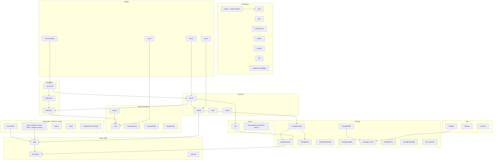

</details>

Dependency direction rules actually enforced by the import graph:

* `driver` imports `embed`, `transaction`, `sql`, `dag`, `document`, `schema`, `codec` but **not**
  `server` (verified by import grep), so `database/sql` users do not link the network stack. That is why
  `embed.CommitGroup` takes the `GroupParticipant` interface and two independent participants exist:
  `server.serverParticipant` (a write gate) and `driver.driverParticipant` ("a namespace mutex where
  the server has a write gate", `driver/commit.go`).
* `peersync` never imports `server`. It reaches the local node through two small interfaces it
  defines itself (`peersync.LocalNode`, `peersync.NamespaceProvider`); `server` implements them
  (`serverLocalNode`, `peerNamespaceProvider`, both in `server/peersync_ingest.go`).
* `compaction`, `tier` and `query/hybrid` have **no non-test importer** inside `go/` (verified by
  import grep). They are complete, tested ports of the Kotlin modules that the Go server does not
  wire in: Go's compaction is `embed.Maintain`/`checkpointAndTruncate`, Go's history tiering is
  `storage.HistoryMode` + `ReclaimMode`, and Go's SQL path calls `sql.Engine` directly.

### 1.2 Object graph of one running namespace (file-backed, server mode)

The following is what `embed.Host.openNamespace` (`embed/file.go`) actually builds, then
`server.NewKdbServerRuntime` wraps.


<details><summary>Mermaid source</summary>

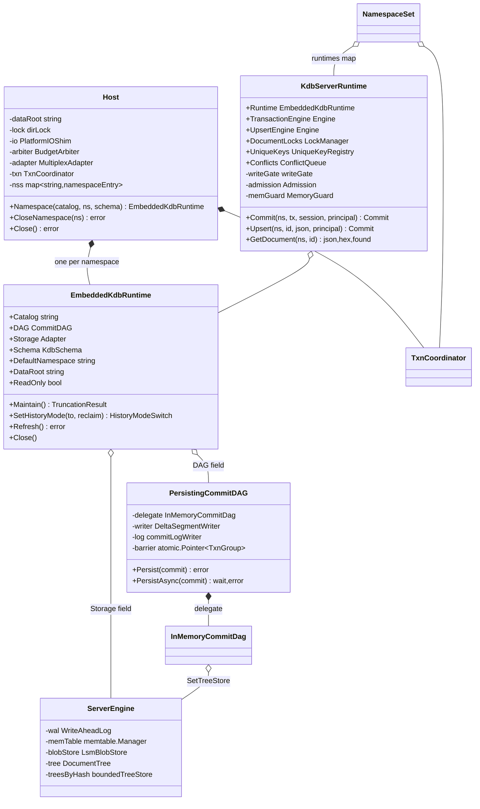

</details>

Two facts that are easy to miss:

1. `EmbeddedKdbRuntime.DAG` is typed `dag.CommitDAG` (the narrow interface) but nearly all of the
   server needs the concrete `*dag.InMemoryCommitDag`; `NewKdbServerRuntime` type-switches on
   `rt.DAG` (`*dag.InMemoryCommitDag` for memory mode, `*embed.PersistingCommitDAG` for file mode,
   unwrapping via `Delegate()`). Any new DAG wrapper must be added to that switch.
2. The `ServerEngine` doubles as the DAG's `DocumentTreeStore` (`d.SetTreeStore(eng)`), so trees
   exist in one place only; the DAG's own `trees` map is empty in an assembled engine.

### 1.3 Write path (one client transaction)

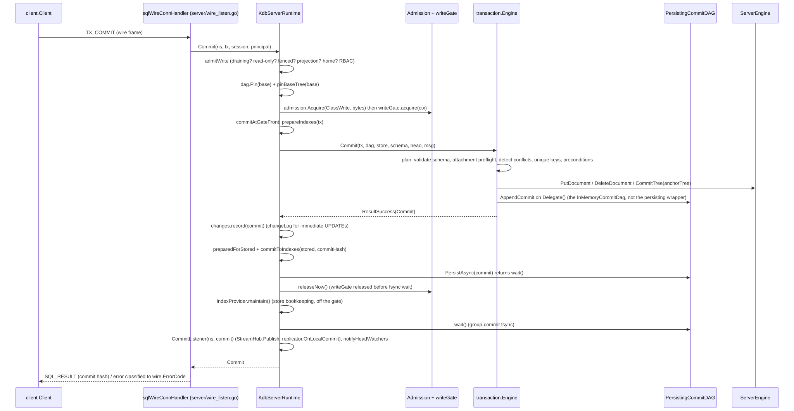

<details><summary>Mermaid source</summary>

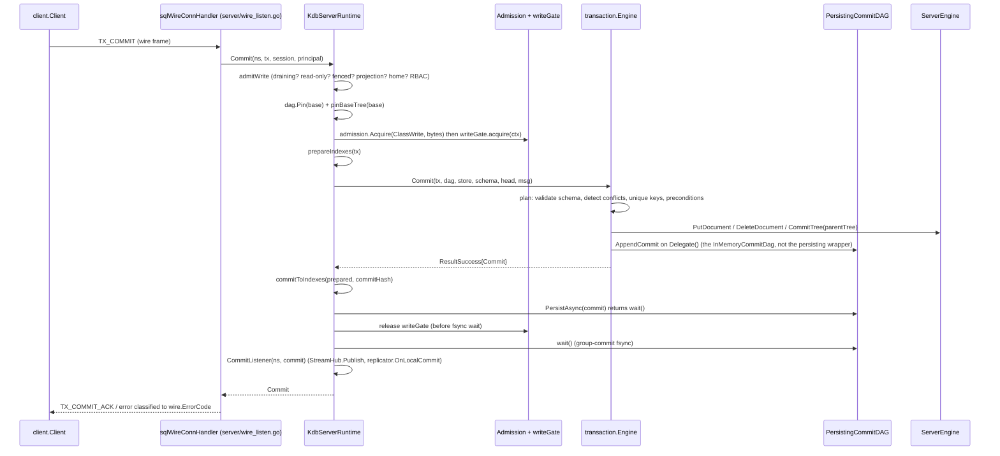

</details>

Notes: the `writeGate` serialises *commit planning and DAG append* (capacity-1 channel, bounded
queue, EWMA of service time used for `RetryAfterMs`), but the durable-fsync wait happens **after**
the gate is released (`releaseNow()` before `waitDurable()`), so concurrent writers share one
group-commit flush (`commitLogWriter` batches `logRequest`s on a channel). On any non-success
`TransactionResult` the runtime converts it to a typed error (`ConflictError`, `SchemaError`, or the
`ResultAborted.Cause`).

### 1.4 Read path (point read)

`KdbServerRuntime.GetDocument(ns, id)` -> resolve head with one atomic pointer load
(`InMemoryCommitDag.head atomic.Pointer[headSnapshot]`, no lock) -> `Commit.DocumentTreeHash` ->
`storage.Adapter.GetDocument(ns, id, atCommit)` -> `ServerEngine` looks up the tree
(`latestTree` atomic snapshot or `treesByHash` bounded LRU) for `docID -> contentHash`, then the
document body in the sharded by-hash cache, falling back to the LSM blob store (memtable, then
SSTables) on a cold load (`coldLoads` counter). SQL reads go through `sql.Executor` with
`QueryContext.AtCommit` set from the session's `ReadConsistency`.

---

## 2. Package reference

Each package entry has: **Purpose**, **Key types** (real names and fields/methods), **Lifecycle**
and, per group, a class diagram.

### 2.1 Foundation

#### 2.1.1 `error` (import alias `kdberr`)

**Purpose.** Stable numeric error codes and the typed error hierarchy shared by every layer; also a
small `Result[T]` type.

**Key types.**

```go
type Code int                       // stable numeric values, see section 4
func (Code) Numeric() int
type Exception interface { error; Code() Code }
type base struct { code Code; msg string; cause error }   // unexported, embedded by pointer
func (*base) Error() string; Unwrap() error; Code() Code
func IsException(err error) bool
func CodeOf(err error) Code
func AsException(err error) (Exception, bool)
```

Concrete exceptions (all embed `*base`; constructors `NewXxx`): `DecodeError{Offset}`,
`EncodeError`, `SchemaError`, `JsonPathError{Path}`, `VersionNotFoundError{NamespaceName,
Reference}`, `IceStorageError{NamespaceName, Hash, ArchiveLocation}`, `ConflictError{Report
ConflictReport}`, `DocumentLockedError{NamespaceName, DocID, Owner}`,
`NamespaceNotFoundError`, `TransportErr`, `UnsupportedProtocolVersionError{PeerVersion,
SupportedVersion}`, `EncodingNegotiationFailureError{LocalEncodings, RemoteEncodings}`,
`ConnectionClosedError{BufferedBytes}`, `SchemaViolationError{Violations []FieldViolation}`,
`SchemaMigrationError{FieldName, Step}`.

Payload structs: `FieldViolation{FieldName, ViolationType, Detail}` (`ViolationType`:
`RequiredFieldMissing`, `TypeMismatch`, `UniqueConstraint`, `EnumValueNotDeclared`,
`CustomConstraint`), `ConflictReport{TransactionID, BaseHash, TargetHash, Conflicts
[]ConflictItem}`, `ConflictItem{DocumentID, OperationType, LocalDoc, IncomingDoc,
ActualContentHash}`, `ConflictOperationType` (`ConcurrentWrite`, `WriteDelete`, `DeleteWrite`,
`SchemaIncompatible`, `PreconditionFailed`; has JSON marshalling).

`Result[T]`: `Ok[T](v)`, `Fail[T](e Exception)`, `Run[T](fn func() (T, error))`, methods
`IsSuccess/IsFailure/Value/Exception/MustValue`. Used by `schema.Validate` and
`schema.ApplyMigration`; almost nothing else.

**Lifecycle.** Immutable values; no state.

#### 2.1.2 `codec` and `codec/schema`

**Purpose.** The deterministic binary encoding used for commits, documents, trees and wire
payloads, plus the identity primitives. `codec/schema` is the codec's own type system (not the
user-facing `schema` package).

```go
// primitives
type UUID struct{ MSB, LSB int64 };  func RandomUUID() (UUID, error); func ParseUUID(string)
type Hash struct{ Bytes [32]byte };  func HashFromHex(string) (Hash, error); (Hash).Hex() string
type Timestamp struct{ EpochMillis int64; MicroRemainder int }; func TimestampNow() Timestamp
func DerivedUUID(s string) UUID                                  // name-based, deterministic

// dynamic value tree (sealed interface, isValue())
type Value interface{ isValue() }
// NullValue BoolValue Int32Value Int64Value Float64Value StringValue BytesValue ArrayValue
// MapValue{[]MapEntry} RecordValue{Fields map[int]Value} EnumValue UnionValue FixedValue
// DateValue TimestampValue UUIDValue
func EncodeBytes(v Value, typ schema.Type, reg *schema.Registry) ([]byte, error)
func DecodeBytes(b []byte, typ schema.Type, reg *schema.Registry) (Value, error)
func DecodeFrom(r io.Reader, typ schema.Type, reg *schema.Registry) (Value, error)
```

`codec/schema`: sealed `Type` (`Primitive{Physical PhysicalKind; Logical LogicalAnnotation}`,
`Ref{FullyQualifiedName}`, `Nullable`, `Array`, `Map`, `Union`), named schemas (`RecordSchema`
with numbered `FieldSchema{ID,Name,Type,Default}`, `EnumSchema`, `FixedSchema`) and
`Registry` (`RegisterRecord/Enum/Fixed`, `Freeze`, `Resolve`). Fields are encoded by numeric id,
which is what makes the format evolvable. `BuiltinRegistry()` is the base; `document.WireRegistry()`
and `wire`'s registry extend it.

**Lifecycle.** A `Registry` is built once at init, frozen, then read concurrently.

#### 2.1.3 `json`

**Purpose.** KDB's own JSON value tree, path language, merge-patch and three-way field diff
(used for document merge and for conflict resolution; it is *not* `encoding/json`).

```go
type Value interface{ isJSONValue() }   // StringValue NumberValue IntValue BoolValue NullValue
                                        // ObjectValue{Keys []string; Fields map[string]Value} ArrayValue
type Path struct{ Expression string }; func CompilePath(expr string) (*Path, error)
func Get/GetAll/Set/Delete/Merge/Contains/Keys/TypeName/ArrayLength(jsonText string, ...) ...
func DiffConflict(base, local, remote Value) []FieldChange   // Kind: ChangeLocal|Remote|Both|Same
func FromKdbValue(codec.Value) (Value, error); func ToKdbValue(Value) (codec.Value, error)
func CanonicalText(v Value) string                           // key-order-stable text used for hashing
```

`ObjectValue` keeps key order (`Keys`) so round-trips preserve author order while `CanonicalText`
sorts for hashing. `CompilePath` results are memoised in a process-wide map guarded by `pathCacheMu sync.Mutex`.

#### 2.1.4 Small foundation packages

| Package | Contents | Notes |
|---|---|---|
| `compression` | `Compress(input, level)`, `Decompress(input, maxOut)` (zstd), `CRC32`, `CRC32All` | Pooled encoders/decoders (`sync.Pool`, `sync.Once`). |
| `metrics` | `Recorder` (`Record`, `Track`, `Snapshot() []StageSnapshot`), stage names `StageLockWait`, `StageFsyncWait`, `StageTreeRebuild` | One `sync.Mutex`; consumed by `embed/commit_log.go`, `storage/engine`, `server/admin.go`, `control/ops_dashboard.go`. |
| `version` | `Info{Version, Commit, BuildDate, Dirty, GoVersion, OS, Arch}`, `Get()` | Build-stamped via `-ldflags`. |
| `file` | `Metadata{Name, ContentType, Size, SHA256}`, `Ingest(name, ct, r) (Metadata, []byte, error)` | 30 lines. Go only hashes and describes; the attachment feature lives in Kotlin `kdb-file` (zip/bundle ingest). |
| `compute` | `Adapter{Name(); Dot(ctx, a, b []float32) (float32, error)}`, `CPUAdapter`; `compute/webgpu.Adapter` (build-tagged native and wasm) | Only the dot-product seam exists; not referenced by the vector index. |
| `inspect` | `WireFrameInspector.DumpFrame(frame, pretty)` | Used by `cmd/kdb-inspect`. |
| `tier` | `Manager{OnTransition(func(Signal)); ArchiveCommit(...)}`, `Tier` (`TierHot/Warm/Cold/Ice`) | Stub; unwired. |

### 2.2 Data model: `document`, `schema`, `dag`

#### 2.2.1 `document`

**Purpose.** The immutable value objects of the versioned store: documents, operations,
transactions, commits, the document trie and refs.

```go
type Document struct{ ID codec.UUID; JSON string }
func FromJSON(jsonText string) (Document, error)                // top-level "id": UUID string = identity,
                                                                // other string = codec.DerivedUUID(s), absent = minted
func (Document) ContentHash() (codec.Hash, error); Merge(patchJSON string); WithJSON(string)

type Op interface{ isOp(); toValue() codec.Value }             // sealed
type WriteOp  struct{ DocID codec.UUID; Patch string }          // Patch is a full body or merge patch
type DeleteOp struct{ DocID codec.UUID }
type FileWriteOp struct{ Path string; BlobHash codec.Hash }
type SchemaMigrationOp struct{ MigrationID codec.UUID; MigrationPayload string }

type Transaction struct {
  ID codec.UUID; BaseVersion codec.Hash; Operations []Op; Timestamp codec.Timestamp
  AuthorNodeID codec.UUID; ResultVersion *codec.Hash; Preconditions []Precondition }
type Precondition struct{ OpIndex int; Kind PreconditionKind; ContentHash codec.Hash }
// PreconditionKind: ExpectAny | ExpectAbsent | ExpectPresent | ExpectContentHash   (compare-and-set)

type Commit struct {
  Hash codec.Hash; ParentHashes []codec.Hash; NamespaceID string; TransactionID codec.UUID
  Timestamp codec.Timestamp; AuthorNodeID codec.UUID; Operations []Op
  DocumentTreeHash codec.Hash; SchemaHash *codec.Hash; Message string }
func BuildCommit(parents, ns, txID, ts, author, ops, treeHash, schemaHash, msg) (Commit, error)
func ComputeCommitHash(c Commit) (codec.Hash, error)
func FromPayloadBytes([]byte) (Commit, error);  (*Commit).ToPayloadBytes() ([]byte, error)

type DocumentTree struct{ TreeHash codec.Hash; Entries map[codec.UUID]codec.Hash } // persistent trie
func (DocumentTree) With(docID, contentHash) (DocumentTree, error); Without(docID) (DocumentTree, error)
func (DocumentTree) Node(prefix string, entryLimit int) (TreeNode, error)   // 16-ary Merkle node
func (DocumentTree) Proof(id codec.UUID) TreeProof; func VerifyTreeProof(root, p) (Hash, bool, error)
func DiffTrees(local, remote NodeSource) ([]TreeDifference, error)           // Merkle diff, used by repair
type Branch struct{ Name, NamespaceID string; HeadHash codec.Hash; CreatedAt, UpdatedAt codec.Timestamp }
type Tag struct{ Name, NamespaceID string; CommitHash codec.Hash; CreatedAt codec.Timestamp; Message string }
type CommitStub struct{ OriginalHash codec.Hash; ArchiveLocation string; StubbedAt codec.Timestamp }
```

Key design points:

* `Commit.Hash` is the hash of the payload bytes, so a commit is self-verifying; parents form the
  Merkle DAG. A **merge commit has two parents**; `Operations` on a commit are *not* invertible
  (no pre-images), so history cannot be folded backward.
* `DocumentTree` is value-typed and **persistent**: `With`/`Without` return a new tree sharing
  structure (the live tree costs ~5 KB per document in memory regardless of document size). The
  `Entries` is nil for any tree produced by `With`/`Without` (those are trie-backed and tracked
  incrementally); it is populated only for trees built from a flat map (`BuildDocumentTree`).
  Always go through `Size/Contains/HashFor/Walk/MaterializedEntries`, never read `Entries` directly.
* `TreeNode`/`TreeProof` give a 16-ary Merkle view over the same trie, which is what peer-sync
  repair (`peersync.RepairSession`) uses to find divergent documents without shipping the tree.
* `document.WireRegistry()` registers the codec record schemas for all of the above.

#### 2.2.2 `schema`

**Purpose.** User-facing document schemas (field types, required/indexed/unique), versioned
migrations, validation.

```go
type KdbSchema struct {
  SchemaHash codec.Hash; Fields []Field; Version int; CreatedAt codec.Timestamp
  Description string; UniqueConstraints []UniqueConstraint }
type Field struct{ Name string; Type FieldType; Required, Indexed, Unique bool }
type FieldType interface{ isFieldType(); SQLTypeName() string; CodecTypeLabel() string }
// StringType Int32Type Int64Type Float64Type BoolType TimestampType UUIDType ObjectType ArrayType EnumType{Values}
func None() KdbSchema                      // "no schema"; (KdbSchema).IsNone()
func Build(fields, version, createdAt, desc) (KdbSchema, error)
func Validate(doc document.Document, sch KdbSchema) kdberr.Result[document.Document]
func ApplyMigration(current KdbSchema, m SchemaMigration) kdberr.Result[KdbSchema]
func DiffSchemas(from, to KdbSchema) Diff;  func IsBackwardCompatible(current, m) bool

type SchemaMigration struct{ MigrationID codec.UUID; FromVersion, ToVersion int; Steps []MigrationStep; Description string }
type MigrationStep interface{ isMigrationStep() }   // sealed: AddFieldStep DropFieldStep RenameFieldStep
// ChangeTypeStep AddIndexStep DropIndexStep SetRequiredStep SetUniqueStep WidenEnumStep NarrowEnumStep
func Migrate(base KdbSchema, fn func(*MigrationBuilder)) (SchemaMigration, error)
```

A schema is itself content-addressed (`SchemaHash`); commits point at it via `Commit.SchemaHash`,
and a `SchemaMigrationOp` inside a transaction is how a schema change enters history.
`schema.FieldType.SQLTypeName()` feeds `sql.ColumnDefinition`; `index.InferIndexType(ft)` and
`index.DescriptorsFromSchema` derive index descriptors from `Indexed`/`Unique` fields.

#### 2.2.3 `dag`

**Purpose.** The per-namespace commit graph, branches/tags, traversal, diff, squash, retention
pins and history navigation. One concrete implementation.

```go
type CommitDAG interface {                // narrow port used by runtime wrappers
  GetCommit(hash) (document.Commit, bool);  GetCommitOrThrow(hash) (document.Commit, error)
  PutCommit(commit document.Commit, requireParents bool) error
  GetDocumentTree(h) (document.DocumentTree, bool); GetDocumentTreeOrThrow(h) (...)
  PutDocumentTree(tree document.DocumentTree)
  AppendCommit(tx document.Transaction, parent codec.Hash, newTree document.DocumentTree,
               schemaHash *codec.Hash, message string) (document.Commit, error)
  Head() (codec.Hash, error); HeadCommit() (codec.Hash, document.Commit, bool, error)
  SetHead(branch string, hash codec.Hash) error
  GetBranch(name) (document.Branch, bool); ListBranches() []document.Branch
  CreateBranch(name string, from codec.Hash) (document.Branch, error)
  Walk(from codec.Hash, until *codec.Hash, limit int) []TraversalEntry }

type HistoryNavigator interface {         // ref/revision resolution, tags, listing
  ResolveRef(CommitRef) (codec.Hash, error); ResolveRevision(spec string) (codec.Hash, error)
  NthAncestor(from, n) ; CommitAtOrBefore(from, ts) ; ListCommits(from, skip, limit) ([]CommitInfo, error)
  CreateTag/GetTag/ListTags/DeleteTag ... }

type DocumentTreeStore interface{ GetTree(hash) (document.DocumentTree, bool); PutTree(tree) }
type CommitOperationsLoader func(hash codec.Hash) ([]document.Op, error)
type InMemoryCommitDag struct{ NamespaceID string; /* unexported: nodes, stubs, shallow, branches, tags,
   txIndex, pins, treeIndex, ancestryVersion, head atomic.Pointer[headSnapshot], mu sync.RWMutex ... */ }
```

`InMemoryCommitDag` is the only implementation of `CommitDAG` besides the decorator
`embed.PersistingCommitDAG`. Its extra (non-interface) surface is what the rest of the code
actually depends on, grouped by file:

| File | Capability | Representative methods |
|---|---|---|
| `in_memory_commit_dag.go` | storage of commits/stubs/shallow roots/trees/branches | `StubCommit`, `PutShallowCommit`, `MarkShallow`, `Unshallow`, `Horizon`, `CommitForTree`, `Squash`, `AppendCommitDetached`, `SetTreeStore` |
| `ancestry.go` | graph algorithms | `IsAncestor`, `CommonAncestor`, `CommitsSince`, `AncestorSet`, `AppendMergeCommit`, `AppendMergeCommitOnto(expectedHead, ...)` |
| `generations.go`, `graph_settings.go` | generation numbers for pruned ancestry, optional on-disk graph file | `GraphSettings{AncestryPruning, FileEnabled, RebuildCommits, AnchorInterval}` |
| `ops_retention.go` | bounded resident operations | `SetOperationsLoader(loader, budgetBytes)`, `CommitOperations(hash)`, `WalkWithOperations` |
| `retention.go` | reader pins | `Pin(hash) (release func())`, `IsPinned`, `PinnedCount` |
| `provisional.go` | provisional commits (peer-sync hold) | `AppendCommitWith(..., AppendOptions{Detached, Provisional})`, `SettleProvisional` |
| `checkpoint.go` | snapshot/restore for fast open | `CheckpointSnapshot[Retaining]`, `RestoreCheckpoint`, `RestoreCommitOperations`, `HydrateBranchHeads` |
| `history_nav.go` | `HistoryNavigator` impl | `ResolveRevision`, `CreateTag`, ... ; `ParseRevision(spec)` |
| `types.go` | value types | `TraversalEntry` (sealed: `FullEntry`, `StubbedEntry`), `CommitDiff` + `DiffEntry` (sealed: `DiffAdded/Removed/Modified`), `CommitRef` (sealed: `RefByHash/Branch/Tag/Time`) |

**Ownership and lifecycle.** One `InMemoryCommitDag` per namespace, created in
`Host.openNamespace`, populated by `restoreNamespace` (checkpoint load then delta-log replay),
then wrapped by `PersistingCommitDAG`. Its concurrency design is unusual and load-bearing: reads
resolve the head through `head atomic.Pointer[headSnapshot]` padded off the `mu sync.RWMutex` cache
line, and **every mutator must call `publishHeadLocked` before unlocking**.

Errors (`dag/errors.go`): `ConsistencyError`, `BranchNotFoundError`, `TagNotFoundError`,
`CompactionSafetyError`, `HeadConflictError{Namespace, Branch, Expected, Actual}` (the
compare-and-swap failure of `AppendMergeCommitOnto`), `RevisionNotFoundError`. These implement
`Code()` directly rather than embedding `kdberr.base`.


<details><summary>Mermaid source</summary>

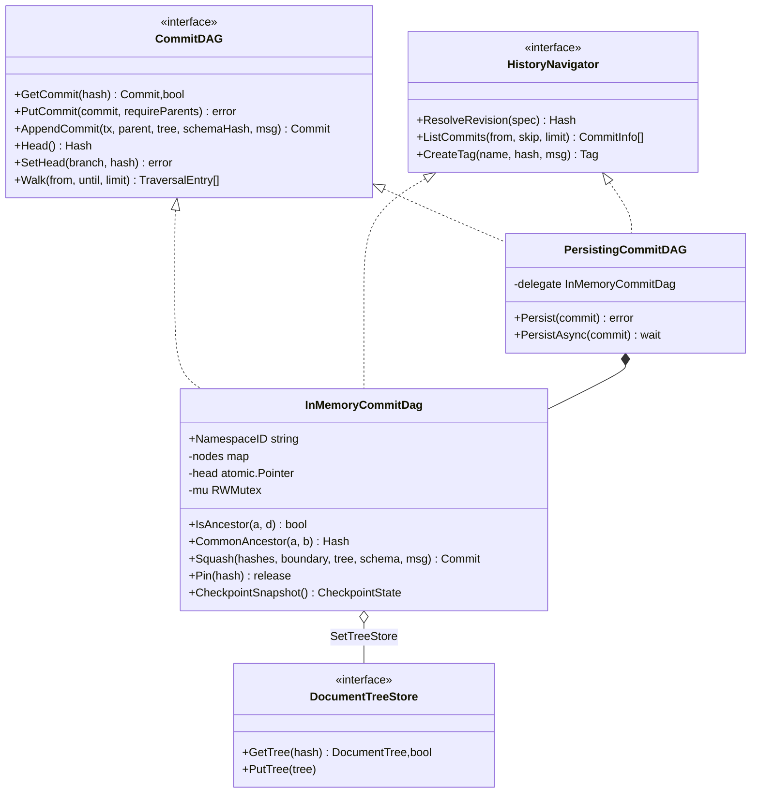

</details>

### 2.3 Write path, indexing, policy: `transaction`, `index/*`, `policy`, `script`, `compaction`

#### 2.3.1 `transaction`

**Purpose.** Turns a `document.Transaction` into a commit: schema validation, optimistic conflict
detection against the target head, unique-key enforcement, compare-and-set preconditions, merge
commits, replay of remote transactions, and document-level leases.

```go
type Engine interface {
  ConflictPolicy() ConflictPolicy
  CustomResolver() ConflictResolver
  Commit(tx document.Transaction, d *dag.InMemoryCommitDag, store storage.Adapter, sch schema.KdbSchema,
         targetHead *codec.Hash, message string) (TransactionResult, error)
  Replay(tx document.Transaction, d *dag.InMemoryCommitDag, store storage.Adapter, sch schema.KdbSchema,
         replayTarget codec.Hash, message string) (TransactionResult, error)
  Merge(primaryHead, mergedHead codec.Hash, d *dag.InMemoryCommitDag, store storage.Adapter,
        sch schema.KdbSchema, message string) (TransactionResult, error)
  Validate(tx document.Transaction, d *dag.InMemoryCommitDag, store storage.Adapter,
           sch schema.KdbSchema) ([]OperationViolation, error)
}
func NewEngine(policy ConflictPolicy, resolver ConflictResolver) Engine
func NewEngineWithOptions(policy ConflictPolicy, resolver ConflictResolver, opts EngineOptions) Engine
type EngineOptions struct{ UniqueKeys *UniqueKeyRegistry; Preconditions bool }

type Preparer interface {  // optional split of Commit into check phase and write phase
  PrepareCommit(tx, d, store, sch) (*PreparedCommit, TransactionResult, error) }
type PreparedCommit struct{ /* unexported */ }   // Namespace() Anchor() Apply(ApplyOptions{Message,Provisional}) Discard()

type ConflictPolicy int   // ConflictPolicyAppendOnly | LastWrite | Strict | Custom
type ConflictResolver interface{ Resolve(c DocumentConflict) (*document.Document, error) }
type TransactionResult interface{ isTransactionResult() }  // sealed sum type
// ResultSuccess{Commit, NewTreeHash} | ResultConflict{Report, ConflictingOps}
// | ResultSchemaError{Violations []OperationViolation} | ResultAborted{Cause error}
```

The single implementation is the unexported `defaultEngine` (`default_engine.go`, `prepare.go`).
`Commit` is literally `PrepareCommit` followed by `Apply`. `Preparer` is deliberately an *optional*
interface (callers do `engine.(transaction.Preparer)`), so wrapping engines elsewhere keep compiling;
it exists so a cross-namespace transaction can check every participant before writing any.

How the engines are instantiated by `server.NewKdbServerRuntime`:

* `TransactionEngine = NewEngineWithOptions(ConflictPolicyStrict, nil, {UniqueKeys, Preconditions:true})`
  used for client transactions (stale base -> `ResultConflict`).
* `UpsertEngine = NewEngineWithOptions(ConflictPolicyLastWrite, ...)` used by `Upsert`/`PutJSON`.
* Peer-sync merges use `ResolutionOptions.Policy` (`KdbServerRuntime.PeerSyncConflictPolicy`) and
  `ResolutionChain`, not these engines.

Supporting types:

| Type | Role |
|---|---|
| `Builder{NamespaceID, BaseVersion, AuthorNodeID, Schema}` | Fluent transaction assembler: `Write`, `WriteDocument`, `Delete`, `FileWrite`, `SchemaMigration`, `Build()`. `NewBuilder(ns, dag, author, schema)` pins `BaseVersion` to the current head. A session holds one (`KdbSession.Pending`). |
| `UniqueKeyRegistry` | In-memory map `UniqueKey{NamespaceID, Fields, Value} -> owner DocID`; `Apply`, `Owner`, `Rebuild`, `RebuildLenient`, `Reset`. Rebuilt from head on open (`KdbServerRuntime.RebuildUniqueKeys`; failure is parked in `UniqueKeyRebuildError`). `UniqueKeysFor(ns, sch, doc)` computes the keys; violation type `UniqueConstraintError`. |
| `LockManager` | Two lock families behind one mutex: transaction-scoped locks (`TryAcquire`, `AcquireAllForTransaction`, `ReleaseAll`, `AssertHeld`, `AssertUnheldByOthers`) and expiring **leases** with monotonically increasing fence tokens (`TryAcquireLease`, `Renew`, `ReleaseLeases`, `ValidateFences`, `Sweep`, `Held`). `Lease{NamespaceID, DocID, SessionID, Fence, ExpiresAt, GrantedNow}`. Clock is injectable (`NewLockManagerWithClock`). |
| `DocumentConflict`, `ConflictOrigin{NodeID, Commit, TimestampMicros}` | Input to a `ConflictResolver`; origin metadata is JSON-marshalled for conflict records. |
| `OperationConflict`, `OperationViolation` | Per-op detail inside `ResultConflict` / `ResultSchemaError`. |
| `EncodeMigration/DecodeMigration` | Schema migration <-> `SchemaMigrationOp.MigrationPayload`. |
| `BaseNotFoundError`, `MergeBaseNotFoundError` | Embed `*kdberr.VersionNotFoundError`. |

**Concurrency.** `defaultEngine` is stateless apart from the injected `UniqueKeys` registry; callers
must serialise `Commit` per namespace (the server does with `writeGate`, the driver with
`namespace.write sync.Mutex`). `LockManager` and `UniqueKeyRegistry` have their own mutexes.
`transaction` starts no goroutines; its only primitives are the three `sync.Mutex`es in `LockManager`, `UniqueKeyRegistry` and the migration cache.


<details><summary>Mermaid source</summary>

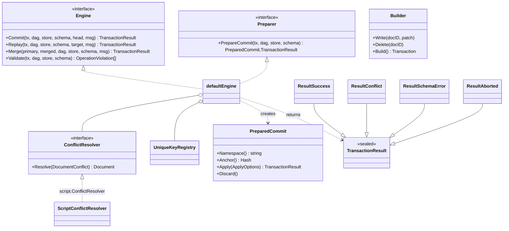

</details>

#### 2.3.2 `index` and sub-packages

**Purpose.** Secondary indexes that are *versioned*: every lookup can be answered "as of commit X".
Four index types, one store port, one per-namespace registry that fans a commit out to all stores.

```go
type IndexType int  // IndexTypeHash | BTree | FullText | Vector
type Descriptor struct { IndexID codec.UUID; NamespaceID, FieldName string; Fields []string; Type IndexType
  Unique bool; SchemaVersion int; CreatedAtHash codec.Hash; Options map[string]string }
type Key interface{ isKey() }   // NullKey BoolKey Int32Key Int64Key Float64Key TimestampKey StringKey UUIDKey VectorKey CompositeKey
type Store interface {
  Descriptor() Descriptor
  Put(entry Entry) error;  Delete(docID codec.UUID, atCommit codec.Hash) error;  BulkLoad([]Entry) error
  Lookup(key Key, atCommit *codec.Hash) ([]codec.UUID, error)
  Range(from, to Key, atCommit *codec.Hash, limit int, ascending bool) ([]codec.UUID, error)
  Search(query string, atCommit *codec.Hash, limit int) ([]RankedResult, error)          // full-text
  NearestNeighbours(q []float32, k int, atCommit *codec.Hash) ([]RankedResult, error)    // vector
  Rebuild([]Entry) error;  Clear() error;  IsValid(atCommit codec.Hash) (bool, error)
  Snapshot() ([]byte, error);  RestoreSnapshot([]byte) error }
type DocumentStore interface { Store
  PrepareDocument(docID codec.UUID, jsonText string) (PreparedPut, error)   // validate, no mutation
  PutDocument(docID codec.UUID, commitHash codec.Hash, jsonText string) error }
type PreparedPut interface{ Apply(commitHash codec.Hash) (Hint, error) }
type StoreFactory interface{ Create(descriptor Descriptor) (Store, error) }
```

Implementations:

| Type | Package | Index types | Notes |
|---|---|---|---|
| `MemoryStore` | `index` | Hash, BTree | One implementation for both: bucket map + sort-on-range. Built on `VersionedEngine` (chronological replay: entries carry `CommitHash`; visibility at `atCommit` is `dag.IsAncestor`, memoised on `InMemoryCommitDag.AncestryVersion()`). |
| `fulltext.Store` | `index/fulltext` | FullText | BM25 (`K1`, `B`), `analyzer.Analyze` (tokeniser + Porter stemmer + stopwords), phrase queries via `ParseQuery`, `SaveToDir/LoadFromDir`, `Stats`. |
| `vector.Store` | `index/vector` | Vector | HNSW (`DefaultM`, `DefaultEfConstruction`, `DefaultEfSearch`) with exact fallback below `Options.ExactThreshold`; metrics `Cosine`, `L2`, `InnerProduct`. |
| `stores.NewFactory(d, Options)` | `index/stores` | all | `StoreFactory` that switches on `Descriptor.Type`; `stores.Open(dir, ns, d, opts)` = `index.LoadRegistry` + factory. |
| `fusion.Fuse(arms, mode, limit)` | `index/fusion` | n/a | Reciprocal-rank-fusion (`ModeRRF`, `DefaultRRFK`) or weighted sum over `Arm{Results, Weight, Depth, MinScore}`. Used by the hybrid search in `server/search.go`. |

`Registry` (`index/registry.go`) is the fan-out hub: `entries []*registryEntry` guarded by
`mu sync.RWMutex`; `Add/Remove/Descriptors/ByName/ByField/Resolve/ByID`, two-phase writes
`PrepareWrite(docID, json) (*PreparedWrite, error)` / `PrepareDelete` -> `ApplyWrite/ApplyDelete`
(`(*PreparedWrite).Commit(hash)` returns `[]Hint` for replication), `ApplyHints` (replicated hints
from peers, unknown indexes ignored), `MarkCommit(hash)`, `RebuildFromScan(ScanFunc)`, `SaveAll`.
Persistence: `Catalog` (`index-catalog.json`), `Manifest` + snapshot per index (`SaveStoreSnapshot`,
`LoadStoreSnapshot`), `LoadRegistry(dir, ns, dag, factory)` returns `LoadReport{Fresh, Stale}`.
`DescriptorsFromSchema(ns, sch)` + `DerivedIndexID(ns, field, type)` give deterministic ids for
schema-declared indexes.

Index errors embed kdberr bases: `NotFoundError` and `TypeMismatchError` embed `*kdberr.SchemaError`;
`UniqueViolationError` and `DimensionMismatchError` embed `*kdberr.SchemaViolationError`.

The SQL layer sees indexes only through `sql.IndexProvider`; the server's adapter is
`server.RegistryIndexProvider` (also implements `sql.IndexDDLExecutor` for `CREATE/DROP INDEX`).


<details><summary>Mermaid source</summary>

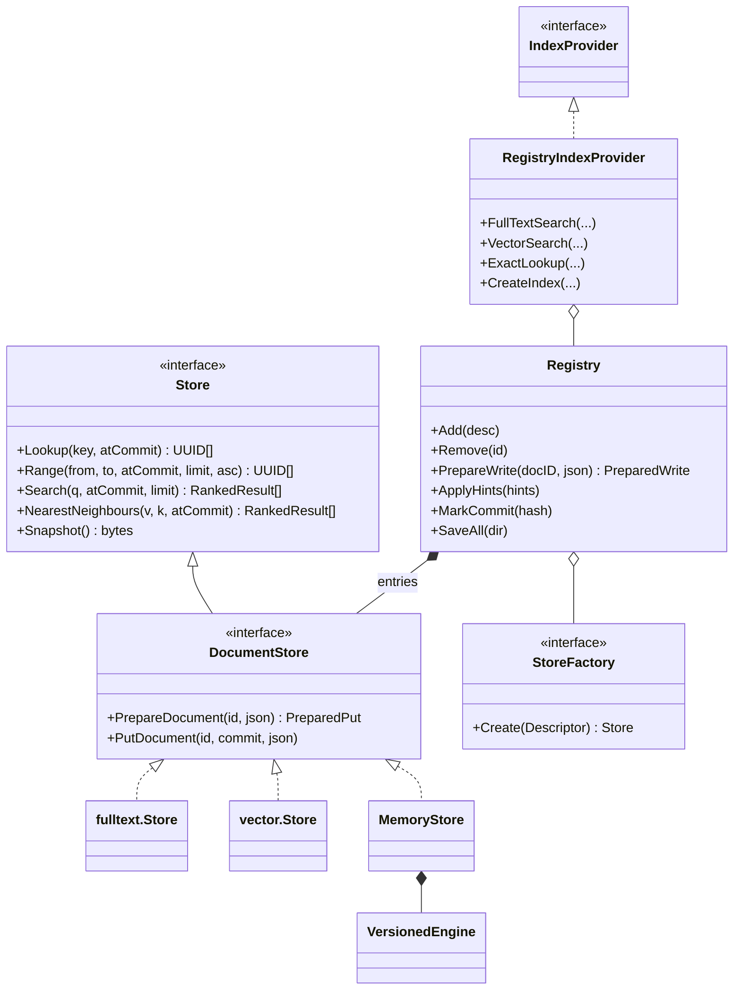

</details>

Note: `MemoryStore` and the two document stores assert `index.DocumentStore` only for fulltext and
vector (`var _ index.DocumentStore = (*Store)(nil)`); `MemoryStore` is accepted by the factory
through the same method set.

#### 2.3.3 `policy`

**Purpose.** Declarative per-namespace policy (mode, history, conflict, compaction, tiers, vector
index parameters, document expiry) with a registry, parser, validator and presets.

```go
type NamespacePolicy struct { NamespaceID string; Schema *schema.KdbSchema; Mode NamespaceMode /*Mutable|AppendOnly*/
  History HistoryMode /*Full|None*/; Retain storage.RetentionWindow; Conflict transaction.ConflictPolicy
  Compaction CompactionPolicy; Tiers TierPolicy; IndexRetentionDefault storage.IndexRetention
  GpuPromotion *GpuPromotionPolicyRef; VectorIndex VectorIndexPolicy; DocumentExpiry *DocumentExpiryPolicy; Revision ... }
type Registry interface { Get(ns) (NamespacePolicy, error); GetOrNull(ns) (*NamespacePolicy, error)
  Put(NamespacePolicy) error; Delete(ns) (bool, error); List() ([]string, error) }
// InMemoryRegistry, StorageBackedRegistry(storage.Adapter, delegate Registry)
type Parser interface { Parse(source string) (NamespacePolicy, error); ParseJSON(json string, sch *schema.KdbSchema) (NamespacePolicy, error) }
type Validator interface{ Validate(NamespacePolicy) ValidationResult }
type Evaluator interface { BoundaryCandidates(policy CompactionPolicy, commitTimestamps map[Hash]Timestamp,
  tagged, branchHeads map[Hash]struct{}, head Hash, parentOf func(Hash) *Hash) []BoundaryPlan }   // impl: defaultEvaluator
func DefaultMutable(ns, sch) NamespacePolicy; AppendOnlyEvents(ns, sch); ScratchDocument(ns); CacheNoHistory(ns)
```

In the Go server the only live consumer is **document expiry** (`server/expiry.go` reads
`DocumentExpiryPolicy`; settable per runtime via `SetDocumentExpiry`) and the settings plumbing in
`service`. History retention in Go is driven by `storage.HistoryMode` / `storage.RetentionWindow`
(section 2.4), not by `policy.HistoryMode`. The two enums share names (`HistoryModeFull`,
`HistoryModeNone`) with different numeric meaning (`policy.HistoryMode.StorageMode()` converts);
do not confuse them.

#### 2.3.4 `script`

**Purpose.** Sandboxed JavaScript (goja) for **stored conflict-resolution procedures**.

```go
type Runtime struct{ /* goja, limits, compile cache */ }
func New(limits Limits) *Runtime
func (*Runtime) Compile(source string) error
func (*Runtime) Call(ctx context.Context, source string, mode Mode, host Host, argsJSON string) (Result, error)
func (*Runtime) ResolveConflict(...) (Decision, error)
type Mode int      // ModePure (no host calls) | ModeRead (Host.Get / Host.Query allowed)
type Host interface { Get(docID string) (string, error); Query(sql string, params []any) (string, error) }
type Limits struct{ WallClock time.Duration; MaxOutputBytes, MaxLogBytes, MaxHostCalls int }
type Decision struct{ Kind DecisionKind; Side int; Doc string } // DecideDefer|Take|Doc|Fork|Delete
type ConflictResolver struct{ Runtime *Runtime; Source string; Mode Mode; Host Host; Context context.Context }
func SourceHash(source string) string   // procedures are addressed by hash of their source
```

`script.ConflictResolver` implements `transaction.ConflictResolver` (the one explicit
`var _ transaction.ConflictResolver = ConflictResolver{}` assertion), so a stored procedure can be
plugged in as a `ConflictPolicyCustom` resolver. Errors are sentinels `ErrCompile`, `ErrTimeout`,
`ErrRuntime`, `ErrOutput`, `ErrDenied`, `ErrNotFound`. The server hosts one shared runtime
(`server.ProcedureRuntime()`), procedure definitions live in the meta namespace, and
`server.ConflictProcedure` is a background loop that applies authority procedures to the
conflict queue. Kotlin has the same idea (`kdb-script`: `ProcedureRuntime`, `GraalProcedureRuntime`)
but a different engine (Graal) and no in-merge parity (Kotlin merges are non-deterministic).

#### 2.3.5 `compaction` (unwired)

```go
type Engine interface { RunCycle(Request) (Result, error); Plan(Request) (Plan, error)
                        UpdatePeerHeads(ns string, heads map[string]codec.Hash) }
type Config struct { NamespaceID string; DAG dag.CommitDAG; Storage storage.Adapter
                     PolicyRegistry policy.Registry; Evaluator policy.Evaluator; Coordinator Coordinator }
type Coordinator interface{ RegisterPeer(namespaceID, peerID string) }   // InProcessCoordinator
type Blocker interface{ blocker() }   // ProtectedTag | ProtectedBranch | PeerBelowBoundary | PolicyDisabled
```

`defaultEngine.UpdatePeerHeads` is an empty method; the package has no non-test importer. The
operative Go compaction path is `EmbeddedKdbRuntime.Maintain()` / `CompactHistory()` ->
`checkpointAndTruncate` (checkpoint, then delete delta segments wholly below checkpoint and
retention window; section 2.4.8), with `dag.Squash` / `StubCommit` as DAG primitives.

### 2.4 Storage

Storage is a stack of small ports. From the bottom: `PlatformIOShim` (bytes in named segments) ->
WAL / delta log / SSTables (formats) -> `ServerEngine` (the composed per-namespace adapter) ->
`MultiplexAdapter` (routes by namespace id) -> `Adapter` as seen by transaction/sql.

#### 2.4.1 `storage` (ports and config)

```go
type Adapter interface {                                   // THE storage port (per namespace id)
  Capabilities() CapabilitySet
  GetDocument(ns string, docID codec.UUID, atCommit codec.Hash) (*document.Document, error)
  GetDocumentOrThrow(...) (document.Document, error);  GetDocuments(ns, ids, atCommit) ([]*document.Document, error)
  ScanDocuments(ns string, atCommit codec.Hash, batchSize int, onBatch func([]document.Document) error) error
  PutDocument(ns string, doc document.Document) error;  DeleteDocument(ns string, docID codec.UUID) error
  DiscardPending(ns string) error                          // abandon staged put/delete
  CommitTree(ns string, parentTreeHash codec.Hash) (document.DocumentTree, error)   // fold staged ops into a tree
  Flush(ns string) error;  ReadBlob(h codec.Hash) ([]byte, error);  WriteBlob(b []byte) (codec.Hash, error)
  IngestDeltaSegment(segment DeltaSegmentRef) error }
```

Write protocol: `PutDocument/DeleteDocument` *stage*; `CommitTree(parentTree)` produces the new
`DocumentTree` (the caller then appends the commit to the DAG); `DiscardPending` rolls back.

Optional capabilities probed by type assertion (the "optional interface" idiom, used heavily here):
`DamageTolerantReader` (skim/stream past damaged frames, for integrity repair), `TreeResolver`
(`TreeAt(hash)`), `TreeWalker` (`WalkTree`), `TreePinner` (`PinTree/UnpinTree`),
`ForeignTreeStore` (`StoreForeignTree`, for snapshot-installed trees), `EvictableAdapter`
(`EvictDocuments/EvictIndex/RebuildDocuments/RebuildIndex/EvictionState`), `RealizedStoreHandle`.

Delta log ports (`delta_types.go`): `DeltaSegmentWriter{Append(DeltaRecord) (int64, error); Flush(); Seal()
(DeltaSegmentRef, error); IsSealed(); CurrentSizeBytes(); NamespaceID(); SegmentID()}`,
`DeltaSegmentReader{ReadAll; ReadRange; ListSegments}`, `DeltaCommitStreamer{StreamCommits;
ReadCommitAt}`, `DeltaSegmentSequencer{SequenceNumber()}`. `DeltaRecord{CommitHash, NamespaceID,
Authorship DeltaAuthorshipEnvelope, CommitPayload []byte, DocumentPatches []DocumentPatch}`.

I/O port: `PlatformIOShim` (`AppendToSegment`, `ReadFromSegment`, `FlushSegment`, `SealSegment`,
`ListSegments`, `DeleteSegment`, `AvailableBytes`, `Read/Write/DeleteSnapshot`).

Config/enums (all in `storage`):

| Type | Values / fields |
|---|---|
| `Durability` | `DurabilitySync` (default; ack after fsync), `DurabilityAsync` (ack after in-memory WAL append, background flush), `DurabilityMemoryOnly` |
| `HistoryMode` | `Unset`, `Full` (keep every commit), `None` (current data + `RetentionWindow`) |
| `HistoryStrategy` | `Unset`, `Replay` (rebuild historical trees by replaying the delta log, lazily), `Objects` (persist per-commit tree objects) |
| `ReclaimMode` | `Unset`, `Manual`, `Immediate`, `Balanced` (default), `Lazy`; `ReclaimCadence{Interval, Sweep, RespectLoad, MaxDefer, SealTriggered}` |
| `RetentionWindow` | `{Duration time.Duration; Commits int64}`; `RetainNothing`; `DefaultRetentionDuration` |
| `CompressionCodec` | `CompressionNone`, `CompressionZSTD` |
| `IndexRetention` | `Pinned`, `Evictable` |
| `StorageEngineConfig` | `PageTargetSizeBytes, PageMaxSizeBytes, GlobalMemoryBudgetBytes, HotTierMemory, CompressionCodec, DefaultIndexRetention, IOShim, Durability, AsyncSyncIntervalMillis, WalMaxSegmentBytes, WalSkipCorruptRecords, Reclaim, DeltaMaxSegmentBytes, HistoryStrategy, HistoryMode, Retain, DocumentCacheBytes, CommitOpsBytes, TreeChainLimit, MemtableFlushBytes, HistoryTreeCacheBytes, DisableCheckpoints` |
| `BudgetArbiter` | Divides a host-wide memory pool among registered `BudgetParticipant{DemandBytes(); SetBudgetBytes(int64)}`s on a ticker (`NewBudgetArbiter(total, interval)`, `Register/Reserve/Unregister/Shares/Close`, `DefaultNamespaceFloorBytes`). |

Memory fractions (`memory_budget.go`): `DefaultDocumentCacheFraction`, `DefaultCommitOpsFraction`,
`DefaultMemtableFraction`, `DefaultHistoryTreeFraction` with `Resolved*Bytes(cfg)` helpers.

#### 2.4.2 `storage/engine`

```go
type Engine interface{ storage.EvictableAdapter; NamespaceID() string }
type Handle interface { NamespaceID() string; Adapter() storage.EvictableAdapter
                        DeltaWriter() storage.DeltaSegmentWriter; DeltaReader() storage.DeltaSegmentReader; Close() error }
type Factory interface{ Target() Target; Open(namespaceID string, config storage.StorageEngineConfig) (Handle, error) }
type Target int   // TargetServer | TargetBrowser | TargetInMemory | TargetGPU | TargetReadOnly
type DefaultFactory struct{ EngineTarget Target }
func NewServerEngine(ns string, config storage.StorageEngineConfig, w wal.WriteAheadLog) *ServerEngine
type BrowserEngine ServerEngine;  type InMemoryEngine ServerEngine   // type definitions, not distinct classes
type MultiplexAdapter struct{ ... }   // Register(ns, Adapter) / Unregister / Namespaces; routes every call by ns
```

`ServerEngine` (the real adapter) composes: a `wal.WriteAheadLog` + `wal.GroupCommitter` (blob puts
are logged), `memtable.Manager` -> `sstable.LsmBlobStore` (content-addressed blobs: documents keyed
by content hash), a sharded by-hash document cache (`docsByHash`, `coldLoader` for cache misses), a
sharded pending store (staged ops), the live `tree` (+ `latestTree atomic.Pointer[treeSnapshot]`,
`treeChain` of incremental steps bounded by `TreeChainLimit`) and a `boundedTreeStore` LRU of
historical trees with a `treeRebuilder` (strategy `Replay`) or recorded locations
(`RecordCommitLocation`, strategy `Objects`). Live knobs read at maintenance time (`retainLive`,
`reclaimLive`, `modeLive`, `strategyLive` under `retainMu`) let `SetHistoryMode` switch without a
reopen. It is also a `storage.BudgetParticipant` (`MemoryDemandBytes`, `SetMemoryBudgetBytes`), a
`DocumentTreeStore` (`GetTree/PutTree`), `TreeResolver`, `TreePinner`, `ForeignTreeStore`.

`DefaultFactory.Open` builds the WAL, SSTable blob store and delta writer/reader (via
`delta.Factory`) from the config's `IOShim`, returning a `Handle`. In file mode the `Host`
calls it once per namespace with `EngineTarget` `TargetServer` or `TargetReadOnly`.

#### 2.4.3 `storage/wal`

```go
type WriteAheadLog interface { WalID() codec.UUID; PartitionKey() string; LastSequence() int64
  ActiveSegmentSizeBytes() int64; Append(Record) (AppendResult, error); AppendBatch([]Record) (AppendResult, error)
  Sync() error; Recover(handler func(Record) error) (RecoverySummary, error); Truncate(through int64) error; Close() error }
type Factory interface { OpenOrCreate(partitionKey string, config storage.StorageEngineConfig, io storage.PlatformIOShim)
  (WriteAheadLog, error); ActiveSegmentName(partitionKey string, walID codec.UUID) string }
type SegmentCatalog interface{ ListSegments(partitionKey string) ([]SegmentInfo, error); DeleteSegment(name string) error }
type Record struct{ Sequence int64; Timestamp codec.Timestamp; Kind RecordKind; Payload []byte }
// RecordKind: PutBlob | DeleteBlob | FlushCheckpoint | Marker
```

`DefaultWriteAheadLog` (one `sync.Mutex`, rotating segments named by
`RotatedSegmentName(partition, walID, firstSequence)`); `GroupCommitter{SyncTo(seq), SyncedSeq()}`
coalesces concurrent `Sync` requests into one fsync (goroutine + `WaitGroup`). `CorruptionError`
carries `Code() = StorageTierError`; `ClosedError`.

#### 2.4.4 `storage/delta`

The **commit log**: the per-namespace append-only sequence of commit frames that is the source of
truth (everything else is rebuildable from it).

```go
type DefaultWriter struct{...}  // storage.DeltaSegmentWriter + DeltaSegmentSequencer; RotateIfNeeded(); Seal()
type DefaultReader struct{...}  // storage.DeltaSegmentReader + DeltaCommitStreamer + DamageTolerantReader
type Factory struct{ Config storage.StorageEngineConfig }; (Factory).OpenWriter/OpenReader
type PageCodec struct{...}      // Frame/Parse: PageFrameHeaderSize, PageFormatVersion; zstd page compression
func ScanSegmentBytes/ScanSegmentFrames/ScanSegmentBounds/ScanSkippingCorrupt/WalkFrames/DecodeFrame(...)
type CorruptFrameError{Offset, Reason};  LegacySegmentFormatError{NamespaceID, Names}
const DefaultDeltaMaxSegmentBytes; func EffectiveMaxSegmentBytes(configured int64) int64
```

Segments are named `DeltaSequencedFileName(seq)` (`storage/io`). Only the newest segment may have a
torn tail; a damaged frame earlier in a segment is a hard error (see `integrity`).

#### 2.4.5 `storage/memtable` and `storage/sstable`

`memtable.Table{Put, Get, Lookup, Delete, SizeBytes}` implemented by `SortedTable`; `memtable.Manager`
(`Put/Get/Delete/Flush/SizeBytes`) flushes to an `sstable.LsmBlobStore` when over
`MemtableFlushBytes`. `sstable`: `Writer{Put, Delete, Finish() (Handle, error)}`,
`Reader{Get, Lookup}`, `DefaultWriter/DefaultReader`, `BlockCache`, `Compact(io, ns, outLevel, inputs,
dropTombstones, keep func(Hash) bool) (Handle, error)` with `ErrNothingToCompact`. `LsmBlobStore`
(`Get/Lookup/Tables/Compact/AddTable/DiscoverTables`) is the multi-level read path; its
`keep` predicate is how unreachable blobs are dropped during compaction.

#### 2.4.6 `storage/io` (+ `s3`)

```go
type SegmentByteStore interface { Append(name string, b []byte) (int64, error); Read(name string, off int64, n int) ([]byte, error)
  Flush(name string, fsync bool) error; MarkSealed(name string) error; List(prefix string) ([]string, error)
  Delete(name string) error; AvailableBytes() (int64, error); Read/Write/DeleteSnapshot(...) }
type ReplicaSink interface { PutSegment(name string, data []byte) error; DeleteSegment(name string) error
  WriteSnapshot(key string, data []byte) error; DeleteSnapshot(key string) error }
type SegmentFetcher interface{ GetSegment(name string) ([]byte, error) }
type HandleReleaser interface{ ReleaseHandles(prefix string) error }
```

Implementations: `OSByteStore` (files; `SyncMode` `SyncModeFull`/`SyncModeFast`, preallocation),
`PrimaryWithReplicas` (**decorator**: a primary `SegmentByteStore` plus `[]RoledSink{Sink, Role:
SinkReplica|SinkArchive}`; `ReplicationPolicy{FailOnReplicaError}`; adds `HasArchive`,
`RestoreSegment`), `FileBackedPlatformIO` (adapts a `SegmentByteStore` to `storage.PlatformIOShim`,
built by `FileBackedPlatformIOFactory.Open`), `InMemoryPlatformIO`. `s3.ReplicaSink` implements
`ReplicaSink` + `SegmentFetcher` over `s3.BlobStore{Put,Get,Delete,List}` (`AWSBlobStore`,
`MemoryBlobStore`, `PrefixedStore`), configured by `s3.Config{Bucket, Region, Prefix, Endpoint,
PathStyle, EnsureBucket}` (`ConfigFromEnv`, `ArchiveConfigFromEnv`). `PlatformIOError` carries
`Code() = StorageTierError`.

#### 2.4.7 `storage/mem` and `storage/manager`

`mem.InMemoryStorageAdapter` implements `storage.Adapter` (+ `TreeResolver`, `WalkTree`,
`StoreForeignTree`) with no persistence; it is what `embed.OpenMemoryRuntime` and many tests use.
`storage/manager` is a process-global singleton (`Install(Manager)`/`Get()`; `DefaultManager`,
`RealizedStorePool`, `PooledRealizedHandle`) for the "realized store" enlistment model ported from
Kotlin; the Go server does not use it (`NotInstalledError` if you ask).

#### 2.4.8 Lifecycle of the persistence stack (in `embed`)

* **Open** (`restoreNamespace`): load newest valid *checkpoint* (a serialised `dag.CheckpointState`
  plus live tree, encoded as codec records in the schema namespace `dev.kdb.checkpoint` and stored
  with `PlatformIOShim.WriteSnapshot("kdb:checkpoint:<ns>")`, `checkpointFormatVersion = 2`; a version or integrity mismatch is ignored
  and the log is replayed instead), then replay delta segments after it
  (`replayDeltaNamespaceFrom`), then `PersistingCommitDAG` is layered on top. A full replay is
  followed by `checkpointAfterFullReplay`.
* **Write**: `PersistingCommitDAG.PersistAsync(commit)` enqueues a `logRequest` on
  `commitLogWriter.reqs`; one writer goroutine appends `DeltaRecord`s to the segment writer,
  flushes per `Durability`, and completes the returned `wait()` (group commit). `onPersisted`
  feeds `ServerEngine.RecordCommitLocation`; `onSealed` notifies the maintenance scheduler.
* **Maintain**: `EmbeddedKdbRuntime.Maintain()` -> `checkpointAndTruncate` (write checkpoint, then
  delete wholly-obsolete segments per `HistoryMode`/`RetentionWindow`/`ReclaimMode`, merge SSTables,
  respect `SetPeerRetentionFloor`). Driven by `MaintenanceScheduler` (section 2.8.1).
* **Close**: flush + seal the writer, `checkpointOnClose`, close the handle.


<details><summary>Mermaid source</summary>

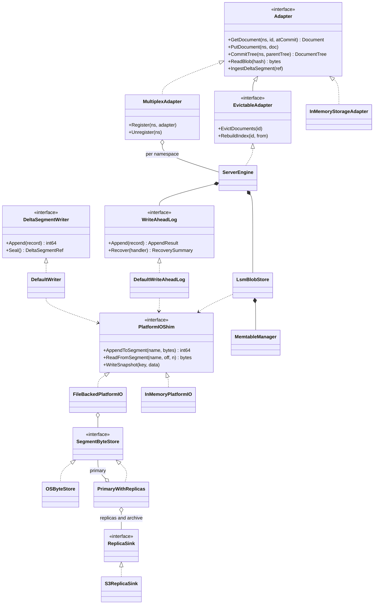

</details>

### 2.5 Query: `sql`, `query/hybrid`

#### 2.5.1 `sql`

**Purpose.** A hand-written SQL subset over JSON documents: parser, planner, executor, DML that
emits `document.Op`s (not storage writes), DDL for tables/indexes, aggregates, and the hybrid
operators `MATCH`, `SIMILARITY`, `FUSE`.

```go
type Engine interface { Execute(sql string, ctx QueryContext) (QueryResult, error)
                        ExecuteDML(sql string, ctx QueryContext) (DMLResult, error) }
func NewEngine(store storage.Adapter, d *dag.InMemoryCommitDag) Engine
func NewEngineWithIndexes(store storage.Adapter, d *dag.InMemoryCommitDag, provider IndexProvider) Engine
type Parser interface{ Parse(sql string) (Statement, error) }          // DefaultParser
type Planner interface{ PlanSelect(q SelectQuery, sch schema.KdbSchema) (PhysicalPlan, Expr, error) } // DefaultPlanner
type IndexProvider interface {
  FullTextSearch(ctx QueryContext, indexOrField, query string, depth int) (hits []index.RankedResult, ok bool, err error)
  VectorSearch(ctx QueryContext, field string, vector []float32, depth int) (...)
  ExactLookup(ctx QueryContext, field string, value Cell) (ids []codec.UUID, ok bool, err error)
  RangeLookup(ctx QueryContext, field string, low, high Cell, lowInclusive, highInclusive bool) (...) }
type IndexDDLExecutor interface{ CreateIndex(StmtCreateIndex, QueryContext) error; DropIndex(StmtDropIndex, QueryContext) error }
type Executor struct{ Storage storage.Adapter; DAG *dag.InMemoryCommitDag; IndexProvider IndexProvider }
type DMLExecutor struct{ Executor *Executor }   // ExecuteInsert/Update/Delete -> DMLResult{Operations []document.Op,...}
type DDLExecutor struct{}                        // ExecuteCreateTable -> new schema
type QueryContext struct { NamespaceID string; Schema schema.KdbSchema; AtCommit *codec.Hash; Parameters []Parameter
                           MaxRows, RowBudget int; Stats *ExecStats }
```

Sealed ASTs: `Statement` (`StmtSelect/Insert/CreateTable/Update/Delete/CreateIndex/DropIndex/Begin/Commit/Rollback`),
`Expr` (`ExprLiteral/ColumnRef/Parameter/Binary/Unary/FunctionCall/In/Between/Match/Similarity/Fuse`),
`Projection`, `Cell` (`CellNull/String/Long/Double/JSON/Bool`), `Parameter` (`ParamString/Int/Double/Bool/Null/Vector`),
`PhysicalPlan` (`PlanFullScan/SingleRow/Filter/Limit/IndexLookup/Search`).

Cost control: `QueryShape` (`ShapeOfSelect`) is the input of `server.CostModel.EstimateScan`;
`QueryContext.RowBudget` makes the executor fail with `ScanRowBudgetExceededError{Budget}`
(classified to `RESOURCE_EXHAUSTED` on the wire). `ExecStats` feeds `CostModel.ObserveScanActual`.
Errors: `ParseError` (embeds `*kdberr.DecodeError`), `PlanningError` (embeds `*kdberr.SchemaError`).

Stateless apart from the engine's references; safe for concurrent `Execute` as long as the
storage adapter is. `server.KdbServerRuntime` rebuilds its `sqlEngine` (under `sqlEngineMu`) whenever
the index provider changes.

#### 2.5.2 `query/hybrid` (unwired)

A port of Kotlin `kdb-hybrid-query`: `Engine{Execute, Prepare, Checkout, ResetCheckout}`,
`Config{SQL, DAG, PolicyRegistry, Storage, Parser, VersionResolver, CheckoutStore}`,
`VersionClause` (sealed `AtTag/AtCommit/AtTime`, parsed by `StripVersionClause` from
`... AS OF ...`), `Request{..., ReadConsistency, ReadPin, SessionCheckout, DeferCommit,
TransactionBase}`, `CheckoutStore`. Errors `HistoryDisabledError`, `HistoryNotRetainedError`,
`ReadOnlyCheckoutError`. The Go server implements read-consistency and time travel directly in
`server/wire_listen.go` (`execRead`) and `server/history.go`, so this package is only exercised by
its tests.


<details><summary>Mermaid source</summary>

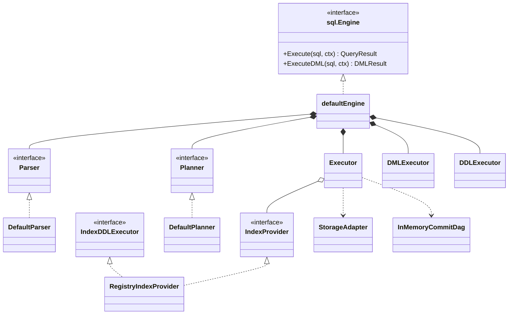

</details>

### 2.6 Wire, stream, transport

#### 2.6.1 `wire`

**Purpose.** The binary (or JSON) frame protocol shared by the SQL/session wire, the stream
(subscriber) protocol and both peer-sync protocol versions.

Frame layout (`wire/frame.go`, `FrameHeaderSize = 12`, `DefaultMaxFrameBytes = 16 MiB`, all
little-endian): `[0:4] int32 total frame length | [4:6] int16 MessageType | [6:8] int16
ProtocolVersion | [8:12] int32 CorrelationID`, then payload. `KdbWireProtocolVersion = 1`;
`SyncProtocolVersion = 2` is the peer-sync-v2 generation carried in `SYNC_HELLO`.

```go
type Header struct{ MessageType MessageType; ProtocolVersion, CorrelationID, PayloadLength int }
type Message interface{ Header() Header }          // every message struct embeds H Header
type Codec interface { Encoding() PayloadEncoding; Encode(Message) ([]byte, error); Decode(frame []byte) (Message, error)
                       EncodeFrameOnly(header Header, payload []byte) ([]byte, error); DecodeHeader(frame []byte) (Header, error) }
func NewCodec(encoding PayloadEncoding) *DefaultCodec        // EncodingKdbBinary | EncodingJSON
type HandshakeNegotiator interface{ Negotiate(local, remote HandshakePayload) (HandshakeAckPayload, error) }   // DefaultHandshakeNegotiator
type ErrorCode string      // BUSY UNAVAILABLE DEADLINE_EXCEEDED RESOURCE_EXHAUSTED CONFLICT SCHEMA_VIOLATION
                           // UNIQUE_VIOLATION UNAUTHORIZED UNSUPPORTED NAMESPACE_MISMATCH INTEGRITY NOT_HOME INTERNAL
```

Message families (one struct per `MessageType`, 0x01..0x3F):

| Family | Types (MessageType hex range) |
|---|---|
| Session/SQL | `HandshakeMessage/AckMessage` (0x01, handshake), `SessionBeginMessage/AckMessage` (0x0E, 0x13), `SqlExecMessage`/`SqlResultMessage` (0x0F/0x10), `TxCommitMessage` (0x11), `TxRollbackMessage` (0x12) |
| Direct doc ops (Go-only) | `DocumentGetMessage/ResultMessage` (0x14/0x15), `UpsertMessage/ResultMessage` (0x16/0x17), `LockAcquire/Renew/Release/ResultMessage` (0x19-0x1C), `SearchMessage/ResultMessage` (0x1D/0x1E, in both trees), `HistoryList/Result` and `Revert/Result` (0x1F-0x22), `TxCommitMulti/Result` (0x23/0x24) |
| Stream | `DeltaCommitMessage` (0x02), `PositionAckMessage` (0x0C), `CompactionNoticeMessage` (0x08), `IceArchiveNoticeMessage` (0x09), `SchemaPushMessage` (0x0D), `TransactionReplayMessage` (0x06), `ConflictReportMessage` (0x07) |
| Peer sync v1 | `CommitFetchMessage` (0x03), `CommitPushMessage` (0x04), `CommitPushAckMessage` (0x18), `DagDiffMessage` (0x05), `SnapshotRequest/ResponseMessage` (0x0A/0x0B), `PeerErrorMessage` (0x25) |
| Peer sync v2 | `SyncHello/Ack` (0x26/0x27), `RefsRequest/Result` (0x28/0x29), `FetchRequest` + `PackPage` (0x2A/0x2B), `RefUpdate/Ack` (0x2C/0x2D), `SnapshotFetch` + `SnapshotPage` (0x2E/0x2F), `ProjectFetch/Page/Write/WriteResult` (0x30-0x33), `TreeNodes/Result` (0x34/0x35), `ObjectFetch/Result` (0x36/0x37), `DocFetch/Result` (0x38/0x39), `GraftPush/Result` (0x3A/0x3B), `MetaView/Result` (0x3C/0x3D), `HomeRequest/Result` (0x3E/0x3F) |

Results that can fail carry `Error *string` (legacy, prose) **and** `ErrorCode *ErrorCode` +
`RetryAfterMs *int` (additive, so old clients keep working). Mapping from server errors to codes is
in section 4.3. Wire errors: `wire.DecodeError{*kdberr.DecodeError}`, `FrameTooLargeError{Length, Max}`,
`InvalidCorrelationError`. Mapping helpers: `payload_mapper.go`, `op_mapper.go`, `transaction_codec.go`,
`commit_push_codec.go` convert between wire DTOs and `document.*`. `wire.PayloadEnvelope` /
`HandshakeDTO` are exported aliases of internal DTOs for `kdb-inspect`.

#### 2.6.2 `stream`

**Purpose.** The push channel: a coordinator publishes committed deltas to subscribers; subscribers
can write back through transaction replay. Also defines the `Transport` port.

```go
type Transport interface{ Connect(uri string) (ConnectionHandle, error) }
type ConnectionHandle interface { Send(frame []byte) error; Incoming() <-chan []byte; Close() error; TryPoll() []byte }
type Coordinator interface { Start(SessionConfig) error; Stop() error; Publish(PublishedCommit) error
                             Subscribers() <-chan SubscriberState; SetTransactionReplayer(TransactionReplayer) }
type Subscriber interface { Connect(SubscriberConfig) (*Connection, error); Disconnect() error; Events() <-chan Event }
type IndexHintApplier interface{ Apply(namespaceID string, hints []wire.IndexHint) }   // NoopHintApplier
func NewCoordinator(w wire.Codec, t Transport) Coordinator;  func NewSubscriber(w, t, hintApplier) Subscriber
type InMemoryTransport struct{...}; type Hub struct{ ServerHandler func(frame []byte) }; func HubFor(name) *Hub
```

`defaultCoordinator` (one `sync.Mutex`, `subscribers chan SubscriberState`) and `defaultSubscriber`
(one `readLoop` goroutine, `events chan Event`, `pendingReplays map[int]chan wire.Message`,
`handshakeAck chan wire.Message`). `ClientMode`: `ClientReadOnly | ClientWriteBack`. `Event` kinds:
`Connected, DeltaReceived, PositionUpdated, CompactionWarning, IceArchived, Disconnected, Error`.
In the server, the real broadcaster is `server.StreamHub` (`NewStreamHub(codec, ns, runtime)`,
`Publish(commit)`, `SetAllowAnonymous`), attached as `KdbServerRuntime.CommitListener`;
`stream.Coordinator` is the library-style equivalent used by tests and embedding.
Errors embed `*kdberr.DecodeError`: `DesyncError{ExpectedParent, ActualParent}`, `NotConnectedError`.

#### 2.6.3 `transport/core`, `transport/tcp`, `transport/ws`

```go
// core: shared framing + options
type TransportConnectOptions struct{ ConnectTimeoutMs, ReadTimeoutMs int64; MaxFrameBytes int
  ConnectHeaders map[string]string; TLS *TransportTlsSettings; Admitter FrameAdmitter; MaxConnections, IncomingQueueFrames int }
type FrameAdmitter func(header wire.Header) (rejection []byte, err error)    // pre-decode admission on header only
type TransportTlsSettings struct{ Enabled, InsecureSkipVerify bool; CAFile, CertFile, KeyFile, ServerName string; RequireClientAuth bool }
type FrameStreamReader struct{...}   // reassembles frames from byte chunks; Feed/TakeRejections/Reset
// tcp
type Transport interface { stream.Transport
  Listen(ctx, uri string, handler func(stream.ConnectionHandle)) error
  ListenBound(uri string) (net.Listener, error);  Serve(ctx, ln net.Listener, handler func(stream.ConnectionHandle)) error }
// ws
type Transport interface { stream.Transport; ConnectWithOptions(...); Listen(...); ListenBound(...) ; Upgrade(w, r, options) }
```

`tcp.NewTransport(options)` / `ws.NewTransport(options)` return the `Transport` interfaces. Both
spawn per-connection reader goroutines feeding `Incoming() chan []byte` (bounded by
`IncomingQueueFrames`; `DefaultIncomingQueueFrames`) and enforce `MaxFrameBytes`. The
`FrameAdmitter` hook lets the server shed an oversize/over-budget request **after reading 12 header
bytes and before buffering the payload** (`server.FrameHost.Admitter` -> `runtime.frameAdmitter`).


<details><summary>Mermaid source</summary>

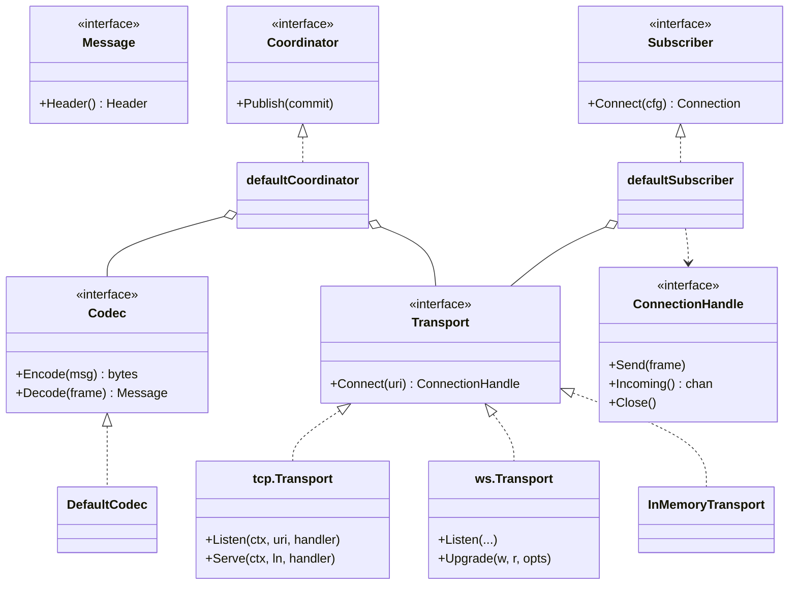

</details>

### 2.7 Distribution: `peersync`, `replication`, `syncnode`

#### 2.7.1 `peersync`

**Purpose.** Replicates commit DAGs between nodes (Git-like: refs, want/have pack negotiation,
three-way merge with a configurable resolution chain, snapshots/grafts for shallow joins, Merkle
tree repair, projections). Two generations coexist on the wire:

* **v1** (`Client`/`Session`, `ConnectionHost`, `HostConfig`/`ClientConfig`): single-namespace
  `COMMIT_FETCH`/`COMMIT_PUSH` over `DagSyncPlan{CommonAncestor, LocalOnly, RemoteOnly}`. Kotlin
  `kdb-peer-sync` speaks only this.
* **v2** (`SyncV2`, `V2Host`, `V2HostConfig`/`V2ClientConfig`): `SYNC_HELLO` negotiates; refs
  exchange (`NamespaceRefs{Branches, Tags, HistoryFloorHex, Shallow, ResolutionHash, Access}`);
  paged want/have `FetchRequest`->`PackPage`; `RefUpdate` push; snapshot join; projections with
  optional write-back. The listener decides v1 vs v2 from the **first frame**
  (`server.peerSyncConnHandler.handle`).

The core is transport-independent and operates on an **`IngestEnv`** (everything the receiving side
needs, supplied by the server):

```go
type IngestEnv struct { DAG *dag.InMemoryCommitDag; Storage storage.Adapter; NamespaceID string
  Node LocalNode; Persist func(document.Commit) error; PersistAsync func(...) (wait func() error, err error)
  ApplyToStorage bool; Resolution ResolutionOptions; Conflicts *ConflictQueue; Peer, Self string
  CheckCommit func(document.Commit) error; CanInstallSnapshot func() error
  SnapshotInstalled func(document.Commit) error; ShallowRootsChanged func([]codec.Hash) error
  GraftRecorded func(root codec.Hash) error; MaxClockSkew time.Duration }
type LocalNode interface { Exclusive(fn func() error) error; Advanced(step AdvanceStep) error }  // server.serverLocalNode
type NamespaceProvider interface { List() []string; Env(ns string, create bool) (IngestEnv, error) } // server.peerNamespaceProvider
func Ingest(env, commits, incomingHead) (IngestResult, error)           // store + fast-forward / merge / conflict
func ResolveDivergence(d, store, ns, localHead, incomingHead, ResolutionOptions) (CommitPushOutcome, error)
func InstallSnapshot(env, fetch) (document.Commit, error);  func Graft(env, root, fetch) (GraftResult, error)
func Deepen(env, *RepairSession, root) (DeepenResult, error);  func ApplyRef(env, kind, name, proposed) (RefUpdateResult, error)
func SyncProjection(w, transport, ProjectionConfig) (ProjectionResult, error)
```

`LocalNode` is the key inversion: `Exclusive` runs peer ingest under the *same* write gate local
clients use (`serverLocalNode.Exclusive` -> `writeGate.acquire`), and `Advanced` lets the server
update indexes/unique keys/storage for ops that arrived from a peer.

Conflict handling types:

| Type | Role |
|---|---|
| `ResolutionChain{Rules []ResolutionRule, AllowUnrelated}` | Ordered strategy list per namespace, content-hashed (`Hash()`), stored in the meta namespace and advertised in `NamespaceRefs.ResolutionHash`. Rule kinds: `RuleSourcePriority`, `RuleValidity`, `RuleFieldMerge`, `RuleLastWrite`, `RuleQueue`, `RuleProcedure`, `RuleAuthority`; `Pending` modes `PendingHold`, `PendingProvisional`. |
| `ResolutionOptions` | Runtime form of the chain: `Policy transaction.ConflictPolicy`, `Choose`, `Resolver transaction.ConflictResolver`, `Valid func(body) bool`, `Procedure func(name, sourceHash, ProcedureConflict) (Settlement, decided, error)`. |
| `Settlement{Body *string; Fork *ForkDoc}` | Outcome for one document; a `ForkDoc` preserves the losing version under a derived id (`ForkID`). |
| `ConflictQueue` (`NewConflictQueue(dir)`) | Durable per-namespace queue of `ConflictEntry` (kinds `ConflictDivergence`, `UniqueDuplicate`, `ForeignGroupPart`, `WriteBack`, `Provisional`, `UnrelatedHistory`); `Record/OnRecord/MarkDelivered/Get/List/Remove`. Resolved through `ResolveConflict(env, id, map[UUID]Choice)`. |
| `HeadUpdate` / `CommitPushOutcome` | `HeadFastForward | HeadAlreadyAncestor | HeadDiverged`; `OutcomeNoOp | FastForwarded | Merged | Conflict`. |
| `RepairSession` | Open v2 connection used for `Diff` (Merkle `TreeNodes`), `Fetch` (objects), `FetchDocs` (proven doc fetch with `TreeProof`), `FetchAncestors`, `RequestHome`. |

Errors: `peersync.Error{*kdberr.TransportErr}`, `RemoteError{Code wire.ErrorCode, Message}`,
`ClockSkewError`, `TreeMismatchError`, `UnrelatedHistoryError`, `NotGrantedError`,
`NamespaceMismatchError`, `UnsupportedFrameError`, sentinels `ErrNotEmpty`, `ErrNotShallow`,
`ErrPeerLacksHistory`, `ErrUnrelatedNotAllowed`, `ErrConflictNotFound`, `ErrUnproven`.


<details><summary>Mermaid source</summary>

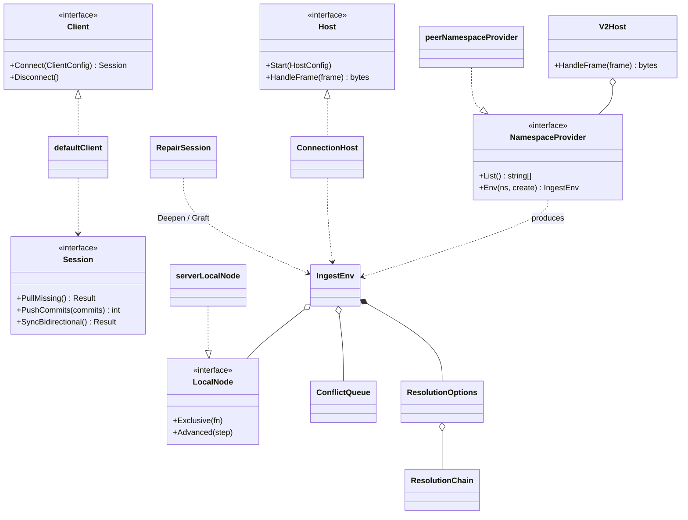

</details>

#### 2.7.2 `replication`

**Purpose.** Background pull/push loops from this node to its configured peers.

```go
type PeerConfig struct{ Name, Addr string; Namespaces []string; Mode peersync.SyncMode /*SyncPull|SyncPush|SyncBoth*/
  Interval time.Duration; User, Password, Token *string; Credentials func() (auth.ConnectionContext, error)
  CreateLocal, PreferSnapshot bool; Filter string; WriteBack, ReadThrough, ScopedMeta bool; ... }
func ParsePeer(spec string) (PeerConfig, error);  func ParsePeers(specs string) ([]PeerConfig, error)
type Config struct{ NodeID string; Local peersync.NamespaceProvider; Peers []PeerConfig; State *StateStore
  Transport func(PeerConfig) stream.Transport; TLS *core.TransportTlsSettings; Debounce, MaxBackoff, Timeout time.Duration
  MetaNamespace string; MetaView func(peer string, defs []wire.MetaDefinition) error
  Projections func(source, filter string, writeBack bool) (peersync.ProjectionTarget, error) }
func New(cfg Config) (*Replicator, error)
// (*Replicator) Start Stop OnLocalCommit SyncNow(name) Status() []PeerStatus SetPeerNamespaces AddNamespaces RemoveNamespaces
//               PeerFloor FetchBodies Compare OpenDocSession OpenRepairSessionTo WriteMetrics
type StateStore struct{...}   // JSON per-peer PeerState{Namespaces map[string]NamespaceState} under StateDir(dataRoot)
```

`Replicator` owns one `peerLoop` per peer (goroutine each; `trigger chan struct{}` for debounced
`OnLocalCommit` wakeups; `cycleMu` allows one sync cycle per peer at a time; exponential backoff to
`MaxBackoff`; `nextAttempt`). `Replicator` satisfies `control.ReplicationSource`, `RepairSource`
and `DeepenSource`, and `embed.EmbeddedKdbRuntime.SetPeerRetentionFloor(floor)` is fed from
`PeerFloor` so log truncation never removes history a peer still needs.

#### 2.7.3 `syncnode`

**Purpose.** Assembles a multi-namespace, replicating node out of `embed.Host`, `server.NamespaceSet`
and `replication.Replicator` (the object behind `kdb-service --peer ...`).

```go
func Open(host *embed.Host, set *server.NamespaceSet, primary *server.KdbServerRuntime, cfg Config) (*Node, error)
// (*Node) Handler() Listen(addr, ...) Start() Replicator() Meta() MetaRuntime() Set() Conflicts() SyncNow(name)
//         StopSync() Handover/ForceHandover/RequestHome (single-home namespaces) CloseIdle() Prepare() Opener() Close()
type Config struct { Peers []replication.PeerConfig; DataDir string; TLS ...; Transport ...; PeerRetentionGrace time.Duration
  AuthorityExpiryInterval time.Duration; ConflictWebhook *server.ConflictWebhook; ScrubInterval time.Duration
  AuthorizePushedDocuments bool; HandoverPolicy server.HandoverPolicy; Idle *IdleConfig; Debounce, MaxBackoff, Timeout time.Duration }
type IdleConfig struct{ MaxOpen int; IdleAfter, MinIdle, Interval time.Duration; OnClose func(*server.KdbServerRuntime) }
```

`Node` creates the meta namespace runtime (`server.MetaNamespace`; file-backed or in-memory) and
`server.MetaStore` (cluster-visible schema/index/resolution/procedure/home definitions), installs
`NamespaceSet.SetOpener` (lazy open of a namespace on first touch), the idle-close policy, the
conflict webhook/procedure loops, the scrub loop (`scrubLoop` goroutine) and attaches
`Replicator.OnLocalCommit` to each runtime's `CommitListener`. Its `mu`-guarded state tracks
listeners and live connections for orderly close.

### 2.8 Runtime assembly: `embed`, `server`, `service`, `control`

#### 2.8.1 `embed`

**Purpose.** Build and own the storage + DAG stack of a namespace (`EmbeddedKdbRuntime`), the
process-wide `Host` that opens many namespaces over one data directory, the cross-namespace
transaction coordinator, and the maintenance scheduler.

```go
type EmbeddedKdbRuntime struct {            // public fields are what upper layers read directly
  Catalog string; DAG dag.CommitDAG; Storage storage.Adapter; Schema schema.KdbSchema
  DefaultNamespace string; WriteBaseVersion *codec.Hash; DataRoot string; ReadOnly bool
  /* unexported: deltaReader, shim, refresh, release, storageClose, maintain, peerFloor atomic.Pointer, snapshot, txn */ }
func OpenMemoryRuntime(catalog, ns string, sch schema.KdbSchema) (*EmbeddedKdbRuntime, error)
func OpenFileRuntime / OpenReadOnlyFileRuntime / OpenFileRuntimeWithOptions(dataRoot, catalog, ns, sch, ...)
func OpenFileHost(dataRoot string, opts FileRuntimeOptions) (*Host, error)
// Host: Namespace / NamespaceWithOptions / ReopenNamespace / CloseNamespace / Namespaces / Adapter / Transactions / MemoryArbiter / Close
```

Methods on the runtime: `Maintain()`, `CompactHistory()`, `Refresh()` (read-only followers replay new
segments), `Close()`, `AssertWritable()` (`ErrReadOnly`), `ReclaimMode/SetReclaimMode`,
`HistoryMode/RetentionWindow/SetRetentionWindow/SetHistoryMode(to, reclaim) (HistoryModeSwitch, error)`,
`EligibleForCompaction()`, `AssertRetainsHistory`, `RestoreFromArchive(from,to)`,
`CanInstallSnapshot/PersistSnapshot/RecordShallowRoots/RecordGraft` (peer snapshot join),
`SetPeerRetentionFloor`. Free functions: `PutJSONDocument`, `DocumentAt`, `DocumentVersions`,
`RevertTo`, `DiffCommits`, `MaterializeCommit`, `MigrateHistoryMode/Strategy`, `LoadOrCreateNodeID`,
`ListNamespaces`, `ValidateNamespaceID`, `LockDataDir` (exclusive maintenance lock).

**Host lifecycle.** `OpenFileHost` takes the data-dir lock (two flock files: a shared *attach* lock
and an exclusive *writer* lock; read-only hosts take only shared; `LockDataDir` takes the
exclusive maintenance lock), builds the `PlatformIOShim` (optionally layering S3 replicas/archive via
`PrimaryWithReplicas`), opens the `TxnCoordinator` (decision log), and creates the `BudgetArbiter`
and `MultiplexAdapter`. `Namespace()` is idempotent per id (double-checked under `Host.mu`; a loser
of the race closes its entry), registers the adapter with the multiplexer and the engine with the
arbiter. `Close()` closes namespaces then releases the lock.

Cross-namespace atomic commit:

```go
type GroupParticipant interface { Namespace() string; Runtime() *EmbeddedKdbRuntime; Lock() (unlock func(), err error)
  Prepare(tx document.Transaction) (PreparedPart, error); Fence(cause error) }
type PreparedPart interface{ Apply(message string) (document.Commit, error); Discard() }
func CommitGroup(coord *TxnCoordinator, parts []GroupPart) (GroupResult, func() error, error)
type TxnCoordinator struct{...}  // Begin(namespaces) (*TxnGroup, error); Epoch(); LocalHostID(); decision log (txn_decision_log.go)
type TxnGroup struct{ ID codec.UUID; Epoch uint64 }  // AddPart / Finish / Fail / Abandon / Done() <-chan / Err()
type GroupMarker struct{ Host string; Epoch uint64; Group codec.UUID; Parts []string }  // embedded in commit Message
```

`CommitGroup` rejects duplicate namespaces, sorts participants by namespace (a global lock order),
pins each base version, `Lock()`s every participant, calls `coord.Begin(namespaces)`, `Prepare`s each part
(stamping the group id as the transaction id; a failing `Prepare` discards earlier parts and abandons the
group), then `Apply`s each part; commits carry a `GroupMarker` in their message so recovery can tell a committed
group (decision log) from an abandoned one, and peer sync can flag `ConflictForeignGroupPart`.
`PersistingCommitDAG.barrier atomic.Pointer[TxnGroup]` records the latest group with a part in that log;
under `DurabilitySync`, later commits' durability waits chain on the group's decision (`chainOnBarrier`)
and fail with `GroupFailedError` if the group fails. `PublishObserver{PublishStarted/Finished}` lets the server delay stream
publication until the group is decided. Implementors of `GroupParticipant`: `server.serverParticipant`
and `driver.driverParticipant` (the test double is in `embed/group_commit_test.go`).

`PersistingCommitDAG` is the file-mode **decorator** for `dag.CommitDAG`: it delegates every call to
`*dag.InMemoryCommitDag` and adds durability (`Persist` sync, `PersistAsync` group-commit,
`Close`, `SetPersistListener`, `SetSealListener`, `AcknowledgesDurably()`); its `AppendCommit` appends in memory
and then persists synchronously (`Persist` = `PersistAsync` + `wait()`). The server deliberately bypasses
that method: it runs `transaction.Engine.Commit` against `Delegate()` and calls `PersistAsync` itself
so it can release the write gate *before* waiting for the fsync (section 1.3). It also forwards the
`HistoryNavigator` surface.

`MaintenanceScheduler` (`StartMaintenance(rt, MaintenanceOptions{Interval, Sweep, Busy func() bool,
MaxDefer, Reclaim, CompactTables, Logger})`): one goroutine ticks every `Interval`, runs
`rt.Maintain()` unless `Busy()` (deferred up to `MaxDefer` times, then forced), a faster `Sweep`
cadence when `ReclaimMode` says so, and `NotifySegmentSealed()` wakes it early. Runtime tuning:
`SetInterval/SetSweep/SetMaxDefer/ApplyReclaimMode`; stats via `Stats() MaintenanceStats`.

Typed errors in `embed` (plain `error` types, **not** `kdberr.Exception`): `TruncatedLogError`,
`SnapshotCheckpointMissingError`, `CommitOperationsUnavailableError`, `HistoryFeatureUnavailableError`,
`HistoryNotRetainedError`, `HistoryStrategyMismatchError`, `HistoryModeMismatchError`,
`HistoryModeStrategyConflictError`, `TreeHashMismatchError`, `GroupFailedError`, `GroupPartError`;
sentinels `ErrReadOnly`, `ErrCheckpointDeferred`, `ErrCommitLogClosed`, `ErrDecisionLogClosed`,
`ErrSnapshotNeedsFreshNamespace`.


<details><summary>Mermaid source</summary>

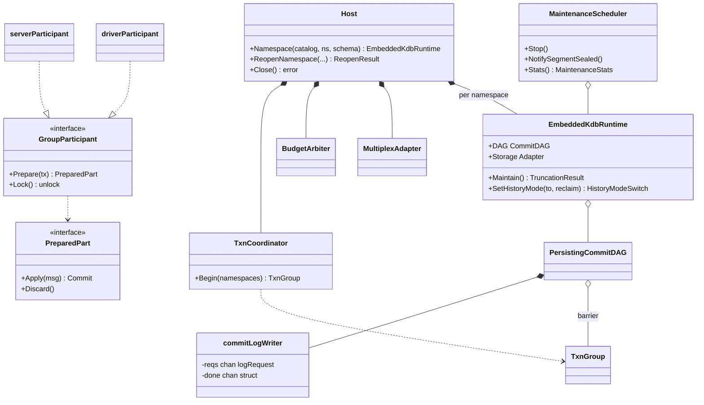

</details>

#### 2.8.2 `server`

**Purpose.** The network-facing node: per-namespace `KdbServerRuntime` (commit path, sessions,
admission, locks, conflicts), `NamespaceSet` (many namespaces + cross-namespace commit), the
listeners (SQL wire over TCP/WS, stream, peer sync, admin), and the governance layer.

`KdbServerRuntime` (`server_runtime.go`), key public fields: `Runtime *embed.EmbeddedKdbRuntime`,
`TransactionEngine`, `UpsertEngine transaction.Engine`, `DocumentLocks *transaction.LockManager`,
`AuthEngine auth.Engine` (default `auth.AllowAll`), `CommitListener func(ns, commit)`, `WriteTimeout`
(default 5s), `UniqueKeys`, `Conflicts *peersync.ConflictQueue`, `ReadThrough`, `SessionWait`,
`ProjectionOf/ProjectionWriteBack/ProjectionFilter` (read-only projection replicas), `Meta`,
`Namespaces`, `NodeID`, `PeerCreateOnPush`, `PeerAuthorizeDocuments`, `HandoverPolicy`.
Methods group as:

| Group | Methods |
|---|---|
| Writes | `Commit(ns, tx, sessionID, principal)`, `Upsert`, `Replay`, `PutJSON` (with `Expect{ContentHash, Absent}` preconditions -> `PreconditionFailedError`), `ReadForUpdate` |
| Reads | `GetDocument`, `ReadDocument`, `SQLEngine()`, `HeadTree`, `Schema()/SetSchema[Checked]` |
| Governance | `SetMemoryLimit`, `SetMemoryBudget`, `Admission()`, `MemoryZone()`, `ShareGovernanceWith(primary)` |
| Lifecycle | `Retain()/Release()` (ref count, `atomic.Int32`; `ServerRuntimeRegistry.GetOrOpen/Release` evicts at zero), `BeginDraining()`, `WaitForWritesToDrain(timeout)`, `ResumeAfterDrain`, `ReopenWith(...)` |
| Distribution | `PeerSyncNode()`, `PeerNamespaces()`, `PeerIngestEnv`, `SetHome/HomeOf/Handover/ForceHandover`, `ResolveConflict/DismissConflict/ResolveAll/AckConflict`, `SetResolutionChain`, `SetProcedure*`, `Deepen`, `ShallowRoots`, `Scrub`, `ProjectionTarget` |
| Expiry | `SetDocumentExpiry`, `SweepExpiredNow`, `ExpirySummary` (background sweeper) |

The write path and its gates are in section 1.3. The gate chain, outermost first:
`admitWrite` (cheap boolean checks) -> `Admission.Acquire` (memory grant, `semaphore.Weighted`
sized `effectiveLimit - reserve - nonGrantedFloor`, per-`OpClass`) -> `writeGate.acquire`
(single-flight, bounded queue) -> `transaction.Engine`.

Governance types:

| Type | Role |
|---|---|
| `MemoryGuard` | Samples `runtime/metrics` (total minus released heap) every 200 ms into a ring; exposes `CurrentZone()` lock-free: `ZoneNormal/Elevated/High/Critical`; `SetObserver`, `Stop`. |
| `Admission` | `Acquire(ctx, OpClass, estimateBytes) (*Grant, error)`; `OpClass`: `ClassPointRead/Scan/Write/Replication`; counts decisions in `AdmissionStats` (atomics); keeps a `RescueReserve`; errors `MemoryPressureError{Zone, Class, RetryAfterMs}`, `ResourceExhaustedError{Reason, EstimateBytes, CapacityBytes}`. |
| `CostModel` | Learns per-shape scan/point-read cost (`EstimateScan(ScanEstimateInput)`, `Observe*Actual`, `AccuracyP95`, `SnapshotState/RestoreState`, persisted by `service` to a state file). |
| `writeGate` | Two channels (`queued` bounded, `running` capacity 1) + EWMA service time (`serviceNanos`, shift 3); errors `BusyError`, `DeadlineExceededError`. `KdbServerRuntime.WriteQueueDepth()`. |
| `AbortWatchdog` | Crash-only supervisor (`NewAbortWatchdog(runtime, listener, abortAfter)`): on *sustained* critical memory pressure it `BeginDraining`s (typed `UnavailableError` to new work), flushes and closes storage via the normal close path, and exits with `AbortExitCode = 75` (EX_TEMPFAIL) so a process supervisor restarts it. Never restarts itself. |

Sessions: `SessionManager` (per connection; `Begin/BeginOn/Get/End/ClearPending/PendingBuilder/All`),
`KdbSession{ID SessionID, NamespaceID, ReadConsistency (ReadCommitted|ReadYourWrites|Snapshot), Pending
*transaction.Builder, Principal}` with `TrackLease/UntrackLease/ClearLeases` so leases die with the
connection. Session tokens (`session_token.go`) let a client demand `MinCommit`, giving
`ReplicaBehindError` -> `BUSY` on lagging replicas.

Listeners: `Listener{ln, cancel, done}` with `Addr()/Close()`; `ListenSqlWire[TLS]`,
`ListenSqlWireWS[TLS]`, `ListenStream[TLS]` (returns `*StreamHub`), `ListenPeerSync[TLS]`,
`NewAdminServer(addr, rt)` (health/metrics, `SetReady`). A connection is a `FrameConn` served by
`FrameHost.Serve`; `sqlWireConnHandler.run` decodes frames, handles the handshake inline, then
dispatches each later frame on its own goroutine, bounded by `MaxInFlightFrames = 64` (a buffered
channel as semaphore), with a per-session FIFO ticket (`sessionTicket`) preserving order of SQL on
one session and a `sendMu` serialising replies; `dispatchRecovering` turns a handler panic into an
INTERNAL error reply.

Multi-namespace: `NamespaceSet{WriteTimeout}` (`mu RWMutex` over `runtimes` and `system`
maps, `openMu` serialising lazy opens through `SetOpener`, `known` for lazily-listed names),
`Add/AddSystem/Get/Resolve/Namespaces/Runtimes/Snapshot`, `CommitAcross([]NamespaceTransaction)
(CrossNamespaceResult, error)` (wraps `embed.CommitGroup` with `serverParticipant`s),
`StartIdleClose(IdlePolicy)`. `MetaStore` keeps cluster definitions in `MetaNamespace`
(`RecordSchema/RecordIndex/SetResolution/SetProcedure/AssignHome/View/ApplyTo/ReconcileAll`).

Other server components: `RegistryIndexProvider` (index fan-out + hybrid `Search` via
`fusion.Fuse`), `SearchProvider` interface (`Search(ctx, wire.SearchMessage)`; `ErrSearchNotConfigured`),
`ReadThrough` (lazy remote fetch for shallow replicas, LRU of `Capacity`), `Home/NotHomeError/
StaleFenceError/HandoverPolicy` (single-home namespaces with fencing tokens), `ConflictWebhook`
(HMAC-signed `ConflictNotification` POSTs), `ConflictProcedure` (runs authority procedures),
`ScrubReport` (verify document bodies against tree hashes and repair from a peer via `BodyFetcher`).


<details><summary>Mermaid source</summary>

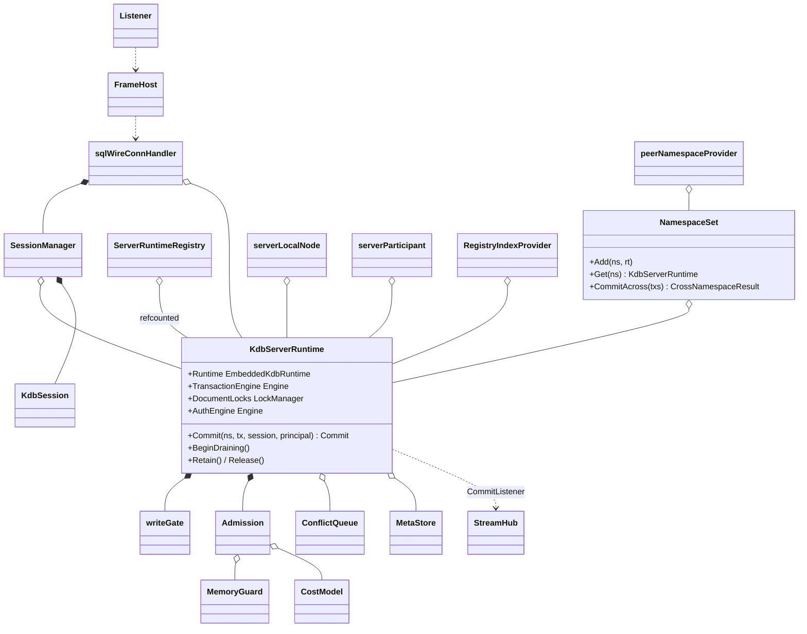

</details>

Server errors (all plain error types, classified in section 4): `BusyError`, `DeadlineExceededError`,
`UnavailableError`, `MemoryPressureError`, `ResourceExhaustedError`, `ConflictError{Report, RetryAfterMs}`,
`SchemaError{Violations}` (`HasUniqueViolation()`), `AuthorizationError{Cause}`, `UnsupportedError`,
`NotHomeError{Namespace, Home}`, `StaleFenceError`, `ReplicaBehindError`, `PreconditionFailedError`,
`ProjectionReadOnlyError`, `HandoverRefusedError`, `ErrResolutionStale`, `ScrubUnrepairedError`,
`CrossNamespaceError` (= `embed.GroupPartError`), sentinels `ErrUnknownNamespace`,
`ErrSearchNotConfigured`, `ErrReadThroughForbidden`, `ErrProjectionWriteOp`.

#### 2.8.3 `service`

`service.Main()` is the whole `kdb-service` binary (`cmd/kdb-service`). It resolves
`config.ServiceSettings` (defaults < config file < env < flags), then assembles in order: logger and
GC memory limit (`ApplyGoMemoryLimit`), storage (`embed.OpenMemoryRuntime` or
`embed.OpenFileHost` + `Host.Namespace`), `server.NewKdbServerRuntime(rt)`, memory governance and
`CostModel` state restore, auth (`embed.OpenFileAuthRegistry` -> `auth.NewRegistryAuthEngine`),
`server.NewNamespaceSet(host.Transactions())`, `syncnode.Open`, the listeners (SQL, WS, peer, stream,
optional gRPC via `RegisterGRPCListener`), `AbortWatchdog`, `AdminServer`, `control.New`,
per-namespace `embed.StartMaintenance`; then blocks on `SIGINT/SIGTERM` and runs drain:
`BeginDraining` -> `WaitForWritesToDrain(DrainTimeout)` -> close listeners -> close runtimes. The
`GRPCListenerFactory` indirection keeps the gRPC dependency out of the default build
(`GRPCLinked()`).

#### 2.8.4 `control`

HTTP/JSON control plane and embedded UI (`control/ui`). `control.New(Options) (*Server, error)`;
`Options` carries `Addr`, `Runtime`, `Namespaces NamespaceSource`, `Settings []config.SettingDescriptor`,
`AllowWrites`, `ServeUI`, `StagingDir`, `BackupDir`, `AllowSettingsPersist`, `AllowPromotion`,
`RequestRestart`, `Replication ReplicationSource`, `Maintenance MaintenanceSource`, `Reopener
NamespaceReopener`. Ports it defines (satisfied by `service`/`syncnode`/`replication`):
`NamespaceSource{Namespaces(); Runtime(ns)}`, `ReplicationSource{Status(); SyncNow(name)}`,
`RepairSource{FetchBodies; Compare}`, `DeepenSource{OpenRepairSessionTo}`,
`NamespaceReopener{ReopenNamespace(ns, edit func(*embed.StorageOptions)); ReopenableNamespaces()}`,
`MaintenanceSource{Schedulers()}`. Authorisation: three wrappers (`nsRead`, `nsWrite`, `adminRead`)
over `auth.AdminAction`/document actions, scope constant `AdminScope`. ~70 routes under `/v1/...`
cover namespaces/status, log/commits/diff/refs (branches, tags), documents and history, SQL,
indexes/schema, retention (history mode, compact, restore from archive), integrity/verify,
checkpoints, backups/restore staging/promotion, conflicts/resolution/procedures/home (distribution),
settings (read, drift, `PATCH` with live apply or namespace reopen per `config.Mutability`),
ops (runtime, locks, metrics, drain) and an SSE event stream. `Server.PublishCommit` feeds the
events. State is per-server `sync.Mutex`/`RWMutex`; restore runs in one goroutine (`runRestore`).

### 2.9 Edges: `client`, `driver`

#### 2.9.1 `client` (Go SDK over the wire)

```go
func Connect(ctx, addr, token string) (*Client, error);  func ConnectWithOptions(ctx, addr, token string, ConnectOptions) (*Client, error)
type ConnectOptions struct{ TLS *core.TransportTlsSettings; Namespaces []string; Transport stream.Transport }
// (*Client): PutJSON GetJSON GetJSONWithHash Upsert Commit AppendEvent PutIfAbsent ReplaceIf ReplaceIfPresent CompareAndSwap
//            History Revert AcquireLock RenewLock ReleaseLock CommitAcross Query QueryRaw Exec Search NewSession Begin BeginTx Close
type Tx struct{...} // Exec Query QueryRaw Commit Rollback;  type Session struct{...} // Token Resume ...
type Router struct{...}   // NewRouter(ctx, addr, token, opts): follows NotHomeError to the home node; Primary/PutJSON/GetJSON/Commit/Upsert
type Transaction struct{ Namespace, BaseVersion string; Writes []DocWrite; Deletes []string }
```

`Client` is one connection, one `readLoop` goroutine, a `pending map[int]chan wire.Message`
keyed by correlation id under `mu`, per-namespace session state (`namespaceState{sessionID, head}`)
under `nsMu`. It keeps `head` per namespace so `Commit` can send a base version. Errors map from
wire codes (section 4.4).

#### 2.9.2 `driver` (`database/sql`)

`sql.Register("kdb", &Driver{})`; `driver.Open(raw)` returns `*sql.DB`. URL (`ParseURL`/`ParseDSN`)
`kdb://...` selects `ModeMemory` (shared by name in a process-wide `registry`, `ClearMemoryRegistries`)
or `ModeFile` (`DataRoot`, `Catalog`, `NamespaceID`, `ReadOnly`). Embedded, in-process: no network.

Internals: `registry{mu, dbs map[string]*database}`; `database{host *embed.Host, coord
*embed.TxnCoordinator, namespaces map[string]*namespace, refs}`; `namespace{rt, d, persister, engine
transaction.Engine, uniques, write sync.Mutex, schemaMu, sqlEngine, fenced atomic.Pointer[error]}`;
`conn{parsed, db, ns, tx *connTx}`; `connTx`/`txWrites` stage writes and commit through
`commitPart` / `driverParticipant` (so a `Tx` touching several tables-as-namespaces uses
`embed.CommitGroup`); `stmt`, `rows`, `txHandle`. Errors: `ErrConflict`, `ErrUnknownNamespace`,
`ConflictError{Namespace, Documents}` (with `Is`), `SchemaError`. The Kotlin analogue is `kdb-jdbc`.

### 2.10 Security and configuration: `auth`, `config`

#### 2.10.1 `auth`

```go
type Authenticator interface{ Authenticate(ctx, Credentials) (Principal, error) }
type Authorizer interface{ Authorize(ctx, Principal, Action) error }
type Engine interface{ Authenticator() Authenticator; Authorizer() Authorizer }
var AllowAll Engine                    // dev/tests; default of KdbServerRuntime.AuthEngine
func NewRegistryAuthEngine(store *RegistryAuthStore) Engine
type Principal struct{ ID string; Roles map[string]struct{}; Claims map[string]string }
type Action interface{ isAction() }    // SessionBeginAction SqlExecAction{ReadOnly} TxCommitAction PeerSync/Pull/PushAction
                                       // ConflictResolveAction StreamSubscribeAction DocumentWrite/Delete/ReadAction AdminAction
type ResourcePath struct{ Database, Collection, DocumentID string }
type RegistryAuthStore struct{...}     // users + roles stored as documents in UsersNamespace / RolesNamespace
```

`NewRegistryAuthStore(userDag, roleDag dag.CommitDAG, store storage.Adapter)` keeps users
(`UserRecord{ID, PasswordHash, PasswordSalt, Roles}`, `HashPassword`/`VerifyPassword`) and roles
(`RoleRecord{Name, Grants}`) as ordinary documents in two system namespaces (under
`embed.FileAuthRegistry`). Grants are permission strings matched by `PermissionMatchesPath`
against `ResourcePath.CandidatePaths()`. Helpers `AuthorizePeer` / `PeerDirections` express
pull/push rights. Errors `AuthenticationError`, `AuthorizationError` embed `*kdberr.TransportErr`.
Kotlin splits this into `kdb-auth` (`AuthEngine`, `CompositeAuthEngine`), `kdb-auth-static`
(config users) and `kdb-auth-store` (`RegistryAuthStore`, `UserStore`/`RoleStore`).

#### 2.10.2 `config`

Pure data: `ServiceSettings` (resolved), `ServiceFile` (pointer-field mirror, decoded from a JSON file, so
"absent" is distinguishable from "zero"), `ServiceTLSFile`, `ProductConfig{Features, AuthPath, TLS}`. `ResolveService(file,
lookupEnv, flagWasSet, flags)` applies precedence default < file < env < flag and records provenance.
`Describe(...)` returns `[]SettingDescriptor{Key, Value, Default, Source, Scope, Mutability, Unit,
Sensitive, Help, Warnings}` (`Redact()` hides sensitive values) which the control plane serves and
uses to decide whether a `PATCH` applies live (`MutabilityLive`), to new connections, on namespace
reopen, only after restart, or never (`MutabilityImmutable`). `SetInFile/WriteServiceFile`
persist a subset (`PersistableInFile`). `Parse{Durability,Compression,SyncMode,LogLevel}` bridge to
`storage`/`storage/io` enums.

### 2.11 Operations: `integrity`, `backup`, `recovery`

* **`integrity`**: `Verify(shim, ns, Options{Level L1|L2}) (*Report, error)` scans delta segments
  and classifies `Finding{Level, Segment, Offset, Classification, CommitHash}` as `TornTail`,
  `MidLogCorruption`, `MissingParent`, `SequenceGap`. `Repair(shim, report, opts)` returns
  `RepairResult{Steps []RepairStep}` with `Action` `TruncatedTornTail`, `RewroteSegmentPrefix`
  (after quarantining the original), `Refused`, `NoOp`. Helpers `ScanVerifiedCommits`,
  `VerifiedSegmentPrefix`, `GenesisCommitHash(ns)`. Relies on `storage.DamageTolerantReader` ideas
  via `storage/delta`'s `ScanSkippingCorrupt`.
* **`backup`**: `ObjectStore{Put,Get,Delete,List(ctx,...)}` (implemented by `DirStore`; the
  `s3.BlobStore` method set is identical), `Create(shim, ns, store, baseBackupID) (*Manifest, error)`
  (incremental when a base id is given; `Manifest{Segments []SegmentEntry{Sequence, FileSha256,
  VerifiedPrefix}}`), `Verify`, `FetchToDir`, `ListBackups`; database-level `CreateDatabase/
  LoadDatabaseManifest/VerifyDatabase` (+ cross-namespace `TxnFile` state `RestoreTxnState`).
* **`recovery`**: `HybridRestore(sources []Source, ns, comp, out)` merges verified commits from
  several sources; `StagePromotion`/`PendingPromotion`/`ApplyPromotion`/`AbandonPromotion`/
  `LastPromotion` implement the two-phase "stage a restored namespace, swap it in on restart, keep
  the superseded copy under `SupersededDir`" flow used by `control`.

None of these hold long-lived state; they operate on a `PlatformIOShim` or `ObjectStore`.

---

## 3. Interface catalogue

"Impls" lists production implementations unless marked (test). "Used by" names the main consumers.
Interfaces marked **sealed** have an unexported marker method, so the full set of implementations
is the closed list in the same package.

| Interface | Package | Impls | Used by |
|---|---|---|---|
| `Exception` | `error` | every `*kdberr.XxxError` via embedded `*base`; also `dag.*Error`, `document.*Error`, `wal.CorruptionError`, `io.PlatformIOError` (hand-written `Code()`) | `CodeOf/AsException`, `schema.Validate` (`Result[T]`) |
| `Value` (codec) / `Type` (codec/schema) / `Value` (json) / `LogicalAnnotation` | `codec`, `codec/schema`, `json` | **sealed** sum types (see 2.1.2, 2.1.3) | codec, json, document |
| `Op` | `document` | **sealed**: `WriteOp`, `DeleteOp`, `FileWriteOp`, `SchemaMigrationOp` | transaction, dag, storage, wire |
| `CommitDAG` | `dag` | `*InMemoryCommitDag`, `*embed.PersistingCommitDAG` | `EmbeddedKdbRuntime.DAG`, `auth.RegistryAuthStore`, `compaction`, `query/hybrid` |
| `HistoryNavigator` | `dag` | `*InMemoryCommitDag`, `*embed.PersistingCommitDAG` (explicit `var _` assertions) | `embed.RevertTo/DiffCommits`, server history, control |
| `DocumentTreeStore` | `dag` | `*engine.ServerEngine` | `InMemoryCommitDag.SetTreeStore` (in `Host.openNamespace`) |
| `TraversalEntry`, `DiffEntry`, `CommitRef` | `dag` | **sealed** (`FullEntry/StubbedEntry`; `DiffAdded/Removed/Modified`; `RefByHash/Branch/Tag/Time`) | history, diff, peer sync |
| `Adapter` | `storage` | `*engine.ServerEngine`, `*engine.MultiplexAdapter`, `*mem.InMemoryStorageAdapter` | transaction, sql, server, policy registry, auth store |
| `EvictableAdapter` | `storage` | `*engine.ServerEngine` | `engine.Handle.Adapter()` |
| `DamageTolerantReader`, `TreeResolver`, `TreeWalker`, `TreePinner`, `ForeignTreeStore` | `storage` | `delta.DefaultReader`; `ServerEngine` + `InMemoryStorageAdapter` (tree ones) | optional-interface probes in `embed`, `integrity`, `peersync` snapshot install, `server` pin |
| `DeltaSegmentWriter` / `Reader` / `CommitStreamer` / `Sequencer` | `storage` | `delta.DefaultWriter`; `delta.DefaultReader`; `DefaultReader`; `DefaultWriter` | `PersistingCommitDAG`, `embed` replay/truncate |
| `PlatformIOShim` | `storage` | `io.FileBackedPlatformIO`, `io.InMemoryPlatformIO` | wal, delta, sstable, checkpoints, integrity, backup |
| `BudgetParticipant` | `storage` | `embed.namespaceBudget` (wraps `ServerEngine` + DAG) | `storage.BudgetArbiter` |
| `RealizedStoreHandle` | `storage` | `manager.PooledRealizedHandle` | `storage/manager` only |
| `SegmentByteStore` | `storage/io` | `OSByteStore`, `PrimaryWithReplicas` | `FileBackedPlatformIO` |
| `ReplicaSink`, `SegmentFetcher` | `storage/io` | `s3.ReplicaSink` | `PrimaryWithReplicas` |
| `s3.BlobStore` / `backup.ObjectStore` | `storage/io/s3`, `backup` | `AWSBlobStore`, `MemoryBlobStore`, `PrefixedStore`; `backup.DirStore` | `s3.ReplicaSink`, `backup.*` |
| `WriteAheadLog`, `wal.Factory` | `storage/wal` | `DefaultWriteAheadLog`, `DefaultFactory` | `ServerEngine` |
| `SegmentCatalog` | `storage/wal` | none (declared, unused) | nothing |
| `memtable.Table` | `storage/memtable` | `SortedTable` (explicit assertion) | `memtable.Manager` |
| `sstable.Writer` / `Reader` | `storage/sstable` | `DefaultWriter` / `DefaultReader` | `LsmBlobStore`, `Compact` |
| `engine.Factory` / `Handle` / `Engine` | `storage/engine` | `DefaultFactory` / internal handle / `ServerEngine` | `embed.Host.openNamespace` |
| `storage/manager.Manager` | `storage/manager` | `DefaultManager` | process singleton (`Install/Get`); unused by server |
| `Engine` | `transaction` | `defaultEngine` (via `NewEngine[WithOptions]`) | `server.KdbServerRuntime`, `driver.namespace`, `peersync` (merge) |
| `Preparer` | `transaction` | `defaultEngine` (explicit assertion) | `server.serverParticipant.Prepare`, `driver.driverParticipant.Prepare` |
| `ConflictResolver` | `transaction` | `script.ConflictResolver` (explicit assertion), user supplied | `defaultEngine` (Custom policy), `peersync.ResolutionOptions` |
| `TransactionResult` | `transaction` | **sealed**: `ResultSuccess/Conflict/SchemaError/Aborted` | server, driver |
| `Store` / `DocumentStore` / `PreparedPut` / `StoreFactory` | `index` | `MemoryStore`; `fulltext.Store`, `vector.Store` (DocumentStore assertions); `StoreFactoryFunc`, `stores.NewFactory` | `index.Registry`, `server.RegistryIndexProvider` |
| `StatsProvider` | `index` | `fulltext.Store` | `SaveStoreSnapshot` manifest stats |
| `Key` | `index` | **sealed** key kinds | stores, registry |
| `sql.Engine`, `Parser`, `Planner` | `sql` | `defaultEngine`, `DefaultParser`, `DefaultPlanner` | server, driver, control |
| `sql.IndexProvider`, `IndexDDLExecutor` | `sql` | `server.RegistryIndexProvider` (both) | `sql.Executor`, `defaultEngine` |
| `Statement`, `Expr`, `Cell`, `Parameter`, `PhysicalPlan`, `Projection` | `sql` | **sealed** ASTs | sql |
| `hybrid.Engine`, `SQLParser`, `VersionResolver`, `PreparedQuery` | `query/hybrid` | internal engine, `DefaultSQLParser`, `DefaultVersionResolver` | tests only |
| `policy.Registry` | `policy` | `InMemoryRegistry`, `StorageBackedRegistry` | `compaction`, `hybrid`, `service` |
| `policy.Parser` / `Validator` / `Evaluator` | `policy` | `DefaultParser`; (validator impl internal); `defaultEvaluator` | policy loading, `compaction` |
| `compaction.Engine` / `Coordinator` | `compaction` | `defaultEngine` / `InProcessCoordinator` | tests only |
| `Authenticator`, `Authorizer`, `Engine` | `auth` | `AllowAll`; engine from `NewRegistryAuthEngine` | server, peersync host, syncnode, control |
| `Action` | `auth` | **sealed** action structs | `Authorizer.Authorize` |
| `wire.Codec` | `wire` | `*DefaultCodec` | server, client, stream, peersync |
| `wire.Message` | `wire` | ~70 `*Message` structs | everywhere on the wire |
| `HandshakeNegotiator` | `wire` | `DefaultHandshakeNegotiator` | not used by the Go server (it negotiates in `handleHandshake`) |
| `stream.Transport`, `ConnectionHandle` | `stream` | `InMemoryTransport`; `tcp.Transport`; `ws.Transport` | client, peersync, replication, listeners |
| `stream.Coordinator` / `Subscriber` / `IndexHintApplier` | `stream` | `defaultCoordinator` / `defaultSubscriber` / `NoopHintApplier` | tests, embedders |
| `peersync.Client` / `Session` / `Host` | `peersync` | `defaultClient` (`NewClient`) + its session / `*ConnectionHost` (`NewHost`) | v1 peer sync |
| `peersync.LocalNode` | `peersync` | `server.serverLocalNode` | `IngestEnv` |
| `peersync.NamespaceProvider` | `peersync` | `server.peerNamespaceProvider`, `replication.Config.Local` | `V2Host`, `SyncV2`, `Replicator` |
| `peersync.ProjectionTarget` / `WriteBackTarget` | `peersync` | `server.projectionTarget` (`KdbServerRuntime.ProjectionTarget()`) | `SyncProjection` |
| `embed.GroupParticipant` / `PreparedPart` | `embed` | `server.serverParticipant`, `driver.driverParticipant`, (test) `fakeParticipant` | `embed.CommitGroup` |
| `embed.PublishObserver` | `embed` | `server.serverParticipant` | `CommitGroup` |
| `script.Host` | `script` | `server.runtimeHost` (reads via the runtime, used with `ModeRead`) | `script.Runtime.Call/ResolveConflict` in `server.ConflictProcedure` |
| `server.SearchProvider` | `server` | `RegistryIndexProvider` | wire `SEARCH` handler |
| `server.FrameConn` | `server` | any `stream.ConnectionHandle` (it already has `Incoming()`/`Send()`) | `FrameHost.Serve` |
| `control.NamespaceSource`, `ReplicationSource`, `RepairSource`, `DeepenSource`, `NamespaceReopener`, `MaintenanceSource` | `control` | `SingleNamespace/StaticNamespaces`; `*replication.Replicator` (via `service.lazyReplication`); `*Replicator`; `*Replicator`; `service.namespaceReopener`; `service.maintenanceRegistry` | `control.Server` |
| `service.GRPCListener` / `GRPCListenerFactory` | `service` | registered by an optional build-tagged package | `service.Main` |
| `compute.Adapter` | `compute` | `CPUAdapter`, `webgpu.Adapter` | none in the Go engine |

Optional-interface idiom (Go "capability probing"): `Preparer`, `PublishObserver`,
`DamageTolerantReader`, `TreePinner`, `TreeResolver`, `IndexDDLExecutor`, `StatsProvider` are all
discovered by type assertion on a value that already satisfies a smaller interface. When adding a
wrapper around one of those values, forward the optional methods or the capability silently
disappears.

---

## 4. Error model

### 4.1 Three families

1. **`kdberr.Exception`** (`error` package): typed, with a stable numeric `Code`. Created through
   `NewXxx` constructors; hierarchy is by *embedding*, e.g. `index.NotFoundError` embeds
   `*kdberr.SchemaError`, `transaction.BaseNotFoundError` embeds `*kdberr.VersionNotFoundError`,
   `sql.ParseError` embeds `*kdberr.DecodeError`, `auth.AuthenticationError` embeds
   `*kdberr.TransportErr`. Detect with `errors.As`, or `kdberr.CodeOf(err)` (walks `Unwrap`).
2. **Package-local errors that implement `Code()` by hand**: `dag.{Consistency,BranchNotFound,
   TagNotFound,CompactionSafety,HeadConflict}Error`, `document.{Decode,CommitDecode}Error`,
   `wal.CorruptionError` and `io.PlatformIOError` (both `StorageTierError`).
3. **Plain error types and sentinels** with no numeric code: everything in `server` (`BusyError`,
   `ConflictError`, `SchemaError`, ...), `client`, `driver`, `embed`, `peersync`, `control`. These
   are classified at the boundary (4.3) rather than carrying a code. Note the name clashes this
   produces: `ConflictError` exists in `error`, `server`, `client`, `driver`; `SchemaError` in `error`,
   `server`, `driver`; `BusyError`, `UnsupportedError`, `NotHomeError` in `server` and `client`;
   `DecodeError` in `error`, `document`, `wire`, `schema`; `HistoryNotRetainedError` in `embed`
   and `query/hybrid`. Always import with an alias.

### 4.2 Numeric codes (`error/code.go`, never renumbered)

| Range | Codes (name = value) |
|---|---|
| 1xxx codec | `KdbDecodeError`=1001, `KdbEncodeError`=1002, `KdbSchemaError`=1005 |
| 2xxx json | `JSONPathError`=2001 |
| 3xxx schema/versions | `SchemaViolation`=3001, `SchemaMigrationFailed`=3002, `VersionNotFound`=3101, `IceStorage`=3102, `CompactionBoundary`=3103 |
| 4xxx concurrency/storage | `Conflict`=4001, `DocumentLocked`=4002, `StorageTierError`=4101, `DataDirectoryLocked`=4102, `NamespaceNotFound`=4201 |
| 5xxx index | `IndexCorruption`=5001 |
| 6xxx protocol/transport/auth | `UnsupportedProtocolVersion`=6001, `EncodingNegotiationFailure`=6002, `TransportError`=6101, `ComputeUnavailable`=6201, `ComputeDispatchError`=6202, `AuthenticationFailed`=6301, `AuthorizationFailed`=6302 |
| 7xxx | `ArchiveRestore`=7001 |

Codes with **no Go producer** found (grep of constructors/constants outside `error/`): `IndexCorruption`,
`ArchiveRestore`, `DataDirectoryLocked` (the data-dir lock failure is a bare
`fmt.Errorf("data directory locked: ...")`), `ComputeUnavailable`, `ComputeDispatchError`, and
`AuthenticationFailed`/`AuthorizationFailed` (the `auth` errors embed `TransportErr`, so they report
`TransportError`=6101). Kotlin's
`KdbErrorCode` additionally defines `TRANSACTION_ABORTED`=4003 and `SCRIPT_NOT_FOUND/COMPILE_ERROR/
TIMEOUT/RESOURCE_LIMIT/RUNTIME_ERROR`=8001-8005, which Go does not (Go's script errors are
sentinels in `script`).

### 4.3 Server error -> wire `ErrorCode` (`server/error_classification.go`, first match wins)

| Go error (`errors.As`) | `wire.ErrorCode` | `RetryAfterMs` |
|---|---|---|
| `*BusyError` | `BUSY` | `RetryAfter()` |
| `*ReplicaBehindError` | `BUSY` | `RetryAfter()` |
| `*UnavailableError` | `UNAVAILABLE` | none |
| `*DeadlineExceededError` | `DEADLINE_EXCEEDED` | none |
| `*MemoryPressureError` | `BUSY` | zone-derived `RetryAfterMs` if > 0 |
| `*ResourceExhaustedError`, `*sql.ScanRowBudgetExceededError` | `RESOURCE_EXHAUSTED` (never retry as-is) | none |
| `*ConflictError` | `CONFLICT` (re-read, then retry) | `conflictRetryAfterMs()` |
| `*AuthorizationError` | `UNAUTHORIZED` | none |
| `*UnsupportedError` | `UNSUPPORTED` | none |
| `*NotHomeError` | `NOT_HOME` (message carries `home=<addr>`) | none |
| `*StaleFenceError` | `CONFLICT` | none |
| `*SchemaError` with `HasUniqueViolation()` | `UNIQUE_VIOLATION` | none |
| `*SchemaError` otherwise | `SCHEMA_VIOLATION` | none |
| anything else | `INTERNAL` | none |

Details that matter: `ConflictError` on the wire is delivered as a `ConflictReportMessage`
(`ReportBytes` = serialised `kdberr.ConflictReport`) for `TX_COMMIT`, and as `Error`+`ErrorCode`
on `UpsertResult`/`DocumentGetResult`/`SqlResult`; a transaction precondition failure is a
`ConflictItem` with `OperationType = PreconditionFailed` and `ActualContentHash` set. `PreconditionFailedError`
(from `server.PutJSON`'s `Expect`) is **not** in `classifyError`; only `control` consumes it (HTTP 409
`precondition_failed`). `peersync` hosts use `V2HostConfig.ClassifyError` / `HostConfig.ClassifyError`
(the server passes `classifyError` and treats `INTERNAL` as "not classified") and otherwise
fall back to `frameHandler.classify`: `NamespaceMismatchError` -> `NAMESPACE_MISMATCH`,
`UnsupportedFrameError` -> `UNSUPPORTED`, `TreeMismatchError` -> `INTEGRITY`,
`auth.AuthorizationError` -> `UNAUTHORIZED`, else `INTERNAL`. Peer failures are sent as
`PeerErrorMessage{Code, Message}`; the receiving `peersync` client surfaces `RemoteError{Code, Message}`.

HTTP mapping for the control plane (`control/docwrite.go`, `data.go`): conflict ->409
`conflict` (or `precondition_failed` when any item has `ActualContentHash`), document lease ->409
`document_locked`, `server.SchemaError` ->400 `schema_violation`, read-only ->403
`read_only_runtime`, other ->500 `commit_failed`.

### 4.4 Wire `ErrorCode` -> client error (`client/client.go: classifiedError`)

| Code | Client type (Is-compatible sentinel) |
|---|---|
| `BUSY` | `*BusyError{RetryAfterMs}` (`ErrBusy`, `RetryAfter()`) |
| `UNAVAILABLE` | `*UnavailableError` (`ErrUnavailable`) |
| `DEADLINE_EXCEEDED` | `*DeadlineExceededError` (`ErrDeadlineExceeded`) |
| `UNSUPPORTED` | `*UnsupportedError` (`ErrUnsupported`) |
| `NOT_HOME` | `*NotHomeError{Home}` (`ErrNotHome`; `Router` follows it) |
| `CONFLICT` | `*ConflictError{TransactionID, BaseHash, TargetHash, Conflicts, RetryAfterMs}` (`ErrConflict`); `*PreconditionError` (`ErrPreconditionFailed`) when an item is `PRECONDITION_FAILED` |
| lock refusal | `*LockError` (`ErrLockUnavailable`) |
| nil code (old server) or unknown code | plain `fmt.Errorf("kdb: %s")` |
| handshake rejection | wraps `ErrUnauthenticated`; connection loss wraps `ErrClosed`; transport faults `*TransportError` |

`SCHEMA_VIOLATION`, `UNIQUE_VIOLATION`, `UNAUTHORIZED`, `RESOURCE_EXHAUSTED`, `INTEGRITY` and
`NAMESPACE_MISMATCH` currently reach Go clients only as the prose fallback (no dedicated client type);
the driver instead surfaces `driver.ErrConflict` / `*driver.SchemaError` / `*driver.ConflictError`
directly from in-process results.

---

## 5. Configuration and option structs

| Struct | Package | Purpose / key fields |
|---|---|---|
| `ServiceSettings` / `ServiceFile` | `config` | Resolved process settings: `DataDir, Memory, Namespace, SQLAddr, PeerAddr, StreamAddr, WSAddr, GRPCAddr, AdminAddr, RBAC, MemoryBudgetMB, MemoryLimitMB, MemoryReserveMB, MaxConnections, ScanRowBudget, AbortAfter, DrainTimeout, MaintenanceInterval/Sweep/MaxDefer, Control*, TLS*, LogLevel, LogFormat, Durability, AsyncSyncIntervalMS, Compression, SyncMode`. `ServiceFile` = same with pointer fields + `ServiceTLSFile`. |
| `SettingDescriptor` | `config` | Provenance/mutability metadata for one setting, drives control-plane `GET/PATCH /v1/settings`. |
| `ProductConfig{Features, AuthPath, TLS}` | `config` | Feature toggles for the product shell (`LoadProduct`, `DefaultFeatures`). |
| `FileRuntimeOptions` | `embed` | `S3`, `S3Archive *s3.Config`, `ArchiveBlobs s3.BlobStore`, `ReplicationPolicy`, `Storage StorageOptions`, `ReadOnly`; `FileRuntimeOptionsFromEnv()`. |
| `StorageOptions` | `embed` | Per-namespace: `MemoryBudgetBytes, Durability, Compression *CompressionCodec, AsyncSyncIntervalMillis, HistoryStrategy, HistoryMode, Retain, DocumentCacheBytes, CommitOpsBytes, HistoryTreeCacheBytes, DeltaMaxSegmentBytes, TreeChainLimit, DisableCheckpoints, Graph dag.GraphSettings, SyncMode, PreallocateSegments`. Changing it live = `Host.ReopenNamespace(..., sopts)`; `StorageOptionsOf(ns)` reads the active one. |
| `StorageEngineConfig` | `storage` | The engine-facing superset built from `StorageOptions` (adds `IOShim`, WAL settings, page sizes). |
| `dag.GraphSettings` | `dag` | `AncestryPruning, FileEnabled, RebuildCommits, AnchorInterval` (all default off). |
| `MaintenanceOptions` | `embed` | `Interval, Sweep, Busy, MaxDefer, Reclaim, CompactTables, Logger`. |
| `PlatformIOConfig` | `storage/io` | `RootDirectory, FsyncOnFlush, SyncMode, MaxAppendBytes, PreallocateBytes`. |
| `s3.Config` | `storage/io/s3` | `Bucket, Region, Prefix, Endpoint, PathStyle, EnsureBucket`. |
| `transaction.EngineOptions` | `transaction` | `UniqueKeys *UniqueKeyRegistry, Preconditions bool`. |
| `HostConfig`, `ClientConfig`, `V2HostConfig`, `V2ClientConfig`, `ResolutionOptions`, `ProjectionConfig` | `peersync` | Callback-heavy configs; the callbacks are how `server` injects persistence, materialisation, classification, home handling and write-back. |
| `replication.Config`, `PeerConfig` | `replication` | Node id, local provider, peers (`name=addr;ns=...;mode=...` parsed by `ParsePeer`), state store, debounce/backoff/timeout. |
| `syncnode.Config`, `IdleConfig` | `syncnode` | Wraps replication + retention grace, webhook, scrub, idle close. |
| `control.Options` | `control` | Listener, runtime/namespace source, settings, feature gates (`AllowWrites`, `AllowSettingsPersist`, `AllowPromotion`, `ServeUI`), dirs, hooks. |
| `ConnectOptions` | `client` | `TLS, Namespaces, Transport`. |
| `ParsedURL` | `driver` | `Mode, Catalog, NamespaceID, ReadOnly, DataRoot, MemoryParams`. |
| `script.Limits` | `script` | `WallClock, MaxOutputBytes, MaxLogBytes, MaxHostCalls`. |
| `TransportConnectOptions`, `TransportTlsSettings` | `transport/core` | Timeouts, frame cap, admitter, connection cap, TLS. |
| `ConflictWebhook`, `ConflictProcedure`, `IdlePolicy` | `server` | Background-loop settings. |
| `NamespacePolicy` | `policy` | Declarative per-namespace policy (largely unused by Go runtime, see 2.3.3). |

Convention: option structs are plain values with zero-value defaults resolved by the consumer
(for example `StorageOptions.MemoryBudgetBytes <= 0` means "share the host pool equally"); there
are no functional-options builders. Fields that turn a new on-disk behaviour on (`dag.GraphSettings`)
zero to *off*, so a caller that was never updated keeps its old behaviour.

---

## 6. Concurrency primitives

Counts below come from non-test source only. "Goroutines" are long-lived loops unless noted.

| Package / type | Locks | Atomics | Goroutines / channels | Notes |
|---|---|---|---|---|
| `dag.InMemoryCommitDag` | `mu sync.RWMutex` (+1 more RW in graph/ops retention) | `head atomic.Pointer[headSnapshot]` padded off `mu`; `pins`, versions | none | Lock-free head reads; every mutator must `publishHeadLocked`. `ancestryVersion` invalidates memoised ancestry. |
| `embed.PersistingCommitDAG` / `commitLogWriter` | `mu` (failure), `sendMu sync.RWMutex` (close vs send), `closeOnce` | `barrier atomic.Pointer[TxnGroup]` | one writer goroutine; `reqs chan *logRequest`, `done`, `closed` chans | Group commit; `wait()` funcs returned to callers. |
| `embed.Host` | `mu sync.Mutex` over `nss`, `closed` | none | arbiter ticker (in `BudgetArbiter`) | Double-checked open; loser closes its entry. |
| `embed.TxnCoordinator` / `TxnGroup` | `mu sync.Mutex` over `epoch, committed, inflight, dead, failed` | `foreignParts atomic.Int64` | `TxnGroup.done` chan closed on decision | `decisionLog`: 16-byte header + one fixed-size record (group id + CRC32C) per committed group; presence of the record is the commit point. |
| `embed.MaintenanceScheduler` | `mu` for the live cadence | | 1 loop goroutine; `stop`, `done`, `reconfigured` chans | `Busy()` defer/force logic; setters coalesce wakeups non-blockingly. |
| `embed` dir lock | OS `flock` x2 (attach, writer) | | | Not a Go lock: cross-process. |
| `storage/engine.ServerEngine` | `retainMu RW`, `treeMu`, `treesMu RW`, `treeRebuildMu`, `treeChainMu`, `pendingMu` | `bodiesExternal`, `replaying`, `latestTree atomic.Pointer`, `coldLoader`, counters | 1 async-sync goroutine (`asyncStop/asyncDone`) | Sharded doc/pending stores to cut contention; padding keeps `latestTree` off `treesMu`. |
| `storage/wal` | `DefaultWriteAheadLog.mu` | | `GroupCommitter` runs rounds (`runRounds` goroutine, `WaitGroup`) | Coalesces fsyncs. |
| `storage/io` | per-store mutexes (`OSByteStore` handle cache) | | | |
| `storage.BudgetArbiter` | mutex | | ticker goroutine, `Close()` | Rebalances `BudgetParticipant`s. |
| `transaction.LockManager` | `mu sync.Mutex` | | none | Leases expire lazily + `Sweep`. |
| `server.KdbServerRuntime` | `sqlEngineMu RW`, `searchProviderMu RW`, `schemaMu RW`, `closeMu`, `hookMu RW`, `inboundOnce` | `refCount`, `draining`, `lastUsed`, `sessionSeq`, `home`, `resolution`, `fenced`, `groupPublishing`, `groupVersion` | expiry sweeper loop, optional others | `foreignGroups sync.Map`. |
| `server.writeGate` | none (channels) | `serviceNanos atomic.Int64` | `queued chan` (bounded), `running chan` (cap 1) | Channel-as-semaphore chosen so `ctx.Done()` can abort a wait. |
| `server.Admission` | `floorMu` | `outstandingBytes/Ops`, `lastZone`, `reserveLost`, `scanRowBudget`, stats counters | `semaphore.Weighted` | Floor is held as a long-lived reservation. |
| `server.MemoryGuard` | `mu`, `observerMu RW` | `zone`, `pressure` | sampler goroutine (`stop/done`, `stopOnce`) | 200 ms `runtime/metrics` ring. |
| `server.NamespaceSet` | `mu RW` (maps), `openMu` (lazy open), `globalMu` (benchmark serialise) | | idle-close loop; `finish()` goroutine per group commit | |
| `server.SessionManager` / `KdbSession` | `versionMu RW`, `leaseMu`, `crossMu`, `mu` | | none | Per-connection manager; leases released in `closeAllSessions`. |
| `server.sqlWireConnHandler` | `sendMu`, ticket map | | 1 reader + up to `MaxInFlightFrames`=64 handler goroutines (`inFlight` chan semaphore, `WaitGroup`) | Session FIFO via per-session ticket chan. |
| `server.StreamHub`, `Listener`, `AdminServer` | mutexes over subscriber/conn sets | | accept loop + per-conn goroutines; `Listener.done` chan | `Close()` cancels ctx and waits. |
| `server.ConflictWebhook`, `ConflictProcedure`, authority expiry | | | one loop each; `Kick()` wakes, `Close()` stops | |
| `peersync.V2Host`, `ConnectionHost`, `ConflictQueue`, `RepairSession` | `mu` each | `atomic.Int32` flags | none (driven by the connection goroutine) | `LocalNode.Exclusive` takes the runtime write gate. |
| `replication.Replicator` | `cycleMu`, `mu` per `peerLoop`; `StateStore.mu` | | 1 goroutine per peer, `trigger chan`, `stop chan`, `WaitGroup`, `once` | Debounced wakeups, backoff. |
| `syncnode.Node` | `mu`, `projectionPeers sync.Map` | `replicator atomic.Pointer` | scrub loop, expiry/idle loops | |
| `stream.defaultSubscriber` / `defaultCoordinator` | `mu` | | `readLoop` goroutine; `events`, `subscribers` chans | |
| `transport/tcp`, `transport/ws` | per-connection mutexes | `atomic.Int64` active-connection counter | accept goroutine, one handler goroutine and one `readLoop` per connection; bounded `Incoming` chan | Backpressure by not reading when the queue is full. |
| `client.Client` | `mu` (correlation, pending, closed), `nsMu`, per-namespace `mu` | | 1 `readLoop`; `pending map[int]chan wire.Message` | Replies matched by correlation id. |
| `driver.namespace` | `write sync.Mutex` (commit serialisation), `schemaMu RW` | `fenced atomic.Pointer[error]` | none | Mirrors `writeGate` without a queue. |
| `index.Registry` | `mu RWMutex` | | none | Stores have their own locks. |
| `json` path cache | `pathCacheMu` | | | Process-wide memo. |
| `script.Runtime` | compile-cache mutex | | one short-lived watchdog goroutine per call | `Limits.WallClock` interrupts goja. |
| `control.Server` | `mu`/`RW` for settings revision, restore state | | SSE stream goroutines, one restore goroutine | |

Lock-ordering rules worth knowing: cross-namespace commits lock participants in **sorted namespace
order** (`CommitGroup`); the server takes admission grant before the write gate, never the reverse;
peer ingest enters through `LocalNode.Exclusive` = the same write gate as local writers, so there is
exactly one writer per namespace at any time.

---

## 7. Kotlin modules and Go packages

Kotlin is Kotlin Multiplatform (`commonMain` plus `jvmMain`/`nativeMain`/`jsMain`; `kdb-server`,
`kdb-jdbc`, `kdb-cli`, `kdb-auth-*`, `kdb-config`, `kdb-script`, `kdb-service`, `kdb-hibernate` are
JVM-only `src/main`). **Every storage/DAG/transaction/engine method in Kotlin is `suspend`**; the Go
equivalents are blocking and use goroutines. Mutual exclusion is `kotlinx.coroutines.sync.Mutex`
rather than `sync.Mutex`.

| Go package | Kotlin module | Central Kotlin names | Where they diverge |
|---|---|---|---|
| `error` | `kdb-error` | `KdbErrorCode` (enum), `KdbException` family (`ConflictException`, `DocumentLockedException`, `DataDirectoryLockedException`, ...), `ConflictReport/Item` | Kotlin adds `TRANSACTION_ABORTED` and `SCRIPT_*` codes and defines `DataDirectoryLockedException` (used by `kdb-jdbc`'s lock registry); Go has no `Result` use outside schema. |
| `codec`, `codec/schema` | `kdb-codec` | `KdbCodec`, `KdbValue`, `KdbType`, `KdbTypeRegistry`, `KdbHash`, `KdbUuid`, `KdbTimestamp` | Same wire format (shared golden vectors under `go/testdata/golden`); Go uses `codec.Value` interface + `schema.Registry`. |
| `json` | `kdb-json` | `JsonValue`, `JsonPath`, `JsonParser`, `JsonWriter`, `KdbJsonFunctionRegistry` | Kotlin has a function-descriptor registry (`KdbJsonFunctionDescriptor`) for JSON functions; Go exposes the functions as plain package funcs. |
| `document` | `kdb-document` | `KdbDocument`, `KdbCommit`, `KdbOp`, `KdbTransaction`, `DocumentTree` (+ `TrieNode`/`TrieLeaf`), `KdbBranch`, `KdbTag`, `CommitStub` | Kotlin has no `Precondition`, `TreeNode`, `TreeProof` (Merkle repair is Go-only). |
| `schema` | `kdb-schema` | `KdbSchema`, `SchemaEngine`, `SchemaMigration(+Builder)`, `KdbFieldType`, `UniqueConstraint` | Equivalent. |
| `dag` | `kdb-dag` | `CommitDag` (interface), `InMemoryCommitDag`, `CommitRef`, `TraversalEntry`, `CommitDiff` | Kotlin's interface is **wider** (tags, `commonAncestor`, `isAncestor`, `diff`, `squash`, `pin`, `appendMergeCommit` are all on `CommitDag`); Go's `CommitDAG` is deliberately narrow and the rest is on the concrete type / `HistoryNavigator`. No shallow roots, grafts, provisional commits, ops-retention budget, generation numbers or on-disk graph in Kotlin. |
| `transaction` | `kdb-transaction` | `TransactionEngine`, `DefaultTransactionEngine`, `AuthorizingTransactionEngine`, `TransactionBuilder`, `DocumentLockManager`, `ConflictPolicy`, `ConflictResolver`, unique-key support | Kotlin wraps authorisation as a decorator engine; Go does RBAC in `KdbServerRuntime.admitWrite`. Go adds `Preparer`/`PreparedCommit`, preconditions and fenced leases. |
| `index` (+`index/*`) | `kdb-index`, `kdb-index-btree`, `-hash`, `-fulltext`, `-vector`, `-composite` | `DefaultIndexManager`, `DefaultIndexRegistry`, `DocumentIndexStore`, `DefaultBtreeIndexStore`, `DefaultHashIndexStore`, `DefaultFullTextIndexStore`, `DefaultVectorIndexStore`, `HnswGraph`, `CompositeIndexStoreFactory`, `FusionArm/Mode` | Go merges hash and btree into one `MemoryStore`; Go's registry has two-phase prepare/apply and replicated `Hint`s. |
| `storage` | `kdb-storage`, `kdb-storage-io` | `StorageAdapter`, `DeltaSegmentWriter/Reader`, `DeltaRecord`, `Durability`, `CompressionCodec`, `SegmentByteStore`, `Jvm/Native/BrowserSegmentByteStore` | Go adds `HistoryMode`, `HistoryStrategy`, `ReclaimMode`, `RetentionWindow`, `BudgetArbiter`, replica/archive sinks, `PrimaryWithReplicas`. |
| `storage/engine` | `kdb-storage-engine` | `StorageEngine`, `ServerStorageEngine`, `BrowserStorageEngine`, `InMemoryStorageEngine`, `GpuStorageEngine`, `DefaultStorageEngineFactory`, `ShardedDocStore`, `StageRecorder` | Go collapses targets into one `ServerEngine` (`BrowserEngine`/`InMemoryEngine` are type aliases; GPU target is a constant only). |
| `storage/wal`, `delta`, `memtable`, `sstable` | `kdb-storage-wal`, `-delta`, `-memtable`, `-sstable` | `DefaultWriteAheadLog`, `GroupCommitter`, `DefaultDeltaSegmentWriter/Reader`, `DeltaPageCodec`, `MemTableManager`, `LsmBlobStore`, `DefaultSsTableWriter/Reader`, `BlockCache` | Format-compatible; Go adds damage-tolerant scanning (`ScanSkippingCorrupt`) and preallocation. |
| `storage/manager`, `tier`, `compaction` | `kdb-storage-manager`, `kdb-storage-tier`, `kdb-storage-compaction`, `kdb-compaction` | `DefaultStorageManager`, `DefaultEnlistmentManager`, `DefaultEvictionManager`, `DefaultRebuildScheduler`; `DefaultStorageTierManager`, `IceBundleWriter`; `CompactionPlanner`; `DefaultCompactionEngine`, `DefaultSnapshotMaterializer`, `DefaultOrphanBlobGc` | Go's counterparts are minimal/unwired (2.3.5, 2.4.7). Go instead has log truncation + checkpoints. Kotlin-only: `kdb-storage-chunking` (`ChunkedStorageAdapter`, content-defined chunking). |
| `policy` | `kdb-namespace-policy` | `NamespacePolicy` registry, `DefaultNamespacePolicyParser`, `DefaultPolicyValidator`, `DefaultCompactionPolicyEvaluator`, `HistoryMode` | Policy drives compaction in Kotlin; in Go only document expiry consumes it. |
| `sql` | `kdb-sql` | `DefaultSqlEngine`, `DmlExecutor`, `DdlExecutor`, `DefaultQueryPlanner`, `DefaultVirtualViewEngine` | Go DML returns `[]document.Op`; Kotlin has virtual views and `ALTER TABLE ADD COLUMN`. |
| `query/hybrid` | `kdb-hybrid-query` | `DefaultHybridQueryEngine`, `HybridQueryRequest/Result`, `CheckoutStore`, `DefaultVersionResolver` | **Wired in Kotlin** (`EmbeddedKdbRuntime.hybrid`), unwired in Go. |
| `wire` | `kdb-wire` | `DefaultWireCodec`, `*Dto` types, `CommitPushCodec`, `DefaultHandshakeNegotiator` | Kotlin covers handshake/SQL/session/stream/v1 peer sync and `SEARCH` + `errorCode` on results. Go-only: lock, history/revert, multi-commit, peer-sync v2 (0x26-0x3F), home, meta view. |
| `stream` | `kdb-stream` | `DefaultStreamCoordinator`, `DefaultStreamSubscriber`, `StreamBroadcastHub`, `InMemoryWireTransport(Hub)` | Equivalent. |
| `transport/*` | `kdb-transport-core/-tcp/-ws` | `FrameFramer`, `FrameStreamReader/Writer`, `JvmTcpWireTransport`, `NativeTcpWireTransport`, `JsWebSocketWireTransport`, `JvmWebSocketWireTransport` | Go has no browser transport; Go adds the pre-decode `FrameAdmitter`. |
| `peersync` | `kdb-peer-sync` | `DefaultPeerSyncClient`, `DefaultPeerSyncHost`, `ConnectionPeerSyncHost`, `PeerSession`, `DagSyncPlan`, `HeadUpdate` | v1 only. No v2, conflict queue, resolution chain, snapshots/grafts, projections, repair. Kotlin merge outcomes are not deterministic across nodes, so procedure-based in-merge parity is out of scope. |
| `embed` | `kdb-embed` (+ `kdb-jdbc` wrapper) | `EmbeddedKdbRuntime` (with `putJson`, commit listeners, `hybrid`), `KdbBrowser`, `StreamReconnectPolicy` | Kotlin's runtime is a *facade with behaviour* (put/get/query); Go's `EmbeddedKdbRuntime` is a *bundle of components* and behaviour lives in `server`/`driver`. No `Host`, `MaintenanceScheduler`, history modes or `TxnCoordinator` in Kotlin (cross-namespace is read-side only in `kdb-jdbc`: `CrossNamespaceDecisions`). |
| `server` | `kdb-server` | `KdbServerRuntime`, `SqlWireHost`, `SessionManager`, `KdbSession`, `WriteCoordinator`, `ServerRuntimeRegistry`, `ExpiryFilteringStorageAdapter`, `LockingTransactionBuilder`, `SqlAuthSupport` | `WriteCoordinator` is the port of `writeGate` (same EWMA shift). Kotlin has **no** `Admission`, `MemoryGuard`, `CostModel`, `NamespaceSet`, `Home`, `MetaStore`, `ReadThrough`, scrub. `SqlWireHost` = Go `FrameHost` + `sqlWireConnHandler`. |
| `auth` | `kdb-auth`, `kdb-auth-static`, `kdb-auth-store` | `AuthEngine`, `Authenticator`, `Authorizer`, `CompositeAuthEngine`, `AllowAllAuth`, `Principal`, `StaticAuthConfig`, `RegistryAuthStore`, `UserStore`, `RoleStore`, `PasswordHasher` | Go has one package; peer actions (`PeerPull/Push`) are Go-only. |
| `config` | `kdb-config`, `kdb-service` | `KdbProductConfig`, `KdbFeatures`, `KdbTlsConfig`; `ServiceConfig` | Go's settings provenance/mutability descriptors have no Kotlin equivalent. |
| `script` | `kdb-script` | `ProcedureRuntime`, `PureProcedureRuntime`, `GraalProcedureRuntime`, `ProcedureConflictResolver`, `ProcLimits` | goja (Go) vs GraalJS (Kotlin). |
| `integrity`, `recovery` | `kdb-integrity`, `kdb-recovery` | `Report`, `Finding`, `Level`, `Classification`, `RepairResult`; `Source`, `Result` | `backup`, promotion staging and the control plane are Go-only. |
| `compression`, `compute` | `kdb-compression`, `kdb-compute`, `-jvm`, `-webgpu` | `Crc32`, `ZstdUnavailableException`; `ComputeAdapter`, `ComputeBackend`, `GpuSegmentHandle` | Go has only the `Dot` seam. |
| `file` | `kdb-file` | `FileAttachmentIngest`, `FileMetadata`, `ZipArchive`, `BundleIngestResult` | Kotlin is the full attachment feature; Go's `file` is hash+describe. |
| `inspect` | `kdb-inspect` | `WireDebugHook`, `DeltaDebugHook`, `DeltaSegmentDump`, `BlobInspector` | Kotlin instruments via hooks; Go has `WireFrameInspector` + `cmd/kdb-inspect`. |
| `driver` | `kdb-jdbc` | `KdbDriver`, `KdbConnection`, `KdbStatement`, `KdbPreparedStatement`, `KdbResultSet`, `KdbJdbcUrl`, `DataDirectoryLock`, `DeltaCommitPersistence`, `DeltaNamespaceReplayer` | JDBC has `memory`/`file`/`remote` modes and keeps its own delta persistence + lock registry; Go's driver reuses `embed.Host`. |
| `client` | (none) | Kotlin clients use `kdb-jdbc` remote mode or `kdb-embed`'s `KdbBrowser` | Go SDK has Router/leases/conditional writes/history/search. |
| `control`, `replication`, `syncnode`, `service`, `metrics`, `version`, `backup` | `kdb-cli` (`KdbCli`, `CliSession`), `kdb-service` (`ServiceConfig`), `kdb-hibernate` (`KdbDialect`) | | Go-only runtime features; `StageRecorder` in `kdb-storage-engine` is the Kotlin analogue of `metrics.Recorder`. |
| (cross-language) | `kdb-integration`, `kdb-benchmark`, `kdb-browser-demo` | | Interop tests drive real Go and JVM peers; golden vectors in `go/testdata/golden`. |

Rule of thumb for porting: a Kotlin class named `DefaultXxx` almost always corresponds to an
**unexported** Go struct behind an interface named `Xxx` (for example `DefaultTransactionEngine` ->
`transaction.defaultEngine`), because Go exports constructors, not implementations.

---

## 8. Design patterns that are actually present

* **Ports and adapters.** `storage.Adapter`, `PlatformIOShim`, `SegmentByteStore`, `stream.Transport`,
  `auth.Engine`, `sql.IndexProvider`, `peersync.LocalNode`/`NamespaceProvider`: the inner packages
  define the interface they need; outer packages (`server`, `embed`) supply adapters. This is why
  `peersync` and `driver` compile without `server`.
* **Factory.** `engine.Factory.Open` -> `Handle` (target switch), `wal.Factory.OpenOrCreate`,
  `delta.Factory.OpenWriter/OpenReader`, `FileBackedPlatformIOFactory.Open`, `index.StoreFactory`
  (switch on `IndexType`), `Host.Namespace`/`ServerRuntimeRegistry.GetOrOpen` (idempotent keyed
  factories with reference counting).
* **Strategy.** `ConflictPolicy` + `ConflictResolver` (+ `script.ConflictResolver`);
  `peersync.ResolutionChain` (ordered rule list); `storage.HistoryMode` (`Full`/`None`),
  `HistoryStrategy` (`Replay`/`Objects`: free-write/expensive-first-historical-read versus
  record-trees-as-you-go) and `ReclaimMode` (`Manual/Immediate/Balanced/Lazy`) are *runtime-switchable*
  strategies held as `*Live` fields on `ServerEngine` and consulted at maintenance time;
  `fusion.Mode` (RRF vs weighted); `Durability` (Sync/Async/MemoryOnly); `vector.Metric`.
* **Decorator.** `embed.PersistingCommitDAG` wraps `dag.CommitDAG`; `io.PrimaryWithReplicas` wraps a
  `SegmentByteStore`; `engine.MultiplexAdapter` is a router/composite over per-namespace adapters;
  Kotlin `AuthorizingTransactionEngine` and `ExpiryFilteringStorageAdapter` are decorators with no
  Go twin (Go does RBAC and expiry inside `server`).
* **Observer / listeners.** `KdbServerRuntime.CommitListener`, `PersistingCommitDAG.SetPersistListener/
  SetSealListener`, `ConflictQueue.OnRecord`, `tier.Manager.OnTransition`, `MemoryGuard.SetObserver`,
  `embed.PublishObserver`. They are single-slot callbacks, not event buses; `syncnode` and the stream
  hub share the `CommitListener` slot by composing closures.
* **Sealed sum types.** Go idiom for closed hierarchies: an interface with an unexported marker method
  (`Op`, `TransactionResult`, `Statement`, `Expr`, `Cell`, `Key`, `Action`, `TraversalEntry`,
  `CommitRef`, `Message` kinds). Consumers `switch x := v.(type)`; adding a variant means touching those
  switches, and the compiler will not tell you.
* **Optional interface / capability probing.** See section 3 note.
* **Copy-on-write persistent data.** `DocumentTree.With/Without`, immutable `Commit`; mutation lives
  in the DAG maps and the storage engine, never in values handed to callers.
* **Command / two-phase commit.** `PreparedCommit` and `PreparedPart` (`Apply`/`Discard`) with a
  coordinator (`TxnCoordinator`, decision log) for cross-namespace atomicity; `index.PreparedWrite`
  and `PreparedPut` are the same shape one level down.
* **Singleton (limited).** `storage/manager.Install/Get`, `server.SetProcessNodeID`/`ProcessNodeID`,
  `auth.AllowAll`, `server.ProcedureRuntime()`, `json` path cache. Everything else is constructed
  and passed explicitly.
* **Actor-ish gating.** `writeGate` (capacity-1 channel) and the per-session ticket queue serialise
  work without holding a mutex across blocking I/O.
* **Not present (despite the vocabulary):** dependency-injection containers, functional options,
  generics-based repositories, an event bus, inheritance of implementations (Go embeds only for error
  bases and in `engine.Engine`).

---

## 9. Gotchas, staleness, and open threads found while verifying

1. **Unwired packages.** `compaction`, `tier`, `query/hybrid`, `storage/manager`, `compute`,
   `wal.SegmentCatalog` and `wire.HandshakeNegotiator` have no production consumer in Go. Check before
   assuming a Kotlin feature "exists in Go".
2. **Type switch on `EmbeddedKdbRuntime.DAG`.** `server.NewKdbServerRuntime` only understands
   `*dag.InMemoryCommitDag` and `*embed.PersistingCommitDAG`; another wrapper makes `KdbServerRuntime.dag`
   nil and every write fails with "requires an InMemoryCommitDag".
3. **`PersistingCommitDAG.AppendCommit` vs the server path.** The server bypasses it (appends on
   `Delegate()` then `PersistAsync`) so persistence-affecting logic added only to `AppendCommit` will
   not run for server writes. `driver` uses the same bypass.
4. **Duplicate enums.** `policy.HistoryMode` vs `storage.HistoryMode`; `hybrid.ReadConsistency` vs
   `server.ReadConsistency`; three `HistoryNotRetainedError`-like types (`embed`, `hybrid`).
5. **Data-dir lock is not a typed error.** `kdberr.DataDirectoryLocked` exists but `embed` returns a plain
   `fmt.Errorf`; callers matching on code will miss it.
6. **LLD drift.** `docs/kdb-lld-components.md` (a) says `storage/manager` and `tier` "exist and are
   wired" (its section 1.20; neither has a non-test importer), (b) has no sections for `replication`,
   `syncnode`, `control`, `service`, peer-sync v2, history modes, or `embed.Host`/`TxnCoordinator`,
   (c) describes `file` as attachment support whereas the Go package is a 30-line hasher. Kotlin
   `kdb-peer-sync` is v1-only by design.
7. **Counting traps.** Package-level goroutine/lock counts are easy to inflate by including `_test.go`
   files; section 6 was recounted on non-test sources only.
8. **Working-tree note.** This document was written while the checkout had many staged changes from other
   sessions (deletions of several test files and of `dag/join.go`, `dag/unlogged.go`,
   `peersync/join.go`, `peersync/boundary.go`, `peersync/snapshot_state.go`). Everything above was read
   from the files present on disk at that moment; if those deletions are reverted or reworked, re-check
   the `dag`, `peersync` and `embed.checkpoint*` sections first.
