# KDB Major Flows

Verified by tracing the Go implementation (`go/kdb/*`) in the working tree on 2026-10-11. Every
function is given as `pkg.Type.Method` with `path:line` relative to `go/kdb/`; line numbers drift,
so grep the symbol if one is off. This supersedes `kdb-lld-flows.md` where they disagree. Where a
feature described elsewhere does not exist in the tree, the flow says so.

| # | Flow |
|---|------|
| 1 | Server startup and namespace open |
| 2 | Client connect, auth, session token, admission |
| 3 | Document put/commit, group commit |
| 4 | Document read, at commit/ref, history |
| 5 | SQL query |
| 6 | Transaction and cross-namespace commit group |
| 7 | Branch, merge, revert, truncate |
| 8 | Index maintenance and schema change |
| 9 | Peer sync (v2) |
| 10 | Conflict detection and stored-procedure merge resolution |
| 11 | Checkpoint, compaction, maintenance, history-mode switch |
| 12 | Backup, verify, repair, restore, promote |
| 13 | Shutdown and crash recovery |
| 14 | Stream mode and replication |

## Findings that differ from earlier docs or are likely defects

These come from code reading, not from running tests; each is repeated in context in its flow.

- There is no authentication session token: the handshake `Token` is `"user:secret"`. `server/session_token.go` is a causal read-your-writes commit hash. The Go server always answers JSON/v1; `DefaultHandshakeNegotiator.Negotiate` has no non-test caller.
- `handleSessionBegin` creates the namespace (`runtimeForWrite`, create=true) before `Authorize`.
- The DAG head is published in memory before the delta-log fsync, so a concurrent reader can see a commit that a crash then loses.
- There is no `TX_BEGIN` wire op (SESSION_BEGIN plus optional SQL BEGIN). `transaction.Engine.Merge` has no production caller.
- SQL "result bound" (`ResultRowLimitError`) is not in the tree; `MaxRows=10_000` silently truncates candidate ids before WHERE/ORDER/aggregates.
- Server does not create index stores from schema `indexed` flags; `CREATE UNIQUE INDEX` is refused unless the schema already declares that field (or tuple) unique, because an index does not enforce uniqueness.
- Branches and tags live only in the checkpoint, so a kill -9 loses them. No code deletes `txn/*.dead` decision files.
- `integrity.Repair` is delete-then-append without fsync. L2 verify checks parent closure only.
- Possible defects flagged in flow 11/13: `MaintenanceScheduler.rt` not rebound on namespace reopen; `lowerCheckpointFloor` may checkpoint through the live segment; `Verify` ignores preallocated zero padding; no directory fsync after delta segment create/delete.
- Peer sync: `peersync/join.go`, `boundary.go`, `snapshot_state.go`, `dag/unlogged.go` are deleted in the working tree (staged); flow 9 states what that removes.
- Stream `Coordinator`/`Subscriber` have no non-test callers; there is no replica-to-primary promote command.

---

## 1. Server startup and namespace open

### Description (short)

`kdb-service` is a one-line `main` that calls `service.Main`. Startup resolves configuration (file < env < flags), applies any staged restore promotion, then opens the data root through `embed.OpenFileHost` (two `flock` locks, one shared segment I/O shim, the cross-namespace decision log, a memory arbiter). The primary namespace is opened through `Host.NamespaceWithOptions` -> `Host.openNamespace`, which resolves the history marker, opens the storage engine (blob WAL, SSTable discovery, delta writer positioned at the next free segment sequence), restores the commit DAG from a checkpoint (or replays the delta log), replays the tail of the log, and wraps the DAG in a `PersistingCommitDAG` that owns the group-commit log writer. On top of that the service wires a `server.KdbServerRuntime`, index registry, optional durable RBAC registry, `server.NamespaceSet`, the sync node (which opens the `_kdb/meta` namespace), the listeners, the maintenance loops, and only then flips `/readyz` to ready. The delta log is the single source of truth; the checkpoint is a cache that is verified against the log fingerprints before it is trusted.

### Diagram

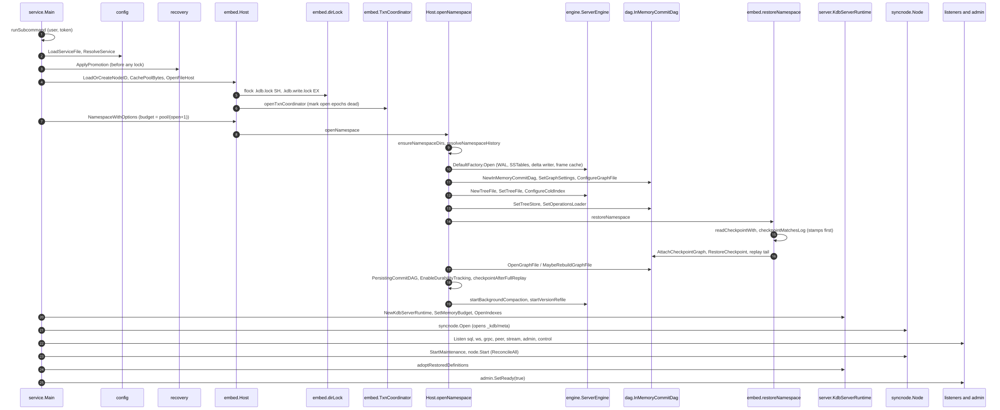

Mermaid source

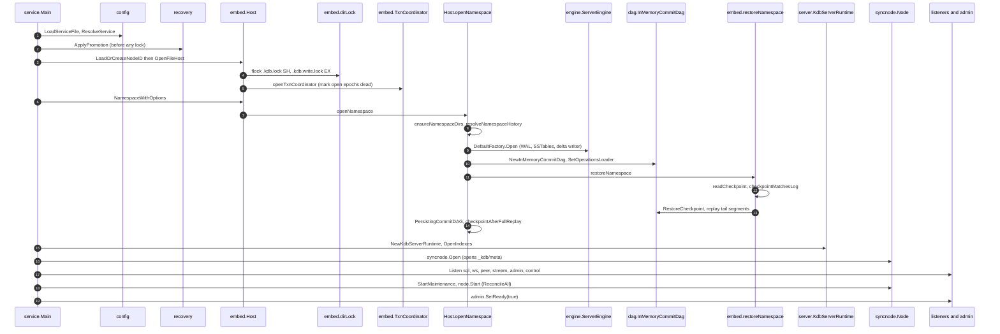

### Call chain

| # | Function (pkg.Type.Method) | File:line | What it does |
|---|---|---|---|
| 1 | `main.main` -> `service.Main` | go/cmd/kdb-service/main.go:11 -> go/kdb/service/service.go:46 | Entry point. `kdb-service user ...` is dispatched to `runUserCommand` first (service.go:47-49). |
| 2 | `config.LoadServiceFile` / `config.ResolveService` | service.go:134, :142 -> go/kdb/config/service.go:227, :250 | Merge precedence file < env < explicitly typed flags (`fs.Visit`, service.go:141). `ParseDurability`/`ParseSyncMode` validated at config/service.go:526, :532. Defaults: `Durability=sync`, `SyncMode=full`, `DrainTimeout=30s`, `MaintenanceInterval=5m`, SQL listener on 9090, peer/stream/WS/gRPC/admin/control off (config/service.go:131-173). |
| 3 | `buildLogger`, TLS, data-dir vs memory | service.go:167, :174-180, :182 | No `--data-dir` means in-memory mode (nothing below the lock step applies). Both `--data-dir` and `--memory` is exit 2. |
| 4 | `recovery.ApplyPromotion` | service.go:204 -> go/kdb/recovery/promote.go:231 (`applyPayload` :268) | Runs before the data root is opened (so before any lock). Verifies the staged payload commit count, renames live `ns/<ns>` to `superseded/<ns>-<stamp>`, renames payload into place, moves/removes `snap/kdb_checkpoint_<ns>`. Clears the intent file first, writes `.kdb.promote.last.json`. A malformed intent file is exit 1 (service.go:215-219). |
| 5 | `embed.LoadOrCreateNodeID` + `server.SetProcessNodeID` | service.go:261, :265 -> go/kdb/embed/node_identity.go:31, `writeNodeID` :76; go/kdb/server/node_identity.go:13 | Reads `<root>/NODE`; `KDB_NODE_ID` env overrides without writing; otherwise adopts `txn/HOST` if present, else a random UUID; written via `NODE.tmp`, `fsync`, `rename`, `syncDir`. |
| 6 | `embed.FileRuntimeOptionsFromEnv` | service.go:246 -> go/kdb/embed/storage_options.go:201 | Builds `FileRuntimeOptions` from `KDB_*` env (history mode/strategy, retain, cache bytes, `KDB_PREALLOCATE_SEGMENTS`, `KDB_CHECKPOINTS=off`, graph flags, S3). service.go:256-259 then overlays Durability/Compression/AsyncSyncIntervalMillis/SyncMode field by field (a wholesale overwrite once dropped the env values). |
| 7 | `embed.OpenFileHost` | service.go:266 -> go/kdb/embed/host.go:132 | Acquires locks, builds the shared segment I/O shim, opens the cross-namespace transaction coordinator, creates the memory arbiter and the multiplex adapter. |
| 7a | `embed.acquireDirLock` -> `flockFile` | host.go:142 -> go/kdb/embed/dir_lock_unix.go:44, :82 | `LOCK_SH|LOCK_NB` on `.kdb.lock` (attach lock), then `LOCK_EX|LOCK_NB` on `.kdb.write.lock`; writes `pid=<pid>\nruntime=<go version>` into the write lock and `Sync`s it (:58). Read-only hosts use `acquireDirLockShared` (:64); maintenance tooling uses `acquireDirLockExclusive` (:74). |
| 7b | `FileBackedPlatformIOFactory.Open` -> `buildSegmentByteStore` -> `storio.NewOSByteStore` | host.go:160 -> go/kdb/embed/segment_store.go:24 -> go/kdb/storage/io/os_store.go:39 | Primary store is `OSByteStore`; with `KDB_S3_*` / archive env it is wrapped by `PrimaryWithReplicas` (`NewPrimaryWithSinks`). `PlatformIOConfig{FsyncOnFlush: !ReadOnly, SyncMode, PreallocateBytes}` (host.go:164-171). Result is a `FileBackedPlatformIO` (go/kdb/storage/io/file_backed.go:60) with per-segment mutexes and an in-memory `sealedSegments` set. |
| 7c | `embed.openTxnCoordinator` | host.go:180 -> go/kdb/embed/txn_coordinator.go:105 | A writer renames every `txn/decisions-<epoch>.log` to `.dead` and `syncDir`s `txn/` before any namespace replays (:128-143). Read-only hosts skip this. |
| 7d | `storage.NewBudgetArbiter`, `engine.NewMultiplexAdapter` | host.go:196-197 | In-memory only; pool defaults to `DefaultHostMemoryBudgetBytes`. |
| 8 | `Host.NamespaceWithOptions` | service.go:268 -> host.go:248 | Idempotent per namespace id; seeds the namespace memory budget at `pool/(open+1)` (host.go:270) so replay does not spike the whole pool. Calls `openNamespace`, then registers the adapter (host.go:300) and arbiter participant (host.go:311). |
| 9 | `Host.openNamespace` | go/kdb/embed/file.go:69 | The per-namespace open sequence; rows 10-20 are its body. |
| 10 | `namespaceDirExists`, `ensureNamespaceDirs` | file.go:80, :82 -> :381, :361 | Creates `ns/<id>/`, `ns/<id>/delta/`, `ns/<id>/meta/` and a bootstrap `meta.json` (`{"namespaceId":...}`, plain `os.WriteFile`, not atomic). Skipped when read-only. |
| 11 | `resolveNamespaceHistory` | file.go:86 -> go/kdb/embed/namespace_meta.go:185 | Resolves history strategy+mode against the `meta.json` marker. Recorded value wins; a conflicting request is `HistoryStrategyMismatchError` (:99) / `HistoryModeMismatchError` (:126); unmarked pre-existing namespace resolves to replay+full; mode none forces replay. Writes the marker through `writeNamespaceMeta` (:57: tmp, fsync, rename, no directory fsync). |
| 12 | `engine.DefaultFactory.Open` | file.go:131 -> go/kdb/storage/engine/server_engine.go:808 | Opens `wal.DefaultFactory.OpenOrCreate` (:812, wal/default_wal.go:55), `NewServerEngine` (:820, :275, which calls `LsmBlobStore.DiscoverTables` at :282), `delta.Factory.OpenWriter` (:829), `OpenReader`, and installs `deltaColdLoader` + `SetCommitFrameReader` (:841-847). `TargetReadOnly` skips WAL and writer. |
| 12a | `delta.Factory.OpenWriter` / `scanExistingDeltaSequence` | go/kdb/storage/delta/writer.go:545, :564 | Lists `ns/<id>/delta/`, takes `max sequence + 1` as the writer's sequence. Never resumes the previous run's segment and does NOT create the file (created lazily by the first `Append`, see `OSByteStore.openFor`, os_store.go:79). A random-UUID (pre-Layer-13) segment name is `LegacySegmentFormatError` and the open fails. |
| 12b | `wal.DefaultFactory.OpenOrCreate` | go/kdb/storage/wal/default_wal.go:55 | Picks the lexicographically newest WAL id among `ns/<id>/wal/*`, or creates an empty `ns/<id>/wal/<uuid>` (`AppendToSegment(name, nil)`). `DefaultWriteAheadLog.Recover` (:313) exists but `ServerEngine.RecoverBlobsFromWal` (server_engine.go:415) has no production caller, so the blob WAL is NOT replayed at open. |
| 13 | `dag.NewInMemoryCommitDag`, `SetGraphSettings`, `SetTreeStore`, `SetOperationsLoader` | file.go:146, :155, :168, :175 -> go/kdb/embed/commit_ops_loader.go:39 | Empty DAG (genesis commit), engine becomes the single tree owner, evicted commit operations are read back lazily from delta frames (`commitOpsLoader.index`, commit_ops_loader.go:70, built once on first use). `KDB_GRAPH_FILE` is accepted but "not implemented yet" (dag/graph_settings.go:48-57). |
| 14 | `readNamespaceMeta`, `SetBodiesExternal` | file.go:177-181 | If `shallowRoots` non-empty or `bodiesExternal`, cold reads also consult the SSTable blob store. |
| 15 | `embed.restoreNamespace` | file.go:182 -> go/kdb/embed/checkpoint_open.go:26 | Decision tree in Data/Failure sections. Sets `eng.SetReplaying(true)` for the duration (:39). Returns `replayedInFull`. |
| 15a | `readCheckpoint` + `checkpointMatchesLog` | checkpoint_open.go:77, :81 -> go/kdb/embed/checkpoint.go:630, :543 | `shim.ReadSnapshot("kdb:checkpoint:<ns>")` -> `<root>/snap/kdb_checkpoint_<ns>` (name flattening `SnapFileName`, os_store.go:325). Decode failure, wrong version (`checkpointFormatVersion=2`, checkpoint.go:19) or wrong namespace is "no checkpoint". Every covered segment >= recorded floor must exist with the same listed size and last commit hash; `damagedInPlace` (:595) lets a same-length, bit-flipped segment keep the checkpoint. |
| 15b | `dag.RestoreCheckpoint`, `engine.RestoreLiveTree`, `RestoreCommitOperations`, `HydrateBranchHeads` | checkpoint_open.go:106, :110, :135, :139 -> go/kdb/dag/checkpoint.go:108, :148, :184 | Commit graph (no operations), branches, tags and the flat live tree come from the checkpoint; branch-head operations come from the checkpoint's `headCommits` payloads (hash re-verified). Replay-strategy namespaces also get `installTreeRebuilder` (:120). |
| 15c | `replayDeltaNamespaceFrom` | checkpoint_open.go:146 -> go/kdb/embed/delta_replay.go:57 | Reads only segments with sequence > `ThroughSequence` (or all, `-1`). `streamSegmentCommits` (:233) -> `DefaultReader.StreamCommits` (writer.go:473) -> `ScanSegmentFrames` (delta/scanner.go:83). Each commit passes `groupGate.skip` (:177), then `applyIfParentsReady` (:255); out-of-order commits are deferred and drained by `applyCommitsTopologically` (:287). `applyReplayedCommit` (:343) re-stages docs into the engine, `CommitTree`, `PutCommit`, `SetHead("main")`. |
| 16 | `checkpointAfterFullReplay` | file.go:215 -> checkpoint_open.go:275 | Only when `replayedInFull` and a writer exists: writes a checkpoint through `writerSeq-1` right away, so a service that is later `kill -9`'d does not replay the full log on every start. `saveCheckpoint` returns nil for `through < 0` (empty namespace writes nothing). |
| 17 | `NewPersistingCommitDAGWithAsyncInterval` -> `newCommitLogWriter` | file.go:204 -> go/kdb/embed/persisting_dag.go:47 -> go/kdb/embed/commit_log.go:100 | Starts the single log-writer goroutine (`commitLogWriter.run` :212 or `runAsync` :245) that owns group commit. `SetPersistListener(eng.RecordCommitLocation)` (file.go:212). |
| 18 | `EmbeddedKdbRuntime` assembly, `rt.maintain`, `rt.storageClose` | file.go:219, :258-289, :295 | `storageClose` = drain log, flush, seal, checkpoint, close engine (see flow 13). `maintain` closure used by the maintenance loop (flow 11). Returns `namespaceEntry` + `namespaceBudget` (file.go:315-317). |
| 19 | `server.NewKdbServerRuntime` | service.go:280 -> go/kdb/server/server_runtime.go:288 | Builds transaction/upsert engines, write gate (`newWriteGate(DefaultMaxQueuedWrites)`), `openConflictQueue` (:270 -> `<root>/replication/conflicts/<escaped ns>`), SQL engine, and `RebuildUniqueKeys` (:403; failure is stored, not fatal). |
| 20 | memory governance | service.go:302-334 | `SetMemoryBudget` (:315), `loadCostModelState` from `<root>/costmodel.json` if < 7 days old (:323, :944), `ApplyGoMemoryLimit` (:327). |
| 21 | `KdbServerRuntime.OpenIndexes` | service.go:353 -> go/kdb/server/index_wiring.go:31 | Loads `<root>/ns/<ns>/index/` catalog + snapshots, rebuilds stale stores from a scan of head, installs SQL index + search providers. Error is fatal (exit 1). Snapshots are flushed every 64 index-touching commits (`indexFlushEvery`, index_wiring.go:23). |
| 22 | `embed.OpenFileAuthRegistry` | service.go:365 (only if `--rbac` and data-dir) -> go/kdb/embed/auth_registry.go:40, :60, `openAuthNamespace` :104 | Opens `_system/users` and `_system/roles` as two namespaces with their own `FileBackedPlatformIO` over the same root (local disk only, no replicas), DurabilitySync, **full delta replay on every start** (no checkpoint, `replayDeltaNamespace` delta_replay.go:39). `reg.Close` flushes+seals both. Memory-only mode uses in-memory DAGs (service.go:374-390). |
| 23 | `server.NewNamespaceSet` | service.go:404 -> go/kdb/server/namespace_set.go:116 | Registry of per-namespace runtimes; the primary is added (:405). |
| 24 | `syncnode.Open` | service.go:435 -> go/kdb/syncnode/node.go:119 | Re-derives `NodeID` from the data root (:129-134), opens `_kdb/meta` through `host.Namespace` (:145), builds `MetaStore` (server/meta.go:191), starts conflict webhook/procedure/expiry goroutines, `set.AddKnown` for every namespace directory found by `embed.ListNamespaces` (:177-184). |
| 25 | `nsSet.SetOpener` | service.go:443 | Lazily opens other namespaces: validates id, refuses to create on read, `host.Namespace`, `NewKdbServerRuntime`, `node.Prepare`, `ShareGovernanceWith`, `OpenIndexes`. |
| 26 | `server.ListenSqlWireTLS` | service.go:482 -> go/kdb/server/wire_listen.go:49 | `tcp.NewTransport.ListenBound` + `Serve` goroutine per listener; `MaxConnections` and frame admitter wired in. |
| 27 | `server.ListenSqlWireWSTLS` | service.go:496 -> go/kdb/server/ws_listen.go:25 | Only if `--ws-addr`; same `sqlWireConnHandler`. |
| 28 | `grpcListenerFactory` | service.go:510 | Only in `kdb-service-grpc`; the plain binary exits 2 if `--grpc-addr` is set (service.go:152-158). |
| 29 | `syncnode.Node.Listen` -> `server.ListenPeerSyncTLS` | service.go:520 -> go/kdb/syncnode/node.go:452 -> go/kdb/server/peersync_listen.go:46 | Peer-sync TCP listener (v1 for the primary namespace, v2 across the set). Optional HTTP/WebSocket peer endpoint `/kdb/sync` at service.go:527-544. |
| 30 | `server.ListenStreamTLS` | service.go:548 -> go/kdb/server/stream_listen.go:44 | Stream hub; `srv.CommitListener` is set to publish commits (service.go:560). |
| 31 | `NewAbortWatchdog`, `NewAdminServer`, `control.New` | service.go:582, :590, :653 -> server/supervisor.go:52, server/admin.go:80, go/kdb/control | Watchdog only if `--abort-after > 0` (default off). Admin starts not-ready (`notReadyReason` "starting"). Control plane optionally opens every other namespace dir found as a secondary runtime (service.go:605-635) and chains `CommitListener` (:701-707). |
| 32 | `embed.StartMaintenance` per namespace | service.go:741-758 -> embed/maintenance_loop.go:232 | Started last (after every namespace is open) when `MaintenanceInterval > 0`; `Busy` = write-queue depth > 0. Only namespaces registered here get a loop (primary + control-plane secondaries). |
| 33 | `syncnode.Node.Start` | service.go:766 -> node.go:331 | `MetaStore.ReconcileAll` (server/meta.go:565) applies stored schema/index definitions to open namespaces, starts the replicator (one goroutine per peer) and the scrub loop (node.go:423). |
| 34 | `slog "KDB service started"`, `admin.SetReady(true, "")` | service.go:779, :803 | Readiness flips only here, after all listeners are bound and the maintenance/replication loops are started. |
| 35 | `signal.Notify(SIGINT, SIGTERM)` + wait | service.go:806-819 | Hand-off to flow 13. |

### Data that changes

| Step | Structure / file / wire message | Mutation |
|---|---|---|
| 4 | `<root>/.kdb.promote.json`, `<root>/.kdb.promote/`, `<root>/superseded/`, `<root>/.kdb.promote.last.json` | Intent removed first, payload dir removed, outcome file written (tmp+rename, no fsync, promote.go:458). Live `ns/<ns>` renamed aside; `snap/kdb_checkpoint_<ns>` moved with it or replaced. |
| 5 | `<root>/NODE`, `<root>/NODE.tmp` | Created once (`fsync` file, `rename`, `fsync` dir). Never rewritten afterwards. |
| 7a | `<root>/.kdb.lock` (flock SH), `<root>/.kdb.write.lock` (flock EX) | Files created `O_CREATE|O_RDWR`; write-lock file content replaced with `pid=..`/`runtime=..` and fsynced. Locks are kernel advisory locks tied to the open file description: released on process death. |
| 7c | `<root>/txn/decisions-<epoch %016d>.log` -> `.dead`; `<root>/txn/EPOCH`, `<root>/txn/HOST` | Open epochs of the previous writer renamed `.log` -> `.dead`, `txn/` directory fsynced. `EPOCH`/`HOST` are only created at the first cross-namespace transaction (`startEpochLocked`, txn_coordinator.go:206). In memory: `TxnCoordinator.dead` map. |
| 10 | `<root>/ns/<id>/{delta,meta}/`, `<root>/ns/<id>/meta.json` | Directories created (0755); minimal `meta.json` written if absent. |
| 11 | `<root>/ns/<id>/meta.json` | `historyStrategy`, `historyMode` recorded and rewritten on every writable open, not only the first (tmp, fsync, rename, no directory fsync). Read-only opens never write. |
| 12 | `<root>/ns/<id>/wal/<walUUID>` | Created empty if no WAL exists; otherwise the newest chain reused and its size read. No records replayed. |
| 12 | `<root>/ns/<id>/sstable/L<n>/<uuid>` | Discovered (`DiscoverTables`) and registered in `LsmBlobStore.tables`; no writes. |
| 12a | `<root>/ns/<id>/delta/<seq %020d>.seg` | Nothing on disk yet. The writer is only positioned at `max+1`; the file appears at first commit (`O_CREATE|O_EXCL`, optionally preallocated 64 MiB of zeros, fsync of the zero fill). |
| 13 | In-memory `InMemoryCommitDag` (`nodes`, `branches`, `tags`, `pins`), `ServerEngine.tree/treesByHash/docsByHash/memTable` | Populated by checkpoint restore and tail replay. `eng.SetReplaying(true)` suppresses per-commit side effects during replay. |
| 15b | `snap/kdb_checkpoint_<ns>` | Read only. |
| 15c | `d.PutCommit`, `d.SetHead("main")`, `store.PutDocument/DeleteDocument`, `store.CommitTree` | Replays commits, applying a commit to the live tree only if it extends main (merge-side commits are stored but not applied, delta_replay.go:344-363). Cross-namespace parts whose group never committed are skipped together with their descendants (`groupGate`). |
| 16 | `snap/kdb_checkpoint_<ns>` | Rewritten (tmp `*.tmp-*`, fsync, rename, directory fsync; legacy un-flattened file removed). Fields: format version 2, `throughSequence`, commits without operations, branches, tags, live tree, per-segment fingerprints (sequence, size, last commit hash), head commit payloads, `floorSequence`. |
| 17 | `commitLogWriter` goroutine + `reqs` channel (cap 256) | Created; the single appender for the namespace's delta log. |
| 19 | `<root>/replication/conflicts/<ns>/` | Conflict queue loaded/created. In-memory `UniqueKeyRegistry`, `WriteGate`. |
| 21 | `<root>/ns/<ns>/index/` | Index snapshots/catalog loaded; stale ones rebuilt and rewritten. |
| 22 | `ns/_system/users/`, `ns/_system/roles/` (delta + wal + meta.json) | Directories created, both logs replayed in full, new writer sequences (each start adds a segment file only once something is written). |
| 24 | `ns/_kdb/meta/...` | `_kdb/meta` opened like any namespace; `set.AddKnown` registers on-disk namespaces (names starting with `_` excluded). |
| 26-30 | Listening sockets | Bound; accept loops run in goroutines. Established connections are not tracked by `server.Listener`. |
| 33 | `<root>/replication/peers/` | `replication.NewStateStore` loads per-peer progress. |

### Failure, edge cases & durability points

- **Lock contention.** A second writer fails at `acquireDirLock` with `data directory locked: <root>/.kdb.write.lock`; a maintenance holder yields `data directory is locked for maintenance: <root>/.kdb.lock` (dir_lock_unix.go:46-53). `Main` prints `Error: ...` and exits 1 (service.go:272-275). Because they are `flock`s, `kill -9` releases them automatically. On non-unix builds `dir_lock_other.go` uses an `O_EXCL` file that goes stale after a crash and must be removed by hand; the shared (reader) lock is simply refused there (dir_lock_other.go:31).
- **Mixed versions.** An older binary takes `.kdb.lock` exclusively, so mixed-version operation fails to open rather than corrupting (dir_lock_unix.go:27-30).
- **Where the log becomes durable.** Nothing is fsynced during open except: `.kdb.write.lock` holder hint, `NODE`, `meta.json`, checkpoint (tmp fsync + rename + dir fsync), decision-log renames (dir fsync). Opening creates no delta segment file. The first segment-file creation is *not* followed by a parent-directory fsync (`OSByteStore.openFor` only syncs the zero fill when preallocating; a grep for `syncDir` finds no use in storage/io), so a power loss right after the first commit relies on the filesystem persisting the directory entry along with the file fsync.
- **Checkpoint is untrusted until verified (`restoreNamespace`).**
  - Disabled (`KDB_CHECKPOINTS=off`), missing, undecodable, wrong format/namespace, missing segment >= floor, or size/last-hash mismatch: `mustReplay()` (checkpoint_open.go:55-75, :81-93).
  - `ThroughSequence > highestSegmentSequence`: checkpoint ignored, full replay (:95-103).
  - `replayIsComplete := lowestSegmentSequence(r) <= 0` (:54): if the log was truncated (history=none) and the checkpoint cannot be used, the open fails with `*TruncatedLogError` (:62) instead of silently opening with less data. A namespace bootstrapped from a peer snapshot (`shallowRoots`) with no usable checkpoint fails with `*SnapshotCheckpointMissingError` (:59). Both end as `Error: ...` + exit 1.
  - Same-length bit damage in a covered segment keeps the checkpoint and logs the damaged frame offsets (checkpoint.go:574-580); bodies that lived only in damaged frames are unreadable until scrub repairs them from a peer (`Node.scrubLoop` node.go:423 -> `KdbServerRuntime.Scrub` server/scrub.go:60).
  - Edge: when a checkpointed head commit does not decode, the code does `return true, replayDeltaNamespaceFrom(d, store, r, -1, coord, nil)` (checkpoint_open.go:130-131) directly rather than through `mustReplay`, so the `TruncatedLogError` guard is bypassed on that single branch (an incomplete log would be replayed silently into a DAG that already holds checkpoint state).
- **Torn tail vs mid-log damage in replay (`replayDeltaNamespaceFrom`).**
  - A frame whose magic is missing, whose length is negative, or whose length runs past EOF stops the scan cleanly with no error (`frameBounds`, delta/scanner.go:122-135). This also covers the zero padding of a preallocated segment.
  - A complete frame with a CRC mismatch or an unparsable body returns `*CorruptFrameError` (scanner.go:140). Replay tolerates it only when that segment is the last one in the replay set (`isMostRecent`, delta_replay.go:114), logging `torn tail at byte offset N` and keeping the commits read before it. Any earlier segment is a hard error: "...is corrupt and is not the most recently written segment ... run kdb-inspect repair-segments" (delta_replay.go:129-136).
  - Consequence worth knowing: a CRC-bad full-length frame in the middle of the *newest* segment is treated as a torn tail, so every later frame in that segment is dropped (only a log line records it). And because `OpenWriter` always starts a fresh segment, a tolerated torn tail stops being "the last segment" as soon as the next session writes; a later full replay (checkpoint absent or disabled) would then fail on it. With checkpoints enabled the checkpoint written by `checkpointAfterFullReplay` covers it. (Derived from reading the code, not exercised.)
- **Apply failures are separated from read failures** (`replayApplyError`, delta_replay.go:91-103): a storage/DAG fault is returned as itself and is not misreported as segment corruption.
- **Orphan parents.** After streaming, deferred commits are placed topologically; if a round makes no progress the open fails with "N commit(s) reference parent commits never found in the log" (delta_replay.go:329-334), except commits listed in `meta.json` `shallowRoots`/`graftRoots`, which are admitted as horizons (`PutShallowCommit`).
- **Cross-namespace groups.** Undecided parts left by a dead epoch are rolled back with all descendants (`groupGate`, `resolvePart` txn_coordinator.go:376): the epoch file is `.dead` by now and a part whose group id is not in it is `partAborted`; `report()` logs `rolled back N commit(s)...` (delta_replay.go:83).
- **Blob WAL.** The `ns/<id>/wal/<uuid>` file is opened but its records are never replayed, and document commits do not write blob WAL records (`WriteBlob` callers are the policy registry and the multiplex adapter only); document durability is the delta log alone.
- **Auth registry is slower to open than data namespaces**: no checkpoint, so `_system/users` and `_system/roles` replay in full on each start. Failure is exit 1 `rbac registry`.
- **Listeners accept before the process is ready.** SQL/peer/stream/WS sockets are bound (service.go:482-564) well before `node.Start` applies stored schema/index definitions (service.go:766) and before `SetReady(true)` (service.go:803), so a client that does not poll `/readyz` can race definition reconcile. A bind failure at any listener is `os.Exit(1)`, which skips deferred closes; the OS drops the flock.
- **Memory-only mode** (`embed.OpenMemoryRuntime`, service.go:240): no lock, no NODE, no checkpoint, no maintenance (`rt.maintain` is nil so `StartMaintenance` returns nil), nothing survives restart.
- **Read-only open** (`OpenReadOnlyFileRuntime`, `Host.ReadOnly`): shared attach lock only; creates nothing (no dirs, no marker); `TargetReadOnly` engine has no WAL/writer; `rt.refresh` re-replays the writer's log (file.go:248-253).
- **Not implemented despite flags/docs:** `KDB_GRAPH_FILE` (on-disk commit graph) is accepted and normalized but inert; `GraphFileActive` is always false (dag/graph_settings.go:48-57, :138).

---

## 2. Client connect + auth/session token + admission

### Description (short)

A Go client (`client.Client`) dials a listener over TCP, TLS (`tcps://`), WebSocket (`ws://`, `wss://`) or a caller-supplied transport (gRPC). It then sends one `HANDSHAKE` frame carrying credentials. The server authenticates against the pluggable `auth.Engine` (`AllowAll` by default, or the durable `RegistryAuthStore` when `--rbac` is on). It authorizes a `SessionBeginAction` against the connection's default namespace and records the `auth.Principal` on the connection handler. After that the client lazily opens one server `KdbSession` per namespace with `SESSION_BEGIN`; the server authorizes that again, per namespace.

Every later frame passes through two layers of admission:

1. A header-only gate in the transport (`frameAdmitter`), driven by the `MemoryGuard` zone.
2. Per-operation gates in the handlers: memory grants (`Admission`), the capacity-1 `writeGate`, and the `MaxConnections` cap at accept time.

Refusals reach the client as typed errors: `ErrorCode` (BUSY, UNAVAILABLE, DEADLINE_EXCEEDED, RESOURCE_EXHAUSTED, ...) plus `RetryAfterMs`.

Two things the name "session token" can mean here:

- There is **no bearer or session token for authentication**. The `Token` field on the handshake is just a combined `"user:secret"` string. Credentials are checked once per connection and the resulting `Principal` lives for the life of that TCP/WS connection.
- The "session token" in `server/session_token.go` is a **read-your-writes causal token**: the newest commit hash the client has seen. It has nothing to do with authentication.

### Diagram

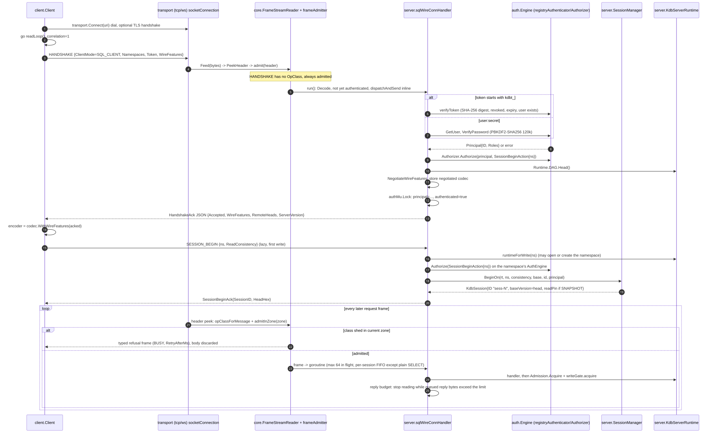

Mermaid source

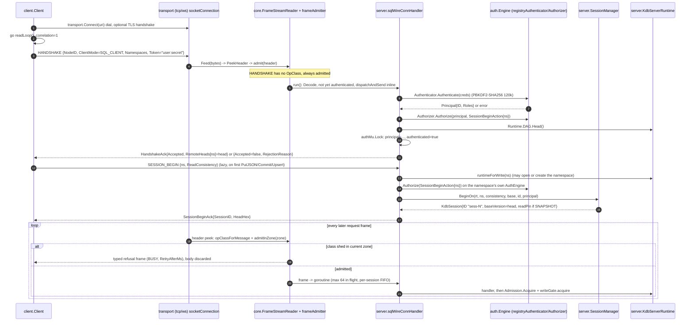

### Call chain

| # | Function (pkg.Type.Method) | File:line | What it does |
|---|---|---|---|
| 1 | `client.Connect` / `client.ConnectWithOptions` | `client/client.go:273` / `:279` | Picks a transport, dials, creates `Client{pending map, namespaces map, correlation=1}`, starts `readLoop`, sends the handshake. Fixed JSON codec: `wire.NewCodec(wire.EncodingJSON)` (`:307`). |
| 2 | `client.dialTransport` | `client/client.go:357` | Scheme switch: `tcp://`, `tcps://` -> `tcp.NewTransport`; `ws://`, `wss://` -> `ws.NewTransport`. `ConnectOptions.Transport` bypasses it (used for gRPC). A bare `host:port` gets `tcp://` prepended (`:288`). |
| 3 | `tcp.defaultTransport.Connect` | `transport/tcp/transport.go:45` | `ParseURI`, refuses `tcps://` without usable TLS settings (no plaintext fallback), `net.Dialer` with connect timeout, `TCP_NODELAY`, `tlsClientHandshake` (`:95`), `newSocketConnection` (`:206`). |
| 4 | `Client.readLoop` | `client/client.go:386` | Decodes each incoming frame and routes it to `pending[correlationID]`. Frames that fail to decode are silently skipped (`:390`). On connection close it closes all pending channels, so callers get `ErrClosed`. |
| 5 | `Client.request` | `client/client.go:423` | Registers a reply channel keyed by `CorrelationID`, `conn.Send(frame)`, waits for reply or `ctx.Done()`. Does not send if `ctx` is already cancelled (`:426`). |
| 6 | `wire.DefaultCodec.Encode` | `wire/codec.go:26` | Frame = 12-byte header (`len32 LE, type16, protoVer16, correlation32`, `wire/frame.go:67`) + 1 encoding-tag byte + JSON envelope. Max frame 16 MiB (`wire/types.go:11`). |
| 7 | `tcp.defaultTransport.Serve` | `transport/tcp/transport.go:138` | Accept loop. If `MaxConnections>0` and active count >= cap, the new socket is closed immediately with no frame (`:164`). Otherwise `go handler(newSocketConnection(...))`. |
| 8 | `tcp.socketConnection.readLoop` | `transport/tcp/transport.go:238` | `reader.Feed(buf)`; writes `TakeRejections()` replies directly from this goroutine before delivering admitted frames to the `incoming` channel. Blocking send gives backpressure. |
| 9 | `core.FrameStreamReader.drainCompleteFrames` | `transport/core/framing.go:197` | `ValidateFrameLength`, then `wire.PeekHeader` (`wire/frame.go:99`) and `admit(header)`. If admit returns an error, the rejection frame is queued and `discardRemaining=frameLength` swallows the body without assembling it. |
| 10 | `KdbServerRuntime.frameAdmitter` | `server/frame_admission.go:54` | `opClassForMessage` (`:17`) maps `DOCUMENT_GET` -> `ClassPointRead`; `SQL_EXEC`/`SEARCH` -> `ClassScan`; `TX_COMMIT`/`UPSERT`/`TRANSACTION_REPLAY`/`TX_COMMIT_MULTI` -> `ClassWrite`; `COMMIT_PUSH`/`DELTA_COMMIT` -> `ClassReplication`. Handshake, session begin, rollback, locks and history are unclassified and never shed. Consults `memGuard.CurrentZone()` + `admitInZone`; on shed builds a `MemoryPressureError` and `rejectionMessage` (`:82`). If no typed reply can be built, the frame is admitted rather than dropped (`:67`). |
| 11 | `server.ListenSqlWireTLS` | `server/wire_listen.go:49` | Wires `opts.Admitter = runtime.frameAdmitter(codec)` and `opts.MaxConnections`, `transport.ListenBound`, then `Serve` with `newSqlWireConnHandler(codec, runtime).run(conn)`. WS variant: `ListenSqlWireWSTLS` `server/ws_listen.go:25` (same handler; the WS read loop at `transport/ws/transport.go:550` applies the same `admit` at `:571`). |
| 12 | `server.newSqlWireConnHandler` | `server/wire_listen.go:132` | One handler and one `SessionManager` per connection (`NewSessionManager`, `server/session_manager.go:221`). |
| 13 | `sqlWireConnHandler.run` | `server/wire_listen.go:154` | Reader loop. Until `isAuthenticated()`, frames are handled inline (`:172`); afterwards each frame gets a per-session FIFO ticket (`sessionTicket` `:207`), a slot in `inFlight` (cap `MaxInFlightFrames=64`, `:93`) and its own goroutine. `defer closeAllSessions` (`:160`). |
| 14 | `sqlWireConnHandler.dispatch` | `server/wire_listen.go:354` | Type switch. Unknown or unhandled types return `nil`, so **no reply is sent** (`:387`). |
| 15 | `sqlWireConnHandler.handleHandshake` | `server/wire_listen.go:391` | Requires `ClientMode==SQL_CLIENT`. `AuthEngine.Authenticator().Authenticate`, then `Authorize(SessionBeginAction{ns})` where `ns` is `Namespaces[0]` or `Runtime.DefaultNamespace` (`:402-410`). Reads `DAG.Head()`, then sets `principal` and `authenticated` under `authMu` (`:420`). Replies via `handshakeAck` (`:447`). |
| 16 | `registryAuthenticator.Authenticate` | `auth/registry_auth_engine.go:31` | `resolveUserAndSecret` (`:57`: `User`+`Password`, or `Token` split at the first `:`) -> `RegistryAuthStore.GetUser` (`auth/registry_store.go:98`) -> `VerifyPassword` (`:106`, `auth.VerifyPassword` PBKDF2-HMAC-SHA256, 120k iterations, `auth/password_hasher.go:38`) -> `Principal{ID, Roles}`. |
| 17 | `registryAuthorizer.Authorize` | `auth/registry_auth_engine.go:71` | `GrantsByRole()` (`registry_store.go:214` scans the roles namespace on every call), `actionToResource` (`:94`: `SessionBeginAction` -> kind `read`), `PrincipalHasPermission` (`auth/permission_matching.go:32`). |
| 18 | `auth.AllowAll` | `auth/engine.go:22` | Default engine: every credential yields `Principal{ID:"anonymous"}`, every action is allowed. |
| 19 | `service` RBAC setup | `service/service.go:362-390` | `embed.OpenFileAuthRegistry(dataDir)` (`embed/auth_registry.go:40`), `auth.NewRegistryAuthEngine(reg.Store)`. Users and roles are ordinary documents in reserved namespaces `_system/users` and `_system/roles` (`auth/registry_store.go:17-18`), persisted in their own delta logs. Without `--data-dir` it uses an in-memory registry. |
| 20 | `Client.ensureNamespace` / `Client.beginSession` | `client/client.go:471` / `:490` | First write to a namespace sends `SESSION_BEGIN{ReadConsistency:"READ_COMMITTED"}`; caches `namespaceState{sessionID, head}`. An empty `SessionID` in the ack becomes `ErrUnauthenticated` (`:506`). |
| 21 | `sqlWireConnHandler.handleSessionBegin` | `server/wire_listen.go:469` | Requires prior handshake. `runtimeForWrite(ns)` (`:477`, `server/multi_commit.go:43`) -> `NamespaceSet.Resolve(ns, create=true)` (`server/namespace_set.go:218`), then `Authorize(SessionBeginAction)` on that runtime's `AuthEngine` (`:481`), then `SessionManager.BeginOn`. |
| 22 | `SessionManager.BeginOn` | `server/session_manager.go:241` | Resolves the head (or a client `BaseVersionHex` that must exist, `:253`), mints id `sess-<runtime ordinal>` (`nextSessionOrdinal`, `server_runtime.go:421`, runtime-global so two connections never share ids), builds `KdbSession`, `startTransactionAt(head)` (`:117`: sets `baseVersion`; for `SNAPSHOT` sets `readPin` and takes `dag.Pin`). |
| 23 | `KdbServerRuntime.SetMemoryBudget` | `server/server_runtime.go:602` | Called by `service/service.go:315`. Builds `NewMemoryGuard` (`server/memory_guard.go:158`, 200 ms sampler) and `NewAdmission` (`server/admission.go:105`: semaphore of `limit-reserve` bytes, rescue reserve, `CostModel`). With limit 0, `admission` is nil and every `Acquire` is a no-op grant. |
| 24 | `MemoryGuard.observe` | `server/memory_guard.go:219` | 5-sample moving average; zones Normal/Elevated/High/Critical at 70/85/93 % of the budget (entry points relative to `rejectFraction=0.85`, `:145`). Escalation is immediate; de-escalation needs `zoneDwell=600ms` and the 0.9 hysteresis ratio. |
| 25 | `admitInZone` / `retryAfterMsForZone` | `server/admission.go:284` / `:298` | Normal/Elevated admit all. High admits point reads + replication only. Critical admits only point reads. Retry hints: 50 / 100 / 500 ms. |
| 26 | `Admission.AcquireBytes` | `server/admission.go:331` | Re-checks the zone, enforces the per-class base cost, point reads are clamped to capacity (never RESOURCE_EXHAUSTED), `cost > capacity` -> `ResourceExhaustedError`, `TryAcquire` else blocking `sem.Acquire(ctx)` -> `BusyError` on ctx expiry. |
| 27 | `writeGate.acquire` | `server/write_gate.go:56` | `queued` channel (default 64, `DefaultMaxQueuedWrites`, `server_runtime.go:33`) full -> immediate `BusyError{RetryAfterMs:50}`. `running` is capacity 1. ctx expiry while queued -> `DeadlineExceededError`. |
| 28 | `classifyError` | `server/error_classification.go:16` | Error type to `wire.ErrorCode` + retry-after: Busy/ReplicaBehind/MemoryPressure -> BUSY; Unavailable -> UNAVAILABLE; DeadlineExceeded -> DEADLINE_EXCEEDED; `ResourceExhaustedError` and `sql.ScanRowBudgetExceededError` -> RESOURCE_EXHAUSTED (no retry hint); `ConflictError` -> CONFLICT (+ jittered hint); `AuthorizationError` -> UNAUTHORIZED; `UnsupportedError` -> UNSUPPORTED; `NotHomeError` -> NOT_HOME; `StaleFenceError` -> CONFLICT; `SchemaError` -> UNIQUE_VIOLATION or SCHEMA_VIOLATION; else INTERNAL. |
| 29 | `KdbServerRuntime.conflictRetryAfterMs` | `server/backoff.go:42` | Full-jitter hint for CONFLICT: uniform in `[2, min(250, queueDepth*meanServiceTime)]` ms, drawn server-side. |
| 30 | `client.classifiedError` | `client/client.go:83` | Maps the wire code to a client error type. It handles only **BUSY, UNAVAILABLE, DEADLINE_EXCEEDED, UNSUPPORTED and NOT_HOME**. Every other code, including RESOURCE_EXHAUSTED, UNAUTHORIZED, UNIQUE_VIOLATION and SCHEMA_VIOLATION, collapses to `fmt.Errorf("kdb: %s", msg)` and the code is lost. CONFLICT arrives on a separate frame and is handled by `decodeConflictError` (`:681`). |
| 31 | `client.backoffDelay` / `waitBackoff` | `client/conditional.go:212` / `:226` | Client-side retry exists only inside `CompareAndSwap` (`:124`). It prefers the server hint (`retryHint` `:192`). Plain `PutJSON`/`Commit`/`GetJSON` never retry automatically. |
| 32 | `Session` (read-your-writes token) | `client/session.go:18-95` | `Client.NewSession` keeps `seen[ns]=newest commit`; `Token()`/`Resume()` export and import it. `getJSON` sends it as `MinCommit` on `DOCUMENT_GET`. Server side: `KdbServerRuntime.AwaitCommit` `server/session_token.go:38`. |
| 33 | `sqlWireConnHandler.closeAllSessions` | `server/wire_listen.go:261` | On connection end: `DocumentLocks.ReleaseAll(sessionID)`, `ClearLeases`, `SessionManager.End` (drops the SNAPSHOT `dag.Pin`). |

### Data that changes

| Step | Structure / file / wire message | Mutation |
|---|---|---|
| Dial | Client `Client.conn`, `pending` map, `correlation` counter | New TCP/TLS/WS connection; `pending[cid]` reply channels registered and deleted per request. |
| Accept | `tcp.Serve` `active` atomic counter | Incremented per accepted connection, decremented in `socketConnection.Close` via `onClose` (`transport.go:289`). |
| Handshake frame | Wire `HANDSHAKE` (type 0x01): `HandshakePayload{NodeID, Namespaces, ClientMode, ProtocolVersion, Token/User/Password}` | Carried in the clear unless `tcps://` or `wss://`. |
| Handshake ok | `sqlWireConnHandler.principal` + `authenticated` (under `authMu`) | Set once; a later repeated handshake on the same connection re-authenticates and replaces the principal. |
| Handshake ack | Wire frame typed `MsgHandshake` (not a separate ack type, `wire_listen.go:455`): `HandshakeAckPayload{Accepted, NegotiatedEncoding=JSON, ProtocolVersion=1, RemoteHeads{ns:head}, RejectionReason}` | `RemoteHeads` has a single entry for the handshake namespace. |
| Session begin | `SessionManager.sessions[id]` (per-connection map); `NamespaceSet.runtimes` | New `KdbSession`; possibly a new namespace runtime opened or created via `NamespaceSet.Resolve` -> opener in `service/service.go:443` (creates the namespace directory under the data root). |
| Session begin (SNAPSHOT) | `InMemoryCommitDag` pin table (`dag/retention.go:33`) | `Pin(head)` held until `KdbSession.EndTransaction`. |
| Session begin ack | Wire `SESSION_BEGIN_ACK` (0x13): `SessionID, HeadHex, ReadConsistency, Error` | Client stores `namespaceState{sessionID, head}`. |
| Per frame | `MemoryGuard.zone` (atomic), `Admission.sem`, `outstandingBytes`, `writeGate.queued/running`, `AdmissionStats` counters | Updated by sampler goroutine and by each admitted request. |
| Shed at header | `FrameStreamReader.discardRemaining`, `rejections` | Body bytes dropped without allocation; a rejection frame is written straight to the socket. |
| Disconnect | `LockManager` entries, `KdbSession` pins, `sessions` map | Released/removed by `closeAllSessions` (deferred in `run`). |
| RBAC store (admin path) | `_system/users`, `_system/roles` namespaces: delta segments `ns/_system/users/delta/<seq>.seg` under the data root | Written only by `RegistryAuthStore.CreateUser`/`AssignRole` etc. (`kdb-service user create`). Not touched by the connect flow, only read. |

### Failure, edge cases & durability points

- **Nothing durable happens in this flow.** Connect, handshake and session begin write no WAL or delta segment. The only persistent state involved is the RBAC registry, which is read-only here. The `Principal` is purely in-memory and ends with the connection.
- **Auth rejection.** The server answers `Accepted=false` with `RejectionReason=err.Error()`. The client closes the socket and returns `fmt.Errorf("%w: %s", ErrUnauthenticated, reason)` (`client.go:336`).
  - The reasons are distinguishable: `unknown user: X` vs `invalid credentials for user: X` (`registry_auth_engine.go:41,48`). This allows username enumeration.
  - There is no attempt limit or lockout. The server keeps the connection open after a rejection, so a client can send another handshake.
  - Each attempt costs one PBKDF2 (120k iterations) on the connection's reader goroutine, inline, before any concurrency.
- **Handshake negotiation is not implemented on the Go server.** `wire.DefaultHandshakeNegotiator.Negotiate` (`wire/handshake.go:19`) has no non-test callers. `handleHandshake` ignores `ProtocolVersion` and `PreferredEncodings`, and `handshakeAck` always answers `EncodingJSON` / version 1. The Go client is JSON-only, so this works in practice; a peer proposing another encoding would not be refused.
- **Frames before authentication.** `run` dispatches them inline and each handler returns "not authenticated" (`documentGetError` `"not authenticated"`, `sessionBeginError`, ...). Message types with no `case` in `dispatch` return `nil`, i.e. no reply at all. There is no handshake timeout.
- **Authorization granularity.**
  - The handshake authorizes only against one namespace: `Namespaces[0]`, else `Runtime.DefaultNamespace`. `client.Connect` sends no namespaces, so this is the default namespace. Real per-namespace authorization happens in `handleSessionBegin`.
  - Writes are re-authorized per operation as `DocumentWriteAction` inside `admitWrite` -> `authorizeOperations` (`server_runtime.go:1009`), using `s.Runtime.DefaultNamespace`.
  - `SESSION_BEGIN` needs the `read` permission (`actionToResource`, `registry_auth_engine.go:97`).
- **Observation: ordering in `handleSessionBegin`.** `runtimeForWrite(msg.Namespace)` (`:477`, `create=true`) runs before `Authorize` (`:481`). The opener registered at `service/service.go:443` validates the ID and creates the namespace when `create` is true; its comment says only "a commit, which is a write authorized against that namespace, may" create one. A principal who then fails authorization may still have caused the namespace to be created. (Read from the code only; not exercised.)
- **Connection cap.** `MaxConnections` closes excess sockets at accept with no error frame, so the client sees an EOF or a failed handshake. `Client.readLoop` then closes pending channels and callers get `ErrClosed`.
- **Admission layering.**
  - Layer 1 is the header-time zone shed (`frameAdmitter`). It is binary per class and needs no memory grant.
  - Layer 2 is per-handler: `Admission.Acquire` for writes in `runTransaction`, `AcquireBytes` for point reads (`readAcquireTimeout=2s`, `wire_listen.go:582`) and scans, then `writeGate`.
  - A write's grant plus gate wait share one `context.WithTimeout(DefaultWriteTimeout=5s)` (`server_runtime.go:817-821`). The durability wait is not bounded by it.
  - `HISTORY_LIST` and `REVERT` are not classified, so they are never memory-shed. `REVERT` takes the write gate with `context.Background()` (no timeout, `history.go:124`).
- **Error surface summary.**
  - Shed or grant failure: BUSY + `RetryAfterMs` (50 / 100 / 500 by zone).
  - Oversized: RESOURCE_EXHAUSTED, no retry hint. A point read is never RESOURCE_EXHAUSTED because it is clamped to capacity.
  - Full write queue: BUSY(50).
  - Queue wait exceeds 5 s: DEADLINE_EXCEEDED.
  - Draining (`BeginDraining`, `server_runtime.go:520`): UNAVAILABLE.
  - A client hitting RESOURCE_EXHAUSTED sees only a generic `kdb: ...` error (see row 30), so it cannot branch on it with `errors.Is`.
- **Session token semantics.** `AwaitCommit` polls `DAG` with exponential sleep (1 ms doubling to 50 ms) for up to `SessionWait` (default 2 s, `session_token.go:14`). If still behind, it returns `ReplicaBehindError`, classified as BUSY with a 250 ms hint. Only the Go server honours `MinCommit`.
- **Router redirect.** `client.Router` (`client/router.go:38`) follows `NOT_HOME` by parsing `home=<addr>` out of the error text (`homeAddr` `:25`) and connecting there with the same token.
- **Idle/concurrency.** Frames on one connection run concurrently, up to 64 in flight. Ordering is guaranteed only for frames that name a session: `SQL_EXEC`, `TX_COMMIT`, `TX_ROLLBACK` and the lock verbs (`sessionIDOf` `wire_listen.go:240`). `DOCUMENT_GET` and `UPSERT` are free-running.

---

## 3. Document put/commit (single write, incl. group commit)

### Description (short)

`client.Client.PutJSON` (and `Commit`) build a `document.Transaction`, encode it with `wire.EncodeTransaction`, and send it as `TX_COMMIT` on the namespace's session. `client.Client.Upsert` is a separate `UPSERT` frame that uses a LAST_WRITE engine and needs no base version.

On the server, `handleTxCommit` -> `commitSession` -> `KdbServerRuntime.Commit` -> `commitWith` -> `runTransaction`:

1. The write path runs the cheapest-first admission checks.
2. The write takes a memory grant and the capacity-1 `writeGate`.
3. It does index pre-validation.
4. It runs the transaction engine (`transaction.defaultEngine.Commit`), which does the schema, precondition, conflict and unique-key phases and applies the writes: staged document puts, `CommitTree` for the new document trie root, and `InMemoryCommitDag.AppendCommitWith` (compare-and-swap on head, then an atomic head-snapshot publish).
5. It applies index updates and queues the commit on the delta log with `PersistingCommitDAG.PersistAsync`.
6. It **releases the write gate before the disk wait**.

The group-commit mechanism is the single `commitLogWriter` goroutine, which coalesces every record queued while the previous fsync was in flight into one `Flush` (`maxLogBatch=256`). A separate cross-namespace group commit (`embed.CommitGroup`, `server.NamespaceSet.CommitAcross`) exists for `TX_COMMIT_MULTI` and SQL transactions touching several namespaces; it is covered as a variant below.

### Diagram

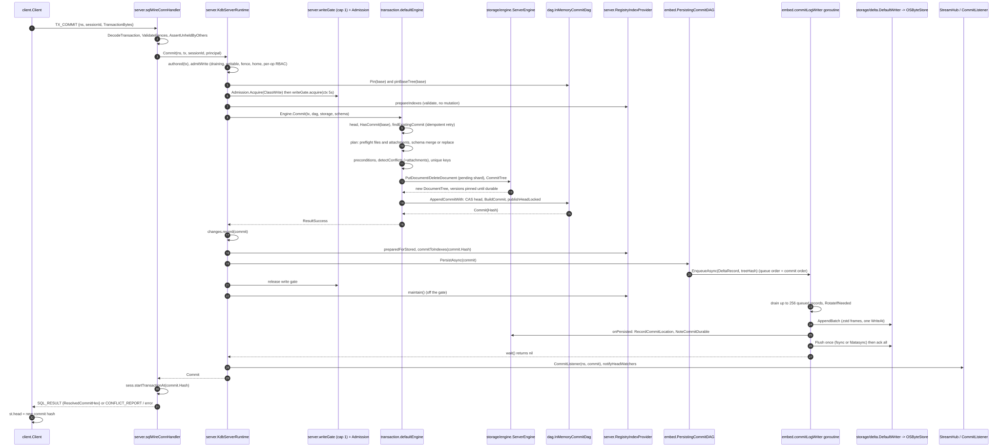

Mermaid source

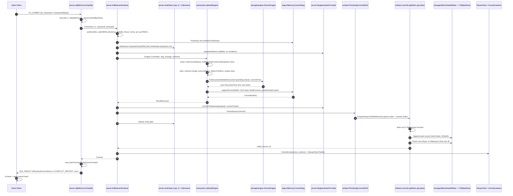

### Call chain

| # | Function (pkg.Type.Method) | File:line | What it does |
|---|---|---|---|
| 1 | `client.Client.PutJSON` | `client/client.go:520` | Validates the UUID, `ensureNamespace`, builds `document.Transaction{ID: random UUID, BaseVersion: st.head, Operations:[WriteOp{DocID, Patch}], Timestamp: now, AuthorNodeID: random per-client}`, then `commitTransaction`. `Client.Commit` (`:619`) is the same with caller-supplied `BaseVersion`, writes and deletes. |
| 2 | `client.Client.commitTransaction` | `client/client.go:646` | `wire.EncodeTransaction` (`wire/transaction_codec.go:41`), sends `TxCommitMessage`, handles `ConflictReportMessage` -> `decodeConflictError` (`:681`; `PRECONDITION_FAILED` becomes `*PreconditionError`, else `*ConflictError`), or `SqlResultMessage` -> updates `st.head`. |
| 3 | `client.Client.Upsert` | `client/client.go:585` | Sends `UPSERT {ns, docId, json, sessionId}`; reply `UpsertResultMessage` carries `CommitHex`. |
| 4 | Transport admit | `server/frame_admission.go:54` | `TX_COMMIT` / `UPSERT` are `ClassWrite`: shed at the header in Critical and High zones (see flow 2 row 10). |
| 5 | `sqlWireConnHandler.handleTxCommit` | `server/wire_listen.go:763` | Looks up the session, calls `commitSession`. Frames on one session are FIFO-ordered by `sessionTicket`. |
| 6 | `sqlWireConnHandler.commitSession` | `server/wire_listen.go:780` | `wire.DecodeTransaction(encoded)` (`wire/transaction_codec.go:66`) or `sess.Pending.Build`. `LeasesFor` + `DocumentLocks.ValidateFences` (`transaction/lock_manager.go:220`). `AssertUnheldByOthers` (`:328`) refuses documents leased by another session. Then `srv.Commit`. On `ConflictError` -> `conflictReport` (`:1135`); other errors -> `sqlResultErrorClassified` (`:1263`). Success -> `sess.startTransactionAt(commit.Hash)` and `SqlResultMessage{ResolvedCommitHex, RowsAffected}`. |
| 7 | `KdbServerRuntime.Commit` -> `commitWith` | `server/server_runtime.go:641` -> `:717` | `authored(tx)` (`:767`) overwrites `AuthorNodeID` with this node's `NodeID`; `clientWrite` (`:728`, write-back projection serialization only) -> `runTransaction`. Calls `engine.Commit(tx, s.dag, s.Runtime.Storage, s.Schema(), nil, s.clientMessage(tx))` with the strict engine. |
| 8 | `KdbServerRuntime.runTransaction` | `server/server_runtime.go:790` | Orchestrates everything below (rows 9-17). |
| 9 | `KdbServerRuntime.admitWrite` | `server/server_runtime.go:911` | In order: `draining` -> `UnavailableError`; `Runtime.AssertWritable()`; `fenceErr()` (a failed cross-namespace group fences the runtime); projection write rules; `admitHome()` (single-home namespaces -> `NotHomeError`); `authorizeOperations` (`:1009`, per-op `DocumentWriteAction`/`DocumentDeleteAction`). |
| 10 | `InMemoryCommitDag.Pin` / `KdbServerRuntime.pinBaseTree` | `dag/retention.go:33`, `server/server_runtime.go:684` | Keeps the base commit and its tree alive while queued so compaction cannot reclaim them and the schema phase does not rebuild the tree. |
| 11 | `Admission.Acquire(ClassWrite, payloadBytes)` | `server/admission.go:320` | Cost = max(model estimate for patch bytes, class base) (`CostModel.Estimate` `costmodel.go:246`); zone check; semaphore. Grant held until `runTransaction` returns, including the durability wait. |
| 12 | `writeGate.acquire` | `server/write_gate.go:56` | One committer at a time per namespace runtime. Release records service time into an EWMA (`observeService` `:77`) that feeds `conflictRetryAfterMs`. |
| 13 | `KdbServerRuntime.prepareIndexes` | `server/index_wiring.go:210` | If a `RegistryIndexProvider` with descriptors exists: `prepareCommitForIndexes` (`:163`) builds `index.PreparedWrite`s per Write/Delete op. A value the indexes cannot accept (e.g. wrong vector length) rejects the whole transaction *before* it lands. |
| 14 | `defaultEngine.Commit` | `transaction/default_engine.go:29` | `d.Head()`, `HasCommit(tx.BaseVersion)` else `BaseNotFoundError` (`:44`). `findExistingCommit` (`:427`, O(1) by transaction id with identical parents) returns the existing commit for an idempotent retry. Then `finalizeTransaction` (`:185`). |
| 15 | `defaultEngine.plan` | `transaction/prepare.go:103` | `HeadIs(anchor)` -> `extendingTip`; `preflightFileWrites`; `runSchemaPhase` (`default_engine.go:309`: merges the patch over the existing document with `Document.Merge`, runs `schema.Validate`, tracks per-transaction pending state so delete-then-write is a replace); `evaluatePreconditions` (`transaction/preconditions.go:26`); `detectConflicts` (`default_engine.go:212`, strict policy only: compares base-tree vs head-tree content hash for each touched document, ops with a precondition are exempt); optional `ConflictPolicyCustom` resolver; `planUniqueKeys` (`transaction/unique_registry.go:357`). Rejections return `ResultConflict` / `ResultSchemaError` and nothing is staged. |
| 16 | `PreparedCommit.Apply` | `transaction/prepare.go:221` | `store.PutDocument` / `DeleteDocument` for each op (staged in the engine's pending shard), `operationsAsStored` (`default_engine.go:569`: the commit records the *merged* stored document, not the raw patch), `store.CommitTree(ns, anchorTreeHash)`, `d.AppendCommitWith(...)`. Lost head CAS -> `DiscardPending`. Then `UniqueKeyRegistry.Apply(retract, claim)`. |
| 17 | `ServerEngine.PutDocument` / `commitTreeLocked` | `storage/engine/server_engine.go:440` / `:694` | `CommitTree` (`:658`) -> `commitTreeLocked`: takes `pending.TakeAllAndClear()`, under `treeMu` applies `tree.Without(id)` / `tree.With(id, contentHash)` (persistent document trie, O(delta)), pins/puts versions in `docsByHash`, `putTreeObject` (`tree_objects.go:382`), `stashPendingLocations`, `publishTreeLocked` (`:269`: `treesByHash.Put` + atomic `latestTree`). After releasing locks `maybeFlushMemtable` may write an SSTable. |
| 18 | `InMemoryCommitDag.AppendCommitWith` -> `appendCommitLocked` | `dag/provisional.go:23` -> `dag/in_memory_commit_dag.go:958` | Under `d.mu`: `requireCommitPresentLocked(parent)`; compare-and-swap of `branches["main"].HeadHash == expected` else `*HeadConflictError`; `putTreeLocked`; `document.BuildCommit` (content-addressed hash over parents, ns, tx id, causal timestamp, author, ops, tree hash, schema hash, message); `putCommitLocked`; `b.HeadHash = commit.Hash`; `publishHeadLocked` (`:174`) stores the new `headSnapshot` atomically for lock-free readers. `causalTimestampLocked` forces timestamp > every parent. |
| 19 | `RegistryIndexProvider.commitToIndexes` | `server/index_wiring.go:183` | Applies prepared index updates keyed by the landed commit hash (under the gate so index order = log order); every `indexFlushEvery` commits `p.save()`. An error here is returned to the client **after** the commit is already in the DAG. |
| 20 | `PersistingCommitDAG.PersistAsync` | `embed/persisting_dag.go:137` | `deltaRecordFor(c)` (`:179`, payload = `c.ToPayloadBytes()`); `commitLogWriter.EnqueueAsync` (`embed/commit_log.go:143`) puts the request on a 256-slot channel *under the write gate* so queue order equals DAG order. Returns `wait`, wrapped by `chainOnBarrier` (`:160`) when a cross-namespace group part is undecided ahead of it. No log (read-only or `Durability=memory`) -> no-op. |
| 21 | Gate release | `server/server_runtime.go:884` | `releaseNow()` frees the single commit slot before `waitDurable()`, so the next writer's plan/apply overlaps this commit's fsync. |
| 22 | `commitLogWriter.run` | `embed/commit_log.go:212` | Sync mode loop: take first request, `drain` (`:321`) everything already queued (<= `maxLogBatch=256`), `writeBatch` (`:405`) = `appendBatch` (`:356`) then one `writer.Flush()`, then ack every request in the batch with the batch's error. First error is latched (`latch` `:204`); every later `Enqueue` returns it (fail-stop). Async mode: `runAsync` (`:245`). |
| 23 | `commitLogWriter.appendBatch` | `embed/commit_log.go:356` | `RotateIfNeeded` between batches (`storage/delta/writer.go:137`, cap 64 MiB default `:97`; seals the old segment, which `FlushSegment`s first); reads the segment sequence once; for each record `writer.Append`; `onPersisted(treeHash, seq, offset)` records the commit's log location (`ServerEngine.RecordCommitLocation`). |
| 24 | `delta.DefaultWriter.Append` | `storage/delta/writer.go:64` | `pageCodec.Frame(payload, CompressionZSTD)` -> `shim.AppendToSegment`. |
| 25 | `FileBackedPlatformIO.AppendToSegment` -> `OSByteStore.Append` | `storage/io/file_backed.go:94` -> `storage/io/os_store.go:146` | Per-segment mutex; refuses sealed segments and frames over `MaxAppendBytes`; positional `WriteAt` at the logical end into `ns/<namespace>/delta/<20-digit seq>.seg` (`storage/io/segment_name.go:46,80,97`). |
| 26 | `FileBackedPlatformIO.FlushSegment` -> `OSByteStore.Flush` -> `syncFile` | `storage/io/file_backed.go:154` -> `storage/io/os_store.go:214` -> `storage/io/sync_*.go` | The only physical sync of a commit. `FsyncOnFlush` (default true, `storage/io/config.go:64`). `SyncModeFull`: `os.File.Sync` (F_FULLFSYNC on macOS, fsync on Linux). `SyncModeFast`: macOS `F_BARRIERFSYNC` (`sync_darwin.go:15`), Linux `fdatasync` (`sync_linux.go:8`). `FlushSegment` deliberately does not take the segment mutex so appends can proceed during the fsync. |
| 27 | `CommitListener` | `server/server_runtime.go:890` | After durability: `CommitListener(DefaultNamespace, commit)`. `service/service.go:560` sets it to `StreamHub.Publish` (`server/stream_listen.go:315`, wakes every subscriber's `sendLoop` `:107`, which `catchUp`s `:129` from the DAG); `service.go:702` chains `controlSrv.PublishCommit`; `syncnode/node.go:271,343` chain peer-replication notifications. |
| 28 | Conflict path | `server/server_runtime.go:894-898` | `ResultConflict` -> `&ConflictError{Report, RetryAfterMs: conflictRetryAfterMs()}`; `commitSession` turns it into `CONFLICT_REPORT` (type 0x07) with the report JSON + `RetryAfterMs`. |
| 29 | `handleUpsert` -> `KdbServerRuntime.Upsert` | `server/wire_listen.go:1178` -> `server/server_runtime.go:653` | `AssertUnheldByOthers`, then resolves `head` itself, `pinBaseTree(head)`, builds a tx `BaseVersion=head`, and `commitWith(s.UpsertEngine, ...)`. `UpsertEngine` uses `ConflictPolicyLastWrite` (no conflict detection; preconditions still evaluated). The same `runTransaction` follows. |
| 30 | `KdbServerRuntime.PutJSON` (embedded API) | `server/put_json.go:87` | Not on the wire path. Builds `[DeleteOp, WriteOp]` (replace semantics) and runs `UpsertEngine.Commit` at the gate front with an optional `Expect` precondition. |
| 31 | Variant: cross-namespace | `server/wire_listen.go:846` (`commitSessionAcross`), `server/namespace_set.go:257` (`NamespaceSet.CommitAcross`), `embed/group_commit.go:31` (`CommitGroup`) | For SQL transactions that touched other namespaces and `TX_COMMIT_MULTI` (`server/multi_commit.go:63`): lock participants in name order, `coord.Begin`, `PrepareCommit` all (`transaction/prepare.go:68`), apply all with `Provisional`, queue each part with `EnqueueDurableAsync` (forced flush even in async mode, `commit_log.go:175`), unlock, then `group.Finish()` writes the group's decision record via `TxnCoordinator.decide` (`embed/txn_coordinator.go:263`). |

### Data that changes

| Step | Structure / file / wire message | Mutation |
|---|---|---|
| Client send | Wire `TX_COMMIT` (0x11): `TxCommitMessage{Namespace, SessionID, TransactionBytes}`; `TransactionBytes` = `wire.EncodeTransaction(document.Transaction)` | Request frame, correlation id from `Client.nextCorrelation`. |
| Session | `KdbSession.Pending` builder (SQL path) / `baseVersion`, `readPin` | `ClearPending` after commit; `startTransactionAt(commit.Hash)` moves `baseVersion` (and re-pins for SNAPSHOT). |
| Gate | `Admission.sem` / `outstandingBytes`; `writeGate.queued`, `running`, `serviceNanos` EWMA | Grant bytes reserved for the whole `runTransaction`; one `running` slot held from engine start to `releaseNow`. |
| DAG pins | `InMemoryCommitDag` pin table | `Pin(base)` for the duration; tree pin in `ServerEngine.treesByHash`. |
| Staging | `ServerEngine.pending` (sharded pending map) | `Put`/`Delete` per op; cleared by `CommitTree` or `DiscardPending` on failure/CAS loss. |
| Document tree | `ServerEngine.tree` (persistent hash trie, `document/document_tree_trie.go`), `docsByHash` version store, `treesByHash`, atomic `latestTree`, tree-object store in the memtable (`putTreeObject`) | New trie root hash; changed doc versions pinned/unpinned; trees published for lock-free readers. Under the objects history strategy tree objects accumulate in the memtable and `maybeFlushMemtable` writes an SSTable once it passes its budget. |
| Unique keys | `UniqueKeyRegistry` (`transaction/unique_registry.go`) | `Apply(retract, claim)` after the DAG append. |
| DAG | `InMemoryCommitDag`: `commits`/`nodes`, `trees`, `branches["main"].HeadHash`, `headSnapshot` (atomic), transaction-id index | New `Commit{Hash, Parents=[base anchor], TransactionID, Timestamp, AuthorNodeID, Operations (as stored), DocumentTreeHash, SchemaHash, Message}`; head moves **in memory immediately**. |
| Indexes | `index.Registry` stores (full-text, vector, keyed) + snapshot files under the index dir | `PreparedWrite.Commit(commitHash)` per op; periodic `save()`. |
| Commit log queue | `commitLogWriter.reqs` (cap 256) | One `logRequest{rec, treeHash, ack}` enqueued in commit order. |
| Disk: delta segment | `<dataRoot>/ns/<namespace>/delta/<seq as %020d>.seg` | A zstd-compressed page frame appended per commit at the segment's logical end; many frames per fsync. Rotates at `DeltaMaxSegmentBytes` (default 64 MiB, `storage/delta/writer.go:97`; overshoots by up to one batch). |
| Disk: WAL | `ns/<namespace>/wal/...` | **Not touched by a document commit.** `ServerEngine.PutDocument` only stages in memory; the blob WAL (`wal.RecordKindPutBlob`, `server_engine.go:380`) is for `WriteBlob`/file content only. The delta log is the commit record. |
| Disk: location index | `ServerEngine` commit-location map (`SetPersistListener(eng.RecordCommitLocation)`, `embed/file.go:212`) | Records `(segmentSeq, frameOffset)` per tree so evicted versions can be re-read. |
| Reply | Wire `SQL_RESULT` (0x10) `{ResolvedCommitHex, RowsAffected}`; `CONFLICT_REPORT` (0x07) `{ReportBytes, RetryAfterMs, ErrorCode}`; `UPSERT_RESULT` (0x17) `{CommitHex}` | Client updates `namespaceState.head` only on success. |
| Notification | `StreamHub.subscribers[*].poke()`; control/peer listeners | Subscribers are caught up from the DAG, not sent the commit itself. |

### Failure, edge cases & durability points

- **The durable boundary is `commitLogWriter.writeBatch`'s `Flush()`** (`embed/commit_log.go:414`). Under the default `Durability=sync` the client only gets its `SQL_RESULT` after `waitDurable()` (`server_runtime.go:886`) returns, i.e. after `OSByteStore.Flush` -> `syncFile` for the batch containing the commit.
  - `--sync-mode=full` (default): `os.File.Sync`, which is F_FULLFSYNC on macOS (survives power loss).
  - `--sync-mode=fast`: `F_BARRIERFSYNC` on macOS, `fdatasync` on Linux. On the Linux target, fast measures the same as full unless segments are preallocated (`storage/io/config.go:44`).
- **Other durability modes** (`--durability`, `storage/config.go:7`):
  - `async`: `runAsync` (`commit_log.go:245`) acks as soon as the record is queued; records are appended into the OS page cache immediately (survive a process crash) and physically flushed at most once per 5 ms (`defaultAsyncFlushInterval`). A power loss or OS crash can lose up to that window of *acknowledged* writes.
  - `memory`: no `commitLogWriter` is created, so `PersistAsync` is a no-op and nothing is logged.
  - Cross-namespace group parts always force a flush (`EnqueueDurableAsync`) even in async mode.
- **Head is visible before it is durable.** `appendCommitLocked` publishes the new head (`publishHeadLocked`) inside the engine, long before `PersistAsync`/`Flush`. `GetDocument` reads `HeadCommit()` with no durability check, so a concurrent reader (or `AwaitCommit`, or the `StreamHub`'s `catchUp`) can observe a commit that has not yet reached disk and, if the fsync then fails or the process dies, is lost. Only the *writer's acknowledgement* is gated on durability.
- **No rollback after the DAG append.** If `PersistAsync`/`waitDurable` or `commitToIndexes` fails, `runTransaction` returns the error to the client but the commit stays in the in-memory DAG ("the DAG is the truth", `clientWrite` comment `server_runtime.go:737`). A log failure is latched, so every later write fails too (fail-stop); a restart replays the delta log and the unlogged commit is gone.
- **Write-gate release before fsync** is what makes group commit work: concurrent committers queue their records under the gate in DAG order, then wait outside it; whatever accumulated while one fsync ran is drained into the next batch (<= 256 records, one fsync). Single-writer latency is unchanged (queue, append, fsync); N concurrent writers share fsyncs.
- **Timeouts.** The grant and gate wait share a 5 s `context` (`DefaultWriteTimeout`). The fsync wait (`waitDurable`) is *not* subject to it, so a stalled disk blocks the client indefinitely until the connection or caller gives up.
- **Conflicts.** The strict engine compares the document's content hash at the transaction's *base* tree with its hash at the *current head* tree, only for the documents touched (`detectConflicts`), not raw head equality. `Client.PutJSON` uses a cached `st.head` base that is advanced only by this client's own commits, so a stale base is normal and harmless unless the same document changed. Ops carrying an explicit precondition are exempt from base-version detection (`guardedOpIndexes`). A conflict returns `CONFLICT_REPORT` with a jittered `RetryAfterMs`; nothing is written.
- **Merge, not replace.** `runSchemaPhase` merges a `WriteOp` patch over the existing document (root-level key merge) for *both* the strict and the upsert engine. `Client.PutJSON` therefore merges unless the caller deletes first (`server.PutJSON` does `[Delete, Write]`). The stored commit operation is the merged document (`operationsAsStored`) so replay agrees with the live tree.
- **Idempotent retry.** `findExistingCommit` returns the original commit if the same `tx.ID` was already committed with the same parent list. `client.PutJSON` generates a new random tx id per call, so a user-level retry after a lost reply is a *new* commit, not a dedupe.
- **Base version eviction.** If `BaseVersion` has been reclaimed (compaction, history=none), `Commit` fails with `BaseNotFoundError`. `Pin` + `pinBaseTree` only protect writers already inside `runTransaction`, not a client's stale cached head across a long gap.
- **Author overwritten.** `authored()` replaces the client's random `AuthorNodeID` with the server's `NodeID` (only if non-zero), so commit hashes are not predictable by the client.
- **Auth on commit.** The wire `TX_COMMIT` handler performs no `TxCommitAction` check. Authorization is the per-operation `DocumentWriteAction`/`DocumentDeleteAction` in `authorizeOperations`, using `Runtime.DefaultNamespace`. `TxCommitAction` is used on `TRANSACTION_REPLAY`, lock verbs, the stream hub and multi-commit (`wire_listen.go:1018`, `lock_listen.go:89`, `stream_listen.go:480`, `multi_commit.go:86`).
- **Leases.** `ValidateFences` (a lapsed explicit lease is a failure) and `AssertUnheldByOthers` run before the gate. The commit path itself takes no locks; write serialization is the gate only (comment `lock_manager.go:320-327`).
- **Draining/shutdown.** `BeginDraining` makes `admitWrite` return UNAVAILABLE; `WaitForWritesToDrain` polls `writeGate.quiesced`. `PersistingCommitDAG.Close` flushes and stops the log writer (`embed/persisting_dag.go:237`) before segments are sealed.
- **Doc vs code.** `wire_listen.go:34-42` header comment still says client-encoded `transactionBytes` commits are unsupported; `commitSession` implements them (`:783-788`), so that comment is stale.

---

## 4. Document read: get by id, at commit/ref, history

### Description (short)

The wire has three read shapes:

1. **Point read** by document id (`DOCUMENT_GET`, sessionless, current head only, optional `MinCommit` causal wait).
2. **SQL read** (`SQL_EXEC` SELECT), executed at the session's read head: live head, or a pinned snapshot for `SNAPSHOT` sessions.
3. **Commit history** (`HISTORY_LIST`): metadata only, navigated with a revision grammar (`head~3`, `tag:v1`, a hash). A revision-to-document read is not exposed over the wire.

A point read resolves head, then the document tree for that head, then the document body through a cache hierarchy with cold fallbacks to the delta log. Reading a document "at a commit" exists in two places in code:

- The embedded API `embed.DocumentAt` / `embed.DocumentVersions`.
- The unwired `query/hybrid` engine (`AT COMMIT/VERSION/TIME`).

Neither is reachable from the Go wire server today. `DOCUMENT_GET` has no `atCommit` field, and `hybrid.Engine` is not on the server's SQL path.

### Diagram

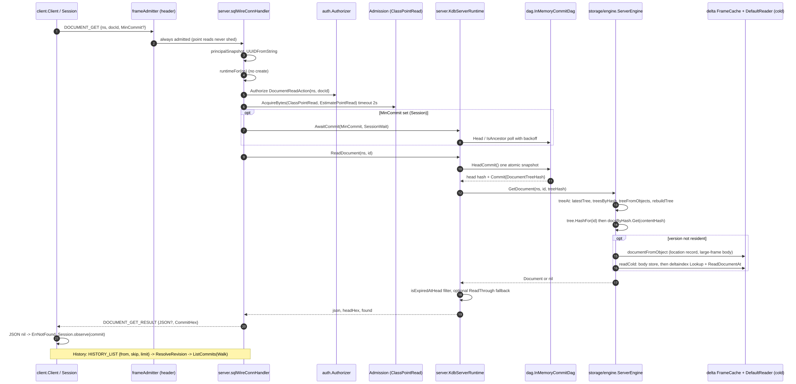

Mermaid source

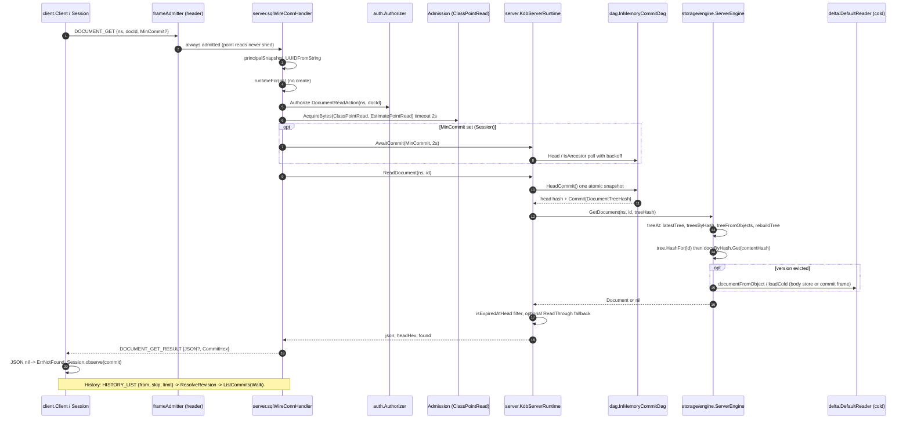

### Call chain

| # | Function (pkg.Type.Method) | File:line | What it does |
|---|---|---|---|
| 1 | `client.Client.GetJSON` / `getJSON` | `client/client.go:548` / `:554` | Builds `DocumentGetMessage{Namespace, DocID, MinCommit}`; `JSON==nil` -> `ErrNotFound` along with the head commit (`:575-577`); `Error` -> `classifiedError`. Returns body + `CommitHex` of the head it was read at. |
| 2 | `client.Session.GetJSON` / `observe` | `client/session.go:66` / `:50` | Supplies `MinCommit = s.token(ns)` and records the returned commit (also on `ErrNotFound`). `PutJSON`/`Upsert`/`Commit` on the session feed the token from write results. |
| 3 | `client.Client.GetJSONWithHash` | `client/client.go:726` | `GetJSON` + locally computed `Document.ContentHash()` (not carried on the wire): the CAS token for `ReplaceIf`. |
| 4 | Header admit | `server/frame_admission.go:54`, `server/admission.go:284` | `ClassPointRead` is admitted in every zone, including Critical. |
| 5 | `sqlWireConnHandler.handleDocumentGet` | `server/wire_listen.go:1061` | Requires auth; parses UUID; `runtimeFor(ns)` (`server/multi_commit.go:36`, no create); `Authorize(DocumentReadAction{ns, docId})` (kind `read`, resource `ns/docId`); `adm.Costs().EstimatePointRead` (`costmodel.go:333`) + `AcquireBytes(ClassPointRead)` with `readAcquireTimeout=2s`; `AwaitCommit`; `rt.ReadDocument`; feeds back `ObserveDocSize` / `ObservePointReadActual`. |
| 6 | `KdbServerRuntime.AwaitCommit` | `server/session_token.go:38` | No-op for empty token. Else `contains()` = `head==want || (HasCommit(want) && IsAncestor(want, head))`; polls 1 ms doubling up to 50 ms until `sessionWait()` (default 2 s), then `ReplicaBehindError` (BUSY, 250 ms hint). |
| 7 | `KdbServerRuntime.ReadDocument` | `server/read_through.go:145` | `GetDocument`; if absent and the runtime is a filtered projection with `ReadThrough`, asks the source at `ProjectionTarget().LastSource()` via `ReadThrough.Get` (`:81`, bounded LRU "hoard", entries valid only for one source commit). |
| 8 | `KdbServerRuntime.GetDocument` | `server/server_runtime.go:977` | `DAG.HeadCommit()` (`dag/in_memory_commit_dag.go:195`) - one atomic load giving head hash and commit together (comment cites a 40 % CPU contention fix). `Storage.GetDocument(ns, id, commit.DocumentTreeHash)`. `isExpiredAtHead` (`server/expiry.go:114`) hides expired docs as if the sweeper had already deleted them. Returns `(json, headHex, found, err)`. |
| 9 | `ServerEngine.GetDocument` | `storage/engine/server_engine.go:445` | `treeAt(treeHash)` (`:191`): (1) atomic `latestTree` when it is the live tree; (2) `treesByHash` bounded store; (3) `treeFromObjects` (`tree_objects.go:605`, walks diff chain to a full object or a resident ancestor; counts `treeRebuilds`); (4) `rebuildTree` (`restore.go:81`) -> `embed.rebuildTreeByFolding` (`embed/tree_rebuild.go:48`, folds commit ops forward from the nearest cached ancestor and verifies the hash). Then `tree.HashFor(docID)` (trie lookup). The parameter is named `atCommit` but callers pass a *tree hash*. |
| 10 | Body fetch | `storage/engine/server_engine.go:451-478`, `:481` | `docsByHash.Get(contentHash)` (sharded, byte-budgeted, live versions pinned). Miss -> `documentFromObject` (`tree_objects.go:501`) then `loadCold`: blob body store if `HistoryModeNone` or bodies are external, else the installed cold loader (`newDeltaColdLoader`) / `commitFrameReader` using the recorded `(segment, offset)` to read one frame from the delta log. Re-admits to `docsByHash`. |
| 11 | `sqlWireConnHandler.execRead` (SQL read) | `server/wire_listen.go:584` | Read head = `KdbSession.ReadHead(DAG.Head)` (`session_manager.go:102`): pinned snapshot for `SNAPSHOT`, live head for `READ_COMMITTED`/`READ_YOUR_WRITES`. Takes a `ClassScan` grant sized by `CostModel.EstimateScan`, runs `SQLEngine().Execute` with `QueryContext.AtCommit=head`, `RowBudget`, returns `ResolvedCommitHex=head`. |
| 12 | `sqlWireConnHandler.handleHistoryList` | `server/history.go:34` | Auth; `runtimeFor`; `Authorize(DocumentReadAction{Namespace})` (namespace-level); casts `rt.Runtime.DAG` to `dag.HistoryNavigator` (`dag/history_nav.go:377`) else `UnsupportedError`; `ResolveRevision(from or "head")`; limit default 50, cap 1000; `ListCommits`. |
| 13 | `InMemoryCommitDag.ResolveRevision` | `dag/history_nav.go:294` | `ParseRevision` (`:254`: `head`, `tag:N`, `branch:N`, hash; suffixes `^`, `~N`) -> `ResolveRef` (`:197`: hash must be resident or stubbed; branch/tag lookup; time) -> `NthAncestor` (`:122`, first-parent walk; errors name where retained history ends). |
| 14 | `InMemoryCommitDag.ListCommits` | `dag/history_nav.go:67` | `Walk(from, nil, skip+limit)` (`dag/in_memory_commit_dag.go:784`, timestamp-ordered across merges), then `CommitInfo` with `OperationCount=-1` when operations were evicted; stubbed commits are reported `Stubbed` with message `(archived)`. No operations or document bodies are returned. |
| 15 | `client.Client.History` | `client/history.go:58` | Sends `HistoryListMessage`; maps `HistoryCommit` to `Commit` (timestamps from micros). |
| 16 | `embed.DocumentAt` | `embed/document_history.go:42` | Embedded-only: `DAG.GetCommit(at)` -> `Storage.GetDocument(ns, id, commit.DocumentTreeHash)`. Any commit is a valid question; absent document -> `false`. No wire exposure (`grep` finds no non-test caller outside this file). |
| 17 | `embed.DocumentVersions` | `embed/document_history.go:72` | Embedded-only per-document history: streams every delta segment (`DeltaCommitStreamer.StreamCommits`) and collects commits whose ops name the document. O(whole log) because nothing indexes document -> commits. |
| 18 | `embed.RevertTo` via `handleRevert` | `embed/revert.go:55`, `server/history.go:102` | Not a read: writes a new commit restoring an old tree. Included because it is the only wire path that consumes a revision spec for document state. Takes `writeGate.acquire(context.Background())` directly. |

### Data that changes

| Step | Structure / file / wire message | Mutation |
|---|---|---|
| Request | Wire `DOCUMENT_GET` (0x14): `{Namespace, DocID, MinCommit}`; `HISTORY_LIST` (0x1F): `{Namespace, From, Skip, Limit}` | None on the server's durable state. |
| Admission | `Admission.sem` / `outstandingBytes` (grant), `CostModel` per-namespace doc-size estimate | Grant reserved/released within the request; the cost model learns document sizes (`ObserveDocSize`, `ObservePointReadActual`). |
| Cache | `ServerEngine.treesByHash` (LRU promote), `docsByHash` (re-admit after cold load), `treeRebuilds` / `coldLoads` counters | A historical or evicted read can **insert** trees and documents into bounded caches and evict others. `latestTree` hit mutates nothing. |
| Cold fallback | Reads `ns/<namespace>/delta/*.seg` frames (and the blob/SSTable tree objects) | Read-only on disk; possibly a one-time in-memory commit-hash -> frame index build ("once per process on the first historical read", `tree_rebuild.go` comment). |
| Session | `KdbSession.readPin` + `dag.Pin` for SNAPSHOT | Not changed by a read; changed at transaction boundaries. |
| Hoard | `ReadThrough.lru/entries` | Projection read-through inserts fetched documents (never committed or replicated). |
| Reply | `DOCUMENT_GET_RESULT` (0x15): `{JSON *string (nil=absent), CommitHex, Error, ErrorCode, RetryAfterMs}`; `HISTORY_RESULT` (0x20): `{Commits[], ResolvedHex, Error...}` | `CommitHex` is the head the read happened at, also when the document is absent. |
| Client | `Session.seen[ns]` | Set to the returned commit on success or `ErrNotFound`. |

### Failure, edge cases & durability points

- **Reads have no durability dimension**: no fsync, no WAL, no log write. A read can only touch disk to *read* the delta log, SSTables or tree objects for cold data.
- **Reads see non-durable commits.** `GetDocument` uses `HeadCommit()`, and the head is published at `appendCommitLocked` before the delta record is flushed (see flow 3). The returned `CommitHex` can therefore name a commit that a crash within the next fsync window will lose.
- **Read consistency.**
  - Point reads always read the *live head*; there is no snapshot option on `DOCUMENT_GET`. Consistency across reads comes only from the causal `MinCommit` token (read-your-writes / monotonic reads across replicas).
  - `READ_COMMITTED` and `READ_YOUR_WRITES` SQL reads follow the live head (they are treated identically); `SNAPSHOT` pins the head at transaction start and re-pins at each commit/rollback (`ReadHead` / `startTransactionAt`).
  - `parseReadConsistency` silently maps any unknown name to `ReadCommitted`.
- **At commit / ref.**
  - `DOCUMENT_GET` has **no `atCommit` field** (`wire/document_ops.go:7-14`). The history-modes plan proposes adding one (`docs/kdb-history-modes-plan.md` §1c) but it is not implemented.
  - `query/hybrid` (`parser.go:48` has the `AT COMMIT` clause; `version_resolver.go`) is **not** called from `server/` or `service/` (only comments reference it), so SQL `AT COMMIT/VERSION/TIME` does not work over the Go wire. `wire/history_ops.go:9` and `embed/document_history.go:16` describe `SQL_EXEC` as "carrying AT COMMIT", which is stale for the Go server.
  - Effective ways to see an old state over the wire are limited to a `SNAPSHOT` session's pin (in-session) and `REVERT` (which writes).
- **History retention limits.** `ResolveRef` fails for hashes not retained; stubbed (archived) commits resolve but cannot be walked (`NthAncestor`). Under `history=none`, commits older than the retention window are gone from the graph and the log. Under `history=full`, `OperationCount` can still be -1 for evicted operations. `Walk` is bounded by `skip+limit`; `maxHistoryLimit=1000`.
- **Auth/admission asymmetry.**
  - `DOCUMENT_GET` checks per-document `read` (`DocumentReadAction{ns, docId}`) and takes a memory grant; `HISTORY_LIST` checks namespace-level `read` and takes **no grant**, so a large listing is bounded only by the 1000-commit cap and the frame size.
  - `DOCUMENT_GET` before authentication returns a bare `"not authenticated"` string with no `ErrorCode`.
- **Errors on point read.** Invalid UUID -> plain error text. Admission failures -> classified (`BUSY` / `RESOURCE_EXHAUSTED` cannot occur for point reads because of the capacity clamp). `ReplicaBehindError` -> BUSY with 250 ms hint. Storage errors -> INTERNAL. An expired or deleted document returns `found=false`, which the client reports as `ErrNotFound`.
- **Cost of misses.** A read at the live head costs one atomic load, a trie lookup and a `docsByHash` hit. A read whose tree is no longer resident (not on this path today unless head's tree was evicted - `latestTree` makes the live tree always hit) can trigger `treeFromObjects`/`rebuildTreeByFolding`, which is O(commits since the nearest resident ancestor) and holds the per-engine rebuild mutex (`restore.go:82`). A cold document body read does one delta-frame read when a location is recorded, else a scan of the log.
- **Projection read-through.** In a filtered projection runtime, a miss on a document the projection does not hold falls through to the source at the source commit the projection last synced; it never commits that document locally. If the projection has never synced (`LastSource()==""`), the answer is "absent" with no error.
- **Doc vs code.** The spec text for `DocumentGetMessage` in older docs (see `docs/kdb-lld-flows.md`, not re-verified here) may describe `atCommit`; the Go struct has only `MinCommit`.

## 5. SQL query: wire request to result (SELECT, DML buffering, commit)

All paths are relative to `go/kdb/`. Line numbers are from the working tree as it stood when this section was written (the tree has a large staged-but-uncommitted diff against HEAD; see "Result bound / scan cap status" below).

### Description (short)

A client sends a `wire.SqlExecMessage` over the SQL wire listener. `server.sqlWireConnHandler` parses it, classifies it (SELECT / DDL / DML / transaction control), resolves which namespace's runtime the statement targets (cross-namespace routing), authorizes it, and then takes one of three routes:

- **SELECT or DDL**: `execRead` takes a scan-class memory grant (SELECT only), builds a `sql.QueryContext` pinned to a read head, and calls `sql.Engine.Execute`. The engine re-parses, plans (validation only), picks an access path (search ranking, secondary index, or full scan), materializes documents, applies the residual WHERE, then sorts / groups / projects / limits. The `sql.QueryResult` is flattened to `[][]string` and returned in a `wire.SqlResultMessage`.
- **DML** (INSERT / UPDATE / DELETE): `execDML` calls `sql.Engine.ExecuteDML`, which only lowers the statement to `document.Op`s; they are appended to the session's pending `transaction.Builder`. Nothing is written until `COMMIT` / `TX_COMMIT`.
- **COMMIT**: `commitSession` builds the `document.Transaction` and calls `KdbServerRuntime.Commit`, which goes through the write gate, `transaction.Engine.Commit` (schema validation, conflict detection, unique-key check, DAG append), the index hooks, and the delta-log persist/fsync wait (that part is covered in the commit flow; here only the SQL-specific edges are listed).

**Result bound / scan cap status in the current tree (authoritative answer).** There are two different bounds and they have opposite status:

1. **Row-examination budget (`RowBudget`, `sql.ScanRowBudgetExceededError`) exists and is live.** `admission.go:100` `DefaultScanRowBudget = 1_000_000`, shrinks under memory pressure (`Admission.ScanRowBudget`, `admission.go:157`), is passed into every `QueryContext` (`wire_listen.go:643`, `:731`, `control/data.go` runSelect) and enforced in `Executor.fullScan` (`sql/executor.go:584`) and `Executor.materialize` (`sql/executor.go:507`). It surfaces as `RESOURCE_EXHAUSTED` via `classifyError` (`server/error_classification.go:58`).
2. **The "result bound" that returned an error when a result exceeded `MaxRows` does NOT exist in the working tree.** `git status` shows `sql/result_bound_fixture_test.go`, `sql/scan_result_bound_test.go`, `sql/search_result_bound_test.go`, `server/result_bound_wire_test.go`, `testdata/golden/sql/result_bound.json` deleted (staged), and `git diff HEAD -- sql/executor.go` shows the staged change removing `ResultRowLimitError`, `maxResultRows`, `defaultMaxResultRows`, the `stopAt` parameter of `chooseAccessPath`/`fullScan`, the `keyLookup` fast path for `kdb_id = ...`, and the `ResultRowLimitError` case in `classifyError`. In its place the tree has the **older silent-truncation behaviour**: `QueryContext.MaxRows` (10_000 on the wire path) truncates the *candidate id list* produced by the access path (`fullScan`, `rankedIDs`, index lookups) **before** the residual WHERE and ORDER BY run, with no error. Consequences are spelled out under "Failure, edge cases". `docs/kdb-lld-flows.md` does not mention either mechanism.

### Diagram

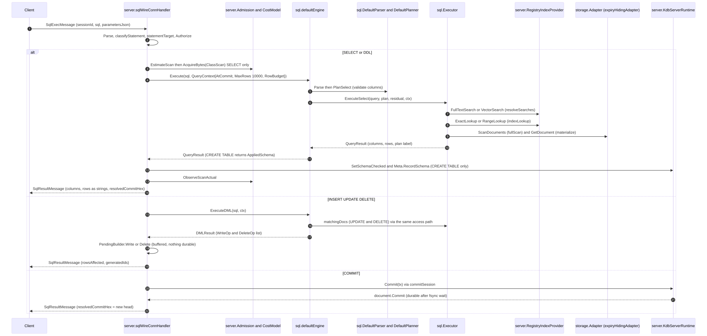

Mermaid source

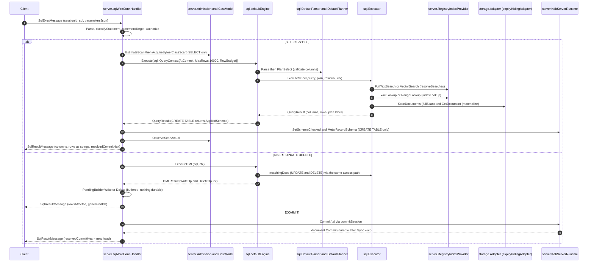

### Call chain

| # | Function (pkg.Type.Method) | File:line | What it does |
|---|---|---|---|
| 1 | `server.sqlWireConnHandler.run` | `server/wire_listen.go:154` | Per-connection read loop. Decodes each frame (`h.codec.Decode`), runs pre-handshake frames inline, otherwise takes a per-session FIFO ticket (`sessionTicket`, `:207`) and runs `dispatchAndSend` in a goroutine bounded by `MaxInFlightFrames`. All sessions on the connection are closed on exit (`closeAllSessions`, `:261`). |
| 2 | `server.sqlWireConnHandler.dispatchAndSend` | `server/wire_listen.go:190` | Calls `dispatch`, encodes the reply with the codec, writes under `sendMu`. |
| 3 | `server.sqlWireConnHandler.dispatch` | `server/wire_listen.go:354` | Type switch on `wire.Message`; `wire.SqlExecMessage` goes to `handleSqlExec`, `wire.TxCommitMessage` to `handleTxCommit`, `wire.SearchMessage` to `handleSearch`. (`dispatchRecovering`, `:302`, is the panic-recovering variant used by `handleFrame`, `:271`; the TCP `run` path calls plain `dispatch`.) |
| 4 | `server.sqlWireConnHandler.handleSqlExec` | `server/wire_listen.go:518` | Looks up the session (`h.sessions.Get`), parses with `h.parser.Parse` (`:526`), short-circuits BEGIN/COMMIT/ROLLBACK to `execTransactionControl` (`:530`), classifies, resolves target namespace, authorizes `auth.SqlExecAction{ReadOnly: isSelect}` (`:549`), decodes `ParametersJSON` (`decodeParametersJSON`, `:1337`), then routes to `execRead` or `execDML`. Errors become `sqlResultError` (no code) or `sqlResultErrorClassified` (`:1263`, carries `ErrorCode`/`RetryAfterMs`). |
| 5 | `sql.DefaultParser.Parse` | `sql/parser.go:25` | Trims, runs `rdParser.parseStatement` (`:54`), consumes optional `;`, rejects trailing input. A `recover()` turns any parser panic into a `*ParseError`. |
| 6 | `sql.rdParser.parseSelectQuery` | `sql/parser.go:461` | Fixed clause order: `[DISTINCT] projections [FROM t] [WHERE expr] [GROUP BY ...] [ORDER BY ... ASC/DESC] [LIMIT n] [OFFSET n]`. Expressions via `parseExpr` -> `parseOr/And/Not/Comparison` (`:641-682`); `MATCH(index, text)`, `SIMILARITY`, `FUSE` are parsed as `ExprMatch/ExprSimilarity/ExprFuse` in the identifier path (`:883-940`). DML: `parseInsert :362`, `parseUpdate :405`, `parseDelete :441`. |
| 7 | `server.classifyStatement` | `server/wire_listen.go:568` | `StmtSelect` -> read; `StmtCreateTable / StmtCreateIndex / StmtDropIndex` -> DDL (immediate, via the read path); everything else is DML by default (fail-closed for new statement kinds). |
| 8 | `server.sqlWireConnHandler.statementTarget` | `server/sql_cross_namespace.go:52` | `sql.TargetTable(stmt)` (`sql/model.go:92`). Without a `NamespaceSet` or a table name it keeps the session's own runtime. A dotted name (`bank.ledger`) routes to namespace `bank/ledger` (`set.Resolve(ns, forWrite)`); an undotted name routes to `<catalog>/<table>` only if that namespace exists, otherwise stays on the session's own namespace. |
| 9 | `server.KdbSession.ReadHead` / `crossReadHead` | `server/session_manager.go:102`, `server/sql_cross_namespace.go:104` | Resolves the commit to read: SNAPSHOT sessions use the pin fixed at transaction start (cross-namespace: pinned at first touch, `dag.Pin`); READ_COMMITTED reads live head. A SELECT does not consult `sess.Pending`, so buffered DML is not visible to later SELECTs in the same session (observed: `execRead` only uses the resolved head). |
| 10 | `server.sqlWireConnHandler.execRead` | `server/wire_listen.go:584` | For `StmtSelect` with admission configured: builds `ScanEstimateInput{Shape: sql.ShapeOfSelect(sel.Query), TreeSize: rt.treeSizeAt(head), MaxRows: 10_000, RowBudget: adm.ScanRowBudget()}` (`:614-621`), `adm.Costs().EstimateScan` (`:622`), `adm.AcquireBytes(ctx 2s, ClassScan, estimate)` (`:624`; `readAcquireTimeout`, `:582`), `defer grant.Release()`. Then builds `sql.QueryContext{NamespaceID, Schema: rt.Schema(), AtCommit, Parameters, MaxRows: 10_000 (:639), RowBudget (:643), Stats}` and calls `rt.SQLEngine().Execute(msg.SQL, ctx)` (`:646`). |
| 11 | `server.CostModel.EstimateScan` / `structuralScanLocked` | `server/costmodel.go:273`, `:300` | Tier 1: learned p95 for (namespace, query fingerprint, tree size) once enough observations. Tier 2: base + rows x (p95 doc bytes + overhead) x copies, where rows = `TreeSize` capped by `RowBudget` for ORDER BY/aggregate shapes (blocking plans) or by `min(MaxRows, LIMIT)` for streaming shapes. `ShapeOfSelect` is `sql/shape.go:34`. |
| 12 | `server.Admission.AcquireBytes` | `server/admission.go:331` | Memory-zone check (`MemoryPressureError` -> BUSY), floors cost at the class base, `ResourceExhaustedError` if cost exceeds total grant capacity (`:357`), else semaphore acquire with the 2s context (`BusyError` on timeout). |
| 13 | `server.KdbServerRuntime.SQLEngine` | `server/server_runtime.go:335` | Returns the engine built by `rebuildSQLEngineLocked` (`:371`): `sql.NewEngineWithIndexes(&expiryHidingAdapter{...}, s.dag, s.sqlIndexProvider)` or `sql.NewEngine` when no provider. `expiryHidingAdapter` (`server/expiry.go:170`) hides TTL-expired documents when reading at the live head's tree. |
| 14 | `sql.defaultEngine.Execute` | `sql/engine.go:53` | Parses again (the server parsed once for classification; the engine parses the raw text a second time), then switch: `StmtSelect` -> `planner.PlanSelect` + `executor.ExecuteSelect` (`:59`); `StmtCreateTable` -> `ddl.ExecuteCreateTable`, returns `QueryResult{AppliedSchema}` (`:65`); `StmtCreateIndex/DropIndex` -> `indexDDL.CreateIndex/DropIndex` (`:71/:79`, error if provider is not an `IndexDDLExecutor`); INSERT/UPDATE/DELETE -> planning error "must be executed via ExecuteDML". |
| 15 | `sql.DefaultPlanner.PlanSelect` | `sql/planner.go:23` | Table-less SELECT -> `validateTablelessSelect` (`:142`) + `PlanSingleRow`. Otherwise `validateSelect` (`:77`) resolves columns in projections / WHERE / GROUP BY / ORDER BY / function args against the schema and rejects non-grouped columns next to aggregates; returns `PlanLimit{PlanFullScan}` and the **whole WHERE as `residual`**. The plan object is largely ornamental: `ExecuteSelect` does not consume `plan` (only `query` and `residual`); real access-path choice is in the executor. `PlanIndexLookup`/`PlanFilter`/`PlanSearch` types exist in `sql/model.go:501-538` but the planner never emits them. |
| 16 | `sql.Executor.ExecuteSelect` | `sql/executor.go:29` | Pipeline: table-less -> `executeSingleRowSelect` (`:237`, answers before touching DAG/storage so `SELECT 1` works on an empty namespace); else `newEvalEnv` (`sql/predicate.go:31`), `resolveSearches`, `chooseAccessPath`, optional LIMIT push-down to ids, `materialize`, `plainRows` or `groupedRows`, `distinctRows`, `applyLimitOffset`, then `Stats.addRetained(rowBytes)` for each row. |
| 17 | `sql.Executor.resolveSearches` / `resolveOneSearch` / `searchDepth` | `sql/search.go:195`, `:221`, `:176` | For `MATCH` / `SIMILARITY` / `FUSE` expressions anywhere in the query: calls `IndexProvider.FullTextSearch` / `VectorSearch` with depth = `min(1000, max(50, 4*(limit+offset)))` when ORDER BY leads with the score and a LIMIT exists, else 0 (all hits); FUSE merges arms with `fusion.Fuse` (RRF or weighted). No matching index -> `PlanningError`. Hits stored in `env.scores`. |
| 18 | `sql.Executor.chooseAccessPath` | `sql/executor.go:311` | Order: (a) ORDER BY leading with a search expression -> `rankedIDs(hits, max)`; (b) for each top-level AND conjunct (`conjuncts`, `:365`): search conjunct -> `rankedIDs`; else if `IndexProvider != nil`, `indexLookup` (first conjunct the provider can serve wins; result truncated to `max = ctx.MaxRows` or 10000, `:339`); (c) else `fullScan`. The label (`fullscan`, `index:eq(f)`, `index:range(f)`, `index:in(f)`, `fulltext(x)`, `vector(f)`, `fuse:...`) becomes `QueryResult.Plan`. |
| 19 | `sql.Executor.indexLookup` | `sql/executor.go:376` | Recognizes `col OP const` (either side, `flipOp` `:476`), `BETWEEN`, `IN (consts)`; skips reserved columns and NULL constants. `=` -> `IndexProvider.ExactLookup`; `< <= > >=` and BETWEEN -> `RangeLookup`; `IN` -> union of `ExactLookup` per value (bails to the next path if any value has no index). `ok=false` from the provider means "no usable index", fall through. |
| 20 | `server.RegistryIndexProvider.ExactLookup` / `RangeLookup` | `server/index_provider.go:89`, `:108` | `keyedStore` prefers HASH over BTREE for equality; range requires a BTREE (`registry.ByField(field, IndexTypeBTree)`). Cell -> `index.Key` via `indexKeyForCell` (`:150`); JSON cells have no key so the lookup reports `ok=false`. Range is always served as a closed interval (`store.Range(from,to,ctx.AtCommit,0,true)`); the residual WHERE strips exclusive endpoints. `store.Lookup/Range(..., ctx.AtCommit)` replay the store's event log with ancestry cutoff at the read head (`index/event_log.go:113-162`, memoized). |
| 21 | `sql.Executor.fullScan` | `sql/executor.go:563` | `Storage.ScanDocuments(ns, commit.DocumentTreeHash, 256, cb)`; per document `Stats.addExamined(1)`; aborts with `ScanRowBudgetExceededError` once `examined > RowBudget` (`:584`); appends ids and stops the scan with the sentinel `errScanComplete` (`:606`) once `len(ids) >= max` where `max = ctx.MaxRows` (default 10000). |
| 22 | `sql.Executor.materialize` | `sql/executor.go:494` | For each id: `Storage.GetDocument(ns, id, treeHash)`; when a residual WHERE exists, counts rows examined and returns `ScanRowBudgetExceededError` if the index (not scan) is past `RowBudget` (`:507`); skips missing docs; evaluates `env.predicate(residual, ed)` (`sql/predicate.go:156`) on every fetched doc whatever access path produced it; accumulates `DocsRead/DocBytesRead/RetainedBytes`. |
| 23 | `sql.Executor.plainRows` / `sortByKeys` | `sql/executor.go:94`, `:118` | ORDER BY: sort keys computed once per row (`env.cell`), stable sort, `resolveAlias` lets ORDER BY name a projection alias such as a `MATCH ... AS score`; then `projectRow` (`:629`) per doc. |
| 24 | `sql.Executor.groupedRows` + `evalEnv.aggregate` | `sql/executor.go:145`, `sql/aggregates.go:75` | GROUP BY buckets docs by `cellKey` hash, sorts groups by key, ORDER BY over `groupCell`, projects each group; an ungrouped aggregate is a single group and ignores LIMIT on its input (`executor.go:81`). `isGroupedQuery` is `sql/aggregates.go:25`. |
| 25 | `sql.applyLimitOffset` / `pushLimit` | `sql/executor.go:295`, `:50-58` | LIMIT/OFFSET pushed down to the id list only when there is no ORDER BY / GROUP / DISTINCT **and** no residual (`pushLimit && residual == nil`); otherwise applied to rows after sort/project. |
| 26 | `server.rowsToStrings` / `cellToString` | `server/wire_listen.go:1298`, `:1310` | Result cells flattened to strings: NULL -> `""` (indistinguishable from empty string), bool -> `"1"/"0"`, doubles via `strconv 'g'`, JSON as raw text. Column names only (`columnNames`, `:1290`); types are not sent. |
| 27 | `server.CostModel.ObserveScanActual` / `ObserveDocSize` | `server/costmodel.go:372`, `:350` | After a successful SELECT with a grant, feeds `stats.RetainedBytes + stringsBytes(rows)` (`:679`) back as the actual, and the mean observed document size per namespace (`:681`). |
| 28 | `server.sqlWireConnHandler.execRead` (CREATE TABLE tail) | `server/wire_listen.go:647-670` | If `result.AppliedSchema != nil`: inside `rt.Meta.Local`, `rt.SetSchemaChecked(...)` (`:659`) then `rt.Meta.RecordSchema(...)` (`:664`, undo with `SetSchema(previous)` on failure). Detailed in Flow 8. |
| 29 | `server.sqlWireConnHandler.execDML` | `server/wire_listen.go:711` | Resolves read head, builds `QueryContext` **without** `MaxRows` (so `chooseAccessPath`/`fullScan` use the 10000 default) but with `RowBudget` (`:731`), calls `rt.SQLEngine().ExecuteDML` (`:733`), then `h.sessions.PendingBuilder(sess)` (`session_manager.go:371`) or `sess.crossBuilder(target)` (`sql_cross_namespace.go:135`) and appends each op via `builder.Write` / `builder.Delete` (`:746/:748`). Reply has `ReadOnly:false`, `RowsAffected`, `GeneratedIDs`, `ResolvedCommitHex = builder.BaseVersion`. |
| 30 | `sql.defaultEngine.ExecuteDML` | `sql/engine.go:94` | Parses, dispatches to `DMLExecutor.ExecuteInsert/Update/Delete`; INSERT returns `GeneratedIDs` from the `WriteOp.DocID`s. Nothing touches storage. |
| 31 | `sql.DMLExecutor.ExecuteInsert` | `sql/dml.go:20` | Per VALUES row: `codec.RandomUUID()` as doc id, builds JSON by `assignPath` (`:102`, JSON-path set via `kdbjson.Set`), `validateJSON` (`:136`, `schema.Validate`, first violation detail becomes a `PlanningError`), emits `document.WriteOp{DocID, Patch: json}`. |
| 32 | `sql.DMLExecutor.ExecuteUpdate` / `ExecuteDelete` | `sql/dml.go:48`, `:88` | Reject `kdb_id` assignment and unknown columns, validate the assigned expressions, then `Executor.matchingDocs(where, table, ctx)` (`sql/executor.go:532`: `validateSelect`, `resolveSearches`, `chooseAccessPath`, `materialize` with the WHERE as residual) so UPDATE/DELETE use the **same index-aware access path and the same MaxRows/RowBudget bounds as SELECT**. UPDATE emits a `WriteOp` per match with the full new JSON (SET applied, `_doc` replaces the body) and re-validates against the schema; DELETE emits `DeleteOp`. |
| 33 | `server.sqlWireConnHandler.handleTxCommit` / `execTransactionControl` | `server/wire_listen.go:763`, `:955` | `TX_COMMIT` and SQL `COMMIT` both end in `commitSession`. `BEGIN` refuses when writes are already pending, otherwise `sess.startTransactionAt(head)` (and, for SNAPSHOT sessions with a `NamespaceSet`, a multi-namespace snapshot via `set.Snapshot`). `ROLLBACK` -> `rollbackSession` (`:910`). |
| 34 | `server.sqlWireConnHandler.commitSession` | `server/wire_listen.go:780` | Builds the tx from client-encoded bytes (`wire.DecodeTransaction`) or `sess.Pending.Build`; `DocumentLocks.ValidateFences` (`:807`) then `AssertUnheldByOthers` (`:818`); `srv.Commit(...)` (`:821`); `h.sessions.ClearPending`; `ConflictError` -> `conflictReport` (conflict report message), other errors -> classified SQL_RESULT error; success -> `sess.startTransactionAt(commit.Hash)` and `ResolvedCommitHex = commit.Hash`. With writes in other namespaces it diverts to `commitSessionAcross` (`:846`) -> `NamespaceSet.CommitAcross` (`namespace_set.go:257`). |
| 35 | `server.KdbServerRuntime.Commit` -> `commitWith` -> `runTransaction` | `server/server_runtime.go:641`, `:717`, `:790` | Admission/auth checks (`admitWrite :911`), pins, write-memory grant (`:829`), write gate (`:835`), `prepareIndexes` (`:850`), `engine.Commit` (`:721`), `commitToIndexes` (`:864`), `PersistAsync` (`:879`), release gate, `waitDurable()` (`:886`), `CommitListener`. Full detail belongs to the commit flow; Flow 8 covers the index/schema half. |

### Data that changes

| Step | Structure / file / wire message | Mutation |
|---|---|---|
| SELECT (any) | `wire.SqlExecMessage` (`wire/types.go:715`) in; `wire.SqlResultMessage` (`wire/types.go:725`) out | Request carries `sessionId`, `namespace`, `sql`, `parametersJson`. Reply carries `columns []string`, `rows [][]string`, `rowsAffected`, `resolvedCommitHex` (the read head), `readOnly=true`, `generatedIds`, or `error` + `errorCode` + `retryAfterMs`. |
| SELECT admission | `Admission` semaphore + counters (`outstandingBytes/Ops`, `stats.Granted/Denied*`) | Reserved `estimate` bytes for the duration of the query; released by `defer grant.Release()`. |
| SELECT learning | `CostModel.cells`, `docSizes` | `ObserveScanActual` adds an observation keyed by (namespace, fingerprint, treeSize); `ObserveDocSize` updates the per-namespace doc-size reservoir. In-memory; `CostModel.SnapshotState/RestoreState` (`costmodel.go:506/:524`) exist for persistence. |
| SELECT execution | `sql.ExecStats` (`sql/model.go:406`) | `RowsExamined`, `DocsRead`, `DocBytesRead`, `RetainedBytes` filled by the executor. No persistent state is modified by a read. |
| SELECT pinning | DAG pin | SNAPSHOT sessions hold `dag.Pin(head)` for the transaction (released in `startTransactionAt`/`clearCross`) so compaction cannot reclaim the read point. |
| CREATE TABLE | `rt.Runtime.Schema`, unique-key registry, `_kdb/meta` namespace | `SetSchemaChecked` swaps the schema and rebuilds `UniqueKeyRegistry`; `RecordSchema` upserts a metadata document in `_kdb/meta` (a real commit). See Flow 8. |
| CREATE/DROP INDEX | Index registry + `index/catalog.json` + `_kdb/meta` | See Flow 8. |
| DML statement | `KdbSession.Pending` (a `transaction.Builder`) or `KdbSession.cross[ns].builder` | `Builder.Write(docID, patchJSON)` / `Builder.Delete(docID)` append to the builder's op list. Memory only; a dropped connection discards them (`closeAllSessions`). |
| COMMIT: transaction | `document.Transaction{ID, BaseVersion, Operations, Timestamp, AuthorNodeID}` | `Pending.Build` mints a random tx id (idempotent retries are detected by `findExistingCommit`). |
| COMMIT: documents | storage adapter staging + document tree | `Apply` (`transaction/prepare.go:221`) stages `PutDocument`/`DeleteDocument`, `CommitTree` produces the new document-tree hash, `operationsAsStored` rewrites the recorded ops to the stored (merged) documents. |
| COMMIT: DAG | `dag.InMemoryCommitDag` | `AppendCommitWith` adds the commit; head moves. Compare-and-swap on the anchor (`HeadConflictError` discards staged writes). |
| COMMIT: uniques | `transaction.UniqueKeyRegistry.owners` | `Apply(retract, claim)` after the DAG append. |
| COMMIT: index stores | per-index `eventLog` | Put/delete events tagged with the commit hash (Flow 8). |
| COMMIT: delta log | segment file in the namespace's delta directory | `PersistAsync` enqueues a `DeltaRecord`; the log writer goroutine frames, compresses, writes, fsyncs. |
| COMMIT: session | `KdbSession.baseVersion`, `readPin`, `Pending` | `ClearPending`; `startTransactionAt(commit.Hash)` re-anchors and (SNAPSHOT) re-pins. |
| COMMIT: wire reply | `SqlResultMessage` | `RowsAffected = len(tx.Operations)`, `ResolvedCommitHex = commit.Hash`. |

### Failure, edge cases & durability points

**Durability.**
- A SELECT or a buffered DML statement is never durable and writes nothing. The only durable boundary in this flow is inside `runTransaction`: `PersistAsync` (`server_runtime.go:879`) queues the delta record under the write gate (so queue order equals log order), the gate is released, then `waitDurable()` (`:886`) blocks until the log writer has fsynced (under `DurabilitySync`; see `embed/persisting_dag.go:130-160`, `chainOnBarrier` only waits on cross-namespace group decisions in sync mode). The client's `SqlResultMessage` for COMMIT is sent after that returns. If a commit fails after the DAG append (for example `commitToIndexes` error at `:864-867`), the caller gets an error although the commit is already in the in-memory DAG and was not persisted by this call (the `PersistAsync` line is after the index step). This is an existing hazard of the ordering, not something the SQL layer compensates for.
- The `ParametersJSON` path (`decodeParametersJSON`) accepts scalars and vectors (`vectorParam`); unsupported shapes produce `"invalid parameters: ..."` (no error code).

**Result bound / scan cap behaviour in the current tree (what actually happens).**
- `MaxRows` (10_000 on the wire path, `wire_listen.go:639`; `limit` <= 2000 on the control plane, `control/data.go` `runSelect`; unset on the DML path -> executor default 10000) is applied in `chooseAccessPath`/`fullScan`/`rankedIDs` to the candidate *id list*, before the residual WHERE and before ORDER BY. Concretely `fullScan` stops after the first 10_000 documents in tree order (`executor.go:587`); an index lookup list is cut to the first 10_000 ids (`:339-341`); a search ranking keeps the first 10_000 ids (`rankedIDs`, `:348`).
- Consequence 1: `SELECT ... WHERE <selective non-indexed predicate>` on a namespace larger than 10_000 documents examines only the first 10_000 and silently returns a prefix of the true answer, with no error and no truncation flag on the wire (`SqlResultMessage` has no such field). The deleted `*_result_bound_*` tests and the removed comment in the diff describe exactly this bug as the reason the earlier `ResultRowLimitError` design existed; the tree has reverted to the older behaviour.
- Consequence 2: the same cut applies to `UPDATE ... WHERE` and `DELETE ... WHERE` (they go through `matchingDocs` -> `chooseAccessPath`). A bulk DELETE or UPDATE on a namespace over 10_000 documents silently affects at most the first 10_000 candidates (in tree order) that satisfy the predicate; `RowsAffected` reports the truncated count.
- Consequence 3: ORDER BY / GROUP BY / aggregates (`COUNT(*)`, `SUM`) operate over at most 10_000 documents on a full scan, so aggregates over larger namespaces are wrong without any error. `ORDER BY ... LIMIT n` is correct only if the namespace has <= 10_000 matching candidates.
- `kdb_id = '<uuid>'` no longer has a key-lookup shortcut (the `keyLookup` function was removed by the staged diff); it is a full scan bounded by `MaxRows`/`RowBudget`, so a point lookup by id in a namespace over 10_000 documents can miss the document. (`DocumentGet` is the point-read path and is unaffected.)
- The rows-examined budget is independent: exceeding `RowBudget` (default 1_000_000, halved/quartered/eighthed as memory zones rise, `admission.go:197-203`) returns `*sql.ScanRowBudgetExceededError`, classified as `RESOURCE_EXHAUSTED` with no retry-after. With the wire path's hard-coded `MaxRows = 10_000`, `fullScan` stops after 10_000 documents and index lists are cut to 10_000 ids, so the default budget (smallest value 125_000 at the deepest zone) can never be reached through `execRead`; it only matters for callers that pass a larger `MaxRows` or a smaller budget. In `materialize` it is enforced only when `residual != nil` (`:506`).
- `ScanEstimateInput.MaxRows` (admission sizing) is the same 10_000, so memory reservations assume streaming plans retain at most 10_000 rows; blocking plans (ORDER BY / aggregate) are sized by `min(TreeSize, RowBudget)` (`costmodel.go:309-311`), which over-reserves relative to what the truncated scan can actually retain. Over-reservation is the safe direction.

**Errors surfaced to the client.** All come back as `SqlResultMessage{Error, ErrorCode?}`: unknown session; `ParseError`/`PlanningError` text (no code); `AuthorizationError` from `handleSqlExec:549` (returned through `sqlResultError`, so text only, no `ErrorCode`, although `classifyError` maps `AuthorizationError` to `UNAUTHORIZED` on the other paths); `MemoryPressureError` -> `BUSY` + retryAfter; `BusyError` (grant wait > 2s) -> `BUSY`; `ResourceExhaustedError` (estimate > total capacity) and `ScanRowBudgetExceededError` -> `RESOURCE_EXHAUSTED`; `ConflictError` on COMMIT -> a conflict report message (not SQL_RESULT) via `conflictReport` (`wire_listen.go:1135`); schema violations on commit -> `SchemaError`; draining -> `UnavailableError`; panics are converted to an `INTERNAL` error by `dispatchRecovering` (`:302`) but only on the `handleFrame` path (`run` calls `dispatch` directly).

**Other edge cases.**
- Double parse: the server parses to classify, the engine parses again from `msg.SQL`. Positional `?` parameters are numbered per parse; both parses agree, but a semantic difference between `h.parser` and the engine's parser would be possible (both are `sql.DefaultParser`).
- DDL (CREATE TABLE / CREATE / DROP INDEX) runs on the read path with `ReadOnly:false` authorization (`handleSqlExec:548-549`: `ReadOnly: isSelect`, false for DDL) and takes no memory grant and no write gate.
- `AtCommit` is the session read head, but DML target resolution (UPDATE/DELETE) also reads at that head, not at the live head. Conflicts with newer commits are caught at COMMIT by `detectConflicts` against `targetDocTreeHash` (the Strict engine policy), returned as a conflict report.
- SELECT cells: NULL and empty string are indistinguishable on the wire; booleans are `"1"/"0"`.
- Expiry: reads at the live head tree skip expired documents through `expiryHidingAdapter`; reads at older commits do not.
- The control-plane SQL console (`control/data.go:197` `handleSQL`) is a parallel entry: same `Execute`, with `MaxRows = limit` (<= 2000, default 500), `truncated: len(rows) >= limit` in its JSON (a heuristic flag, not an exact one), DML autocommitted through `KdbServerRuntime.Commit`, and **CREATE TABLE through it discards `QueryResult.AppliedSchema`** (`control/data.go:344`, `_, err := rt.SQLEngine().Execute(...)`), so the schema is neither applied nor recorded on that path; only the wire path (`execRead:647-670`) applies it.
- `SEARCH` frames are a separate sessionless path (`server/search.go:41` `handleSearch` -> `RegistryIndexProvider.Search`, `server/index_provider.go:316`): authorized as `DocumentReadAction`, scan-class grant sized as an ordered scan with `MaxRows = limit`, `defaultSearchLimit = 50` when unset (`index_provider.go:333`, const at `:405`), hits at head are dropped if the document is missing or expired. Its bound is explicit (`limit`) rather than a silent cap.

---

## 6. Transaction, including the cross-namespace commit group

Paths are relative to `go/kdb/` unless noted. All line numbers were taken from the working tree on 2026-10-11.

### Description (short)

A client opens a session, buffers writes (SQL DML or a pre-encoded transaction), and commits. A single-namespace commit goes through `KdbServerRuntime.runTransaction`: admission, a per-runtime write gate, `transaction.defaultEngine.Commit` (check, stage, append provisional-free commit to the in-memory DAG), then the commit is queued on the namespace's commit log and acknowledged once the batch is fsynced. A commit that touches several namespaces (SQL naming a second namespace, or the `TX_COMMIT_MULTI` wire op) runs the same check/apply split through `embed.CommitGroup`: every participant is locked in namespace order, every participant is *prepared* (all checks, nothing written), then each part is appended as a **provisional** commit whose message carries a group marker (`kdb:xns/1 host=... epoch=... group=... parts=...`). The group becomes atomic only when a 20-byte record naming the group id is fsynced into the per-epoch decision log. On open, any part whose group has no decision record is dropped (with its descendants).

There is no `TX_BEGIN` wire message. "Begin" is `SESSION_BEGIN` (0x0E, `wire/types.go:43`) plus an optional SQL `BEGIN` carried in `SQL_EXEC`; commit is `TX_COMMIT` (0x11) or SQL `COMMIT`, rollback is `TX_ROLLBACK` (0x12) or SQL `ROLLBACK`, and the multi-namespace op is `TX_COMMIT_MULTI` (0x23) / `TX_COMMIT_MULTI_RESULT` (0x24) (`wire/types.go:46-47,89-90`).

### Diagram

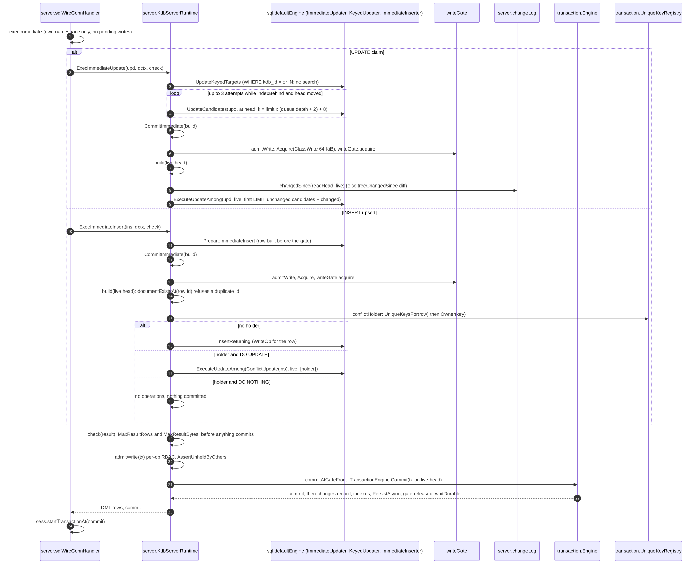

Mermaid source

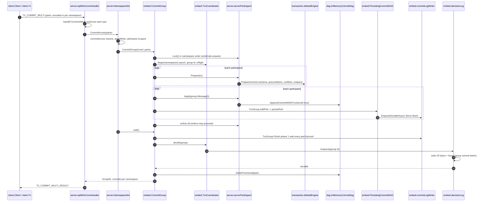

### Call chain

Client side

| # | Function | File:line | What it does |
|---|---|---|---|
| 1 | `client.Client.BeginTx` | `client/tx.go:45` | Takes an idle pooled session or calls `beginSession`, then sends SQL `BEGIN` via `execSqlOnSession` so the server restarts the transaction at the current head (and takes a multi-namespace snapshot for `Snapshot` isolation). |
| 2 | `client.Client.beginSession` | `client/client.go:490` | Sends `SESSION_BEGIN`; returns session id and head. |
| 3 | `client.Tx.Exec` / `Query` | `client/tx.go:111,123` | `SQL_EXEC` on the session; DML is buffered server-side, nothing is committed. |
| 4 | `client.Tx.Commit` | `client/tx.go:150` | Sends `TX_COMMIT` (namespace, session). Conflict reply becomes `ErrConflict`, or `*CrossNamespaceError` when the refusing namespace is not the tx namespace. |
| 5 | `client.Tx.Rollback` | `client/tx.go:184` | Sends `TX_ROLLBACK`. |
| 6 | `client.Client.Commit` / `commitTransaction` | `client/client.go:619,646` | Sessionless single-namespace commit: builds `document.Transaction`, `wire.EncodeTransaction`, `TX_COMMIT` carrying `TransactionBytes`. |
| 7 | `client.Client.CommitAcross` | `client/multi_commit.go:51` | Builds one encoded tx per namespace (rejects duplicate namespaces), sends one `TX_COMMIT_MULTI`, maps reply parts to commit hashes. |
| 8 | `wire.EncodeTransaction` / `DecodeTransaction` | `wire/transaction_codec.go:41,66` | Tx byte codec shared with the Kotlin implementation. |
| 9 | `wire.encodeMultiCommitMessage` / `decodeMultiCommitMessage` | `wire/multi_commit_ops.go:81,105` | JSON envelope kinds `txCommitMulti` and `txCommitMultiResult` (Go-only op). |

Server side, session buffering and single-namespace commit

| # | Function | File:line | What it does |
|---|---|---|---|
| 10 | `server.sqlWireConnHandler.dispatch` | `server/wire_listen.go:354` | Routes by message type (`TxCommitMessage` at 362, `TxCommitMultiMessage` at 384). Frames for one session are ordered by `sessionIDOf` (`wire_listen.go:240`). |
| 11 | `server.sqlWireConnHandler.handleSessionBegin` | `server/wire_listen.go:469` | Authorize `SessionBeginAction`, `SessionManager.BeginOn`. |
| 12 | `server.SessionManager.BeginOn` | `server/session_manager.go:241` | Creates `KdbSession`, pins base version = head (or caller's), `startTransactionAt(head)`. |
| 13 | `server.sqlWireConnHandler.handleSqlExec` | `server/wire_listen.go:518` | SELECT and DDL run now; DML appended to `SessionManager.PendingBuilder` (`session_manager.go:371`), which anchors a non-Snapshot session's write base at the live head on the first write. SQL naming another namespace buffers into `KdbSession.cross` (`sql_cross_namespace.go:135 crossBuilder`). |
| 14 | `server.sqlWireConnHandler.execTransactionControl` | `server/wire_listen.go:955` | `COMMIT`/`ROLLBACK` delegate to `commitSession`/`rollbackSession`; `BEGIN` refuses if writes are pending, else `startTransactionAt(head)` (and `NamespaceSet.Snapshot` for Snapshot sessions). |
| 15 | `server.sqlWireConnHandler.handleTxCommit` | `server/wire_listen.go:763` | Looks up session, calls `commitSession`. |
| 16 | `server.sqlWireConnHandler.commitSession` | `server/wire_listen.go:780` | Decodes `TransactionBytes` or `Pending.Build` (`transaction.Builder.Build`, `transaction/builder.go:67`), runs `LockManager.ValidateFences` over the session's explicit leases (807), then either `commitSessionAcross` (811) or `LockManager.AssertUnheldByOthers` (818) + `KdbServerRuntime.Commit` (821). Always `ClearPending`. |
| 17 | `server.KdbServerRuntime.Commit` -> `commitWith` -> `clientWrite` | `server/server_runtime.go:641,717,728` | Stamps author node (`authored`, 767), runs `runTransaction` with `engine.Commit`. |
| 18 | `server.KdbServerRuntime.runTransaction` | `server/server_runtime.go:790` | `admitWrite` (draining, read-only, fence, RBAC), `dag.Pin(base)`, `pinBaseTree`, `admission.Acquire(ClassWrite)`, `writeGate.acquire` (`server/write_gate.go:56`), `prepareIndexes` (`index_wiring.go:210`), `call()`, `commitToIndexes`, `persister.PersistAsync` under the gate, gate released, `waitDurable()`, `CommitListener`. |
| 19 | `transaction.defaultEngine.Commit` | `transaction/default_engine.go:29` | Base must exist (`BaseNotFoundError`), `findExistingCommit` makes retry of the same tx id idempotent, then `finalizeTransaction` (185) = `plan` + `PreparedCommit.Apply`. |
| 20 | `transaction.defaultEngine.plan` | `transaction/prepare.go:103` | In order: `preflightFileWrites`, `runSchemaPhase` (`default_engine.go:309`), `evaluatePreconditions` (`preconditions.go:26`, only when engine option enabled and `tx.Preconditions` set), conflict policy (`detectConflicts`, `default_engine.go:212`; `Strict` rejects, `Custom` calls the resolver, `LastWrite`/`AppendOnly` skip), `planUniqueKeys` (`unique_registry.go:357`). |
| 21 | `transaction.PreparedCommit.Apply` | `transaction/prepare.go:221` | Stages `PutDocument`/`DeleteDocument` into the storage engine's pending set, `operationsAsStored`, `store.CommitTree`, `dag.AppendCommitWith(Detached: !extendingTip, Provisional: opts.Provisional)`, then `uniqueKeys.Apply`. Staging failure -> `DiscardPending` and `ResultAborted`. |
| 22 | `dag.InMemoryCommitDag.appendCommitLocked` | `dag/in_memory_commit_dag.go:958` | Compare-and-swap of the `main` head against the expected parent (`HeadConflictError` on mismatch), `putTreeLocked`, `BuildCommit`, `putCommitLocked`, moves branch head, `publishHeadLocked`. |
| 23 | `embed.PersistingCommitDAG.PersistAsync` | `embed/persisting_dag.go:137` | `deltaRecordFor`, `commitLogWriter.EnqueueAsync`, `chainOnBarrier` (160) so a commit queued behind an undecided group part is not acknowledged before that group is decided (only under `DurabilitySync`). |
| 24 | `embed.commitLogWriter.run` / `writeBatch` | `embed/commit_log.go:212,405` | Single goroutine: `appendBatch` (356) then one `writer.Flush()` per batch (414) = the fsync; acks every request in the batch. |
| 25 | `server.sqlWireConnHandler.rollbackSession` | `server/wire_listen.go:910` | `DocumentLocks.ReleaseAll(session)`, `ClearLeases`, `ClearPending`, `clearCross`, `startTransactionAt(head)`. Nothing was ever written, so there is nothing to undo on disk. |

Leases and fences

| # | Function | File:line | What it does |
|---|---|---|---|
| 26 | `server.sqlWireConnHandler.handleLockAcquire` | `server/lock_listen.go:23` | `LockManager.TryAcquireLease` with TTL clamped by `clampLeaseTTL` (103), `KdbSession.TrackLease`. |
| 27 | `transaction.LockManager.TryAcquireLease` / `grantLocked` | `transaction/lock_manager.go:129,97` | Per `(namespace, doc)` lock; fence counter `fences[key]` is monotonic and survives release. Same session re-acquiring or renewing keeps its fence. |
| 28 | `transaction.LockManager.ValidateFences` | `transaction/lock_manager.go:220` | Commit-time proof that the lease is the same session, same fence, unexpired. |
| 29 | `transaction.LockManager.AssertUnheldByOthers` | `transaction/lock_manager.go:328` | Refuses a write whose document another session holds a live lease on. Commit does not take locks of its own; mutual exclusion between writers is the write gate. |

Cross-namespace commit

| # | Function | File:line | What it does |
|---|---|---|---|
| 30 | `server.sqlWireConnHandler.handleTxCommitMulti` | `server/multi_commit.go:63` | Authenticated? Session known? Decodes each part, `Resolve(namespace, true)`, authorizes `TxCommitAction`, then `NamespaceSet.CommitAcross`. Errors -> `multiCommitError` (111) with `FailedNamespace`, `ErrorCode`, conflict report. |
| 31 | `server.sqlWireConnHandler.commitSessionAcross` | `server/wire_listen.go:846` | Session path: own namespace tx plus `cross[ns].builder.Build` for the others; calls `NamespaceSet.CommitAcross`. |
| 32 | `server.NamespaceSet.CommitAcross` / `commitAcross` | `server/namespace_set.go:257,261` | Resolve runtimes, cheapest-first refusals (projection read-only, `admitWrite`, engine must implement `transaction.Preparer`, DAG present), one deadline, `admission.Acquire` per participant held through the durability wait, then `embed.CommitGroup`. If every participant acknowledges before durability (`acknowledgesDurably`, 473) the wait runs in a goroutine and the call returns early. |
| 33 | `embed.CommitGroup` | `embed/group_commit.go:31` | Sort parts, reject duplicate namespaces, pin caller bases, lock all (ordered), `Begin`, prepare all, apply all, unlock, return `wait`. |
| 34 | `server.serverParticipant.Lock` | `server/namespace_set.go:381` | `writeGate.acquire`. |
| 35 | `server.serverParticipant.Prepare` | `server/namespace_set.go:402` | Head as base if zero, `AssertUnheldByOthers`, `prepareIndexes`, `Preparer.PrepareCommit` (`transaction/prepare.go:68`), maps conflict/schema/abort results to errors. |
| 36 | `server.serverPrepared.Apply` | `server/namespace_set.go:450` | `PreparedCommit.Apply(ApplyOptions{Message, Provisional: true})` then `commitToIndexes`. |
| 37 | `embed.TxnCoordinator.Begin` | `embed/txn_coordinator.go:170` | Random group id, sorted parts, lazily `startEpochLocked` (206) on first group, registers `inflight[id]`. |
| 38 | `embed.TxnGroup.AddPart` | `embed/txn_group.go:98` | `PersistingCommitDAG.persistPart` (`persisting_dag.go:204`) = `EnqueueDurableAsync` (`commit_log.go:175`, `force: true` so the batch is flushed regardless of `DurabilityAsync`) and makes the group that namespace's `barrier`. Records predecessor group for decision ordering. |
| 39 | `embed.TxnGroup.Finish` | `embed/txn_group.go:134` | Phase 1: wait every part's ack. Order behind predecessor groups (`<-p.enqueued`). Phase 2: `TxnCoordinator.decide` then wait. `finish` (204) settles or fences. |
| 40 | `embed.TxnCoordinator.decide` | `embed/txn_coordinator.go:263` | Test hook `beforeDecision`, then `decisionLog.enqueue` (`txn_decision_log.go:233`). In-memory coordinator decides instantly. |
| 41 | `embed.decisionLog.run` | `embed/txn_decision_log.go:248` | Single goroutine drains up to 512 requests, writes `20 bytes x n` (16-byte group id + CRC32C), `storio.SyncFile` once, acks all. |
| 42 | `embed.TxnGroup.finish` | `embed/txn_group.go:204` | Success: `InMemoryCommitDag.SettleProvisional` (`dag/provisional.go:57`), `clearBarrier`. Failure: `PersistingCommitDAG.fence` -> `commitLogWriter.fence` latches the error so every later append to that namespace fails. Then `TxnCoordinator.finished` (292). |
| 43 | `driver.database.commitAcross` | `driver/commit.go:111` | The embedded `database/sql` driver's entry into the same `embed.CommitGroup`; its participant uses a namespace mutex where the server uses the write gate. |

Recovery of in-doubt groups (open path)

| # | Function | File:line | What it does |
|---|---|---|---|
| 44 | `embed.openTxnCoordinator` | `embed/txn_coordinator.go:105` | Called from `embed.OpenFileHost` (`embed/host.go:132`, call at 180) before any namespace opens. A writer renames every `txn/decisions-<epoch>.log` left by a previous writer to `.dead` (134) and `syncDir`s (142). |
| 45 | `embed.replayDeltaNamespaceFrom` | `embed/delta_replay.go:57` | Called with `h.txn` as the coordinator (`checkpoint_open.go:69,131,146`, `file.go:250`). Builds `groupGate`. |
| 46 | `embed.groupGate.skip` | `embed/delta_replay.go:177` | For each commit: descendant of a dropped or held commit -> skip; else `TxnCoordinator.resolvePart`; aborted -> add to `dropped`. |
| 47 | `embed.TxnCoordinator.resolvePart` | `embed/txn_coordinator.go:376` | Parses the marker (`ParseGroupMarker`, `embed/txn_marker.go:37`). Foreign host -> committed but counted in `foreignParts`. Own live epoch -> `committed`/`inflight` maps. Otherwise reads `.log` then `.dead` decision file (`readDecisions`, `txn_decision_log.go:85`): present -> committed, absent -> aborted (writer) or held (read-only reader of a live epoch). No file at all -> epoch was sealed -> committed. |
| 48 | `embed.groupGate.report` | `embed/delta_replay.go:207` | One log line with the number of rolled-back commits and groups. |
| 49 | `embed.TxnCoordinator.close` / `sealLocked` | `embed/txn_coordinator.go:331,312` | Clean shutdown: wait up to 5 s for in-flight groups, then, if none in flight and none failed, close and **delete** the epoch file + `syncDir` (absence of file = "every group of this epoch committed"). Called from `Host.Close` (`host.go:364`) after every namespace closed (call at 399). |

### Data that changes

| Step | Structure / file / wire message | Mutation |
|---|---|---|
| Session begin | `KdbSession` (in `SessionManager.sessions`), DAG pin | New session, `baseVersion = head`; Snapshot sessions pin the head commit (`dag.Pin`). |
| DML buffered | `KdbSession.Pending` (`transaction.Builder.ops`), `KdbSession.cross[ns].builder` | In-memory only. No file, no DAG, no storage mutation. |
| Lease acquire | `LockManager.locks`, `LockManager.fences`; `KdbSession` lease list | In-memory. Fence counter incremented when a different session takes the doc. Never persisted: a restart drops all leases. |
| Single commit: Apply | storage engine pending set (`ServerEngine.PutDocument`/`DeleteDocument`), live tree via `CommitTree`; `InMemoryCommitDag` commit map, tree map, `branches["main"].HeadHash` | Pending docs folded into a new tree; new commit inserted; `main` head CAS-moved and republished (`publishHeadLocked`). Unique-key registry updated. |
| Single commit: persist | namespace delta segment `ns/<ns>/delta/<sequenced-name>` (via `commitLogWriter`) | One framed record appended; batch fsynced by `writeBatch` -> `Flush`. |
| Cross-ns Begin | `txn/HOST` (written once, tmp+fsync+rename+dir fsync), `txn/EPOCH` (tmp+fsync+rename+dir fsync), `txn/decisions-<epoch 16 digits>.log` (created `O_EXCL`, 16-byte header `KDBXNSD1`+epoch, fsync, dir fsync) | Only on the first group after open or after a seal. A process that never runs a cross-ns group never creates `txn/`. |
| Cross-ns Apply | each participant's DAG: commit with `Message = "kdb:xns/1 host=<h> epoch=<n> group=<uuid> parts=a,b"` and `TransactionID = group id`; `dag.provisional` set; `provisionalGen++`; each namespace's `PersistingCommitDAG.barrier = group` | Part is visible in memory immediately (readers may see it before the decision; `groupPublishing`/`groupVersion` counters bracket publication so `NamespaceSet.Snapshot` retries). |
| Cross-ns part persist | each namespace's delta segment | Part record appended with `force` ack. |
| Decision | `txn/decisions-<epoch>.log` | Appended `[group id MSB, LSB (big-endian), CRC32C]` per group, one fsync per batch. This is the commit point. |
| Settle | `dag.provisional` | Part removed from the set; barrier cleared; checkpoints may now include it. |
| Failure | `commitLogWriter.failure` of every participant (latched), `KdbServerRuntime.fenced` / driver `namespace.fenced`, `TxnCoordinator.failed = true` | Namespace refuses all later writes until reopened; the epoch will not be sealed. |
| Seal (roll or close) | `txn/decisions-<epoch>.log` | File deleted (+ dir fsync). No other state remains. |
| Crash recovery | `txn/decisions-<epoch>.log` renamed to `.dead`; in-memory DAG | Undecided parts and their descendants are not applied. Nothing on disk is rewritten: the part frames stay in the segment and are skipped on every later open. |

### Failure, edge cases & durability points

- **Durable boundaries of a single-namespace commit.** The commit is durable (and acknowledged) when `commitLogWriter.writeBatch` returns from `writer.Flush()` (`commit_log.go:414`) under `DurabilitySync`. Under `DurabilityAsync` `EnqueueAsync` returns `func() error { return nil }` immediately and the ack promises nothing (`commit_log.go:161`). The in-memory DAG head moves *before* the fsync; the write gate is released after queueing and before waiting (`server_runtime.go:884`), which is what lets concurrent commits share one fsync.
- **Durable boundaries of a group.** Order is: every part fsynced (`EnqueueDurableAsync`, forced flush even under async durability) -> decision record fsynced -> `SettleProvisional`. A crash before the decision record is durable rolls back *all* parts; after it, none. `decisionLog` uses the host's `syncMode`; the `decisionLog` header write, `EPOCH`, `HOST` and directory entries are individually fsynced (`txn_decision_log.go:203,207,149,159,331,339`).
- **Torn decision record.** `readDecisions` stops at the first short or CRC-bad record (`txn_decision_log.go:98-101`). Justified because a group is not acknowledged until its record's fsync returns and records are strictly appended.
- **Rollback of an undecided group is by ancestry, not position.** `groupGate` drops the part and everything descending from it. This is safe because `chainOnBarrier` (`persisting_dag.go:160`) withholds the ack of any later commit in the same namespace until the earlier group is decided (under `DurabilitySync`); under `DurabilityAsync` that guarantee does not exist (the code states async acks promise nothing a crash cannot take).
- **Pre-write failure is clean.** Any `Prepare` refusal -> `Discard()` on earlier parts, `group.Abandon()` (`txn_group.go:185`), `GroupPartError` naming the namespace; nothing was written (`group_commit.go:93-99`). Lock acquisition failures likewise.
- **Post-write failure fences.** A failure in `Apply`, `AddPart`, the part wait, or the decision write calls `TxnGroup.Fail`/`finish` -> `PersistingCommitDAG.fence` and `fenceAll` -> `KdbServerRuntime.fence` (`server_runtime.go:946`). The in-memory graph still holds the undecided provisional part and cannot be un-appended; the namespaces refuse writes with `*embed.GroupFailedError` until the process is restarted, at which point replay drops the part. The part stays provisional, so `saveCheckpoint` returns `ErrCheckpointDeferred` (`checkpoint_open.go:215,247`) and no checkpoint can capture it.
- **Checkpoint interplay.** `ProvisionalGeneration`/`HasProvisional` are checked before the snapshot and again after the live tree is captured (`checkpoint_open.go:214-249`) so a part published in between cannot slip into a checkpoint.
- **Epoch lifecycle.** An epoch is sealed (file deleted) only when nothing is in flight and nothing failed; rolls at `decisionRollThreshold = 1 MiB` (`txn_decision_log.go:42`, check in `TxnCoordinator.finished`, `txn_coordinator.go:303`). After an unclean stop, the next writer renames the live file to `.dead`. **No code deletes `.dead` files** (the only references are the rename at `txn_coordinator.go:134` and reads at 432); they persist as the permanent record of that epoch. This is a growth path the docs do not mention.
- **Read-only followers.** A reader that sees an undecided part in a live epoch it does not own returns `partHeld` (skip it and descendants, retry on next refresh) rather than `partAborted` (`txn_coordinator.go:419-427`). A group part whose marker names a different host id (arrived through peer sync) is read as committed and only counted (`ForeignGroupParts`); atomicity is not verified for it (comment cites `docs/kdb-distributed-implementation-plan.md` 6.4).
- **Backups.** `backup.CreateDatabase` copies `txn/` (see flow 12) because a restored namespace log without the decision files would read in-doubt groups as committed.
- **Ack-before-durable at the server.** If all participants run `DurabilityAsync`, `commitAcross` returns the result immediately and finishes the group in a background goroutine (`namespace_set.go:353-359`); a failure there is discarded (`_ = finish()`), visible only as fences.
- **Preconditions and conflicts are evaluated against the head being landed on.** `evaluatePreconditions` uses `targetDocTreeHash`; operations with a real precondition are exempt from base-version conflict detection (`guardedOpIndexes`, `default_engine.go:202`). Preconditions run only if the engine was built with the option on (`prepare.go:134`).
- **Leases are advisory exclusion plus fencing.** The commit path itself takes no lock (`AssertUnheldByOthers` only refuses documents others hold). Leases live only in memory, expire lazily, and `closeAllSessions` (`wire_listen.go:261`) releases them on connection drop. `ValidateFences` is applied to the session's own tx in `commitSession` only (not for the `others` namespaces' builders in `commitSessionAcross`, which go through `serverParticipant.Prepare` -> `AssertUnheldByOthers` but not fence validation).
- **No dedicated begin op.** The Go wire layer has no `TX_BEGIN`; session begin plus SQL `BEGIN` is the only begin (see Description). `transaction.Engine.Merge` is unused by any non-test caller (see flow 7).

## 7. Branch, merge, revert and truncate

Paths relative to `go/kdb/`. "Truncate" here is what the code calls truncation: deleting delta-log *segments* under `history=none` (`embed/truncate.go`), not rewinding a branch. No flow in this tree moves a branch head backwards, by design (`embed/revert.go:30-50`).

### Description (short)

Four related operations over one namespace's `dag.InMemoryCommitDag` (the commit graph) and its delta log:

1. **Refs.** Branches and tags are in-memory maps on the DAG, created/deleted through the control plane (`control/refs.go`) or by peer sync. They are *not* written to the delta log; they survive only through the namespace checkpoint. `main` is the only branch any write path advances.
2. **Merge.** There is no user-facing local "merge branch X into Y". The only production merge is peer-sync divergence resolution (`peersync.resolveDivergedLocked` + `mergeNonConflicting`), which produces a deterministic two-parent commit `kdb:merge/1`. `transaction.Engine.Merge` exists but has no non-test caller.
3. **Revert.** `embed.RevertTo` writes a *new* commit on top of head whose tree equals a past commit's tree (history only moves forward). Entry points: wire `REVERT`, control `revert/plan` + `revert/apply`, control restore points.
4. **Truncate.** `checkpointAndTruncate` writes a checkpoint claiming a higher segment floor, then deletes eligible segments (only under `history=none`).

### Diagram

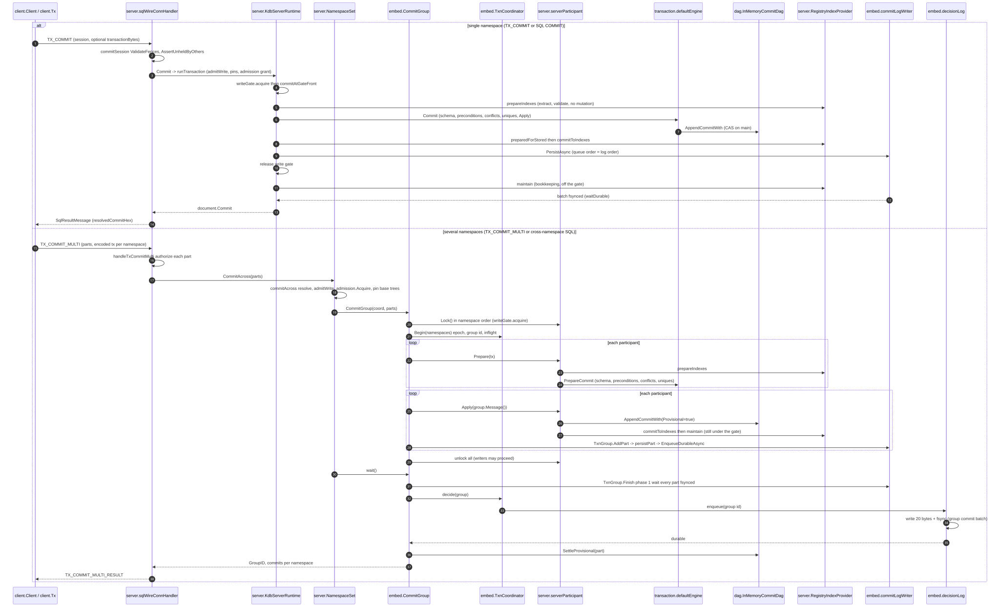

Mermaid source

```mermaid
flowchart TD
    subgraph Refs
      CB[control.Server.handleCreateBranch] --> DCB[dag.InMemoryCommitDag.CreateBranch]
      CT[control.Server.handleCreateTag] --> DCT[dag.InMemoryCommitDag.CreateTag]
      DCB --> MEM[(branches / tags maps in memory)]
      DCT --> MEM
      MEM -. only via .-> CK[embed.saveCheckpoint -> writeCheckpoint snap file]
    end
    subgraph Revert
      WR[server.sqlWireConnHandler.handleRevert holds writeGate] --> RT[embed.RevertTo]
      CR[control.Server.handleRevertApply expectHead check, no writeGate] --> RT
      RP[control.Server.handleRestoreToPoint N reverts] --> RT
      RT --> RES[dag.ResolveRevision + resolveTree head and target]
      RES --> STG[Storage.PutDocument / DeleteDocument staged]
      STG --> CTR[Storage.CommitTree check tree hash == target tree hash]
      CTR --> AC[PersistingCommitDAG.AppendCommit -> InMemoryCommitDag.AppendCommit CAS on main]
      AC --> LOG[Persist -> commitLogWriter fsync]
    end
    subgraph Merge
      ING[peersync.Adopt] --> RD[peersync.resolveDivergedLocked]
      RD --> MN[peersync.mergeNonConflicting]
      MN --> AM[dag.AppendMergeCommitOnto two parents CAS on main]
      AM --> PA[IngestEnv.persistAll -> PersistAsync, wait outside gate]
    end
    subgraph Truncate
      MS[MaintenanceScheduler.runPass / Maintain / CompactHistory / close] --> CAT[embed.checkpointAndTruncate]
      CAT --> PL[embed.planTruncation segmentsToDelete]
      PL --> SC[saveCheckpoint with floor = highest victim + 1]
      SC --> AT[embed.applyTruncation PrepareForTruncation then DeleteSegment per victim]
    end
```

### Call chain

Refs and revision resolution

| # | Function | File:line | What it does |
|---|---|---|---|
| 1 | `control.Server.handleCreateBranch` | `control/refs.go:60` | Refuses staged copies (`refuseIfStaged`, `control/restore.go:424`) and `history=none` namespaces (`refuseWithoutHistory`, `refs.go:151` -> `EmbeddedKdbRuntime.AssertRetainsHistory`, `embed/history_features.go:87`), validates the name (`validRefName`, 337), resolves `from` (`resolveRevisionFor`, `control/history.go:62`), calls `CreateBranch`. |
| 2 | `dag.InMemoryCommitDag.CreateBranch` | `dag/in_memory_commit_dag.go:746` | Fails `branch exists` for an existing name (including `main`), `requireCommitPresentLocked(from)`, inserts the `Branch`, `publishHeadLocked`. `PersistingCommitDAG.CreateBranch` (`embed/persisting_dag.go:90`) is a plain delegate: no log write. |
| 3 | `control.Server.handleDeleteBranch` | `control/refs.go:109` | Calls `DeleteBranch`; "default branch" error becomes 409. |
| 4 | `dag.InMemoryCommitDag.DeleteBranch` | `dag/in_memory_commit_dag.go:768` | Refuses `main`; deletes map entry. |
| 5 | `dag.InMemoryCommitDag.SetHead` | `dag/in_memory_commit_dag.go:701` | Existing branch only, target commit must be present; moves head, republishes. Callers: peer sync (`peersync/ingest.go:408,487`, `conflict_detection.go:215`, `refs.go:107`, `snapshot.go:125`) and replay (`embed/delta_replay.go:394`). No user endpoint. |
| 6 | `control.Server.handleCreateTag` / `dag.InMemoryCommitDag.CreateTag` | `control/refs.go:163`, `dag/history_nav.go:315` | Commit must be present; same name+same commit is idempotent, same name different commit is refused (never moves a tag). A tag is a retention root. `durable:true` calls `EmbeddedKdbRuntime.Maintain()` to force a checkpoint. |
| 7 | `dag.InMemoryCommitDag.ResolveRevision` | `dag/history_nav.go:294` | `ParseRevision` (254: `head`, `tag:x`, `branch:x`, hash, `~n`, `^`) -> `ResolveRef` (197) -> `NthAncestor` (122, first-parent steps). Also `ListCommits` (67), `CommitAtOrBefore` (166). |
| 8 | `dag.InMemoryCommitDag.CommonAncestor` / `IsAncestor` / `CommitsSince` | `dag/ancestry.go:39,83,17` | Ancestor queries. `IsAncestor` uses generation numbers when `AncestryPruning` is on, else a full closure; `CommonAncestor` and `CommitsSince` always build closures (`ancestorClosureLocked`). |

Revert

| # | Function | File:line | What it does |
|---|---|---|---|
| 9 | `server.sqlWireConnHandler.handleRevert` | `server/history.go:102` | Authenticate, authorize `DocumentWriteAction`, **`rt.writeGate.acquire`** (124), then `embed.RevertTo`. Reply `REVERT_RESULT` with commit, target, restored, removed. Client entry is `client.Client.Revert` (`client/history.go:111`). |
| 10 | `control.Server.handleRevertPlan` | `control/revert.go:47` | Dry run: resolves head and target, `diffRevisions` head->target (via `embed.DiffCommits`, `embed/revert.go:201`), returns `expectHead`. Read-only. |
| 11 | `control.Server.handleRevertApply` | `control/revert.go:93` | Requires `expectHead`; refuses `409 head_moved` if head differs; calls `embed.RevertTo(rt.Runtime, ...)` **without taking the server write gate**. |
| 12 | `control.Server.handleRestoreToPoint` | `control/restorepoints.go:471` | Plans every namespace (`DiffCommits`), takes an undo point (`createRestorePoint`, 382), then calls `embed.RevertTo(..., "tag:<name>")` per namespace (541). Not atomic across namespaces. Also no write gate. |
| 13 | `embed.RevertTo` | `embed/revert.go:55` | `AssertWritable`; needs `dag.HistoryNavigator`; `ResolveRevision`; if target tree hash equals head's tree hash -> no-op (returns head). Else `resolveTree` for both (`TreeAt` on the engine or the DAG's map), diff the materialized entries, `GetDocument` at target tree and `PutDocument` for changed docs, `DeleteDocument` for docs absent in target, `Storage.CommitTree(head tree)`, **postcondition `tree.TreeHash == target tree hash`** (161), then `rt.DAG.AppendCommit(tx, head, tree, nil, "revert to <hex>")` (187). Deferred `DiscardPending` unstages on any error. |
| 14 | `embed.PersistingCommitDAG.AppendCommit` | `embed/persisting_dag.go:97` | Delegate `AppendCommit` (`dag/in_memory_commit_dag.go:919`, CAS on `main` == parent), then `Persist` = `PersistAsync` + wait (`persisting_dag.go:122,137`) so the call returns after the log write is acked. |

Merge (peer-sync divergence)

| # | Function | File:line | What it does |
|---|---|---|---|
| 15 | `peersync.Adopt` | `peersync/ingest.go:188` | Under `node.Exclusive` (server write gate, `server/peersync_ingest.go:113`) and the per-namespace `divergenceLockFor` (`conflict_detection.go:165`): reads local head, `ResolveHeadUpdate` (`conflict_detection.go:35`) -> already-ancestor (no-op), fast-forward (`fastForward`, `ingest.go:476`, `SetHead(main)`), or diverged. |
| 16 | `peersync.resolveDivergedLocked` | `peersync/merge_resolution.go:274` | `CommonAncestor` (nil = unrelated, needs `Chain.AllowsUnrelated`), `commitsBetween` both ways, collect touched doc ids, `valueIndex.valuesAt` both heads, per document: unchanged on one side -> take the changed side; both changed -> conflict list -> `resolveConflicting` (`merge_resolution.go:490`: operator `Choose`, `Chain` rules, `Policy`, `Resolver`, `Procedure`) -> either `OutcomeConflict` report (nothing merged, `main` untouched) or merged bodies/forks/provisional ids. |
| 17 | `peersync.mergeNonConflicting` | `peersync/conflict_detection.go:291` | Stages final remote-side values (`PutDocument`/`DeleteDocument`), `CommitTree(local head tree)`, parents ordered canonically by hash (`mergeCommitParents`, 272), tx id = `DerivedUUID("kdb:merge/1:<p0>:<p1>")`, author `MergeAuthorNodeID`, timestamp = later head's, message `kdb:merge/1` plus ` provisional=<ids>` when a resolver authority settled docs provisionally (`mergeMessageFor`, 244), then `d.AppendMergeCommitOnto(&localHead, ...)`. Same inputs give the same merge hash on every node. |
| 18 | `dag.InMemoryCommitDag.AppendMergeCommitOnto` | `dag/ancestry.go:193` | `appendCommitLocked` with two parents and the CAS on `main` against `expectedHead`; stale head -> `*dag.HeadConflictError`. |
| 19 | `peersync.IngestEnv.persistAll` + `peersync.advance` | `peersync/ingest.go:449,468` | Remote commits then the merge commit are queued on the log in order; `serverLocalNode.Advanced` (`server/peersync_ingest.go:141`) applies schema migrations, rebuilds indexes and unique keys, tracks foreign group parts. Durability waits happen after the gate is released (`ingest.go:263`). |
| 20 | `transaction.defaultEngine.Merge` | `transaction/default_engine.go:83` | Replays each branch commit onto the tip (`Replay`, scratch commits) then caps with `AppendMergeCommitOnto`. Called only from `transaction/builder_merge_test.go`; not reachable from any server/control/embed path (grep over non-test code finds no `.Merge(` on an engine). |

Truncate

| # | Function | File:line | What it does |
|---|---|---|---|
| 21 | `embed.MaintenanceScheduler.runPass` | `embed/maintenance_loop.go:518` | Periodic: `rt.Maintain()`. Other triggers: `EmbeddedKdbRuntime.CompactHistory` (`embed/runtime.go:113`, forces `ReclaimImmediate` for the call), `checkpointOnClose` (`checkpoint_open.go:297`), control `handleCompactHistory` (`control/retention.go:169`). |
| 22 | `rt.maintain` closure | `embed/file.go:295` | `through = highest segment seq`, lowered to `writer.SequenceNumber()-1` so the open segment is never claimed; window = `withPeerFloor(liveRetention(...))` (`runtime.go:230`, widens retention to keep what a lagging peer still needs). |
| 23 | `embed.checkpointAndTruncate` | `embed/checkpoint_open.go:398` | Branches: disabled or no reader -> nothing; non-`ServerEngine` -> checkpoint only; `ReclaimManual` -> checkpoint and report "held" (with eligible counts); `history=full` -> checkpoint + blob-store compaction, floor unchanged; `history=none` -> plan, **checkpoint first** (463), then `applyTruncation` (469), then `withCompaction`. |
| 24 | `embed.planTruncation` / `segmentsToDelete` | `embed/truncate.go:196,115` | Pure decision. Never deletes segments above `through`; always keeps at least one segment below it; honours commit floor (`segmentsForCommits`, 1 segment per 1000 commits, min 1) and duration window (undatable segment is kept). `plan.Floor = highest victim + 1`. |
| 25 | `embed.saveCheckpoint` | `embed/checkpoint_open.go:192` | `ErrCheckpointDeferred` if any provisional (cross-ns) commit exists; `CheckpointSnapshotRetaining` (`dag/checkpoint.go:55`: branches, tags, retained commits), live tree, segment fingerprints, head payloads -> `writeCheckpoint` -> `shim.WriteSnapshot`. |
| 26 | `storage.io.OSByteStore.WriteSnapshot` | `storage/io/os_store.go:369` | Temp file, fsync, rename, directory fsync: atomic and durable. |
| 27 | `embed.applyTruncation` | `embed/truncate.go:248` | `ServerEngine.PrepareForTruncation` (flush document bodies to disk) first (`storage/engine/document_bodies.go:106`), then `shim.DeleteSegment` per victim, stopping at the first failure. |

### Data that changes

| Step | Structure / file / wire message | Mutation |
|---|---|---|
| Create/delete branch | `InMemoryCommitDag.branches[name]` | In-memory add/remove; `publishHeadLocked` refreshes the lock-free head snapshot. No delta record. Durable only after the next checkpoint (`CheckpointState.Branches`) written by close, maintenance or post-replay checkpoint. |
| Create/delete tag | `InMemoryCommitDag.tags[name]` | Same; tags also act as retention roots, so compaction (squash) will not remove the tagged commit. |
| Fast-forward | `branches["main"].HeadHash` | `SetHead`. The commits were already stored. |
| Local commit (for contrast) | `branches["main"]` | Moved by `appendCommitLocked` only for `main` (every append variant passes `mainBranch`: `in_memory_commit_dag.go:928,946`, `ancestry.go:203`, `provisional.go:37`). User-created branches are therefore labels that never advance on their own. |
| Revert | engine pending set -> live tree; DAG commit map and tree map; `main` head; delta segment | New commit `message = "revert to <hex>"`, `ops` = WriteOp/DeleteOp of the diff, tree hash == target's. Persisted by `Persist` (fsync under `DurabilitySync`). Old state stays reachable by hash. |
| Merge | engine pending set, DAG, `main` head, delta segment, conflict queue | Merge commit with two parents, plus the adopted remote commits appended first; on `OutcomeConflict` only the conflict queue (`IngestEnv.noteConflict`) changes and `main` is untouched. |
| Truncate: checkpoint | `snap/<checkpoint key>` file | Replaced atomically with `FloorSequence = plan.Floor`, `ThroughSequence`, segment fingerprints, branches and tags. |
| Truncate: delete | `ns/<ns>/delta/<sequenced-name>` files below the floor | `DeleteSegment` -> `os.Remove` (no directory fsync in `OSByteStore.Delete`, `os_store.go:285`). Document bodies flushed to SSTables first. |
| Provisional commits | `InMemoryCommitDag.provisional`, `provisionalGen` | Only for cross-namespace parts (flow 6): they block checkpoints. Separately, a merge commit's ` provisional=` message list names documents settled by last-write pending a resolver authority; that is data inside the merge message, not the `provisional` set. |

### Failure, edge cases & durability points

- **Refs are not durable until a checkpoint.** `control/refs.go:20-25,54-58` says it: a branch or tag created here survives a clean shutdown (checkpoint on close) and is lost by `kill -9` before the next checkpoint, while the commit it names is in the log. `createTag durable:true` runs `Maintain()` to close that gap; restore points do the same with `durable`. `PersistingCommitDAG.CreateTag/SetHead/CreateBranch` write nothing to the log.
- **No backwards head move.** Reads resolve a tree from the DAG while writes keep building on the engine's single live tree (`ServerEngine.CommitTree` ignores the parent tree hash it is handed), so a backwards `SetHead` would make reads and writes disagree. That is the stated reason revert goes forward (`embed/revert.go:30-50`). Commits carry no pre-image so history cannot be un-applied either.
- **Revert refuses unreconstructable targets.** `resolveTree` failure (reclaimed segment under `history=none`) is rethrown through `explainHistoryFailure` (`embed/history_features.go:123`); a tree entry whose body is gone aborts with an error rather than a partial restore (`revert.go:128-136`). No-op revert (tree already equal) returns the current head.
- **Revert serialization differs by door.** The wire path holds `writeGate` (`server/history.go:124`); the control-plane apply path (`control/revert.go:127`) and restore-point restore (`control/restorepoints.go:541`) call `embed.RevertTo` directly with no gate. The control path relies on `expectHead` (a check-then-act, not a lock) and on `AppendCommit`'s head compare-and-swap, which fails with `HeadConflictError` if a writer won the race; the deferred `DiscardPending` then unstages. Staged writes made through the engine's shared pending set by a concurrent server commit are a possible interaction this code does not guard against (not exercised or tested here).
- **Revert durability.** Acknowledged after `PersistingCommitDAG.Persist` waits for the log ack, so under `DurabilitySync` it is fsynced; under `DurabilityAsync` it is not.
- **Restore point restore is N independent reverts.** A mid-way failure returns `restore_incomplete` listing the undo point name (`restorepoints.go:543-546`). The head-capture handshake (`captureHeads`, 303) needs two consecutive agreeing reads of every head (5 attempts), otherwise `too_busy`.
- **Merge atomicity and determinism.** Parents are ordered by hash, author and tx id are derived, timestamp is the later parent's (then `causalTimestampLocked` bumps by 1 microsecond past parents), so two nodes merging the same pair converge on one hash. Same-document overlap is never field-merged: either a configured rule settles it or `OutcomeConflict` leaves `main` alone (`conflict_detection.go:355-359` comment). A stale local head raises `HeadConflictError` rather than orphaning commits.
- **Merge chain mismatch.** Nodes advertise `ResolutionOptions.AdvertisedHash`; if a node cannot run a rule's procedure it advertises `unavailable:<hash>` and merging is held (`conflict_detection.go:143-158`).
- **Truncation crash windows.** Order is plan -> checkpoint claiming the higher floor -> delete. A crash after the checkpoint leaves extra old segments below the recorded floor that the open guard ignores (`checkpointMatchesLog` skips them) and the next pass removes (`truncate.go:241-247`). A checkpoint failure (including `ErrCheckpointDeferred` from a pending cross-ns group) means *nothing* is deleted that pass (`checkpoint_open.go:463-465`). Reversing the order would leave a checkpoint expecting missing segments (reads as damage).
- **Truncation guard on open.** If `lowestSegmentSequence > 0` and the checkpoint cannot be used, open fails with `TruncatedLogError` rather than silently replaying a partial log (`checkpoint_open.go:54-65`), and a namespace bootstrapped from a peer snapshot without its checkpoint fails with `SnapshotCheckpointMissingError`.
- **Archive.** Deleted segments can be fetched back by `EmbeddedKdbRuntime.RestoreFromArchive` (flow 12) only if an archive tier exists (`TruncationResult.Reversible` via `shimHasArchive`, `truncate.go:297`); a replica does not count.
- **Docs vs code.** Anything that says branches are merged locally by the engine is describing `transaction.Engine.Merge`, which is only exercised by tests. `control/refs.go:26-28` lists "deleting the branch being read at" as refused; the handler only inherits the DAG's refusal of `main` (`refs.go:119-129`), I found no read-at check.

## 8. Index maintenance and schema change

### Description (short)

Two coupled mechanisms keep derived structures consistent with documents:

- **Indexes** (`index` package; HASH, BTREE, FULLTEXT, VECTOR) are in-memory event-sourced stores owned by a per-namespace `index.Registry`, exposed through `server.RegistryIndexProvider`. They are created by `CREATE [UNIQUE] INDEX`, dropped by `DROP INDEX`, updated on the commit path in two phases (validate before the DAG append, apply after it, both under the write gate), snapshotted to disk every 64 index-touching commits, and rebuilt from a document scan whenever a snapshot is missing or not at the DAG head on open.
- **Schemas** (`schema` package) validate every written document inside `transaction.runSchemaPhase`, enforce unique constraints through `transaction.UniqueKeyRegistry`, and are created by `CREATE TABLE` (wire path), by `SchemaMigrationOp` operations inside commits (validated locally, applied to the runtime schema only on peer ingest), and by `MetaStore` reconciliation (which is also how a schema and index definitions survive a restart).

Definitions (schema + index DDL) are stored as documents in the reserved namespace `_kdb/meta`; `MetaStore` records local changes there and re-applies stored ones at startup and as peers replicate them. Index *contents* are not stored in `_kdb/meta`; they are local, derived, and rebuilt.

Notes that contradict an easy reading of the code or docs:
- **Schema `indexed` flags do not create index stores in the Go server.** `index.DescriptorsFromSchema` (`index/schema_descriptors.go:38`) has no non-test caller. Only `CREATE INDEX` (and its replicated form) creates stores. `sql/ddl.go:20` sets `Field.Indexed = col.Indexed || col.Unique`, which is just a schema flag; `control/handlers.go:135` and `control/indexes.go` surface it as schema "intent".
- **`Descriptor.Unique` / `CREATE UNIQUE INDEX` is not enforced by the index package, so the statement is now refused unless the schema declares the same field (or tuple) unique.** Older definitions already in a catalog still load. `index.UniqueViolationError` / `NewUniqueViolationError` (`index/exceptions.go:45`, `:79`) have no caller outside their definition. Real uniqueness comes from schema `Unique` fields and `UniqueConstraint` tuples via `transaction.UniqueKeyRegistry`.
- `CREATE INDEX ... ON t (...)` ignores `t`: the index is built for the namespace of the session (`descriptorFor(stmt, ctx.NamespaceID)`, `server/index_provider.go:240`; `stmt.Table` is only carried into the meta document).

### Diagram


Mermaid source

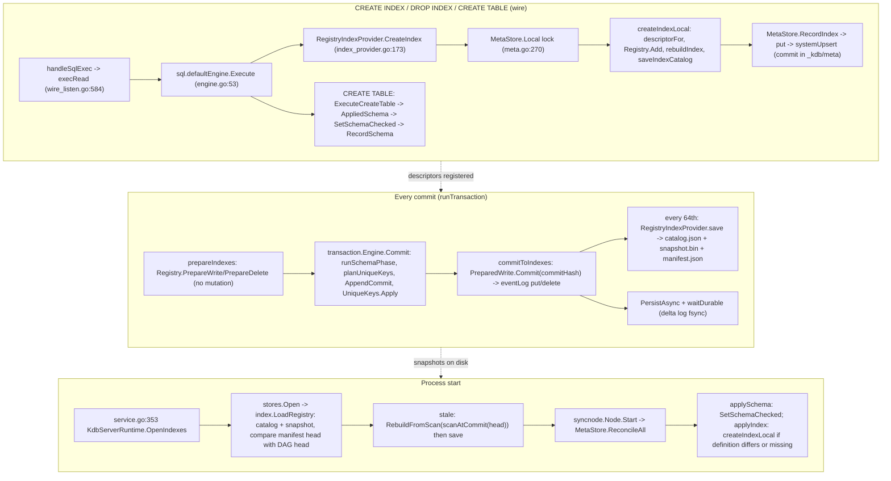

### Call chain

**A. CREATE INDEX / DROP INDEX**

| # | Function (pkg.Type.Method) | File:line | What it does |
|---|---|---|---|
| 1 | `sql.rdParser.parseCreateIndexBody` | `sql/parser.go:245` | Parses `CREATE [UNIQUE] INDEX name ON table (path [WEIGHT w], ...) [USING HASH|BTREE|FULLTEXT|VECTOR] [WITH (k = v, ...)]` into `sql.StmtCreateIndex` (`sql/model.go:39`); an unknown kind is a `ParseError`. `parseDropIndexBody` is `:345` -> `StmtDropIndex{Name, Table}`. |
| 2 | `server.classifyStatement` + `execRead` | `server/wire_listen.go:568`, `:584` | CREATE/DROP INDEX are classified DDL and go through the read path (no scan grant, `ReadOnly:false` authorization). `ctx.NamespaceID` is the target namespace, `ctx.AtCommit` the read head. |
| 3 | `sql.defaultEngine.Execute` | `sql/engine.go:53` (`:71`, `:79`) | Delegates to the `IndexDDLExecutor`. The engine only has one when the `IndexProvider` it was built with also implements it (`engine.go:44`); `NewPlanningError("CREATE INDEX requires an index catalog on this engine")` otherwise. |
| 4 | `server.RegistryIndexProvider.CreateIndex` | `server/index_provider.go:173` | `p.runtime.Meta.Local(func)`: holds `MetaStore.applyMu` (`meta.go:270`) so reconciliation cannot interleave, runs `createIndexLocal`, then `Meta.RecordIndex(ctx.NamespaceID, stmt)`; if recording fails the index is removed again (`registry.Remove`, `saveIndexCatalog`). With no `runtime` (tests) it only runs `createIndexLocal`. |
| 5 | `server.RegistryIndexProvider.createIndexLocal` | `server/index_provider.go:194` | `descriptorFor` (`:240`) validates and builds an `index.Descriptor`; `registry.Add(desc)`; `runtime.rebuildIndex(desc.IndexID)` (backfill); on rebuild failure `registry.Remove` so a half-built index is never left registered; then `saveIndexCatalog`. |
| 6 | `server.descriptorFor` | `server/index_provider.go:240` | Type defaults to HASH; non-FULLTEXT indexes may cover one field only; options include `index_name` (the SQL name), lower-cased `WITH` keys, `weights` for FULLTEXT; VECTOR requires `dimensions` as a positive int. `IndexID = index.DerivedIndexID(namespace, name, type)` (`index/schema_descriptors.go:25`: first 16 bytes of `sha256("kdb-index|ns|name|TYPE")` with version/variant bits), so the same definition yields the same id on every node. |
| 7 | `index.Registry.Add` | `index/registry.go:49` | Rejects duplicate `IndexID`, duplicate index name, or a second index of the same type on the same first field; `factory.Create(desc)` (`stores.NewFactory`, `index/stores/factory.go:24`: HASH/BTREE -> `index.MemoryStore`, FULLTEXT -> `fulltext.NewFullTextStore`, VECTOR -> `vector.NewVectorStore`); the store must implement `index.DocumentStore` (`index/store.go:38`). |
| 8 | `server.KdbServerRuntime.rebuildIndex` -> `RegistryIndexProvider.rebuild` | `server/index_wiring.go:131`, `:119` | Reads `DAG.Head()`, calls `registry.RebuildFromScan(runtime.scanAtCommit(head), head, only)`, then `p.save()`. |
| 9 | `server.KdbServerRuntime.scanAtCommit` | `server/index_wiring.go:83` | `Storage.ScanDocuments(ns, commit.DocumentTreeHash, 256, ...)` over the raw storage adapter (not the expiry-hiding view), yielding `(docID, jsonText)`. |
| 10 | `index.Registry.RebuildFromScan` | `index/registry.go:298` | For the selected stores: `store.Clear()` (`:313`); then for each scanned doc, `store.PrepareDocument` + `p.Apply(headCommit)` (every entry tagged with `headCommit`); a document that fails extraction (wrong-length vector) is counted in `RebuildStats.Skipped` and left out rather than failing the rebuild; finally `MarkCommit(headCommit)`. |
| 11 | `index.MemoryStore.PrepareDocument` / `memoryPreparedPut.Apply` | `index/memory_store.go:104`, `:166` | Single-field index: one key per scalar candidate at the JSON path (arrays are multikey, `index.PathValues`/`KeyFromJSONValue`, `index/paths.go:32,107`); composite: one `CompositeKey` from the first candidate of each field, none if any field is absent. `Apply` always appends a delete event for the doc at `commitHash` first (so a changed key leaves its old bucket) then put events; returns a `Hint` (Put or Delete). |
| 12 | `RegistryIndexProvider.save` | `server/index_wiring.go:149` | No-op for a memory-backed registry (`dir == ""`). Else `index.SaveCatalog` (`index/catalog.go:135`) then `Registry.SaveAll` (`index/registry.go:358`): per store `SaveStoreSnapshot` (`index/persist.go:80`) writes `snapshot.bin` then `manifest.json` (head hash, descriptor), each via `WriteFileAtomic` (`index/persist.go:43`). |
| 13 | `server.MetaStore.RecordIndex` -> `put` -> `systemUpsert` | `server/meta.go:292`, `:228`, `:734` | Document id = `codec.DerivedUUID("kdb:meta/index/<ns>/<name>")` (`meta.go:185`), body = JSON `metaDoc{kind:"index", namespace, name, table, fields, using, unique, with}`. `put` marks the body seen, skips the write if the stored body is identical, else `systemUpsert` -> `systemCommit` (`:740`) -> `runTransaction` with `system:true` (no RBAC) on the `_kdb/meta` runtime: a normal durable commit. |
| 14 | `RegistryIndexProvider.DropIndex` / `dropIndexLocal` | `server/index_provider.go:215`, `:228` | Under `Meta.Local`: `registry.Remove(name)` (error `index not found: <name>` if absent), `saveIndexCatalog` (rewrites `catalog.json` without it; the dropped index's directory with `snapshot.bin`/`manifest.json` is left on disk, not deleted: no removal call exists), then `Meta.RecordDropIndex` (`meta.go:303`) writes a tombstone document (`dropped:true`) so other nodes drop it too. |

**B. Index maintenance on every commit**

| # | Function (pkg.Type.Method) | File:line | What it does |
|---|---|---|---|
| 15 | `server.KdbServerRuntime.prepareIndexes` | `server/index_wiring.go:210` | Called from `runTransaction` (`server_runtime.go:850`) after the write gate is held and before the engine commit. Returns nothing when no provider or no descriptors (fast path). Else `prepareCommitForIndexes` (`:163`): `Registry.PrepareWrite(docID, patch)` for each `WriteOp` and `PrepareDelete` for each `DeleteOp`. |
| 16 | `index.Registry.PrepareWrite` | `index/registry.go:179` | For every registered store `e.store.PrepareDocument(docID, jsonText)`; no store is mutated. An error (a vector of the wrong length is `*index.DimensionMismatchError`, `vector/store.go:213`; unparseable JSON) rejects the whole transaction before anything lands. Note it is given the op's **patch**, not the merged stored document; for a partial-update `WriteOp` the indexed value is extracted from the patch text only (see edge cases). |
| 17 | `transaction.defaultEngine.Commit` -> `finalizeTransaction` -> `plan` | `transaction/default_engine.go:29`, `:185`, `transaction/prepare.go:103` | Validates and conflict-checks (below), then `PreparedCommit.Apply` (`prepare.go:221`) stages documents, `CommitTree`, `AppendCommitWith`, and finally `uniqueKeys.Apply(retract, claim)`. |
| 18 | `server.RegistryIndexProvider.commitToIndexes` | `server/index_wiring.go:183` | After `ResultSuccess` and still under the gate (`server_runtime.go:864`). Empty prepared set -> `registry.MarkCommit(hash)` only. Else `pw.Commit(commitHash)` per prepared write; increments `p.flushed`; every `indexFlushEvery = 64` (`:23`) index-touching commits it calls `p.save()` (synchronously, on the commit path, under the gate). The returned hints are discarded by `runTransaction` (`_ = hints`, `server_runtime.go:868`); they are not attached to the commit. |
| 19 | `index.PreparedWrite.Commit` | `index/registry.go:202` | Apply: for deletes, `store.Delete(docID, commitHash)` on every store; for writes, each prepared put `Apply(commitHash)`; then `MarkCommit(commitHash)`. Returns `[]index.Hint`. |
| 20 | `server.serverPrepared.Apply` (cross-namespace) | `server/namespace_set.go:450-465` | Same two-phase hook for `CommitAcross`: `rt.prepareIndexes` in `serverParticipant.Prepare` (`:419`), `commitToIndexes` after `pc.Apply` (`:459`). |
| 21 | `server.serverLocalNode.Advanced` (peer ingest) | `server/peersync_ingest.go:141` (index block `:172-184`) | For replicated commits: `prepareCommitForIndexes(step.Applied)` + `commitToIndexes(prepared, last.Hash)`; on any error it records the error and falls back to `p.rebuild(nil)` (full rebuild from head). It also applies any `SchemaMigrationOp` found in the replicated commits via `schema.ApplyMigration` + `rt.SetSchema` (`:155-171`) and `UniqueKeys.RebuildLenient` (`:190`). |
| 22 | `index.eventLog.lookup/rangeScan/replayLocked` | `index/event_log.go:224`, `:238`, `:162` | Queries replay put/delete events in sequence order, keeping only events whose `CommitHash` is an ancestor of the cutoff commit (`dag.AncestorSet`), memoized per (cutoff, log seq, DAG ancestry version) in a bounded cache. This is what makes `ExactLookup(..., ctx.AtCommit)` correct for reads at an older or pinned commit and for forked histories. |

**C. Schema validation and change**

| # | Function (pkg.Type.Method) | File:line | What it does |
|---|---|---|---|
| 23 | `sql.DDLExecutor.ExecuteCreateTable` | `sql/ddl.go:13` | Refuses if a schema already exists on the namespace (`ctx.Schema.IsNone()` must be true); builds `schema.Field`s (`Indexed = col.Indexed || col.Unique`) and `UniqueConstraint`s; `schema.BuildWithConstraints(fields, constraints, 1, now, "")` (`schema/schema.go:143`: version >= 1, no duplicate names, constraint fields exist, SHA-256 of the canonical wire encoding is `SchemaHash`). Returns the schema; it is applied by the caller. |
| 24 | `server.sqlWireConnHandler.execRead` (AppliedSchema) | `server/wire_listen.go:647-670` | `rt.Meta.Local`: `SetSchemaChecked` then `RecordSchema`; on `RecordSchema` failure restore with `SetSchema(previous)`. |
| 25 | `server.KdbServerRuntime.SetSchemaChecked` | `server/server_runtime.go:454` | Swaps `Runtime.Schema` under `schemaMu`, then `RebuildUniqueKeys` (`:403`: scan head tree, `UniqueKeyRegistry.Rebuild`, `transaction/unique_registry.go:146`). Any duplicate or unparseable doc fails the rebuild; the previous schema is restored and the registry rebuilt again, so a rejected migration leaves no trace. Success clears `UniqueKeyRebuildError`. `SetSchema` (`:437`) is the unchecked variant (records the error instead of rolling back). |
| 26 | `server.MetaStore.RecordSchema` | `server/meta.go:280` | `schema.ToBytes()` hex-encoded in a `metaDoc{kind:"schema"}` at `metaSchemaID(ns)` (`:177`); same `put` path as indexes: an ordinary commit in `_kdb/meta`. |
| 27 | `transaction.runSchemaPhase` | `transaction/default_engine.go:309` | Runs on every commit inside `plan`. Keeps a rolling `pending` map so later ops in a tx see earlier ones (delete-then-write is a replace). `WriteOp`: merges the patch over the base doc (`baseDoc.Merge`) or `FromJSONWithID`, then `schema.Validate(candidate, rolling)`; violations become `ResultSchemaError`. `SchemaMigrationOp`: `DecodeMigration` (`transaction/migration_codec.go`) then `schema.ApplyMigration(rolling, mig)`; later ops in the same tx are validated against the migrated schema. The commit records the rolling schema's hash (`AppendCommitWith(..., schemaHashWire, ...)`). |
| 28 | `schema.Validate` | `schema/engine.go:14` | No-op for `schema.None()`. For each schema field: JSON path get, required-and-null -> `RequiredFieldMissing`, optional-and-null skipped, else `checkFieldValue` (`:157`, type/enum checks). Fields not in the schema are not rejected. |
| 29 | `schema.ApplyMigration` | `schema/engine.go:52` | Requires `FromVersion == current.Version` and `ToVersion == current+1` (a no-op if already at `ToVersion`); `replayMigrationSteps` -> `applyMigrationStep` (`:352`) handles Add/Drop/Rename/ChangeType field, Add/DropIndex (toggles `Indexed`; `DropIndex` also clears `Unique`), SetRequired, SetUnique (forces `Indexed`), Widen/NarrowEnum; builds the new schema with `Build(...)` (`:77`). `schema.IsBreaking` (`schema/migration.go:52`) and `IsBackwardCompatible` (`engine.go:96`) classify steps but are not consulted by the commit path. |
| 30 | `transaction.planUniqueKeys` | `transaction/unique_registry.go:357` | Runs in `plan` after conflict resolution, before anything is staged, against `targetDocTreeHash`. Pass one collects keys released by touched docs; pass two checks claims against the registry, same-tx releases, and other claims in the same tx. A violation becomes an `OperationViolation` in `ResultSchemaError` (`UNIQUE_CONSTRAINT`). `UniqueKeysFor` (`:290`) derives per-field and compound keys. |
| 31 | `transaction.UniqueKeyRegistry.Apply` | `transaction/unique_registry.go:112` | Retract then claim, called only after `AppendCommitWith` succeeds (`prepare.go`, comment on ordering). Never persisted: rebuilt by scan at runtime construction (`NewKdbServerRuntime`, `server_runtime.go:319+` calls `RebuildUniqueKeys`; a failure is stored in `UniqueKeyRebuildError`, not fatal). |

**D. Open / restart / reconcile / backfill**

| # | Function (pkg.Type.Method) | File:line | What it does |
|---|---|---|---|
| 32 | `service` startup | `service/service.go:353` (primary), `:470` (every other namespace the listener serves) | Calls `KdbServerRuntime.OpenIndexes(stores.Options{})` right after the runtime is built; a failure is fatal (`os.Exit(1)`) because a half-indexed server returns wrong answers. |
| 33 | `server.KdbServerRuntime.OpenIndexes` | `server/index_wiring.go:31` | `indexDir()` (`:71`) -> `<DataRoot>/ns/<namespace>/index` (or the legacy `<DataRoot>/<catalog>/index` if its `catalog.json` names this namespace). No `DataRoot` -> in-memory `index.NewRegistry`, never persisted. Else `stores.Open` (`index/stores/factory.go:42`) -> `index.LoadRegistry`. Stale stores are rebuilt immediately (`provider.rebuild(report.StaleIDs())`); then `SetSQLIndexProvider(provider)` (rebuilds the SQL engine around it, `server_runtime.go:346`) and `SetSearchProvider(provider)`. |
| 34 | `index.LoadRegistry` | `index/registry.go:404` | `LoadCatalog` (missing file -> empty registry); for each descriptor `r.Add(desc)` creates an empty store, then `LoadStoreSnapshot` (`index/persist.go:128`) restores `snapshot.bin` if the manifest's index id and type match. The store is **fresh only if `manifest.HeadCommitHex == DAG head`**; otherwise (no snapshot, unreadable, or at any other head) the store is cleared and reported `Stale`. There is no incremental catch-up from the delta log. |
| 35 | `syncnode.Node.Start` -> `MetaStore.ReconcileAll` | `syncnode/node.go:331` (call at `:339`), `server/meta.go:565`, `:571` | At startup (and on every `_kdb/meta` commit via the kick channel, `meta.go:191-216`) reads all definition docs from `_kdb/meta` (`docs()`, `:586`, schema sorted before index), computes `effective(ns)` (a namespace's own definitions override pattern definitions such as `app/**`), and `apply`s each to the runtime it serves. `NewMetaStore` is wired at `syncnode/node.go:157`; namespaces opened later are brought up with `MetaStore.ApplyTo(rt)` (`meta.go:613`, called from `node.go:278`). |
| 36 | `server.MetaStore.apply` | `server/meta.go:629` | Skips a definition whose exact body this node already applied or recorded (`seen` map), so a reconcile pass cannot put an older definition back over a newer local one. Failure is recorded as a `meta-apply` conflict entry in that namespace's conflict queue rather than stopping other definitions. |
| 37 | `server.MetaStore.applySchema` | `server/meta.go:676` | Decodes hex -> `schema.FromBytes`; no-op if `SchemaHash` equals the live one; else `rt.SetSchemaChecked(sch)`. This is the only place a persisted `CREATE TABLE` schema is reloaded after restart: `embed.OpenFileRuntime` takes the schema as an argument (`embed/file.go:223`) and `syncEmbedSchema` (`embed/memory.go:32`) is an explicit no-op. |
| 38 | `server.MetaStore.applyIndex` | `server/meta.go:691` | No-op if the runtime has no `RegistryIndexProvider`. `Dropped` -> `dropIndexLocal` if present. Else `descriptorFor`; if an index of that name exists and `sameIndex` (`:726`: fields, type, unique, options) it is left alone; if it exists but differs it is dropped and recreated; `createIndexLocal` (builds + backfills + saves). On a restart where the catalog already restored the same index this is a no-op. |
| 39 | `control.Server.handleIndexes` | `control/indexes.go:24` (route `control/server.go:321`) | `GET /v1/ns/{ns}/indexes`: lists `Registry.Descriptors()` and reports `indexedThrough` (= `Registry.Head()`) against the DAG head and a `current` boolean. Read-only; its note text says unsnapshotted state "is replayed from the log on the next open", which is not what `LoadRegistry` does (it rebuilds stale stores from a full document scan). |

### Data that changes

| Step | Structure / file / wire message | Mutation |
|---|---|---|
| CREATE INDEX: parse | `sql.StmtCreateIndex{Name, Table, Fields[], Using, Unique, With}` | Pure value; no state. |
| CREATE INDEX: register | `index.Registry.entries` (`registryEntry{desc, store}`) | New entry appended under `Registry.mu`; `Registry.head` set by `MarkCommit` at the end of the rebuild. |
| CREATE INDEX: backfill | the new store's `eventLog.puts/deletes` | `Clear()`, then one put event per scanned document tagged with the head commit hash (`RebuildFromScan`). For FULLTEXT: postings + doc-length stats; for VECTOR: HNSW graph (`vector/hnsw.go`). |
| CREATE INDEX: catalog | `<indexDir>/catalog.json` (`index.Catalog`, `DescriptorJSON`), `<indexDir>/<indexId>/snapshot.bin`, `<indexDir>/<indexId>/manifest.json` | Each file written atomically: temp file in the same directory, `tmp.Sync()` (`index/persist.go:56`), `os.Rename` (`:65`). The parent directory is not fsynced. `manifest.json` records `headCommitHex`, `formatVersion`, the descriptor and optional stats. |
| CREATE INDEX: replicated definition | `_kdb/meta` namespace: document `kdb:meta/index/<ns>/<name>` | One new commit (full document replacement, `replacing(...)`), durable via the normal delta log; replicated to peers by ordinary peer sync. |
| DROP INDEX | `Registry.entries`, `catalog.json`, `_kdb/meta` | Entry removed; catalog rewritten; tombstone document (`dropped:true`) written. `<indexDir>/<indexId>/` (snapshot, manifest) is left behind on disk. |
| Commit: prepare | `index.PreparedWrite` objects in memory | Extracted keys / tokens / vectors; no store mutated. |
| Commit: apply | each store's `eventLog` (a delete event for the doc at `commitHash`, then put events) | Appended under `eventLog.mu`; `seqCounter` increments, invalidating memoized bucket maps (cache key includes `seq`). `Registry.head = commitHash`. |
| Commit: flush | the on-disk index directory | Every 64th index-touching commit: `catalog.json` + all `snapshot.bin` + `manifest.json` rewritten with `head = Registry.Head()`. |
| Commit: schema validation | none persisted | `schemaOutcome.rollingSchema` is only used for validation and to stamp `Commit.SchemaHash`; the stored documents are the merged, validated ones (`writes[idx]`). |
| Commit: uniques | `UniqueKeyRegistry.owners map[UniqueKey]UUID` | Retract + claim after DAG append. Not persisted. |
| CREATE TABLE / schema set | `Runtime.Schema` (under `schemaMu`), `UniqueKeyRegistry.owners`, `_kdb/meta` doc `kdb:meta/schema/<ns>` | Schema replaced; registry rebuilt from a head scan; schema bytes (hex) recorded as a commit in `_kdb/meta`. |
| SchemaMigrationOp commit (local) | the commit's operations list; `Commit.SchemaHash` | The op is recorded in the commit and validated; `Runtime.Schema` is **not** updated by `runTransaction` (no `SetSchema` call after a local migration commit; only `peersync_ingest.go:170` does that). See edge cases. |
| Open: load | in-memory registry | Catalog descriptors -> empty stores -> restored from snapshots when manifest head equals DAG head. |
| Open: rebuild | stale stores' event logs, then disk | `Clear` + rescan at head; then `save()` writes catalog + snapshots at the head. |
| Open: reconcile | `Runtime.Schema`, registry entries, per-namespace conflict queue | `applySchema` / `applyIndex` as above; failures recorded as `meta-apply` conflict entries. |

### Failure, edge cases & durability points

**Where durability actually is.**
- **Documents and `_kdb/meta` definition documents** are durable at the delta-log fsync inside `runTransaction` (`PersistAsync` at `server_runtime.go:879`, `waitDurable()` at `:886`). That includes the recorded schema and index definitions. They are the source of truth that survives restart.
- **Index contents are never part of that durable boundary.** `commitToIndexes` mutates in-memory event logs only; the snapshot is written every 64 index-touching commits (`indexFlushEvery`), at CREATE/DROP INDEX, and after any rebuild. `WriteFileAtomic` fsyncs the temp file but not the directory (`index/persist.go:43-70`). A crash between flushes loses nothing durable: on the next open the manifest head differs from the DAG head, `LoadRegistry` marks every such store `Stale`, and `OpenIndexes` rebuilds it from a full document scan at head. Practically, after any unclean shutdown (and after any clean one that saw commits since the last flush) every index is rebuilt by full scan; cost is O(documents x indexes).
- **`catalog.json` and the snapshot/manifest pair are written snapshot-then-manifest**, so a manifest is only visible beside a complete snapshot, but `SaveAll` writes stores one after another: a crash mid-`SaveAll` can leave some stores at the new head and others at the old; each is judged independently on open.

**Ordering hazards and errors on the commit path.**
- Index extraction happens before the DAG append, so a bad value (wrong-length vector, unparseable JSON for an indexed document) rejects the commit with nothing half-applied (`server_runtime.go:850-853`). Application happens after the DAG append: if `commitToIndexes` then fails (or the periodic `save()` fails, because it runs inside `commitToIndexes`), `runTransaction` returns an error to the client although the commit is already in the in-memory DAG and has not yet been queued for persistence (`PersistAsync` comes after, `:879`). The in-memory state then runs ahead of the log until the next commit or restart. Not compensated.
- `PrepareWrite` receives the op's *patch* (`WriteOp.Patch`), whereas the stored document is the merge of the patch over the base (`runSchemaPhase`, `baseDoc.Merge`). For a partial-update patch that omits an indexed field, `PrepareDocument` finds no candidate and `Apply` records a delete for that document: the document silently drops out of that index until a later full rewrite or a rebuild. SQL UPDATE emits the full new JSON so SQL paths are unaffected; `Upsert` merges at the root (`server_runtime.go` Upsert doc comment), so a root-level merge patch that omits an indexed key is the exposed case. This is read from the code (`index_wiring.go:163-175` passes `o.Patch`), not exercised.
- Cross-namespace commits run `prepareIndexes` per participant before any apply (`namespace_set.go:419`), so one participant's bad vector rejects the group.
- Peer-ingested commits: a failure in `prepareCommitForIndexes`/`commitToIndexes` triggers `p.rebuild(nil)` (full rebuild of all indexes) instead of refusing the history (`peersync_ingest.go:172-184`).

**CREATE INDEX specifics.**
- Backfill is synchronous inside the statement: the SQL reply is sent only after the full scan and `save()` complete. For a large namespace this is a long call on a connection goroutine holding `MetaStore.applyMu` (blocking all other definition changes and reconciliation).
- The new store is registered (`Registry.Add`) before it is populated (`rebuildIndex`), and neither step takes the write gate (only `MetaStore.applyMu`). In the code read there is no "building" state: a concurrent SELECT can get `ok=true` from `ExactLookup` against a store that is still empty or partial, and a concurrent commit's `commitToIndexes` can append events that `RebuildFromScan`'s `store.Clear()` then discards (the scan is of the head read earlier). This window was not exercised by a test I read; treat it as a plausible race rather than a confirmed failure.
- Failures: duplicate name / duplicate (type, first field) -> `fmt.Errorf` from `Registry.Add`; invalid options -> `descriptorFor` errors; rebuild failure -> index removed again; `RecordIndex` failure -> index removed and catalog re-saved. Errors reach the client as plain `SqlResultMessage.Error` text (no `ErrorCode`: `execRead` classifies via `sqlResultErrorClassified`, and none of these error types map to a code).
- `CREATE UNIQUE INDEX` sets `Descriptor.Unique=true`, which is stored in `catalog.json` and the meta document and shown by `GET .../indexes`, but nothing enforces it (see Description), so the Go server now refuses the statement unless the schema declares the same constraint. Enforced uniqueness requires a schema `UNIQUE` column / `UNIQUE (a, b)` table constraint.
- A schema field marked `INDEXED` does not get an index store; an equality predicate on it is a full scan unless a `CREATE INDEX` exists.
- Index name uniqueness is per namespace; the SQL name is stored as `Options["index_name"]`. `ExactLookup`/`RangeLookup` find stores by *field* (`registry.ByField`), not by name, so the `ON table` clause and the index name have no effect on planning.

**Schema change specifics.**
- `CREATE TABLE` is only valid on a namespace with no schema (`ExecuteCreateTable`). There is no `ALTER TABLE` in the parser (`parseStatement` handles SELECT/INSERT/UPDATE/DELETE/CREATE/DROP/BEGIN/COMMIT/ROLLBACK only). Migrations therefore come from `transaction.Builder.SchemaMigration` (`transaction/builder.go:53`) via encoded transactions, `schema.Migrate` / `MigrationBuilder` (`schema/migration_builder.go`), or replication.
- A locally committed `SchemaMigrationOp` validates and is recorded in the commit (with the new schema hash), but the server runtime's `Schema()` is not advanced by `runTransaction`/`commitWith`; only the peer-ingest path applies migrations to `Runtime.Schema`. So after a local migration commit the next commit is validated with the old schema until something calls `SetSchema`/`SetSchemaChecked` (the MetaStore only does so for `CREATE TABLE`-recorded schemas). Treat as a gap to verify against intended behaviour; no code in `server/` or `embed/` was found that closes it.
- `schema.ApplyMigration` rebuilds with `Build` (no constraints argument), so compound `UniqueConstraint`s on the previous schema are not carried into the migrated schema (`schema/engine.go:77`; `BuildWithConstraints` is the variant that takes them). Single-field `Unique` flags are preserved because they live on `Field`.
- `SetSchemaChecked` is the only guard that a newly-unique field is consistent with existing data (registry rebuild fails on a duplicate). The commit path's `planUniqueKeys` then guards later writes. Turning a field required (`SetRequiredStep{Required:true}`) does not re-validate existing documents; `schema.IsBreaking` marks it breaking but nothing enforces that classification.
- Reconciliation can fail without breaking the node: `applySchema`/`applyIndex` errors are recorded as `meta-apply` conflicts (`meta.go:660-668`) and cleared on the next success.
- After restart the schema comes back only if `MetaStore` ran: `OpenFileRuntime` is given the schema by its caller, `syncEmbedSchema` does nothing, and commits stamp a schema hash but the runtime does not reload the schema from history. A node run without `syncnode`/`MetaStore` (for example the plain embedded driver; `driver/database.go:245` keeps its own `setSchemaChecked`) must supply the schema itself.
- `control` plane: `GET /v1/ns/{ns}/indexes` is read-only, and `CREATE INDEX` via the control SQL console works because the index provider does the work inside `Execute`; `CREATE TABLE` via the console does not (the returned `AppliedSchema` is dropped, `control/data.go:344`).

**Tests that pin this behaviour (leads, not re-run):** `server/index_wiring_test.go`, `server/multi_namespace_indexes_test.go`, `server/meta_test.go`, `index/stores/registry_test.go`, `transaction/unique_registry_test.go`, `transaction/unique_compound_test.go`, `schema/engine_test.go`.

## 9. Peer sync (v2 client and server)

All paths are relative to `go/kdb/`. Line numbers are from the working tree as it stands (see the "state of the tree" bullet at the end of this flow: the index deletes several files that exist in HEAD).

### Description (short)

Peer sync v2 is a request/response protocol over one connection (TCP via `tcp.Transport`, or WebSocket via `syncnode.Node.Handler`). A client (`peersync.SyncV2`) says `SYNC_HELLO`, the host (`peersync.V2Host`) authenticates the principal, grants each matching namespace with a direction (`pull`, `push`, or both) and answers with every granted namespace's refs. The client then handles each namespace independently: **pull first** (optionally a snapshot bootstrap, then `FETCH_REQUEST` pages per ref, then a local ref decision through `peersync.ApplyRef`) and **then push** (`REF_UPDATE` pages, where the host stores the commits and makes the same ref decision with the same `ApplyRef`). Pull-before-push means that after a merge the push is a fast-forward on the peer. Histories rooted at a snapshot (shallow roots) are handled by `Graft` (when the namespace's resolution chain sets `allowUnrelated`) or healed later by `Deepen` over a separate repair session.

The usual driver is `replication.Replicator` (one `peerLoop` per configured peer, started by `syncnode.Node.Start`), triggered by a debounce after local commits, by an interval timer (default 30s), or by `POST /v1/peers/{name}/sync`. `SyncV2` falls back to the v1 single-namespace protocol when the peer answers `SYNC_HELLO` with `UNSUPPORTED`.

### Diagram


Mermaid source

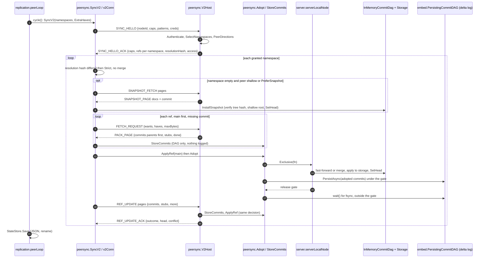

### Call chain

| # | Function (pkg.Type.Method) | File:line | What it does |
|---|---|---|---|
| 1 | `replication.Replicator.Start` | replication/replicator.go:95 | Starts one goroutine per peer (`peerLoop.run`) and kicks each once. Created by `syncnode.Node.Start` (syncnode/node.go:331, `replication.New` at :358). |
| 2 | `replication.Replicator.OnLocalCommit` | replication/replicator.go:114 | Called from `syncnode.Node.notify` (syncnode/node.go:219) via the `CommitListener` chain (node.go:342-346); kicks every peer whose namespace patterns match `ns`. |
| 3 | `replication.peerLoop.run` | replication/replicator.go:287 | Wait on trigger (+ `Debounce`, default 50ms) or timer (`PeerConfig.Interval`, default 30s, `DefaultInterval` replication/config.go:75); calls `cycle`; on error uses `backoff` (:332, interval doubled per consecutive failure, capped at 10 min, +-10% jitter). |
| 4 | `replication.peerLoop.cycle` | replication/replicator.go:346 | Loads `PeerState`, builds `ExtraHaves` per namespace from `PendingTips` plus last `RemoteMain`, calls `peersync.SyncV2` (:375), updates counters/`PendingTips`, optionally `deepen` (:413), `StateStore.Save`. Filtered peers go to `projectionCycle` instead (flow 14). |
| 5 | `replication.peerLoop.connCx` | replication/replicator.go:452 | Credentials: `PeerConfig.Credentials()` callback or static user/password/token; a token also becomes an `Authorization: Bearer` header (WebSocket only). |
| 6 | `peersync.SyncV2` | peersync/v2_client.go:127 | `dial`, `SYNC_HELLO`, checks ack, optional `META_VIEW` (:161), then `syncNamespace` per ack ref. `UNSUPPORTED` reply -> `syncV1Fallback` (:508). |
| 7 | `peersync.dial` | peersync/v2_client.go:611 | WebSocket transport uses `ws.Transport.ConnectWithOptions` (TLS + headers); everything else `transport.Connect`. Default transport chosen in replication/transport.go:14. |
| 8 | `peersync.v2Conn.request` | peersync/v2_client.go:573 | Send frame, wait for the reply with the same `CorrelationID` (timeout `Timeout`, default 30s), `PEER_ERROR` becomes `*RemoteError`. One request in flight. |
| 9 | `server.ListenPeerSyncTLS` / `peerSyncConnHandler.run` | server/peersync_listen.go:46 / :154 | TCP accept loop. WebSocket path: `syncnode.Node.Handler` (syncnode/handler.go:24) -> `server.ServePeerSyncConnection` (:89), with `ConnectionContextFrom` (syncnode/handler.go:49) turning the `Authorization` header into credentials. A handler error drops the connection (:165). |
| 10 | `peerSyncConnHandler.handle` | server/peersync_listen.go:115 | The first frame fixes the protocol: `SYNC_HELLO` -> `peersync.NewV2Host` with `V2HostConfig` (Namespaces = `PeerNamespaces()`, `CreateOnPush`, `AuthorizeDocuments`, `MetaView`, `HomeRequest`, `WriteBack`, `OnCaughtUp`); anything else -> v1 `peersync.ConnectionHost` for the listener's one namespace. |
| 11 | `peersync.V2Host.HandleFrame` / `serve` | peersync/v2_host.go:97 / :133 | Decode, require hello first, dispatch by message type; any `error` becomes `PEER_ERROR` with a code from `ClassifyError` (:113). Undecodable frame returns an error (connection dropped). |
| 12 | `peersync.V2Host.hello` | peersync/v2_host.go:267 | Rejects a peer with this node's own `NodeID`; authenticates (hello creds, else transport `ConnectionContext`); `SelectNamespaces` (peersync/patterns.go:42) against `NamespaceProvider.List`; `auth.PeerDirections` (auth/types.go:88) gives access; `CreateOnPush` grants literal unknown names; stores principal/granted/access/peer/`helloAt`; returns refs and `intersect(capabilities)`. |
| 13 | `peersync.V2Host.refs` -> `RefsOf` | peersync/v2_host.go:401, peersync/refs.go:15 | Branches (tracking branches `peers/...` omitted), tags, `Horizon()` as `Shallow`, plus `ResolutionHash = env.Resolution.AdvertisedHash()` (peersync/conflict_detection.go:143) and the session's `Access`. |
| 14 | `peersync.V2Host.env` | peersync/v2_host.go:429 | Per frame: namespace must be in `granted`, direction re-authorized with `auth.AuthorizePeer` (auth/types.go:77) so a revoked grant bites on the next frame; then `NamespaceProvider.Env` -> `server.peerNamespaceProvider.Env` (server/peersync_ingest.go:96) -> `KdbServerRuntime.PeerIngestEnv` (:36). |
| 15 | `peersync.v2Conn.syncNamespace` | peersync/v2_client.go:181 | `cfg.Local.Env(ns, CreateLocal && Mode&SyncPull)`; if local `AdvertisedHash` != remote `ResolutionHash`, forces `ConflictPolicyStrict` and sets `ResolutionMismatch` (:189-195); skips the direction the peer's `Access` does not grant. |
| 16 | `peersync.v2Conn.pull` | peersync/v2_client.go:216 | `needsSnapshot` (peersync/snapshot.go:220) -> `InstallSnapshot`; builds haves = `spreadAncestors(localHead)` (peersync/client.go:324) + `localRefHeads` (refs.go:171) + `ExtraHaves` that are held; per ref (main first, `orderedRefs` :482): `fetchRef` if the target is not held, then `ApplyRef`. Only main's failure aborts the namespace; other refs go to `RefErrors`. |
| 17 | `peersync.InstallSnapshot` | peersync/snapshot.go:87 | Under `Node.Exclusive` + `divergenceLockFor`: requires empty namespace (`ErrNotEmpty`), `CanInstallSnapshot`, pages through `snapshotFetcher` (v2_client.go:331) writing documents to storage and committing the tree per page, verifies commit hash and the tree hash, `PutShallowCommit`, `SetHead(main)`, then `SnapshotInstalled` (durability), then `Advanced`. `undo` rolls back on any failure. |
| 18 | host `SNAPSHOT_FETCH` case -> `peersync.snapshotPage` | peersync/v2_host.go:175, peersync/snapshot.go:29 | Walks the tree of the requested commit, sorts ids, returns documents after the cursor up to `maxBytes` (at least one) with `Done`/`Next`. Requires `storage.TreeWalker`. |
| 19 | `peersync.v2Conn.fetchRef` | peersync/v2_client.go:350 | Loop of `FETCH_REQUEST{wants:[want], haves, maxBytes}`; `StoreCommits` per page; on a store error caused by a peer shallow root (`unsharedRoot` ingest.go:695) either `Graft` (chain allows unrelated) or `noteUnrelated` (ingest.go:715); records `ReceivedTips`; stops at `Done` or an empty page. |
| 20 | host `FETCH_REQUEST` case -> `peersync.MissingCommitsFrom` | peersync/v2_host.go:150, peersync/refs.go:204 | `env(..., dirPull)`; BFS from wants excluding the ancestor closure of haves, topological order (`topoSort` ingest.go:628), page cut by `commitSize` estimate (:189); stubs for archived parents; `Done` when the page is everything. On `Done` calls `OnCaughtUp` -> `NoteInboundPeer` (server/inbound_peers.go:37). |
| 21 | `peersync.StoreCommits` | peersync/ingest.go:166 | `PutStub` for stubs; for each commit not held: `checkSkew` (:114, `DefaultMaxClockSkew` 5 min) then `DAG.PutCommit(c, requireParents=true)`. Decides nothing, logs nothing, moves no head. |
| 22 | `peersync.Graft` | peersync/graft.go:54 | Needs `Chain.AllowsUnrelated()` (`ErrUnrelatedNotAllowed`) and `storage.ForeignTreeStore`; pages the root's state, verifies commit hash + tree hash, then in `Exclusive`: `StoreForeignTree` (blob store flushed+synced), `GraftRecorded` (`EmbeddedKdbRuntime.RecordGraft`, embed/snapshot_install.go:137), `PutShallowCommit`, `PutDocumentTree`, `persistAll`; waits fsync after the gate; `undo` -> `DropShallowCommit`. |
| 23 | `peersync.ApplyRef` | peersync/refs.go:56 | Requires the proposed commit to be stored. Tag: `applyTag` (:120) create / no-op / conflict, never moves. Side branch: `applySideBranch` (:93) create / fast-forward / no-op / conflict (never merged). Main: `applyMain` (:73) -> `Adopt`. |
| 24 | `peersync.Adopt` | peersync/ingest.go:188 | Inside `Node.Exclusive` + per-namespace `divergenceLockFor` (conflict_detection.go:165): re-reads head; `CheckCommit` (single-home fence) on commits to be adopted; `ResolveHeadUpdate` (conflict_detection.go:35) -> no-op / `fastForward` (:476) / `resolveDivergedLocked` (flow 10); `persistAll` (:449); `advance` (:468) -> `serverLocalNode.Advanced`. After the gate: waits all fsync futures, `clearConflict`, `afterAdvance` (:290). |
| 25 | `server.serverLocalNode.Exclusive` | server/peersync_ingest.go:113 | Refuses when draining (`UnavailableError`), read-only, fenced, or a projection (`ProjectionReadOnlyError`); takes `writeGate` with `WriteTimeout`; so peer sync is an ordinary writer of the runtime. |
| 26 | `peersync.fastForward` / `applyAndVerify` | peersync/ingest.go:476 / :496 | `commitsBetween` (:593), `netEffect` (:666) folds to one final op per document, writes them to storage, `CommitTree` on `from.DocumentTreeHash` and requires the result to equal the incoming head's declared tree; on mismatch `restore` (:549) writes pre-images back and returns `*TreeMismatchError`; then `DAG.SetHead(main)`. |
| 27 | `embed.PersistingCommitDAG.PersistAsync` | embed/persisting_dag.go:137 | Queues each adopted commit to the delta-log writer goroutine in order and returns a `wait()` that completes when the record is durable (fsync policy of the log's `DurabilityMode`). `chainOnBarrier` (:155) also waits for an undecided cross-namespace group ahead under `DurabilitySync`. |
| 28 | `server.serverLocalNode.Advanced` | server/peersync_ingest.go:141 | Runs inside the gate after the head moved: applies replicated schema migrations, updates SQL indexes (rebuilds on failure), rebuilds unique-key registry (`RebuildLenient`, duplicates recorded as `ConflictUniqueDuplicate`), tracks foreign cross-namespace group parts, fires `CommitListener` for every commit (this is what wakes the stream hub and the replicator). Its error does not undo the head move. |
| 29 | `peersync.v2Conn.push` | peersync/v2_client.go:397 | For each local ref whose value differs from the advertised one: skip main if `ResolutionMismatch` and not a fast-forward (:422); `graftRootsFor` (:278); loop `MissingCommitsFrom` pages -> `REF_UPDATE{kind, ref, old, new, commits, stubs, more}` (:438); records `Remote[ref]` outcome, `ack.HeadHex`, remote conflict report. |
| 30 | `peersync.v2Conn.graftRootsFor` | peersync/v2_client.go:278 | For each local shallow root that lies under the ref being pushed and is unknown to the peer: probes with `FETCH_REQUEST{maxBytes:1}`; if the peer holds nothing, either skips the ref ("cannot graft") or sends the root's state as `GRAFT_PUSH` pages (wire/graft_ops.go:13). |
| 31 | `peersync.V2Host.graftPush` | peersync/v2_host.go:486 | Stages pages per namespace in `h.grafts` (cap `maxGraftPushBytes` 1 GiB), on the `Done` page runs `Graft` over the staged pages; requires `dirPush`. |
| 32 | `peersync.V2Host.refUpdate` | peersync/v2_host.go:530 | `env(ns, CreateOnPush, dirPush)`; if `AuthorizeDocuments`, every pushed write/delete is checked with `DocumentWriteAction`/`DocumentDeleteAction` (:457); `StoreCommits`; on the last page `ApplyRef`; ack carries outcome, head and JSON conflict report. |
| 33 | `replication.peerLoop.deepen` -> `peersync.OpenRepairSession` / `DeepenAll` / `Deepen` | replication/replicator.go:671, peersync/repair.go:230, peersync/deepen.go:303, :106 | Only when `PeerConfig.Deepen`: separate connection (needs `repair` capability), `FetchAncestors` (:80) pulls everything below each shallow root, stores parents-first, `ShallowRootsChanged` (marker), logs the history and the root, then `Unshallow`. |
| 34 | `RepairSession.FetchDocs` / `V2Host.docFetch` | peersync/doc_fetch.go:147 / :27 | `DOC_FETCH` read-through with Merkle proofs; needs read rights (`StreamSubscribeAction`) not sync rights; `verifyDocFetch` (:196) checks commit hash, proof against `DocumentTreeHash`, body against the proven content hash (`ErrUnproven`). Used by `server.ReadThrough` (flow 14). |
| 35 | `replication.StateStore.Save` | replication/state.go:106 | Per-peer JSON at `<dataRoot>/replication/peers/<name>.json` via tmp file + rename (no fsync). |

### Data that changes

| Step | Structure / file / wire message | Mutation |
|---|---|---|
| Hello | `V2Host` fields `principal, granted, access, peer, helloDone, helloAt` (v2_host.go:63-81) | Set once per connection; `granted/access` fixed for the session, authorization of each direction re-checked per frame. |
| Hello ack | `wire.SyncHelloAckMessage{Accepted, NodeID, Capabilities, Refs []NamespaceRefs}` (wire/sync_v2_ops.go:87, :44) | Carries `Branches`, `Tags`, `Shallow`, `HistoryFloorHex`, `ResolutionHash`, `Access`. |
| Pull pages | `InMemoryCommitDag` commits + stubs (`PutCommit`, `PutStub`) | New commits and stubs resident in memory only; they are **not** in the delta log until adopted. Commits are verified against their own hash by `PutCommit`. |
| Replication state | `NamespaceSyncResult.ReceivedTips` -> `NamespaceState.PendingTips` in `replication/peers/<name>.json` (state.go:36) | Persisted only if the namespace failed, so the next sync names those tips as `ExtraHaves` and resumes. Cleared on success. |
| Fast-forward | Storage live tree (`PutDocument`/`DeleteDocument`/`CommitTree`), `DAG.PutDocumentTree`, `DAG.SetHead(main)`, SQL indexes, unique-key registry | One net op per document, verified against the head's declared tree; main moves to the incoming head. |
| Merge | A two-parent merge commit (`kdb:merge/1`, author `MergeAuthorNodeID`) appended by `AppendMergeCommitOnto`; storage writes of the other side's documents | See flow 10. |
| Delta log | `PersistingCommitDAG.PersistAsync` frames, in the order main reached them (remote side's commits, then the merge) | Appended by the log writer goroutine; durable when `wait()` returns. |
| Snapshot install | Storage documents + tree, `DAG.PutShallowCommit(target)`, `SetHead(main, target)`, then `PersistSnapshot` (embed/snapshot_install.go:60): `MaterializeLiveBodies` (blob store), `writeCheckpoint` with `ThroughSequence = -1`, namespace marker `ShallowRoots += root` with `BodiesExternal = true` (`writeNamespaceMeta`: tmp + `Sync` + rename, namespace_meta.go:57) | Namespace now opens "bootstrapped": open refuses to proceed without that checkpoint. |
| Graft | `ForeignTreeStore.StoreForeignTree` (blob store flush + sync), marker `GraftRoots += root` (`RecordGraft`, embed/snapshot_install.go:137), `PutShallowCommit(root)`, `PutDocumentTree`, root logged | The root is stored but **not** on main; main reaches its state only through the later merge. |
| Deepen | `DAG` gains the ancestors, `PutShallowCommit` for ones whose own parents are missing, marker `ShallowRoots` rewritten (`RecordShallowRoots`, snapshot_install.go:111), log frames for the history, then `Unshallow(root)` | Root stops being shallow; empty marker list means a full replay from genesis rebuilds the namespace. |
| Push | Peer-side effects of `REF_UPDATE`: `StoreCommits` then `ApplyRef` (same as pull on the host) | `ack.Stored`, `ack.Outcome` in `{stored, fast-forwarded, merged, conflict, created, noop}`, `ack.HeadHex`. |
| Inbound-peer bookkeeping | `<dataRoot>/replication/inbound/<ns>.json` map peer -> last-caught-up time (`NoteInboundPeer`) | Written on every final `FETCH_REQUEST` page; feeds the peer retention floor (`InboundPeerFloor` -> `EmbeddedKdbRuntime.SetPeerRetentionFloor`, syncnode/node.go:229). |
| Conflict queue | `<dataRoot>/replication/conflicts/<ns>/<id>.json` (`ConflictQueue`, peersync/conflicts.go) and tracking branch `peers/<peer>/branch:main` | Written when `ApplyRef` reports a conflict or an unrelated history is found. |

### Failure, edge cases & durability points

- **State of the tree.** `git status` stages deletions of `peersync/join.go`, `peersync/boundary.go`, `peersync/snapshot_state.go`, `dag/join.go`, `dag/unlogged.go` (+ their tests); none exist on disk and nothing in the live tree references them. They exist in HEAD (merge of PR #114 "fix/mesh-merge-convergence"). What the working tree therefore does *not* have, per those files' own header comments and the staged diff of `ingest.go`/`snapshot.go`/`v2_client.go`: (a) `StoreCommits` stores with plain `PutCommit` (ingest.go:178), so a stored-but-unlogged commit is not marked and `CheckpointSnapshotRetaining` is not used by the checkpointer - a checkpoint taken while a peer commit sits unadopted can describe history only memory holds; (b) no "extend the shallow boundary" step in `fetchRef` (v2_client.go:368 handles only `unsharedRoot`/`Graft`), so a peer branch forked from behind this node's own snapshot root cannot be stored ("missing parent") unless the namespace allows unrelated histories; `NamespaceSyncResult.BoundaryExtended` is gone; (c) `snapshotPage` reads `walker.WalkTree(commit.DocumentTreeHash)` directly (snapshot.go:45), so a snapshot request at a commit whose tree this node never built fails; (d) no canonical same-content join, so `Adopt` always merges pairwise and the deleted `dag/join.go` comment says that pairwise merging is deterministic but not confluent in a mesh; (e) `adoptable()` is gone, so shallow roots are not filtered out of a head move's commit list. Treat any doc that describes these as current as stale for this tree.
- **docs/kdb-lld-flows.md section 12 is v1.** It describes `HANDSHAKE`/`COMMIT_FETCH`/`COMMIT_PUSH` (peersync/host.go `ConnectionHost`, peersync/client.go), which still exists but is only the fallback (`syncV1Fallback`, v2_client.go:508) and the listener's behaviour when the first frame is not `SYNC_HELLO`. `CommitsToPush` (sync_plan.go:91) is not called by any non-test code; v2 pushes with `MissingCommitsFrom` (refs.go:204) and v1 with `MissingCommits` (sync_plan.go:37). v1 syncs main only and merges nothing when a chain exists (host.go:337, v2_client.go:521).
- **Authentication and authorization.** No separate peer identity exists: the peer is an ordinary principal. `hello` authenticates with credentials in the hello or the transport `ConnectionContext`; failure returns `Accepted:false, Reason` (not `PEER_ERROR`). Authorization is per namespace and per direction using `PeerSyncAction` (both) else `PeerPullAction`/`PeerPushAction` (auth/types.go:56-91); a principal with neither on a matched namespace simply does not get it granted. Every later frame re-authorizes (`V2Host.env`), `DOC_FETCH`/`PROJECT_FETCH`/`PROJECT_WRITE` use `StreamSubscribeAction` plus per-document `DocumentReadAction`, `HOME_REQUEST` requires push rights. Optional per-document write checks on pushed commits via `AuthorizeDocuments`; merge commits carry every document the sides disagreed on, so the peer needs rights on those too. The v1 handler authorizes `PeerSyncAction` for the listener's namespace on every frame (host.go:131). TLS/mTLS is the transport's (`core.TransportTlsSettings`).
- **Loop and identity guards.** A peer presenting this node's `NodeID` is refused (v2_host.go:274, "delete its NODE file").
- **Failures surfaced.** Any host error becomes `PEER_ERROR{code,message}` -> `*RemoteError` on the client (v2_client.go:601); codes come from `server.classifyError` (`ErrorCodeUnsupported` for unknown frames, `Integrity` for `TreeMismatchError`, `Unauthorized`, `NotHome`, ...). A namespace error is recorded in `NamespaceSyncResult.Err` and does not stop the other namespaces; `peerLoop.cycle` turns it into an overall error (backoff) while still saving partial progress. Per-ref errors other than main land in `RefErrors`.
- **Where data becomes durable.** (1) Pulled/pushed commits are *only memory* (`StoreCommits`) until main adopts them; `IngestEnv.Persist` documentation (ingest.go:49-60) states why: replay applies every logged commit onto main, so only adopted commits are logged. A crash loses unadopted pages; the next sync re-fetches them (the replicator's `PendingTips` only help while the state file survives). (2) Adopted commits are queued with `PersistAsync` **under the write gate** (log order = main order) and the fsync is awaited **after** the gate is released (ingest.go:263-267); an fsync failure is returned after main already moved in memory ("peer sync: persisting adopted commits"). Whether that is a real `fsync` depends on the log's durability mode; see `chainOnBarrier` for sync-ack semantics. (3) Snapshot bootstrap is durable only via `SnapshotInstalled` (`RebuildUniqueKeys` first, then `PersistSnapshot`; peersync_ingest.go:50-73): bodies to the blob store, then checkpoint (`shim.WriteSnapshot`; I did not verify it fsyncs), then the marker (tmp, `Sync`, rename). Failure of the hook triggers `undo` which restores main and drops the root, leaving the namespace empty and bootstrappable. (4) Graft order, from graft.go header: blob-store sync of tree+bodies, then marker, then log the root, so a crash after any step opens cleanly; `GraftRecorded` is inert if the root never reached the log. (5) Deepen orders marker -> log -> in-memory `Unshallow` -> marker rewrite; a crash between steps leaves the root marked shallow over history it holds and re-running finishes the job. (6) `replication.StateStore.Save`, `NoteInboundPeer` and `ConflictQueue.writeLocked` write a tmp file and rename **without fsync**; losing them costs a negotiation or a re-recorded conflict, never data.
- **Edge cases.** Resolution-hash mismatch (different chains, or a procedure missing/at another revision -> advertised hash `unavailable:<hash>`): neither side merges; pulled divergences are queued as conflicts and main is pushed only when it fast-forwards the peer. `Access` of `push` skips pull and vice versa. Pushing to a namespace the peer lacks needs `V2HostConfig.CreateOnPush` (server: `KdbServerRuntime.PeerCreateOnPush`); the hello advertises it as having no refs so the client pushes everything. `needsSnapshot` only fires for an empty (genesis-only) local namespace and a peer with `Shallow` roots, a `HistoryFloorHex`, or `PreferSnapshot` (`bootstrap=snapshot`). `PageBytes` default is 4 MiB estimated (`DefaultPageBytes`, refs.go:183); v1 pages by commit count (`DefaultPageCommits` = 500, peersync/types.go:58).
- **Concurrency.** One request in flight per connection (`v2Conn`). Server-side, `Adopt`, `Graft`, `InstallSnapshot` and `Deepen` serialize on `Node.Exclusive` (the runtime's `writeGate`) *and* the per-namespace `divergenceLockFor` mutex; `fetchRef`/`StoreCommits` run outside both and only touch the DAG (which has its own lock).
- **Not present.** No push of unrelated sibling namespaces' definitions beyond what `META_VIEW` offers; no per-peer rate limiting in this package; no persistent peer identity beyond the NODE id presented in the hello.

---

## 10. Conflict detection and stored-procedure merge resolution

### Description (short)

A conflict exists only when two heads of `main` have diverged (neither is an ancestor of the other) **and** both sides changed the same document to different values. `peersync.Adopt` calls `resolveDivergedLocked`, which compares each candidate document's value at both heads and follows each value to the write that originated it (`valueIndex.origin`), so a node's own earlier write echoed back through a peer's merge is not counted as a change. Non-conflicting documents merge automatically. Each genuinely conflicting document goes through, in order: an operator's explicit `Choose`, the namespace's **resolution chain** (`source-priority`, `validity`, `field-merge`, `procedure`, `last-write`, `queue`, `authority`), then the legacy `ConflictPolicy`. If everything is decided, one deterministic two-parent merge commit is created; otherwise `main` is left untouched, the divergence is recorded in the durable `ConflictQueue`, and an operator or an "authority" settles it later with an ordinary merge commit that replicates like any write.

### Diagram


Mermaid source

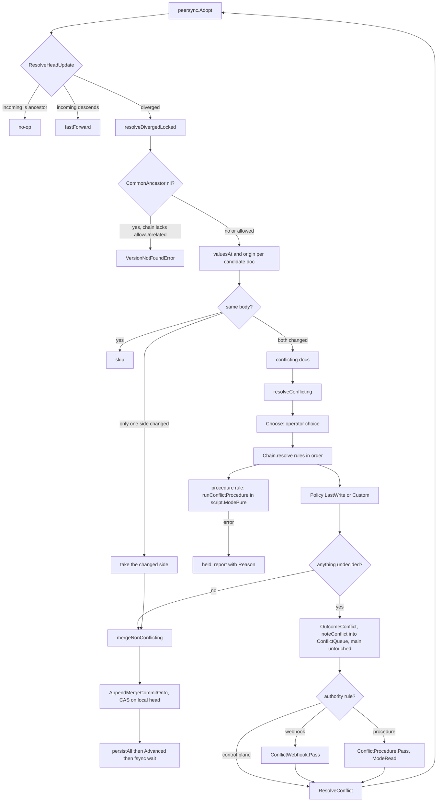

### Call chain

| # | Function (pkg.Type.Method) | File:line | What it does |
|---|---|---|---|
| 1 | `peersync.Adopt` | peersync/ingest.go:188 | Entry from `ApplyRef(main)` (flow 9). Under `Exclusive` + `divergenceLockFor`: `ResolveHeadUpdate`; `default:` branch (:241) calls `resolveDivergedLocked(env.DAG, env.Storage, env.NamespaceID, localHead, incomingHead, env.Resolution)`. |
| 2 | `peersync.ResolveHeadUpdate` | peersync/conflict_detection.go:35 | `HeadFastForward` / `HeadAlreadyAncestor` / `HeadDiverged` via `IsAncestor`. |
| 3 | `peersync.resolveDivergedLocked` | peersync/merge_resolution.go:274 | `CommonAncestor`; unrelated histories (`ancestor == nil`) are refused with `kdberr.NewVersionNotFoundError` unless `Chain.AllowsUnrelated()` (base becomes the empty tree; `shallowRootDocs` :444 adds documents of shallow roots as candidates). Collects candidate ids from `commitsBetween(local, incoming)` and the reverse (ingest.go:593); `valuesAt` both heads; classifies each differing doc via `origin` + `changed` (:241). |
| 4 | `valueIndex.valuesAt` / `origin` | peersync/merge_resolution.go:141 / :208 | Value at a commit = last op of the nearest write along the first-parent chain (a replace is delete+write, so the **last** op counts); at a shallow root or missing parent the commit's tree in storage answers. `origin` follows a merge-taken value into the parent that held it, so it is independent of which ancestor is picked and which side is local. |
| 5 | `peersync.resolveConflicting` | peersync/merge_resolution.go:490 | Order: `opts.Choose` -> `opts.Chain.resolve` -> `opts.Policy` (`ConflictPolicyLastWrite` uses `originLater` :631; `ConflictPolicyCustom` calls `opts.Resolver` once per doc with `transaction.DocumentConflict`, any error or nil -> all stay undecided). Leftovers become a `kdberr.ConflictReport` + `[]ConflictDetail`. |
| 6 | `peersync.canonicalSides` / `mergeCommitParents` | peersync/merge_resolution.go:611 / peersync/conflict_detection.go:272 | Side 0 is always the lower-hash head's, so both nodes evaluate the rules with identical arguments. |
| 7 | `peersync.ResolutionChain.resolve` | peersync/resolution_chain.go:264 | Walks `Rules`: `RuleProcedure` (:268), `RuleSourcePriority` (`sourcePriority` :328, ranks by commit `AuthorNodeID`), `RuleValidity` (needs both sides present; uses `opts.Valid`), `RuleFieldMerge` (`fieldMerge` :354, top-level three-way), `RuleLastWrite` (:306), `RuleAuthority` (:308: `PendingProvisional` -> last-write marked provisional, else queued), `RuleQueue` (:313). `ResolutionChain.Validate` (:131) forbids a rule after a terminal one. |
| 8 | `server.KdbServerRuntime.peerResolution` | server/resolution.go:43 | Builds `ResolutionOptions` per `PeerIngestEnv`: `Policy = PeerSyncConflictPolicy` (zero value reports), `Chain = ResolutionChainOf()`, `Valid` = `schema.Validate` against the replicated schema, `ProcedureHash`, `Procedure` closure with a per-env budget `maxProcedureCallsPerSync = 10_000` (:40). **No `Resolver` is set**, so `ConflictPolicyCustom` on the server path cannot decide. |
| 9 | `server.KdbServerRuntime.runConflictProcedure` | server/resolution.go:71 | Looks up the source (`ProcedureSource` procedures.go:71); recomputes `script.SourceHash` (script/runtime.go:64) and compares with the hash the chain pinned (`SourceHash`), error on mismatch; calls `procRuntime.ResolveConflict(ctx, src, script.ModePure, nil, ConflictInput{DocID, Base, Local=side0, Remote=side1, origins})`; maps `DecideDefer/Take/Doc/Delete/Fork` to a `peersync.Settlement`. Fork uses `peersync.ForkOf`. |
| 10 | `script.Runtime.ResolveConflict` -> `Call` | script/conflict.go:250, script/runtime.go:100 | Fresh `goja.Runtime` per call (no state between documents), `purePrelude` (sandbox.go) removes `Date`, `Intl`, `Math.random` and the transcendental `Math` functions, locale methods; wall clock `Limits.WallClock` 5s (script/limits.go:33) interrupts; output capped 1 MiB; compiled programs cached by source hash. `ModeRead` instead installs a read-only `kdb.get/kdb.query` host (script/host.go). |
| 11 | `peersync.ForkOf` / `ForkID` | peersync/merge_resolution.go:102 / :95 | Keeps the loser as a new document with a `conflictOf:{id,commit}` back-reference; id is `DerivedUUID("kdb:fork/1:"+docID+":"+body)`, so identical settlements on two nodes write the same document. Refuses a deleted side or a non-object body. |
| 12 | `peersync.mergeNonConflicting` | peersync/conflict_detection.go:291 | Writes the final state of every document the remote side touched into storage (`PutDocument`/`DeleteDocument` in sorted id order), `CommitTree` on the local head's tree, then builds the merge transaction with: `ID = DerivedUUID("kdb:merge/1:"+p0+":"+p1)`, `AuthorNodeID = MergeAuthorNodeID` (:231), `Timestamp` = later of the two heads, parents in hash order, message `mergeMessageFor(provisional)` (`kdb:merge/1` plus ` provisional=<ids>`), `Operations` = every document on which the parents differ. Calls `dag.AppendMergeCommitOnto(&localHead, ...)`. |
| 13 | `dag.InMemoryCommitDag.AppendMergeCommitOnto` | dag/ancestry.go:193 | Compare-and-swap on `expectedHead`; a stale head returns `*dag.HeadConflictError` instead of re-pointing main. |
| 14 | `Adopt` tail | peersync/ingest.go:250-259, :263-283 | `persistAll(step.Commits)` (remote side's commits, then the merge) under the gate, `advance` -> `Advanced`; outside the gate wait fsync; `clearConflict`; `afterAdvance` (:290): `ResolvedEntry` closes entries a received resolution names, `noteProvisional` (:332) records provisional decisions, `SweepIncorporated` (:311) drops divergences main already contains. |
| 15 | `peersync.IngestEnv.noteConflict` | peersync/ingest.go:398 | On `OutcomeConflict`: points tracking branch `peers/<peer>/branch:main` (conflicts.go:313) at the incoming head so retention keeps it, then `ConflictQueue.Record` (conflicts.go:173) with items + `ConflictDetail` (base, origins, `Reason` when a rule could not run). Entry id = sha256 of kind+ns+ref+peer, so a persisting conflict is one entry with a growing `Seen`. |
| 16 | `peersync.ResolutionOptions.AdvertisedHash` | peersync/conflict_detection.go:143 | Chain hash while this node can run every procedure rule at the pinned revision, else `"unavailable:"+hash`. Compared in `syncNamespace` (v2_client.go:189) before any merge. |
| 17 | `server.MetaStore.SetProcedure` / `SetResolution` / `pinProcedures` / `repinChain` / `apply` | server/meta.go:390 / :315 / :364 / :430 / :629 | Procedures and chains are replicated definitions in the metadata namespace (`put` :228 commits a doc as `kdb:meta` via `systemUpsert`). `SetProcedure` compiles first (`procRuntime.Compile`), applies at once, then re-pins the chain; `SetResolution` validates and pins each `RuleProcedure.SourceHash` from the local copy (a chain cannot call an undefined procedure). `apply` installs into the runtime (`SetResolutionChain` resolution.go:25, `SetProcedure` procedures.go:41); an apply failure is recorded as a `meta-apply` conflict. |
| 18 | `peersync.ResolveConflict` | peersync/conflicts.go:353 | Operator resolution of a queued `ConflictDivergence` of main: sets `env.Resolution.Choose` from `Choice` (`take` local/remote, `body`, `delete`, `fork{keep}`) and runs `Adopt(env, incoming)` again, i.e. the **same** merge machinery; documents without a choice leave the conflict open (error naming them); on success `Conflicts.Remove`. |
| 19 | `server.KdbServerRuntime.ResolveConflict` | server/peersync_ingest.go:244 | `authorizeResolve` (resolution.go:133: `ConflictResolveAction` if the chain has an authority, else `TxCommitAction`), provisional entries go to `resolveProvisional` (resolution.go:159: an ordinary commit `kdb:resolve/1 <id>` that rewrites each document if it still holds the value the merge kept, else `ErrResolutionStale`), divergences to `peersync.ResolveConflict`. |
| 20 | `server.ConflictWebhook.Pass` / `deliver` | server/conflict_webhook.go:106 / :149 | For authority-flagged, undelivered entries addressed to this node: POST JSON `ConflictNotification`, headers `X-KDB-Delivery` (entry id) and `X-KDB-Signature: sha256=<HMAC>` (:178); 2xx -> `MarkDelivered`; at-least-once. Kicked by `ConflictQueue.OnRecord`. Started in `syncnode.Open` (syncnode/node.go:163). |
| 21 | `server.ConflictProcedure.Pass` / `settle` | server/conflict_procedure.go:125 / :193 | Authority rule with `Procedure` set, on the notifying node only: for every document of an entry runs the procedure in `script.ModeRead` with a `runtimeHost` (read-only `Get`/`Query`), translates decisions with `authorityChoice` (:236), and only if **all** documents decided calls `rt.ResolveConflict(e.ID, choices, p.Principal)` (default principal `systemPrincipal()`, must hold `resolve`). Retries up to `maxProcedureAttempts = 5` per entry (:37). |
| 22 | `server.KdbServerRuntime.ExpireAuthorityConflicts` / `StartAuthorityExpiry` | server/resolution.go:334 / :385 | After the rule's `Timeout`, a held divergence is merged by last write (`peersync.ResolveConflict` with `laterOrigin` choices) and a provisional entry is simply dropped; run as the runtime, no principal. |
| 23 | Control plane | control/replication.go:59-170, control/server.go:305-308 | `GET /v1/ns/{ns}/conflicts`, `POST .../conflicts/{id}/resolve`, `.../ack`, `.../conflicts/resolve-all` (`KdbServerRuntime.ResolveAll` resolution.go:283), `DELETE .../conflicts/{id}` (`DismissConflict` peersync_ingest.go:266); `GET/PUT /v1/ns/{ns}/resolution`, `GET/PUT/DELETE /v1/ns/{ns}/procedures[/{name}]`. There is no separate `control/resolution` package: only `control/resolution_test.go` exists. |

### Data that changes

| Step | Structure / file / wire message | Mutation |
|---|---|---|
| Detect | none (reads `InMemoryCommitDag`, storage tree at both heads) | Pure computation under `divergenceLockFor(ns)` and the node's write gate. |
| Merged | Storage live tree: final state of the other side's documents, forks written once (`forkWritten` :250); DAG: new merge `document.Commit` (two parents, `kdb:merge/1[ provisional=...]`), new document tree, `main` moved to it (CAS) | The merge commit is identical on every node that merges the same two heads under the same chain: same parents order, ops, timestamp (max of heads), author, transaction id, message. |
| Merged, delta log | `PersistAsync(remote commits..., merge)` | Logged in the order main reached them. |
| Provisional | `ConflictEntry{Kind: provisional, MergeHex, Items, Details, Authority}` id derived from the merge hash | Same id on every node; closed when the authority's `kdb:resolve/1 <id>` commit is adopted anywhere (`ResolvedEntry`). |
| Conflict (undecided) | `main` unchanged; DAG branch `peers/<peer>/branch:main`; `ConflictQueue` file `<dataRoot>/replication/conflicts/<ns>/<id>.json` (kind `divergence`, `LocalHex`, `IncomingHex`, `TrackingRef`, `Items`, `Details`, `Authority`, `Delivered`, `Seen`) | Idempotent re-record; `Delivered` cleared when items change. |
| Resolution commit | `peersync.ResolveConflict`: merge commit as above, entry + tracking branch removed. `resolveProvisional`: ordinary transaction with `DeleteOp`+`WriteOp` per document (+ fork doc) and message `kdb:resolve/1 <id>` | Replicates like any write; other nodes fast-forward and close their copy. |
| Definitions | metadata namespace documents (`kind: resolution` / `procedure` / `home`) | Chain + `SourceHash` pins; change of a procedure re-pins the chain. |
| Wire | `REF_UPDATE_ACK.ConflictBytes` (JSON `kdberr.ConflictReport`), `ConflictReportMessage` in v1 | Conflict reported to the pusher without moving the host's main. |

### Failure, edge cases & durability points

- **Determinism is the design constraint.** The merge hash covers its content, so everything feeding it is made symmetric: parents ordered by hash, side 0/1 by parent order, timestamp = max of the heads' (not a local clock), fixed author id, transaction id derived from the parents, base value taken from `CommonAncestor(p0, p1)` in canonical order (:374), fork ids derived from content, documents processed in sorted id order. Remaining sources of divergence are guarded: peers compare `ResolutionHash` before merging; a missing/different procedure revision makes the advertised hash `unavailable:`; a procedure error **holds** the document (never falls through) because "failed here" is not something both nodes agree about; the per-sync call cap and 5s wall-clock make a node hold rather than decide differently (the other node may merge and this one fast-forwards to its result). The `Valid` rule uses the local schema, which the chain hash does not cover, so it only chooses between two present values.
- **Sandbox.** `ModePure` procedures get no clock, randomness, locale or database; goja exposes no `require`/FS/network. `ModeRead` (authority procedures only) may read through `Get`/`Query` (`MaxHostCalls` 1000, `runtimeHost.Query` capped at 10,000 rows) but cannot write; its result is applied as an ordinary commit by `ResolveConflict`. `ConflictProcedure.Limits` (conflict_procedure.go:50) is declared and documented but never read: `settle` uses the process-wide `procRuntime` with `script.Limits{}` defaults. The Go and Kotlin runtimes are meant to give the same answer for the same source (script/limits.go:32); Kotlin-side merges are non-deterministic across implementations (project memory), so cross-implementation in-merge parity is out of scope.
- **Fallbacks.** Rule order inside the chain; a rule that returns nothing falls to the next (`RuleLastWrite`/`RuleQueue`/`RuleAuthority` end the chain). If the chain runs out: `ConflictPolicyLastWrite` (later origin by timestamp then hash), `ConflictPolicyCustom` (needs `opts.Resolver`, not set on the server path), otherwise report. No procedure available on this node (`opts.Procedure == nil`) -> held with reason. A `ResolutionMismatch` sync uses `ConflictPolicyStrict` with no chain.
- **Durability points.** Detection and the decision are in memory. The merge commit is durable only when `persistAll`'s `PersistAsync` futures complete (queued under the gate, awaited after it; ingest.go:263). `noteConflict`/`ConflictQueue.Record` write `<id>.json` via tmp + rename **without fsync** (conflicts.go:293); on a crash the conflict is simply re-detected by the next sync. A merge whose log write failed leaves main moved in memory and returns the error; the commit is re-derived identically by any node. Definitions (chain, procedures) are durable as ordinary commits of the metadata namespace.
- **Errors surfaced.** Unrelated histories without `allowUnrelated`: `VersionNotFoundError` (from `Adopt`; `fetchRef` pre-empts it with `ConflictUnrelatedHistory` via `noteUnrelated`). `ErrResolutionStale` (HTTP 409 `stale`), `AuthorizationError` (403), `ErrConflictNotFound` (404), "still has documents without a choice" (409 `not_resolved`) in control/replication.go:83-96. `ResolveConflict` merges against the **current** head, so a document touched by local writes since may need a new choice.
- **Not implemented / not as documented.** `CommitPushOutcome.Details`/`ConflictDetail.Reason` are the only place a failing procedure is explained. There is no `control/resolution` package. The v1 host merges nothing when a chain exists (`ingestEnv`, host.go:337). A canonical same-content "join" that existed in HEAD (`peersync/join.go`, `dag/join.go`) is deleted in this tree, so every divergence of identical content still produces a (content-free) merge commit; per the deleted file's comment this makes pairwise merging non-confluent in a mesh.

---

## 11. Checkpoint, compaction, maintenance loop, retention and history-mode switch

### Description (short)

Maintenance is a per-namespace background loop (`embed.MaintenanceScheduler`) that wakes on a timer, decides cheaply whether anything could be reclaimed (new head commit, SSTable backlog, or the sweep clock), prefers moments with no writes in flight (bounded deferral), and then runs `EmbeddedKdbRuntime.Maintain`. A pass is "checkpoint, then (history=none and reclaim != manual) delete delta segments that are below the checkpoint, outside the retention window and not the open segment, then merge SSTables". The order checkpoint-claims-floor then delete is what makes a crash mid-pass safe. History mode (`full`/`none`) and reclaim mode (`manual`/`immediate`/`balanced`/`lazy`) are separate axes: switching mode only writes a marker and tells the engine; deletion happens only through maintenance under a reclaiming mode or an explicit `CompactHistory`. Segment rotation (64 MiB default) is what makes segments sealed and therefore reclaimable in a long-running process. The `compaction` package and `InMemoryCommitDag.Squash/StubCommit` exist but are not wired into any production path.

### Diagram

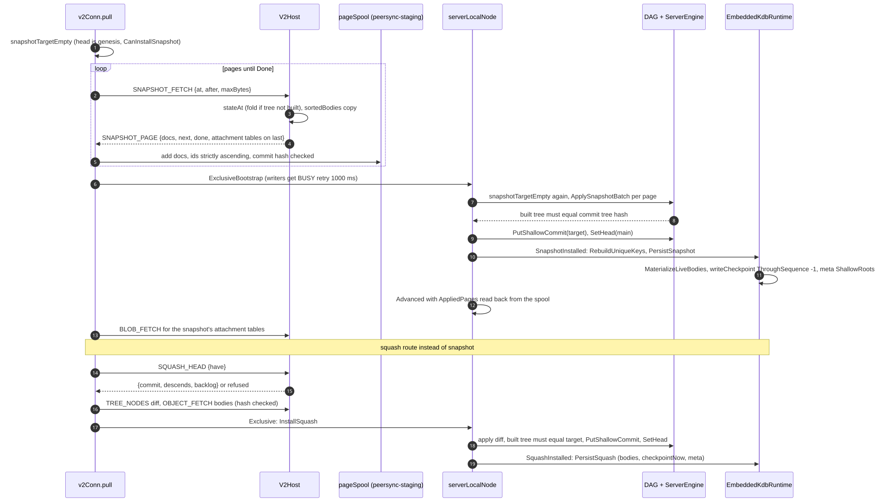

Mermaid source

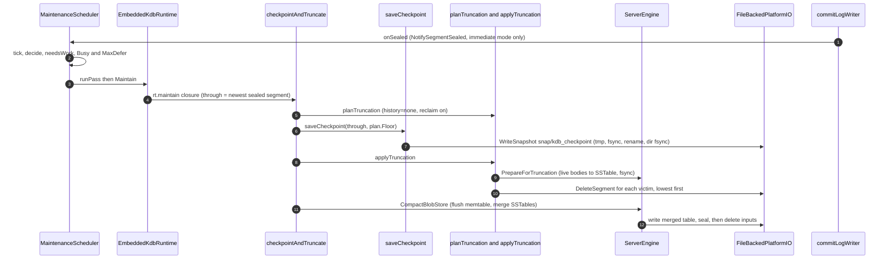

### Call chain

| # | Function (pkg.Type.Method) | File:line | What it does |
|---|---|---|---|
| 1 | `embed.StartMaintenance` | go/kdb/service/service.go:743 -> go/kdb/embed/maintenance_loop.go:232 | One scheduler per served namespace (primary + control-plane secondaries only). Returns nil for `Interval<=0`, read-only runtime, or nil `rt.maintain` (memory runtime). Registers `NotifySegmentSealed` on the DAG's log writer via `SetSealListener` (maintenance_loop.go:243; persisting_dag.go:281). |
| 2 | `newMaintenanceScheduler` | maintenance_loop.go:252 | Defaults Sweep 30m, MaxDefer 6, CompactTables `sstable.DefaultCompactionTrigger`=4 (sstable/compaction.go:37). Seeds `lastHead` from the current head so open does not look like a fresh commit; `lastPassAt` zero makes the first tick due via the sweep rule. |
| 3 | `MaintenanceScheduler.loop` | maintenance_loop.go:330 | `select` on stop / `reconfigured` / `after(Interval())` -> `tick`. |
| 4 | `tick` -> `decide` -> `needsWork` | maintenance_loop.go:438, :464, :494 | `needsWork` = head hash changed since last pass, OR `BlobTableCount() >= CompactTables`, OR `now-lastPassAt >= Sweep`. If work is due and `respectLoad` and `Busy()` (service.go:747: write queue depth > 0): defer up to `MaxDefer` consecutive ticks, then `maintenanceForce`. Negative MaxDefer never forces. |
| 5 | `runPass` -> `EmbeddedKdbRuntime.Maintain` | maintenance_loop.go:518 -> go/kdb/embed/runtime.go:90 | Errors are counted and logged ("scheduled maintenance did not complete; it will be retried"), not escalated. |
| 6 | `rt.maintain` closure | go/kdb/embed/file.go:295 | `through = highestSegmentSequence(r)` capped at `writer.SequenceNumber()-1` (file.go:296-301): never claims the segment still taking appends. Applies `withPeerFloor` (runtime.go:230) which widens the retention window to cover the slowest replication peer, and `liveRetention`/`liveReclaim` (file.go:329, :340), read from the live engine so control-plane changes apply. |
| 7 | `checkpointAndTruncate` | go/kdb/embed/checkpoint_open.go:398 | Branching: disabled/`through<0` -> no-op; `!reclaim.Reclaims()` (manual) -> checkpoint only and report eligible segments (:428-453, `ReclaimHeld`); history=full -> checkpoint + `withCompaction` (:455-461); history=none -> plan, checkpoint with `plan.Floor`, apply, compact (:459-478). |
| 8 | `saveCheckpoint` | checkpoint_open.go:192 | Refuses with `ErrCheckpointDeferred` (:265) if `d.HasProvisional()` (undecided cross-namespace part) before and after capturing; `segmentFingerprints` (checkpoint.go:510); `dag.CheckpointSnapshotRetaining(commitRetentionFilter(eng))` (dag/checkpoint.go:55; filter at checkpoint_open.go:356 keeps only in-window commits plus ref-named commits under history=none); head payloads; `eng.LiveTree()`; `writeCheckpoint` (checkpoint.go:642) -> `OSByteStore.WriteSnapshot` (os_store.go:369). |
| 9 | `planTruncation` | go/kdb/embed/truncate.go:196 | Pure decision. Only for history=none; `segmentsToDelete` (:115) walks newest-first and refuses: segment > `through`; fewer than 1 kept segment so far; fewer than `segmentsForCommits(window.Commits)` (1 per 1000 commits, min 1, :173); last commit younger than `window.Duration` or undatable. Floor = highest victim + 1. |
| 10 | `applyTruncation` | truncate.go:248 | `eng.PrepareForTruncation()` first; failure aborts ("refusing to truncate the delta log because document bodies could not be flushed first"). Then `shim.DeleteSegment` per victim in ascending order, stopping at the first failure (:273-281). |
| 11 | `ServerEngine.PrepareForTruncation` / `MaterializeLiveBodies` | go/kdb/storage/engine/document_bodies.go:106, :123 | For history=none: every version the live tree names is `memTable.Put`, then `memTable.Flush(0)` (SSTable written, sealed = fsynced) and `wal.Sync`. If a live version cannot be produced from memory or the log: error, no truncation. |
| 12 | `FileBackedPlatformIO.DeleteSegment` -> `OSByteStore.Delete` (or `PrimaryWithReplicas.Delete`) | go/kdb/storage/io/file_backed.go:207 -> os_store.go:285 (primary_replicas.go:162) | Closes cached fd, `os.Remove`. Replica sinks follow the delete, archive sinks keep it (`replicateDeletion`, primary_replicas.go:210). |
| 13 | `withCompaction` -> `ServerEngine.CompactBlobStore` -> `LsmBlobStore.Compact` -> `sstable.Compact` | checkpoint_open.go:488 -> document_bodies.go:221 -> go/kdb/storage/sstable/types.go:235 -> sstable/compaction.go:58 | Flushes memtable first, then (if >= 4 tables) merges every table into one at `level = deepest+1`, key set restricted by `reachableBlobKeys` (document_bodies.go:260: live-tree bodies only under history=none, everything under full). New table sealed before inputs are deleted; failure is logged, not returned. |
| 14 | `commitLogWriter.appendBatch` -> `DefaultWriter.RotateIfNeeded` | go/kdb/embed/commit_log.go:356, :371 -> go/kdb/storage/delta/writer.go:137 | Checked only between batches; rotates when `sizeBytes >= EffectiveMaxSegmentBytes(config)` (default 64 MiB, writer.go:97, :109). Empty segments never rotate. Flushes, `sealLocked` (writer.go:187: `shim.SealSegment` only if bytes were written), then advances `sequence`, new random segment id, `sizeBytes=0`. Calls `onSealed` (commit_log.go:382). The new segment file is created lazily at the next append. |
| 15 | `NotifySegmentSealed` | maintenance_loop.go:212 | Wakes the loop (`reconfigured` channel) only under `ReclaimImmediate` (`sealTriggered`). |
| 16 | Preallocation: `OSByteStore.openFor` -> `preallocateFile` -> `zeroFill` | os_store.go:79, :101-109 -> go/kdb/storage/io/preallocate_linux.go:23 (darwin: preallocate_darwin.go) -> preallocate.go:25 | Enabled by `KDB_PREALLOCATE_SEGMENTS`/`StorageOptions.PreallocateSegments` (storage_options.go:227); size is `delta.EffectiveMaxSegmentBytes` via `preallocateBytesFor` (host.go:419). `O_EXCL` create distinguishes first creation (fallocate + 1 MiB-chunk zero fill + fsync, runs inside the first Append on the log goroutine) from reopen. Writes are positional (`WriteAt` at logical end), not `O_APPEND`. |
| 17 | `EmbeddedKdbRuntime.CompactHistory` | runtime.go:113 | Explicit one-way door: temporarily sets reclaim to `ReclaimImmediate`, runs `rt.maintain`, restores the mode (deferred). Exposed as `POST /v1/ns/{ns}/retention/compact` (control/server.go:354 -> control/retention.go:169). |
| 18 | `EmbeddedKdbRuntime.EligibleForCompaction` | go/kdb/embed/history_mode_switch.go:151 | Dry run: forces manual for the duration so the pass writes a checkpoint and reports the plan without deleting; used by `GET .../retention` (control/retention.go:55). |
| 19 | `EmbeddedKdbRuntime.SetHistoryMode` | history_mode_switch.go:63 (HTTP: `PUT /v1/ns/{ns}/retention/history-mode`, control/server.go:353 -> retention.go:98) | Writes `meta.json` first (`writeNamespaceMeta` namespace_meta.go:57; also forces strategy replay for none) and then `eng.SetHistoryMode` + `eng.SetReclaimMode` (tree_objects.go:62, :117). Lands on `ReclaimManual` when going to none; reports `HistoryLost` if `logHasBeenTruncated()` (:175). Refused for memory-backed and read-only runtimes. |
| 20 | `MaintenanceScheduler.ApplyReclaimMode`, `SetInterval/SetSweep/SetMaxDefer` | maintenance_loop.go:183, :374, :388, :406 | Presets from `ReclaimMode.Cadence` (storage/reclaim_mode.go): manual and lazy 30m/6h, MaxDefer 24; immediate 10s/1m, no load deference, seal-triggered; balanced 5m/30m, MaxDefer 6. Control-plane settings `governance.maintenanceInterval/Sweep/MaxDefer`, `reclaim.mode`, `retain.duration/commits` (control/settings_apply.go:123-210, `eachScheduler` :267, `applyReclaimMode` :298). |
| 21 | `EmbeddedKdbRuntime.SetRetentionWindow` | go/kdb/embed/history_features.go:68 | Refused under history=full. Not persisted: a restart returns to the configured window. |
| 22 | `MigrateHistoryMode` / `MigrateHistoryStrategy` (offline) | go/kdb/embed/migrate_history.go:116, :28 | Take `LockDataDir` (exclusive attach lock, file.go:353). To none: `prepareForNoneMode` (:164) opens the namespace under none with `alreadyLocked` and calls `PrepareForTruncation`, then writes marker (strategy forced replay). To objects: `buildTreeObjects` (:72) -> `recordTreeObjectsForHistory` (tree_rebuild.go:166). Marker is written only after the work succeeds. |
| 23 | Tree rebuild for replay strategy | go/kdb/embed/checkpoint_open.go:333 -> go/kdb/embed/tree_rebuild.go:48 | `installTreeRebuilder` (only when checkpoint restored and strategy is replay) lets `ServerEngine` fold a historical tree forward from the nearest cached ancestor (`maxTreeFoldDepth` 100,000, tree_rebuild.go:22), result verified against the requested tree hash. |
| 24 | `EmbeddedKdbRuntime.RestoreFromArchive` | go/kdb/embed/restore_archive.go:63 (HTTP `POST .../retention/restore`) | Fetches segments highest-first from the archive sink, stops at the first hole, only then `lowerCheckpointFloor` (:153) rewrites the checkpoint with a lower floor. |
| 25 | `Maintain` as a flush side effect | go/kdb/control/refs.go:220, go/kdb/control/restorepoints.go:458 | Control-plane ref flush and restore-point creation call `Maintain()` directly (checkpoint outside the schedule). |
| 26 | Not wired | go/kdb/compaction/engine.go (skeleton, `RunCycle` returns empty `Result`); `dag.InMemoryCommitDag.Squash` (dag/in_memory_commit_dag.go:1034) and `StubCommit` (:425) | No production importer of package `compaction`, and no non-test caller of `Squash`/`StubCommit`. DAG compaction in the sense of squashing commit history is therefore not performed by the server; "compaction" in the running system means SSTable merge plus delta-segment deletion. |

### Data that changes

| Step | Structure / file / wire message | Mutation |
|---|---|---|
| 3-5 | `MaintenanceScheduler` fields (`lastHead`, `lastPassAt`, `deferrals`, `stats`) | Updated per tick/pass; `stats.Passes/Skipped/Deferred/Forced/Errors/SegmentsRemoved/BytesReclaimed/TablesRemoved`. |
| 8 | `<root>/snap/kdb_checkpoint_<ns>` (ns `/` becomes `%2F`) | Atomically replaced: `os.CreateTemp` in `snap/`, write, `Sync`, `Chmod 0644`, `Rename`, best-effort `Sync` of `snap/` (os_store.go:369-411). Content: `throughSequence`, `floorSequence`, segment fingerprints, commit graph without operations, refs, live tree, head payloads. If an S3 replica/archive is configured the snapshot is also pushed to sinks. |
| 8 | In-memory DAG | Read-only snapshot under `d.mu.RLock`; no mutation. |
| 11 | `ns/<id>/sstable/L0/<uuid>` | Memtable flushed to a new table (`sstable.DefaultWriter.Finish`, sstable/codec.go:268: blocks, footer, `SealSegment` = flush+fsync). `LsmBlobStore.tables` gains the handle. WAL synced. |
| 12 | `ns/<id>/delta/<seq>.seg` (victims) | Unlinked in ascending sequence order. No directory fsync after unlink. Replica sinks delete, archive sinks keep. |
| 13 | `ns/<id>/sstable/L<k>/<uuid>` | One merged table written + fsynced first, then each input deleted; `LsmBlobStore.tables` replaced by `[merged]`. Superseded document versions dropped under history=none. |
| 14 | `ns/<id>/delta/<seq>.seg` | Active segment's `sizeBytes` reset, sequence+1; old segment `fsync`ed. In `FileBackedPlatformIO.sealedSegments` (memory only) the old name is marked sealed: no on-disk marker, no rename, no truncation of preallocated padding (`OSByteStore.MarkSealed` is a no-op, os_store.go:253). With an S3 sink, `PrimaryWithReplicas.MarkSealed` reads the whole segment and uploads it synchronously inside `SealSegment` on the log-writer goroutine (primary_replicas.go:142). |
| 16 | New `.seg` file | Created `O_EXCL`, extents allocated and zero-filled to 64 MiB, fsynced; physical size 64 MiB while logical size (= `openSegment.size`) starts at 0. `DefaultReader.ListSegments` reports logical size (consumed frames), not physical. |
| 17-19 | `meta.json` (`historyMode`, `historyStrategy`) and engine fields (`HistoryMode`, `ReclaimMode`, retention window) | Marker first (tmp, fsync, rename), engine second. A crash between the two resolves to the marker at next open. |
| 20 | Scheduler `interval/sweep/maxDefer/respectLoad/sealTriggered` | Mutated under `s.mu`; `reconfigured` channel wakes the loop. |
| 22 | `meta.json`, plus an engine opened under the maintenance lock | `prepareForNoneMode` flushes live bodies to SSTables, then the marker flips. |
| 24 | `ns/<id>/delta/<seq>.seg` (restored), `snap/kdb_checkpoint_<ns>` | Segments re-materialized from archive; checkpoint rewritten with lower `floorSequence`. |

### Failure, edge cases & durability points

- **Crash safety of a truncation pass** (embed/truncate.go:241-247, checkpoint_open.go:393-397): (1) `PrepareForTruncation` makes live bodies durable (SSTable sealed+fsynced, WAL synced), (2) the checkpoint with the *higher* floor is durable (tmp fsync + rename + directory fsync), (3) only then segments are unlinked. A crash after (2) leaves extra old segments below the recorded floor; `checkpointMatchesLog` skips segments below the floor (checkpoint.go:554-558) and the next pass deletes them. A crash after (1) alone leaves only extra SSTable data. `applyTruncation` stops at the first failed delete and leaves the rest for the next pass.
- **Checkpoint cannot claim the live segment** at runtime: `through` is capped at `writerSeq-1` (file.go:296-301). Only the close path (`checkpointOnClose`, after `Seal`) and `checkpointAfterFullReplay` use other bounds, both safe for the same reason (writer never resumes an old segment).
- **Candidate defect, not exercised:** `lowerCheckpointFloor` (restore_archive.go:153-170) calls `saveCheckpoint(..., through = highestSegmentSequence(...), ...)` on a live runtime instead of the sealed-only cap used by `rt.maintain`. If the open segment already has a file, the checkpoint fingerprints it at its current size; the next append changes the size, so the next open takes the `checkpointMatchesLog` mismatch path -> `mustReplay` -> for a truncated history=none namespace (lowest segment > 0) that is `*TruncatedLogError`, i.e. the namespace refuses to open.
- **Candidate defect, not exercised:** a namespace reopen (`Host.ReopenNamespace` embed/reopen.go:55 via `namespaceReopener.ReopenNamespace` service/reopen.go:87) creates a *new* `EmbeddedKdbRuntime` but nothing rebinds `MaintenanceScheduler.rt` (only `StartMaintenance` at service.go:743 ever sets it; reopen.go has no scheduler handling). The scheduler keeps calling `Maintain` on the closed runtime: its `needsWork` probe watches the old DAG head (never changes) so only the sweep fires, and the checkpoint it writes comes from the old, stale DAG with `through` capped at the old writer's sequence-1 (conservative, so the result is a stale-but-consistent checkpoint rather than a lost-commit one). Reclaim-mode/interval changes applied through the scheduler also act on the stale runtime.
- **Manual reclaim is the safe landing.** `SetHistoryMode(none)` lands on `ReclaimManual`, so maintenance only checkpoints and reports `EligibleSegments/EligibleBytes` until `CompactHistory` or a reclaim-mode change. Going none -> full cannot restore deleted segments (`HistoryLost`), unless an archive holds them (`RestoreFromArchive`).
- **Archive caveat:** `PrimaryWithReplicas.fanOut` returns nil even if a sink failed unless `FailOnReplicaError` is set (and even then only returns the first error when that policy is on, primary_replicas.go:214-230). A segment whose upload to the archive failed at seal time is therefore deleted locally by a later compaction while `TruncationResult.Reversible` still reads true (`shimHasArchive` only asks "is there an archive sink", truncate.go:297).
- **Peer retention floor.** `withPeerFloor` can only widen the window, so a lagging replication peer delays reclamation instead of forcing a snapshot catch-up.
- **Window is a floor, not a ceiling.** Granularity is whole sealed segments; undatable segments (last commit not in the DAG) are kept; the newest sealed segment is always kept (`kept < 1`, truncate.go:139).
- **Maintenance vs commits.** `Busy` only checks write-gate queue depth; deferral is bounded (`MaxDefer`), so a permanently busy server still reclaims. `ReclaimImmediate` ignores load. `Stop` waits for an in-flight pass (maintenance_loop.go:308), which is why shutdown stops schedulers first (flow 13).
- **Preallocation and tooling.** A preallocated sealed segment keeps its zero padding. Replay and checkpoints use logical size so they are unaffected, but: (a) `integrity.Verify` compares consumed bytes to `len(raw)` and would classify trailing zeros as "truncated data in a sealed segment" (non-last) or torn tail (last) (integrity/verify.go:218-243); (b) `damagedInPlace` requires `skim.PhysicalSize == want.SizeBytes`, which cannot hold for a preallocated file (checkpoint.go:616-617); (c) the S3 sink uploads the padded file. By code reading; no preallocation case in the integrity tests.
- **fd retention.** Rotated/sealed segments keep their `*os.File` in `OSByteStore.handles` until deleted or the namespace closes (`ReleaseHandles`), so a long-running history=full process holds one fd per segment ever written; `Host.Close` itself does not call `ReleaseHandles` (relies on process exit).
- **Sync modes on Linux.** `SyncModeFast` is `fdatasync` (sync_linux.go:8-16) but a growing file changes size metadata so it collapses into a full journal commit; preallocation exists to make segments fixed-size so `fdatasync` can skip metadata. Darwin: `F_BARRIERFSYNC` for fast, `F_FULLFSYNC` (via `os.File.Sync`) for full.
- **Switching `history=none` is not live-only:** `HistoryStrategyMismatchError`/`HistoryModeMismatchError` stop an open under a different recorded mode; the offline `MigrateHistoryMode` is the way to change the recorded mode with the service stopped, whereas `SetHistoryMode` is the running-service path and writes the marker itself.
- **Compaction of the commit graph does not exist at runtime.** History=none shrinks the *checkpoint's* commit list via `commitRetentionFilter` and deletes log segments; the in-memory DAG still holds the commits that were present until restart.

---

## 12. Backup, verify, repair, restore and promote

Paths relative to `go/kdb/` unless prefixed `go/cmd/`. Line numbers from the working tree on 2026-10-11.

### Description (short)

Everything here works on the **delta log** (segment files `ns/<namespace>/delta/<sequenced-name>`), which is the durable record of commits; the checkpoint and SSTables are caches that can be rebuilt by replay.

- **Backup** (`backup.Create`, `backup.CreateDatabase`): copy each namespace's CRC-verified segment bytes into an object store (`DirStore` or S3-like), and write a JSON manifest *last*. A database backup groups per-namespace backups and also copies `<dataRoot>/txn/` (cross-namespace decision state).
- **Verify**: `integrity.Verify` (physical frame CRC + framing + sequence gaps, and at L2 parent closure) for a live log; `backup.Verify` re-hashes every object named by a backup manifest; `server.KdbServerRuntime.Scrub` re-reads every live document and checks its content hash against the head tree.
- **Repair**: `integrity.Repair` (offline, truncate torn tail or rewrite a segment prefix, with quarantine); `Scrub` repairs damaged document bodies from peers by writing a `kdb:repair/1` commit.
- **Restore**: `recovery.HybridRestore` unions CRC-verified commits from any number of sources, orders them topologically, writes a fresh sealed delta log into an output directory. `kdb-inspect restore` and the control plane's staged restore are the callers. **Promote** swaps a staged namespace into the live data root across a restart. `EmbeddedKdbRuntime.RestoreFromArchive` is a different thing: it re-fetches segments that truncation evicted.

### Diagram

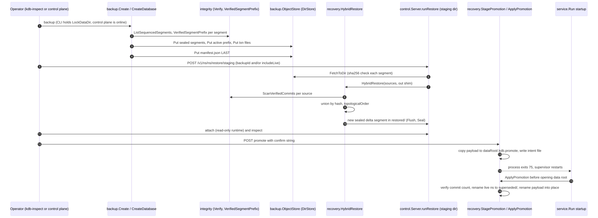

Mermaid source

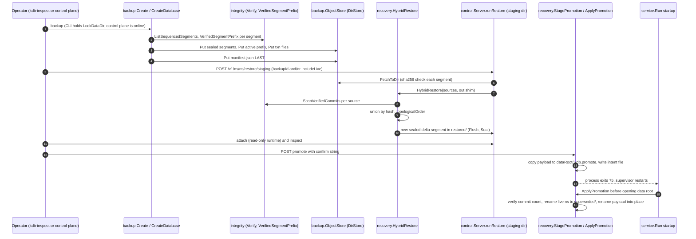

### Call chain

Backup

| # | Function | File:line | What it does |
|---|---|---|---|
| 1 | `kdb-inspect backup` | `go/cmd/kdb-inspect/backup.go:46,59-79` | `embed.LockDataDir(dataDir)` (service must be stopped), then one namespace -> `backup.Create`, no `--namespace` -> `embed.ListNamespaces` + `backup.CreateDatabase` under the same lock. |
| 2 | `control.Server.handleCreateBackup` | `control/recovery.go:425` | Online: `backupStore()` (`DirStore` at `--control-backup-dir`), `openShim(dataRoot)` (unlocked read view, `recovery.go:102`), `backup.Create`. Per-namespace only. |
| 3 | `backup.Create` | `backup/backup.go:78` | `integrity.ListSequencedSegments` (refuses legacy names), optional base manifest, random backup id. For each segment: `integrity.VerifiedSegmentPrefix` (`integrity/scan.go:19`), `sha256` of that prefix. Highest sequence = active candidate: prefix stored under backup-scoped key `backups/<ns>/<id>/active-<seq>.prefix` with `VerifiedPrefix:true`. Others stored under the shared sequenced segment key; an incremental run references the base's entry when sequence and hash match. `HeadHashes` = tips of the commit set found. Finally `store.Put(ManifestKey)`. |
| 4 | `backup.CreateDatabase` | `backup/database.go:74` | Sorted namespaces -> `Create` each (optional `bases`), `backupTxnState` (`backup/txn.go:41`) copies every regular non-`.tmp` file in `<dataRoot>/txn/` to `database-backups/<id>/txn/<name>` with size and sha256, then writes `database-backups/<id>/manifest.json` last. Caller must hold the data-root lock. |
| 5 | `integrity.VerifiedSegmentPrefix` / `readAndScanSegment` | `integrity/scan.go:19`, `integrity/verify.go:145` | Reads the segment, `delta.ScanSegmentBytes` (`storage/delta/scanner.go`, `verifyFrameCRC`), returns bytes up to the last frame that scanned clean. |

Verify

| # | Function | File:line | What it does |
|---|---|---|---|
| 6 | `integrity.Verify` | `integrity/verify.go:194` | Per segment: sequence-gap finding, `readAndScanSegment`; CRC/short frame -> `TornTail` if highest segment else `MidLogCorruption`; trailing unconsumed bytes likewise. L2 adds `MissingParent` (parent not in the scanned union, genesis exempt via `GenesisCommitHash`, `integrity/genesis.go`). It does **not** recompute commit hashes; the control plane comment (`control/recovery.go:133`) says L2 "adds commit hashes", this file only checks parent closure. |
| 7 | `control.Server.handleVerify` | `control/recovery.go:135` | One verification per namespace at a time, `integrity.Verify` over an unlocked shim, result kept in `recoveryState.reports` (in memory). |
| 8 | `control.Server.handleMaintenancePlan` | `control/recovery.go:256` | Does not repair anything: returns the `kdb-inspect repair-segments` / `restore` commands that apply, because they need the data-dir lock this process holds. |
| 9 | `backup.Verify` / `VerifyDatabase` | `backup/backup.go:213`, `backup/database.go:159` | Re-download each object, compare size and SHA-256; database verify also re-checks `txn/` files (`verifyTxnState`, `txn.go:130`). Exposed at `POST /v1/ns/{ns}/backups/{id}/verify` (`control/recovery.go:482`). |
| 10 | `server.KdbServerRuntime.Scrub` | `server/scrub.go:60` | `TreeWalker.WalkTree` of the head tree, batch-read documents (256), `bodyMatches` (content hash vs tree entry). Damaged ids -> `fetch` (peers via `replication.Replicator.FetchBodies`, `replication/replicator.go:589`), re-verify, `systemCommit` of a `kdb:repair/1` commit that rewrites verified bodies (tree unchanged), else a `damaged` conflict-queue entry and `ScrubUnrepairedError`. Triggered by `control.Server.handleScrub` (`control/replication.go:344`) and `syncnode.Node.scrubLoop` (`syncnode/node.go:423`, call at 438). |

Repair (offline)

| # | Function | File:line | What it does |
|---|---|---|---|
| 11 | `kdb-inspect repair-segments` | `go/cmd/kdb-inspect/verify.go:140` | `LockDataDir`, `integrity.Verify` at L1, `--dry-run` prints, else `integrity.Repair`; exits 1 if any step refused. |
| 12 | `integrity.Repair` | `integrity/repair.go:55` | Acts only on L1 findings. `TornTail` -> `repairTornTail` (79). `MidLogCorruption` -> `repairMidLogCorruption` (116). L2 findings are left (restore is the answer). |
| 13 | `integrity.repairTornTail` | `integrity/repair.go:79` | Appends the torn bytes to `ns/<ns>/quarantine/<seq>.quarantine-<nanos>`, `DeleteSegment` the live segment, `AppendToSegment` the good prefix back. |
| 14 | `integrity.repairMidLogCorruption` | `integrity/repair.go:116` | Checks that dropping the corrupt frame and everything after it in that segment leaves no later segment with a dangling parent; if so quarantines the *full* original segment, deletes, rewrites the good prefix; else `ActionRefused` listing the missing hashes. |

Restore and promote

| # | Function | File:line | What it does |
|---|---|---|---|
| 15 | `kdb-inspect restore` | `go/cmd/kdb-inspect/restore.go:60-122` | Sources `--source LABEL=PATH` and/or `--from-backup` (`backup.FetchToDir` to a temp dir), `LockDataDir(out)`, `recovery.HybridRestore`. Reports `MissingHashes` as a partial restore warning. |
| 16 | `restoreDatabase` | `go/cmd/kdb-inspect/restore.go:130` | `LoadDatabaseManifest`, `LockDataDir(out)`, **`backup.RestoreTxnState` first** (`backup/txn.go:77`: verify every file against the manifest, write with fsync, directory fsync), then `FetchToDir` + `HybridRestore` per namespace into the same root. |
| 17 | `backup.FetchToDir` | `backup/backup.go:243` | Get each segment, re-hash against manifest (mismatch = "refusing to restore corrupt object"), `os.WriteFile` into `<outDir>/ns/<ns>/delta/<sequenced name>`. No fsync. |
| 18 | `recovery.HybridRestore` | `recovery/restore.go:56` | `integrity.ScanVerifiedCommits` per source (`integrity/scan.go:33`), union by hash (first writer wins), `topologicalOrder` (122; genesis-parented commits ready immediately; unresolvable remainder returned as `MissingHashes`), `delta.Factory.OpenWriter(ns)`, `Append` each commit, `writer.Flush()`, `writer.Seal()`. |
| 19 | `control.Server.handleStartRestore` / `runRestore` | `control/restore.go:108,163` | Async job in `<stagingRoot>/<jobId>/`. Optional `FetchToDir` into `_backup/`, optional live data root as a second source (`includeLive`, salvage), `LockDataDir(restored/)`, `HybridRestore` with ZSTD. Job states `running`/`complete`/`failed` kept in memory. Never touches the live namespace. |
| 20 | `control.Server.handleAttachRestore` | `control/restore.go:309` | `embed.OpenReadOnlyFileRuntime(restored/, ...)` (shared lock, no WAL/delta writer), registered as `staged/<jobId>/<ns>` for inspection; writes refused by the runtime; `refuseIfStaged` (424) gives a clear error. `handleDetachRestore` (361) closes and optionally `RemoveAll`s the staging dir. |
| 21 | `control.Server.buildPromotionPlan` / `handlePromote` | `control/promote.go:78,213` | Plan blockers: job not complete, in-memory namespace, control read-only, promotion not enabled (`--control-promote`), no restart hook, still attached, `.kdb.promote` on another filesystem, insufficient free space, history-strategy mismatch, another promotion pending. Execution needs the exact `confirm` string. Under `applyMu`: `promotedMarker` (`promote.go:459`), `recovery.StagePromotion`, reply `202`, `flush`, `RequestRestart` (process exits 75). |
| 22 | `recovery.StagePromotion` | `recovery/promote.go:120` | Verify staged namespace has >0 CRC-verified commits (`countVerifiedCommits`), `RemoveAll` any old `.kdb.promote`, `copyTree` the namespace into `<dataRoot>/.kdb.promote/ns/<ns>` (each file fsynced, `copyFile` 429), write `meta.json` marker if the staged copy has none, copy the staged checkpoint if any, finally `writeJSONFile(<dataRoot>/.kdb.promote.json)` = the intent. |
| 23 | `service.Main` (startup) -> `recovery.ApplyPromotion` | `service/service.go:204`, `recovery/promote.go:231` | Before the data root is opened and locked. `applyPayload` (268): recount verified commits vs intent; rename live `ns/<ns>` to `superseded/<ns>-<UTC stamp>` (moving the old checkpoint into it), rename the payload into place, move the payload's checkpoint over (or delete the old checkpoint if none came). Intent is removed whatever happened; outcome written to `.kdb.promote.last.json`. |
| 24 | `control.Server.handlePromotionStatus` / `handleAbandonPromotion` | `control/promote.go:302,329` | Read pending intent and last outcome; abandon = `recovery.AbandonPromotion` (`promote.go:199`, remove intent then payload). |
| 25 | `embed.EmbeddedKdbRuntime.RestoreFromArchive` | `embed/restore_archive.go:63` | (Different recovery path: re-admit segments evicted by truncation, flow 7.) Requires an archive tier; from `to` downward calls `RestoreSegment` (`storage/io/primary_replicas.go:95`: first archive sink that returns bytes, `primary.Append`) until the first hole; then `lowerCheckpointFloor` (153) -> `saveCheckpoint` with the lower floor. Exposed at `POST /v1/ns/{ns}/retention/restore` (`control/retention.go:206`). |
| 26 | `control.Server.handleCreateRestorePoint` / `handleRestoreToPoint` | `control/restorepoints.go:356,471` | Restore points are tags with one name in every namespace; restoring is N `embed.RevertTo` calls (flow 7). It is a logical undo, not a file restore. |

### Data that changes

| Step | Structure / file / wire message | Mutation |
|---|---|---|
| Backup of a namespace | Object store: `backups/<ns>/<backupId>/manifest.json` (written last), shared sealed segment objects keyed by `DeltaSequenced(ns, seq)`, `backups/<ns>/<id>/active-<seq>.prefix` | Pure reads of the source data root. Objects only added. A backup exists iff its manifest exists. |
| Database backup | `database-backups/<id>/manifest.json` (written last), `database-backups/<id>/txn/{HOST,EPOCH,decisions-*.log|.dead}` copies | Same; manifest lists entries (ns -> backupId) and `TxnFile` hashes. |
| `DirStore.Put` | files under the store root | `backup/store.go:42`: write `<key>.tmp` with `os.WriteFile`, then `os.Rename` (whole-object visibility, but no file or directory fsync). |
| Staged restore | `<stagingRoot>/<jobId>/_backup/ns/<ns>/delta/*`, `<stagingRoot>/<jobId>/restored/ns/<ns>/delta/<seq0>` (one fresh sealed segment), the `restored/` directory lock | New directory tree only. The live data root is not written (unless `includeLive` which only reads it). |
| Attach | `restoreState.attached[alias]`, `closers[alias]` | A second, read-only runtime in the process. |
| Stage promotion | `<dataRoot>/.kdb.promote/ns/<ns>/...`, `<dataRoot>/.kdb.promote/` snap file for the checkpoint, `<dataRoot>/.kdb.promote.json` (intent) | New files inside the live root; live namespace untouched. |
| Apply promotion | `<dataRoot>/ns/<ns>` -> `<dataRoot>/superseded/<ns>-<stamp>`; payload renamed to `<dataRoot>/ns/<ns>`; `snap/<checkpoint>` replaced or removed; `.kdb.promote.json` removed; `.kdb.promote.last.json` written | Directory renames. Old data retained, never deleted. |
| Repair (torn tail / mid-log) | `ns/<ns>/quarantine/<seq>.quarantine-<nanos>`, `ns/<ns>/delta/<seq>` | Quarantine file created, live segment deleted then re-created with the good prefix. |
| Scrub repair | delta log (new `kdb:repair/1` commit), DAG head, conflict queue (`damaged` entries) | Commit with the same tree hash (bodies rewritten in the log); unrepaired docs recorded as conflicts. |
| Archive restore | `ns/<ns>/delta/<seq>` files for lower sequences, checkpoint `FloorSequence` | Segments re-appended to the primary, then the checkpoint rewritten with the lower floor. |
| Database restore (CLI) | `<out>/txn/*`, `<out>/ns/<ns>/delta/*` for every namespace | Txn state first (fsync'd), then logs. A `.log` (live) epoch file copied from the backup will be renamed `.dead` by the first writer that opens the restored root (flow 6, `openTxnCoordinator`). |

### Failure, edge cases & durability points

- **Backup consistency.** The CLI path holds the data-root exclusive lock for the whole pass, so every namespace and `txn/` are captured at one quiesced instant (`backup/database.go:26-33`). The control plane `handleCreateBackup` takes no lock and works because each segment is read through `VerifiedSegmentPrefix`; the highest-sequence segment is stored only as a verified prefix, so a write that lands mid-backup may be absent (the response says so, `control/recovery.go:472-477`). A control-plane backup is therefore per namespace and not mutually consistent across namespaces; also it does not back up `txn/`, so it cannot carry cross-namespace decision state.
- **Sealed segments are also uploaded as their verified prefix.** `Create` stores `prefix` (not `raw`) for every segment (`backup.go:158`), so a sealed segment with trailing garbage is stored without it and its hash matches the prefix.
- **Manifest-last is the only commit protocol.** There is no fsync or two-phase step in `backup.Create`; atomicity rests on `ObjectStore.Put` of the manifest. For `DirStore` that is tmp-write + rename without fsync (`backup/store.go:42-57`), so after a power loss the manifest could in principle be visible while an object it names is not; `backup.Verify` detects that. A failed `CreateDatabase` leaves valid per-namespace backups but no database manifest (`database.go:75-82`). `ListBackups` only lists ids that have a `manifest.json`.
- **Restore never trusts unverified bytes.** `ScanVerifiedCommits` includes only frames whose CRC passed; commits after the first bad frame of a segment are excluded for that source (`integrity/scan.go:27-31`). A commit with any parent in no source, and its descendants, is reported in `MissingHashes` and *not applied* (`restore.go:152-156`); the output is then a consistent but partial history.
- **Durability of restore output.** `HybridRestore` ends with `writer.Flush()` then `writer.Seal()` (`restore.go:97-102`), so the restored log is flushed before the call returns. The fetched backup files in `FetchToDir` are written with `os.WriteFile` (no fsync) but are only an intermediate copy. `RestoreTxnState` fsyncs each file and the directory (`txn.go:98-114`).
- **Restore does not rebuild anything but the log.** No checkpoint, no `meta.json` namespace marker, no SSTables: the first open replays the whole log (slow, correct). That is why `promotedMarker`/`StagePromotion` supply a marker (`promote.go:148-160`). Group markers inside restored commits still refer to the original host id and epochs, so a single-namespace staged restore (`runRestore`) does not bring `txn/` with it; whether such parts are judged committed on the live root depends on that root's `txn/` (`resolvePart` treats foreign host ids as committed). Only the CLI database restore restores `txn/`.
- **Torn decision/in-doubt state across backup.** Because `txn/` is copied verbatim, an open `.log` epoch in a backup is renamed `.dead` on first writer open, and in-doubt parts in the restored logs are rolled back exactly as after a crash (flow 6).
- **Repair is not crash-safe.** `repairTornTail` quarantines only the *torn bytes*, then deletes the live segment and re-appends the good prefix (`repair.go:91-99`); `FileBackedPlatformIO.AppendToSegment` goes to `OSByteStore.Append` (positional `WriteAt`, no sync, `os_store.go:146`) and `Delete` is `os.Remove` with no directory sync (`os_store.go:285`); `Repair` never calls `Flush`. A crash between the delete and the re-append loses the good prefix of that segment (the quarantine does not contain it). `repairMidLogCorruption` quarantines the whole original first, so the bytes survive, but the live segment still passes through a delete/recreate window. Because the service must be stopped (exclusive `LockDataDir`), this only matters for a crash of the repair tool itself.
- **Repair refuses rather than guesses.** Mid-log repair is refused if later segments reference commits that would be dropped; `Repair` skips L2 findings entirely (`repair.go:58`). Sequence gaps and missing parents are only fixable by restore from another source.
- **Promotion safety.** Copy happens while the server is up and can fail before anything is committed; apply happens before the data root is locked; live namespace is moved aside, never deleted; the commit count is re-verified (`promote.go:284-288`); a failed apply clears the intent so a bad request cannot cause a boot loop; the filesystem is the state machine, so a crash between the two renames resumes. Gaps I found: `writeJSONFile` (`promote.go:458`) writes the intent/outcome via tmp + rename with no file or directory fsync, and none of the `os.Rename` calls are followed by a directory fsync (only `copyFile` syncs file contents), so the durability of the swap itself rests on the filesystem. The restart is cooperative (`RequestRestart`, exit 75): without a supervisor the intent just waits for the next start.
- **Archive restore ordering is deliberate.** Segments are fetched first (descending from `to`, stopping at the first hole), the checkpoint floor is lowered only afterwards, and only ever lowered (`restore_archive.go:29-35,147-152`). The restored segment bytes are written via `primary.Append` with no flush call visible in `RestoreSegment`/`RestoreFromArchive`; the checkpoint write that follows is fsynced (`os_store.go:369`).
- **Scrub scope.** It verifies document bodies against the head tree only; history below head, and the delta log framing, are `integrity`'s job. If a peer cannot supply a body it stays a `damaged` conflict entry, cleared by a later scrub that finds it readable (`clearHealed`, `scrub.go:188`). The repair is a normal commit through `systemCommit`/`runTransaction`, so it takes the write gate and is fsync-acked like any commit.
- **Docs vs code.** `control/recovery.go:133` (and likely docs) describe L2 as checking commit hashes; `integrity.Verify` at L2 checks parent closure only. `control/maintenance/plan` is advisory text; no control-plane endpoint performs repair, repair exists only as the offline `kdb-inspect repair-segments`.

## 13. Shutdown and crash recovery

### Description (short)

A clean stop (SIGINT/SIGTERM, or a control-plane promotion restart) runs one ordered sequence in `service.Main`: readiness off, replication/scrub stopped, maintenance loops stopped, writes drained, listeners closed, cost model saved, `KdbServerRuntime.Release` (which closes the primary `EmbeddedKdbRuntime`: drain the commit-log queue, fsync, seal the segment, write a final checkpoint, flush the engine) and `Host.Close` (other namespaces, decision-log epoch seal, lock release). The memory-pressure `AbortWatchdog` follows a similar but shorter path and exits 75. None of this is required for correctness: every acknowledged commit is already in the delta log, so a `kill -9` is recovered by the same open path as flow 1: reacquire locks (the kernel dropped them), mark the dead writer's decision epochs, load the checkpoint if it still matches the log, replay the tail segments, tolerate a torn tail in the newest segment, and roll back undecided cross-namespace groups.

### Diagram

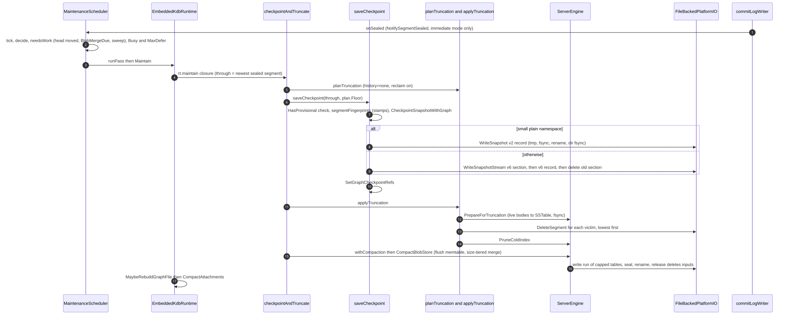

Mermaid source

```mermaid
flowchart TD
    subgraph CLEAN["Clean stop in service.Main"]
        A1["SIGINT or SIGTERM, or RequestRestart from control plane"] --> A2["admin.SetReady false (readyz 503)"]
        A2 --> A3["node.StopSync: replicator and scrub"]
        A3 --> A4["MaintenanceScheduler.Stop (waits for pass)"]
        A4 --> A5["watchdog.Stop, srv.BeginDraining"]
        A5 --> A6["close sql, peer, stream listeners"]
        A6 --> A7["WaitForWritesToDrain (default 30s)"]
        A7 --> A8["saveCostModelState, srv.Release"]
        A8 --> A9["EmbeddedKdbRuntime.Close then Host.CloseNamespace"]
        A9 --> A10["persisting.Close: drain queue and fsync"]
        A10 --> A11["writer.Flush then Seal"]
        A11 --> A12["checkpointOnClose (and truncate if history none)"]
        A12 --> A13["engine.Close: memtable flush"]
        A13 --> A14["Host.Close: other namespaces, txn epoch seal, release flocks"]
        A14 --> A15["exit 0, or exit 75 on restart request"]
    end
    subgraph CRASH["kill -9 or power loss"]
        B1["kernel drops flocks"] --> B2["next start: ApplyPromotion if intent exists"]
        B2 --> B3["openTxnCoordinator: txn/*.log renamed to .dead"]
        B3 --> B4["restoreNamespace: checkpoint matches log?"]
        B4 -->|yes| B5["restore graph, replay segments after ThroughSequence"]
        B4 -->|no| B6["replay all segments, or TruncatedLogError"]
        B5 --> B7["newest segment: torn tail tolerated, groupGate rolls back undecided parts"]
        B6 --> B7
        B7 --> B8["new writer segment max+1, checkpointAfterFullReplay if replayed in full"]
    end
```

### Call chain

| # | Function (pkg.Type.Method) | File:line | What it does |
|---|---|---|---|
| 1 | `signal.Notify` + `select` | go/kdb/service/service.go:807, :812-819 | Waits for SIGINT/SIGTERM or `restartRequested` (buffered chan, cap 1; a second restart request returns "a shutdown is already under way", service.go:670-677). After `Notify`, further signals are only buffered, so there is no second-signal force-quit; only SIGKILL stops a stuck drain beyond its timeouts. |
| 2 | `AdminServer.SetReady(false, "draining")` | service.go:831 -> go/kdb/server/admin.go:110 | `/readyz` -> 503. |
| 3 | `syncnode.Node.StopSync` | service.go:835 -> go/kdb/syncnode/node.go:496 | Closes `stopScrub`, waits `scrubDone`, `Replicator.Stop()` (waits for in-flight sync = a writer). |
| 4 | `MaintenanceScheduler.Stop` | service.go:839-841 -> go/kdb/embed/maintenance_loop.go:308 | Closes `stop`, waits `done`: an in-flight checkpoint/truncate/merge pass runs to completion (no timeout). |
| 5 | `AbortWatchdog.Stop`, `KdbServerRuntime.BeginDraining` | service.go:842-843 -> go/kdb/server/supervisor.go:79, go/kdb/server/server_runtime.go:520 | `draining` atomic set; `admitWrite` (server_runtime.go:915) rejects new writes with `*UnavailableError`. Reads continue. |
| 6 | Listener close | service.go:844-852 -> go/kdb/server/wire_listen.go:83 | Closes sql, peer, stream listeners only: `Listener.Close` cancels the context and waits for the accept loop (`tcp Serve` closes the listening socket, transport/tcp/transport.go:138-148). Already-established connections are not closed. The WebSocket and gRPC listeners and the admin/control servers are not closed here; they close via `defer` when `Main` returns (service.go:501, :515, :595, :697). |
| 7 | `KdbServerRuntime.WaitForWritesToDrain` | service.go:853 -> server_runtime.go:535 | Polls `writeGate.quiesced()` every 10 ms until empty or `--drain-timeout` (default 30s). On timeout: warn and close anyway ("replay covers the rest"). |
| 8 | `saveCostModelState` | service.go:859 -> :965 | `costmodel.json` via tmp + rename (no fsync). |
| 9 | `KdbServerRuntime.Release` | service.go:861 -> server_runtime.go:561 | Refcount to zero: `stopSweeper`, `memGuard.Stop` (unless shared), then `Runtime.Close()`. Only the primary namespace's runtime is released here. |
| 10 | `EmbeddedKdbRuntime.Close` | go/kdb/embed/runtime.go:201 | Runs `rt.storageClose` (log line "safe to ignore" on error) then `rt.release` (nil for a Host-opened runtime, so the lock is NOT dropped here). |
| 11 | `Host.CloseNamespace` -> `entry.close` | go/kdb/embed/file.go:289 -> go/kdb/embed/host.go:332 | Unroutes the namespace from the multiplex adapter, `arbiter.Unregister`, runs the `storageClose` closure (file.go:258), then `ReleaseHandles` on the shared shim (closing cached segment fds, os_store.go:437). |
| 12 | `storageClose` step 1: `PersistingCommitDAG.Close` -> `commitLogWriter.Close` | file.go:264 -> go/kdb/embed/persisting_dag.go:237 -> go/kdb/embed/commit_log.go:419 | Marks closed, closes `reqs`, waits for the goroutine to drain everything queued (sync: `writeBatch` = append + one fsync per batch, commit_log.go:405; async: final `flush`), returns the latched failure. |
| 13 | step 2-3: `DefaultWriter.Flush`, `Seal` | file.go:269-276 -> go/kdb/storage/delta/writer.go:89, :177 | `FlushSegment` (fsync honoring `SyncMode`), then `sealLocked`: if bytes were written, `FileBackedPlatformIO.SealSegment` flushes again, `MarkSealed` (no-op on disk; replica/archive upload if configured) and records the name as sealed in memory. An untouched writer seals nothing. |
| 14 | step 4: `checkpointOnClose` | file.go:279 -> go/kdb/embed/checkpoint_open.go:297 | `checkpointAndTruncate` with `through = highestSegmentSequence` (widest floor, writer sealed). Under history=none with a reclaiming mode this also deletes eligible segments and merges SSTables at shutdown; failure only logs ("the next open will replay the log"). |
| 15 | step 5: `handle.Close` -> `ServerEngine.Close` | file.go:282 -> go/kdb/storage/engine/server_engine.go:338 | `memTable.Flush(0)` (unflushed blobs/tree objects to an SSTable), stops the async blob-WAL ticker (final `wal.Sync`). The WAL file is not closed or sealed. |
| 16 | `Host.Close` | service.go:865 (also `defer` at :277) -> embed/host.go:364 | Sets `closed`, stops the arbiter, closes every remaining namespace (`_kdb/meta`, secondaries) through the same `storageClose`, then `TxnCoordinator.close` (txn_coordinator.go:331: waits up to 5 s for in-flight groups, `sealLocked` closes and **deletes** the epoch file and fsyncs `txn/`), then `lock.Release()` (dir_lock_unix.go:106: write lock first, then attach). |
| 17 | Exit | service.go:867-873 | `restartReason != ""` -> `os.Exit(75)` (EX_TEMPFAIL, supervisor restarts); otherwise return, running deferred `admin.Close`, `controlSrv.Close`, ws/grpc listener close, `node.Close` (service.go:440, which closes peer listeners and stops webhook/procedure goroutines), `reg.Close` (auth registry flush+seal, service.go:370). |
| 18 | Abort path: `AbortWatchdog.run` -> `abort` | go/kdb/server/supervisor.go:92, :118 | Polls `memGuard.ShouldReject()` every 200 ms; sustained for `--abort-after` (default 0 = off): `BeginDraining`, close the listeners it was given (sql, peer, stream only), sleep 250 ms (:136), `w.runtime.Runtime.Close()` (:139), `exit(75)` (:147). It does not call `Host.Close` or stop maintenance/replication, so other namespaces and the txn epoch are not closed and the epoch file stays `.log`. |
| 19 | Promotion restart | service.go:670-677 (`RequestRestart`) + :867-871 | Control plane (`AllowPromotion`) stages a copy under `<root>/.kdb.promote/` + `.kdb.promote.json` (`recovery.StagePromotion`, promote.go:120) and requests restart; the process runs the clean sequence above, exits 75; next start applies it (flow 1 row 4). |
| 20 | Recovery: lock + epochs | `acquireDirLock` dir_lock_unix.go:44; `openTxnCoordinator` txn_coordinator.go:105 | Described in flow 1. `.log` -> `.dead` marks a dead writer's epoch; groups whose id is in the `.dead` file stay committed, others are aborted. |
| 21 | Recovery: `restoreNamespace` | embed/checkpoint_open.go:26 | See flow 1 rows 15-15c. After a crash the checkpoint was written by the last maintenance pass, last clean close, or last full replay; everything newer lives in segments > `ThroughSequence` and is replayed. |
| 22 | Recovery: `replayDeltaNamespaceFrom` | embed/delta_replay.go:57 | Torn-tail tolerance and cross-namespace rollback (`groupGate`, :154-200). |
| 23 | Recovery: `delta.DefaultReader.ListSegments` / `scanSegmentRef` | go/kdb/storage/delta/writer.go:301, :358 | Segment sizes and last-commit hashes for fingerprints are computed by a CRC-checking frame walk in 1 MiB windows (`segmentScanWindowBytes`); a corrupt frame ends the walk, so size = bytes up to the first bad frame. |
| 24 | Offline repair: `integrity.Verify`, `integrity.Repair` | go/kdb/integrity/verify.go:194, repair.go:55 (`repairTornTail` :79, `repairMidLogCorruption` :116) | `kdb-inspect verify/repair-segments`. Classification is positional: damage in the highest segment is `TornTail` (quarantine the tail as a sidecar segment, rewrite the good prefix), anywhere else `MidLogCorruption` (quarantine the whole file, rewrite the good prefix only if the parent closure still holds, else refuse and name the missing hashes). Needs `LockDataDir` (embed/file.go:353). |
| 25 | Offline restore: `recovery.HybridRestore` | go/kdb/recovery/restore.go:56 (`topologicalOrder` :122) | Unions CRC-verified commits from several directory sources (`integrity.ScanVerifiedCommits`), orders them topologically with genesis exempt, writes a fresh sequenced delta log through a new `delta.Factory` writer, Flush + Seal; commits with unresolved parents are reported in `Result.MissingHashes`, never applied out of order. |
| 26 | Online self-repair: `KdbServerRuntime.Scrub` | go/kdb/server/scrub.go:60 | Re-reads every live document body, compares with the tree's content hash, restores damaged bodies from peers by hash and records them in a `kdb:repair/1` commit. Run from `Node.scrubLoop` (node.go:423) if `--scrub-interval` is set. |
| 27 | Promotion apply: `recovery.ApplyPromotion` | go/kdb/recovery/promote.go:231 | Called before the data root is opened. Recoverable at every step because the filesystem is the state machine (`applyPayload` :268): if the payload dir exists the next step is derived from what is on disk. |

### Data that changes

| Step | Structure / file / wire message | Mutation |
|---|---|---|
| 2 | `/readyz` response | 200 -> 503 "draining". |
| 5 | `KdbServerRuntime.draining` (atomic bool) | Set once, never reset on the shutdown path (`ResumeAfterDrain` exists only for reopen, server/reopen.go:34). New writes get `*UnavailableError` on the wire. |
| 3-4 | Replicator state files under `<root>/replication/peers/`, scrub | Peers' progress persisted by the replicator before it stops (not detailed here). |
| 6 | Listening sockets | Accept loops stop. Open connections continue until the process exits. |
| 8 | `<root>/costmodel.json` | Replaced via `costmodel.json.tmp` rename. |
| 12 | `ns/<id>/delta/<seq>.seg` | Last queued frames appended and fsynced (sync mode does this on every batch already, so close only matters for DurabilityAsync's unflushed tail). |
| 13 | Same segment | Final fsync; name added to `FileBackedPlatformIO.sealedSegments` (memory only). Nothing about "sealed" is on disk: a crash-left segment and a cleanly sealed one are byte-identical. |
| 14 | `snap/kdb_checkpoint_<ns>` | Rewritten with `throughSequence = newest segment`, so the next start has no tail to replay. Under history=none+reclaim also deletes segments and may rewrite SSTables (flow 11). |
| 15 | `ns/<id>/sstable/L0/<uuid>` | Residual memtable flushed (fsync). |
| 16 | `<root>/txn/decisions-<epoch>.log` | Deleted (epoch sealed as "all groups committed") if nothing in flight and not failed; otherwise closed and left `.log` for the next writer to rename `.dead`. `.kdb.write.lock`/`.kdb.lock` unlocked and closed. |
| 17 | Process | Exit 0 or 75. |
| 18 | Abort path | Same as rows 12-15 for the primary namespace only; epoch file untouched; locks released by process exit. |
| 20 | `<root>/txn/decisions-<epoch>.log` -> `.dead` + `txn/` fsync | Dead-writer epochs marked. |
| 21-22 | In-memory DAG/engine | Rebuilt as in flow 1. |
| 22 | `ns/<id>/delta/` | Not modified. The torn bytes stay in the old segment; the next session writes `max+1`. Only `integrity.Repair` rewrites/quarantines a segment. |
| 24 | `ns/<id>/delta/<seq>.seg`, quarantine sidecar segment | Tail or whole segment copied to a quarantine name before the original is deleted and rewritten (repair.go:79-115), in the exclusive-lock tool only. |
| 25 | Output shim's `ns/<id>/delta/` | Fresh log of verified commits. |

### Failure, edge cases & durability points

- **Where acknowledged commits become durable.** Under `Durability=sync` (default) the client ack waits for `commitLogWriter.writeBatch` -> `DefaultWriter.Flush` -> `FileBackedPlatformIO.FlushSegment` -> `OSByteStore.Flush(fsync=FsyncOnFlush)` -> `syncFile(mode)` (embed/commit_log.go:405-417; storage/io/file_backed.go:154; os_store.go:214). One fsync covers every record queued while the previous one ran (`drain`, up to 256). `SyncMode=full` is `fsync` (Linux) / `F_FULLFSYNC` (darwin); `fast` is `fdatasync` / `F_BARRIERFSYNC`, which survives process and OS crashes but may lose what the drive cache held on power loss. Under `DurabilityAsync` a record is `WriteAt`-ed to the page cache immediately (survives `kill -9`) and `Flush`ed at most every `AsyncSyncIntervalMS` (5 ms default), or at once for a batch containing a cross-namespace group part (`force`); an OS crash can lose up to one interval. `DurabilityMemoryOnly` writes no log.
- **What `kill -9` loses.** Under sync: nothing acknowledged. Frames appended but not yet fsynced at the instant of the kill are in the page cache and survive a pure process kill; the client simply never got an ack for them, so a retry must be idempotent (transaction ids). Power loss can additionally leave a torn final frame: either an incomplete frame (clean scan stop, not even logged) or a full-length frame with a bad CRC (tolerated and logged only for the newest segment).
- **Drain timeout.** If admitted writes do not finish in `--drain-timeout`, storage is closed anyway (service.go:853-857). The commit-log goroutine's `Close` still drains whatever reached its queue; commits that were still earlier in the pipeline get an error from the closed log (`ErrCommitLogClosed`) or are simply never acked. Acked data is safe either way.
- **Flush/seal errors are non-fatal by design.** `EmbeddedKdbRuntime.Close` logs and continues (runtime.go:206-213); `checkpointOnClose` logs "the next open will replay the log" (checkpoint_open.go:317). The dir lock is released regardless.
- **Abort path gaps (by reading).** It closes only the primary runtime, does not stop maintenance schedulers (a pass can run concurrently with the close and the final checkpoint), does not close `_kdb/meta`/secondary namespaces, and skips `Host.Close`, so the txn epoch stays open (harmless: next writer marks it `.dead`) and other namespaces keep whatever DurabilityAsync tail they had. It closes the same three listeners as the clean path, not WS/gRPC.
- **Listeners not closed explicitly.** On the clean path the WS and gRPC listeners (and admin/control) remain up until deferred closes run after `Release`/`Host.Close`; they can still accept connections whose writes are rejected as draining, and reads run against a closing engine. On the restart path (`os.Exit(75)`) those defers never run (service.go:871).
- **Established connections.** `Listener.Close` does not close live connections; client sessions only see `*UnavailableError` on writes. Process exit drops them.
- **Segment file descriptors.** `Host.Close` does not call `ReleaseHandles` (only `CloseNamespace` does), so `OSByteStore` fds stay open until process exit; harmless for the service, relevant when `Host` is used in-process repeatedly.
- **No directory fsync for segment create/delete.** New delta segments and truncation unlinks are not followed by a parent directory sync (only the checkpoint, `NODE`, decision-log and promotion paths sync directories). A crash can therefore lose the directory entry of a freshly created segment even though its data was fsynced; recovery sees a log that ends one segment earlier.
- **Torn tail vs mid-log damage, precisely.**
  - Replay (embed/delta_replay.go:114-136): CRC-bad/unparsable complete frame in the *last replayed segment* = log + continue; elsewhere = hard failure with the `repair-segments` hint. Incomplete frames and preallocated zeros stop the scan with no error anywhere.
  - Checkpoint open path (checkpoint.go:543-592): for segments the checkpoint covers, a segment whose listed size or last hash changed fails the match; if the file has the recorded physical length and its intact frames end at the recorded commit (or its last frame is the damaged one), `damagedInPlace` keeps the checkpoint, logs "opening from the checkpoint" and the documents that lived only in damaged frames are unreadable until scrub repairs them from a peer (`StreamCommitsPastDamage` in the cold loader skips damaged frames, cold_loader.go:119-124). This is the fix for the earlier "mid-segment flipped byte rolled namespaces back" regression.
  - Tools (integrity/verify.go:218-243): classification is by segment position only, so a torn tail left by a crash becomes "mid-log" in the report once a newer segment exists.
  - A CRC-bad full-length frame inside the newest segment is indistinguishable from a torn tail in replay and drops all frames after it in that segment (only a log line). Not verified at runtime.
- **Truncated namespaces are unforgiving.** history=none with an unusable checkpoint is `*TruncatedLogError`; snapshot-bootstrapped namespaces without checkpoint are `*SnapshotCheckpointMissingError`. Both stop the service at open (exit 1) instead of serving partial data. The remedy is a backup restore (`HybridRestore` / control-plane restore + promotion).
- **Cross-namespace transactions at crash.** Only the decision log decides: a group is committed iff its id is in the epoch's file. Parts are fsynced before the decision is written (`EnqueueDurableAsync`, commit_log.go:175), and commits queued behind an undecided part are not acknowledged until the group is decided (`chainOnBarrier`, persisting_dag.go:160). On recovery a part of an undecided group in a `.dead` epoch is dropped with everything descending from it.
- **Windows/non-unix builds.** `dirLock` falls back to an `O_EXCL` file that stays after a crash and must be deleted manually (dir_lock_other.go).
- **What is not replayed:** the blob WAL (`ns/<id>/wal/*`) records; they are not read at open. SSTables are only discovered. Index snapshots are validated against their recorded commit and rebuilt if stale (`OpenIndexes`). The replication conflict queue and peer state are separate on-disk stores reloaded at startup.
- **Exit codes.** 0 clean; 1 open/listen failure (`os.Exit(1)`, no cleanup, locks dropped by the OS); 2 configuration error; 75 (`server.AbortExitCode`, supervisor.go:15) abort-watchdog and promotion restart.

## 14. Stream mode and replication (stream pkg, StreamHub, replicator, projections, handover)

### Description (short)

Two separate mechanisms are called "stream/replication" in the code:

1. **Stream mode (Mode 1/2)**: a long-lived subscriber connection to `server.StreamHub` (`ListenStreamTLS`). Mode 1 (`STREAM_READ_ONLY`) receives `DELTA_COMMIT` frames; Mode 2 (`STREAM_WRITE_BACK`) additionally sends `TRANSACTION_REPLAY`, applied by the server onto its **current head**. A subscriber gets exactly what lies between its position and the head, read from the DAG (not from what `Publish` is handed), so it is resumable and never loses a commit.
2. **Replication** (`replication.Replicator`): pull/push peer sync (flow 9) per configured peer, plus **filtered projections**: a read-only local namespace (`<src>.projection-<hash>`) fed by `PROJECT_FETCH` pages, optionally **write-back** (`PROJECT_WRITE`) and **read-through** (`DOC_FETCH`).

Read-only replicas exist only in two senses: an in-process/shared-directory read-only runtime (`OpenReadOnlyFileRuntime` + `Refresh`) and a replicator peer with `mode=pull` or a filtered projection. "Promote" exists as home handover (`Handover`/`AssignHome`/`HOME_REQUEST`) and as promotion of a staged *restore* (control/promote.go); there is no command that turns a read-only replica into a writer.

### Diagram

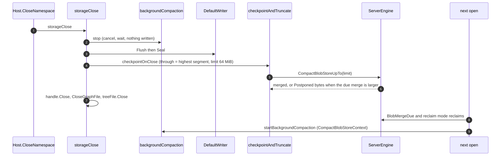

Mermaid source

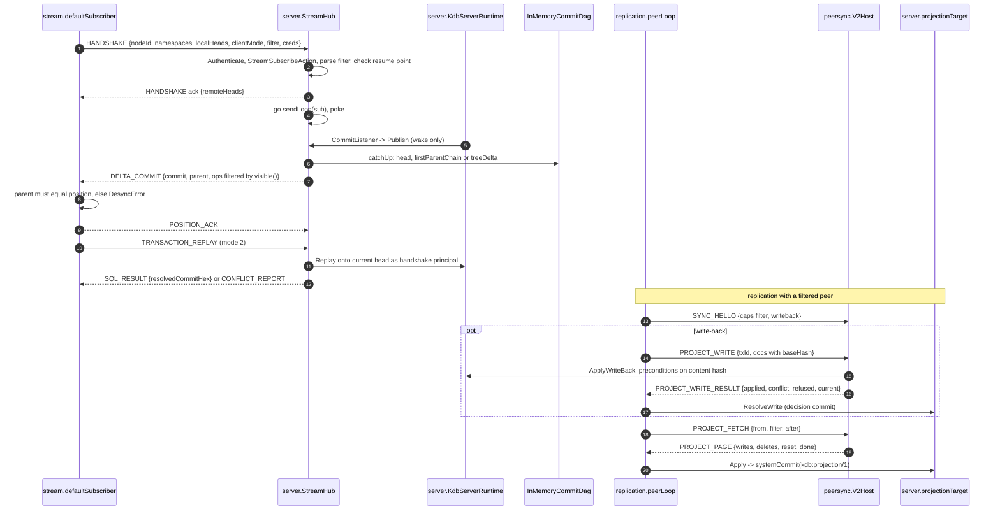

### Call chain

| # | Function (pkg.Type.Method) | File:line | What it does |
|---|---|---|---|
| 1 | `server.ListenStreamTLS` | server/stream_listen.go:44 | TCP accept loop; creates the `StreamHub` (`NewStreamHub` :306). `service` wires it (service/service.go:547) and sets `srv.CommitListener` to call `hub.Publish` (:560-562), later chained with the control plane's `PublishCommit` (:701). Serves only the primary namespace. |
| 2 | `server.StreamHub.run` | server/stream_listen.go:324 | Per connection: first `HandshakeMessage` -> `handleHandshake`; `PositionAck` -> `updateLastAck`; `TransactionReplay` -> `handleTransactionReplay`; other frames ignored. |
| 3 | `server.StreamHub.handleHandshake` | server/stream_listen.go:368 | Requires `ClientMode` in `{STREAM_READ_ONLY, STREAM_WRITE_BACK}` and the hub's namespace; unless `allowAnonymous` (`--stream-allow-anonymous`) authenticates credentials and authorizes `StreamSubscribeAction`; parses the optional `Filter` (`sql.ParseFilter`); resume point `LocalHeads[ns]` must exist in the DAG and be an ancestor-or-equal of main, else rejected ("subscribe without one and reload"); no position means "start at the head"; registers `registeredSubscriber`, replies with ack, then (after the ack is sent) starts `sendLoop` and pokes it. |
| 4 | `server.StreamHub.Publish` | server/stream_listen.go:315 | Only wakes every subscriber (`poke`); ignores the commit it is given. Never blocks the writer. |
| 5 | `server.StreamHub.sendLoop` / `catchUp` | server/stream_listen.go:107 / :129 | Per-subscriber goroutine. If main's first-parent line reaches the subscriber's position within `maxPerCommitCatchUp = 64` commits (`firstParentChain` :157, needs operations still resident), one `DELTA_COMMIT` per commit; otherwise `treeDelta` (:185, via `embed.DiffCommits`) sends the net difference as one frame named for the head. A send error drops the subscriber (`unregister`). |
| 6 | `server.StreamHub.visible` | server/stream_listen.go:228 | Per subscriber: a write outside its filter or unreadable by its principal (`DocumentReadAction`) is turned into a `DeleteOp` so a document that leaves the filter is removed from the subscriber. |
| 7 | `server.StreamHub.handleTransactionReplay` | server/stream_listen.go:472 | Requires a completed handshake (or anonymous allowed), authorizes `TxCommitAction`, then `replayTransaction` (server/wire_listen.go:1031) -> `KdbServerRuntime.Replay` (server/server_runtime.go:712) -> `replayWith` (:755) -> `runTransaction` (:790): `engine.Replay` onto the current head, ignoring the client's `BaseVersion`. Replies `SQL_RESULT{ResolvedCommitHex}` or `CONFLICT_REPORT`. |
| 8 | `stream.defaultSubscriber.Connect` / `handleFrame` | stream/subscriber.go:73 / :214 | Client side: HANDSHAKE, blocks up to 10s for the ack; each `DELTA_COMMIT` must have `ParentHash == position` else `EventError(DesyncError)` (:258) and the frame is dropped; then `hintApplier.Apply` (no-op: `NoopHintApplier`, stream/hint_applier.go), position advance, `POSITION_ACK`. |
| 9 | `stream.defaultSubscriber.submitTransaction` | stream/subscriber.go:349 | Mode 2: sends `TRANSACTION_REPLAY` with `BaseVersion = position`, waits up to `replayTimeout` (30s); maps replies with `replayResultFrom` (:422). |
| 10 | `stream.defaultCoordinator` | stream/coordinator.go:33 | An in-memory-transport-only coordinator (`Start` wires a server handler only for `*InMemoryTransport`, :66). `stream.NewCoordinator`/`NewSubscriber` are referenced only by tests; the real listener is `server.StreamHub`. |
| 11 | `replication.peerLoop.cycle` -> `projectionCycle` | replication/replicator.go:346, :542 | For a `PeerConfig.Filter != ""` peer: target = `Config.Projections(source, filter, writeBack)` (syncnode: `n.set.Resolve(ProjectionNamespace(...), true)`, sets `rt.ProjectionOf/Filter/WriteBack`); `peersync.SyncProjection`; records `Pulled = writes+deletes`, `Pushed = written` in `PeerState`. |
| 12 | `peersync.SyncProjection` / `pushWrites` | peersync/projection.go:257 / :366 | `SYNC_HELLO` with caps `filter` (+`writeback`), then (write-back) sends every pending write in order, each answered `applied`/`conflict`/`refused` and resolved locally, then loops `PROJECT_FETCH` from `Target.LastSource()`; applies each page with `Target.Apply`. A reset page ends with deleting everything not delivered. |
| 13 | `peersync.V2Host.projectFetch` / `projectPage` | peersync/v2_host.go:572, peersync/projection.go:73 | Read-only authorization (`StreamSubscribeAction`, per-document `DocumentReadAction`); `reset` full scan when `FromHex` is unknown or not an ancestor, else net effect of `commitsBetween(at, from)`; deletes only for documents the replica could have held (`heldAtFrom`). |
| 14 | `server.projectionTarget.Apply` / `LastSource` | server/projection.go:53 / :18 | Each page is one `systemCommit` (server/meta.go:740, bypasses RBAC and the projection read-only rule) with message `kdb:projection/1 source=<hash> complete=<bool>` and writes expressed as delete+write (`replacing`). `LastSource` walks the DAG back to the last `complete=true` commit, so an interrupted transfer restarts from there. Pages never overwrite a document with an undecided local write. |
| 15 | `server.KdbServerRuntime.admitWrite` | server/server_runtime.go:911 | Refuses client writes when draining, read-only (`AssertWritable`), fenced, on a projection without write-back (`admitProjectionWrite` writeback.go:51, only writes/deletes allowed) or on a non-home node (`admitHome` home.go:96). |
| 16 | `server.KdbServerRuntime.clientWrite` / `localWriteMessage` | server/server_runtime.go:728, server/writeback.go:68 | Write-back projection: the client commit is made locally at once with message `kdb:writeback-local/1 <doc>=<contentHashBefore>...`; it is pending until a later commit `kdb:writeback/1 commit=<hash> outcome=...` names it (`loadPendingLocked` writeback.go:172 rebuilds the outbox from the DAG after a restart). |
| 17 | `V2Host.projectWrite` -> `KdbServerRuntime.ApplyWriteBack` | peersync/v2_host.go:364, server/writeback.go:333 | Source side: tx id `WriteBackTxID(commit)` makes a resend idempotent (`GetCommitByTransactionID`); each document becomes delete+write guarded by an `ExpectContentHash`/`ExpectAbsent` precondition; authorizes `TxCommitAction`; `Commit`. Stale base -> `WriteBackConflict` with the current documents (`notApplied`); permanent errors -> `WriteBackRefused`; transient errors -> `PEER_ERROR` so the replica retries. |
| 18 | `server.projectionTarget.ResolveWrite` | server/writeback.go:241 | Not applied: `recordRejectedWrite` (`ConflictWriteBack` in the `ConflictQueue`, :290) and the decision commit restores each document to the source's current state (dropped if absent, unreadable or outside the filter); applied: just the decision commit. |
| 19 | `server.ReadThrough` | server/read_through.go:30 | A projection with `readthrough=true` answers reads of documents it does not hold via `Replicator.OpenDocSession` -> `peersync.OpenDocSession` -> `DOC_FETCH` (flow 9 row 34). |
| 20 | `embed.OpenReadOnlyFileRuntime` / `EmbeddedKdbRuntime.Refresh` / `AssertWritable` | embed/file.go:28, :249; embed/runtime.go:167, :183 | Shared-lock (`flock`) read-only runtime: no WAL, no delta writer; `Refresh` replays new delta segments onto its DAG (`replayDeltaNamespaceFrom`); every write path calls `AssertWritable` (`ErrReadOnly`). Not network replication. |
| 21 | Promotion / handover | server/handover.go:51-119, server/meta.go:491, server/home.go:96-154, control/promote.go:213 | `KdbServerRuntime.Handover` / `ForceHandover` / `answerHomeRequest` (a peer's `HOME_REQUEST`, decided by `HandoverPolicy`) call `MetaStore.AssignHome`, which raises the fence (`Fence = previous+1`) and records `Since` (the assigning node's head). The new home refuses writes until it holds `Since` (`admitHome`); replicated commits from a former home after `Since` are refused wherever they arrive (`checkReplicatedCommit` home.go:131, `StaleFenceError`). `control/promote.go` is **restore** promotion (stage a restored namespace, record an intent, exit for a supervisor; applied at next startup by `recovery.ApplyPromotion`), unrelated to replicas. |
| 22 | `replication.Replicator.FetchBodies` / `Compare` / `PeerFloor` | replication/replicator.go:589 / :633 / :515 | Repair helpers: ask peers (healthiest first) for the bodies of damaged documents with hash verification (`RepairSession.Fetch`), Merkle-diff against a peer, and the retention floor (`PeerFloor` + `InboundPeerFloor`) that stops `history=none` truncation from dropping commits a peer has not received. |

### Data that changes

| Step | Structure / file / wire message | Mutation |
|---|---|---|
| Handshake | `StreamHub.subscribers` (`registeredSubscriber`: principal, filter, `position`, `lastAck`, `wake`, `stop`) in memory | Added; an earlier registration for the same connection is retired. Nothing on disk. |
| Delta | `wire.DeltaCommitMessage{Payload{Namespace, CommitHash, ParentHash, TimestampMicros, Operations}}` | `IndexHints` is never populated by the hub; operations are rewritten per subscriber by `visible`. |
| Subscriber | `defaultSubscriber.position` | Advanced after each accepted frame; lost on process end (a resume needs the caller to pass `ResumeFrom`). |
| Write-back stream | A commit on the hub's runtime via `Replay` (same path as a client commit: write gate, delta log, indexes, listeners) | Message is the home stamp or `localWriteMessage` as for any client write. |
| Projection pull | Projection namespace commits with message `kdb:projection/1 source=<srcCommit> complete=<bool>` | Documents replaced; `LastSource` derived from the DAG. |
| Projection write | Local commit `kdb:writeback-local/1 ...`; decision commit `kdb:writeback/1 commit=... outcome=...`; `ConflictQueue` entry `write-back`; on the source a normal commit with tx id `DerivedUUID("kdb:writeback/1:"+commit)` | Outbox is the DAG. |
| Replicator | `<dataRoot>/replication/peers/<name>.json` (`PeerState`: `LastAttempt/LastSuccess/ConsecutiveFailures`, per namespace `LocalMain/RemoteMain/LastSync/PendingTips/Pulled/Pushed/OpenConflicts`) | Saved after each cycle (tmp + rename). |
| Handover | Metadata doc `kind: home` `{node, addr, fence, since}`; runtime `home` atomic | New fence; replicated as an ordinary definition. |

### Failure, edge cases & durability points

- **What exists vs. not.** Exists: `server.StreamHub` (real TCP stream mode, resumable, filtered, per-document read checks), `stream.Subscriber` (client library, tests only), `replication.Replicator` (pull/push/both, filtered projections with write-back and read-through, `bootstrap=snapshot`, `deepen`, scoped metadata, inbound-peer retention floor), single-home ownership with fences and application-driven handover, shared-directory read-only runtimes. Not present: the stream `Coordinator`/`hint_applier` as a production path (`NoopHintApplier` ignores hints; the hub sends none); `CompactionNotice`/`IceArchiveNotice` frames are handled by the subscriber but no code in this tree sends them; a network "read-only replica" role distinct from `mode=pull`; any replica-to-primary promote command; automatic failover (handover is operator/application-driven, `ForceHandover` only by the chain's authority node). A filtered peer forces `Mode = SyncPull` and cannot combine with `deepen` (replication/config.go validation).
- **docs/kdb-lld-flows.md section 13 is partly stale.** It shows `HUB->>S1: DELTA_COMMIT` driven by `CommitListener(namespace, commit)` carrying operations; in the code `Publish` ignores its argument and each subscriber's goroutine rebuilds frames from the DAG. It also omits handshake authentication, filters, per-document read checks, resume and the 64-commit catch-up rule. Section 23 (read-only replicas) matches the code.
- **Durability / ordering of notifications.** For local writes `CommitListener` fires after the fsync wait (server_runtime.go:889-891). For peer-adopted commits it fires from `serverLocalNode.Advanced` (peersync_ingest.go:203) **inside** the write gate, i.e. before the fsync wait of `Adopt`, so a stream subscriber (or a `replicator.OnLocalCommit` kick) can observe a peer-adopted commit that is not yet durable on this node. Because the hub reads the DAG, a subscriber can also be sent a head that a failing log write later leaves resident in memory only.
- **Mode 2 replay semantics.** `Replay` ignores the client's `BaseVersion` (it replays onto the current head), so there is no optimistic-concurrency check at the hub; conflicts come from the engine's own detection, reported as `CONFLICT_REPORT` (subscriber: `ReplayResult.Conflict`). The write runs as the handshake principal; an anonymous hub applies `auth.AllowAll`-like behaviour only when the operator opted in.
- **Subscriber failure modes.** A resume position that is not in main's history is rejected at handshake (never silently re-based). A subscriber whose `ParentHash` check fails gets `DesyncError` and the frame is dropped; the hub keeps sending from its own notion of position, so a client that sees `EventError` must reconnect. A dead or slow connection never blocks writers (`wake` has capacity 1, `Publish` only pokes); a failed `Send` unregisters the subscriber. Operations evicted from memory defeat `firstParentChain`, so the hub falls back to `treeDelta` (needs `embed.DiffCommits`).
- **Replicator failure modes.** Failed cycle: `ConsecutiveFailures++`, exponential backoff capped at `MaxBackoff` (10 min), state saved. Namespace-level errors keep `PendingTips` for resume. A peer's `Err` for one namespace still lets others sync. State and inbound-peer files use tmp + rename without fsync.
- **Write-back crash safety.** A write is "pending" exactly while no decision commit names it; the DAG is the only log, so a crash between the local commit and the send re-sends on the next sync, and the deterministic tx id makes the source answer `applied` again instead of applying twice. A source that cannot decide (unavailable, not home) returns `PEER_ERROR`; the write stays pending and later writes are not sent ahead of it (`pushWrites` stops at the first failure).
- **Single-home specifics.** Writes on a non-home node fail with `NotHomeError` (wire code `NOT_HOME`). The new home answers `UnavailableError` until it holds the `Since` commit. Home stamps are in commit messages (`kdb:home/1 node=... fence=...`), checked by `checkReplicatedCommit` only on `IngestEnv.CheckCommit` for single-home namespaces (peersync_ingest.go:75-78).
- **Read-only runtime caveat.** `OpenReadOnlyFileRuntime` takes a shared directory lock: a writer cannot start while any reader is open, and a reader's view only advances on `Refresh()`; it is a snapshot, not a replica of a remote node.
