# KDB Major Flows

Verified by tracing the Go implementation (`go/kdb/*`) on main at e79bb674 on 2026-10-23 (first
written 2026-10-11 against 838a08e0). Every function is given as `pkg.Type.Method` with
`path:line` relative to `go/kdb/`; line numbers drift, so grep the symbol if one is off. This
supersedes `kdb-lld-flows.md` where they disagree. Where a feature described elsewhere does not
exist in the tree, the flow says so.

| # | Flow |
|---|------|
| 1 | Server startup and namespace open |
| 2 | Client connect, auth, session token, admission |
| 3 | Document put/commit, group commit |
| 4 | Document read, at commit/ref, history |
| 5 | SQL query |
| 6 | Transaction and cross-namespace commit group |
| 7 | Branch, merge, revert, truncate |
| 8 | Index maintenance and schema change |
| 9 | Peer sync (v2) |
| 10 | Conflict detection and stored-procedure merge resolution |
| 11 | Checkpoint, compaction, maintenance, history-mode switch |
| 12 | Backup, verify, repair, restore, promote |
| 13 | Shutdown and crash recovery |
| 14 | Stream mode and replication |
| 15 | Attachments: upload, commit, read, maintenance and sync |
| 16 | Client replica (Track D): TS and Kotlin |

## Findings that differ from earlier docs or are likely defects

These come from code reading, not from running tests; each is repeated in context in its flow.
Re-checked on 2026-10-23 against e79bb674.

Still true:

- The handshake credential is either `"user:secret"` or, since U12 (66fa49fd), a revocable access token `kdbt_<id>_<secret>` (SHA-256 of the secret kept in `_system/users`). Credentials are checked once per connection; there is no per-request bearer. `server/session_token.go` is still a causal read-your-writes commit hash, not authentication. `wire.DefaultHandshakeNegotiator.Negotiate` still has no caller; what the server negotiates now is `wireFeatures` (binary frames, zstd, attachments), and the ack's `NegotiatedEncoding` is always JSON.
- `handleSessionBegin` resolves the namespace with `runtimeForWrite` (create=true) before `Authorize`, so an unauthorized principal can still cause a namespace to be created.
- The DAG head is published in memory (`appendCommitLocked` -> `publishHeadLocked`) before the delta-log fsync, so a concurrent reader can see a commit that a crash then loses.
- There is no `TX_BEGIN` wire op (SESSION_BEGIN plus optional SQL BEGIN). `transaction.Engine.Merge` still has no production caller.
- Server does not create index stores from schema `indexed` flags; `CREATE UNIQUE INDEX` installs a unique constraint: on a schemaless namespace as a constraints-only schema (checked against existing data, recorded, replicated), and only if already declared on a namespace with declared fields (`uniqueConstraintFor`, `server/index_provider.go:399`).
- Branches and tags live only in the checkpoint (`PersistingCommitDAG.CreateBranch`/`CreateTag` only delegate), so a kill -9 loses them. No code deletes `txn/*.dead` decision files.
- `integrity.Repair` is still delete-then-append without a flush (`integrity/repair.go:92-99`). L2 verify still checks hash plus parent closure only.
- No directory fsync after delta segment create (`OSByteStore.openFor`); renames and streamed snapshots do `fsx.SyncDir` (`os_store.go:545`, `:663`).
- `MaintenanceScheduler.rt` is not rebound when the control plane reopens a namespace (`service/reopen.go` swaps the runtime with `ReopenWith`, the maintenance registry keeps the old one). Namespaces opened on demand through `nsSet.SetOpener` do get a fresh loop now (`maintenance.replace`, `service/service.go:523`).
- Stream `Coordinator`/`Subscriber` have no non-test callers; there is no replica-to-primary promote command (`recovery.ApplyPromotion` promotes a *restored* namespace, not a replica).
- A checkpointed head commit that will not decode replays via `replayDeltaNamespaceFrom(..., -1, ...)` directly (`embed/checkpoint_open.go:154`), bypassing `mustReplay`'s `TruncatedLogError`/`SnapshotCheckpointMissingError` guards and, with graph refs, the `DetachGraph` wrapper.
- `client.classifiedError` (`client/client.go:99`) still collapses UNAUTHORIZED, UNIQUE_VIOLATION, SCHEMA_VIOLATION, CONFLICT-as-code and INTERNAL to `fmt.Errorf("kdb: %s")`.

Fixed or no longer applicable:

- SQL result bound: "`MaxRows=10_000` silently truncates candidates" is fixed by d05e094b (PR #115). Results over 10k rows (`ResultRowLimitError`, applied after WHERE/ORDER, `sql/executor.go:132`, `:206`) or over 15 MiB (`ReplyTooLargeError`) now fail with RESOURCE_EXHAUSTED; paged queries end the page early instead (flow 5).
- Indexing the request patch instead of the merged stored document: fixed by a884cd84 (`preparedForStored`, `server/index_wiring.go:433`; flow 8).
- CREATE INDEX racing concurrent writes: fixed by d2207c37 (flow 8).
- "An unclean stop rebuilds all indexes by full scan": retired (flow 8).
- Mid-segment CRC damage in the newest segment treated as a torn tail: fixed by e38e1bc4 (N5, PR #129). Replay now returns `*delta.DamagedSegmentError` for any damage an intact frame follows, in any segment; only a true torn tail is tolerated, in the newest segment or an older one.
- `Verify` ignoring preallocated zero padding: fixed by the same N5 change (`integrity/verify.go:190`, `integrity/scan.go:20`).
- `lowerCheckpointFloor` "may checkpoint through the live segment": it now lives in `embed/restore_archive.go:153` and only ever lowers the floor; it still saves through `highestSegmentSequence`, which on a writable runtime includes the open segment (restore-archive is an offline operation, so left as a note for flow 12).
- Peer sync files (`peersync/join.go`, `boundary.go`, `snapshot_state.go`, `dag/unlogged.go`): the staged deletion never landed; all four exist on main.
- `KDB_GRAPH_FILE` "accepted but inert": the mapped on-disk commit graph is implemented and defaults on (`embed/storage_options.go:318`, PRs #159/#161).
- Blob WAL "opened but never replayed" is unchanged, but it is no longer the only non-delta file a write touches: see attachments and SSTable sidecars in their own flows.

New:

- **Lease bypass via client-asserted session id.** `UPSERT` passes the frame's `SessionID` straight to `DocumentLocks.AssertUnheldByOthers` (`server/wire_listen.go:1531`) even when that session is not on this connection, and `SESSION_BEGIN` accepts a client-chosen `SessionID` (`SessionManager.BeginOn`, `server/session_manager.go:263`). Minted ids are sequential (`sess-N`) and a `DocumentLockedError` names the holder, so any authenticated client can write through another connection's lease. (Read from code; not exercised.)
- **Index failure after the DAG append skips the log.** In `commitAtGateFront` (`server/server_runtime.go:889`) a `preparedForStored`/`commitToIndexes` error returns *before* `PersistAsync`, but the commit is already the in-memory head. The log is not latched, so later commits (whose parent is the unlogged one) are logged, and the next open's replay fails with "commit(s) reference parent commits never found in the log". The old doc noted the error-after-append but not that it leaves a hole in the log. (Read from code; not exercised.)
- **Token revocation needs the service stopped.** `kdb-service token revoke` opens the registry with `OpenFileAuthRegistryExclusive` (`service/user_cmd.go:82`); there is no online revoke path, and a revoked token's open connections keep their `Principal` until they reconnect.
- **SELECT at an arbitrary commit is reachable over the wire** through a forged paging continuation: `decodePageToken` (`server/sql_paging.go:53`) only checks an unkeyed 8-byte SHA-256 digest of the SQL text plus params, then reads at the token's commit if the DAG still holds it. `DOCUMENT_GET` still has no `atCommit`.
- `DOCUMENT_GET` authorization failure is returned via `documentGetError` with no `ErrorCode` (`wire_listen.go:1414`), so the client sees a plain `kdb: ...` error instead of UNAUTHORIZED.
- The client write-session pool per namespace (PR #337) and the loopback zstd decline (f5e58d98) are TypeScript-client only; the Go client still opens one session per namespace and always offers `zstd-frames`.
- `wire_listen.go:38-45` header comment still says client-encoded `transactionBytes` commits are unsupported; `commitSession` implements them.
- Concurrent SELECTs on a READ_COMMITTED (or READ_YOUR_WRITES) session skip the per-session FIFO (`readsNoSessionState`, `server/wire_listen.go:336`), so a SELECT sent after the session's own COMMIT can run before that COMMIT lands and miss its writes (flows 2, 5).
- A queue claim with no LIMIT and no `kdb_id` key evaluates its whole WHERE under the write gate (`CommitImmediate`; flow 5).
- The control SQL console runs `UPDATE ... LIMIT ... RETURNING` as an ordinary, conflict-able commit and drops the RETURNING rows (flow 5).
- A cross-namespace part whose index apply fails after its provisional append can be abandoned without fencing the runtime (code reading only; flow 6).
- Revert does not restore attachments (flow 7).
- Peer sync can move main backwards (`undoAdoption`; flows 7, 9).
- `CREATE INDEX` holds `applyMu` for the whole backfill, stalling every commit on the namespace; and the new index is visible to SELECT before its backfill finishes (flow 8).
- `ApplyMigration` drops compound UNIQUE constraints (flow 8).
- Attachments and replica (flows 15-16): the TS `Replica.readAttachment` fetches at `full.head`, which the host does not have while local commits are unpushed (Kotlin uses `remoteMain`); `peersync.uploadBlob` silently skips a blob whose `Open` fails, even with `ErrCorrupt`, so a push proceeds without bytes the host can fetch; `AttachmentPutOp.Size` is never checked against the stored blob's size; the TS and Kotlin push read only the last REF_UPDATE page's ack.
- `ConflictProcedure.Limits` is still never read (flow 10).
- Backup and restore silently drop the torn-tail bytes of an older segment, and a staged restore is not fsynced before it is swapped in (flow 12).
- A v6 checkpoint's streamed section can be orphaned by a crash between writing it and saving the checkpoint that names it; manual reclaim stops SSTable merges (flow 11).
- Only the primary namespace is drained at shutdown (flow 13).
- A far-behind stream subscriber's catch-up (`treeDelta`) drops attachment changes (flow 14).
- The `OpenReadOnlyFileRuntime` comment says a writer cannot start while a reader is open; the lock code allows it (flow 13).

---

## 1. Server startup and namespace open

### Description (short)

`kdb-service` is a one-line `main` that calls `service.Main`. Startup dispatches subcommands (`user`, `token`), resolves configuration (file < env < flags), starts the GC pacer, applies any staged restore promotion, then opens the data root through `embed.OpenFileHost` (two `flock` locks, one shared segment I/O shim, the cross-namespace decision log, a memory arbiter sized from the machine by `server.CachePoolBytes`). The primary namespace is opened through `Host.NamespaceWithOptions` -> `Host.openNamespace`, which resolves the history marker, opens the storage engine (blob WAL, SSTable discovery with sidecars, delta writer positioned at the next free segment sequence, frame cache in front of single-frame reads), configures the mapped commit graph and the `tree.file` live tree, installs the deltaindex sidecar directories, restores the commit DAG from a checkpoint (v2..v6, verified against segment stamps/fingerprints) or replays the delta log, replays the log tail, and wraps the DAG in a `PersistingCommitDAG` that owns the group-commit log writer. Before returning it starts a background SSTable merge and, if the document-copies switch changed, a version re-file. On top of that the service wires a `server.KdbServerRuntime`, memory governance, index registry, optional durable RBAC registry, `server.NamespaceSet`, the sync node (which opens `_kdb/meta`), the listeners, the control plane (refused on a non-loopback address without `--rbac` unless `--control-open`), the maintenance loops, `node.Start`, restored-definition adoption, and only then flips `/readyz` to ready. The delta log is the single source of truth; the checkpoint is a cache that is verified against the log before it is trusted.

### Diagram


<details><summary>Mermaid source</summary>

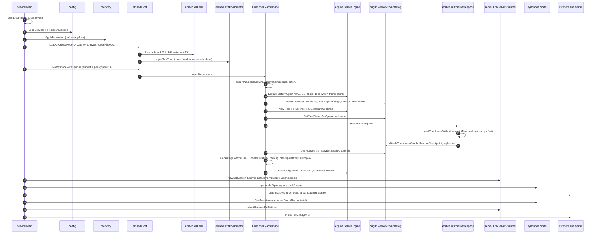

</details>

### Call chain

| # | Function (pkg.Type.Method) | File:line | What it does |
|---|---|---|---|
| 1 | `main.main` -> `service.Main` | go/cmd/kdb-service/main.go:11 -> go/kdb/service/service.go:49 | Entry point. `kdb-service user ...` / `token ...` are dispatched first by `runSubcommand` (service.go:50, service/user_cmd.go:17). |
| 2 | `config.LoadServiceFile` / `config.ResolveService` | service.go:152, :160 -> go/kdb/config/service.go:266, :289 | Merge precedence file < env < explicitly typed flags (`fs.Visit`, service.go:159). `ParseDurability`/`ParseSyncMode` at config/service.go:623, :658. Defaults (`DefaultServiceSettings` :155): `Durability=sync`, `SyncMode=full`, `DrainTimeout=30s`, `MaintenanceInterval=5m`, SQL on `127.0.0.1:9090`, `MemoryBudgetMB=0` (auto-detect), `CacheMB=0` (size from machine); peer/stream/WS/gRPC/admin/control off. `--grpc-addr` on a binary without gRPC linked is exit 2 (service.go:170-176). |
| 3 | `buildLogger`, data-dir vs memory, TLS, `memtune.Start` | service.go:185, :192-199, :201, :213 | No `--data-dir` means in-memory mode. Both `--data-dir` and `--memory` is exit 2. `memtune.Start` makes GC pacing follow the live heap (`--gc-headroom-percent`). |
| 4 | `recovery.ApplyPromotion` | service.go:228 -> go/kdb/recovery/promote.go:232 (`applyPayload` :269) | Runs before the data root is opened (so before any lock). Verifies the staged payload, renames live `ns/<ns>` to `superseded/<ns>-<stamp>`, moves the payload into place, handles `snap/kdb_checkpoint_<ns>`. Clears the intent first, writes `.kdb.promote.last.json`. An unreadable intent file is exit 1 (service.go:240-244). |
| 5 | `embed.FileRuntimeOptionsFromEnv` | service.go:274 -> go/kdb/embed/storage_options.go:256 | `KDB_*` env: history mode/strategy, retain, cache bytes, `KDB_BOUNDED_LIVE_BODIES` (default on, :283), `KDB_DOCUMENT_COPIES`, `KDB_PREALLOCATE_SEGMENTS`, `KDB_CHECKPOINTS=off`, `KDB_TREE_FILE` (default on, :300), `KDB_GRAPH_FILE` (default on, `graphSettingsFromEnv` :315-318), S3. service.go:286-292 overlays Durability/Compression/AsyncSyncInterval/SyncMode/attachment settings/DocumentCopies field by field. |
| 6 | `embed.LoadOrCreateNodeID` + `server.SetProcessNodeID` | service.go:293, :297 -> go/kdb/embed/node_identity.go:32, `writeNodeID` :77 | Reads `<root>/NODE`; `KDB_NODE_ID` overrides without writing; else adopts `txn/HOST`, else a random UUID; written via tmp, fsync, rename, dir fsync. |
| 7 | `server.CachePoolBytes` | service.go:302 -> go/kdb/server/memory_budget.go:130 | `--cache-mb`, else 1/8 (`CachePoolFractionOfMemory`) of the cgroup limit or host RAM, clamped to [Min, Max]CachePoolBytes. Becomes the host pool. |
| 8 | `embed.OpenFileHost` | service.go:304 -> go/kdb/embed/host.go:132 | Locks, segment I/O shim, transaction coordinator, `storage.NewBudgetArbiter(pool)`, `engine.NewMultiplexAdapter`. |
| 8a | `acquireDirLock` -> `lockNamedFile` -> `lockFile` | host.go:142 -> go/kdb/embed/dir_lock.go:45, :86 -> dir_lock_flock_unix.go:10 | `.kdb.lock` shared (attach), then `.kdb.write.lock` exclusive, non-blocking; writes `pid=..\nruntime=..` into the write lock and `Sync`s it. Read-only: `acquireDirLockShared` (:65). Maintenance: `acquireDirLockExclusive` (:75). Windows uses `LockFileEx` (dir_lock_windows.go:25); other platforms (js/wasm) an `O_EXCL` file (dir_lock_other.go). |
| 8b | `FileBackedPlatformIOFactory.Open` -> `buildSegmentByteStore` -> `storio.NewOSByteStore` | host.go:160 -> go/kdb/embed/segment_store.go:24 -> go/kdb/storage/io/os_store.go:57 | `OSByteStore`, optionally wrapped with S3 replica/archive sinks. `PlatformIOConfig{FsyncOnFlush: !ReadOnly, SyncMode, PreallocateBytes: preallocateBytesFor}` (host.go:164-171, :423). Result `FileBackedPlatformIO` (storage/io/file_backed.go:80). |
| 8c | `embed.openTxnCoordinator` | host.go:180 -> go/kdb/embed/txn_coordinator.go:106 | A writer renames every `txn/decisions-<epoch>.log` to `.dead` and `syncDir`s `txn/` before any namespace replays (:143). Read-only hosts skip it. |
| 9 | `Host.NamespaceWithOptions` | service.go:306 -> host.go:248 | Idempotent per id; seeds the namespace budget at `pool/(open+1)` (host.go:270); closes a racing duplicate open; registers the adapter (:300) and arbiter participant (:311), or `Reserve`s a fixed per-namespace budget. |
| 10 | `Host.openNamespace` | go/kdb/embed/file.go:72 | Per-namespace open; rows 11-24 are its body. |
| 11 | `namespaceDirExists`, `ensureNamespaceDirs` | file.go:83, :85 -> :517, :497 | Creates `ns/<id>/{delta,meta}` and a bootstrap `meta.json` (plain `os.WriteFile`, not atomic). Skipped when read-only. |
| 12 | `resolveNamespaceHistory` | file.go:89 -> go/kdb/embed/namespace_meta.go:210 | Recorded strategy+mode win; conflicts are `HistoryStrategyMismatchError` / `HistoryModeMismatchError` / `HistoryModeStrategyConflictError`. Writes the marker through `writeNamespaceMeta` (:82: tmp, fsync, `fsx.Rename`, no directory fsync) on every writable open. |
| 13 | `engine.DefaultFactory.Open` | file.go:137 -> go/kdb/storage/engine/server_engine.go:1055 | `wal.DefaultFactory.OpenOrCreate` (wal/default_wal.go:55), `NewServerEngine` (:319, `DiscoverTables`), `RemoveOrphanSidecars` (writer) / `SetSidecarBuild(false)` (reader), `delta.Factory.OpenWriter` (delta/writer.go:1091), `OpenReader`, `newDeltaColdLoader` + `SetColdLoader`, `SetCommitFrameReader`, and `installFrameReads` (engine/frame_reads.go:20: a `delta.FrameCache` sized by `ResolvedDeltaFrameCacheBytes`, re-cut from the namespace budget). |
| 13a | `delta.Factory.OpenWriter` / `scanExistingDeltaSequence` | delta/writer.go:1091, :1110 | `max sequence + 1`; never resumes a segment and does not create the file (created by the first append, `OSByteStore.openFor` os_store.go:103). A pre-Layer-13 random-UUID segment is `LegacySegmentFormatError`. |
| 13b | `wal.DefaultFactory.OpenOrCreate` | wal/default_wal.go:55 | Newest WAL id or a new empty one. `ServerEngine.RecoverBlobsFromWal` (server_engine.go:491) still has no caller; the blob WAL is not replayed. |
| 14 | `dag.NewInMemoryCommitDag`, `SetGraphSettings`, `ConfigureGraphFile` | file.go:159, :168, :172 -> go/kdb/dag/graph_attach.go:23 | Graph settings before restore (generations). With `Graph.FileEnabled` the DAG is pointed at `ns/<id>/graph/` so a checkpoint can attach mapped graph segments. |
| 15 | `document.NewTreeFile`, `ServerEngine.SetTreeFile` | file.go:184, :197 -> go/kdb/document/document_tree_file.go:124 | `tree.file` (default on): the live tree lives in mapped segments under `ns/<id>/tree/`; `ErrTreeFileUnsupported` (Windows) keeps it on the heap. |
| 16 | `SetTreeStore`, `newCommitOpsLoader`, `SetOperationsLoader`, `SetPayloadLoader`, `ConfigureColdIndex` | file.go:205-225 -> go/kdb/embed/commit_ops_loader.go | Engine is the single tree owner; evicted commit ops and payloads are read back from delta frames through a deltaindex whose sealed-segment sidecars live in `ns/<id>/deltaidx/`; the cold version loader uses the same directory. |
| 17 | `readNamespaceMeta`, `SetBodiesExternal`, `useAttachmentSetStore`, `seedPersistedAttachmentTables` | file.go:227-241 | Shallow roots or `bodiesExternal` make cold reads consult the blob store; attachment set pool spills to the blob store; peer-seeded attachment tables loaded. |
| 18 | `embed.restoreNamespace` | file.go:243 -> go/kdb/embed/checkpoint_open.go:27 | Decision tree in Data/Failure sections. `eng.SetReplaying(true)` for the duration (:41). Returns `replayedInFull`. |
| 18a | `readCheckpointWith` + `checkpointMatchesLog` | checkpoint_open.go:83, :87 -> go/kdb/embed/checkpoint.go:1097, :984 | `ReadSnapshot("kdb:checkpoint:<ns>")` -> `<root>/snap/kdb_checkpoint_<ns>`. Accepted versions 2 (record), 3 (graph refs), 4 (packed tree+commits), 5 (attachments), 6 (`checkpointSectionFormatVersion`, embed/checkpoint_section.go:41: tree and commits in a separate CRC'd section snapshot `kdb:checkpoint-section:<ns>:<digest>`, mapped not read; with a tree file the tree is located by digest). `unchangedSinceCheckpoint` (:951) trusts segment *stamps* without scanning; otherwise every covered segment >= floor must match size and last commit hash, with `damagedInPlace` (:1046) keeping the checkpoint for same-length bit damage. |
| 18b | `AttachCheckpointGraph`, `RestoreCheckpoint`, `SeedPackedAttachmentTables`, `RestoreLiveTree`, `RestoreCommitOperations`, `HydrateBranchHeads` | checkpoint_open.go:115, :125, :129, :133, :158, :162 | Graph segments mapped first (failure -> full replay, `DetachGraph`); graph, branches, tags, live tree, attachment tables from the checkpoint; branch-head ops from `HeadCommits`. Replay strategy installs `installTreeRebuilder` (:143). |
| 18c | `replayDeltaNamespaceFrom` | checkpoint_open.go:169 -> go/kdb/embed/delta_replay.go:61 | Segments after `ThroughSequence` via `ListSegmentsAfter`. Per segment: `Tail.Kind` (`TailDamaged` -> `DamagedSegmentError`, `TailTorn` -> log and continue); `streamSegmentCommits` (:339); `eng.RecordFrameLocations` for every commit read; `groupGate.skip` (:268); `applyIfParentsReady` (:362); deferred commits via `applyCommitsTopologically` (:394); `applyReplayedCommit` (:449) applies only commits that extend main (or `SupersedesHead`). |
| 19 | `MarkShallow`, `InvalidateGenerations`, `OpenGraphFile`, `MaybeRebuildGraphFile` | file.go:248-282 -> dag/graph_attach.go:35, :146 | Without a checkpoint that named segments, the graph file is opened and rebuilt once the resident tier passes the threshold. Failure logs and keeps commits on the heap. |
| 20 | `NewPersistingCommitDAGWithAsyncInterval` -> `newCommitLogWriter`; `SetPersistListener`; `EnableDurabilityTracking` | file.go:286, :294, :299 -> embed/persisting_dag.go:82 -> embed/commit_log.go:100 | Starts the log-writer goroutine. The persist listener calls `eng.RecordCommitLocation` + `eng.NoteCommitDurable` (releases bounded-live-body pins). |
| 21 | `checkpointAfterFullReplay` | file.go:302 -> checkpoint_open.go:354 | Only after a full replay: checkpoint through `writerSeq-1` so a kill -9 does not replay everything again. |
| 22 | `EmbeddedKdbRuntime` assembly, attachments, `snapshotSupport`, `syncEmbedSchema`, `storageClose`, `maintain`, `checkpointNow` | file.go:306-437 | `storageClose` (flow 13) now stops the background merge and refile first. |
| 23 | `startBackgroundCompaction`, `startVersionRefile` | file.go:448, :451 -> embed/background_compaction.go:57, embed/version_refile.go:47 | Close no longer does a full merge (#215); a background merge picks up at open. A changed document-copies switch re-files versions (objects strategy only) and, when copies are dropped, runs a major compaction before writing the marker. |
| 24 | `server.NewKdbServerRuntime` | service.go:318 -> go/kdb/server/server_runtime.go:316 | Strict + last-write engines sharing one `UniqueKeyRegistry`, `newWriteGate(64)`, `openConflictQueue` (:298, `peersync.ConflictQueueDir`, falls back to memory), SQL engine, `RebuildUniqueKeys` (:432; failure stored). |
| 25 | Memory governance | service.go:340-371 | `MemoryBudgetMB=0` auto-detects (`DetectMemoryBudgetBytes`, memory_budget.go:33); `SetMemoryBudget` (server_runtime.go:631), `loadCostModelState`, `ApplyGoMemoryLimit`. `-1` disables. |
| 26 | `KdbServerRuntime.OpenIndexes` | service.go:392 -> go/kdb/server/index_wiring.go:58 | Catalog + snapshots, stale stores rebuilt. Snapshots are now written by a background `indexFlusher` once commits go quiet (`indexFlushIdle=1s`, min gap 5s, index_wiring.go:41-49), not every N commits. Fatal on error. |
| 27 | `embed.OpenFileAuthRegistry` | service.go:404 -> go/kdb/embed/auth_registry.go:40, `openAuthNamespace` :104 | `_system/users` + `_system/roles`, full delta replay on every start (`replayDeltaNamespace`), no checkpoint. Token records live in `_system/users`. |
| 28 | `server.NewNamespaceSet`, `nsSet.Add` | service.go:443-444 -> server/namespace_set.go:116, :129 | Registry of per-namespace runtimes. |
| 29 | `syncnode.Open` | service.go:474 -> go/kdb/syncnode/node.go:126 | Opens `_kdb/meta` (:155), `MetaStore`, conflict/expiry goroutines, `set.AddKnown` for on-disk namespaces (:187-194). |
| 30 | `nsSet.SetOpener` | service.go:482-533 | Lazily opens other namespaces: `ValidateNamespaceID`, refuses to create on read, `host.Namespace`, runtime, `node.Prepare`, `ShareGovernanceWith`, `OpenIndexes`, optional expiry, and its own maintenance loop (`maintenance.replace`). |
| 31 | `server.ListenSqlWireTLS`, `ListenSqlWireWSTLS`, `grpcListenerFactory`, `node.Listen`, peer HTTP, `server.ListenStreamTLS` | service.go:539, :553, :567, :577, :586, :606 | `ListenSqlWireTLS` (server/wire_listen.go:54) wires `MaxConnections`, `WriteTimeoutMs` and the frame admitter. The stream hub becomes `srv.CommitListener` (service.go:618). |
| 32 | `NewAbortWatchdog`, `NewAdminServer`, loopback check, `control.New` | service.go:640, :648, :659-664, :717 | Control on a non-loopback address with `--rbac` off and no `--control-open` is exit 2 (`isLoopbackAddr`, service/restored_definitions.go:65). Control plane opens other namespace dirs through `nsSet.Resolve` (reserved `_` ones directly) and chains `CommitListener` (:765). |
| 33 | `reopener.setHost/add`, `embed.StartMaintenance` | service.go:797-819 -> embed/maintenance_loop.go:234 | Loops for the primary and control-plane secondaries; `Busy` = write-queue depth > 0. |
| 34 | `syncnode.Node.Start` | service.go:830 -> node.go:341 | `MetaStore.ReconcileAll` (server/meta.go:596), replicator, scrub loop (node.go:433). |
| 35 | `adoptRestoredDefinitions` | service.go:837 -> service/restored_definitions.go:21 | A namespace restored from a backup that carried its definitions adopts them once (`MetaStore.AdoptView`). |
| 36 | `slog "KDB service started"`, `admin.SetReady(true, "")` | service.go:848, :873 | Readiness flips only here. |
| 37 | `signal.Notify(SIGINT, SIGTERM)` or control restart request | service.go:877-890 | Hand-off to flow 13; a control-plane promotion restart exits 75. |

### Data that changes

| Step | Structure / file / wire message | Mutation |
|---|---|---|
| 4 | `<root>/.kdb.promote.json`, `.kdb.promote/`, `superseded/`, `.kdb.promote.last.json` | Intent removed first; live `ns/<ns>` renamed aside; outcome file written. |
| 6 | `<root>/NODE`, `NODE.tmp` | Created once (fsync file, rename, fsync dir). |
| 8a | `<root>/.kdb.lock` (flock SH), `.kdb.write.lock` (flock EX) | Write-lock content replaced with `pid=..`/`runtime=..` and fsynced. Kernel advisory locks, released on process death. |
| 8c | `<root>/txn/decisions-<epoch>.log` -> `.dead` | Renamed, `txn/` fsynced. `EPOCH`/`HOST` only created at the first cross-namespace transaction. |
| 11 | `ns/<id>/{delta,meta}/`, `ns/<id>/meta.json` | Created; minimal `meta.json` if absent. |
| 12 | `ns/<id>/meta.json` | `historyStrategy`, `historyMode` rewritten on every writable open (tmp, fsync, rename, no dir fsync). |
| 13 | `ns/<id>/wal/<uuid>`, `ns/<id>/sstable/...` | WAL created empty if missing; SSTables discovered; orphan SSTable sidecars removed (writer). |
| 13a | `ns/<id>/delta/<seq %020d>.seg` | Nothing yet; the file appears at the first commit (`O_CREATE|O_EXCL`, optionally preallocated). |
| 14-19 | `ns/<id>/graph/` segments, `ns/<id>/tree/` segments, `ns/<id>/deltaidx/` sidecars | Mapped; graph rebuilt or tree segment written when thresholds are passed; read-only opens never write. |
| 18 | In-memory DAG (`nodes` / mapped graph, `branches`, `tags`, `pins`), engine `tree` (tree.file or heap), `treesByHash`, `docsByHash`, cold-index location records | Populated by checkpoint restore and tail replay. Replay files a location record for every replayed commit. |
| 18a | `snap/kdb_checkpoint_<ns>`, `snap/<flattened kdb:checkpoint-section:<ns>:<digest>>` | Read (section mapped). |
| 20 | `commitLogWriter` goroutine + `reqs` channel (cap 256) | The single appender for this namespace's delta log. |
| 21 | `snap/kdb_checkpoint_<ns>` (+ section for v6) | Rewritten after a full replay: section first, then record (tmp, fsync, rename, dir fsync), then the previous section deleted. Up to `legacyCheckpointMaxEntries=20_000` entries v2 is written, beyond that v6. |
| 23 | SSTable runs; `meta.json` filing-threshold marker | Background merge rewrites tables; refile writes location records/copies, then the marker. |
| 24 | `<root>/replication/conflicts/<ns>/` | Conflict queue loaded/created. |
| 26 | `ns/<ns>/index/` | Loaded; stale stores rebuilt and rewritten by the flusher. |
| 27 | `ns/_system/users/`, `ns/_system/roles/` | Replayed in full. |
| 29 | `ns/_kdb/meta/...` | Opened like any namespace. |
| 31 | Listening sockets | Bound; accept loops in goroutines. |
| 35 | restored-definitions file under the data root | Consumed once; `_kdb/meta` gains the definitions. |

### Failure, edge cases & durability points

- **Lock contention.** A second writer fails with `data directory locked: <root>/.kdb.write.lock`; maintenance holding the attach lock yields `data directory is locked for maintenance: <root>/.kdb.lock` (dir_lock.go:46-55). Exit 1. `flock`s release on kill -9; the js/wasm `O_EXCL` fallback does not.
- **Mixed versions.** An older binary takes `.kdb.lock` exclusively, so mixing versions fails to open rather than corrupting (dir_lock.go:31-33).
- **What open fsyncs.** Write-lock hint, `NODE`, `meta.json` (no dir fsync), checkpoint after a full replay, decision-log renames (dir fsync). No delta segment is created at open; when the first commit creates one there is still no parent-directory fsync (`OSByteStore.openFor`).
- **Checkpoint is untrusted until verified (`restoreNamespace`).**
  - Disabled, missing, undecodable, unknown version, wrong namespace, v6 section missing or CRC-bad, a segment >= floor missing, or size/last-hash mismatch: `mustReplay()` (checkpoint_open.go:57-110).
  - Stamps that match (`unchangedSinceCheckpoint`) skip scanning entirely; any doubt falls back to the full fingerprint comparison.
  - `ThroughSequence > highestSegmentSequence`: ignored, full replay (:101-110).
  - `mustReplay` refuses with `*SnapshotCheckpointMissingError` for a snapshot-bootstrapped namespace (:58-62) and `*TruncatedLogError` when segments below the floor are gone (:63-68). Both are exit 1.
  - Graph segments the checkpoint relies on unusable: full replay after `DetachGraph` (:115-123).
  - Same-length bit damage keeps the checkpoint and logs the damaged frame offsets; bodies only in those frames need scrub.
  - Edge: a checkpointed head commit that will not decode replays directly with `-1` (:154), bypassing both `mustReplay` guards and the `DetachGraph` wrapper, into a DAG that already holds checkpoint state.
- **Torn tail vs damage in replay (`replayDeltaNamespaceFrom`, since N5 / #129).**
  - A segment whose classified tail is `TailDamaged` (intact frames follow the fault), or a `CorruptFrameError` that is not `Torn()`, is a hard `*delta.DamagedSegmentError`, in any segment including the newest.
  - A true torn tail (nothing intact after it) is logged and tolerated in the newest segment and in older ones (a crash from an earlier run, since `OpenWriter` always starts a fresh segment).
  - If later commits then name parents that are missing and an older segment had a torn tail, the error names that segment (`BuiltOn: true`): its last frame was damaged in place after being built on.
- **Apply failures** are returned as themselves (`replayApplyError`), not as segment corruption.
- **Orphan parents.** Deferred commits that never place fail the open, except `shallowRoots`/`graftRoots` horizons.
- **Cross-namespace groups.** Parts of undecided groups of a dead epoch are rolled back with their descendants (`groupGate`, `resolvePart` txn_coordinator.go:377).
- **Blob WAL** is opened but not replayed; document durability is the delta log.
- **Auth registry** replays in full on each start. Failure is exit 1 `rbac registry`.
- **Control plane on the network.** Refused at startup without `--rbac` or `--control-open` (exit 2), because without RBAC the auth engine is `AllowAll`.
- **Listeners accept before ready.** SQL/WS/peer/stream sockets are bound well before `node.Start` reconciles definitions and `adoptRestoredDefinitions` runs; clients that do not poll `/readyz` can race them. A bind failure is `os.Exit(1)`, skipping deferred closes.
- **Memory-only mode** (`embed.OpenMemoryRuntime`, service.go:268): no lock, NODE, checkpoint or maintenance.
- **Read-only open**: shared attach lock only; creates nothing; `TargetReadOnly` engine has no WAL/writer and builds no SSTable sidecars; `rt.refresh` replays the writer's log (file.go:347).
- **Open is not atomic with the background jobs.** The background merge and version refile start at open and run concurrently with the first writes; `storageClose` cancels them first.

---


## 2. Client connect + auth/session token + admission

### Description (short)

A Go client (`client.Client`) dials a listener over TCP, TLS (`tcps://`), WebSocket (`ws://`, `wss://`) or a caller-supplied transport (gRPC). It sends one `HANDSHAKE` frame carrying credentials, optional target namespaces and, unless `ConnectOptions.JSONOnly`, the wire features it supports (`binary-frames`, `binary-frames-2`, `zstd-frames`, `attachments`, `attachment-proofs`). The server authenticates against the pluggable `auth.Engine` (`AllowAll` by default, or the durable `RegistryAuthStore` when `--rbac` is on), which accepts either a revocable access token (`kdbt_<id>_<secret>`) or `user`+`password`. It authorizes a `SessionBeginAction` against the handshake namespace, records the `auth.Principal` on the connection handler, and acks with the negotiated wire features; from then on both sides encode eligible messages as binary (tag 2) or zstd-compressed binary (tag 3) frames, decoding by each frame's tag. The client lazily opens one server `KdbSession` per namespace with `SESSION_BEGIN`; the server authorizes that again, per namespace.

Every later frame passes through two layers of admission:

1. A header-only gate in the transport (`frameAdmitter`), driven by the `MemoryGuard` zone.
2. Per-operation gates in the handlers: memory grants (`Admission`), the capacity-1 `writeGate` (which can also be in a "long hold" during a snapshot install), the reply-byte budget, and the `MaxConnections` cap at accept time.

Refusals reach the client as typed errors: `ErrorCode` (BUSY, UNAVAILABLE, DEADLINE_EXCEEDED, RESOURCE_EXHAUSTED, NOT_FOUND, INTEGRITY, ...) plus `RetryAfterMs`.

Two things the name "session token" can mean here:

- The **access token** (U12, `auth/tokens.go`) is a credential presented at handshake, as `Token` or as the password. It names one client, carries its user's roles (read live), may expire, and can be revoked. It is checked once per connection; the `Principal` then lives for the connection.
- The "session token" in `server/session_token.go` is a **read-your-writes causal token**: the newest commit hash the client has seen. It has nothing to do with authentication.

### Diagram


<details><summary>Mermaid source</summary>

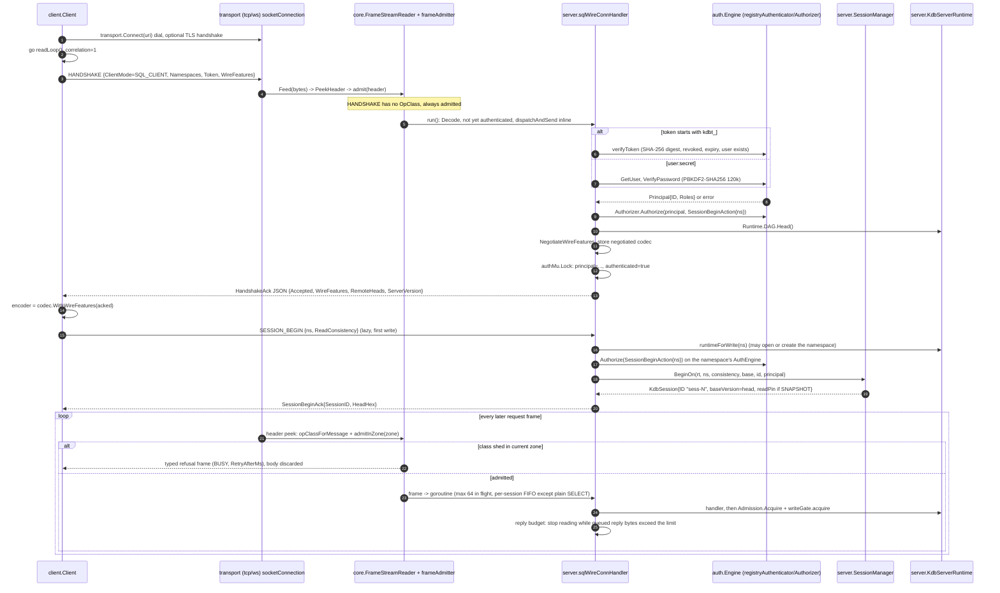

</details>

### Call chain

| # | Function (pkg.Type.Method) | File:line | What it does |
|---|---|---|---|
| 1 | `client.Connect` / `client.ConnectWithOptions` | `client/client.go:326` / `:332` | Picks a transport, dials, creates `Client`, starts `readLoop`, sends the handshake with `WireFeatures = wire.SupportedWireFeatures` unless `JSONOnly` (`:370-372`). On an accepted ack it stores `codec.WithWireFeatures(NegotiateWireFeatures(ack))` as the encoder (`:397-400`). |
| 2 | `client.dialTransport` | `client/client.go:424` | `tcp://`, `tcps://` -> `tcp.NewTransport`; `ws://`, `wss://` -> `ws.NewTransport`. `ConnectOptions.Transport` bypasses it. A bare `host:port` gets `tcp://` (`:342`). |
| 3 | `tcp.defaultTransport.Connect` | `transport/tcp/transport.go:45` | `ParseURI`, refuses `tcps://` without TLS settings, dial with timeout, `TCP_NODELAY`, `tlsClientHandshake` (`:95`), `newSocketConnection` (`:208`). |
| 4 | `Client.readLoop` | `client/client.go:453` | Decodes each frame (any tag) and routes it to `pending[correlationID]`; undecodable frames are skipped (`:456`). On close all pending channels close (`ErrClosed`). |
| 5 | `Client.request` | `client/client.go:490` | Does not send if `ctx` is already cancelled (`:493`); encodes with the negotiated encoder; waits for reply or `ctx.Done()`. |
| 6 | `wire.DefaultCodec.Encode` / `Decode` | `wire/codec.go:59` / `:202` | Frame = 12-byte header (`wire/frame.go`) + 1 tag byte + body: tag 1 JSON envelope, tag 2 binary body (`wire/binary.go`), tag 3 zstd-compressed binary for bodies >= 8 KiB (`zstdFrameThreshold`). Max frame 16 MiB (`wire/types.go:11`). |
| 7 | `tcp.defaultTransport.Serve` | `transport/tcp/transport.go:138` | Accept loop; `MaxConnections` cap closes the new socket with no frame (`:164`). |
| 8 | `tcp.socketConnection.readLoop` | `transport/tcp/transport.go:241` | `reader.Feed(buf)`; writes `TakeRejections()` directly before delivering admitted frames. |
| 9 | `core.FrameStreamReader.drainCompleteFrames` | `transport/core/framing.go:228` | `ValidateFrameLength`, `wire.PeekHeader` (`wire/frame.go:107`), `admit(header)`; a refused frame's body is skipped via `discardRemaining`. |
| 10 | `KdbServerRuntime.frameAdmitter` | `server/frame_admission.go:54` | `opClassForMessage` (`:17`): `DOCUMENT_GET` point read; `SQL_EXEC`/`SEARCH` scan; `TX_COMMIT`/`UPSERT`/`TRANSACTION_REPLAY`/`TX_COMMIT_MULTI` write; `COMMIT_PUSH`/`DELTA_COMMIT` replication. Handshake, session begin, rollback, locks, history, revert and the attachment ops are unclassified and never shed. Refusals are JSON frames (`rejectionMessage` `:82`); an unbuildable refusal admits the frame. |
| 11 | `server.ListenSqlWireTLS` | `server/wire_listen.go:54` | JSON codec, `MaxConnections`, `WriteTimeoutMs`, `Admitter`, `ListenBound`, `Serve` -> `newSqlWireConnHandler(codec, runtime).run(conn)`. WS: `ListenSqlWireWSTLS` `server/ws_listen.go:25`, same handler; the WS read loop (`transport/ws/transport.go:554`) applies `admit` at `:575`. |
| 12 | `server.newSqlWireConnHandler` | `server/wire_listen.go:197` | One handler, one `SessionManager` (`server/session_manager.go:221`) and one reply budget (`newReplyBudget(MaxQueuedReplyBytes)`, `server/reply_bounds.go:179`) per connection. |
| 13 | `sqlWireConnHandler.run` | `server/wire_listen.go:220` | Before auth, frames are handled inline in order. After, each frame gets a `sessionTicket` (`:297`), a slot in `inFlight` (`MaxInFlightFrames=64`, `:149`), a reply-byte reservation, and its own goroutine; the reader then blocks in `replies.waitBelowLimit()` while too many reply bytes are queued. `defer closeAllSessions` (`:226`). |
| 13a | `sessionTicket` / `readsNoSessionState` / `sessionIDOf` | `server/wire_listen.go:297` / `:336` / `:372` | Ordered per session: `SQL_EXEC`, `TX_COMMIT`, `TX_ROLLBACK`, lock verbs, and attachment upload/get chunks (keyed `upload:<id>` / `read:<id>`). A plain `SELECT` on a non-SNAPSHOT session skips the queue (`isPlainSelect` `:347`), so it runs concurrently with the session's other frames. |
| 14 | `sqlWireConnHandler.dispatchRecovering` -> `dispatch` | `server/wire_listen.go:454` -> `:506` | Panic backstop returns a typed INTERNAL reply. Unknown types return `nil` (`:545`): no reply. New cases: `ATTACHMENT_UPLOAD/GET/LIST`. |
| 15 | `sqlWireConnHandler.handleHandshake` | `server/wire_listen.go:549` | Requires `SQL_CLIENT`. `Authenticate`, then `Authorize(SessionBeginAction{ns})` with `ns = Namespaces[0]` or `Runtime.DefaultNamespace`; `DAG.Head()`; `handshakeAck` (`:615`, always `NegotiatedEncoding=JSON`, plus `ServerVersion`); if the codec is a `*wire.DefaultCodec`, `NegotiateWireFeatures` and `h.negotiated.Store(...)` (`:580-587`); then `principal`/`authenticated` under `authMu` (`:588`). |
| 16 | `registryAuthenticator.Authenticate` | `auth/registry_auth_engine.go:32` | Token first: if `Token` or `Password` has prefix `kdbt_` (`IsAccessToken`, `auth/tokens.go:51`), `verifyToken` (`:144`: parse, constant-time digest compare, revoked, expired, user still present) -> `Principal{ID: user, Roles: user's roles}`. Else `resolveUserAndSecret` (`:72`) -> `GetUser` (`auth/registry_store.go:98`) -> `VerifyPassword` (`:106`, PBKDF2-HMAC-SHA256 120k, `auth/password_hasher.go:38`). |
| 17 | `registryAuthorizer.Authorize` | `auth/registry_auth_engine.go:86` | `GrantsByRole()` (`registry_store.go:214`, scans the roles namespace per call), `actionToResource` (`:109`), `PrincipalHasPermission` (`auth/permission_matching.go:32`); `sync` grants cover `sync_pull`/`sync_push`. |
| 18 | `auth.AllowAll` | `auth/engine.go:22` | Default: every credential is `anonymous`, every action allowed. |
| 19 | RBAC and token administration | `service/service.go:400-440`, `service/user_cmd.go:17`, `auth/tokens.go:73`, `:103` | `--rbac` + data dir: `OpenFileAuthRegistry`; without a data dir an in-memory registry. `kdb-service token create/revoke/list` open the registry with `OpenFileAuthRegistryExclusive` (`user_cmd.go:82`), so the service must be stopped. |
| 20 | `Client.ensureNamespace` / `Client.beginSession` | `client/client.go:538` / `:557` | First use of a namespace sends `SESSION_BEGIN{ReadConsistency:"READ_COMMITTED"}`; caches `namespaceState{sessionID, head}`. Empty `SessionID` with an error -> `ErrUnauthenticated` (`:573`). One session per namespace in the Go client (the TS client pools 8 since #337). |
| 21 | `sqlWireConnHandler.handleSessionBegin` | `server/wire_listen.go:638` | Requires the handshake; `runtimeForWrite(ns)` (`:646`, `server/multi_commit.go:43` -> `NamespaceSet.Resolve(ns, create=true)` `server/namespace_set.go:218`), then `Authorize(SessionBeginAction)` on that runtime (`:650`), then `BeginOn`. |
| 22 | `SessionManager.BeginOn` | `server/session_manager.go:241` | Head or a client `BaseVersionHex` that must exist; id = client-supplied `SessionID` if any, else `sess-<n>` from a process-global counter (`nextSessionOrdinal`, `server_runtime.go:450`); `startTransactionAt(head)` (`:117`; SNAPSHOT takes `readPin` + `dag.Pin`). |
| 23 | `KdbServerRuntime.SetMemoryBudget` | `server/server_runtime.go:631` | `NewMemoryGuard` (`server/memory_guard.go:158`), `NewAdmission` (`server/admission.go:105`). Without a budget `admission` is nil and grants are no-ops. |
| 24 | `MemoryGuard.observe` | `server/memory_guard.go:219` | Moving average; zones at 70/85/93 %; immediate escalation, de-escalation after `zoneDwell=600ms` (`:132`) and hysteresis. |
| 25 | `admitInZone` / `retryAfterMsForZone` | `server/admission.go:284` / `:298` | Normal/Elevated admit all; High: point reads + replication; Critical: point reads only. Hints 50 / 100 / 500 ms. |
| 26 | `Admission.Acquire` / `AcquireBytes` | `server/admission.go:320` / `:331` | Zone re-check, class base cost, point reads clamped to capacity, `cost > capacity` -> `ResourceExhaustedError`, else semaphore; ctx expiry -> `BusyError`. |
| 27 | `writeGate.acquire` -> `admit` | `server/write_gate.go:92` -> `:102` | Queue full (64) -> `BusyError{50, "write queue is full"}`; ctx expiry -> `DeadlineExceededError`; a long hold (`beginLongHold`, `:66`, a snapshot install) refuses queued and new writers with the hold's `BusyError`. `acquireThroughHold` (`:98`) is for internal drains. |
| 28 | `classifyError` | `server/error_classification.go:17` | `attachstore.ErrCorrupt` -> INTEGRITY; Busy/ReplicaBehind/MemoryPressure -> BUSY; Unavailable; DeadlineExceeded; `ResourceExhaustedError`, `ScanRowBudgetExceededError`, `RetainedLimitError`, `ReplyTooLargeError`, `wire.FrameTooLargeError`, `ResultRowLimitError` -> RESOURCE_EXHAUSTED; Conflict/StaleFence -> CONFLICT; Authorization -> UNAUTHORIZED; Unsupported; NotHome; Schema -> UNIQUE_VIOLATION / SCHEMA_VIOLATION; else INTERNAL. |
| 29 | `KdbServerRuntime.conflictRetryAfterMs` | `server/backoff.go:42` | Full-jitter CONFLICT hint. |
| 30 | `client.classifiedError` | `client/client.go:99` | Maps BUSY, RESOURCE_EXHAUSTED (`*ResourceExhaustedError`), UNAVAILABLE, DEADLINE_EXCEEDED, UNSUPPORTED, NOT_HOME, NOT_FOUND (`ErrNotFound`), INTEGRITY (`ErrAttachmentCorrupt`). UNAUTHORIZED, UNIQUE_VIOLATION, SCHEMA_VIOLATION and INTERNAL still collapse to `fmt.Errorf("kdb: %s")`. CONFLICT frames go through `decodeConflictError` (`:759`). |
| 31 | `client.backoffDelay` / `waitBackoff` | `client/conditional.go:216` / `:230` | Retry only inside `CompareAndSwap` (`:128`), preferring the server hint (`retryHint` `:196`). |
| 32 | `Session` (read-your-writes token) | `client/session.go:25-95` | `seen[ns]` newest commit; `Token()`/`Resume()`; sent as `MinCommit`. Server: `KdbServerRuntime.AwaitCommit` `server/session_token.go:38`. |
| 33 | `sqlWireConnHandler.closeAllSessions` | `server/wire_listen.go:404` | On connection end: closes attachment reads, `DocumentLocks.ReleaseAll(sessionID)`, `ClearLeases`, `SessionManager.End`. |

### Data that changes

| Step | Structure / file / wire message | Mutation |
|---|---|---|
| Dial | `Client.conn`, `pending`, `correlation`, `encoder` (atomic codec), `features` | New connection; encoder switched after the ack. |
| Accept | `tcp.Serve` `active` counter | Incremented per connection, decremented by `onClose` (`transport.go:315`). |
| Handshake frame | `HANDSHAKE` (0x01, always JSON): `HandshakePayload{NodeID, Namespaces, ClientMode, ProtocolVersion, Token/User/Password, WireFeatures}` | Credentials in the clear unless `tcps://`/`wss://`. |
| Handshake ok | `principal`, `authenticated` (under `authMu`), `negotiated` codec | Set once per accepted handshake; a repeated handshake re-authenticates and replaces them. |
| Handshake ack | Frame typed `MsgHandshake`: `HandshakeAckPayload{Accepted, NegotiatedEncoding=JSON, ProtocolVersion, RemoteHeads{ns:head}, RejectionReason, WireFeatures, ServerVersion}` | `RemoteHeads` has one entry. |
| Session begin | `SessionManager.sessions[id]`; `NamespaceSet.runtimes` | New `KdbSession`; possibly a new namespace opened or created via the opener. |
| Session begin (SNAPSHOT) | DAG pin table (`dag/retention.go:33`) | `Pin(head)` until `EndTransaction`. |
| Session begin ack | `SESSION_BEGIN_ACK` (0x13) | Client stores `namespaceState`. |
| Per frame | `MemoryGuard.zone`, `Admission.sem`, `writeGate.queued/running/hold`, `replyBudget`, `sessionTails` | Updated per admitted request. |
| Shed at header | `discardRemaining`, `rejections` | Body dropped; JSON rejection written. |
| Disconnect | `LockManager` entries, `KdbSession` pins, attachment reads | Released by `closeAllSessions`. |
| Token admin (offline) | `_system/users` documents `token:<id>` (`TokenRecord{Kind, TokenID, User, Label, SecretSHA256, CreatedAt, ExpiresAt, Revoked}`) | Written by `CreateToken`/`RevokeToken`; read on every token handshake. |

### Failure, edge cases & durability points

- **Nothing durable happens in this flow.** Connect, handshake and session begin write no WAL or delta record, except that session begin may create a namespace directory (see below). The `Principal` is in memory and ends with the connection.
- **Auth rejection.** `Accepted=false` with `RejectionReason=err.Error()`; the client closes and returns `ErrUnauthenticated` (`client.go:393`).
  - Reasons distinguish `unknown user: X` from `invalid credentials for user: X` (`registry_auth_engine.go:56`, `:63`), and for tokens `invalid access token` / `has been revoked` / `has expired` / `belongs to a user that no longer exists`.
  - No attempt limit, no lockout, connection stays open after a rejection; each password attempt costs one inline PBKDF2. Token verification is a single SHA-256.
- **Token revocation is offline and not retroactive.** `RevokeToken` needs the exclusive data-dir lock (service stopped). A connection authenticated before revocation keeps its `Principal`; the user's roles are read when the token is verified, so a role change also applies only at the next connect.
- **Wire feature negotiation.** Only offered and supported features are acked, and nothing is acked without `binary-frames` (`NegotiateWireFeatures`, `wire/binary.go:68`). A server built without the features, or the Kotlin server, acks none and the connection stays JSON. `ProtocolVersion`/`PreferredEncodings` are still ignored; `DefaultHandshakeNegotiator.Negotiate` has no caller. The Go client offers `zstd-frames` even on loopback (the TS client declines it there, f5e58d98).
- **Frames before authentication** are dispatched inline and answered "not authenticated"; unhandled types get no reply; there is no handshake timeout.
- **Authorization granularity.**
  - The handshake authorizes against one namespace (`Namespaces[0]`, else the default). Per-namespace authorization happens at `SESSION_BEGIN`.
  - Writes are re-authorized per operation in `admitWrite` -> `authorizeOperations` (`server_runtime.go:1064`), using `s.Runtime.DefaultNamespace`.
  - `SESSION_BEGIN` needs `read`.
- **Observation: ordering in `handleSessionBegin`.** `runtimeForWrite` (create=true, `:646`) runs before `Authorize` (`:650`); a principal that fails authorization may still have created the namespace.
- **Observation: client-chosen session ids.** `BeginOn` accepts any `SessionID` the client sends, and lease checks key by id across the whole runtime. A second connection can open a session with another connection's id (ids are `sess-N`, sequential, and named in `DocumentLockedError` messages) and its commits then pass `AssertUnheldByOthers`; `UPSERT` does not even need the session to exist on its connection (flow 3).
- **Connection cap.** Excess sockets are closed at accept with no frame; the client sees EOF / `ErrClosed`.
- **Admission layering.**
  - Layer 1: header-time zone shed, binary per class.
  - Layer 2: `Admission.Acquire` for writes in `runTransaction` / `CommitImmediate`; `AcquireBytes` for point reads (`readAcquireTimeout=2s`, `wire_listen.go:844`) and scans; then `writeGate`.
  - Grant plus gate wait share one `context.WithTimeout(WriteTimeout, default 5s)`. The durability wait is not bounded by it.
  - `HISTORY_LIST`, `REVERT` and the attachment ops are not classified, so never memory-shed. `REVERT` takes the gate with `context.Background()` (`server/history.go:124`).
  - Reply backpressure: once queued reply bytes pass `MaxQueuedReplyBytes`, the reader stops taking frames, so a client that pipelines faster than it reads is slowed by TCP.
- **Error surface summary.** Shed or grant failure: BUSY + 50/100/500 ms. Oversized request or reply: RESOURCE_EXHAUSTED (now a typed `*ResourceExhaustedError` in the client). Full write queue or long hold: BUSY. Queue wait > timeout: DEADLINE_EXCEEDED. Draining (`BeginDraining`, `server_runtime.go:549`): UNAVAILABLE.
- **Session token semantics.** `AwaitCommit` polls with backoff (1 ms doubling to 50 ms) for up to `SessionWait` (`DefaultSessionWait=2s`, `session_token.go:18`), then `ReplicaBehindError` (BUSY, 250 ms).
- **Router redirect.** `client.Router` (`client/router.go:49`) follows `NOT_HOME` by parsing `home=<addr>` (`homeAddr` `:25`).
- **Concurrency on one connection.** Up to 64 frames in flight. Ordered: frames naming a session (except plain SELECTs on non-SNAPSHOT sessions) and attachment chunks of one upload/read. `DOCUMENT_GET`, `UPSERT`, `SEARCH`, `TRANSACTION_REPLAY` are free-running. Because an unordered SELECT does not wait for its session's earlier frames, a SELECT pipelined right after that session's own COMMIT can execute first and not see the commit.

---


## 3. Document put/commit (single write, incl. group commit)

### Description (short)

`client.Client.PutJSON` (and `Commit`, `ReplaceJSON`, `ReplaceIf`) build a `document.Transaction`, encode it with `wire.EncodeTransaction`, and send it as `TX_COMMIT` on the namespace's session (binary frame when negotiated). A `WriteOp` may carry `Replace=true` (e2ea7a51): its patch is the whole document rather than a merge patch. `client.Client.Upsert` is a separate `UPSERT` frame that uses a LAST_WRITE engine and needs no base version.

On the server, `handleTxCommit` -> `commitSession` -> `KdbServerRuntime.Commit` -> `commitWith` -> `runTransaction` -> `commitAtGateFront`:

1. The write path runs the cheapest-first admission checks (`admitWrite`).
2. The write pins its base commit and tree, takes a memory grant and the capacity-1 `writeGate`.
3. At the gate front it prepares index updates (validation, no mutation).
4. It runs the transaction engine (`transaction.defaultEngine.Commit`): file and attachment preflight, schema phase (merge or replace), preconditions, conflict detection (documents and attachments), unique keys, then the writes: staged puts, `CommitTree` for the new trie root, and `InMemoryCommitDag.AppendCommitWith` (head compare-and-swap, then an atomic head-snapshot publish).
5. It records the commit's written documents in the change log, re-prepares index updates for what was actually stored and applies them, and queues the commit on the delta log with `PersistAsync`.
6. It **releases the write gate before the disk wait**, then runs index store bookkeeping (`maintain`) off the gate while the fsync is in flight.

The group-commit mechanism is the single `commitLogWriter` goroutine, which coalesces every record queued while the previous fsync was in flight into one `AppendBatch` (one positional write) and one `Flush` (`maxLogBatch=256`). Cross-namespace group commit (`embed.CommitGroup`, `server.NamespaceSet.CommitAcross`) for `TX_COMMIT_MULTI` and multi-namespace SQL transactions is a variant below; SQL auto-commit DML uses the same gate front through `CommitImmediate` (flow 5).

### Diagram


<details><summary>Mermaid source</summary>

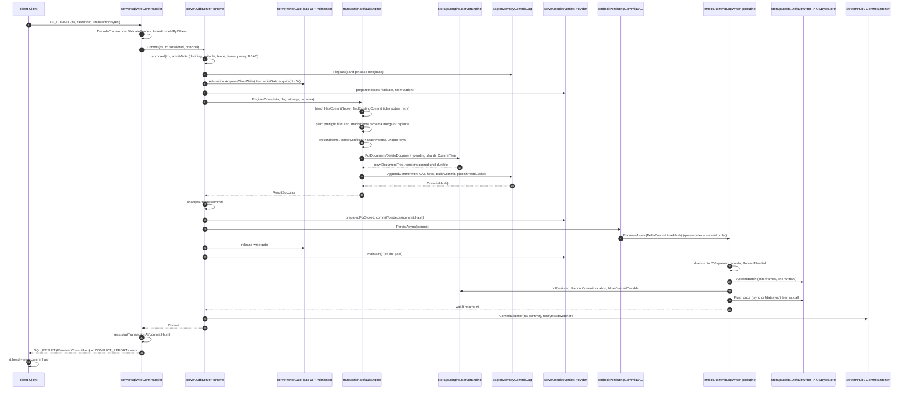

</details>

### Call chain

| # | Function (pkg.Type.Method) | File:line | What it does |
|---|---|---|---|
| 1 | `client.Client.PutJSON` | `client/client.go:587` | Validates the UUID, `ensureNamespace`, builds `document.Transaction{ID: random, BaseVersion: st.head, Operations:[WriteOp{DocID, Patch}], Timestamp, AuthorNodeID}`, `commitTransaction`. `Client.Commit` (`:695`) takes caller writes/deletes and `BaseVersion`; `ReplaceJSON` (`:685`) and `ReplaceIf`/`ReplaceIfPresent` (`client/conditional.go:63`, `:75`) send `WriteOp{Replace:true}`, the conditional ones with a server-checked precondition. |
| 2 | `client.Client.commitTransaction` | `client/client.go:722` | `wire.EncodeTransaction` (`wire/transaction_codec.go:41`), `TxCommitMessage`; `ConflictReportMessage` -> `decodeConflictError` (`:759`; `PRECONDITION_FAILED` -> `*PreconditionError`, else `*ConflictError`); `SqlResultMessage` -> `st.head`. |
| 3 | `client.Client.Upsert` | `client/client.go:652` | `UPSERT {ns, docId, json, sessionId}`; the session id is sent so the server can tell a lease holder's own upsert. |
| 4 | Transport admit | `server/frame_admission.go:54` | `TX_COMMIT` / `UPSERT` are `ClassWrite`: shed at the header in High and Critical zones. |
| 5 | `sqlWireConnHandler.handleTxCommit` | `server/wire_listen.go:1099` | Session lookup on this connection, `commitSession`. FIFO per session via `sessionTicket`. |
| 6 | `sqlWireConnHandler.commitSession` | `server/wire_listen.go:1116` | `wire.DecodeTransaction` (`wire/transaction_codec.go:66`) or `sess.Pending.Build`; `LeasesFor` + `ValidateFences`; other namespaces pending -> `commitSessionAcross` (`:1182`); `AssertUnheldByOthers` (`transaction/lock_manager.go:328`); `srv.Commit`; `ConflictError` -> `conflictReport` (`:1471`), else `sqlResultErrorClassified` (`:1599`); success -> `startTransactionAt` + `SqlResultMessage`. |
| 7 | `KdbServerRuntime.Commit` -> `commitWith` | `server/server_runtime.go:670` -> `:746` | `authored(tx)` (`:802`) sets `AuthorNodeID = NodeID`; `clientWrite` (`:757`, write-back projections only) -> `runTransaction` with the strict engine and `clientMessage(tx)`. |
| 8 | `KdbServerRuntime.runTransaction` | `server/server_runtime.go:825` | `admitWrite`, `Pin(base)`, `pinBaseTree(base)` (`:713`), `context.WithTimeout(WriteTimeout)`, `Admission.Acquire`, `writeGate.acquire`, then `commitAtGateFront`. |
| 9 | `KdbServerRuntime.admitWrite` | `server/server_runtime.go:966` | `draining` -> `UnavailableError`; `AssertWritable`; `fenceErr`; projection rules; `admitHome` (`NotHomeError`); `authorizeOperations` (`:1064`, per-op write/delete actions). |
| 10 | `InMemoryCommitDag.Pin` / `pinBaseTree` | `dag/retention.go:33`, `server/server_runtime.go:713` | Keep the base commit and tree alive while queued. |
| 11 | `Admission.Acquire(ClassWrite, payloadBytes)` | `server/admission.go:320` | Cost-model estimate, zone check, semaphore; held for the whole `runTransaction`, durability wait included. |
| 12 | `writeGate.acquire` | `server/write_gate.go:92` | One committer per runtime; service-time EWMA (`observeService` `:139`) feeds `conflictRetryAfterMs`; refuses during a long hold. |
| 13 | `KdbServerRuntime.commitAtGateFront` | `server/server_runtime.go:889` | Gate-front work shared with `CommitImmediate` (`server/immediate_update.go:272`): rows 14-24. |
| 14 | `KdbServerRuntime.prepareIndexes` | `server/index_wiring.go:530` | Builds `index.PreparedWrite`s from the request; a value the indexes reject fails the transaction before it lands. |
| 15 | `defaultEngine.Commit` | `transaction/default_engine.go:29` | `Head`, `HasCommit(base)` else `BaseNotFoundError`; `findExistingCommit` (`:440`) for an idempotent retry; `finalizeTransaction` (`:198`). |
| 16 | `defaultEngine.plan` | `transaction/prepare.go:103` | `HeadIs(anchor)` -> `extendingTip`; `preflightFileWrites` (`default_engine.go:294`); `preflightAttachments`; `runSchemaPhase` (`default_engine.go:322`: merge over the rolling pending state, or replace when `WriteOp.Replace`; `schema.Validate`); `evaluatePreconditions` (`transaction/preconditions.go:26`); `detectConflicts` (`default_engine.go:225`) + `detectAttachmentConflicts` (strict only; precondition-guarded ops exempt); custom resolver; `planUniqueKeys` (`transaction/unique_registry.go:447`). |
| 17 | `PreparedCommit.Apply` | `transaction/prepare.go:229` | Stage puts/deletes; write failure -> `DiscardPending` + `ResultAborted`; `operationsAsStored` (`default_engine.go:641`: the commit records the staged full document, so `Replace` never reaches the log); `CommitTree`; `AppendCommitWith(... AppendOptions{Detached: !extendingTip, Provisional})`; lost CAS -> `DiscardPending`; `UniqueKeyRegistry.Apply` (`unique_registry.go:112`). |
| 18 | `ServerEngine.PutDocument` / `CommitTree` -> `commitTreeLocked` | `storage/engine/server_engine.go:516` / `:885` -> `:921` | `pending.TakeAllAndClear()`; under `treeMu` `tree.Without`/`tree.With` (persistent trie, or mapped `tree.file` pages); with bounded live bodies (default) each new version is pinned only until its commit is logged (`durablePins[treeHash]`), otherwise pins follow the live tree; `docsByHash.Put`; `putTreeObject` (`tree_objects.go:382`); `stashPendingLocations` (`:749`); `publishTreeLocked` (`:313`). Afterwards `maybeFlushMemtable` (`:911`) may write an SSTable. |
| 19 | `InMemoryCommitDag.AppendCommitWith` -> `appendCommitLocked` | `dag/provisional.go:23` -> `dag/in_memory_commit_dag.go:1018` | Under `d.mu`: parents present; CAS `branches["main"].HeadHash == expected` else `*HeadConflictError`; merge attachment ops and attachment root; `putTreeLocked`; `BuildCommitWithAttachments`; `putCommitLocked` (`:380`); `b.HeadHash = commit.Hash`; `publishHeadLocked` (`:190`). `Provisional` marks a cross-namespace part under the same lock. |
| 20 | `changeLog.record` | `server/change_log.go:37`, call `server_runtime.go:905` | Records which documents the commit wrote (last 4096 commits), so immediate UPDATEs can walk what changed instead of diffing trees (29ee5294). |
| 21 | `RegistryIndexProvider.preparedForStored` + `commitToIndexes` | `server/index_wiring.go:433`, `:465` | Re-prepares ops whose stored document differs from the request (merge patches, resolver rewrites), then applies under the commit hash, still under the gate. No disk write; the background flusher is nudged. An error here returns **before** `PersistAsync` with the commit already in the DAG. |
| 22 | `PersistingCommitDAG.PersistAsync` | `embed/persisting_dag.go:172` | `deltaRecordFor` (`:214`, payload `c.ToPayloadBytes()`); `commitLogWriter.EnqueueAsync` (`embed/commit_log.go:143`) under the gate; wraps `wait` with `chainOnBarrier` (`:195`, sync durability only) and `afterDurable` (`:38`, attachment hook). No log -> immediate `wait`. |
| 23 | Gate release, `maintain` | `server/server_runtime.go:933`, `:937` -> `index_wiring.go:479` | `releaseNow()` before `waitDurable()`; then index bookkeeping (`BoundHistoryIfDue`, `repairHeads`) with `TryLock`, skipped if another pass is running (60f4c526). |
| 24 | `commitLogWriter.run` -> `drain` -> `writeBatch` | `embed/commit_log.go:212` -> `:321` -> `:428` | Sync mode: first request, drain everything queued (<= 256), `appendBatch` then one `writer.Flush()`, ack all with the batch error. Errors are latched (`latch` `:204`). Async: `runAsync` (`:245`). |
| 25 | `commitLogWriter.appendBatch` | `embed/commit_log.go:363` | `RotateIfNeeded` only between batches (`delta/writer.go:230`, cap `DefaultDeltaMaxSegmentBytes=64 MiB` `:190`; `onSealed` notifies maintenance); one sequence for the batch; `DefaultWriter.AppendBatch` (`delta/writer.go:105`, frames concatenated into as few `AppendToSegment` calls as `MaxAppendBytes` allows); `onPersisted(treeHash, seq, offset)` per record -> `RecordCommitLocation` (`tree_objects.go:779`) + `NoteCommitDurable` (`server_engine.go:633`). Note: called after the append, **before** the flush. |
| 26 | `FileBackedPlatformIO.AppendToSegment` -> `OSByteStore.Append` | `storage/io/file_backed.go:103` -> `storage/io/os_store.go:176` | Per-segment mutex; refuses sealed segments and frames over `MaxAppendBytes`; positional `WriteAt` (`:205`) into `ns/<ns>/delta/<%020d>.seg` (`storage/io/segment_name.go:47`). |
| 27 | `DefaultWriter.Flush` -> `FileBackedPlatformIO.FlushSegment` -> `OSByteStore.Flush` -> `syncFile` | `delta/writer.go:182` -> `file_backed.go:250` -> `os_store.go:393` -> `storage/io/sync_*.go` | The only physical sync of a commit. `SyncModeFull`: `os.File.Sync` (F_FULLFSYNC on macOS). `SyncModeFast`: `F_BARRIERFSYNC` (`sync_darwin.go:15`), `fdatasync` (`sync_linux.go:8`). |
| 28 | `CommitListener`, `notifyHeadWatchers` | `server/server_runtime.go:945`, `server/head_watch.go:34` | After durability. Stream hub `Publish` (`server/stream_listen.go:390`) wakes subscribers that `catchUp` (`:138`) from the DAG; control plane `PublishCommit` chained (`service.go:765`); syncnode chains (`syncnode/node.go:280`, `:352`); head watchers serve `REFS_WATCH` sessions. |
| 29 | Conflict path | `server/server_runtime.go:953` | `ResultConflict` -> `&ConflictError{Report, RetryAfterMs}` -> `CONFLICT_REPORT` (0x07). `ResultSchemaError` -> `SchemaError`; `ResultAborted` -> its cause. |
| 30 | `handleUpsert` -> `upsertRuntime` -> `KdbServerRuntime.Upsert` | `server/wire_listen.go:1514` -> `:1548` -> `server/server_runtime.go:682` | Runtime of the named session if it is on this connection and namespace, else `runtimeForWrite`; `AssertUnheldByOthers(ns, msg.SessionID, ...)` (`:1531`); `Upsert` resolves `head`, `pinBaseTree(head)`, `commitWith(UpsertEngine)` (last-write, preconditions still evaluated). |
| 31 | `KdbServerRuntime.PutJSON` (embedded API) | `server/put_json.go:87` | Not on the wire path. `[DeleteOp, WriteOp]` replace with optional `Expect`. |
| 32 | Variant: cross-namespace | `server/wire_listen.go:1182`, `server/namespace_set.go:257`, `embed/group_commit.go:31`, `server/multi_commit.go:63` | Lock participants in name order, `coord.Begin`, `PrepareCommit` all (`transaction/prepare.go:68`), apply with `Provisional`, queue with `EnqueueDurableAsync` (`commit_log.go:175`, forced flush even in async), then `TxnCoordinator.decide` (`embed/txn_coordinator.go:264`). Covered in flow 6. |

### Data that changes

| Step | Structure / file / wire message | Mutation |
|---|---|---|
| Client send | `TX_COMMIT` (0x11): `{Namespace, SessionID, TransactionBytes}`; JSON or binary frame | Request frame. |
| Session | `KdbSession.Pending`, `baseVersion`, `readPin` | `ClearPending`; `startTransactionAt(commit.Hash)`. |
| Gate | `Admission.sem`, `writeGate.queued/running/serviceNanos` | Grant for the whole call; running slot until `releaseNow`. |
| DAG pins | DAG pin table; `ServerEngine` tree pins | For the duration. |
| Staging | `ServerEngine.pending` (sharded) | `Put`/`Delete`; cleared by `CommitTree` or `DiscardPending`. |
| Document tree | `ServerEngine.tree` (trie, mapped pages with tree.file), `docsByHash`, `durablePins`, `treesByHash`, `latestTree`, tree objects in the memtable | New root; new versions pinned until logged (bounded live bodies) or until superseded (otherwise). |
| Unique keys | `UniqueKeyRegistry` | `Apply(retract, claim)` after the append. |
| DAG | commits/nodes (resident tier of the graph), trees, `branches["main"].HeadHash`, `headSnapshot`, tx-id index, `provisional` | New `Commit{Hash, Parents, TransactionID, Timestamp, AuthorNodeID, Operations (as stored), DocumentTreeHash, SchemaHash, Message, AttachmentRoot}`; head moves **in memory immediately**. |
| Change log | `KdbServerRuntime.changes` (ring of 4096) | Commit hash -> documents written. |
| Indexes | `index.Registry` stores | Updated under the gate; snapshots written later by the flusher. |
| Commit log queue | `commitLogWriter.reqs` (cap 256) | One `logRequest{rec, treeHash, ack}` in commit order. |
| Disk: delta segment | `<root>/ns/<ns>/delta/<%020d>.seg` | One zstd page frame per commit; a batch written with one `WriteAt`, one fsync per batch. Rotates at 64 MiB (overshoots by up to one batch). |
| Disk: WAL | `ns/<ns>/wal/...` | Not touched by a document commit. |
| Location index | memtable location records (objects strategy) via `RecordCommitLocation`; bulk-commit bodies (`fileBodiesOfLargeCommit`) | Filed after the append. |
| Reply | `SQL_RESULT` (0x10), `CONFLICT_REPORT` (0x07), `UPSERT_RESULT` (0x17) | Client updates `head` only on success. |
| Notification | stream subscribers, control/peer listeners, head watchers | Woken; caught up from the DAG. |

### Failure, edge cases & durability points

- **The durable boundary is `commitLogWriter.writeBatch`'s `Flush()`** (`embed/commit_log.go:428`). Under `Durability=sync` the reply is sent after `waitDurable()` (`server_runtime.go:940`).
  - `--sync-mode=full` (default): `os.File.Sync` (F_FULLFSYNC on macOS).
  - `--sync-mode=fast`: `F_BARRIERFSYNC` on macOS, `fdatasync` on Linux; on Linux it measures like full unless segments are preallocated.
- **Other durability modes.**
  - `async`: acks once queued; appended immediately (page cache), flushed at most every 5 ms (`defaultAsyncFlushInterval`). A power loss can lose acknowledged writes in that window.
  - `memory`: no log writer; `PersistAsync` returns an immediate wait.
  - Cross-namespace parts always force a flush; a commit queued behind an undecided part also waits for that group's decision (`chainOnBarrier`) under sync durability.
- **Head is visible before it is durable.** `appendCommitLocked` publishes the head long before the flush; `GetDocument`, `AwaitCommit` and stream `catchUp` can observe a commit a crash then loses. Only the writer's ack is gated.
- **Bounded live bodies release on append, not on fsync.** `onPersisted` runs after the append and before `Flush`, so a new version becomes evictable once its frame is in the page cache; a cold read then re-reads it from the (not yet fsynced) frame, which is correct within the process. If the log write fails, the commit's pins are never released (fail-stop anyway).
- **No rollback after the DAG append.** If index re-prepare/apply, `PersistAsync` or `waitDurable` fails, the client gets the error and the commit stays in the DAG.
  - A log failure is latched (every later write fails; restart replays the log and the commit is gone).
  - Suspected defect: an **index failure** returns before `PersistAsync`, the log is not latched, and the next commit (whose parent is the unlogged one) is logged. Replay then reports parents "never found in the log" and the namespace does not open. (Read from code; not exercised.)
- **Write-gate release before fsync** makes group commit work; `maintain` running after release keeps per-store index bookkeeping off the gate.
- **Timeouts.** Grant + gate wait share the 5 s context; `waitDurable` does not, so a stalled disk blocks the reply indefinitely.
- **Conflicts.** Strict: per touched document, base-tree vs head-tree content hash (and attachment tables); precondition-guarded ops exempt. Cached `st.head` bases are normal. Conflicts return `CONFLICT_REPORT` with a jittered hint; nothing is written.
- **Merge vs replace.** `runSchemaPhase` merges a `WriteOp` patch over the stored (or pending) document unless `Replace` is set; both engines. The commit stores the resulting document, so replay, history and peer sync see no `Replace` flag.
- **Idempotent retry.** `findExistingCommit` dedupes the same `tx.ID` with the same parents; `client.PutJSON` makes a new tx id per call, so a user retry is a new commit.
- **Base version eviction.** A reclaimed `BaseVersion` fails with `BaseNotFoundError`.
- **Author overwritten** by `authored()` with the server `NodeID`.
- **Auth on commit.** `TX_COMMIT` performs no `TxCommitAction`; per-op `DocumentWriteAction`/`DocumentDeleteAction` against `Runtime.DefaultNamespace`. `TxCommitAction` is used on `TRANSACTION_REPLAY` (`wire_listen.go:1354`), lock verbs (`lock_listen.go:89`), attachments (`attachments_wire.go:152`), stream hub (`stream_listen.go:570`), multi-commit (`multi_commit.go:86`), resolution and write-back.
- **Leases.** `ValidateFences` and `AssertUnheldByOthers` run before the gate; the commit takes no locks. Suspected defect: `UPSERT` checks the lease against `msg.SessionID` as sent, whether or not that session belongs to this connection (`wire_listen.go:1531`), and `SESSION_BEGIN` accepts a client-chosen id, so a client that names the holder's `sess-N` (shown in the `DocumentLockedError` text) bypasses the lease.
- **Draining/shutdown.** `BeginDraining` -> UNAVAILABLE; `WaitForWritesToDrain` polls `writeGate.quiesced`; `PersistingCommitDAG.Close` (`persisting_dag.go:272`) drains the log before sealing.
- **Doc vs code.** `wire_listen.go:38-45` still says client-encoded `transactionBytes` are unsupported; `commitSession` implements them.

---


## 4. Document read: get by id, at commit/ref, history

### Description (short)

The wire has three read shapes:

1. **Point read** by document id (`DOCUMENT_GET`, sessionless, current head only, optional `MinCommit` causal wait).
2. **SQL read** (`SQL_EXEC` SELECT), executed at the session's read head: live head, or a pinned snapshot for `SNAPSHOT` sessions; a paged SELECT's later pages read at the commit named in its continuation token. Plain SELECTs on non-SNAPSHOT sessions run concurrently with the session's other frames.
3. **Commit history** (`HISTORY_LIST`): metadata only, navigated with a revision grammar (`head~3`, `tag:v1`, a hash).

A point read resolves head, then the document tree for that head, then the document body through a cache hierarchy: the resident version store (`docsByHash`, bounded; live versions evictable once logged under bounded live bodies), then, under the objects strategy, a location record (single-document read of the framed commit, or a filed body for a large bulk commit), then the body store (history=none or external bodies), then the delta cold loader (deltaindex sidecar lookup -> one frame). Every single-frame read goes through the namespace's frame cache.

Reading a document "at a commit" exists only in the embedded API (`embed.DocumentAt` / `embed.DocumentVersions`) and in the unwired `query/hybrid` engine (`AT COMMIT/VERSION/TIME`, imported by nothing in `server/`, `service/` or `sql/`). `DOCUMENT_GET` has no `atCommit` field. A SELECT at an arbitrary commit is, however, reachable through a hand-made paging continuation (see Failure section).

### Diagram


<details><summary>Mermaid source</summary>

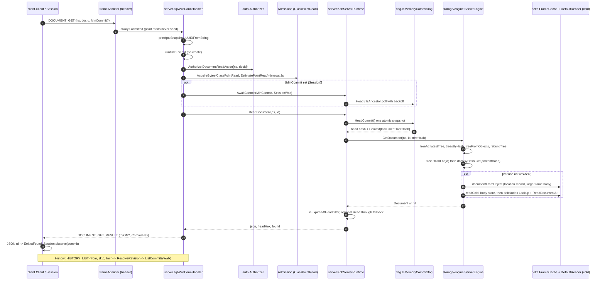

</details>

### Call chain

| # | Function (pkg.Type.Method) | File:line | What it does |
|---|---|---|---|
| 1 | `client.Client.GetJSON` / `getJSON` | `client/client.go:615` / `:621` | `DocumentGetMessage{Namespace, DocID, MinCommit}`; `Error` -> `classifiedError`; `JSON==nil` -> `ErrNotFound` with the head commit (`:643`). |
| 2 | `client.Session.GetJSON` / `observe` | `client/session.go:66` / `:50` | `MinCommit = s.token(ns)`; records the returned commit (also on `ErrNotFound`). |
| 3 | `client.Client.GetJSONWithHash` | `client/client.go:804` | `GetJSON` + locally computed content hash, the CAS token for `ReplaceIf` (whose check now runs on the server as a precondition). |
| 4 | Header admit | `server/frame_admission.go:54`, `server/admission.go:284` | `ClassPointRead` admitted in every zone. |
| 5 | `sqlWireConnHandler.handleDocumentGet` | `server/wire_listen.go:1397` | Auth; UUID; `runtimeFor(ns)` (`server/multi_commit.go:36`, no create); `Authorize(DocumentReadAction{ns, docId})` (failure -> `documentGetError`, no code, `:1414`); `EstimatePointRead` (`server/costmodel.go:351`) + `AcquireBytes` with `readAcquireTimeout=2s`; `AwaitCommit`; `rt.ReadDocument`; `ObserveDocSize` / `ObservePointReadActual`. |
| 6 | `KdbServerRuntime.AwaitCommit` | `server/session_token.go:38` | No-op for empty token; else `head==want || (HasCommit && IsAncestor)`, polled up to `sessionWait()` (`DefaultSessionWait=2s`), then `ReplicaBehindError`. |
| 7 | `KdbServerRuntime.ReadDocument` | `server/read_through.go:145` | `GetDocument`; on a miss in a filtered projection with `ReadThrough`, asks the source at `LastSource()` (`ReadThrough.Get` `:81`, bounded hoard). |
| 8 | `KdbServerRuntime.GetDocument` | `server/server_runtime.go:1032` | `DAG.HeadCommit()` (`dag/in_memory_commit_dag.go:211`, one atomic load); `Storage.GetDocument(ns, id, commit.DocumentTreeHash)`; `isExpiredAtHead` (`server/expiry.go:117`). |
| 9 | `ServerEngine.GetDocument` -> `treeAt` | `storage/engine/server_engine.go:521` -> `:228` | (1) `latestTree`; (2) `treesByHash`; (3) `treeFromObjects` (`tree_objects.go:631`); (4) `rebuildTree` (`restore.go:160`) -> `embed.rebuildTreeByFolding` (`embed/tree_rebuild.go:48`). Then `tree.HashFor(docID)` (trie, or mapped tree.file pages for the live tree). The parameter is named `atCommit` but is a tree hash. |
| 10 | Body fetch | `server_engine.go:532-554` | `docsByHash.Get`. Miss -> `documentFromObject` (`tree_objects.go:505`, objects strategy: location record -> `documentFromLargeFrame` (`large_frame_bodies.go:90`) or `documentFromLog`, which decodes only that document's writes from the frame via `readVersionFromFrame` (`cold_loader.go:104`) -> `DefaultReader.ReadDocumentAt` (`storage/delta/writer.go:1011`)); then `loadCold` (`:557`) -> `readCold` (`:569`): body store (`loadDocumentBody`, `document_bodies.go:64`) under history=none or external bodies, then `deltaColdLoader.load` (`cold_loader.go:62`: `deltaindex.Index.Lookup(contentHash)` from mapped per-segment sidecars plus the newest segment on the heap, catching up with the log on a miss). Hits re-admit to `docsByHash`. |
| 11 | Frame cache | `storage/engine/frame_reads.go:20`, `storage/delta/writer.go:1025` | `delta.FrameCache` in front of `ReadCommitAt`/`ReadDocumentAt`, keyed by segment incarnation; sized `ResolvedDeltaFrameCacheBytes`, re-cut with the namespace budget unless set explicitly. |
| 12 | `sqlWireConnHandler.execRead` (SQL read) | `server/wire_listen.go:846` | `KdbSession.ReadHead` (`session_manager.go:102`: pin for SNAPSHOT, else live head) or `crossReadHead` for another namespace's table; a continuation token replaces the head with its commit (`decodePageToken`, `server/sql_paging.go:53`); `ClassScan` grant (`:918`) sized from tree size, shape, `MaxResultRows`, `RowBudget`; executes and returns `ResolvedCommitHex`. Detail in flow 5. |
| 13 | `sqlWireConnHandler.handleHistoryList` | `server/history.go:34` | Auth; `runtimeFor`; `Authorize(DocumentReadAction{Namespace})`; `dag.HistoryNavigator` (`dag/history_nav.go:377`) else `UnsupportedError`; `ResolveRevision(from or "head")`; limit default 50, cap `maxHistoryLimit=1000` (`:32`); `ListCommits`. |
| 14 | `InMemoryCommitDag.ResolveRevision` | `dag/history_nav.go:294` | `ParseRevision` (`:254`) -> `ResolveRef` (`:197`) -> `NthAncestor` (`:122`, first-parent walk). |
| 15 | `InMemoryCommitDag.ListCommits` | `dag/history_nav.go:67` | `Walk(from, nil, skip+limit)` (`in_memory_commit_dag.go:844`), `CommitInfo` with `OperationCount=-1` for evicted ops; stubbed commits reported `(archived)`. Commits on the mapped graph are read from the file. |
| 16 | `client.Client.History` | `client/history.go:58` | `HistoryListMessage` -> `Commit` list. |
| 17 | `embed.DocumentAt` | `embed/document_history.go:42` | Embedded only: `GetCommit(at)` -> `Storage.GetDocument(ns, id, commit.DocumentTreeHash)`. |
| 18 | `embed.DocumentVersions` | `embed/document_history.go:72` | Embedded only: streams every segment and collects commits naming the document; O(whole log). |
| 19 | `embed.RevertTo` via `handleRevert` | `embed/revert.go:55`, `server/history.go:102` | Not a read: writes a commit restoring an old tree (not its attachments). Takes `writeGate.acquire(context.Background())` (`history.go:124`). |

### Data that changes

| Step | Structure / file / wire message | Mutation |
|---|---|---|
| Request | `DOCUMENT_GET` (0x14): `{Namespace, DocID, MinCommit}`; `HISTORY_LIST` (0x1F): `{Namespace, From, Skip, Limit}` (JSON or binary frames) | None on durable state. |
| Admission | `Admission.sem`, `CostModel` per-namespace doc-size estimate | Grant within the request; cost model learns sizes. |
| Cache | `treesByHash`, `docsByHash`, frame cache, `treeRebuilds` / `coldLoads` counters | A cold or historical read inserts trees, versions and frames into bounded caches and can evict others. A `latestTree` + `docsByHash` hit mutates nothing. |
| Cold index | `deltaindex` heap part for the newest segment; sidecars under `ns/<ns>/deltaidx/` | First miss in a segment may build that segment's sidecar (a writer writes it; a read-only runtime only reads existing ones). |
| Cold fallback | `ns/<ns>/delta/*.seg` frames, blob/SSTable body store | Read-only on disk. |
| Session | `KdbSession.readPin` + `dag.Pin` for SNAPSHOT | Changed only at transaction boundaries. |
| Hoard | `ReadThrough.lru/entries` | Projection read-through inserts fetched documents. |
| Reply | `DOCUMENT_GET_RESULT` (0x15): `{JSON *string, CommitHex, Error, ErrorCode, RetryAfterMs}`; `HISTORY_RESULT` (0x20) | `CommitHex` is the head read at, also when absent. |
| Client | `Session.seen[ns]` | Set on success or `ErrNotFound`. |

### Failure, edge cases & durability points

- **Reads have no durability dimension**; disk is touched only to read frames, SSTables, tree objects, mapped tree/graph segments, or to build a cold-index sidecar.
- **Reads see non-durable commits.** `HeadCommit()` sees the head published before the flush (flow 3); the returned `CommitHex` can name a commit a crash then loses. With bounded live bodies a just-written version can also be evicted after its frame is appended but before the fsync and re-read from the page cache: correct, but not a sign the commit is durable.
- **Read consistency.**
  - Point reads always read the live head; consistency across reads comes only from `MinCommit`.
  - `READ_COMMITTED` and `READ_YOUR_WRITES` SQL reads follow the live head (identical), and since they now bypass the per-session FIFO, a SELECT pipelined after the same session's COMMIT can run first and not see it. `SNAPSHOT` pins at transaction start and re-pins at commit/rollback, and stays ordered.
  - `parseReadConsistency` maps any unknown name to `ReadCommitted`.
- **At commit / ref.**
  - `DOCUMENT_GET` has no `atCommit` (`wire/document_ops.go:7-14`).
  - `query/hybrid` is still not on the server's SQL path; `wire/history_ops.go` and `embed/document_history.go` comments that describe `SQL_EXEC` "carrying AT COMMIT" are stale for the Go server.
  - Observation: a paging continuation is base64url JSON `{c: commit, o: offset, k: key, h: digest}` whose digest is an unkeyed truncated SHA-256 of the SQL text and parameters (`pageDigest`, `sql_paging.go:30`). A client can mint one naming any commit the DAG still holds and so run that SELECT at a historical commit, with only namespace-level `read`. Expired commits answer "continuation expired".
  - Otherwise old state over the wire is limited to a `SNAPSHOT` pin and `REVERT` (a write).
- **History retention limits.** Unretained hashes fail `ResolveRef`; stubbed commits resolve but cannot be walked; under `history=none` old commits are gone. `OperationCount` can be -1 for evicted ops. `Walk` bounded by `skip+limit`, cap 1000.
- **Auth/admission asymmetry.**
  - `DOCUMENT_GET` checks per-document `read` and takes a grant; `HISTORY_LIST` checks namespace-level `read` and takes no grant.
  - `DOCUMENT_GET` before authentication, and on an authorization failure, answers with plain error text and no `ErrorCode`, so the client cannot tell UNAUTHORIZED from any other failure.
- **Errors on point read.** Invalid UUID -> plain text. Admission -> classified (`RESOURCE_EXHAUSTED` cannot occur for point reads). `ReplicaBehindError` -> BUSY 250 ms. A corrupt attachment body (not a document) -> INTEGRITY. Storage errors -> INTERNAL. Expired or deleted -> `ErrNotFound`.
- **Cost of misses.** Live head: one atomic load, a trie lookup and a `docsByHash` hit. Under bounded live bodies a cold live version costs a location-record or deltaindex lookup plus one (cached) frame read that decodes only the requested document. A non-resident historical tree costs `treeFromObjects` or `rebuildTreeByFolding`, O(commits since the nearest resident ancestor); `rebuildTree` no longer holds an engine mutex across the fold (the mutex only guards reading the installed rebuilder), so concurrent historical reads can fold the same tree twice.
- **Projection read-through.** Falls through to the source at the last synced source commit; never commits locally; an unsynced projection answers "absent".
- **Doc vs code.** Older docs (`docs/kdb-lld-flows.md`) may describe `atCommit` on `DocumentGetMessage`; the Go struct has only `MinCommit`.
## 5. SQL query: wire request to result (SELECT, DML buffering, immediate statements, commit)

All paths are relative to `go/kdb/`. Line numbers are from commit e79bb674 (2026-10-23).

### Description (short)

A client sends a `wire.SqlExecMessage` over the SQL wire listener. `server.sqlWireConnHandler` parses it, classifies it, resolves which namespace's runtime the statement targets (cross-namespace routing), authorizes it, and then takes one of four routes:

- **SELECT or DDL**: `execRead` resolves the read head (or, for a paged request with a continuation token, the commit the first page read at), takes a scan-class memory grant sized from a candidate estimate (SELECT only), builds a `sql.QueryContext` and calls `sql.Engine.Execute`. The engine re-parses, plans (validation only) and runs `Executor.ExecuteSelect`, which picks, in order: a table-less answer; a page; a COUNT(*)-only answer from tree or index counters; a bounded top-k for `ORDER BY ... LIMIT` (composite BTREE walk, single-field BTREE walk, or a heap over the access path); otherwise an access path (search ranking, `kdb_id` key lookup, the cheapest index-servable conjunct, an OR served as a union of index lookups, or a full scan that applies the residual WHERE as it reads). It then sorts, groups, projects and limits. A result over `MaxResultRows` (10_000) is an error (`ResultRowLimitError`), not a truncation; a reply over `MaxResultBytes` (15 MiB) is an error unpaged, or ends a page early when paged. `EXPLAIN [ANALYZE] SELECT` runs the query and returns one row (plan label, rows, rows examined, docs read).
- **Buffered DML** (INSERT / UPDATE / DELETE without the claim or upsert clauses): `execDML` calls `sql.Engine.ExecuteDML`, which only lowers the statement to `document.Op`s (writes, deletes, attachment puts/deletes); they are appended to the session's pending `transaction.Builder`. Nothing is written until `COMMIT` / `TX_COMMIT`.
- **Immediate statements** (5a, 5b): an `UPDATE` with `ORDER BY`, `LIMIT` or `RETURNING` (a queue claim) or an `INSERT` with `ON CONFLICT` or `RETURNING` (an upsert) is not buffered. `execImmediate` runs it as its own auto-committed transaction whose operations are decided at the front of the write gate against the live head (`KdbServerRuntime.CommitImmediate`), so it can neither conflict nor double-claim.
- **COMMIT**: `commitSession` builds the `document.Transaction` and calls `KdbServerRuntime.Commit` -> `runTransaction` -> `commitAtGateFront` (index preparation, `transaction.Engine.Commit`, change log, index apply, `PersistAsync`, gate release, index bookkeeping, durability wait). That part belongs to flows 3 and 6.

**Frame concurrency.** Frames on one connection run concurrently, bounded by `MaxInFlightFrames` and by reply bytes waiting to be written. Frames naming a session run in arrival order per session, **except** a plain `SELECT` on a non-SNAPSHOT session (`readsNoSessionState`), which does not wait behind its session's earlier frames.

**Result bound / scan cap (current tree).** The silent truncation described in the 2026-10-11 version of this flow is gone. Three bounds now apply, and each one fails loudly instead of truncating:
1. **Rows returned**: `KdbServerRuntime.MaxResultRows` (default `DefaultMaxResultRows = 10_000`, `server_runtime.go:1219`), passed as `QueryContext.MaxRows` and enforced on the final rows by `Executor.executeSelect` (`ResultRowLimitError`, `sql/executor.go:1523`). Candidate id lists and scans are **not** cut by it (`conjunctPath` comment at `:937`; `fullScan` doc comment `:1444`). A scan may stop early (`stopAt`) only when nothing filters or orders after it: `want = MaxRows+1` or `LIMIT+OFFSET`, which lets it detect overflow without reading the namespace.
2. **Rows examined**: `RowBudget` (`DefaultScanRowBudget = 1_000_000`, `admission.go:100`, shrinking under memory pressure, `Admission.ScanRowBudget`, `:157`) -> `ScanRowBudgetExceededError`. Enforced in `fullScan`, `materializeUpTo` (residual only), `topKDocs` and the BTREE walks.
3. **Bytes**: `RetainedLimit = Admission.MaxQueryBytes` (`admission.go:391`) charged as the executor retains rows -> `sql.RetainedLimitError` (`sql/estimate.go:39`); reply bytes capped by `MaxResultBytes` (`DefaultMaxResultBytes` = 16 MiB frame - 1 MiB, `server/reply_bounds.go:42`) -> `ReplyTooLargeError`. All of these classify as `RESOURCE_EXHAUSTED` (`server/error_classification.go:63-87`).

### Diagram


<details><summary>Mermaid source</summary>

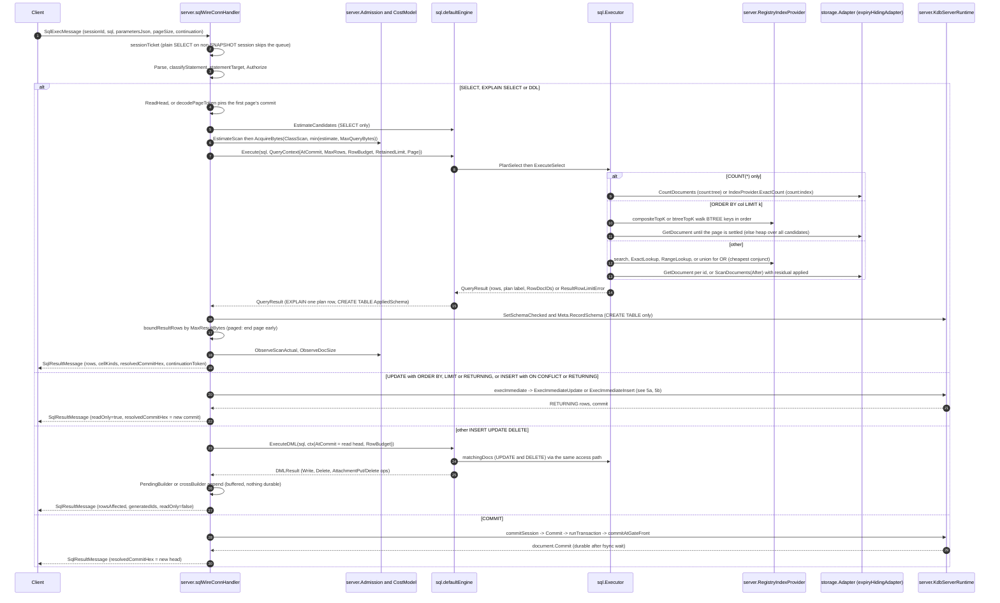

</details>

### Call chain

| # | Function (pkg.Type.Method) | File:line | What it does |
|---|---|---|---|
| 1 | `server.sqlWireConnHandler.run` | `server/wire_listen.go:220` | Per-connection read loop. Before the handshake, frames run inline in order. After it, each frame takes a per-session FIFO ticket on the reader goroutine (`sessionTicket`, `:297`), a slot of `MaxInFlightFrames`, and a reply-bytes reservation (`h.replies.reserve`), then runs `dispatchAndSendReserved` (`:273`) in a goroutine. `h.replies.waitBelowLimit()` stops reading new frames while too many reply bytes are unsent (TCP backpressure). All sessions are closed on exit (`closeAllSessions`, `:404`). |
| 2 | `server.sqlWireConnHandler.readsNoSessionState` / `isPlainSelect` | `server/wire_listen.go:336`, `:347` | A `SqlExecMessage` whose text literally starts with `SELECT` on a session that is not `Snapshot` gets an already-closed ticket, so it runs concurrently with the session's other frames. SNAPSHOT sessions, DML, transaction control, `EXPLAIN` and anything else stay ordered. |
| 3 | `server.sqlWireConnHandler.dispatchAndSendReserved` -> `dispatchRecovering` -> `dispatch` | `server/wire_listen.go:273`, `:454`, `:506` | `dispatchRecovering` is now on the listener path too: a handler panic becomes a typed `INTERNAL` reply. `encodeReplyOrError` turns a reply that will not encode (over the frame limit) into a typed error of the same reply type. Encoding uses `replyCodec` (`:428`): the codec negotiated at handshake (`negotiated.Store(dc.WithWireFeatures(...))`, `:585`, binary frames when both sides advertise them) or the default. `dispatch` sends `SqlExecMessage` to `handleSqlExec`. |
| 4 | `server.sqlWireConnHandler.handleSqlExec` | `server/wire_listen.go:687` | Looks up the session, parses (`h.parser.Parse`), short-circuits BEGIN/COMMIT/ROLLBACK to `execTransactionControl` (`:1291`), classifies (`classifyStatement`, `:830`), resolves the target (`statementTarget`), authorizes `auth.SqlExecAction{Namespace, ReadOnly: isSelect}` against the target runtime, decodes `ParametersJSON` (`decodeParametersJSON`, `:1707`), then routes: SELECT/DDL -> `execRead`; `sql.ImmediateUpdate(stmt)` -> `execImmediate` with `ExecImmediateUpdate`; `sql.ImmediateInsert(stmt)` -> `execImmediate` with `ExecImmediateInsert`; else `execDML`. |
| 5 | `sql.DefaultParser.Parse` / `rdParser.parseStatement` | `sql/parser.go:25`, `:54` | Accepts `SELECT`, `EXPLAIN [ANALYZE] SELECT` (`StmtSelect{Explain:true}`), INSERT, UPDATE, DELETE, CREATE TABLE/[UNIQUE] INDEX, DROP INDEX, BEGIN/COMMIT/ROLLBACK. New syntax since 2026-10-11: `x IS [NOT] MISSING` (parsed to `exists(x)`, `:825`), `CASE` (`parseCase`, `:1121`), `COALESCE`, `EXISTS`, `ALL_VALUES` (evaluated in `sql/predicate.go:474-495`), UPDATE `REMOVE path, ...` (`parseUpdateChanges`, `:467`), UPDATE `ORDER BY / LIMIT / RETURNING` (`parseUpdate`, `:434`), INSERT `ON CONFLICT (cols) DO NOTHING | DO UPDATE SET ... [REMOVE ...] [WHERE ...]` (`parseOnConflict`, `:522`) and `RETURNING` (`parseInsert`, `:373`). |
| 6 | `server.classifyStatement` | `server/wire_listen.go:830` | `StmtSelect` -> read; `StmtCreateTable / StmtCreateIndex / StmtDropIndex` -> DDL; everything else DML (fail-closed). |
| 7 | `server.sqlWireConnHandler.statementTarget` | `server/sql_cross_namespace.go:52` | `sql.TargetTable(stmt)` (`sql/model.go:99`). A dotted name (`bank.ledger`) routes to namespace `bank/ledger`. An undotted name routes to `<session catalog>/<table>` **when that namespace exists**, else stays on the session's namespace (so `FROM docs` reads a sibling namespace `<catalog>/docs` if one exists). Without a `NamespaceSet` it keeps the session's runtime. |
| 8 | `server.KdbSession.ReadHead` / `crossReadHead` | `server/session_manager.go:102`, `server/sql_cross_namespace.go:104` | SNAPSHOT sessions read at the pin fixed at transaction start (cross-namespace: pinned at first touch); READ_COMMITTED and READ_YOUR_WRITES read the live head. A SELECT never reads `sess.Pending`, so buffered DML is invisible to later SELECTs in the same session. |
| 9 | `server.sqlWireConnHandler.execRead` | `server/wire_listen.go:846` | Resolves the head. Paging: `PageSize > 0` or a `Continuation` builds a `sql.PageRequest`; a token is decoded by `decodePageToken` (`:871`, `server/sql_paging.go:53`; checks a digest of SQL+params) and refused with "continuation expired" if the DAG no longer has the commit. For a SELECT with admission: `ScanEstimateInput{Shape, TreeSize: treeSizeAt(head), MaxRows: MaxResultRows(), RowBudget, PageSize, Candidates}`, where `Candidates` comes from `sql.CandidateEstimator.EstimateCandidates` (`:907`, `sql/estimate.go:14`); `EstimateScan` (`:912`); `AcquireBytes(2s, ClassScan, min(estimate, MaxQueryBytes))` (`:918`). Builds `QueryContext{NamespaceID, Schema, AtCommit, Parameters, MaxRows, RowBudget, Stats, Page, RetainedLimit}` and calls `rt.SQLEngine().Execute` (`:944`). |
| 10 | `server.CostModel.EstimateScan` / `structuralScanLocked` | `server/costmodel.go:281`, `:308` | Tier 1: learned p95 per (namespace, fingerprint, tree size). Tier 2: `CountOnly` shapes cost the class base only; rows = `TreeSize`, lowered to the index candidate estimate when known; ORDER BY/aggregate shapes capped by `RowBudget`, streaming shapes by `min(MaxRows, LIMIT, PageSize+1)`; times p95 doc bytes times copies. `ShapeOfSelect` is `sql/shape.go:53`. |
| 11 | `server.Admission.AcquireBytes` | `server/admission.go:331` | Memory-zone check (`MemoryPressureError` -> BUSY), `ResourceExhaustedError` if cost exceeds capacity, else semaphore acquire (`BusyError` after 2 s). |
| 12 | `server.KdbServerRuntime.SQLEngine` / `rebuildSQLEngineLocked` | `server/server_runtime.go:363`, `:399` | Engine over `expiryHidingAdapter` (`server/expiry.go:199`) and the index provider; `sql.SetAttachmentBlobs` wires attachment bytes. |
| 13 | `sql.defaultEngine.Execute` | `sql/engine.go:90` | Parses a second time. `StmtSelect` -> `PlanSelect` + `ExecuteSelect`; with `Explain`, runs the same and returns `explainResult` (`:197`: columns `plan, rows, rows_examined, docs_read`). CREATE TABLE -> `QueryResult{AppliedSchema}`; CREATE/DROP INDEX -> `IndexDDLExecutor` (Flow 8); INSERT/UPDATE/DELETE -> planning error. |
| 14 | `sql.DefaultPlanner.PlanSelect` | `sql/planner.go:23` | Validation only (`validateSelect`, `:77`; table-less `validateTablelessSelect`, `:142`); returns the whole WHERE as `residual`. Access-path choice is in the executor. |
| 15 | `sql.Executor.ExecuteSelect` / `executeSelect` | `sql/executor.go:38`, `:49` | Order: table-less -> `executeSingleRowSelect` (`:755`); `ctx.Page` -> `executePage`; `resolveSearches`; `ORDER BY kdb_id` (asc) on an `OrderedScanner` sets keyset mode and a lower bound from `kdb_id > '<uuid>'` (`kdbIDLowerBound`, `:1371`); compute `stopAt`; `tryCountOnly`; `topKEligible` -> `topKDocs`; else `chooseAccessPath`, `materializeUpTo`, `plainRows`/`groupedRows`, `distinctRows`, `applyLimitOffset`; then `ResultRowLimitError` if `len(rows) > MaxRows`, `addRetained`, `overRetainedLimit`. |
| 16 | `sql.Executor.executePage` / `keysetEligible` | `sql/executor.go:236`, `:301` | Runs the ordinary pipeline for `size+1` rows (size capped at `MaxRows-1`). Keyset paging (no ORDER BY other than `kdb_id`, no DISTINCT/GROUP/OFFSET, an `OrderedScanner`) continues after the last row's document id; otherwise by offset. `More` is set when the extra row exists. The server mints the continuation (`encodePageToken`, `server/wire_listen.go:1026`) after the byte cap, so the next page starts at the first row that did not fit. |
| 17 | `sql.Executor.tryCountOnly` / `countFromCounters` / `countByStreaming` | `sql/executor.go:327`, `:365`, `:397` | Only for projections that are all bare `COUNT(*)`, no GROUP/DISTINCT/OFFSET. No WHERE: `storage.DocumentCounter.CountDocuments` (label `count:tree`). WHERE an AND of string/bool equalities or IN lists: `countByIndex` (`:548`, `ExactCounter.ExactCount`), minus documents the storage hides that the index still holds (`HiddenDocumentLister`; label `count:index`). Otherwise streaming through the access path, keeping nothing. |
| 18 | `sql.topKEligible` / `Executor.topKDocs` | `sql/topk.go:19`, `:72` | `ORDER BY` (not `kdb_id`) + `LIMIT`, not grouped or DISTINCT, `LIMIT+OFFSET <= 100_000`. Tries `compositeTopK`, then `chooseIndexPath` + `btreeTopK`; else a size-k heap over the index ids or a full scan. Documents read by a walk that gave up are reused (`fetched`). |
| 19 | `sql.Executor.compositeTopK` | `sql/composite_topk.go:176` | `WHERE a='x' AND b='y' ... ORDER BY c [ASC|DESC] LIMIT k` on a composite BTREE (a, b, c): walks the keys under the prefix in c's order, like a Cassandra clustering key, reading irregular-key documents first, and stops when the page is settled. Declines when the index cannot serve the commit exactly; `markIndexBehind` records that for the claim retry. Label `index:<name>+order(c asc|desc)`. |
| 20 | `sql.Executor.btreeTopK` / `btreeTopKWalk` | `sql/ordered_topk.go:304`, `:309` | Single-field BTREE on the first ORDER BY column (ascending only): walks key groups (unfiled, NULL, numeric, string) and stops before a group whose bound exceeds the k-th kept row. Gives up when more than half the candidates are unfiled, when there are more than `maxOrderedCandidates` (2^21, `:239`), or when it has walked more than `walkEntriesPerCandidate` (4, `:233`) entries per candidate (label `...+topk(order(f) abandoned)`). Success label `index:...+order(f)`. |
| 21 | `sql.Executor.chooseAccessPath` / `chooseIndexPath` / `conjunctPath` | `sql/executor.go:847`, `:866`, `:882` | (a) ORDER BY leading with a search score -> `rankedIDs`; (b) per top-level AND conjunct: a search conjunct -> ranking; `kdb_id = c` / `kdb_id IN (...)` -> `keyLookup` (`:1229`, label `keylookup`, needs no index); other servable conjuncts are **ranked by estimated size** (`estimateConjunct`, `:991`, via `ExactCounter`), cheapest first, and the smallest id list wins; (c) else `fullScan` with the residual applied during the scan. The id list is not truncated. |
| 22 | `sql.Executor.indexLookup` / `orLookup` | `sql/executor.go:1122`, `:966` | `col OP const`, `BETWEEN`, `IN` as before. An OR is served as the deduplicated union of each disjunct's own `conjunctPath` (search conjuncts not allowed inside an OR), sorted by id, label `index:or(a|b)`; one disjunct with no path makes the whole OR a scan. |
| 23 | `server.RegistryIndexProvider.ExactLookup` / `ExactCount` / `RangeLookup` | `server/index_provider.go:117`, `:138`, `:166` | HASH preferred over BTREE for equality; range needs a BTREE and is served as a closed interval. `index.ErrHistoryUnavailable` (the index no longer holds the read commit's history) -> `ok=false`, so the executor falls back to the documents instead of failing. |
| 24 | `sql.Executor.fullScan` | `sql/executor.go:1452` | `ScanDocuments` (or `OrderedScanner.ScanDocumentsAfter` in keyset mode); per document counts examined and doc bytes, `ScanRowBudgetExceededError` past `RowBudget`, applies the residual, charges retained bytes (`overRetainedLimit`), stops with `errScanComplete` at `stopAt` (> 0 only when nothing after the scan needs every row). |
| 25 | `sql.Executor.materializeUpTo` | `sql/executor.go:1315` | `GetDocument` per id at the read commit's tree; row budget applies when a residual exists; skips missing docs; residual on every fetched doc; stops at `stopAt`. |
| 26 | `sql.Executor.plainRows` / `groupedRows` / `applyLimitOffset` | `sql/executor.go:612`, `:663`, `:817` | Sort (stable, alias-aware), group, project; an ungrouped aggregate ignores LIMIT on its input. |
| 27 | `server.sqlWireConnHandler.execRead` (tail) | `server/wire_listen.go:952-1029` | CREATE TABLE: `Meta.Local` { `SetSchemaChecked`, `RecordSchema` or roll back } (Flow 8). `rowsToStrings` (`:1637`) now also returns per-cell `wire.CellKind`s (`cellKind`, `:1657`), so NULL, numbers, bools, JSON and bytes (base64) are typed on the wire. `boundResultRows` (`reply_bounds.go:74`) against `MaxResultBytes` (`:976`): unpaged or a single oversized row -> `ReplyTooLargeError`; paged -> truncate the page and set `More`. `ObserveScanActual` / `ObserveDocSize` (`costmodel.go:390`, `:368`). |
| 28 | `server.sqlWireConnHandler.execDML` | `server/wire_listen.go:1045` | Resolves the read head; `QueryContext{AtCommit, NamespaceID, Schema, Parameters, RowBudget}` (no `MaxRows`; DML is not row-bounded); `ExecuteDML` (`:1067`); appends `WriteOp`, `DeleteOp`, `AttachmentPutOp`/`AttachmentDeleteOp` to `PendingBuilder` (`session_manager.go:371`) or `crossBuilder` (`sql_cross_namespace.go:135`). Reply `ReadOnly:false`, `ResolvedCommitHex = builder.BaseVersion`. |
| 29 | `sql.defaultEngine.ExecuteDML` | `sql/engine.go:141` | INSERT: refuses an immediate INSERT ("runs only as its own statement on a server session"), else `ExecuteInsert`. UPDATE: `ExecuteUpdateAmong(upd, ctx, nil)`. DELETE: `ExecuteDelete`. Attachment errors from `ctx.attach` surface here. |
| 30 | `sql.DMLExecutor.ExecuteInsert` / `insertRow` | `sql/dml.go:22`, `:51` | Per row: a random id, or the `kdb_id` column value **only** for an immediate INSERT (a buffered one is refused, because it would merge silently into an existing document); body via `assignPath`; schema validated; attachment ops appended. |
| 31 | `sql.DMLExecutor.ExecuteUpdateAmong` / `updateTargets` / `checkUpdate` | `sql/dml.go:108`, `:216`, `:170` | Targets: `among` ids (materialized with the WHERE), or `topKDocs` when ORDER BY + LIMIT, or `matchingDocs` (`sql/executor.go:1409`); sorted by ORDER BY, cut to LIMIT. Applies SET (`assignPath`), then REMOVE (`removePath`, `:348`), validates, emits `WriteOp{Patch: full new JSON, Replace: len(Removes) > 0}` (a patch is merged; one that removes fields must replace). RETURNING projects the document as it is after the update. |
| 32 | `server.sqlWireConnHandler.commitSession` | `server/wire_listen.go:1116` | Decodes `TransactionBytes` or builds `Pending`; `ValidateFences` (`:1143`); cross-namespace writes -> `commitSessionAcross` (`:1182`); else `AssertUnheldByOthers` (`:1154`), `srv.Commit` (`:1157`), `ClearPending`, `ConflictError` -> `conflictReport` (`:1471`); success -> `startTransactionAt(commit.Hash)`. |
| 33 | `server.KdbServerRuntime.Commit` -> `commitWith` -> `clientWrite` -> `runTransaction` -> `commitAtGateFront` | `server/server_runtime.go:670`, `:746`, `:757`, `:825`, `:889` | `admitWrite`, pins, write grant, write gate; then at the gate front: `prepareIndexes`, `engine.Commit`, `changes.record` (`:905`), `preparedForStored` + `commitToIndexes`, `PersistAsync` (`:928`), `releaseNow()`, `indexProvider.maintain()` (bookkeeping after the gate is released), `waitDurable` (`:940`), `CommitListener`, `notifyHeadWatchers`. Flows 3, 6 and 8. |

#### 5a. Queue claim: `UPDATE ... [WHERE] [ORDER BY] [LIMIT n] [RETURNING ...]`

An UPDATE carrying any of ORDER BY, LIMIT or RETURNING is `Immediate` (`sql/model.go:143`). It is MongoDB's `findOneAndUpdate`: it picks documents, writes them and commits in one step, so two concurrent claims cannot take the same document and a claim never gets a version conflict. To keep the work done under the write gate small, it finds candidates before the gate and only re-checks under it.


<details><summary>Mermaid source</summary>

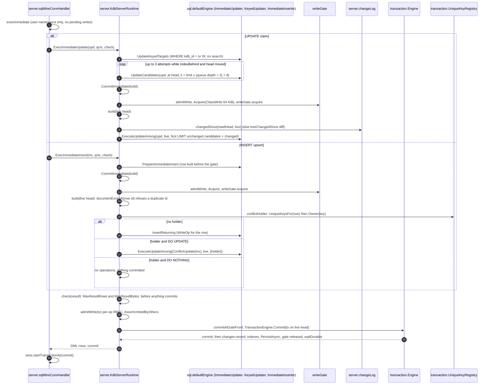

</details>

| # | Function (pkg.Type.Method) | File:line | What it does |
|---|---|---|---|
| a1 | `server.sqlWireConnHandler.execImmediate` | `server/wire_listen.go:760` | Refuses a statement routed to another namespace and one sent while the session has pending writes (`hasPendingWrites`, `:766`): it commits alone and cannot take the open transaction with it. Builds `QueryContext{MaxRows: MaxResultRows, RowBudget}` (no AtCommit). `check` refuses a result over `MaxResultRows` (`ResultRowLimitError`) or `MaxResultBytes` (`ReplyTooLargeError`) **before** the commit, so a claim whose reply could not be sent does not take the documents. On success `startTransactionAt(commit.Hash)`. Reply `ReadOnly:true` (the client must not send a TX_COMMIT), `ResolvedCommitHex = commit hash` (or the live head when nothing was written). |
| a2 | `server.KdbServerRuntime.ExecImmediateUpdate` | `server/immediate_update.go:80` | Keyed path: `KeyedUpdater.UpdateKeyedTargets` (`sql/immediate_keyed.go:19`): a top-level `kdb_id = c` or `kdb_id IN (...)` names the only possible targets, so there is no candidate search and no change check. Narrow path (LIMIT > 0): up to 3 attempts (`maxCandidateRetries = 2`) of `UpdateCandidates` at the current head with that head's tree pinned, retried at a newer head when `ExecStats.IndexBehind` says an index walk could not serve the head it read (claims committed in between); then `CommitImmediate`. No LIMIT and not keyed: `among = nil`, the statement is evaluated in full under the gate. |
| a3 | `sql.DMLExecutor.UpdateCandidates` | `sql/dml.go:259` | Runs `SELECT kdb_id ... WHERE ... ORDER BY ... LIMIT k` through `ExecuteSelect` (so composite/BTREE top-k serve it), `MaxRows >= k`; `complete = len(ids) < k`. `k = limit x (WriteQueueDepth + 2) + 8`, at most `limit + 1024` (`immediateCandidateCount`, `immediate_update.go:169`). |
| a4 | `server.KdbServerRuntime.CommitImmediate` | `server/immediate_update.go:272` | `admitWrite(empty tx)`; inside `clientWrite`: `admission.Acquire(ClassWrite, 64 KiB)`, `writeGate.acquire`; reads the live head; `build(head)`; no ops -> commit nothing; mints a tx on `BaseVersion = head`, `admitWrite(tx)` (per-op RBAC), `DocumentLocks.AssertUnheldByOthers`, then `commitAtGateFront` with `TransactionEngine.Commit`. Shared by claims and upserts. |
| a5 | `server.KdbServerRuntime.immediateAmong` / `changedSince` | `server/immediate_update.go:180`, `:214` | Under the gate: documents changed between the candidate head and the live head come from `changeLog.changedSince` (`server/change_log.go:78`; recorded by `commitAtGateFront` for single-parent commits whose ops all name documents; 4096 commits kept), else `treeChangedSince` (`DiffTrees`, more than 4096 changes -> give up). `among` = the first LIMIT unchanged candidates + every changed doc; too few candidates and not `complete` -> nil (evaluate in full). |
| a6 | `sql.DMLExecutor.ExecuteUpdateAmong` | `sql/dml.go:108` | As row 31, with `among`: every id is re-read and re-checked against the WHERE at the live head, ordered, cut to LIMIT. |

#### 5b. Upsert: `INSERT ... ON CONFLICT (cols) DO NOTHING | DO UPDATE SET ... [REMOVE ...] [WHERE ...] [RETURNING ...]`

| # | Function (pkg.Type.Method) | File:line | What it does |
|---|---|---|---|
| b1 | `server.KdbServerRuntime.ExecImmediateInsert` | `server/immediate_insert.go:49` | Needs an engine that is both `ImmediateInserter` and `ImmediateUpdater`. Builds the row before the gate (`PrepareImmediateInsert`, `sql/upsert.go:43`; exactly one VALUES row, no attachments; the conflict columns must be those of a unique constraint, `conflictTuple`, `:85`). With ON CONFLICT it refuses when the runtime has no `UniqueKeys` or `UniqueKeyRebuildError` is set ("no holder" would not be exact). Under the gate (`CommitImmediate`): `documentExistsAt(live, row.ID)` -> "kdb_id already exists"; `conflictHolder`; insert, update the holder (`ConflictUpdate`, `sql/upsert.go:104`, passes RETURNING through), or do nothing. |
| b2 | `server.KdbServerRuntime.conflictHolder` | `server/immediate_insert.go:124` | `transaction.UniqueKeysFor(row)` keys of the conflict tuple -> `UniqueKeys.Owner`. An array part is multikey; elements owned by two different documents -> "ON CONFLICT row matches more than one document". An absent or null part claims nothing. Exact because every commit updates the registry before the gate moves on. |
| b3 | commit-time unique check | `transaction/unique_registry.go` (flow 6/8) | Still runs on the upsert's commit: a row colliding on another constraint than the conflict target is refused (as PostgreSQL). |

### Data that changes

| Step | Structure / file / wire message | Mutation |
|---|---|---|
| SELECT (any) | `wire.SqlExecMessage` in; `wire.SqlResultMessage` out | Request adds `pageSize`, `continuation`. Reply adds `cellKinds` (typed cells) and `continuationToken`; still `columns`, `rows`, `rowsAffected`, `resolvedCommitHex`, `readOnly`, `generatedIds`, `error`/`errorCode`/`retryAfterMs`. |
| Paging | continuation token (`server/sql_paging.go:40`) | Not stored server side: encodes the commit, rows returned so far, the last document id (keyset), and a digest of SQL + params. Unsigned; the commit is not pinned between pages, so a reclaimed commit gives "continuation expired". |
| SELECT admission | `Admission` semaphore and counters | Reserved `min(estimate, MaxQueryBytes)` bytes for the query; released by `defer grant.Release()`. |
| SELECT learning | `CostModel.cells`, `docSizes` | `ObserveScanActual`, `ObserveDocSize`. In memory. |
| SELECT execution | `sql.ExecStats` | `RowsExamined`, `DocsRead`, `DocBytesRead`, `RetainedBytes`, `IndexBehind`. No persistent state changes. |
| Connection | `sqlWireConnHandler.replies`, `sessionTails` | Reply-byte reservations and per-session FIFO tails. |
| CREATE TABLE / CREATE/DROP INDEX | schema, unique registry, index registry, `_kdb/meta` | Flow 8. |
| Buffered DML | `KdbSession.Pending` or `cross[ns].builder` | `Write` / `Delete` / `Append(attachment op)`. Memory only; dropped with the connection. |
| Immediate statement | one commit on the live head; `changeLog`; `UniqueKeyRegistry`; session anchor | A full transaction, durable before the reply (under `DurabilitySync`); `startTransactionAt(commit)`. Nothing buffered. |
| COMMIT | transaction, documents, DAG, uniques, index stores, change log, delta log, session | As flows 3 and 6. |

### Failure, edge cases & durability points

**Durability.**
- A SELECT or a buffered DML statement writes nothing. The durable boundary is `commitAtGateFront`: `PersistAsync` (`server_runtime.go:928`) under the gate, gate released, `waitDurable` (`:940`). Immediate statements cross that same boundary before their reply. If `preparedForStored` or `commitToIndexes` fails after `engine.Commit` succeeded, the caller gets an error although the commit is in the in-memory DAG and has not been queued for persistence (`:911`, `:915` return before `:928`). Still not compensated.

**Bounds.**
- The silent truncation is retired: a non-indexed selective WHERE, `UPDATE`/`DELETE ... WHERE`, ORDER BY and aggregates now see every candidate. A result of more than `MaxResultRows` rows fails with `RESOURCE_EXHAUSTED` ("add a LIMIT or a more selective predicate"). Buffered UPDATE/DELETE have no row bound, only the row budget.
- `kdb_id = '<uuid>'` / `IN (...)` is a key lookup again (`keyLookup`), with no index needed.
- An unpaged result over `MaxResultBytes` fails (`ReplyTooLargeError`, remedy "page it (pageSize), add a LIMIT, or select fewer columns"); a paged one ends the page early. A single row over the limit fails even when paged.
- The row budget is now reachable from the wire: scans are no longer stopped at 10_000, so a WHERE on a namespace over `RowBudget` documents with no index path fails with `ScanRowBudgetExceededError`.
- Admission still sizes `ORDER BY ... LIMIT` as a blocking shape (`min(TreeSize or candidates, RowBudget)` rows), although top-k holds at most k. The grant is capped by `MaxQueryBytes`, and `RetainedLimit` enforces the real bound as rows are retained.

**Immediate statements.**
- They run only on the session's own namespace and only with no pending writes. Inside `BEGIN ... COMMIT` they still commit on their own; they are not part of the open transaction.
- A claim with no LIMIT that is not keyed (`UPDATE ... SET ... RETURNING` without LIMIT, or ORDER BY alone) evaluates its whole WHERE under the write gate (`among = nil`), which holds every writer on the namespace for the scan.
- The candidate search runs before the gate, at a head pinned by `pinBaseTree`; under the gate the decision is exact (unchanged non-candidates rank behind every candidate). When the change log and tree diff cannot say what changed (merge commit, peer commits, more than 4096 changes), the statement is evaluated in full under the gate: correct, but slow.
- `check` runs before the commit: an oversized RETURNING aborts the claim and nothing is written.
- An upsert refuses a `kdb_id` that already exists (it only inserts or updates the conflict holder). ON CONFLICT is unavailable while `UniqueKeyRebuildError` is set.
- The control-plane SQL console (`control/data.go:363` `runDML`) does not know immediate statements: an `UPDATE ... ORDER BY ... LIMIT ... RETURNING` there is lowered by `ExecuteDML` and committed as an ordinary transaction on the head it read (it can conflict, and the RETURNING rows are discarded); an immediate INSERT is refused by `ExecuteDML`.

**Errors surfaced to the client.** `SqlResultMessage{Error, ErrorCode?}`: unknown session; `ParseError`/`PlanningError` (no code); `AuthorizationError` from `handleSqlExec` still goes through `sqlResultError` (text only, no `UNAUTHORIZED` code); `statementTarget` errors are classified; BUSY for memory pressure and a grant wait over 2 s; RESOURCE_EXHAUSTED for `ResourceExhaustedError`, `ScanRowBudgetExceededError`, `RetainedLimitError`, `ReplyTooLargeError`, `FrameTooLargeError`, `ResultRowLimitError`; "continuation expired" / digest mismatch for a bad token (no code); `ConflictError` on COMMIT -> conflict report; panics -> `INTERNAL` on every path (`dispatchRecovering` now wraps the listener path).

**Other edge cases.**
- Double parse: the server parses to classify and the engine parses `msg.SQL` again.
- Concurrent SELECTs on one READ_COMMITTED session can complete out of order relative to the session's earlier DML/COMMIT frames: a SELECT sent after a COMMIT on the same session may run before that COMMIT finishes and not see it. This is deliberate (`readsNoSessionState` comment); SNAPSHOT sessions keep strict order.
- Unqualified table routing: on a server with a `NamespaceSet`, `FROM docs` reads namespace `<catalog>/docs` if it exists, not the session's namespace. This is intended (see the memory note on the routing trap), but it can surprise.
- DDL runs on the read path with `ReadOnly:false` authorization, no memory grant and no write gate.
- Expiry: reads at the live head skip expired documents via `expiryHidingAdapter`; COUNT from counters subtracts what the expiry index hides (`HiddenDocumentLister`).
- Cell typing: `cellKinds` now distinguishes NULL from the empty string; the `rows` strings are unchanged (NULL is still `""`, bools `"1"/"0"`, bytes base64).
- The control-plane console (`control/data.go:197` `handleSQL`, `runSelect` `:275`) sets `MaxRows = limit` (<= 2000), so a result larger than `limit` now fails with `ResultRowLimitError` instead of being truncated; its `truncated: len(rows) >= limit` flag is therefore only true when exactly `limit` rows came back. **CREATE TABLE through the console still discards `AppliedSchema`** (`runDDL`, `control/data.go:344`).
- `SEARCH` frames remain a separate sessionless path (`server/search.go:41` -> `RegistryIndexProvider.Search`, `server/index_provider.go:634`, `defaultSearchLimit = 50`, `:723`).

---


## 6. Transaction, including the cross-namespace commit group

Paths are relative to `go/kdb/` unless noted. Line numbers are from `origin/main` at `e79bb674`.

### Description (short)

A client opens a session, buffers writes (SQL DML or a pre-encoded transaction), and commits. A single-namespace commit goes through `KdbServerRuntime.runTransaction` -> `commitAtGateFront`: admission, a per-runtime write gate, index preparation, `transaction.defaultEngine.Commit` (check, stage, append to the in-memory DAG), index apply, then the commit is queued on the namespace's commit log, the gate is released, the index stores' bookkeeping (`RegistryIndexProvider.maintain`) runs outside the gate, and the client is acknowledged once the batch is fsynced. A commit that touches several namespaces (SQL naming a second namespace, or the `TX_COMMIT_MULTI` wire op) runs the same check/apply split through `embed.CommitGroup`: every participant is locked in namespace order, every participant is *prepared* (all checks, nothing written), then each part is appended as a **provisional** commit whose message carries a group marker (`kdb:xns/1 host=... epoch=... group=... parts=...`). The group becomes atomic only when a 20-byte record naming the group id is fsynced into the per-epoch decision log. On open, any part whose group has no decision record is dropped (with its descendants).

Since the 2026-10-11 trace:
- **Immediate statements commit on their own.** `UPDATE ... ORDER BY / LIMIT / RETURNING` (queue claim) and `INSERT ... ON CONFLICT / RETURNING` (upsert) are not buffered on the session: `handleSqlExec` routes them to `execImmediate` (`server/wire_listen.go:760`), which refuses them while the session has pending writes, and they commit through `KdbServerRuntime.CommitImmediate` (`server/immediate_update.go:272`), whose operations are decided at the front of the write gate against the live head and then go through the same `commitAtGateFront`. The SQL side (claim gate, keyed UPDATEs, recorded change sets) is in flow 5; the only commit-path piece is `s.changes.record(commit)` (`server_runtime.go:905`), which every successful single-namespace commit feeds.
- **Unique constraints are multikey on arrays** (each non-null element is claimed, compound tuples claim every combination), and **`CREATE UNIQUE INDEX` now installs a real constraint in the namespace schema**, so it is enforced by the same commit-time `planUniqueKeys` check as a declared `UNIQUE` column.
- **Index apply indexes the stored document** (`preparedForStored`), not the request's merge patch, and index-store bookkeeping moved off the write gate.
- **Attachment checks** (`preflightAttachments`, `detectAttachmentConflicts`) joined `plan`, and the DAG append builds the commit's attachment table.
- **Session frame ordering** now lets plain SELECTs on a non-SNAPSHOT session run concurrently with that session's other frames; DML, commit, rollback and lock verbs stay ordered.

There is no `TX_BEGIN` wire message. "Begin" is `SESSION_BEGIN` (0x0E, `wire/types.go:43`) plus an optional SQL `BEGIN` carried in `SQL_EXEC`; commit is `TX_COMMIT` (0x11) or SQL `COMMIT`, rollback is `TX_ROLLBACK` (0x12) or SQL `ROLLBACK`, and the multi-namespace op is `TX_COMMIT_MULTI` (0x23) / `TX_COMMIT_MULTI_RESULT` (0x24) (`wire/types.go:46-47,89-90`).

### Diagram


<details><summary>Mermaid source</summary>

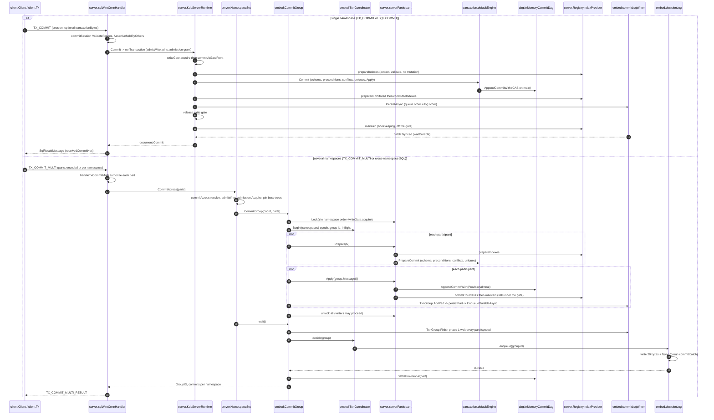

</details>

### Call chain

Client side

| # | Function | File:line | What it does |
|---|---|---|---|
| 1 | `client.Client.BeginTx` | `client/tx.go:45` | Takes an idle pooled session (`takeIdleTxSession`, `:67`) or calls `beginSession`, then sends SQL `BEGIN` via `execSqlOnSession` so the server restarts the transaction at the current head (and takes a multi-namespace snapshot for `Snapshot` isolation). `releaseTxSession` (`:79`) returns it to the idle pool after a clean finish. |
| 2 | `client.Client.beginSession` | `client/client.go:557` | Sends `SESSION_BEGIN`; returns session id and head. |
| 3 | `client.Tx.Exec` / `Query` | `client/tx.go:111,123` | `SQL_EXEC` on the session; DML is buffered server-side, nothing is committed. |
| 4 | `client.Tx.Commit` | `client/tx.go:164` | Sends `TX_COMMIT` (namespace, session). Conflict reply becomes `ErrConflict`, or `*CrossNamespaceError` when the refusing namespace is not the tx namespace; success advances the client's known head (`advanceHead`, `client/multi_commit.go:122`). |
| 5 | `client.Tx.Rollback` | `client/tx.go:198` | Sends `TX_ROLLBACK`. |
| 6 | `client.Client.Exec` / `ExecReturning` -> `execAutoCommit` | `client/query.go:113`, `:131`, `:142` | One statement on the namespace's own session under `namespaceState.dml` (write lock: one auto-committed statement at a time per namespace in the Go client), then `TX_COMMIT` if the server left writes pending. An immediate statement (claim/upsert) comes back already committed (`needsCommit=false`); its `resolvedCommitHex` becomes the known head. |
| 7 | `client.Client.Commit` / `commitTransaction` | `client/client.go:695,722` | Builds `document.Transaction`, `wire.EncodeTransaction`, `TX_COMMIT` carrying `TransactionBytes` on the namespace's session, under `dml.RLock` (so concurrent `Commit`s share a namespace, but not with an in-progress `Exec`). |
| 8 | `client.Client.CommitAcross` | `client/multi_commit.go:51` | Builds one encoded tx per namespace (rejects duplicate namespaces), sends one `TX_COMMIT_MULTI`, maps reply parts to commit hashes. |
| 9 | `wire.EncodeTransaction` / `DecodeTransaction` | `wire/transaction_codec.go:41,66` | Tx byte codec shared with the Kotlin implementation. |
| 10 | `wire.encodeMultiCommitMessage` / `decodeMultiCommitMessage` | `wire/multi_commit_ops.go:81,105` | JSON envelope kinds `txCommitMulti` and `txCommitMultiResult` (Go-only op). |
| 11 | TS client write-session pool | `packages/kdb-client/src/client.ts` (repo root, not `go/kdb`) | Since #337 the TypeScript client sends self-contained writes (an exec with its auto-commit, a commit carrying its own transaction) on a per-namespace pool of sessions (`ConnectOptions.sessionsPerNamespace`, default 8) so several writes from one process are in flight and can share a group commit; leases, queries and transaction control stay on the namespace's own session, and writes stay there while the client holds a lease in that namespace. The Go client has no such pool. |

Server side, session buffering and single-namespace commit

| # | Function | File:line | What it does |
|---|---|---|---|
| 12 | `server.sqlWireConnHandler.run` / `sessionTicket` / `readsNoSessionState` | `server/wire_listen.go:220`, `:297`, `:336` | Frames for one session are ordered by `sessionIDOf` (`:372`) via per-session tails; a plain `SELECT` on a non-SNAPSHOT session (`isPlainSelect`) skips the queue and runs concurrently. Up to `MaxInFlightFrames = 64` (`:149`) per connection; byte-based reply backpressure (`h.replies.waitBelowLimit`). `closeAllSessions` (`:404`) runs after in-flight frames finish. |
| 13 | `server.sqlWireConnHandler.dispatch` | `server/wire_listen.go:506` | Routes by message type (`TxCommitMessage`, `TxRollbackMessage`, `TxCommitMultiMessage`, ...). The TCP path goes through `dispatchRecovering` (`:454`) since the byte-backpressure change. |
| 14 | `server.sqlWireConnHandler.handleSessionBegin` | `server/wire_listen.go:638` | `runtimeForWrite` (creates the namespace) then authorize `SessionBeginAction`, `SessionManager.BeginOn`. |
| 15 | `server.SessionManager.BeginOn` | `server/session_manager.go:241` | Creates `KdbSession`, pins base version = head (or caller's), `startTransactionAt(head)` (`:117`). |
| 16 | `server.sqlWireConnHandler.handleSqlExec` | `server/wire_listen.go:687` | SELECT and DDL run now (`execRead`, `:846`); `sql.ImmediateUpdate` / `ImmediateInsert` statements go to `execImmediate` (`:760`) and commit on their own; other DML -> `execDML` (`:1045`) appends to `SessionManager.PendingBuilder` (`session_manager.go:371`), which anchors a non-Snapshot session's write base at the live head on the first write. SQL naming another namespace buffers into `KdbSession.cross` (`sql_cross_namespace.go:135 crossBuilder`). |
| 17 | `server.sqlWireConnHandler.execTransactionControl` | `server/wire_listen.go:1291` | `COMMIT`/`ROLLBACK` delegate to `commitSession`/`rollbackSession`; `BEGIN` refuses if writes are pending, else `startTransactionAt(head)` (and `NamespaceSet.Snapshot` for Snapshot sessions). |
| 18 | `server.sqlWireConnHandler.handleTxCommit` | `server/wire_listen.go:1099` | Looks up session, calls `commitSession`. |
| 19 | `server.sqlWireConnHandler.commitSession` | `server/wire_listen.go:1116` | Decodes `TransactionBytes` or `Pending.Build` (`transaction.Builder.Build`, `transaction/builder.go:104`), `LockManager.ValidateFences` over the session's explicit leases (`:1143`), then either `commitSessionAcross` (`:1148`) or `LockManager.AssertUnheldByOthers` (`:1154`) + `KdbServerRuntime.Commit` (`:1157`). Always `ClearPending`; success re-anchors with `startTransactionAt(commit.Hash)`. |
| 20 | `server.KdbServerRuntime.Commit` -> `commitWith` -> `clientWrite` | `server/server_runtime.go:670,746,757` | Stamps author node (`authored`, `:802`), runs `runTransaction` with `engine.Commit`; on a write-back projection `clientWrite` serializes with the projection's writers and queues the write for the source. |
| 21 | `server.KdbServerRuntime.runTransaction` | `server/server_runtime.go:825` | `admitWrite` (`:966`: draining, read-only, fence, projection, home (`admitHome`, `server/home.go:96`), RBAC), `dag.Pin(base)` (`:841`), `pinBaseTree`, `admission.Acquire(ClassWrite)` (`:864`), `writeGate.acquire` (`:870`, `server/write_gate.go:92`), then `commitAtGateFront`. |
| 22 | `server.KdbServerRuntime.commitAtGateFront` | `server/server_runtime.go:889` | Shared with `CommitImmediate`. `prepareIndexes` (`:893`, `index_wiring.go:530`), `call()` (engine), on `ResultSuccess`: `changes.record` (`:905`, `server/change_log.go:37`), `preparedForStored` + `commitToIndexes` (`:909-913`, under the gate, commit order), `persister.PersistAsync` (`:928`, under the gate), `releaseNow()` (`:933`), **`indexProvider.maintain()` (`:937`) after the gate is released**, `waitDurable()` (`:940`), `CommitListener`, `notifyHeadWatchers` (`:947`). Conflict -> `ConflictError` with `RetryAfterMs`; schema -> `SchemaError`. |
| 23 | `server.RegistryIndexProvider.maintain` | `server/index_wiring.go:479` | `TryLock` on `maintainMu` (a concurrent pass covers this commit), `Registry.BoundHistoryIfDue`, `repairHeads` (rebuild stores whose head state could not follow). Flow 8 owns the details. |
| 24 | `transaction.defaultEngine.Commit` | `transaction/default_engine.go:29` | Base must exist (`BaseNotFoundError`), `findExistingCommit` (`:440`) makes retry of the same tx id idempotent, then `finalizeTransaction` (`:198`) = `plan` + `PreparedCommit.Apply`. |
| 25 | `transaction.defaultEngine.plan` | `transaction/prepare.go:103` | In order: `preflightFileWrites` (`default_engine.go:294`), `preflightAttachments` (`:121`, `transaction/attachments.go:108`), `runSchemaPhase` (`default_engine.go:322`), `evaluatePreconditions` (`preconditions.go:26`, only when the engine option is on and `tx.Preconditions` is set, `:137`), conflict policy (`detectConflicts`, `default_engine.go:225`, plus `detectAttachmentConflicts`, `:154`; `Strict` rejects, `Custom` calls the resolver, `LastWrite`/`AppendOnly` skip), `planUniqueKeys` (`unique_registry.go:447`). |
| 26 | `transaction.planUniqueKeys` / `UniqueKeysFor` | `transaction/unique_registry.go:447`, `:296` | Against `targetDocTreeHash`. Keys come from `sch.UniqueTuples()` (single-field `UNIQUE` flags, compound constraints, and constraints installed by `CREATE UNIQUE INDEX`). **Multikey:** an array part claims each non-null element (`multikeyValues`, `:379`), a compound tuple claims every combination (`combinations`, `:397`), an empty array or absent/null part claims nothing. `fieldReader` (`:350`) decodes only the named members. "Released in the same tx" is checked by map presence, so a key held by the nil-UUID document is no longer treated as released (fix eb02cbca). |
| 27 | `transaction.PreparedCommit.Apply` | `transaction/prepare.go:229` | Stages `PutDocument`/`DeleteDocument`, `operationsAsStored` (`:278`, the commit records the merged stored documents, not the patches), `store.CommitTree` (`:284`), `dag.AppendCommitWith(Detached: !extendingTip, Provisional: opts.Provisional)` (`:293`), then `uniqueKeys.Apply` (`:314`). Staging failure -> `DiscardPending` and `ResultAborted`; a lost head CAS -> `DiscardPending` and the `HeadConflictError`. |
| 28 | `dag.InMemoryCommitDag.appendCommitLocked` | `dag/in_memory_commit_dag.go:1018` | Compare-and-swap of the `main` head against the expected parent (`HeadConflictError`), merge-commit attachment ops (`mergeAttachmentOpsLocked`), `attachmentRootLocked`, `document.BuildCommitWithAttachments`, `putCommitLocked`, moves branch head, publishes it. |
| 29 | `embed.PersistingCommitDAG.PersistAsync` | `embed/persisting_dag.go:172` | `deltaRecordFor` (`:214`), `commitLogWriter.EnqueueAsync` (`commit_log.go:143`), `chainOnBarrier` (`:195`) so a commit queued behind an undecided group part is not acknowledged before that group is decided (only under `DurabilitySync`), wrapped by `afterDurable` (`:38`) which tells the attachment store a commit holding an attachment put is durable. |
| 30 | `embed.commitLogWriter.run` / `writeBatch` | `embed/commit_log.go:212,428` | Single goroutine: `appendBatch` (`:363`; rotation only at the batch boundary; a drained batch goes out in one `AppendBatch` write when the writer supports it) then one `writer.Flush()` per batch = the fsync; acks every request in the batch. |
| 31 | `server.sqlWireConnHandler.rollbackSession` | `server/wire_listen.go:1246` | `DocumentLocks.ReleaseAll(session)`, `ClearLeases`, `ClearPending`, `clearCross`, `startTransactionAt(head)`. Nothing was ever written, so there is nothing to undo on disk. |

Leases and fences

| # | Function | File:line | What it does |
|---|---|---|---|
| 32 | `server.sqlWireConnHandler.handleLockAcquire` | `server/lock_listen.go:23` | `LockManager.TryAcquireLease` with TTL clamped by `clampLeaseTTL` (`:103`), `KdbSession.TrackLease`. |
| 33 | `transaction.LockManager.TryAcquireLease` / `grantLocked` | `transaction/lock_manager.go:129,97` | Per `(namespace, doc)` lock; fence counter `fences[key]` is monotonic and survives release. Same session re-acquiring or renewing keeps its fence. |
| 34 | `transaction.LockManager.ValidateFences` | `transaction/lock_manager.go:220` | Commit-time proof that the lease is the same session, same fence, unexpired. |
| 35 | `transaction.LockManager.AssertUnheldByOthers` | `transaction/lock_manager.go:328` | Refuses a write whose document another session holds a live lease on. Commit does not take locks of its own; mutual exclusion between writers is the write gate. `CommitImmediate` checks it too, under the gate, once its operations are known. |

Cross-namespace commit

| # | Function | File:line | What it does |
|---|---|---|---|
| 36 | `server.sqlWireConnHandler.handleTxCommitMulti` | `server/multi_commit.go:63` | Authenticated? Session known? Decodes each part, `Resolve(namespace, true)`, authorizes `TxCommitAction`, then `NamespaceSet.CommitAcross`. Errors -> `multiCommitError` (`:111`) with `FailedNamespace`, `ErrorCode`, conflict report. |
| 37 | `server.sqlWireConnHandler.commitSessionAcross` | `server/wire_listen.go:1182` | Session path: own namespace tx plus `cross[ns].builder.Build` for the others; calls `NamespaceSet.CommitAcross`. A conflict report names the refusing namespace (`CrossNamespaceError`). |
| 38 | `server.NamespaceSet.CommitAcross` / `commitAcross` | `server/namespace_set.go:257,261` | Resolve runtimes, cheapest-first refusals (projection read-only, `admitWrite`, engine must implement `transaction.Preparer`, DAG present), one deadline, `admission.Acquire` and `pinBaseTree` per participant held through the durability wait, then `embed.CommitGroup`. `finish` runs `wait()` then each runtime's `CommitListener` and `notifyHeadWatchers`. If no participant acknowledges durably (`acknowledgesDurably`, `:482`) `finish` runs in a goroutine and the call returns early. |
| 39 | `embed.CommitGroup` | `embed/group_commit.go:31` | Sort parts, reject duplicate namespaces, pin caller bases, lock all (ordered), `Begin`, prepare all, apply all (`applyGroup`, `:146`) between `PublishStarted/Finished`, unlock, return `wait`. |
| 40 | `server.serverParticipant.Lock` | `server/namespace_set.go:384` | `writeGate.acquire`; the release records service time (`observeService`). |
| 41 | `server.serverParticipant.Prepare` | `server/namespace_set.go:405` | Head as base if zero, `AssertUnheldByOthers`, `prepareIndexes`, `Preparer.PrepareCommit` (`transaction/prepare.go:68`), maps conflict/schema/abort results to errors. |
| 42 | `server.serverPrepared.Apply` | `server/namespace_set.go:454` | `PreparedCommit.Apply(ApplyOptions{Message, Provisional: true})`, then `preparedForStored` + `commitToIndexes` and **`maintain()` while the participant's gate is still held** (unlike the single-namespace path). Does not call `changes.record`, so the immediate-UPDATE change log sees group parts as "unknown" and falls back to a tree diff. |
| 43 | `embed.TxnCoordinator.Begin` | `embed/txn_coordinator.go:171` | Random group id, sorted parts, lazily `startEpochLocked` (`:207`) on first group, registers `inflight[id]`. |
| 44 | `embed.TxnGroup.AddPart` | `embed/txn_group.go:98` | `PersistingCommitDAG.persistPart` (`persisting_dag.go:239`) = `EnqueueDurableAsync` (`commit_log.go:175`, flushed at once even under `DurabilityAsync`) and makes the group that namespace's `barrier`. Records predecessor group for decision ordering. A queueing failure still records the member so `Fail` fences it. |
| 45 | `embed.TxnGroup.Finish` | `embed/txn_group.go:134` | Phase 1: wait every part's ack. Order behind predecessor groups (`<-p.enqueued`). Phase 2: `TxnCoordinator.decide` then wait. `finish` (`:204`) settles or fences. |
| 46 | `embed.TxnCoordinator.decide` | `embed/txn_coordinator.go:264` | Test hook `beforeDecision`, then `decisionLog.enqueue` (`txn_decision_log.go:227`). In-memory coordinator decides instantly. |
| 47 | `embed.decisionLog.run` | `embed/txn_decision_log.go:242` | Single goroutine drains up to 512 requests, writes `20 bytes x n` (16-byte group id + CRC32C), `storio.SyncFile` once, acks all. |
| 48 | `embed.TxnGroup.finish` | `embed/txn_group.go:204` | Success: `InMemoryCommitDag.SettleProvisional` (`dag/provisional.go:57`), `clearBarrier`. Failure: `PersistingCommitDAG.fence` (`persisting_dag.go:264`) -> `commitLogWriter.fence` latches the error so every later append to that namespace fails. Then `TxnCoordinator.finished` (`:293`). |
| 49 | `driver.database.commitAcross` | `driver/commit.go:111` | The embedded `database/sql` driver's entry into the same `embed.CommitGroup`; its participant uses a namespace mutex where the server uses the write gate. |

Recovery of in-doubt groups (open path)

| # | Function | File:line | What it does |
|---|---|---|---|
| 50 | `embed.openTxnCoordinator` | `embed/txn_coordinator.go:106` | Called from `embed.OpenFileHost` (`embed/host.go:132`, call at `:180`) before any namespace opens. A writer renames every `txn/decisions-<epoch>.log` left by a previous writer to `.dead` (`:135`) and `syncDir`s (`:143`). |
| 51 | `embed.replayDeltaNamespaceFrom` | `embed/delta_replay.go:61` | Called with `h.txn` as the coordinator (`checkpoint_open.go:71,154,169`, `file.go:348`). Builds `groupGate`. |
| 52 | `embed.groupGate.skip` | `embed/delta_replay.go:268` | For each commit: descendant of a dropped or held commit -> skip; else `TxnCoordinator.resolvePart`; aborted -> add to `dropped`. |
| 53 | `embed.TxnCoordinator.resolvePart` | `embed/txn_coordinator.go:377` | Parses the marker (`ParseGroupMarker`, `embed/txn_marker.go:37`). Foreign host -> committed but counted in `foreignParts` (`:393`). Own live epoch -> `committed`/`inflight` maps. Otherwise reads `.log` then `.dead` decision file (`readDecisions`, `txn_decision_log.go:86`): present -> committed, absent -> aborted (writer) or held (read-only reader of a live epoch, `:405`). No file at all -> epoch was sealed -> committed. |
| 54 | `embed.groupGate.report` | `embed/delta_replay.go:298` | One log line with the number of rolled-back commits and groups. |
| 55 | `embed.TxnCoordinator.close` / `sealLocked` | `embed/txn_coordinator.go:332,313` | Clean shutdown: wait up to 5 s for in-flight groups, then, if none in flight and none failed, close and **delete** the epoch file + `syncDir` (absence of file = "every group of this epoch committed"). Called from `Host.Close` (`host.go:365`) after every namespace closed (call at `:404`). |

### Data that changes

| Step | Structure / file / wire message | Mutation |
|---|---|---|
| Session begin | `KdbSession` (in `SessionManager.sessions`), DAG pin | New session, `baseVersion = head`; Snapshot sessions pin the head commit (`dag.Pin`). |
| DML buffered | `KdbSession.Pending` (`transaction.Builder.ops`), `KdbSession.cross[ns].builder` | In-memory only. No file, no DAG, no storage mutation. Immediate statements (claim, upsert) never touch these. |
| Lease acquire | `LockManager.locks`, `LockManager.fences`; `KdbSession` lease list | In-memory. Fence counter incremented when a different session takes the doc. Never persisted: a restart drops all leases. |
| Single commit: Apply | storage engine pending set (`PutDocument`/`DeleteDocument`), live tree via `CommitTree`; `InMemoryCommitDag` commit map, tree map, attachment table root, `branches["main"].HeadHash` | Pending docs folded into a new tree; new commit (ops rewritten to the stored documents) inserted; `main` head CAS-moved and republished. Unique-key registry updated (multikey claims included). |
| Single commit: change log | `KdbServerRuntime.changes` (`changeLog.byCommit`, last 4096 commits) | `record` notes the documents a single-parent commit wrote, for immediate UPDATEs deciding under the gate (flow 5). In memory only. |
| Single commit: indexes | each index store's event log / head state | Applied under the gate from the stored documents; `maintain` (bounding history, repairing heads) after the gate is released. |
| Single commit: persist | namespace delta segment `ns/<ns>/delta/<sequenced-name>` (via `commitLogWriter`) | One framed record appended (a drained batch in one write); batch fsynced by `writeBatch` -> `Flush`. |
| Cross-ns Begin | `txn/HOST` (written once, tmp+fsync+rename+dir fsync), `txn/EPOCH` (tmp+fsync+rename+dir fsync), `txn/decisions-<epoch 16 digits>.log` (created `O_EXCL`, 16-byte header `KDBXNSD1`+epoch, fsync, dir fsync) | Only on the first group after open or after a seal. A process that never runs a cross-ns group never creates `txn/`. |
| Cross-ns Apply | each participant's DAG: commit with `Message = "kdb:xns/1 host=<h> epoch=<n> group=<uuid> parts=a,b"` and `TransactionID = group id`; `dag.provisional` set; `provisionalGen++`; each namespace's `PersistingCommitDAG.barrier = group` | Part is visible in memory immediately (readers may see it before the decision; `groupPublishing`/`groupVersion` counters bracket publication so `NamespaceSet.Snapshot` retries). |
| Cross-ns part persist | each namespace's delta segment | Part record appended with `force` ack. |
| Decision | `txn/decisions-<epoch>.log` | Appended `[group id MSB, LSB (big-endian), CRC32C]` per group, one fsync per batch. This is the commit point. |
| Settle | `dag.provisional` | Part removed from the set; barrier cleared; checkpoints may now include it. |
| Failure | `commitLogWriter.failure` of every participant (latched), `KdbServerRuntime.fenced` / driver `namespace.fenced`, `TxnCoordinator.failed = true` | Namespace refuses all later writes until reopened; the epoch will not be sealed. |
| Seal (roll or close) | `txn/decisions-<epoch>.log` | File deleted (+ dir fsync). No other state remains. |
| Crash recovery | `txn/decisions-<epoch>.log` renamed to `.dead`; in-memory DAG | Undecided parts and their descendants are not applied. Nothing on disk is rewritten: the part frames stay in the segment and are skipped on every later open. |

### Failure, edge cases & durability points

- **Durable boundaries of a single-namespace commit.** The commit is durable (and acknowledged) when `commitLogWriter.writeBatch` returns from `writer.Flush()` (`commit_log.go:428-439`) under `DurabilitySync`. Under `DurabilityAsync` `EnqueueAsync` returns `func() error { return nil }` immediately and the ack promises nothing (`commit_log.go:161-163`). The in-memory DAG head moves *before* the fsync; the write gate is released after queueing and before waiting (`server_runtime.go:933`), which is what lets concurrent commits share one fsync. Index bookkeeping (`maintain`) now overlaps that wait instead of holding the gate.
- **Index failure after the DAG append is still not compensated.** If `preparedForStored` or `commitToIndexes` fails (`server_runtime.go:909-916`), `commitAtGateFront` returns an error to the client although the commit is already in the in-memory DAG, and it returns before `PersistAsync`, so that commit is never queued for the log. `applyCommit` marks the provider `inconsistent` (`index_wiring.go:520`). Unchanged hazard of the ordering.
- **Immediate statements.** `CommitImmediate` holds the gate from reading the live head through the commit, so its operations cannot conflict with an earlier commit; it re-runs `admitWrite` on the built transaction (authorization of the actual operations) and `AssertUnheldByOthers`. Refused when the session has pending writes and when it names another namespace (`execImmediate`, `wire_listen.go:762-771`). Its reply is `ReadOnly: true` so a client must not send `TX_COMMIT` after it.
- **Unique constraints.** Enforced only through `UniqueKeyRegistry` at commit (`planUniqueKeys`) and, for existing data, by `SetSchemaChecked`'s rebuild when a constraint is installed. `CREATE UNIQUE INDEX` on a schemaless namespace installs a constraints-only schema (`uniqueConstraintFor`, `server/index_provider.go:399`); on a namespace with declared fields it is refused unless the schema already declares that tuple. A compound `CREATE UNIQUE INDEX` with no `USING` builds no index store at all, only the constraint. Multikey semantics mean a document whose array repeats a value claims it once, while two documents sharing any element collide.
- **Durable boundaries of a group.** Order is: every part fsynced (`EnqueueDurableAsync`, forced flush even under async durability) -> decision record fsynced -> `SettleProvisional`. A crash before the decision record is durable rolls back *all* parts; after it, none. `decisionLog` uses the host's `syncMode`; the header write, `EPOCH`, `HOST` and directory entries are individually fsynced.
- **Torn decision record.** `readDecisions` stops at the first short or CRC-bad record. Justified because a group is not acknowledged until its record's fsync returns and records are strictly appended.
- **Rollback of an undecided group is by ancestry, not position.** `groupGate` drops the part and everything descending from it. This is safe because `chainOnBarrier` (`persisting_dag.go:195`) withholds the ack of any later commit in the same namespace until the earlier group is decided (under `DurabilitySync`); under `DurabilityAsync` that guarantee does not exist.
- **Pre-write failure is clean.** Any `Prepare` refusal -> `Discard()` on earlier parts, `group.Abandon()` (`txn_group.go:185`), `GroupPartError` naming the namespace; nothing was written (`group_commit.go:92-99`). Lock acquisition failures likewise.
- **Post-write failure fences, with one gap.** A failure in `Apply`, `AddPart`, the part wait, or the decision write calls `TxnGroup.Fail`/`finish` -> `PersistingCommitDAG.fence` and `fenceAll` -> `KdbServerRuntime.fence` (`server_runtime.go:1001`). The in-memory graph still holds the undecided provisional part; the namespaces refuse writes with `*embed.GroupFailedError` until restart, when replay drops the part, and `saveCheckpoint` returns `ErrCheckpointDeferred` (`checkpoint_open.go:258-260,315-316`) meanwhile. **Gap (read from code, not exercised):** `serverPrepared.Apply` can return an error *after* `pc.Apply` appended the provisional part (index failure, `namespace_set.go:461-469`); `applyGroup` does not count that participant in `applied` (`group_commit.go:150-156`). When it is the first participant (`applied == 0`), `CommitGroup` calls `group.Abandon()` and fences nothing (`group_commit.go:116-119`): a provisional part stays in that namespace's DAG as head, unpersisted, unsettled and unfenced, so later commits build on it and checkpoints defer until restart.
- **Cross-namespace path differs from single-namespace in two small ways.** `serverPrepared.Apply` runs `maintain()` while the gate is held, and it does not `changes.record` the part, so an immediate UPDATE that meets a group part falls back to the tree diff (correct, slower).
- **Checkpoint interplay.** `ProvisionalGeneration`/`HasProvisional` are checked before the snapshot and again after the live tree is captured (`checkpoint_open.go:258-316`) so a part published in between cannot slip into a checkpoint.
- **Epoch lifecycle.** An epoch is sealed (file deleted) only when nothing is in flight and nothing failed; rolls at `decisionRollThreshold = 1 MiB` (`txn_decision_log.go:43`). After an unclean stop, the next writer renames the live file to `.dead`. **No code deletes `.dead` files** (only the rename at `txn_coordinator.go:135` and reads around `:410-435`); they persist as the permanent record of that epoch.
- **Read-only followers.** A reader that sees an undecided part in a live epoch it does not own returns `partHeld` (skip it and descendants, retry on next refresh) rather than `partAborted`. A group part whose marker names a different host id (arrived through peer sync) is read as committed and only counted (`ForeignGroupParts`); atomicity is not verified for it.
- **Backups.** `backup.CreateDatabase` copies `txn/` (see flow 12) because a restored namespace log without the decision files would read in-doubt groups as committed.
- **Ack-before-durable at the server.** If no participant acknowledges durably, `commitAcross` returns the result immediately and runs `finish` in a background goroutine (`namespace_set.go:356-361`); a failure there is discarded (`_ = finish()`), visible only as fences, and `CommitListener`/head watchers for those commits fire from that goroutine.
- **Preconditions and conflicts are evaluated against the head being landed on.** `evaluatePreconditions` uses `targetDocTreeHash`; operations with a real precondition are exempt from base-version conflict detection (`guardedOpIndexes`, `default_engine.go:215`). Preconditions run only if the engine was built with the option on (`prepare.go:137`).
- **Leases are advisory exclusion plus fencing.** The commit path itself takes no lock (`AssertUnheldByOthers` only refuses documents others hold). Leases live only in memory, expire lazily, and `closeAllSessions` releases them on connection drop. `ValidateFences` is applied to the session's own tx in `commitSession` only (not for the `others` namespaces' builders in `commitSessionAcross`, which go through `serverParticipant.Prepare` -> `AssertUnheldByOthers` but not fence validation). Because the server checks a lease against its holder's session, the TS client's write-session pool keeps writes on the namespace's own session while it holds a lease there.
- **Session concurrency.** A plain SELECT on a READ_COMMITTED / READ_YOUR_WRITES session no longer waits behind that session's buffered DML or commit (it never read pending writes anyway); a SNAPSHOT session's SELECT stays ordered because its read pin moves at transaction boundaries.
- **No dedicated begin op.** The Go wire layer has no `TX_BEGIN`; session begin plus SQL `BEGIN` is the only begin (see Description). `transaction.Engine.Merge` is unused by any non-test caller (see flow 7).


## 7. Branch, merge, revert and truncate

Paths relative to `go/kdb/`. Line numbers re-traced at `e79bb674` (2026-10-23). "Truncate" here is what the code calls truncation: deleting delta-log *segments* under `history=none` (`embed/truncate.go`), not rewinding a branch. No user-facing operation moves a branch head backwards, by design (`embed/revert.go:30-53`); the two internal exceptions (a peer adoption undone after its log write fails, and a content-free peer join) are listed under edge cases.

### Description (short)

Four related operations over one namespace's `dag.InMemoryCommitDag` (the commit graph) and its delta log:

1. **Refs.** Branches and tags are in-memory maps on the DAG, created/deleted through the control plane (`control/refs.go`) or by peer sync (tracking branches for refused updates). They are still *not* written to the delta log; they survive only through the namespace checkpoint. `main` is the only branch any append advances.
2. **Merge.** There is still no user-facing local "merge branch X into Y". The only production merge is peer-sync divergence resolution (`peersync.adopt` -> `resolveDivergedLocked` -> `mergeNonConflicting`), which produces a deterministic two-parent commit `kdb:merge/1`, or, when both heads hold the same documents, a content-free canonical join (`peersync.joinSameContent`). Every two-parent append now also merges the parents' **attachment tables** three-way inside the DAG (`dag/attachment_merge.go`). `transaction.Engine.Merge` was reworked (#281 follow-up, `3b60d9b8`: each branch write is rebased as a field-level change onto the primary) but still has no non-test caller.
3. **Revert.** `embed.RevertTo` writes a *new* commit on top of head whose document tree equals a past commit's tree (history only moves forward). Entry points: wire `REVERT`, control `revert/plan` + `revert/apply`, control restore points.
4. **Truncate.** `checkpointAndTruncate` writes a checkpoint claiming a higher segment floor, then deletes eligible segments (only under `history=none` and a reclaiming `ReclaimMode`). Checkpoints now also carry the heads' attachment tables and, under `history=full` with a graph file, references to graph segments instead of commits.

### Diagram


<details><summary>Mermaid source</summary>

```mermaid
flowchart TD
    subgraph Refs
      CB[control.Server.handleCreateBranch] --> DCB[dag.InMemoryCommitDag.CreateBranch]
      CT[control.Server.handleCreateTag] --> DCT[dag.InMemoryCommitDag.CreateTag]
      NC[peersync.IngestEnv.noteConflict tracking branch] --> DCB
      DCB --> MEM[(branches / tags maps in memory)]
      DCT --> MEM
      MEM -. only via .-> CK[embed.saveCheckpointThrough -> writeCheckpoint snap file]
    end
    subgraph Revert
      WR[server.sqlWireConnHandler.handleRevert holds writeGate] --> RT[embed.RevertTo]
      CR[control.Server.handleRevertApply expectHead check, no writeGate] --> RT
      RP[control.Server.handleRestoreToPoint N reverts] --> RT
      RT --> RES[dag.ResolveRevision + resolveTree head and target]
      RES --> STG[Storage.PutDocument / DeleteDocument staged]
      STG --> CTR[Storage.CommitTree check tree hash == target tree hash]
      CTR --> AC[PersistingCommitDAG.AppendCommit -> InMemoryCommitDag.AppendCommit CAS on main]
      AC --> LOG[Persist -> PersistAsync + wait, commitLogWriter fsync]
    end
    subgraph Merge
      ING[peersync.adopt under node.Exclusive + divergenceLockFor] --> HU{ResolveHeadUpdate}
      HU -- fast-forward --> FF[fastForward SetHead main]
      HU -- diverged --> RD[peersync.resolveDivergedLocked]
      RD -- same content --> JN[joinSameContent canonical join or SetHead]
      RD -- differing docs --> RC[resolveConflicting when both sides changed a doc]
      RC -- unresolved --> CQ[noteConflict: conflict queue + tracking branch, main untouched]
      RC -- resolved --> MN[peersync.mergeNonConflicting]
      RD -- no conflicts --> MN
      MN --> AM[dag.AppendMergeCommitOnto two parents CAS on main]
      AM --> ATT[appendCommitLocked adds mergeAttachmentOpsLocked ops]
      ATT --> PA[IngestEnv.persistAll -> PersistAsync, wait outside gate]
      PA -- log refused --> UN[undoAdoption: MarkUnlogged, SetHead main back, rewindStorage]
    end
    subgraph Truncate
      MS[MaintenanceScheduler.runPass / CompactHistory / checkpointOnClose] --> CAT[embed.checkpointAndTruncate]
      CAT --> PL[embed.planTruncation segmentsToDelete]
      PL --> SC[saveCheckpoint with floor = highest victim + 1]
      SC --> AT[embed.applyTruncation PrepareForTruncation, DeleteSegment per victim, PruneColdIndex]
    end
```

</details>

### Call chain

Refs and revision resolution

| # | Function | File:line | What it does |
|---|---|---|---|
| 1 | `control.Server.handleCreateBranch` | `control/refs.go:60` | Refuses staged copies (`refuseIfStaged`, `control/restore.go:432`) and `history=none` namespaces (`refuseWithoutHistory`, `refs.go:151` -> `EmbeddedKdbRuntime.AssertRetainsHistory`, `embed/history_features.go:87`), validates the name (`validRefName`, `:337`), resolves `from` (`Server.resolveRevisionFor`, `control/history.go:62`), calls `CreateBranch`. |
| 2 | `dag.InMemoryCommitDag.CreateBranch` | `dag/in_memory_commit_dag.go:806` | Fails `branch exists` for an existing name (including `main`), `requireCommitPresentLocked(from)`, inserts the `Branch`, `publishHeadLocked`. `PersistingCommitDAG.CreateBranch` (`embed/persisting_dag.go:125`) is a plain delegate: no log write. |
| 3 | `control.Server.handleDeleteBranch` | `control/refs.go:109` | Calls `DeleteBranch`; "default branch" error becomes 409. |
| 4 | `dag.InMemoryCommitDag.DeleteBranch` | `dag/in_memory_commit_dag.go:828` | Refuses `main`; deletes map entry. |
| 5 | `dag.InMemoryCommitDag.SetHead` | `dag/in_memory_commit_dag.go:761` | Existing branch only, target commit must be present; moves head, republishes. Callers are peer sync (fast-forward `peersync/ingest.go:705`, tracking branches in `noteConflict` `:542`, `undoAdoption` `:644`, `joinSameContent` `peersync/join.go:63`, `resolveDivergenceLocked` `conflict_detection.go:236`), and replay. No user endpoint. `PersistingCommitDAG.SetHead` (`persisting_dag.go:118`) writes nothing. |
| 6 | `control.Server.handleCreateTag` / `dag.InMemoryCommitDag.CreateTag` | `control/refs.go:163`, `dag/history_nav.go:315` | Commit must be present; same name+same commit is idempotent, same name different commit is refused (never moves a tag). A tag is a retention root. `durable:true` calls `rt.Runtime.Maintain()` (`refs.go:220`) to force a checkpoint. |
| 7 | `dag.InMemoryCommitDag.ResolveRevision` | `dag/history_nav.go:294` | `ParseRevision` (`:254`: `head`, `tag:x`, `branch:x`, hash, `~n`, `^`) -> `ResolveRef` (`:197`) -> `NthAncestor` (`:122`, first-parent steps). Also `ListCommits` (`:67`), `CommitAtOrBefore` (`:166`). |
| 8 | `dag.InMemoryCommitDag.CommonAncestor` / `IsAncestor` / `CommitsSince` / `MergeBases` | `dag/ancestry.go:39,83,17`, `dag/merge_bases.go:28` | Ancestor queries. `CommonAncestor` walks from its second argument, so callers that need determinism pass parents in canonical (hash) order. `MergeBases` returns every nearest common ancestor (used by resolution chain version 2 and by the attachment-table merge). |

Revert

| # | Function | File:line | What it does |
|---|---|---|---|
| 9 | `server.sqlWireConnHandler.handleRevert` | `server/history.go:102` | Authenticate, authorize `DocumentWriteAction`, **`rt.writeGate.acquire`** (`:124`), then `embed.RevertTo` (`:130`). Reply `REVERT_RESULT` with commit, target, restored, removed. Client entry is `client.Client.Revert` (`client/history.go:111`). |
| 10 | `control.Server.handleRevertPlan` | `control/revert.go:47` | Dry run: resolves head and target, diffs head->target (via `embed.DiffCommits`, `embed/revert.go:201`), returns `expectHead`. Read-only. |
| 11 | `control.Server.handleRevertApply` | `control/revert.go:93` | Requires `expectHead`; refuses `409 head_moved` (`:117`) if head differs; calls `embed.RevertTo(rt.Runtime, ...)` (`:127`) **without taking the server write gate**. |
| 12 | `control.Server.handleRestoreToPoint` | `control/restorepoints.go:471` | Plans every namespace, takes an undo point (`createRestorePoint`, `:382`), then calls `embed.RevertTo(..., "tag:<name>")` per namespace (`:541`). Not atomic across namespaces. Also no write gate. |
| 13 | `embed.RevertTo` | `embed/revert.go:55` | `AssertWritable`; needs `dag.HistoryNavigator`; `ResolveRevision`; if target tree hash equals head's -> no-op (returns head). Else `resolveTree` (`:240`) for both, diff the materialized entries, `GetDocument` at target tree + `PutDocument` for changed docs (a body that is gone aborts, `:127-136`), `DeleteDocument` for docs absent in target, `Storage.CommitTree(head tree)`, **postcondition `tree.TreeHash == target tree hash`** (`:161`), then `rt.DAG.AppendCommit(tx, head, tree, nil, "revert to <hex>")` (`:187`). Deferred `DiscardPending` (`:110-115`) unstages on any error after staging began. Restores document bodies only: the commit has one parent, so its attachment table is inherited from head (`dag/attachments.go:223`), minus attachments of documents the revert deletes. |
| 14 | `embed.PersistingCommitDAG.AppendCommit` | `embed/persisting_dag.go:132` | Delegate `InMemoryCommitDag.AppendCommit` (`dag/in_memory_commit_dag.go:979`, CAS on `main` == parent), then `Persist` (`:157`) = `PersistAsync` (`:172`) + wait, so the call returns after the log write is acked. `afterDurable` (`:38`) fires the attachments-committed hook for commits that put an attachment. |

Merge (peer-sync divergence)

| # | Function | File:line | What it does |
|---|---|---|---|
| 15 | `peersync.Adopt` / `AdoptFastForward` -> `adopt` | `peersync/ingest.go:277`, `:289`, `:293` | Under `node.Exclusive` (server write gate, `server/peersync_ingest.go:142`, acquire at `:162`) and the per-namespace `divergenceLockFor` (`conflict_detection.go:186`): reads local head inside the serialization, optional `CheckCommit` per adoptable commit (a refusal records a conflict), then `ResolveHeadUpdate` (`conflict_detection.go:35`) -> already-ancestor (no-op), fast-forward (`fastForward`, `ingest.go:693`, `SetHead(main)`), or diverged. `AdoptFastForward` (paged pulls) only ever fast-forwards. Durability waits run after the serialization is released. |
| 16 | `peersync.resolveDivergedLocked` | `peersync/merge_resolution.go:277` | `CommonAncestor` (nil = unrelated, needs `Chain.AllowsUnrelated`); `joinSameContent` (`peersync/join.go:34`) first: heads with the same documents get a content-free canonical join (or `SetHead` to the head that already is it); else `commitsBetween` both ways, collect touched doc ids, `valueIndex.valuesAt` (`:141`) both heads, per document: changed on one side only -> take that side's **whole body**; both changed -> `conflicting`, with a base from `CommonAncestor(p0,p1)` or, under resolution chain version 2, a virtual merge base over every `MergeBases` result (`peersync/merge_semantics_v2.go:203`); `resolveConflicting` (`:511`: operator `Choose`, `Chain` rules, `Policy`, `Resolver`, `Procedure`) -> either `OutcomeConflict` report (nothing merged, `main` untouched) or merged bodies / forks / provisional ids. No field-level merge on this path (`conflict_detection.go:380`). |
| 17 | `peersync.mergeNonConflicting` | `peersync/conflict_detection.go:312` | Stages the remote-side storage writes (`PutDocument`/`DeleteDocument`), `CommitTree(local head tree)`, parents ordered canonically by hash (`mergeCommitParents`, `:293`), tx id = `DerivedUUID("kdb:merge/1:<p0>:<p1>")`, `BaseVersion` = ancestor (zero for unrelated), author `MergeAuthorNodeID`, timestamp = later head's, schema hash only when both parents agree, message `kdb:merge/1` plus ` provisional=<ids>` (`mergeMessageFor`, `:265`), ops = every differing document's merged body, then `d.AppendMergeCommitOnto(&localHead, ...)`. Same inputs give the same merge hash on every node. |
| 18 | `dag.InMemoryCommitDag.AppendMergeCommitOnto` -> `appendCommitLocked` | `dag/ancestry.go:220`, `dag/in_memory_commit_dag.go:1018` | Parents present, CAS on `main` against `expectedHead` (stale -> `*dag.HeadConflictError`), then **`mergeAttachmentOpsLocked`** (`:1047`, `dag/attachment_merge.go:35`): for a two-parent commit whose tx carries no explicit attachment table, merges the parents' tables three-way against the first merge base (version beats removal; between versions the greater (hash, name, size, mime) wins; same-name clash renames the larger id `<name>~<8 hex>`; docs absent from the merged tree keep none) and appends those ops to the commit. `attachmentRootLocked` (`dag/attachments.go:223`) computes the root; `causalTimestampLocked` bumps the timestamp past the parents. |
| 19 | `peersync.IngestEnv.persistAll` + `advance` / `undoAdoption` | `peersync/ingest.go:595`, `:685`, `:640` | Remote commits then the merge commit are queued on the log in order; `serverLocalNode.Advanced` (`server/peersync_ingest.go:175`) applies schema migrations, indexes, unique keys, foreign group parts. If the log refuses a write under the serialization, `undoAdoption` marks the made commit unlogged (`dag/unlogged.go:91`), `SetHead(main, localHead)` and `rewindStorage` (`:658`) puts live storage back on the old tree (verified by tree hash). A wait that fails after release leaves the commit `MarkUnlogged` so no checkpoint describes it. |
| 20 | `transaction.defaultEngine.Merge` | `transaction/default_engine.go:83` | `CommonAncestor`, `CommitsSince`, `topoSort`, then per branch commit `branchDocuments.rebase` (`:599`): each logged write (a whole document since #281) becomes the branch's root-level change against its own previous version (folded from the ancestor tree) carried onto the primary's document via `document.Document.RebasedOnto` (`document/kdb_document.go:52`), replayed as a `Replace` write through `Replay`; deletes pass through. Caps with `AppendMergeCommitOnto(&head, ...)`. Still called only from tests (`transaction/builder_merge_test.go`, `merge_field_changes_test.go`); a grep of non-test code finds no caller. |

Truncate

| # | Function | File:line | What it does |
|---|---|---|---|
| 21 | `embed.MaintenanceScheduler.runPass` | `embed/maintenance_loop.go:520` | Periodic: `rt.Maintain()`. Other triggers: `EmbeddedKdbRuntime.CompactHistory` (`embed/runtime.go:135`, forces reclaim for the call), `checkpointOnClose` (`checkpoint_open.go:376`, call at `:398`), control `handleCompactHistory` (`control/retention.go:169`). |
| 22 | `rt.maintain` closure | `embed/file.go:408` | `through = highest segment seq`, lowered to `writer.SequenceNumber()-1` so the open segment is never claimed; window = `withPeerFloor(liveRetention(...))` (`runtime.go:287`, `file.go:465`); after the pass, `MaybeRebuildGraphFile`. A sibling `rt.checkpointNow` (`:429`) checkpoints without truncating (squash catch-up durability). |
| 23 | `embed.checkpointAndTruncate` | `embed/checkpoint_open.go:483` | Disabled / no reader / `through < 0` -> nothing; non-`ServerEngine` -> checkpoint only; reclaim mode not reclaiming (`ReclaimManual`) -> checkpoint and report "held" with eligible counts; `history=full` -> checkpoint + SSTable compaction, floor unchanged; `history=none` -> plan, **checkpoint first** (`:549`), then `applyTruncation` (`:555`), then `withCompaction`. |
| 24 | `embed.planTruncation` / `segmentsToDelete` | `embed/truncate.go:196,115` | Pure decision. Never deletes segments above `through`; keeps at least one below it; honours commit floor (`segmentsForCommits`, `:173`) and duration window. `plan.Floor = highest victim + 1`. |
| 25 | `embed.saveCheckpoint` -> `saveCheckpointThrough` | `embed/checkpoint_open.go:215`, `:236` | `ErrCheckpointDeferred` if any provisional (cross-ns) commit exists (checked before and after capture); `CheckpointSnapshotWithGraph` (`dag/graph_checkpoint.go:38`; refuses when `main` names an unlogged commit, names graph segments under `history=full`), shallow-root and branch-head payloads, **attachment tables of every branch head, tag and shallow root** (`PackAttachmentTables`, `dag/attachments.go:284`), live tree -> `writeCheckpoint` (`embed/checkpoint.go:1109`). |
| 26 | `storage.io.OSByteStore.WriteSnapshot` | `storage/io/os_store.go:610` | Via `WriteSnapshotStream` (`:626`): temp file, fsync, rename, directory fsync. |
| 27 | `embed.applyTruncation` | `embed/truncate.go:248` | `ServerEngine.PrepareForTruncation` (`storage/engine/document_bodies.go:107`) first, then `shim.DeleteSegment` per victim, stopping at the first failure; then `PruneColdIndex` removes the deleted segments' delta-index sidecars. |

### Data that changes

| Step | Structure / file / wire message | Mutation |
|---|---|---|
| Create/delete branch | `InMemoryCommitDag.branches[name]` | In-memory add/remove; `publishHeadLocked`. No delta record. Durable only after the next checkpoint (`CheckpointState.Branches`). |
| Create/delete tag | `InMemoryCommitDag.tags[name]` | Same; tags are retention roots, and their commits' attachment tables are packed into the checkpoint. |
| Tracking branch | `branches["<peer>/..."]` via `noteConflict` | Created or moved to the incoming head on a refused update so it stays retained. |
| Fast-forward | `branches["main"].HeadHash` | `SetHead`. The commits were already stored. |
| Local commit (for contrast) | `branches["main"]` | Moved by `appendCommitLocked` only for `main`; user-created branches are labels that never advance on their own. |
| Revert | engine pending set -> live tree; DAG commit + tree maps; `main` head; delta segment | New commit `message = "revert to <hex>"`, `ops` = WriteOp (whole target body)/DeleteOp of the diff, tree hash == target's. Attachment table: head's, minus deleted docs. Old state stays reachable by hash. |
| Merge | engine pending set, DAG, `main` head, delta segment, attachment table pool, conflict queue | Remote commits appended first, then the two-parent merge commit whose ops are the merged documents plus the attachment-merge ops; on `OutcomeConflict` only the conflict queue and tracking branch change. |
| Merge undo | `main` head, live storage, `InMemoryCommitDag` unlogged marks | Head and storage put back on the local head when the log refused the write; the made commit stays in the graph, marked unlogged. |
| Truncate: checkpoint | `snap/<checkpoint key>` file | Replaced atomically with `FloorSequence = plan.Floor`, `ThroughSequence`, segment fingerprints, branches, tags, graph refs, attachment tables. |
| Truncate: delete | `ns/<ns>/delta/<sequenced-name>` files below the floor, delta-index sidecars | `DeleteSegment` -> `OSByteStore.Delete` (`fsx.Remove`, no directory fsync, `os_store.go:496-511`). Document bodies flushed first; sidecars pruned after. |
| Provisional commits | `InMemoryCommitDag.provisional`, `provisionalGen` | Cross-namespace parts only (flow 6); they block checkpoints. A merge's ` provisional=` list is data in the merge message, not this set. |

### Failure, edge cases & durability points

- **Refs are still not durable until a checkpoint.** `control/refs.go:20-25` and `refDurabilityNote` (`:55`) say it: a branch or tag survives a clean shutdown and is lost by `kill -9` before the next checkpoint, while the commit it names is in the log. `createTag durable:true` runs `Maintain()`; restore points do the same with `durable`. `PersistingCommitDAG.CreateBranch/SetHead/CreateTag` write nothing to the log.
- **Backwards head moves exist, but only inside peer sync.** Reads resolve trees from the DAG while writes build on the engine's single live tree, which is why revert goes forward (`embed/revert.go:30-53`). Two peer-sync paths do move `main` to a non-descendant: `undoAdoption` (`ingest.go:640`, under the write gate, rewinds live storage and checks the tree hash), and `joinSameContent` (`join.go:63`, documents identical so storage is unchanged). Neither is reachable from a user endpoint.
- **Revert refuses unreconstructable targets.** `resolveTree` failure (reclaimed segment under `history=none`) goes through `explainHistoryFailure` (`embed/history_features.go:123`); a tree entry whose body is gone aborts. No-op revert returns the current head.
- **Revert does not restore attachments.** `RevertTo` writes only document ops; the new commit inherits head's attachment table, so attachments added after the target survive the revert and attachments removed since are not brought back (only deleted documents lose theirs). The tree-hash postcondition covers documents only. Read from code (`revert.go` has no attachment handling); not exercised.
- **Revert serialization differs by door.** The wire path holds `writeGate` (`server/history.go:124`); the control apply path (`control/revert.go:127`) and restore points (`control/restorepoints.go:541`) call `RevertTo` with no gate, relying on `expectHead` (check-then-act) and `AppendCommit`'s CAS. A concurrent server commit sharing the engine's pending set while a gateless revert has staged documents is unguarded (not exercised).
- **Revert durability.** Acknowledged after `Persist` waits for the log ack: fsynced under `DurabilitySync`, not under `DurabilityAsync`.
- **Restore point restore is N independent reverts.** Mid-way failure returns `restore_incomplete` (`restorepoints.go:543`) naming the undo point; `captureHeads` (`:303`) needs two agreeing reads of every head, otherwise `too_busy` (`:418`).
- **Merge atomicity and determinism.** Parents ordered by hash, author and tx id derived, timestamp the later parent's (then +1 µs past parents), and the attachment-table merge depends only on the parents and their merge base, so two nodes merging the same pair converge on one hash. Same-document overlap on the peer-sync path is never field-merged: a configured rule settles it or `OutcomeConflict` leaves `main` alone. A stale local head raises `HeadConflictError`.
- **Two merge semantics.** `transaction.Engine.Merge` (test-only) now rebases root-level field changes (`RebasedOnto`, nested objects are compared as whole values), while the production peer-sync merge takes whole documents and calls same-document edits a conflict. Anything describing "the engine's merge" describes code no server path runs.
- **Merge chain mismatch.** Nodes advertise `ResolutionOptions.AdvertisedHash` (`conflict_detection.go:147`); a node that cannot run a rule's procedure advertises `unavailable:<hash>` and merging is held.
- **Merge log failure.** Under the serialization: undone (see above). After release: `MarkUnlogged`, and `CheckpointSnapshotWithGraph` refuses to checkpoint while `main` names an unlogged commit, so the next open replays what the log holds (`ingest.go:384-396`).
- **Truncation crash windows.** Plan -> checkpoint claiming the higher floor -> delete. A crash after the checkpoint leaves extra segments below the floor that the open guard ignores (`checkpointMatchesLog`) and the next pass removes (`truncate.go:241-247`). A checkpoint failure (including `ErrCheckpointDeferred`, or a refused unlogged head) means nothing is deleted that pass.
- **Truncation guard on open.** If the log has been truncated and the checkpoint cannot be used, open fails with `TruncatedLogError` (`checkpoint_open.go:64`); a namespace bootstrapped from a peer snapshot without its checkpoint fails with `SnapshotCheckpointMissingError` (`:61`).
- **Attachments under truncation.** Because checkpoints now pack the heads' attachment tables, `history=none` can drop the segments that built them; tables of commits that are neither a head, a tag nor a shallow root are not kept.
- **Archive.** Deleted segments can be fetched back by `RestoreFromArchive` (flow 12) only if an archive tier exists (`TruncationResult.Reversible`, `shimHasArchive`, `truncate.go:304`).
- **Docs vs code.** `control/refs.go:26-28` lists "deleting the branch being read at" as refused; the handler only inherits the DAG's refusal of `main` (`refs.go:119-129`); there is still no read-at check.


## 8. Index maintenance and schema change

Paths are relative to `go/kdb/`. Line numbers re-traced at `e79bb674` (2026-10-23).

### Description (short)

Two coupled mechanisms keep derived structures consistent with documents:

- **Indexes** (`index` package; HASH, BTREE incl. composite BTREEs, FULLTEXT, VECTOR, plus the system expiry BTREE) are in-memory stores owned by a per-namespace `index.Registry`, exposed through `server.RegistryIndexProvider`. They are created by `CREATE [UNIQUE] INDEX`, dropped by `DROP INDEX`, and updated on the commit path in two phases: values are extracted and validated before the DAG append, and applied after it **from what the commit stored** (not the request's merge patch), still under the write gate. Each store keeps a *head state* plus a bounded window of history (`index.Lineage`); the windows of all stores in a namespace are bounded together as 5% of the namespace's memory budget. The stores' bookkeeping (advancing head states, history trimming, repairing a store that lost its head state) runs in `maintain` **after the gate is released**. Snapshots are written by a background flusher once the namespace is quiet (never on the write path), only for stores that changed. On open, a store whose snapshot is at the DAG head is used as is, one whose snapshot is at an earlier commit the DAG still holds is **caught up** by applying the tree diff, and anything else is rebuilt by one scan at head.
- **Schemas** (`schema` package) validate every written document inside `transaction.runSchemaPhase`, enforce unique constraints (multikey over arrays) through `transaction.UniqueKeyRegistry`, and are created by `CREATE TABLE` (wire path), by `CREATE UNIQUE INDEX` on a schemaless namespace (a constraints-only schema), by `SchemaMigrationOp` operations inside commits (validated locally, applied to the runtime schema only on peer ingest), and by `MetaStore` reconciliation (which is also how schemas and index definitions survive a restart).

Definitions (schema + index DDL) are stored as documents in the reserved namespace `_kdb/meta`; `MetaStore` records local changes there and re-applies stored ones at startup and as peers replicate them, building all missing indexes of a namespace in one scan. Index *contents* are not stored in `_kdb/meta`; they are local, derived, and rebuilt or caught up.

Notes that contradict an easy reading of the code or docs:
- **Schema `indexed` flags do not create index stores in the Go server.** `index.DescriptorsFromSchema` (`index/schema_descriptors.go:38`) still has no non-test caller. Only `CREATE INDEX` (and its replicated form) and the expiry policy (`ensureExpiryIndex`) create stores. `sql/ddl.go:20` sets `Field.Indexed = col.Indexed || col.Unique`, a schema flag only.
- **`CREATE UNIQUE INDEX` is a constraint, not an index feature.** `Descriptor.Unique` is still not enforced by the index package (`index.NewUniqueViolationError`, `index/exceptions.go:79`, has no caller). `RegistryIndexProvider.CreateIndex` instead installs the tuple in the namespace schema when the namespace is schemaless (`uniqueConstraintFor`, `server/index_provider.go:399`), where `UniqueKeyRegistry` enforces it; it refuses the statement on a namespace with declared fields unless the schema already declares the same tuple. A compound `CREATE UNIQUE INDEX` with no `USING` builds no store at all (constraint only).
- `CREATE INDEX ... ON t` no longer always ignores `t`: `sql.TargetTable` (`sql/model.go:111`) returns the table, so `statementTarget` (`server/sql_cross_namespace.go:52`) routes a dotted name, or an undotted name whose `<catalog>/<t>` namespace exists, to that namespace. Otherwise the index is built for the session's namespace and `t` is only carried into the meta document.

### Diagram


<details><summary>Mermaid source</summary>

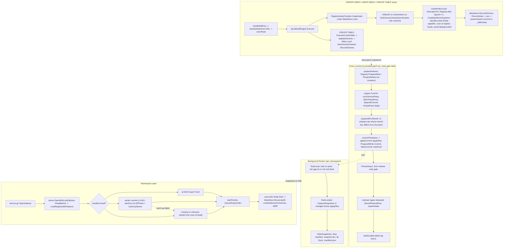

</details>

### Call chain

**A. CREATE INDEX / DROP INDEX**

| # | Function (pkg.Type.Method) | File:line | What it does |
|---|---|---|---|
| 1 | `sql.rdParser.parseCreateIndexBody` | `sql/parser.go:256` | Parses `CREATE [UNIQUE] INDEX name ON table (path [WEIGHT w], ...) [USING HASH|BTREE|FULLTEXT|VECTOR] [WITH (k = v, ...)]` into `sql.StmtCreateIndex` (`sql/model.go:46`). `parseDropIndexBody` is `:356` -> `StmtDropIndex{Name, Table}`. There is still no `ALTER TABLE`. |
| 2 | `server.classifyStatement` + `execRead` | `server/wire_listen.go:830`, `:846` | `StmtCreateTable/StmtCreateIndex/StmtDropIndex` are DDL and go through `execRead` (called from `handleSqlExec`, `:687`, at `:728`): no scan grant (the grant is taken only for `StmtSelect`), `ReadOnly:false` authorization. `ctx.NamespaceID` is the routed target namespace (see Description), `ctx.AtCommit` the read head. |
| 3 | `sql.defaultEngine.Execute` | `sql/engine.go:90` (`:113` CREATE TABLE, `:122` CREATE INDEX, `:130` DROP INDEX) | Delegates to the `IndexDDLExecutor`, present only when the engine's `IndexProvider` also implements it (`engine.go:84`); otherwise a planning error. |
| 4 | `server.RegistryIndexProvider.CreateIndex` | `server/index_provider.go:336` | `uniqueConstraintFor` (`:399`) first. Then inside `runtime.Meta.Local` (`server/meta.go:274`, holds `MetaStore.applyMu`): `SetSchemaChecked(constraint)` when a constraint is needed (checked against existing data), `createIndexLocal` unless constraint-only, `Meta.RecordSchema` for the constraint, `Meta.RecordIndex`. Any failure undoes what came before (`registry.Remove` + `saveIndexCatalog`, `SetSchema(previous)`). With no runtime (tests) only `createIndexLocal`, and a UNIQUE request is refused. |
| 5 | `server.uniqueConstraintFor` | `server/index_provider.go:399` | Nil when not UNIQUE or the schema already has the tuple (`schema.KdbSchema.UniqueTuples`, `schema/schema.go:38`); error when `!IsSchemaless()` (`schema.go:124`); else `WithUniqueTuple` (`schema.go:129`). |
| 6 | `server.RegistryIndexProvider.createIndexLocal` | `server/index_provider.go:426` | Under `persistMu`: `descriptorFor`, `registry.Add`, `index.InvalidateStoreSnapshot` (`index/persist.go:140`, removes a manifest a dropped index of the same id may have left at this head, dir fsync), `rebuildLocked([id])`, `saveCatalogLocked`. A failed rebuild removes the index again. `createIndexesLocal` (`:463`) is the batch form: register all, one `rebuildLocked(ids)` scan for all. |
| 7 | `server.descriptorFor` | `server/index_provider.go:542` | Type defaults to HASH. Only FULLTEXT and BTREE may cover several fields. A composite BTREE must use top-level fields, takes no `field_type`, and cannot be UNIQUE. Options: `index_name`, lower-cased `WITH` keys, `weights` for FULLTEXT; VECTOR requires positive `dimensions`. `IndexID = index.DerivedIndexID(ns, name, type)` (`index/schema_descriptors.go:25`), the same on every node. |
| 8 | `index.Registry.Add` | `index/registry.go:84` | Rejects duplicate id, duplicate name, or the same type over the same field list (a composite on `(a,b)` and a single on `a` may coexist). `factory.Create` (`index/stores/factory.go:26`: HASH/BTREE -> `index.MemoryStore`, FULLTEXT -> `fulltext.NewFullTextStore`, VECTOR -> `vector.NewVectorStore`). Bumps `Registry.epoch` (also on `Remove`, `:119`), so a write prepared before the change is re-prepared when it commits. |
| 9 | `server.RegistryIndexProvider.rebuildLocked` | `server/index_wiring.go:202` | Holds `applyMu` (so no commit reaches the stores during the rebuild) and scans at the **registry's** head, not the DAG's (a commit already in the DAG may be waiting on `applyMu`; including it in the scan would apply it twice). Falls back to `DAG.Head()` if the registry has no head. `registry.RebuildFromScan(runtime.scanAtCommit(head), head, only)`, then `kickFlush`. `rebuild` (`:189`) takes `persistMu` first. |
| 10 | `server.KdbServerRuntime.scanAtCommit` | `server/index_wiring.go:152` | `Storage.ScanDocuments(ns, commit.DocumentTreeHash, 256, ...)` over the raw adapter (not the expiry-hiding view). |
| 11 | `index.Registry.RebuildFromScan` | `index/registry.go:513` | `Clear()` each selected store, then **one parse per document for all selected stores** (`parsedDoc.prepare`) and `Apply(headCommit)`; extraction failures are counted in `RebuildStats.Skipped`; `ForgetHistory()` on each store (rebuilt content has no history, so a read at an older commit gets `ErrHistoryUnavailable`, not a wrong answer); `MarkCommit(headCommit)`. |
| 12 | `index.MemoryStore.PrepareParsedDocument` / `memoryPreparedPut.Apply` | `index/memory_store.go:128`, `:232` | Single field: one key per distinct scalar candidate (arrays multikey, `PathValues`/`KeyFromJSONValue`). Composite BTREE: `compositeBTreeKeys` (`:185`) builds one clustering-style `CompositeKey`; absent/null prefix field files nothing, null last field files a NULL part, an array/object anywhere files `IrregularCompositeKey` (read first by every walk). Composite HASH-like (FULLTEXT excluded) keys: first candidate per field. `Apply` logs a delete for the doc at `commitHash`, then puts. |
| 13 | `server.MetaStore.RecordIndex` -> `put` -> `systemUpsert` | `server/meta.go:296`, `:232`, `:812` | Doc id `codec.DerivedUUID("kdb:meta/index/<ns>/<name>")` (`metaIndexID`, `:189`), body `metaDoc{kind:"index", ...}`. `put` marks the body seen, skips an identical body, else `systemUpsert` -> `systemCommit` (`:818`) -> `runTransaction` with `system:true` on the `_kdb/meta` runtime (full-document replacement via `replacing`). |
| 14 | `RegistryIndexProvider.DropIndex` / `dropIndexLocal` | `server/index_provider.go:512`, `:525` | Under `Meta.Local`: `registry.Remove(name)` (`index not found` if absent), `saveCatalogLocked`; then `Meta.RecordDropIndex` (`meta.go:307`) writes a `dropped:true` tombstone. The dropped index's `<indexDir>/<id>/` stays on disk; a later create of the same id invalidates its manifest first (row 6). |
| 15 | `server.KdbServerRuntime.ensureExpiryIndex` | `server/expiry_index.go:62` | System BTREE on the expiry field with TIMESTAMP keys (`expiryIndexDescriptor`, `:41`; `OptionSystem`, never returned by `Registry.ByField`, `index/registry.go:175`). Built (via `rebuildLocked`) when a policy is set and none matches, dropped when the field changes or the policy goes. Called from `OpenIndexes` (`index_wiring.go:127`) and `SetDocumentExpiry` (`server/expiry.go:55`). Failure is logged; expiry then reads bodies. |

**B. Index maintenance on every commit**

| # | Function (pkg.Type.Method) | File:line | What it does |
|---|---|---|---|
| 16 | `server.KdbServerRuntime.commitAtGateFront` | `server/server_runtime.go:889` | The gate-holding half of `runTransaction` (`:825`, gate acquired `:870`), shared with immediate UPDATE/INSERT (`server/immediate_update.go:325`). Order: `prepareIndexes` (`:893`), engine call (`:898`), `changes.record` (`:905`), `preparedForStored` (`:909`) + `commitToIndexes` (`:913`, hints discarded `:917`), `PersistAsync` (`:928`), `releaseNow()` (`:933`), `indexProvider.maintain()` (`:937`), `waitDurable()` (`:940`), `CommitListener`. |
| 17 | `server.KdbServerRuntime.prepareIndexes` | `server/index_wiring.go:530` | Nothing when no provider or no descriptors. Else `prepareCommitForIndexes` (`:408`): `Registry.PrepareWrite(docID, patch)` per `WriteOp`, `PrepareDelete` per `DeleteOp`. |
| 18 | `index.Registry.PrepareWrite` | `index/registry.go:243` | Snapshots the entry list and `epoch`, parses the JSON once, `prepare` per store; no store mutated. Error (`*index.DimensionMismatchError`, unparseable JSON) rejects the transaction before anything lands. |
| 19 | `transaction.defaultEngine.Commit` -> `finalizeTransaction` -> `plan` / `PreparedCommit.Apply` | `transaction/default_engine.go:29`, `:198`, `transaction/prepare.go:103`, `:229` | Validate, conflict-check, `planUniqueKeys` (`prepare.go:202`); `Apply` stages, `CommitTree`, `AppendCommitWith`, then `uniqueKeys.Apply` (`prepare.go:314`). `operationsAsStored` puts the stored (merged) documents into the commit's ops. |
| 20 | `server.RegistryIndexProvider.preparedForStored` | `server/index_wiring.go:433` | For each `WriteOp` whose stored body differs from the request's patch (merge patch, resolver rewrite), prepares again from the stored body; reuses the preparation otherwise. Fixes the old "index the patch" defect (`a884cd84`). |
| 21 | `server.RegistryIndexProvider.commitToIndexes` -> `applyCommit` | `server/index_wiring.go:465`, `:504` | Under `applyMu`: empty set -> `MarkCommit(hash)`; else `PreparedWrite.Commit(hash)` per write; a failure sets `p.inconsistent` (no snapshot is written until a full rebuild). Always `kickFlush`. Nothing written to disk. |
| 22 | `index.PreparedWrite.Commit` | `index/registry.go:268` | Deletes: `store.Delete` on every store. Writes: re-prepare if `epoch` moved (a store was added/removed since prepare), then each `Apply(commitHash)`; `MarkCommit`. `MarkCommit` (`:349`) also records the commit in the shared history window and every 32 commits flags a history check (deferred; `DeferHistoryBounding`, `:385`). |
| 23 | `server.RegistryIndexProvider.maintain` | `server/index_wiring.go:479` | Runs after the gate is released (TryLock: a pass already running covers this commit). `Registry.BoundHistoryIfDue` (`index/registry.go:388`) -> `boundHistory` (`:432`): shrink the shared window by 1/4 (min 256 commits) and `TrimHistoryOutside` every store while total history bytes exceed the budget, grow it back by 5/4 when under half. Then `repairHeads` (`:492`): `Registry.NeedingRebuild` (`registry.go:657`) and `rebuild(ids)` of any store whose head state could not follow. |
| 24 | `index.Registry.SetHistoryBudget` | `index/registry.go:413` | Set by `OpenIndexes` (`index_wiring.go:83`) to `MemoryBudgetBytes() * storage.DefaultIndexHistoryFraction` (0.05, `storage/memory_budget.go:189`). One window in commits for all stores, so a read behind head is answerable by every index or none. |
| 25 | `index.eventLog` (keyed head state + window) | `index/event_log.go:12-44`, `lookup :662`, `rangeScan :717`, `viewLocked :488`, `planLocked :538` | Authoritative state is the replay result at the head cutoff, advanced in place (`index.Lineage`, `index/lineage.go:8-37`, shared with FULLTEXT and VECTOR stores). Only the last `DefaultHistoryEvents` (32768) events are kept; a read at an older commit undoes newer retained events. A read the window cannot answer returns `ErrHistoryUnavailable`. New keys are spliced into the sorted key order by binary search (`keyTable.spliceSorted`, `index/keytable.go:147`). |
| 26 | `server.RegistryIndexProvider.ExactLookup` / `ExactCount` / `RangeLookup` / `searchText` / `searchVector` | `server/index_provider.go:117`, `:138`, `:166`, `:215`, `:228` | On `ErrHistoryUnavailable` keyed lookups report `ok=false` (executor scans the documents); FULLTEXT/VECTOR build a throwaway store from a scan at that commit (`storeAt`, `:244`). |
| 27 | `server.serverPrepared.Apply` (cross-namespace) | `server/namespace_set.go:454-472` | Same hooks: `prepareIndexes` in `serverParticipant.Prepare` (`:422`), then after `pc.Apply` `preparedForStored`, `commitToIndexes`, and `maintain` (here still under the participants' gates). |
| 28 | `server.serverLocalNode.Advanced` (peer ingest) | `server/peersync_ingest.go:175` (migrations `:183-205`, indexes `:206-227`, uniques `:228-237`) | Applies replicated `SchemaMigrationOp`s via `schema.ApplyMigration` + `rt.SetSchema`. Indexes: `step.EachApplied` in batches (snapshot installs stream pages), `prepareCommitForIndexes` + `commitToIndexes(last.Hash)` + `maintain`; any error -> `p.rebuild(nil)`. Uniques: `RebuildLenient` and `recordUniqueDuplicates` when the schema has unique constraints. |

**C. Background snapshot flush**

| # | Function (pkg.Type.Method) | File:line | What it does |
|---|---|---|---|
| 29 | `server.RegistryIndexProvider.flushLoop` / `indexFlusher.waitQuiet` | `server/index_wiring.go:354`, `:385` | Woken by `kickFlush`; waits for `indexFlushIdle` (1 s) with no kick and at least `max(indexFlushMinGap 5 s, 10 x last flush duration)` since the previous start (`:40-50`). |
| 30 | `server.RegistryIndexProvider.flushLocked` | `server/index_wiring.go:249` | Under `persistMu`; holds `applyMu` only for `Registry.CaptureSnapshots(p.saved)` (`index/registry.go:756`: serializes stores whose generation changed, records the head). Skips when `inconsistent`. Disk writes run with commits flowing. |
| 31 | `index.WriteSnapshots` / `writeStoreSnapshot` | `index/registry.go:782`, `index/persist.go:108` | Per store: changed data -> `InvalidateStoreSnapshot` (remove manifest + dir fsync), `WriteFileAtomic(snapshot.bin)` (`persist.go:44`: temp, fsync, rename), dir fsync; then `WriteFileAtomic(manifest.json)` naming the head. Unchanged store: manifest only. |
| 32 | `server.RegistryIndexProvider.Close` | `server/index_wiring.go:293` | Close hook (`AddCloseHook`, `index_wiring.go:117`): stop flusher, write catalog and a final flush. |

**D. Schema validation and change**

| # | Function (pkg.Type.Method) | File:line | What it does |
|---|---|---|---|
| 33 | `sql.DDLExecutor.ExecuteCreateTable` | `sql/ddl.go:13` | Refuses an existing schema; builds fields (`Indexed = col.Indexed || col.Unique`) and `UniqueConstraint`s; `schema.BuildWithConstraints` (`schema/schema.go:177`). Returned as `QueryResult.AppliedSchema`, applied by the caller. |
| 34 | `server.sqlWireConnHandler.execRead` (AppliedSchema) | `server/wire_listen.go:951-970` | `rt.Meta.Local`: `SetSchemaChecked`, then `RecordSchema`; on record failure `SetSchema(previous)`. |
| 35 | `server.KdbServerRuntime.SetSchemaChecked` / `SetSchema` / `RebuildUniqueKeys` | `server/server_runtime.go:483`, `:466`, `:432` | Swap under `schemaMu`, rebuild `UniqueKeyRegistry` from a head scan (`transaction/unique_registry.go:146`); checked variant restores the old schema on failure. |
| 36 | `server.MetaStore.RecordSchema` | `server/meta.go:284` | Hex of `schema.ToBytes()` at `metaSchemaID(ns)` (`:180`), same `put` path. |
| 37 | `transaction.runSchemaPhase` | `transaction/default_engine.go:322` | Every commit: rolling `pending` map; `WriteOp` merged over base then `schema.Validate`; `SchemaMigrationOp` -> `DecodeMigration` + `schema.ApplyMigration` on the rolling schema; commit stamped with the rolling schema hash. |
| 38 | `schema.Validate` | `schema/engine.go:14` | Required/type/enum checks per schema field (`checkFieldValue`, `:157`); unknown fields allowed. |
| 39 | `schema.ApplyMigration` | `schema/engine.go:52` | Version checks, `replayMigrationSteps` -> `applyMigrationStep` (`:352`), then `Build(...)` (not `BuildWithConstraints`). `schema.IsBreaking` (`schema/migration.go:52`) is not consulted by the commit path. |
| 40 | `transaction.planUniqueKeys` / `UniqueKeysFor` | `transaction/unique_registry.go:447`, `:296` | Against `targetDocTreeHash`: release keys of touched docs, check claims against registry, same-tx releases and same-tx claims; violation -> `UNIQUE_CONSTRAINT`. **Multikey**: an array part claims each non-null element, a compound tuple with array parts claims every combination (`multikeyValues :379`, `combinations :397`); empty array claims nothing. |
| 41 | `transaction.UniqueKeyRegistry.Apply` | `transaction/unique_registry.go:112` | Retract then claim after the DAG append. Never persisted: rebuilt at `NewKdbServerRuntime` (`server_runtime.go:355`; failure stored in `UniqueKeyRebuildError`). |

**E. Open / restart / reconcile / catch-up**

| # | Function (pkg.Type.Method) | File:line | What it does |
|---|---|---|---|
| 42 | `service` startup | `service/service.go:392` (primary), `:510` (other served namespaces) | `OpenIndexes(stores.Options{})`; failure is fatal. |
| 43 | `server.KdbServerRuntime.OpenIndexes` | `server/index_wiring.go:58` | Closes a previous provider; `indexDir()` (`:140`). No `DataRoot` -> in-memory registry. Else `stores.OpenWithLoadOptions(..., LoadOptions{KeepBehind: true})` (`index/stores/factory.go:49`). Sets the shared history budget, records Fresh stores' generations as saved, `catchUp(report.Behind)`, `rebuild(stale + failed catch-ups)`, `startFlusher`, close hook, `SetSQLIndexProvider`, `SetSearchProvider`, `ensureExpiryIndex`. |
| 44 | `index.LoadRegistryWithOptions` | `index/registry.go:838` | Catalog (missing -> empty), `Add` each descriptor, `LoadStoreSnapshot` (`index/persist.go:172`). Manifest at DAG head -> Fresh. With `KeepBehind`, manifest naming another commit the DAG holds -> `Behind{Head}` (content kept). Else (no/unreadable snapshot, unknown commit) -> cleared, Stale. |
| 45 | `server.RegistryIndexProvider.catchUp` / `catchUpFrom` | `server/index_catchup.go:25`, `:75` | Under `persistMu` + `applyMu`. Groups Behind stores by snapshot commit; `document.DiffTrees` between the snapshot commit's tree and head's (`TreeResolver.TreeAt`), reads changed docs at head, `Registry.CatchUpStores` (`index/registry.go:586`: apply changes tagged head, `ForgetHistory`, `MarkCommit(head)`). Any failure clears those stores and returns them for a rebuild. |
| 46 | `syncnode.Node.Start` -> `MetaStore.ReconcileAll` | `syncnode/node.go:341` (call `:349`), `server/meta.go:596` | Reads all `_kdb/meta` definitions, per served namespace `effective(ns)`, `createIndexesInOneScan` (`meta.go:669`: when two or more defined indexes are missing, `createIndexesLocal` builds them in one scan), then `apply` each. Also on every `_kdb/meta` commit (`loop`, `:220`). `NewMetaStore` at `syncnode/node.go:167`; later-opened namespaces via `MetaStore.ApplyTo` (`meta.go:646`, called `node.go:288`). |
| 47 | `server.MetaStore.apply` / `applySchema` / `applyIndex` | `server/meta.go:693`, `:754`, `:769` | `seen` map skips bodies already applied/recorded; failure -> `meta-apply` conflict entry. `applySchema`: `SetSchemaChecked` unless hash equal. `applyIndex`: drop on tombstone; leave if `sameIndex` (`:804`); drop + recreate if different; else `createIndexLocal` (no UNIQUE-constraint check here, on purpose). |
| 48 | `control.Server.handleIndexes` | `control/indexes.go:25` (route `control/server.go:323`) | Lists descriptors, `indexedThrough` vs DAG head. Its note (`:94`) says unsnapshotted state "is replayed from the log on the next open"; actually it is caught up from a tree diff (or rebuilt by scan). |

### Data that changes

| Step | Structure / file / wire message | Mutation |
|---|---|---|
| CREATE INDEX: register | `index.Registry.entries`, `Registry.epoch` | Entry appended, epoch incremented (in-flight prepared writes re-prepare). |
| CREATE UNIQUE INDEX (schemaless) | `Runtime.Schema`, `UniqueKeyRegistry`, `_kdb/meta` `kdb:meta/schema/<ns>` | Constraints-only schema installed (checked), recorded as a commit. |
| CREATE INDEX: backfill | the new store's head state / event log | `Clear`, one entry per scanned document tagged with the registry head, history forgotten. |
| CREATE INDEX: catalog | `<indexDir>/catalog.json` | Rewritten atomically at DDL time. Snapshot of the new store follows in the background. Old manifest of a same-id store removed (dir fsync). |
| CREATE INDEX: replicated definition | `_kdb/meta` document `kdb:meta/index/<ns>/<name>` | One durable commit, replicated by peer sync. |
| DROP INDEX | `Registry.entries`, `catalog.json`, `_kdb/meta` | Entry removed; catalog rewritten; tombstone written. `<indexDir>/<id>/` left on disk. |
| Commit: prepare | `index.PreparedWrite` (with epoch) | In-memory extraction; nothing mutated. |
| Commit: apply | each store's event log / head state; `Registry.head`; store generation; shared history window (`recent`, `recentSeq`) | Under `applyMu` and the write gate. |
| Commit: maintain | stores' head states and history windows | After the gate is released: history trimmed to the shared window, broken head states rebuilt. |
| Background flush | `<indexDir>/<id>/snapshot.bin`, `manifest.json` | Only changed stores rewrite data; others move their manifest to the new head. Manifest removed (dir fsync) before new snapshot bytes. |
| Commit: uniques | `UniqueKeyRegistry.owners` | Retract + claim after DAG append (multikey claims for arrays). Not persisted. |
| CREATE TABLE / schema set | `Runtime.Schema`, `UniqueKeyRegistry`, `_kdb/meta` | Schema replaced; registry rebuilt from head scan; schema recorded. |
| SchemaMigrationOp commit (local) | commit ops; `Commit.SchemaHash` | Recorded and validated; `Runtime.Schema` **not** updated (only `peersync_ingest.go:204` calls `SetSchema` for migrations). |
| Open: load / catch-up / rebuild | in-memory registry, then disk via the flusher | Fresh restored; Behind caught up by tree diff; Stale cleared and rescanned; flush kicked. |
| Open: reconcile | `Runtime.Schema`, registry entries, conflict queue | As above; missing indexes built in one scan. |

### Failure, edge cases & durability points

**Where durability actually is.**
- **Documents and `_kdb/meta` definitions** are durable at the delta-log fsync (`waitDurable`, `server_runtime.go:940`). They are the source of truth.
- **Index contents are never part of that boundary.** Snapshots are captured at heads that are not yet durable (indexes advance before the commit is fsynced). `writeStoreSnapshot` therefore removes the old manifest durably before replacing the snapshot, so a manifest is never beside bytes newer than it names. After a crash a manifest may name a commit that did not survive: `d.HasCommit` is false, the store is Stale and rebuilt. A manifest at a surviving earlier commit is caught up from the tree diff (cost proportional to changed documents, not the namespace). A clean close writes a final flush, so a clean reopen needs neither.
- `catalog.json` is written at DDL time; snapshots lag by at least the 1 s quiet period. A catalog entry with no current snapshot is rebuilt on open.

**Ordering hazards and errors on the commit path.**
- Extraction errors reject the commit before the DAG append (`server_runtime.go:893-896`). If `preparedForStored`/`commitToIndexes` fails after the append (`:909-916`), the client gets an error although the commit is in the in-memory DAG and **not yet queued** for persistence (`PersistAsync` is at `:928`); `p.inconsistent` then suppresses snapshot writes until a full rebuild. Unchanged hazard, not compensated.
- The patch-vs-stored-document defect is fixed: `preparedForStored` indexes what the commit stored (`index_wiring.go:425-458`).
- **`applyMu` is taken by `commitToIndexes` under the write gate**, and also held for the whole of `rebuildLocked` (CREATE INDEX backfill, `ensureExpiryIndex`, `repairHeads`, peer-ingest fallback rebuild) and `catchUp`. So a CREATE INDEX on a large namespace now **stalls every commit on that namespace** for the duration of the scan (commits block at `applyCommit` while holding the gate). That is the price of the `d2207c37` race fix; `flushLocked` holds it only for the in-memory capture.
- A read whose commit is outside the shared history window falls back: keyed lookups -> full scan; FULLTEXT/VECTOR -> throwaway store built from a scan at that commit (`storeAt`). Correct but potentially very slow for paged reads far behind head under a tight memory budget.
- Cross-namespace commits prepare indexes for every participant before any apply, so one bad vector rejects the group; their `maintain` runs inside `Apply`, while the participants' gates are still held.
- Peer-ingested commits: index failure triggers `p.rebuild(nil)` rather than refusing history.

**CREATE INDEX specifics.**
- Backfill is synchronous inside the statement and holds `MetaStore.applyMu`, `persistMu` and `applyMu`. The concurrent-writer races (commit applied into a store mid-rebuild; store added between a commit's prepare and apply) are fixed by `applyMu` + registry-head scan and by the registry epoch.
- Residual: the new store is visible to readers (`Registry.ByField`) from `Add`, before `RebuildFromScan` has filled it, and there is no "building" state. A concurrent SELECT on that field during the backfill can get `ok=true` from a partial store. Plausible from the code, not exercised by a test read here.
- Errors reach the client via `sqlResultErrorClassified` as text (no error code maps for these types).
- A schema field marked `INDEXED` gets no store; an equality predicate on it is a scan unless a `CREATE INDEX` exists. `ExactLookup`/`RangeLookup` find stores by first field (`ByField`), skipping composite and system stores; composite BTREEs are read only through `CompositeBTrees` walks.

**Schema change specifics.**
- `CREATE TABLE` only on a namespace with no schema; no `ALTER TABLE`. Migrations come from encoded transactions (`transaction.Builder.SchemaMigration`), `schema.MigrationBuilder`, or replication.
- **Still open:** a locally committed `SchemaMigrationOp` is validated and stamped but `Runtime.Schema` is not advanced on the committing node; only peer ingest applies it (`peersync_ingest.go:183-205`).
- **Still open:** `schema.ApplyMigration` rebuilds with `Build`, dropping compound `UniqueConstraint`s (`schema/engine.go:77`). Since `CREATE UNIQUE INDEX` now installs compound constraints this way, a later migration on such a namespace would silently drop them.
- **Still open:** the control-plane SQL console discards `AppliedSchema` (`control/data.go:344`), so `CREATE TABLE` there is neither applied nor recorded. `CREATE [UNIQUE] INDEX` through the console works (the provider does the work, including the constraint).
- `SetSchemaChecked` is the only check that a newly unique field matches existing data; turning a field required does not re-validate existing documents.
- After restart the schema comes back only through `MetaStore`; a node without `syncnode` must supply it.

**Tests that pin this behaviour (leads, not re-run):** `server/index_wiring_test.go`, `server/index_catchup_test.go`, `server/index_ddl_concurrency_test.go`, `server/index_merge_patch_test.go`, `server/index_snapshot_flush_test.go`, `server/index_history_test.go`, `server/snapshot_restart_test.go`, `server/unique_index_wire_test.go`, `server/expiry_index_test.go`, `server/composite_index_test.go`, `server/meta_test.go`, `transaction/unique_registry_test.go`, `schema/engine_test.go`.
## 9. Peer sync (v2 client and server)

All paths are relative to `go/kdb/`. Line numbers are from e79bb674.

### Description (short)

Peer sync v2 is a request/response protocol over one connection (TCP via `tcp.Transport`, or WebSocket via `syncnode.Node.Handler`). A client (`peersync.SyncV2`) says `SYNC_HELLO`, the host (`peersync.V2Host`) authenticates the principal, grants each matching namespace with a direction (`pull`, `push`, or both), intersects capabilities (`zstd-pack`, `squash`, `attachments`, `graft`, `repair`, ...) and answers with every granted namespace's refs. The client then handles each namespace independently: **pull first**, then **push**. A pull takes its turn on the namespace's pull gate (one pull per namespace at a time on this node), then picks one catch-up route: a **snapshot bootstrap** (empty namespace, peer shallow or `bootstrap=snapshot`; pages staged to disk, then installed under a gate that refuses writers), a **squash catch-up** (jump straight to the peer's head when policy says so), or ordinary **replay** (`FETCH_REQUEST` pages, stored unlogged, main fast-forwarded early every 32 MiB, then a ref decision through `peersync.ApplyRef`). The push sends `REF_UPDATE` pages from a cursor; the host stores them and makes the same `ApplyRef` decision (also adopting early). Pull-before-push means that after a merge the push is a fast-forward on the peer. Histories rooted at a snapshot are handled by `Graft` (when the chain sets `allowUnrelated`), by **boundary extension** (a peer branch forked below this node's own snapshot root: take the fork point's state), or healed later by `Deepen` over a separate repair session. Attachment blobs travel alongside commits (`BLOB_FETCH`/`ATTACHMENT_UPLOAD`); see the attachments flow.

The usual driver is `replication.Replicator` (one `peerLoop` per configured peer, started by `syncnode.Node.Start`), triggered by a debounce after local commits, by an interval timer (default 30s), or by `POST /v1/peers/{name}/sync`. A peer configured `bootstrap=snapshot` runs its first sync before every other peer's first sync. `SyncV2` falls back to the v1 single-namespace protocol when the peer answers `SYNC_HELLO` with `UNSUPPORTED`. The Kotlin client/host speak the same v2 core (interop is tested from the Kotlin side); this section traces the Go code.

### Diagram


<details><summary>Mermaid source</summary>

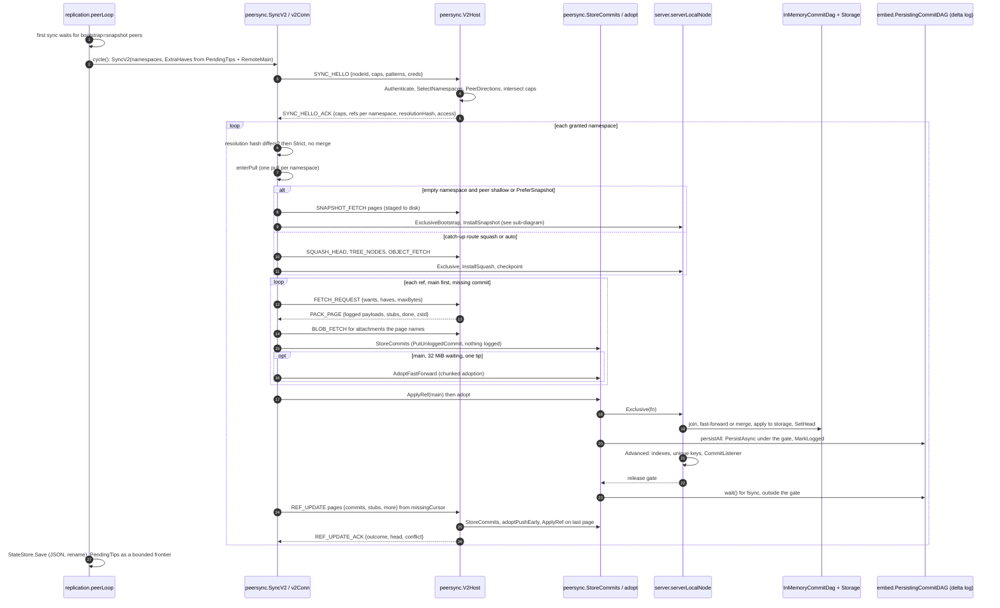

</details>

Sub-flow: snapshot bootstrap and squash catch-up (both admit a shallow root without a replayable log record, so both are made durable by a checkpoint).


<details><summary>Mermaid source</summary>

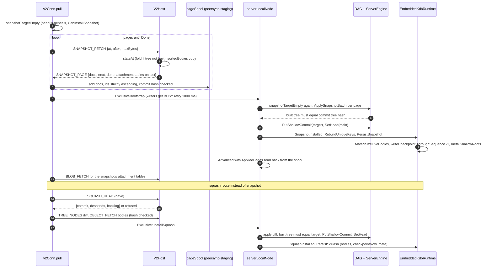

</details>

### Call chain

| # | Function (pkg.Type.Method) | File:line | What it does |
|---|---|---|---|
| 1 | `replication.Replicator.Start` | replication/replicator.go:109 | Starts one goroutine per peer (`peerLoop.run`) and kicks each once. Created by `syncnode.Node.Start` (syncnode/node.go:341, `replication.New` at :368). |
| 2 | `replication.Replicator.OnLocalCommit` | replication/replicator.go:128 | Called from `syncnode.Node.notify` (syncnode/node.go:229) via the `CommitListener` chain (node.go:352-355); kicks every peer whose namespace patterns match `ns`. |
| 3 | `replication.peerLoop.run` | replication/replicator.go:311 | Wait on trigger (+ `Debounce`, default 50ms) or timer (`PeerConfig.Interval`, default 30s, `DefaultInterval` replication/config.go:82); on the first cycle a non-snapshot peer waits in `awaitSnapshotPeers` (:369, bounded by the request timeout) until every `bootstrap=snapshot` peer (`bootstrapsBySnapshot` :356) finished its first sync, so the snapshot decision is not raced away; calls `cycle`; on error uses `backoff` (:398, interval doubled per consecutive failure, capped at 10 min, +-10% jitter). |
| 4 | `replication.peerLoop.cycle` | replication/replicator.go:424 | Loads `PeerState`, builds `ExtraHaves` per namespace from `PendingTips` (capped at `MaxPendingTips`=64) plus last `RemoteMain`, calls `peersync.SyncV2` with `CatchUp`/`CatchUpNamespaces` (`catchup=` / `catchup-ns=` peer options), updates `Pulled/Pushed/Overshoot` (received minus stored), keeps `PendingTips` on failure as a bounded frontier (`pendingFrontier`, replication/pending_tips.go:22), optionally `deepen` (:780), `StateStore.Save`. Filtered peers go to `projectionCycle` (:651, flow 14). |
| 5 | `replication.peerLoop.connCx` | replication/replicator.go:549 | Credentials: `PeerConfig.Credentials()` callback or static user/password/token; a token also becomes an `Authorization: Bearer` header (WebSocket only). |
| 6 | `peersync.SyncV2` | peersync/v2_client.go:154 | `dial`, `SYNC_HELLO` with `ClientCapabilities` (= `HostCapabilities`, v2_host.go:201), checks ack, optional `META_VIEW` (:189), then `syncNamespace` per ack ref. `UNSUPPORTED` reply -> `syncV1Fallback` (:698). |
| 7 | `peersync.dial` | peersync/v2_client.go:801 | WebSocket transport uses `ws.Transport.ConnectWithOptions` (TLS + headers); everything else `transport.Connect`. Default transport chosen in replication/transport.go:14. |
| 8 | `peersync.v2Conn.request` | peersync/v2_client.go:763 | Send frame, wait for the reply with the same `CorrelationID` (timeout `Timeout`, default 30s), `PEER_ERROR` becomes `*RemoteError`; frames with another correlation id (e.g. unsolicited `REFS_CHANGED`) are skipped. One request in flight. |
| 9 | `server.ListenPeerSyncTLS` / `peerSyncConnHandler.run` | server/peersync_listen.go:47 / :181 | TCP accept loop, now capped at `PeerSyncMaxConnections` (default `DefaultPeerSyncMaxConnections`=64, server/memory_budget.go:95; negative = unlimited). Sessions are tracked in a `sessionSet` so `Listener.Close` ends open sessions and waits for their handlers. WebSocket path: `syncnode.Node.Handler` (syncnode/handler.go:24) -> `server.ServePeerSyncConnection` (peersync_listen.go:100), with `ConnectionContextFrom` (handler.go:49) turning the `Authorization` header into credentials. A handler error drops the connection; `run` always calls `V2Host.Close` on exit (drops staged grafts, uploads, watches). |
| 10 | `peerSyncConnHandler.handle` | server/peersync_listen.go:134 | The first frame fixes the protocol: `SYNC_HELLO` -> `peersync.NewV2Host` with `V2HostConfig` (Namespaces = `PeerNamespaces()` which lists *known* namespaces incl. idle-closed ones, `CreateOnPush`, `AuthorizeDocuments`, `MetaView`, `HomeRequest`, `WriteBack`, `WatchHead`+`Send` for `REFS_WATCH`, `OnCaughtUp`); anything else -> v1 `peersync.ConnectionHost`. |
| 11 | `peersync.V2Host.HandleFrame` / `serve` | peersync/v2_host.go:206 / :242 | Decode, require hello first, dispatch by message type (`REFS_WATCH`, `REFS_REQUEST`, `FETCH_REQUEST`, `REF_UPDATE`, `PROJECT_*`, `SNAPSHOT_FETCH`, `DOC_FETCH`, `GRAFT_PUSH`, `HOME_REQUEST`, `META_VIEW`, `TREE_NODES`, `SQUASH_HEAD`, `BLOB_FETCH`, `ATTACHMENT_UPLOAD`, `OBJECT_FETCH`); any `error` becomes `PEER_ERROR` with a code from `classify` (:222). Undecodable frame returns an error (connection dropped). |
| 12 | `peersync.V2Host.hello` | peersync/v2_host.go:399 | Rejects a peer with this node's own `NodeID`; authenticates (hello creds, else transport `ConnectionContext`); `SelectNamespaces` (peersync/patterns.go:42) against `NamespaceProvider.List`; `auth.PeerDirections` (auth/types.go:88) gives access; `CreateOnPush` grants literal unknown names (push only, advertised with no refs); stores principal/granted/access/peer/`helloAt`; negotiates `zstdPack` and `peerAttachments`; returns refs and `intersect(capabilities)` (`writeback`/`watch` added only when configured, :492). |
| 13 | `peersync.V2Host.refs` -> `RefsOf` | peersync/v2_host.go:542, peersync/refs.go:15 | Branches (tracking branches `peers/...` omitted), tags, `Horizon()` as `Shallow`, `HistoryFloorHex`, plus `ResolutionHash = env.Resolution.AdvertisedHash()` (peersync/conflict_detection.go:147) and the session's `Access`. |
| 14 | `peersync.V2Host.env` | peersync/v2_host.go:570 | Per frame: namespace must be in `granted`, direction (`dirPull`/`dirPush`/`dirEither`) re-authorized with `auth.AuthorizePeer` (auth/types.go:77); then `NamespaceProvider.Env` -> `server.peerNamespaceProvider.Env` (server/peersync_ingest.go:114, `NamespaceSet.Resolve` reopens an idle namespace) -> `KdbServerRuntime.PeerIngestEnv` (:37). |
| 15 | `peersync.v2Conn.syncNamespace` | peersync/v2_client.go:208 | `cfg.Local.Env(ns, CreateLocal && Mode&SyncPull)`; if local `AdvertisedHash` != remote `ResolutionHash`, forces `ConflictPolicyStrict` and sets `ResolutionMismatch`; skips the direction the peer's `Access` does not grant. |
| 16 | `peersync.v2Conn.pull` | peersync/v2_client.go:243 | `enterPull` (peersync/pull_gate.go:42): pulls of one namespace on this node take turns (keyed by DAG, wait at most `Timeout`, then proceed anyway); tips stored by other pulls are shared as haves. Then `needsSnapshot` (peersync/snapshot.go:457) -> `InstallSnapshot` + `fetchTableBlobs`; else `trySquash` (peersync/squash.go:143). Haves = `spreadAncestors(localHead)` (peersync/client.go:324) + `localRefHeads` (refs.go:171) + held `ExtraHaves` + gate-shared tips; per ref (main first, `orderedRefs` :672): `fetchRef` if the target is not held, then `ApplyRef`. Only main's failure aborts the namespace; other refs go to `RefErrors`. |
| 17 | `peersync.InstallSnapshot` | peersync/snapshot.go:224 | Two phases. (1) Outside any gate: `snapshotTargetEmpty` (:380), `fetchSnapshotPages` (:397: commit hashes to itself, every page names the same commit, ids strictly ascend) writes every doc into a `pageSpool` (peersync/spool.go:42) in `StagingDir` (`<dataRoot>/peersync-staging`, server/peersync_ingest.go:93). (2) `exclusiveBootstrap` (ingest.go:41) + `divergenceLockFor`: re-check empty (a local write that landed meanwhile wins, `ErrNotEmpty`), apply the spool in `DefaultPageBytes` batches (`storage.SnapshotApplier.ApplySnapshotBatch` on the server engine, else `PutDocument`+`CommitTree`), built tree must equal the declared tree, `PutShallowCommit`, `SetHead(main)`, `SnapshotInstalled` (durability), then `Advanced` with `AppliedPages` streamed back from the spool. `undo` rolls back (main first, `DropShallowCommit`, delete committed docs) on any failure. |
| 18 | `server.serverLocalNode.exclusive(bootstrap=true)` | server/peersync_ingest.go:137 / :142 | Same refusals as `Exclusive` (row 26), then `writeGate.beginLongHold` with a `BusyError{RetryAfterMs: 1000}`: every writer arriving during the install is refused at once with BUSY instead of waiting out its deadline. |
| 19 | host `SNAPSHOT_FETCH` case -> `peersync.snapshotPage` | peersync/v2_host.go:289, peersync/snapshot.go:36 | Resolves the state with `stateAt` (peersync/snapshot_state.go:46): storage's tree if built here, else folded forward from the nearest first-parent ancestor whose tree is held (verified against the declared hash, cached for the next page). Pages seek the trie after the cursor (`snapshotPageSeek` :101; `snapshotPageScan` :153 fallback), at most `maxBytes` (at least one doc). Large snapshots are served from a background, on-disk id-sorted copy of the bodies (`sortedBodiesFor`, peersync/snapshot_source.go:90) built by streaming the delta log. The last page carries the commit's packed attachment tables. Refused to a peer without `attachments` cap when the commit carries attachments (`checkPeerAttachments`, attachments.go:720). |
| 20 | `peersync.v2Conn.trySquash` / host `squashHeadPage` / `peersync.InstallSquash` | peersync/squash.go:143 / :99 / :237 | Squash catch-up (route per namespace via `catchUpFor` :54: `replay` default, `squash`, `auto` = backlog >= `AutoSquashMinBacklog` 1000 and >= 2x changed docs). Needs `squash`+`repair` caps and no `SquashRefused`; host refuses with a reason when the namespace has attachments or refuses squashes. Client verifies the target hashes to itself, `RepairSession.Diff` (repair.go:306, `TREE_NODES`) + `Fetch` (:328, `OBJECT_FETCH`, hash-verified). `InstallSquash` under `Exclusive` + divergence lock: head must still be `from` (`errSquashDeclined` otherwise -> replay), `checkSkew`, `CheckCommit`, apply the diff, built tree must equal target's, `PutShallowCommit(target)`, `SetHead`, `SquashInstalled` (`EmbeddedKdbRuntime.PersistSquash`, embed/snapshot_install.go:166), `Advanced`. Fast-forward only. |
| 21 | `peersync.v2Conn.fetchRef` | peersync/v2_client.go:450 | Loop of `FETCH_REQUEST{wants:[want], haves, maxBytes}`; `fetchBlobs` (attachments.go:298) before storing so no commit names bytes this node lacks; `StoreCommits`; on a store error: parents behind this node's own snapshot root (`gapsBelowBoundary`, boundary.go:74) -> `extendBoundary` (:106) takes the parent's state and retries; a peer shallow root (`unsharedRoot`, ingest.go:1058) -> `Graft` if the chain allows unrelated, else `noteUnrelated` (:1078). Records `ReceivedTips` as a bounded frontier (`foldTips`, peersync/frontier.go:26), shares tips with the pull gate, haves = start haves + last page's tips (`pageHaves` :61). When fetching main, after `AdoptEveryBytes` (default `DefaultAdoptEveryBytes` 32 MiB) of stored-not-adopted commits, `adoptEarly` (:546) -> `AdoptFastForward` if the page ends in one tip. |
| 22 | host `FETCH_REQUEST` case -> `V2Host.fetchPage` -> `missingCursor.pagePayloads` | peersync/v2_host.go:261, :132, peersync/refs.go:283 | `env(..., dirPull)`; the session keeps a `missingCursor` (`newMissingCursor` refs.go:233: one ancestor walk + topo sort per transfer) and serves the next page when the request continues it (`continues` :364); `errCursorStale` rebuilds once. Logged commits are served as their stored log payload (no decode/re-encode); page cut by `commitSize` estimate; stubs for archived parents; pack compressed when `zstd-pack` negotiated. On `Done` calls `OnCaughtUp` -> `NoteInboundPeer` (server/inbound_peers.go:39). |
| 23 | `peersync.StoreCommits` | peersync/ingest.go:233 | `PutStub` for stubs; for each commit not held: `checkSkew` (:177, `DefaultMaxClockSkew` 5 min) then `DAG.PutUnloggedCommit` (dag/unlogged.go:46): stored but marked unlogged so a checkpoint taken meanwhile does not describe it. Held commits whose operations were evicted and are not in the log are refilled from the peer's copy (`refillUnlogged` :265). Decides nothing, logs nothing, moves no head. |
| 24 | `peersync.Graft` | peersync/graft.go:54 | Needs `Chain.AllowsUnrelated()` (`ErrUnrelatedNotAllowed`) and `storage.ForeignTreeStore`; `admitRootFromState` (:65) pages the root's state, verifies commit hash + tree hash, then in `Exclusive`: `StoreForeignTree` (blob store flushed+synced), `GraftRecorded` (`EmbeddedKdbRuntime.RecordGraft`, embed/snapshot_install.go:137), `PutShallowCommit`, `persistAll`; waits fsync after the gate. Holds the whole state in memory until verified. |
| 25 | `peersync.extendBoundary` / host `pushBlockedByBoundary` | peersync/boundary.go:106 / :186 | Boundary extension: a commit whose parent P lies behind this node's snapshot root. P's state is fetched by `SNAPSHOT_FETCH` at P (host folds it, row 19), verified, admitted as a shallow root with Graft's durability order; no `allowUnrelated` needed. Push side: the host refuses the page with `SHALLOW_BOUNDARY` and remembers the gaps (`noteBoundaryGaps` v2_host.go:162, max 1024); the pusher sends the states by `GRAFT_PUSH` (`pushBoundaryStates`, v2_client.go:390) and resends the same page. |
| 26 | `server.serverLocalNode.Exclusive` | server/peersync_ingest.go:131 -> :142 | Refuses when draining (`UnavailableError`), read-only, fenced, or a projection (`ProjectionReadOnlyError`); takes `writeGate` with `WriteTimeout`; so peer sync is an ordinary writer of the runtime. |
| 27 | `peersync.ApplyRef` | peersync/refs.go:56 | Requires the proposed commit to be stored. Tag: `applyTag` (:120) create / no-op / conflict, never moves. Side branch: `applySideBranch` (:93) create / fast-forward / no-op / conflict (never merged). Main: `applyMain` (:73) -> `Adopt`. |
| 28 | `peersync.Adopt` / `AdoptFastForward` -> `adopt` | peersync/ingest.go:277 / :289 / :293 | Inside `Node.Exclusive` + `divergenceLockFor` (conflict_detection.go:186): re-reads head; fast-forward-only mode (chunked adoption) no-ops unless `HeadFastForward`; `CheckCommit` (single-home fence) on `adoptable` commits (:865, shallow roots filtered out); `ResolveHeadUpdate` (conflict_detection.go:35) -> no-op / `fastForward` (:693) / `resolveDivergedLocked` (flow 10, tries `joinSameContent` first); `persistAll` (:595); `advance` (:685) -> `serverLocalNode.Advanced`. A refused log write under the gate -> `undoAdoption` (:640) puts main and storage back. After the gate: waits all fsync futures (a failed wait re-marks the commits unlogged so no checkpoint describes them), `clearConflict`, `afterAdvance` (:424). |
| 29 | `peersync.fastForward` / `applyAndVerify` | peersync/ingest.go:693 / :714 | `commitsBetween` (:816), `netEffect` (:1029) folds to one final op per document, writes them to storage, `CommitTree` on the from-tree and requires the result to equal the incoming head's declared tree; on mismatch `restore` (:767) writes pre-images back and returns `*TreeMismatchError`; then `DAG.SetHead(main)`. |
| 30 | `peersync.IngestEnv.persistAll` -> `embed.PersistingCommitDAG.PersistAsync` | peersync/ingest.go:595, embed/persisting_dag.go:172 | `MarkLogged` then queue each adopted commit to the delta-log writer goroutine in order; returns a `wait()` that completes when the record is durable (log's `DurabilityMode`). `chainOnBarrier` (:195) also waits for an undecided cross-namespace group ahead under `DurabilitySync`. |
| 31 | `server.serverLocalNode.Advanced` | server/peersync_ingest.go:175 | Runs inside the gate after the head moved: applies replicated schema migrations, updates SQL indexes (rebuilds on failure), rebuilds unique-key registry (`RebuildLenient`, duplicates recorded as `ConflictUniqueDuplicate`), tracks foreign cross-namespace group parts, fires `CommitListener` for every commit (wakes the stream hub, `REFS_WATCH` sessions and the replicator). Its error does not undo the head move. |
| 32 | `peersync.v2Conn.push` | peersync/v2_client.go:557 | For each local ref whose value differs from the advertised one: skip main if `ResolutionMismatch` and not a fast-forward; `graftRootsFor` (:332); one `newMissingCursor` per ref, paged (`errCursorStale` rebuilds with what was held); refuses commits with attachments to a peer without the `attachments` cap; `uploadBlobs` (attachments.go:420) first; `REF_UPDATE{kind, ref, old, new, commits, stubs, more, zstd}`; a `SHALLOW_BOUNDARY` refusal -> `pushBoundaryStates` and resend once; records `Remote[ref]`, `ack.HeadHex`, remote conflict report. |
| 33 | `peersync.v2Conn.graftRootsFor` | peersync/v2_client.go:332 | For each local shallow root under the ref and unknown to the peer: probes with `FETCH_REQUEST{maxBytes:1}`; if the peer holds nothing, either skips the ref ("cannot graft") or uploads the root's attachment blobs and sends the root's state as `GRAFT_PUSH` pages. |
| 34 | `peersync.V2Host.graftPush` / `stageGraftPage` | peersync/v2_host.go:649 / :706 | Pages are staged **on disk** per namespace in a `pageSpool` under `StagingDir` (cap `MaxGraftPushBytes`, default `DefaultMaxGraftPushBytes` 256 MiB of bodies; pages must name one commit); on the `Done` page `admitGraftAttachments`, then either `extendBoundary` (the commit is a gap this session refused) or `Graft`, fed by re-reading the spool in `DefaultPageBytes` batches. Requires `dirPush`. Unfinished stages are dropped by `V2Host.Close` (:748). |
| 35 | `peersync.V2Host.refUpdate` / `adoptPushEarly` | peersync/v2_host.go:759 / :816 | `env(ns, CreateOnPush, dirPush)`; optional `authorizePushedDocuments` (:598); `StoreCommits`; a page with `More` may adopt main early (fast-forward only, once `AdoptEveryBytes` is waiting); the last page runs `ApplyRef`; ack carries outcome, head and JSON conflict report. |
| 36 | `replication.peerLoop.deepen` -> `peersync.OpenRepairSession` / `DeepenAll` / `Deepen` | replication/replicator.go:780, peersync/repair.go:239, peersync/deepen.go:383, :140 | Only when `PeerConfig.Deepen` and `deepenAfter` (:820: success, or a `ShallowBoundaryError`): separate connection (needs `repair` capability), `FetchAncestorsPaged` (deepen.go:108) pulls everything below each shallow root, stores parents-first, `ShallowRootsChanged` (marker), logs the history and the root, then `Unshallow`. |
| 37 | `RepairSession.FetchDocs` / `V2Host.docFetch` | peersync/doc_fetch.go:147 / :27 | `DOC_FETCH` read-through with Merkle proofs; needs read rights (`StreamSubscribeAction`) not sync rights; `verifyDocFetch` (:196) checks commit hash, proof against `DocumentTreeHash`, body against the proven content hash (`ErrUnproven`). Used by `server.ReadThrough` (flow 14). |
| 38 | `V2Host.startWatch` | peersync/watch.go:28 | `REFS_WATCH`: the host sends unsolicited `REFS_CHANGED` frames after each head move of a watched namespace (via `WatchHead`), so a peer can sync on change instead of polling. |
| 39 | `replication.StateStore.Save` | replication/state.go:111 | Per-peer JSON at `<dataRoot>/replication/peers/<name>.json` via tmp file + `fsx.Rename` (no fsync). |

### Data that changes

| Step | Structure / file / wire message | Mutation |
|---|---|---|
| Hello | `V2Host` fields `principal, granted, access, peer, helloDone, helloAt, zstdPack, peerAttachments` (v2_host.go:78-124) | Set once per connection; `granted/access` fixed for the session, authorization of each direction re-checked per frame. |
| Hello ack | `wire.SyncHelloAckMessage{Accepted, NodeID, Capabilities, Refs []NamespaceRefs}` | Carries `Branches`, `Tags`, `Shallow`, `HistoryFloorHex`, `ResolutionHash`, `Access`. |
| Host session | `V2Host.fetch` (`missingCursor` of the transfer), `pushWaiting`, `grafts` (on-disk spools), `boundaryGaps`, `uploads`, `watch` | Per connection; released by `V2Host.Close`. |
| Pull pages | `InMemoryCommitDag` commits (`PutUnloggedCommit`) + stubs (`PutStub`); attachment blobs in the namespace's `attachstore.Store` | Commits resident and **marked unlogged**; not in the delta log until adopted. Commits are verified against their own hash on store. |
| Chunked adoption | Main fast-forwarded to a single-tip prefix every 32 MiB of stored commits (pull: `adoptEarly`; push: `adoptPushEarly`) | Those commits are logged (and their operations evictable) during the transfer instead of all at the end. |
| Replication state | `NamespaceSyncResult.ReceivedTips` -> `NamespaceState.PendingTips` in `replication/peers/<name>.json` | Persisted only if the namespace failed, as a frontier of at most 64 tips; cleared on success. `Overshoot` counts received-but-already-held commits. |
| Fast-forward | Storage live tree (`PutDocument`/`DeleteDocument`/`CommitTree`), `DAG.PutDocumentTree`, `DAG.SetHead(main)`, SQL indexes, unique-key registry | One net op per document, verified against the head's declared tree; main moves to the incoming head. |
| Merge / join | A two-parent merge commit (`kdb:merge/1`, author `MergeAuthorNodeID`), or a content-free join commit when both sides hold the same content | See flow 10. |
| Delta log | `PersistingCommitDAG.PersistAsync` frames, in the order main reached them (remote side's commits, then the merge) | Appended by the log writer goroutine; durable when `wait()` returns; `MarkLogged` before, `MarkUnlogged` again if the wait fails. |
| Staging | `<dataRoot>/peersync-staging/` spool files (snapshot pages, pushed graft pages, host sorted-body runs) | Temporary; removed on close/idle. |
| Snapshot install | Storage documents + tree (bulk batches), `DAG.PutShallowCommit(target)`, `SetHead(main, target)`, then `PersistSnapshot` (embed/snapshot_install.go:60): `MaterializeLiveBodies`, `writeCheckpoint` with `ThroughSequence = -1`, marker `ShallowRoots += root`, `BodiesExternal = true` (`writeNamespaceMeta`: tmp + `Sync` + rename) | Namespace now opens "bootstrapped": open refuses to proceed without that checkpoint. |
| Squash install | Storage: diff applied; `PutShallowCommit(target)`; `SetHead(main, target)`; `PersistSquash`: `MaterializeBodies(changed)`, `checkpointNow` through the current log position, marker `ShallowRoots += target`, `BodiesExternal` | Durable only through the checkpoint (a replay would apply target's ops onto the wrong parent). |
| Graft / boundary extension | `ForeignTreeStore.StoreForeignTree` (blob store flush + sync), marker `GraftRoots += root` (`RecordGraft`), `PutShallowCommit(root)`, `PutDocumentTree`, root logged | The root is stored but **not** on main; main reaches its state only through the later merge. |
| Deepen | `DAG` gains the ancestors, marker `ShallowRoots` rewritten (`RecordShallowRoots`, snapshot_install.go:111), log frames for the history, then `Unshallow(root)` | Root stops being shallow; empty marker list means a full replay from genesis rebuilds the namespace. |
| Push | Peer-side effects of `REF_UPDATE`: `StoreCommits`, early adoption, then `ApplyRef` | `ack.Stored`, `ack.Outcome` in `{stored, fast-forwarded, merged, conflict, created, noop}`, `ack.HeadHex`. |
| Inbound-peer bookkeeping | `<dataRoot>/replication/inbound/<ns>.json` map peer -> session start time (`NoteInboundPeer`) | Written on every final `FETCH_REQUEST` page; feeds the peer retention floor (`InboundPeerFloor` -> `EmbeddedKdbRuntime.SetPeerRetentionFloor`, embed/runtime.go:281, wired at syncnode/node.go:149, :287). |
| Conflict queue | `<dataRoot>/replication/conflicts/<ns>/<id>.json` (`ConflictQueue.Record`, peersync/conflicts.go:174) and tracking branch `peers/<peer>/branch:main` (`TrackingBranch` :314) | Written when `ApplyRef` reports a conflict, a fence refuses a commit, or an unrelated history is found. |

### Failure, edge cases & durability points

- **Files once slated for deletion are live.** `peersync/join.go`, `boundary.go`, `snapshot_state.go`, `dag/join.go` and `dag/unlogged.go` all exist and are wired at e79bb674: unlogged marking (`PutUnloggedCommit`, `CheckpointSnapshotLogged` dag/checkpoint.go:91), boundary extension in `fetchRef`/`refUpdate`, folded snapshot state (`stateAt`), same-content join (`joinSameContent`, called first by `resolveDivergedLocked` merge_resolution.go:295) and `adoptable()` (ingest.go:865). The earlier "state of the tree" caveat no longer applies.
- **docs/kdb-lld-flows.md section 12 is v1.** It describes `HANDSHAKE`/`COMMIT_FETCH`/`COMMIT_PUSH` (peersync/host.go `ConnectionHost`, peersync/client.go), which still exists but is only the fallback (`syncV1Fallback`, v2_client.go:698) and the listener's behaviour when the first frame is not `SYNC_HELLO`. `CommitsToPush` (sync_plan.go:91) still has no non-test caller; v2 pushes with `missingCursor` (refs.go:233) and v1 with `MissingCommits` (sync_plan.go:37). v1 syncs main only.
- **Authentication and authorization.** No separate peer identity exists: the peer is an ordinary principal. `hello` authenticates with credentials in the hello or the transport `ConnectionContext`; failure returns `Accepted:false, Reason` (not `PEER_ERROR`). Authorization is per namespace and per direction using `PeerSyncAction` (both) else `PeerPullAction`/`PeerPushAction` (auth/types.go:57-91). Every later frame re-authorizes (`V2Host.env`); `DOC_FETCH`/`PROJECT_FETCH` use `StreamSubscribeAction` plus per-document `DocumentReadAction`; `HOME_REQUEST` and `GRAFT_PUSH` require push rights. Optional per-document write checks on pushed commits via `AuthorizeDocuments`. TLS/mTLS is the transport's.
- **Loop and identity guards.** A peer presenting this node's `NodeID` is refused (v2_host.go:406, "delete its NODE file").
- **Resource bounds.** Listener connections capped (64 default); one request in flight per connection; host-side fetch cursor per session (32 B per missing commit); pushed grafts and snapshot pages staged on disk, not memory (grafts still verified in memory, bounded by 256 MiB); `ReceivedTips`/`PendingTips` at most 64; boundary gaps at most 1024 per session; the pull gate's shared tips at most 64. `Graft` and `ForeignTreeStore` still hold a root's whole state in memory.
- **Failures surfaced.** Any host error becomes `PEER_ERROR{code,message}` -> `*RemoteError` on the client; codes come from `server.classifyError` (server/error_classification.go:17; `Busy` during a bootstrap, `NotHome`, `Unauthorized`, ...) and, for anything it maps to `Internal`, peersync's own `frameHandler.classify` (peersync/host.go:190-205: `Unsupported` incl. `AttachmentsUnsupportedError`, `ShallowBoundary` for `PushBelowBoundaryError`, `Integrity` for `TreeMismatchError`, ...). A namespace error is recorded in `NamespaceSyncResult.Err` and does not stop the other namespaces; `peerLoop.cycle` turns it into an overall error (backoff) while still saving partial progress. Per-ref errors other than main land in `RefErrors`.
- **Where data becomes durable.** (1) Pulled/pushed commits are *only memory* (`StoreCommits`, marked unlogged) until main adopts them; only adopted commits are logged because replay applies every logged commit onto main (ingest.go:91-100). Unlogged marks keep checkpoints from describing them. A crash loses unadopted pages; chunked adoption bounds that to the last 32 MiB of a long transfer of main; `PendingTips` resume the rest while the state file survives. (2) Adopted commits are queued with `PersistAsync` **under the write gate** (log order = main order) and the fsync is awaited **after** the gate is released; a refused queue write is undone (`undoAdoption`), but an fsync failure is returned after main already moved in memory ("peer sync: persisting adopted commits") and the commits are re-marked unlogged. (3) Snapshot bootstrap is durable only via `SnapshotInstalled` (`RebuildUniqueKeys` first, then `PersistSnapshot`; peersync_ingest.go:56-80): bodies to the blob store, then checkpoint, then the marker (tmp, `Sync`, rename). Failure triggers `undo`, leaving the namespace empty and bootstrappable. (4) Squash catch-up is durable only via `PersistSquash`'s checkpoint, taken under the gate so no local write is logged on top of an un-checkpointed target; refused when checkpoints are disabled. A crash before it leaves the namespace at its old head. (5) Graft and boundary-extension order: blob-store sync of tree+bodies, then marker, then log the root. (6) Deepen orders marker -> log -> in-memory `Unshallow` -> marker rewrite; re-running finishes the job. (7) `replication.StateStore.Save`, `NoteInboundPeer` and `ConflictQueue.writeLocked` write a tmp file and `fsx.Rename` (plain `os.Rename` off Windows) **without fsync**; losing them costs a negotiation or a re-recorded conflict, never data.
- **Edge cases.** Resolution-hash mismatch (different chains, or a procedure missing/at another revision -> advertised hash `unavailable:<hash>`): neither side merges; pulled divergences are queued as conflicts and main is pushed only when it fast-forwards the peer. `Access` of `push` skips pull and vice versa. Pushing to a namespace the peer lacks needs `CreateOnPush`. `needsSnapshot` only fires for an empty (genesis-only) local namespace and a peer with `Shallow` roots, a `HistoryFloorHex`, or `PreferSnapshot`. A local write landing while snapshot pages are in flight wins (install refused `ErrNotEmpty`); one arriving during the install phase gets BUSY. Squash is declined (falls back to replay) when the namespace has attachments, the host or local env sets `SquashRefused`, main moved meanwhile, or the target is already held. `PageBytes` default is 4 MiB estimated (`DefaultPageBytes`, refs.go:183); v1 pages by commit count (`DefaultPageCommits` = 500, peersync/types.go:58). A peer without the `attachments` cap is refused any commit or snapshot carrying attachments (`AttachmentsUnsupportedError`).
- **Concurrency.** Server-side, `adopt`, `Graft`, `InstallSnapshot`, `InstallSquash` and `Deepen` serialize on `Node.Exclusive` (the runtime's `writeGate`) *and* the per-namespace `divergenceLockFor` mutex; `fetchRef`/`StoreCommits` run outside both and only touch the DAG (own lock). Pulls of one namespace on one node also serialize on the pull gate (bounded wait), pushes do not.
- **Not present.** No per-peer rate limiting in this package; no persistent peer identity beyond the NODE id presented in the hello; squash catch-up is fast-forward only and skips namespaces with attachments.

---


## 10. Conflict detection and stored-procedure merge resolution

### Description (short)

A conflict exists only when two heads of `main` have diverged (neither is an ancestor of the other) **and** both sides changed the same document to different values. `peersync.adopt` calls `resolveDivergedLocked`, which first tries a **same-content join**: two heads with the same document tree and schema need no merge of their own, only the canonical join of the content-carrying history they stand for (identical on every node, so a quiet mesh converges instead of minting a merge per pair). Otherwise it compares each candidate document's value at both heads and follows each value to the write that originated it (`valueIndex.origin`), so a node's own earlier write echoed back through a peer's merge is not counted as a change. Non-conflicting documents merge automatically. Each genuinely conflicting document goes through, in order: an operator's explicit `Choose`, the namespace's **resolution chain** (`source-priority`, `validity`, `field-merge`, `procedure`, `last-write`, `queue`, `authority`), then the legacy `ConflictPolicy`. The chain has a **version**: version 2 (`ChainVersionMergeBases`) hands the rules a virtual base built from every nearest common ancestor, makes `field-merge` decide per field by origin (with a following `last-write` settling a field both sides changed by that field's last writer), and binds the schema into the advertised hash for `validity`. If everything is decided, one deterministic two-parent merge commit is created (its attachment tables merged three-way by the DAG); otherwise `main` is left untouched, the divergence is recorded in the durable `ConflictQueue`, and an operator or an "authority" settles it later with an ordinary merge commit that replicates like any write.

A separate, local mechanism also called "merge" is `transaction.Engine.Merge` (merging a branch into main inside one node): it replays each branch commit onto the primary head, rebasing each whole-document write to its field-level change (`branchDocuments.rebase`), and because every step is replayed against the current head it never reports a conflict, even under STRICT.

### Diagram


<details><summary>Mermaid source</summary>

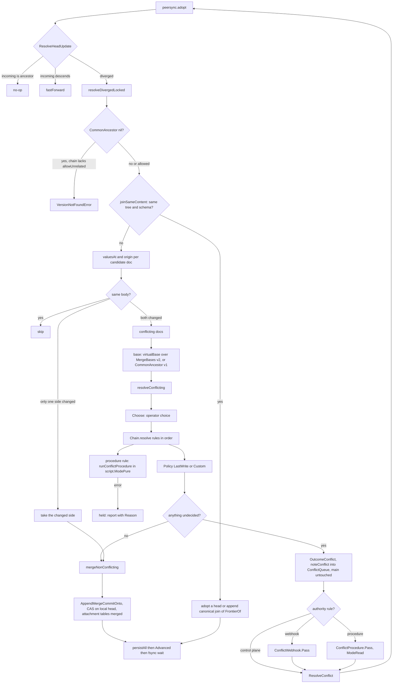

</details>

### Call chain

| # | Function (pkg.Type.Method) | File:line | What it does |
|---|---|---|---|
| 1 | `peersync.adopt` | peersync/ingest.go:293 | Entry from `ApplyRef(main)` via `Adopt` (:277) (flow 9). Under `Exclusive` + `divergenceLockFor`: `ResolveHeadUpdate`; `default:` branch calls `resolveDivergedLocked(env.DAG, env.Storage, env.NamespaceID, localHead, incomingHead, env.Resolution)`. `AdoptFastForward` (chunked adoption) never reaches it. |
| 2 | `peersync.ResolveHeadUpdate` | peersync/conflict_detection.go:35 | `HeadFastForward` / `HeadAlreadyAncestor` / `HeadDiverged` via `IsAncestor`. |
| 3 | `peersync.resolveDivergedLocked` | peersync/merge_resolution.go:277 | `CommonAncestor` (dag/ancestry.go:39); unrelated histories (`ancestor == nil`) refused with `kdberr.NewVersionNotFoundError` unless `Chain.AllowsUnrelated()` (base = empty tree; `shallowRootDocs` :465 adds shallow roots' documents as candidates). Then `joinSameContent` (:295). Else collects candidate ids from `commitsBetween(local, incoming)` and the reverse (ingest.go:816); `valuesAt` both heads; classifies each differing doc via `origin` + `changed` (:242). Step commits = `adoptable(remoteCommits)` + merge. |
| 4 | `peersync.joinSameContent` | peersync/join.go:34 | Only when both heads have the same `DocumentTreeHash` and schema. `dag.InMemoryCommitDag.FrontierOf` (dag/join.go:71) = the content-carrying commits the heads stand for, looking through content-free merges. Frontier is (or is exactly named by) the local head -> no-op; the incoming head -> `SetHead(main, incoming)` (main may move to a head that does not descend from the old one; only content-free merges leave main's path); else `AppendCommitOnto` (dag/join.go:180) a canonical join with parents = frontier in hash order and every field from `joinTransaction` (:95). Writes nothing to storage. Falls back to a normal merge if the live tree is not the head's. |
| 5 | `valueIndex.valuesAt` / `origin` | peersync/merge_resolution.go:141 / :208 | Value at a commit = last op of the nearest write along the first-parent chain (a replace is delete+write, so the **last** op counts); at a shallow root or missing parent the commit's tree in storage answers. `origin` follows a merge-taken value into the parent that held it, so it is independent of which ancestor is picked and which side is local. |
| 6 | Base for the rules | peersync/merge_resolution.go:378-409 | Only with a chain or resolver. v1: `CommonAncestor(p0, p1)` in canonical parent order. v2 (`Chain.mergeBases()`, resolution_chain.go:172): `virtualBase.values` (peersync/merge_semantics_v2.go:237) over `dag.MergeBases` (dag/merge_bases.go:28); several bases are merged recursively under the same chain (git "recursive"), memoized and walk-bounded; a base that cannot be built sets `baseHeld`, which holds the document. |
| 7 | `peersync.resolveConflicting` | peersync/merge_resolution.go:511 | Order: `opts.Choose` -> `opts.Chain.resolve` -> `opts.Policy` (`ConflictPolicyLastWrite` uses `originLater` :665; `ConflictPolicyCustom` calls `opts.Resolver` once per doc, any error or nil -> all stay undecided). Leftovers become a `kdberr.ConflictReport` + `[]ConflictDetail`. |
| 8 | `peersync.canonicalSides` / `mergeCommitParents` | peersync/merge_resolution.go:645 / peersync/conflict_detection.go:293 | Side 0 is always the lower-hash head's, so both nodes evaluate the rules with identical arguments. |
| 9 | `peersync.ResolutionChain.resolve` | peersync/resolution_chain.go:360 | Refuses (holds) an unsupported chain version (`ErrUnsupportedChainVersion`, newer than `MaxChainVersion`=2) or a held base. Walks `Rules`: `RuleProcedure` (no runner -> held; error -> held, never falls through), `RuleSourcePriority` (`sourcePriority` :452, ranks by commit `AuthorNodeID`), `RuleValidity` (needs both sides present; v2 holds when this node has no schema), `RuleFieldMerge` (v2: `fieldMergeByOrigin` merge_semantics_v2.go:35, per-field origin, collisions to the later field origin if `last-write` is next; v1: `fieldMerge` :478, top-level three-way), `RuleLastWrite` (`lastWrite` :444), `RuleAuthority` (`PendingProvisional` -> last-write marked provisional, else queued), `RuleQueue`. `ResolutionChain.Validate` (:206) checks version and rule order. |
| 10 | `server.KdbServerRuntime.peerResolution` | server/resolution.go:50 | Builds `ResolutionOptions` per `PeerIngestEnv`: `Policy = PeerSyncConflictPolicy` (zero value reports), `Chain = ResolutionChainOf()`, `Valid` = `schema.Validate` against the replicated schema, `ProcedureHash`, `SchemaHash` (for v2's advertised hash), `Procedure` closure with a per-env budget `maxProcedureCallsPerSync = 10_000` (:40). **No `Resolver` is set**, so `ConflictPolicyCustom` on the server path cannot decide. |
| 11 | `server.KdbServerRuntime.runConflictProcedure` | server/resolution.go:87 | Looks up the source (`ProcedureSource` procedures.go:71); recomputes `script.SourceHash` (script/runtime.go:64) and compares with the chain's pin, error on mismatch; calls `procRuntime.ResolveConflict(ctx, src, script.ModePure, nil, ConflictInput{DocID, Base, Local=side0, Remote=side1, origins})`; maps `DecideDefer/Take/Doc/Delete/Fork` to a `peersync.Settlement`. Fork uses `peersync.ForkOf`. |
| 12 | `script.Runtime.ResolveConflict` -> `Call` | script/conflict.go:250, script/runtime.go:100 | Fresh `goja.Runtime` per call, pure prelude (script/sandbox.go) removes `Date`, `Intl`, `Math.random` and the transcendental `Math` functions, locale methods; wall clock `Limits.WallClock` 5s (script/limits.go:34) interrupts; output capped 1 MiB (`MaxOutputBytes`); compiled programs cached by source hash. `ModeRead` instead installs a read-only `kdb.get/kdb.query` host (script/host.go). |
| 13 | `peersync.ForkOf` / `ForkID` | peersync/merge_resolution.go:102 / :95 | Keeps the loser as a new document with a `conflictOf:{id,commit}` back-reference; id is `DerivedUUID("kdb:fork/1:"+docID+":"+body)`, so identical settlements on two nodes write the same document. Refuses a deleted side or a non-object body. |
| 14 | `peersync.mergeNonConflicting` | peersync/conflict_detection.go:312 | Writes the final state of every document the remote side touched into storage (sorted id order), `CommitTree` on the local head's tree, then builds the merge transaction: `ID = DerivedUUID("kdb:merge/1:"+p0+":"+p1)`, `AuthorNodeID = MergeAuthorNodeID` (:252), `Timestamp` = later of the two heads, parents in hash order, message `mergeMessageFor(provisional)` (:265, `kdb:merge/1` plus ` provisional=<ids>`), `Operations` = every document on which the parents differ. Calls `dag.AppendMergeCommitOnto(&localHead, ...)`. |
| 15 | `dag.InMemoryCommitDag.AppendMergeCommitOnto` -> `appendCommitLocked` | dag/ancestry.go:220, dag/in_memory_commit_dag.go:1047 | Compare-and-swap on `expectedHead` (stale head -> `*dag.HeadConflictError`). Every two-parent commit also gets the attachment ops that merge the parents' attachment tables three-way against the merge base (`mergeAttachmentOpsLocked`, dag/attachment_merge.go:35; see the attachments flow). |
| 16 | `adopt` tail | peersync/ingest.go:356-417 | `persistAll(step.Commits)` (remote side's commits, then the merge or join) under the gate, `advance` -> `Advanced`; a refused log write -> `undoAdoption`; outside the gate wait fsync (a failed wait re-marks the merge unlogged); `clearConflict`; `afterAdvance` (:424): `ResolvedEntry` (conflicts.go:79) closes entries a received resolution names, `noteProvisional` (:466) records provisional decisions, `SweepIncorporated` (:445) drops divergences main already contains. |
| 17 | `peersync.IngestEnv.noteConflict` | peersync/ingest.go:532 | On `OutcomeConflict`: points tracking branch `peers/<peer>/branch:main` (`TrackingBranch` conflicts.go:314) at the incoming head so retention keeps it, then `ConflictQueue.Record` (conflicts.go:174) with items + `ConflictDetail` (base, origins, `Reason` when a rule could not run). Entry id = sha256 of kind+ns+ref+peer, so a persisting conflict is one entry with a growing `Seen`. |
| 18 | `peersync.ResolutionOptions.AdvertisedHash` | peersync/conflict_detection.go:147 | Chain hash; `unsupported:<hash>` for a version this release does not run; v2 with a validity rule appends `;schema=<hash or none>`; `unavailable:<hash>` while this node cannot run every procedure rule at the pinned revision. Compared in `syncNamespace` (v2_client.go:216) before any merge. |
| 19 | `server.MetaStore.SetProcedure` / `SetResolution` / `pinProcedures` / `repinChain` / `apply` | server/meta.go:420 / :319 / :394 / :460 / :693 | Procedures and chains are replicated definitions in the metadata namespace (`put` :232 commits a doc as `kdb:meta`). `SetProcedure` compiles first, applies at once, then re-pins the chain; `SetResolution` validates and pins each `RuleProcedure.SourceHash` from the local copy. `apply` installs into the runtime (`SetResolutionChain` resolution.go:25, `SetProcedure` procedures.go:41); an apply failure is recorded as a `meta-apply` conflict. |
| 20 | `peersync.ResolveConflict` | peersync/conflicts.go:354 | Operator resolution of a queued `ConflictDivergence` of main: sets `env.Resolution.Choose` from `Choice` (`take` local/remote, `body`, `delete`, `fork{keep}`) and runs `Adopt(env, incoming)` again, i.e. the **same** merge machinery; documents without a choice leave the conflict open; on success `Conflicts.Remove`. |
| 21 | `server.KdbServerRuntime.ResolveConflict` | server/peersync_ingest.go:286 | `authorizeResolve` (resolution.go:149: `ConflictResolveAction` if the chain has an authority, else `TxCommitAction`), provisional entries go to `resolveProvisional` (resolution.go:175: an ordinary commit `kdb:resolve/1 <id>` that rewrites each document if it still holds the value the merge kept, else `ErrResolutionStale`), divergences to `peersync.ResolveConflict`. |
| 22 | `server.ConflictWebhook.Pass` / `deliver` | server/conflict_webhook.go:106 / :149 | For authority-flagged, undelivered entries addressed to this node: POST JSON `ConflictNotification`, headers `X-KDB-Delivery` and `X-KDB-Signature: sha256=<HMAC>` (`SignConflictNotification` :178); 2xx -> `MarkDelivered`; at-least-once. Started in `syncnode.Open` (syncnode/node.go:173). |
| 23 | `server.ConflictProcedure.Pass` / `settle` | server/conflict_procedure.go:125 / :193 | Authority rule with `Procedure` set, on the notifying node only: runs the procedure in `script.ModeRead` with a `runtimeHost` (read-only `Get`/`Query`), translates decisions with `authorityChoice` (:236), and only if **all** documents decided calls `rt.ResolveConflict`. Retries up to `maxProcedureAttempts = 5` per entry (:37). Started at syncnode/node.go:178. |
| 24 | `server.KdbServerRuntime.ExpireAuthorityConflicts` / `StartAuthorityExpiry` | server/resolution.go:350 / :401 | After the rule's `Timeout`, a held divergence is merged by last write (`laterOrigin` :392 choices) and a provisional entry is dropped; run as the runtime, no principal. Started at syncnode/node.go:171. |
| 25 | Control plane | control/replication.go:59-280, control/server.go:301-315 | `GET /v1/ns/{ns}/conflicts`, `POST .../conflicts/{id}/resolve`, `.../ack` (`AckConflict` resolution.go:334), `.../conflicts/resolve-all` (`ResolveAll` resolution.go:299), `DELETE .../conflicts/{id}` (`DismissConflict` peersync_ingest.go:308); `GET/PUT /v1/ns/{ns}/resolution`, `GET/PUT/DELETE /v1/ns/{ns}/procedures[/{name}]`. There is still no `control/resolution` package: only `control/resolution_test.go`. |
| 26 | `transaction.defaultEngine.Merge` / `branchDocuments.rebase` / `document.Document.RebasedOnto` | transaction/default_engine.go:83 / :599, document/kdb_document.go:52 | Local branch merge (not peer sync): topo-sorted branch commits since `CommonAncestor` are replayed onto the primary head (`Replay` with `BaseVersion = head`); each logged whole-document write is rebased to the branch's field-level change against its own previous version and emitted as a `Replace` write, deletes pass through (#281 follow-up, same rule as Kotlin `KdbDocument.rebasedOnto`). Because each step replays against the current head, conflict detection never fires, whatever the policy. No non-test Go caller of `Engine.Merge` was found. |

### Data that changes

| Step | Structure / file / wire message | Mutation |
|---|---|---|
| Detect | none (reads `InMemoryCommitDag`, storage tree at both heads) | Pure computation under `divergenceLockFor(ns)` and the node's write gate. v2 virtual bases are memoized for the merge only. |
| Joined | DAG: main moved to the incoming head, or a new content-free join commit (parents = frontier in hash order); no storage writes | The same join on every node that joins heads standing for the same frontier. |
| Merged | Storage live tree: final state of the other side's documents, forks written once (`forkWritten` :251); DAG: new merge `document.Commit` (two parents, `kdb:merge/1[ provisional=...]`, merged attachment ops), new document tree, `main` moved to it (CAS) | Identical on every node that merges the same two heads under the same chain: same parents order, ops, timestamp (max of heads), author, transaction id, message. |
| Merged, delta log | `PersistAsync(remote commits..., merge)` | Logged in the order main reached them; `MarkLogged`, re-marked unlogged on a failed wait. |
| Provisional | `ConflictEntry{Kind: provisional, MergeHex, Items, Details, Authority}` id derived from the merge hash | Same id on every node; closed when the authority's `kdb:resolve/1 <id>` commit is adopted anywhere (`ResolvedEntry`). |
| Conflict (undecided) | `main` unchanged; DAG branch `peers/<peer>/branch:main`; `ConflictQueue` file `<dataRoot>/replication/conflicts/<ns>/<id>.json` | Idempotent re-record; `Delivered` cleared when items change. |
| Resolution commit | `peersync.ResolveConflict`: merge commit as above, entry + tracking branch removed. `resolveProvisional`: ordinary transaction (`DeleteOp`+`WriteOp` per document, + fork doc), message `kdb:resolve/1 <id>` | Replicates like any write; other nodes fast-forward and close their copy. |
| Definitions | metadata namespace documents (`kind: resolution` / `procedure` / `home`), chain `Version` | Chain + `SourceHash` pins; change of a procedure re-pins the chain. |
| Wire | `REF_UPDATE_ACK.ConflictBytes` (JSON `kdberr.ConflictReport`), `ConflictReportMessage` in v1 | Conflict reported to the pusher without moving the host's main. |
| Branch merge (local) | Replayed merge-step commits on main (`merge-step:<hash>` messages), each with rebased replace writes | Ordinary commits through the engine. |

### Failure, edge cases & durability points

- **Determinism is the design constraint.** The merge hash covers its content, so everything feeding it is symmetric: parents ordered by hash, side 0/1 by parent order, timestamp = max of the heads' (not a local clock), fixed author id, transaction id derived from the parents, base from `CommonAncestor(p0, p1)` in canonical order (v1) or the virtual base over all merge bases (v2), fork ids derived from content, documents in sorted id order, attachment-table merge derived from the parents alone. Remaining sources of divergence are guarded: peers compare `ResolutionHash` (incl. chain version and, for v2 validity, the schema) before merging; a missing/different procedure revision makes the advertised hash `unavailable:`; a procedure error **holds** the document; the per-sync call cap (10,000; the release notes' known issue is that a larger divergence under a procedure chain is held) and the 5s wall clock make a node hold rather than decide differently. Under v1 the `Valid` rule uses the local schema, which the chain hash does not cover, so it only chooses between two present values.
- **Convergence.** Pairwise merging is deterministic but not confluent; `joinSameContent` makes same-content divergences converge to one canonical join, so a mesh that stops writing settles. Divergences with different content still produce pairwise merges.
- **Sandbox.** `ModePure` procedures get no clock, randomness, locale or database; goja exposes no `require`/FS/network. `ModeRead` (authority procedures only) may read through `Get`/`Query` but cannot write. `ConflictProcedure.Limits` (conflict_procedure.go:50) is still declared and never read. Kotlin-side merges are non-deterministic across implementations (project memory), so cross-implementation in-merge parity is out of scope.
- **Fallbacks.** Rule order inside the chain; a rule that returns nothing falls to the next (`RuleLastWrite`/`RuleQueue`/`RuleAuthority` end the chain). If the chain runs out: `ConflictPolicyLastWrite`, `ConflictPolicyCustom` (needs `opts.Resolver`, not set on the server path), otherwise report. No procedure available on this node -> held with reason. A `ResolutionMismatch` sync uses `ConflictPolicyStrict` with no chain. A chain version newer than this release holds every conflict and advertises `unsupported:`.
- **Durability points.** Detection and the decision are in memory. The merge (or join) commit is durable only when `persistAll`'s `PersistAsync` futures complete (queued under the gate, awaited after it). `noteConflict`/`ConflictQueue.Record` write `<id>.json` via tmp + `fsx.Rename` **without fsync** (conflicts.go:294); on a crash the conflict is re-detected by the next sync. A merge whose queue write was refused is undone (`undoAdoption`); one whose fsync failed leaves main moved in memory, marked unlogged so no checkpoint describes it, and returns the error. Definitions are durable as ordinary commits of the metadata namespace.
- **Errors surfaced.** Unrelated histories without `allowUnrelated`: `VersionNotFoundError` (`fetchRef` pre-empts it with `ConflictUnrelatedHistory` via `noteUnrelated`). `ErrResolutionStale` (HTTP 409 `stale`), `AuthorizationError` (403), `ErrConflictNotFound` (404), "still has documents without a choice" (409 `not_resolved`) in control/replication.go:83-96. `ResolveConflict` merges against the **current** head, so a document touched by local writes since may need a new choice.
- **Local branch merge never conflicts.** `Engine.Merge` steps replay onto the moving head, so STRICT/LastWrite policies never see a conflict; concurrent field changes on the primary survive only because each branch write is rebased to its field-level change. By reading, a field both sides changed ends at the branch's value (not verified by a test here).
- **Not implemented / not as documented.** `CommitPushOutcome.Details`/`ConflictDetail.Reason` are the only place a failing procedure is explained. There is no `control/resolution` package. The v1 host merges nothing when a chain exists (`frameHandler.ingestEnv`, host.go:343).

---


## 11. Checkpoint, compaction, maintenance loop, retention and history-mode switch

### Description (short)

Maintenance is a per-namespace background loop (`embed.MaintenanceScheduler`) that wakes on a timer, decides cheaply whether anything could be reclaimed (new head commit, an SSTable merge due under the size-tiered policy, or the sweep clock), prefers moments with no writes in flight (bounded deferral), and then runs `EmbeddedKdbRuntime.Maintain`. kdb-service starts one loop per namespace open at startup and one per namespace opened on demand (replacing any earlier loop for that id). A pass is "checkpoint, then (history=none and reclaim != manual) delete delta segments that are below the checkpoint, outside the retention window and not the open segment, then run the due SSTable merge, then catch the commit-graph file up, then attachment compaction". The order checkpoint-claims-floor then delete is what makes a crash mid-pass safe. Checkpoints are written as v2 (small, plain namespaces, <= 20,000 entries, readable by v0.6.2) or v6 (packed live tree + packed commits streamed into a separate CRC'd section snapshot, record written after it); v3-v5 are still read but no longer written. Close seals the writer, checkpoints through the newest segment and merges SSTables only when the due merge reads <= 64 MiB; a writable open that finds a merge due runs it in the background (cancelled by close). History mode (`full`/`none`) and reclaim mode (`manual`/`immediate`/`balanced`/`lazy`) are separate axes: switching mode only writes a marker and tells the engine; deletion happens only through maintenance under a reclaiming mode or an explicit `CompactHistory`. Segment rotation (64 MiB default) is what makes segments sealed and therefore reclaimable in a long-running process. The `compaction` package and `InMemoryCommitDag.Squash/StubCommit` still exist but are not wired into any production path ("squash catch-up" in peersync is a different mechanism, `PersistSquash`).

### Diagram


<details><summary>Mermaid source</summary>

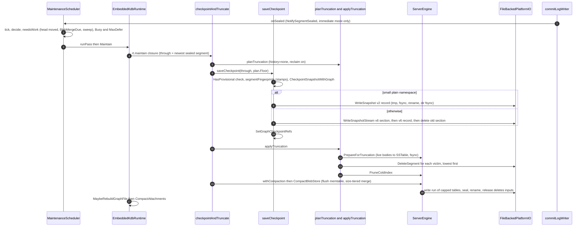

</details>

Close and open merge sub-flow:


<details><summary>Mermaid source</summary>

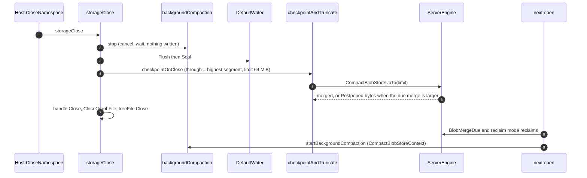

</details>

### Call chain

| # | Function (pkg.Type.Method) | File:line | What it does |
|---|---|---|---|
| 1 | `embed.StartMaintenance` | go/kdb/service/service.go:807 (startup: primary + secondaries), :523 (on-demand opener, `maintenanceRegistry.replace` :971 stops the earlier loop) -> go/kdb/embed/maintenance_loop.go:234 | One scheduler per served namespace. Returns nil for `Interval<=0`, read-only runtime, or nil `rt.maintain` (memory runtime). Registers `NotifySegmentSealed` on the DAG's log writer via `SetSealListener` (maintenance_loop.go:245; persisting_dag.go:316). |
| 2 | `newMaintenanceScheduler` | maintenance_loop.go:254 | Defaults Sweep 30m, MaxDefer 6, CompactTables `sstable.DefaultCompactionTrigger`=4 (sstable/compaction.go:47). Seeds `lastHead` from the current head so open does not look like a fresh commit; `lastPassAt` zero makes the first tick due via the sweep rule. |
| 3 | `MaintenanceScheduler.loop` | maintenance_loop.go:332 | `select` on stop / `reconfigured` / `after(Interval())` -> `tick`. |
| 4 | `tick` -> `decide` -> `needsWork` | maintenance_loop.go:440, :466, :496 | `needsWork` = head hash changed since last pass, OR `ServerEngine.BlobMergeDue(CompactTables)` (document_bodies.go:378: `LsmBlobStore.PendingMerge`, a tiered merge is due, not a raw table count), OR `now-lastPassAt >= Sweep`. If work is due and `respectLoad` and `Busy()` (service.go:811: write queue depth > 0): defer up to `MaxDefer` consecutive ticks, then `maintenanceForce`. Negative MaxDefer never forces. |
| 5 | `runPass` -> `EmbeddedKdbRuntime.Maintain` | maintenance_loop.go:520 -> go/kdb/embed/runtime.go:104 | `AssertWritable`, `rt.maintain()`, then `CompactAttachments` (attachments.go:776: deltas for replaced versions, unreferenced-blob GC). Errors are counted and logged ("scheduled maintenance did not complete; it will be retried"), not escalated. |
| 6 | `rt.maintain` closure | go/kdb/embed/file.go:408 | `through = highestSegmentSequence(r)` capped at `writer.SequenceNumber()-1` (file.go:409-414): never claims the segment still taking appends. Applies `withPeerFloor` (runtime.go:287) which widens the retention window to cover the slowest replication peer, and `liveRetention`/`liveReclaim` (file.go:465, :476), read from the live engine so control-plane changes apply. After the pass calls `dag.InMemoryCommitDag.MaybeRebuildGraphFile` (file.go:422; dag/graph_attach.go:146: flush resident tier as a graph segment or full rewrite; error logged only). |
| 7 | `checkpointAndTruncate` | go/kdb/embed/checkpoint_open.go:483 | Branching: disabled/`through<0` -> no-op; `!reclaim.Reclaims()` (manual) -> checkpoint only, no SSTable merge, report eligible segments (:514-532, `ReclaimHeld`); history=full -> checkpoint + `withCompaction` (:534-543); history=none -> plan, checkpoint with `plan.Floor`, apply, compact (:545-561). `compactLimit` is `compactWhole` (-1) for maintenance, a byte bound for close. |
| 8 | `saveCheckpoint` -> `saveCheckpointThrough` | checkpoint_open.go:215, :236 | Refuses with `ErrCheckpointDeferred` (:260, :316) if `d.HasProvisional()` (undecided cross-namespace part) or the provisional generation moved between capture steps. `segmentFingerprints` (checkpoint.go:900; `rememberedFingerprints` :853 reuses memoised fingerprints whose `SegmentStamp` (size+mtime) still holds, so unchanged sealed segments are not rescanned). `dag.CheckpointSnapshotWithGraph(commitRetentionFilter(eng))` (dag/graph_checkpoint.go:38; filter checkpoint_open.go:441 keeps in-window commits plus refs under history=none; under full with graph segments attached only the resident tier is captured plus `GraphRefs`/`GraphHidden`). Shallow-root and branch-head payloads, packed attachment tables, `eng.LiveTree()`; then `writeCheckpoint` and `d.SetGraphCheckpointRefs` (graph_checkpoint.go:123: pins referenced graph segments, deletes superseded ones). `saveCheckpointThrough` accepts `through=-1` for `checkpointNow`/`PersistSquash` (file.go:429). |
| 9 | `writeCheckpoint` | checkpoint.go:1109 | `legacyCheckpointFits` (:312: no graph refs, no attachments, live entries + commits <= `legacyCheckpointMaxEntries` 20,000, :59) -> `encodeLegacyCheckpoint` v2 + `saveTreeSegment` -> `OSByteStore.WriteSnapshot` (os_store.go:610). Otherwise `writeSectionedCheckpoint` (checkpoint_section.go:81): tree hashed by a streaming `WritePacked` pass, `document.SaveTreeSegmentDigest` for a paged tree (tree.file), section `"KDBCPS01"|lens|tree|commits|CRC32` streamed via `WriteSnapshotStream` (os_store.go:626) under a content-derived key, `DropMappedPages`, v6 record written, previous section deleted. |
| 10 | `planTruncation` | go/kdb/embed/truncate.go:196 | Pure decision. Only for history=none; `segmentsToDelete` (:115) walks newest-first and refuses: segment > `through`; fewer than 1 kept segment so far (:139); fewer than `segmentsForCommits(window.Commits)` (1 per 1000 commits, min 1, :173); last commit younger than `window.Duration` or undatable. Floor = highest victim + 1. |
| 11 | `applyTruncation` | truncate.go:248 | `eng.PrepareForTruncation()` first; failure aborts ("refusing to truncate the delta log because document bodies could not be flushed first"). Then `shim.DeleteSegment` per victim in ascending order, stopping at the first failure (:271-283). Then `eng.PruneColdIndex()` (:290; server_engine.go:678) removes the deleted segments' delta-index sidecars (failure logged). |
| 12 | `ServerEngine.PrepareForTruncation` / `MaterializeLiveBodies` | go/kdb/storage/engine/document_bodies.go:107, :124 | For history=none: skips the walk when snapshot-installed bodies already cover the tree; else every live version not already in the memtable/LSM is `memTable.Put` (resident, or `loadCold` from the log), then `flushBodies` = `memTable.Flush(0)` (SSTable sealed = fsynced) + `wal.Sync`. A live version nothing can produce: error, no truncation. |
| 13 | `FileBackedPlatformIO.DeleteSegment` -> `OSByteStore.Delete` (or `PrimaryWithReplicas.Delete`) | go/kdb/storage/io/file_backed.go:303 -> os_store.go:496 (primary_replicas.go:206) | Forgets sealed/generation state, drops the cached read handle and any write handle, `Remove`. Replica sinks follow the delete, archive sinks keep it (`replicateDeletion`, primary_replicas.go:254). |
| 14 | `withCompaction` -> `ServerEngine.CompactBlobStore` / `CompactBlobStoreUpTo` -> `LsmBlobStore.compactContext` -> `sstable.compact` | checkpoint_open.go:579 -> document_bodies.go:254 / :267 -> go/kdb/storage/sstable/types.go:432 -> sstable/compaction.go:137 | Flushes memtable first. `pickMerge` (tiering.go:105, size-tiered after RocksDB universal): full merge when everything newer >= oldest run (only one that drops tombstones), else a window of >= trigger similar-size consecutive runs, else the cheapest window once runs > `3*trigger`. Inputs read through mapped sidecars whose pages are dropped as read (`DropPages`, compaction.go:259-313). Output is a run of tables capped at 64 MiB / 1M keys (compaction.go:56-57), written under partial names then renamed; key set restricted by `reachableBlobKeys` (document_bodies.go:345: live tree + attachment rule under none, everything under full). Inputs pinned and deleted by `release` (types.go:279) once no lookup holds them. `UpTo` returns `Postponed` bytes when the due merge exceeds the bound. Failure logged, not returned. |
| 15 | `commitLogWriter.appendBatch` -> `DefaultWriter.RotateIfNeeded` | go/kdb/embed/commit_log.go:363 -> go/kdb/storage/delta/writer.go:230 | Checked only between batches; rotates when `sizeBytes >= EffectiveMaxSegmentBytes(config)` (default 64 MiB, writer.go:190, :202). Empty segments never rotate. Flushes, `sealLocked` (writer.go:280: `shim.SealSegment` only if bytes were written), then advances `sequence`, new random segment id, `sizeBytes=0`. Calls `onSealed` (commit_log.go:389). The new segment file is created lazily at the next append. |
| 16 | `FileBackedPlatformIO.SealSegment` -> `OSByteStore.MarkSealed` | file_backed.go:260 -> os_store.go:458 | Flush (fsync per `FsyncOnFlush`), then `MarkSealed` closes and forgets the write handle; sealed name recorded in memory (`sealedSegments`). With sinks, `PrimaryWithReplicas.MarkSealed` (primary_replicas.go:166) reads the whole file and `PutSegment`s it to every sink synchronously on the log goroutine. |
| 17 | `NotifySegmentSealed` | maintenance_loop.go:214 | Wakes the loop (`reconfigured` channel) only under `ReclaimImmediate` (`sealTriggered`). |
| 18 | Preallocation: `OSByteStore.openFor` -> `preallocateFor` -> `preallocateFile` -> `zeroFill` | os_store.go:103, :89 -> go/kdb/storage/io/preallocate_linux.go:23 (darwin: preallocate_darwin.go:38) -> preallocate.go:25 | Enabled by `KDB_PREALLOCATE_SEGMENTS`/`StorageOptions.PreallocateSegments` (storage_options.go:227, :292); size is `delta.EffectiveMaxSegmentBytes` via `preallocateBytesFor` (host.go:423); delta segment names only. `O_EXCL` create distinguishes first creation (allocate + zero fill, inside the first Append on the log goroutine) from reopen. Writes are positional (`WriteAt` at logical end), not `O_APPEND`. |
| 19 | `checkpointOnClose` (inside `storageClose`) | checkpoint_open.go:376, called from file.go:384 | After `bgCompaction.stop`, `refile.stop`, commit-log drain, `Flush`, `Seal`: `checkpointAndTruncate(through = highestSegmentSequence, limit = closeCompactionLimit(CloseCompactionBytes))` (background_compaction.go:20; default 64 MiB, negative = never). Then `handle.Close`, `CloseGraphFile`, `treeFile.Close`. Failure is a log line. |
| 20 | `startBackgroundCompaction` | go/kdb/embed/background_compaction.go:57, started at file.go:448 | On a writable open (unless `DisableBackgroundCompaction`), when `BlobMergeDue` and the reclaim mode reclaims: goroutine runs `CompactBlobStoreContext` (document_bodies.go:291); close cancels it and waits (`stop`, :80), nothing written. |
| 21 | `startVersionRefile` | go/kdb/embed/version_refile.go:47, started at file.go:451 | Objects strategy only: when `DocumentCopies` changed the filing threshold vs `meta.json`, `RefileVersions` in the background; towards fewer copies also `CompactBlobStoreAllContext` (major merge, types.go:428); marker rewritten only when done. |
| 22 | `EmbeddedKdbRuntime.CompactHistory` | runtime.go:135 | Explicit one-way door: temporarily sets reclaim to `ReclaimImmediate`, runs `rt.maintain`, restores the mode (deferred). Exposed as `POST /v1/ns/{ns}/retention/compact` (control/server.go:356 -> control/retention.go:169). Does not run `CompactAttachments`. |
| 23 | `EmbeddedKdbRuntime.EligibleForCompaction` | go/kdb/embed/history_mode_switch.go:151 | Dry run: forces manual for the duration so the pass writes a checkpoint and reports the plan without deleting; used by `GET .../retention` (control/retention.go:55, :77). |
| 24 | `EmbeddedKdbRuntime.SetHistoryMode` | history_mode_switch.go:63 (HTTP: `PUT /v1/ns/{ns}/retention/history-mode`, control/server.go:355 -> retention.go:98) | Writes `meta.json` first (`writeNamespaceMeta` namespace_meta.go:82; also forces strategy replay for none) and then `eng.SetHistoryMode` + `eng.SetReclaimMode` (tree_objects.go:62, :117). Lands on `ReclaimManual` when going to none (unset reclaim); going to full keeps the current reclaim mode. Reports `HistoryLost` if `logHasBeenTruncated()` (:175, lowest segment on disk > 0). Refused for memory-backed and read-only runtimes. |
| 25 | `MaintenanceScheduler.ApplyReclaimMode`, `SetInterval/SetSweep/SetMaxDefer` | maintenance_loop.go:185, :376, :390, :408 | Presets from `ReclaimMode.Cadence` (storage/reclaim_mode.go:138): manual and lazy 30m/6h, MaxDefer 24; immediate 10s/1m, no load deference, seal-triggered; balanced (default, :70) 5m/30m, MaxDefer 6. Control-plane settings `governance.maintenanceInterval/Sweep/MaxDefer`, `reclaim.mode`, `retain.duration/commits` (control/settings_apply.go:123-210, `eachScheduler` :267, `applyReclaimMode` :298, `applyRetention` :345). |
| 26 | `EmbeddedKdbRuntime.SetRetentionWindow` | go/kdb/embed/history_features.go:68 | Refused under history=full. Not persisted: a restart returns to the configured window. |
| 27 | `MigrateHistoryMode` / `MigrateHistoryStrategy` (offline) | go/kdb/embed/migrate_history.go:116, :28 | Take `LockDataDir` (file.go:489). To none: `prepareForNoneMode` (:164) opens the namespace under none with `alreadyLocked` and calls `PrepareForTruncation`, then writes marker (strategy forced replay). To objects: `buildTreeObjects` (:72) -> `recordTreeObjectsForHistory` (tree_rebuild.go:166). Marker is written only after the work succeeds. |
| 28 | Tree rebuild for replay strategy | go/kdb/embed/checkpoint_open.go:143 -> `installTreeRebuilder` :418 -> go/kdb/embed/tree_rebuild.go:48 | Only when a checkpoint restored and strategy is replay: lets `ServerEngine` fold a historical tree forward from the nearest cached ancestor (`maxTreeFoldDepth` 100,000, tree_rebuild.go:22), result verified against the requested tree hash. |
| 29 | `EmbeddedKdbRuntime.RestoreFromArchive` | go/kdb/embed/restore_archive.go:63 (HTTP `POST .../retention/restore`, control/server.go:357 -> retention.go:206) | Fetches segments highest-first from the archive sink, stops at the first hole, only then `lowerCheckpointFloor` (:153) rewrites the checkpoint with a lower floor. |
| 30 | `Maintain` as a flush side effect | go/kdb/control/refs.go:220, go/kdb/control/restorepoints.go:458 | Control-plane ref flush and restore-point creation call `Maintain()` directly (checkpoint outside the schedule). |
| 31 | Not wired | go/kdb/compaction/engine.go (skeleton, `RunCycle` :77 returns empty `Result`); `dag.InMemoryCommitDag.Squash` (dag/in_memory_commit_dag.go:1106) and `StubCommit` (:470) | No production importer of package `compaction`, and no non-test caller of `Squash`/`StubCommit`. Commit-history squashing is not performed by the server; "compaction" in the running system means SSTable merge, delta-segment deletion, graph-file rewrite (`CompactCommitGraph`, graph_runtime.go:9) and attachment compaction. |

### Data that changes

| Step | Structure / file / wire message | Mutation |
|---|---|---|
| 3-5 | `MaintenanceScheduler` fields (`lastHead`, `lastPassAt`, `deferrals`, `stats`) | Updated per tick/pass; `stats.Passes/Skipped/Deferred/Forced/Errors/SegmentsRemoved/BytesReclaimed/TablesRemoved`. |
| 8 | `DefaultReader` fingerprint memo | `rememberCheckpointFingerprints` records (stamp, size, last commit) per stamped segment so the next checkpoint and the next open (`unchangedSinceCheckpoint`, checkpoint.go:951) can trust them without scanning. A segment held open for appending has no stamp (os_store.go:234). |
| 9 | `<root>/snap/kdb_checkpoint_<ns>` (ns `/` becomes `%2F`) | Atomically replaced: `os.CreateTemp` in `snap/`, buffered write, `Sync`, `Chmod 0644`, `Rename`, best-effort `SyncDir` of `snap/`, legacy-name file removed (os_store.go:626-671). v2 content: `throughSequence`, `floorSequence`, segment fingerprints (+stamps), commit records, refs, live-tree records, head payloads. v6 content: same metadata, plus section key, tree digest, entry count, graph refs/hidden, attachment tables. If sinks are configured the record is also pushed to them. |
| 9 | `snap/` section `kdb:checkpoint-section:<ns>:<hex>` (v6) | New section streamed (same tmp/fsync/rename) before the record; previous section deleted after the record lands. A record whose section is missing or fails CRC is unusable -> replay. |
| 9 | tree.file segment / graph segments | `SaveTreeSegmentDigest` tags a tree segment with the checkpoint's digest (accelerator only). `SetGraphCheckpointRefs` pins referenced graph segments and deletes deferred superseded ones. |
| 8 | In-memory DAG | Read-only snapshot under `d.mu.RLock`; no mutation. |
| 12 | `ns/<id>/sstable/L0/<age>-<uuid>` | Memtable flushed to a new table (`sstable.DefaultWriter.Finish`, sstable/codec.go:375: blocks, footer, `SealSegment` = flush+fsync). `LsmBlobStore.tables` gains the handle. WAL synced. |
| 11 | `ns/<id>/delta/<seq>.seg` (victims) and their delta-index sidecars | Unlinked in ascending sequence order, then sidecars pruned. No directory fsync after unlink. Replica sinks delete, archive sinks keep. |
| 14 | `ns/<id>/sstable/L<k>/<age>-<uuid>.<nnnn>` | A run of merged tables written under partial names, sealed, renamed (with directory fsync, os_store.go:545); inputs replaced in `LsmBlobStore.tables` (tables registered during the merge kept), then deleted when unpinned. Full merge goes to `deepest+1`, a window keeps the oldest input's level and slot. Superseded versions dropped under history=none. |
| 15-16 | `ns/<id>/delta/<seq>.seg` | Active segment's `sizeBytes` reset, sequence+1; old segment flushed/fsynced and its write handle closed. In `FileBackedPlatformIO.sealed` (memory only) the old name is marked sealed: no on-disk marker, no rename, no truncation of preallocated padding. With an S3 sink, the whole file (including padding) is uploaded inside `SealSegment` on the log-writer goroutine. |
| 18 | New `.seg` file | Created `O_EXCL`, extents allocated and zero-filled to 64 MiB, fsynced; physical size 64 MiB while logical size (= `openSegment.size`) starts at 0. `DefaultReader.ListSegments` reports logical size (consumed frames). Once sealed, `OSByteStore.Size` reports the file length (os_store.go:217-231). |
| 19-20 | SSTables at close / open | Close merges only a due merge <= limit, else logs `Postponed`; open's background merge writes nothing if cancelled. |
| 21 | `meta.json` `FilingThresholdBytes` | Rewritten after a completed refile (+ major merge). |
| 22-24 | `meta.json` (`historyMode`, `historyStrategy`) and engine fields (`HistoryMode`, `ReclaimMode`, retention window) | Marker first (tmp, fsync, rename), engine second. A crash between the two resolves to the marker at next open. |
| 25 | Scheduler `interval/sweep/maxDefer/respectLoad/sealTriggered` | Mutated under `s.mu`; `reconfigured` channel wakes the loop. |
| 27 | `meta.json`, plus an engine opened under the data-dir lock | `prepareForNoneMode` flushes live bodies to SSTables, then the marker flips. |
| 29 | `ns/<id>/delta/<seq>.seg` (restored), `snap/kdb_checkpoint_<ns>` | Segments re-materialized from archive; checkpoint rewritten with lower `floorSequence`. |

### Failure, edge cases & durability points

- **Crash safety of a truncation pass** (embed/truncate.go:238-247, checkpoint_open.go:469-482): (1) `PrepareForTruncation` makes live bodies durable (SSTable sealed+fsynced, WAL synced), (2) the checkpoint with the *higher* floor is durable (tmp fsync + rename + directory fsync; for v6 section first, then record), (3) only then segments are unlinked. A crash after (2) leaves extra old segments below the recorded floor; `checkpointMatchesLog` and `unchangedSinceCheckpoint` skip segments below the floor (checkpoint.go:963, :1001) and the next pass deletes them. A crash after (1) alone leaves only extra SSTable data. `applyTruncation` stops at the first failed delete and leaves the rest for the next pass. A crash between v6 section and record leaves the old record with its own section; the new section is then an orphan file (by code reading nothing deletes it, since only the section the current record names is deleted).
- **Checkpoint cannot claim the live segment** at runtime: `through` is capped at `writerSeq-1` (file.go:409-414; same cap in `checkpointNow` :429-435). Only the close path (`checkpointOnClose`, after `Seal`) and `checkpointAfterFullReplay` (file.go:302) use other bounds, both safe for the same reason (writer never resumes an old segment).
- **Candidate defect, not exercised (still present):** `lowerCheckpointFloor` (restore_archive.go:153-176) calls `saveCheckpoint(..., through = highestSegmentSequence(...), ...)` (:169) on a live runtime instead of the sealed-only cap used by `rt.maintain`. If the open segment already has a file, the checkpoint fingerprints it at its current logical size and without a stamp (open segment, os_store.go:234); the next append changes the size, so an open after a crash (before any later maintenance or close checkpoint supersedes it) takes the `checkpointMatchesLog` mismatch path -> `mustReplay` -> for a truncated history=none namespace (lowest segment > 0) that is `*TruncatedLogError` (checkpoint_open.go:56-66), i.e. the namespace refuses to open.
- **Candidate defect, not exercised (still present):** a namespace reopen (`Host.ReopenNamespace` embed/reopen.go:55 via `namespaceReopener.ReopenNamespace` service/reopen.go:87, swapped with `KdbServerRuntime.ReopenWith` server/reopen.go:53) creates a *new* `EmbeddedKdbRuntime` but nothing rebinds or replaces `MaintenanceScheduler.rt` (only `StartMaintenance` at service.go:523/:807 sets it; `maintenanceRegistry.replace` is called only by the on-demand opener). The scheduler keeps calling `Maintain` on the closed runtime: its `needsWork` probe watches the old DAG head (never changes) so only the sweep or a stale `BlobMergeDue` fires, and any checkpoint it writes comes from the old, stale DAG with `through` capped at the old writer's sequence-1 (stale-but-consistent, not lost commits). Reclaim-mode/interval changes applied through the scheduler also act on the stale runtime, and the new runtime gets no scheduled maintenance.
- **Manual reclaim is the safe landing.** `SetHistoryMode(none)` lands on `ReclaimManual`, so maintenance only checkpoints and reports `EligibleSegments/EligibleBytes` until `CompactHistory` or a reclaim-mode change. Under manual neither SSTable merge (maintenance or open background merge) runs either, in any history mode. Going none -> full cannot restore deleted segments (`HistoryLost`), unless an archive holds them (`RestoreFromArchive`).
- **Archive caveat (still present):** `PrimaryWithReplicas.fanOut` (primary_replicas.go:258-273) records the first sink error but returns nil unless `FailOnReplicaError` is set. A segment whose upload to the archive failed at seal time (`MarkSealed` :166) is therefore deleted locally by a later compaction while `TruncationResult.Reversible` still reads true (`shimHasArchive` only asks "is there an archive sink", truncate.go:304).
- **Peer retention floor.** `withPeerFloor` can only widen the window, so a lagging replication peer delays reclamation instead of forcing a snapshot catch-up.
- **Window is a floor, not a ceiling.** Granularity is whole sealed segments; undatable segments (last commit not in the DAG) are kept; the newest sealed segment is always kept (`kept < 1`, truncate.go:139).
- **Maintenance vs commits.** `Busy` only checks write-gate queue depth; deferral is bounded (`MaxDefer`), so a permanently busy server still reclaims. `ReclaimImmediate` ignores load. `Stop` waits for an in-flight pass (maintenance_loop.go:310), which is why shutdown stops schedulers first (flow 13).
- **Close no longer bounds SSTables by itself.** A store whose due merge exceeds `CloseCompactionBytes` keeps its tables across close; an embedded runtime without a maintenance loop relies on the next writable open's background merge (or `DisableBackgroundCompaction` leaves it unbounded).
- **Preallocation and tooling.** A preallocated sealed segment keeps its zero padding. Replay and checkpoints use logical size. `integrity.Verify` now treats zero padding after the last frame as no finding (integrity/verify.go:189-191). `damagedInPlace` now accepts `FramesEnd == want.SizeBytes` for a full-size file (checkpoint.go:1073), but the damaged-tail case still requires `PhysicalSize == want.SizeBytes` (:1074), which a preallocated file never satisfies, so a damaged last frame header in a preallocated segment falls back to replay. The S3 sink still uploads the padded file.
- **Directory durability.** Delta segment create (`openFor`) and delete (`OSByteStore.Delete`) do not fsync the directory (only `Rename` :545 and snapshot writes :663 do); a power loss can lose a newly created segment's directory entry after its frames were fsynced and acknowledged, or resurrect a deleted one (harmless, below floor).
- **fd retention (resolved).** `MarkSealed` now closes a sealed segment's write handle; read handles are cached up to `maxReadHandles` 512 (os_store.go:50) and released on delete or `Host.CloseNamespace` -> `ReleaseHandles` (host.go:352).
- **Sync modes on Linux.** `SyncModeFast` is `fdatasync` via `SyscallConn().Control` (sync_linux.go:8-27, avoids the raw `Fd()` reuse race), falling back to `Sync`; a growing file changes size metadata so it collapses into a full journal commit; preallocation exists to make segments fixed-size so `fdatasync` can skip metadata. Darwin: `F_BARRIERFSYNC` for fast, `F_FULLFSYNC` (via `os.File.Sync`) for full.
- **Small namespaces stay v2.** `legacyCheckpointFits` keeps <= 20,000-entry namespaces without graph refs or attachments on v2 so a rollback to v0.6.2 has nothing to replay; anything larger (or with attachments/graph segments) can only be rolled back to v0.7.x+.
- **Switching `history=none` is not live-only:** `HistoryStrategyMismatchError`/`HistoryModeMismatchError` stop an open under a different recorded mode; the offline `MigrateHistoryMode` is the way to change the recorded mode with the service stopped, whereas `SetHistoryMode` is the running-service path and writes the marker itself.
- **Commit-graph compaction.** History=none shrinks the *checkpoint's* commit list via `commitRetentionFilter` and deletes log segments; graph segments are rewritten by `MaybeRebuildGraphFile` each pass (or `CompactCommitGraph` on demand), dropping deleted commits' records. No commit squashing.

---


## 12. Backup, verify, repair, restore and promote

Paths relative to `go/kdb/` unless prefixed `go/cmd/`. Line numbers from e79bb674.

### Description (short)

Everything here works on the **delta log** (segment files `ns/<namespace>/delta/<sequenced-name>`), which is the durable record of commits; the checkpoint and SSTables are caches that can be rebuilt by replay. Large attachments live in separate attachment-store segments that ride along with the log (see the attachments flow for their layout).

- **Backup** (`backup.Create` / `CreateWithOptions`, `backup.CreateDatabase`): first classify every segment with the replay rule (`storage.TailKind`: clean, torn, damaged) and refuse the whole backup if any segment is damaged in place; then copy each segment's CRC-verified bytes into an object store (`DirStore` or S3-like). Sealed segments go under a **content-addressed key** (sequence + SHA-256), the newest under a backup-scoped prefix key. Attachment-store segments follow, then (control plane only) the namespace's definitions, and the JSON manifest is written *last*. Commit count and head tips are computed while streaming (`logTips`), not from a whole-log map. A database backup groups per-namespace backups and also copies `<dataRoot>/txn/` (cross-namespace decision state).
- **Verify**: `integrity.Verify` (L1: tail classification per segment, sequence gaps; L2: plus parent closure) for a live log; `backup.Verify` re-hashes every object a backup manifest names (segments and attachment parts); `server.KdbServerRuntime.Scrub` re-reads every live document and checks its content hash against the head tree.
- **Repair**: `integrity.Repair` (offline, truncate a torn tail or rewrite a segment prefix, with quarantine; refuses when intact frames follow the damage); `Scrub` repairs damaged document bodies from peers by writing a `kdb:repair/1` commit.
- **Restore**: `recovery.HybridRestore` unions CRC-verified commits from any number of sources, orders them topologically, writes a fresh sealed delta log, then copies attachment segments. `kdb-inspect restore` and the control plane's staged restore are the callers; both leave the backup's definitions in `ns/<ns>/restored-definitions.json`, which `kdb-service` adopts on first open. **Promote** swaps a staged namespace into the live data root across a restart. `EmbeddedKdbRuntime.RestoreFromArchive` is a different thing: it re-fetches segments that truncation evicted.

### Diagram

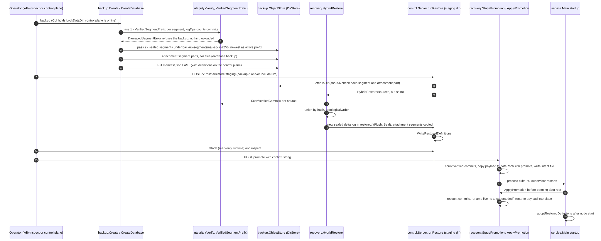

<details><summary>Mermaid source</summary>

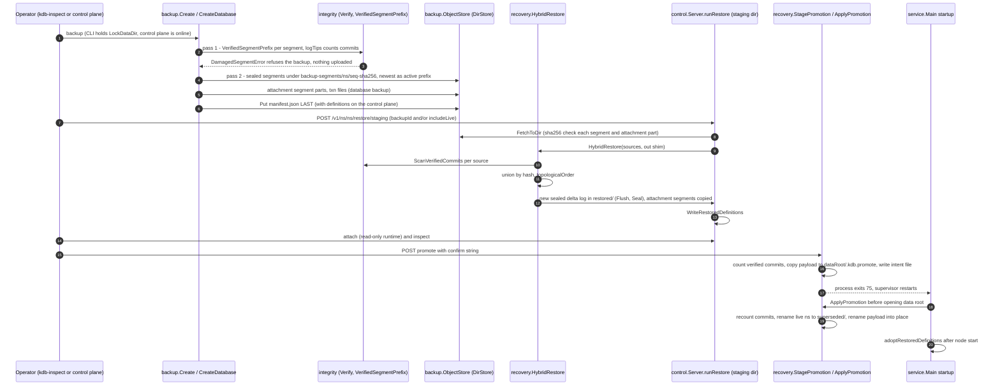

</details>

### Call chain

Backup

| # | Function | File:line | What it does |
|---|---|---|---|
| 1 | `kdb-inspect backup` | `go/cmd/kdb-inspect/backup.go:33,46,56-79` | `embed.LockDataDir(dataDir)` (service must be stopped), then one namespace -> `backup.Create`, no `--namespace` -> `embed.ListNamespaces` + `backup.CreateDatabase` under the same lock. Neither CLI path records definitions. |
| 2 | `control.Server.handleCreateBackup` | `control/recovery.go:427` | Online: `backupStore()` (`DirStore` at `--control-backup-dir`, 363), `openShim(dataRoot)` (unlocked read view, 103), definitions from `rt.Meta.View` (best effort, 453-460), `backup.CreateWithOptions`. A `*backup.DamagedSegmentError` -> `409 segment_damaged` with segment/offset/nextIntactFrame (462-473). Per-namespace only. |
| 3 | `backup.Create` / `CreateWithOptions` | `backup/backup.go:124,129` | `integrity.ListSequencedSegments` (refuses legacy names), optional base manifest, random backup id. **Pass 1** (182-201): `integrity.VerifiedSegmentPrefix` per segment; damaged -> `DamagedSegmentError` before any upload; records each prefix length and feeds commits to `logTips` (457). **Pass 2** (211-252): re-read each prefix (`ReadFromSegment(name,0,prefixLen)`, error if it shrank), SHA-256. Highest sequence -> `active-<seq>.prefix` under `backups/<ns>/<id>/` with `VerifiedPrefix:true`. Others: incremental reuses the base entry when hash matches and `baseObjectStillHolds` (375; re-hashes legacy shared keys), else `store.Put(sealedSegmentKey)` (61, `backup-segments/<ns>/<seq>-<sha>.seg`). Then `backupAttachments`, `Definitions`, `CommitCount`/`HeadHashes` from `logTips`, `store.Put(ManifestKey)` last (276). |
| 4 | `backup.backupAttachments` | `backup/attachments.go:48` | Attachment-store segments cut into <=64 MiB parts keyed `attachments/<ns>/<sha256>`; parts the base already stored are not re-uploaded. Detail in the attachments flow. |
| 5 | `backup.CreateDatabase` | `backup/database.go:74` | Sorted namespaces -> `Create` each (optional `bases`, no definitions), `backupTxnState` (`backup/txn.go:43`) copies every regular non-`.tmp` file in `<dataRoot>/txn/` to `database-backups/<id>/txn/<name>` with size and sha256, then writes `database-backups/<id>/manifest.json` last. Caller must hold the data-root lock. |
| 6 | `integrity.VerifiedSegmentPrefix` / `readAndScanSegment` | `integrity/scan.go:26`, `integrity/verify.go:141` | Reads the segment, `delta.ScanSegment` (`storage/delta/tail.go:21`) -> commits + `storage.SegmentTail`. Clean (incl. all-zero preallocation padding) and torn return the bytes up to the last intact frame; `TailDamaged` (intact frame after bad bytes, or CRC-clean frame that will not decode) -> `*delta.DamagedSegmentError`. |

Verify

| # | Function | File:line | What it does |
|---|---|---|---|
| 7 | `integrity.Verify` | `integrity/verify.go:163` | Per segment: sequence-gap finding, `readAndScanSegment`, switch on tail kind (193-220): `TailDamaged` -> `MidLogCorruption` in any segment, newest included; `TailTorn` -> `TornTail` only in the newest segment, `MidLogCorruption` in an older one; zero padding is no finding. L2 (228-252) adds `MissingParent` (parent not in the scanned union, genesis exempt via `GenesisCommitHash`, `integrity/genesis.go`). It does **not** recompute commit hashes, although `L2` is documented as "commit hash + parent closure" (`verify.go:59`) and so is the control plane (`control/recovery.go:134,151`). |
| 8 | `control.Server.handleVerify` | `control/recovery.go:136` | `POST /v1/ns/{ns}/integrity/verify`. One verification per namespace at a time, `integrity.Verify` over an unlocked shim (185), result kept in `recoveryState.reports` (in memory). |
| 9 | `control.Server.handleMaintenancePlan` | `control/recovery.go:257` | Does not repair anything: returns the `kdb-inspect repair-segments` / `restore` commands that apply, because they need the data-dir lock this process holds. |
| 10 | `backup.Verify` / `VerifyDatabase` | `backup/backup.go:309`, `backup/database.go:159` | Re-download each segment object, compare size and SHA-256; a mismatch on a legacy shared key gets `overwriteExplanation` (342, names the backup that overwrote it). `verifyAttachments` (`attachments.go:143`) re-checks every part. Database verify also re-checks `txn/` files (`verifyTxnState`, `txn.go:127`). Exposed at `POST /v1/ns/{ns}/backups/{id}/verify` (`control/recovery.go:506`, route `control/server.go:372`); `VerifyDatabase` has no non-test caller. |
| 11 | `server.KdbServerRuntime.Scrub` | `server/scrub.go:60` | `TreeWalker.WalkTree` of the head tree, batch-read documents, `bodyMatches` (205; content hash vs tree entry). Damaged ids -> `fetch` (peers via `replication.Replicator.FetchBodies`, `replication/replicator.go:698`), re-verify, `systemCommit` of a `kdb:repair/1` commit that rewrites verified bodies (tree unchanged), else a `damaged` conflict-queue entry and `ScrubUnrepairedError`. Triggered by `control.Server.handleScrub` (`control/replication.go:373`) and `syncnode.Node.scrubLoop` (`syncnode/node.go:433`, call at 448). |

Repair (offline)

| # | Function | File:line | What it does |
|---|---|---|---|
| 12 | `kdb-inspect repair-segments` | `go/cmd/kdb-inspect/verify.go:137` | `LockDataDir`, `integrity.Verify` at L1, `--dry-run` prints, else `integrity.Repair`; exits 1 if any step refused. Shim has `FsyncOnFlush:true` (`verify.go:24`) but Repair never flushes. |
| 13 | `integrity.Repair` | `integrity/repair.go:56` | Acts only on L1 findings (59). `TornTail` -> `repairTornTail` (80). `MidLogCorruption` -> `repairMidLogCorruption` (118). L2 findings are left (restore is the answer). |
| 14 | `integrity.repairTornTail` | `integrity/repair.go:80` | Appends the torn bytes to `ns/<ns>/quarantine/<seq>.quarantine-<nanos>`, `DeleteSegment` the live segment, `AppendToSegment` the good prefix back (91-102). |
| 15 | `integrity.repairMidLogCorruption` | `integrity/repair.go:118` | Refuses if intact frames follow the damage in the same segment (`intactCommitsAfter`, 215, via `delta.ScanSkippingCorrupt`; 142-147). Else checks that dropping the corrupt frame and everything after it leaves no later segment with a dangling parent; if so quarantines the *full* original segment, deletes, rewrites the good prefix; else `ActionRefused` listing the missing hashes. |

Restore and promote

| # | Function | File:line | What it does |
|---|---|---|---|
| 16 | `kdb-inspect restore` | `go/cmd/kdb-inspect/restore.go:27,60-128` | Sources `--source LABEL=PATH` and/or `--from-backup` (`backup.FetchToDir` to a temp dir), `LockDataDir(out)` (98), `recovery.HybridRestore` (108), then `backup.WriteRestoredDefinitions` if the manifest carries definitions (112-117). Reports `MissingHashes` as a partial restore warning. |
| 17 | `restoreDatabase` | `go/cmd/kdb-inspect/restore.go:138` | `LoadDatabaseManifest`, `LockDataDir(out)`, **`backup.RestoreTxnState` first** (159; `backup/txn.go:79`: verify every file against the manifest, write with fsync, directory fsync), then `FetchToDir` + `HybridRestore` per namespace into the same root. No definitions (the database backup has none). |
| 18 | `backup.FetchToDir` | `backup/backup.go:392` | Get each segment, re-hash against manifest (mismatch = "refusing to restore corrupt object"), `os.WriteFile` into `<outDir>/ns/<ns>/delta/<sequenced name>` (412). `fetchAttachments` (`attachments.go:108`) reassembles attachment segments part by part with a hash check. No fsync. |
| 19 | `recovery.HybridRestore` | `recovery/restore.go:58` | `integrity.ScanVerifiedCommits` per source (`integrity/scan.go:49`), union by hash (first writer wins), `topologicalOrder` (127; genesis-parented commits ready immediately; unresolvable remainder returned as `MissingHashes`), `delta.Factory.OpenWriter(ns)`, `Append` each commit, `writer.Flush()`, `writer.Seal()` (99-104), then `restoreAttachmentSegments` (172: copy every attachment segment name once, `FlushSegment`, `SealSegment`). |
| 20 | `control.Server.handleStartRestore` / `runRestore` | `control/restore.go:109,164` | Async job in `<stagingRoot>/<jobId>/`. Optional `FetchToDir` into `_backup/`, optional live data root as a second source (`includeLive`, salvage), `LockDataDir(restored/)` (217), `HybridRestore` with ZSTD (228), `WriteRestoredDefinitions` (231). Job states `running`/`complete`/`failed` kept in memory; readers get copies (`snapshotJob`, 257). Never touches the live namespace. |
| 21 | `control.Server.handleAttachRestore` | `control/restore.go:317` | `embed.OpenReadOnlyFileRuntime(restored/, ...)` (338; shared lock, no WAL/delta writer), registered as `staged/<jobId>/<ns>` for inspection; writes refused by the runtime; `refuseIfStaged` (432) gives a clear error. `handleDetachRestore` (369) closes and optionally `RemoveAll`s the staging dir. |
| 22 | `control.Server.buildPromotionPlan` / `handlePromote` | `control/promote.go:78,213` | Plan blockers: job not complete, in-memory namespace, control read-only, promotion not enabled (`--control-promote`), no restart hook (140), still attached, `.kdb.promote` on another filesystem (`recovery.SameFilesystem`), insufficient free space, history-strategy mismatch, another promotion pending. Execution needs the exact `confirm` string. Under `applyMu` (251): `promotedMarker` (459), `recovery.StagePromotion` (260), reply `202`, `flush`, `RequestRestart` (291; process exits 75). |
| 23 | `recovery.StagePromotion` | `recovery/promote.go:121` | `countVerifiedCommits` (378: `ScanVerifiedCommits` over a fresh store, closed before return) must be >0, `RemoveAll` any old `.kdb.promote`, `copyTree` (404) the namespace into `<dataRoot>/.kdb.promote/ns/<ns>` (each file fsynced, `copyFile` 433; carries `restored-definitions.json`), write `meta.json` marker if the staged copy has none (152-161), copy the staged checkpoint if any, finally `writeJSONFile(<dataRoot>/.kdb.promote.json)` (182) = the intent. |
| 24 | `service.Main` (startup) -> `recovery.ApplyPromotion` | `service/service.go:228`, `recovery/promote.go:232` | Before the data root is opened and locked. `applyPayload` (269): recount verified commits vs intent (281-289); rename live `ns/<ns>` to `superseded/<ns>-<UTC stamp>` (moving the old checkpoint into it), rename the payload into place, move the payload's checkpoint over (or delete the old checkpoint if none came). Intent is removed whatever happened (253); outcome written to `.kdb.promote.last.json` (258). |
| 25 | `service.adoptRestoredDefinitions` | `service/restored_definitions.go:21`, call `service/service.go:837` | After `node.Start`: `backup.ReadRestoredDefinitions`, `MetaStore.AdoptView` (schema, unique constraints, indexes built from restored documents), then `RemoveRestoredDefinitions`. A failure keeps the file for the next start. |
| 26 | `control.Server.handlePromotionStatus` / `handleAbandonPromotion` | `control/promote.go:302,329` | Read pending intent and last outcome; abandon = `recovery.AbandonPromotion` (`promote.go:200`, remove intent then payload). |
| 27 | `embed.EmbeddedKdbRuntime.RestoreFromArchive` | `embed/restore_archive.go:63` | (Different recovery path: re-admit segments evicted by truncation, flow 7.) Requires an archive tier; from `to` downward calls `RestoreSegment` (88; `storage/io/file_backed.go:57` takes the per-segment lock, marks the segment sealed; `storage/io/primary_replicas.go:97`: first archive sink that returns bytes, `primary.Append` at 121) until the first hole; then `lowerCheckpointFloor` (153) -> `saveCheckpoint` with the lower floor. Exposed at `POST /v1/ns/{ns}/retention/restore` (`control/retention.go:206`). |
| 28 | `control.Server.handleCreateRestorePoint` / `handleRestoreToPoint` | `control/restorepoints.go:356,471` | Restore points are tags with one name in every namespace; restoring is N `embed.RevertTo` calls (flow 7). It is a logical undo, not a file restore. |

### Data that changes

| Step | Structure / file / wire message | Mutation |
|---|---|---|
| Backup of a namespace | Object store: `backups/<ns>/<backupId>/manifest.json` (written last; `segments`, `attachments`, optional `definitions`), sealed segment objects `backup-segments/<ns>/<seq>-<sha256>.seg` (content-addressed, immutable), `backups/<ns>/<id>/active-<seq>.prefix`, attachment parts `attachments/<ns>/<sha256>` | Pure reads of the source data root. Objects only added; a content key is never rewritten with different bytes. A backup exists iff its manifest exists. Older manifests may still name legacy shared keys (`ns/<ns>/delta/<name>`), which still verify, restore and serve as bases. |
| Refused backup | none | `DamagedSegmentError` is raised in pass 1, before any `Put`: no objects, no manifest. |
| Database backup | `database-backups/<id>/manifest.json` (written last), `database-backups/<id>/txn/{HOST,EPOCH,decisions-*.log|.dead}` copies | Same; manifest lists entries (ns -> backupId) and `TxnFile` hashes. |
| `DirStore.Put` | files under the store root | `backup/store.go:26`: write `<key>.tmp` with `os.WriteFile`, then `fsx.Rename` (whole-object visibility, but no file or directory fsync). |
| Staged restore | `<stagingRoot>/<jobId>/_backup/ns/<ns>/...`, `<stagingRoot>/<jobId>/restored/ns/<ns>/delta/*` (fresh sealed log), restored attachment segments, `restored/ns/<ns>/restored-definitions.json`, the `restored/` directory lock | New directory tree only. The live data root is not written (unless `includeLive` which only reads it). |
| Attach | `restoreState.attached[alias]`, `closers[alias]` | A second, read-only runtime in the process. |
| Stage promotion | `<dataRoot>/.kdb.promote/ns/<ns>/...`, `<dataRoot>/.kdb.promote/` snap file for the checkpoint, `<dataRoot>/.kdb.promote.json` (intent) | New files inside the live root; live namespace untouched. |
| Apply promotion | `<dataRoot>/ns/<ns>` -> `<dataRoot>/superseded/<ns>-<stamp>`; payload renamed to `<dataRoot>/ns/<ns>`; `snap/<checkpoint>` replaced or removed; `.kdb.promote.json` removed; `.kdb.promote.last.json` written | Directory renames. Old data retained, never deleted. |
| Definitions adoption | metadata namespace (schema, constraints, indexes), `ns/<ns>/restored-definitions.json` | Adopted via `AdoptView`, then the file is removed. |
| Repair (torn tail / mid-log) | `ns/<ns>/quarantine/<seq>.quarantine-<nanos>`, `ns/<ns>/delta/<seq>` | Quarantine file created, live segment deleted then re-created with the good prefix. |
| Scrub repair | delta log (new `kdb:repair/1` commit), DAG head, conflict queue (`damaged` entries) | Commit with the same tree hash (bodies rewritten in the log); unrepaired docs recorded as conflicts. |
| Archive restore | `ns/<ns>/delta/<seq>` files for lower sequences (marked sealed in the shim), checkpoint `FloorSequence` | Segments re-appended to the primary, then the checkpoint rewritten with the lower floor. |
| Database restore (CLI) | `<out>/txn/*`, `<out>/ns/<ns>/delta/*` and attachment segments for every namespace | Txn state first (fsync'd), then logs. A `.log` (live) epoch file copied from the backup will be renamed `.dead` by the first writer that opens the restored root (flow 6, `openTxnCoordinator`, `embed/txn_coordinator.go:135`). |

### Failure, edge cases & durability points

- **Damaged segments refuse a backup.** Pass 1 classifies every segment before any upload (`backup.go:171-201`); damage in place anywhere -> `DamagedSegmentError` (`backup/damaged.go:17`) naming `kdb-inspect verify` / `repair-segments` / `restore`. A refused incremental therefore can no longer overwrite a base's object. A torn tail is left out (never acknowledged), zero padding is not damage.
- **Torn tail in an older segment is treated inconsistently.** `integrity.Verify` calls a torn tail in a non-newest segment `MidLogCorruption` ("torn tail from an earlier unclean shutdown or a damaged last frame", `verify.go:205-219`), but `VerifiedSegmentPrefix` only refuses `TailDamaged` (`scan.go:31`), so backup silently drops those bytes and `ScanVerifiedCommits` excludes them from restore without a finding.
- **Backup consistency.** The CLI path holds the data-root exclusive lock for the whole pass, so every namespace and `txn/` are captured at one quiesced instant (`backup/database.go:33-36`). The control plane `handleCreateBackup` takes no lock and works because each segment is read through `VerifiedSegmentPrefix` and pass 2 re-reads only the classified prefix length (a segment only grows); the highest-sequence segment is stored only as a verified prefix, so a write that lands mid-backup may be absent (the response says so, `control/recovery.go:494-499`). A control-plane backup is per namespace and not mutually consistent across namespaces; it does not back up `txn/`. Only the control plane records definitions; CLI and database backups restore without them.
- **Content-addressed sealed objects.** Before this, a sealed segment whose bytes changed (repair, truncation rewrite) was re-uploaded under the shared key and silently invalidated older manifests. `sealedSegmentKey` (`backup.go:61`) makes objects immutable; for manifests still naming legacy keys, `baseObjectStillHolds` re-hashes before reuse and `overwriteExplanation` names the culprit on verify/fetch.
- **Bounded memory.** Backup holds only prefix lengths and `logTips` (32 bytes per commit plus the frontier, `backup.go:447-486`), re-reading each segment in pass 2. Restore and promotion counting still build a full `map[hash]Commit` per source (`ScanVerifiedCommits`, `scan.go:49`; `countVerifiedCommits`, `promote.go:378`).
- **Manifest-last is the only commit protocol.** There is no fsync or two-phase step in `backup.Create`; atomicity rests on `ObjectStore.Put` of the manifest. For `DirStore` that is tmp-write + rename without fsync (`backup/store.go:36-40`), so after a power loss the manifest could in principle be visible while an object it names is not; `backup.Verify` detects that. A failed `CreateDatabase` leaves valid per-namespace backups but no database manifest (`database.go:94-100`). `ListBackups` only lists ids that have a `manifest.json`.
- **Restore never trusts unverified bytes.** `ScanVerifiedCommits` includes only commits before each segment's stop (clean, torn or damaged; frames after damage are not salvaged) (`integrity/scan.go:43-64`). A commit with any parent in no source, and its descendants, is reported in `MissingHashes` and *not applied* (`restore.go:157-161`); the output is then a consistent but partial history.
- **Durability of restore output.** `HybridRestore` ends with `writer.Flush()` then `writer.Seal()` (`restore.go:99-104`). With `kdb-inspect` (`FsyncOnFlush:true`, `verify.go:24`) that fsyncs; the control plane's `openShim` (`control/recovery.go:103`) leaves `FsyncOnFlush` false, so a staged restore is not fsynced (it is scratch; `copyFile` syncs it when promoted). `FetchToDir`, `fetchAttachments` and `WriteRestoredDefinitions` use plain writes (no fsync). `RestoreTxnState` fsyncs each file and the directory (`txn.go:102-113`).
- **Restore does not rebuild anything but the log and attachments.** No checkpoint, no `meta.json` namespace marker, no SSTables: the first open replays the whole log (slow, correct). That is why `promotedMarker`/`StagePromotion` supply a marker (`promote.go:149-161`). Definitions come back only through `restored-definitions.json` on next service start. Group markers inside restored commits still refer to the original host id and epochs, so a single-namespace staged restore (`runRestore`) does not bring `txn/` with it; whether such parts are judged committed on the live root depends on that root's `txn/` (`resolvePart` treats foreign host ids as committed). Only the CLI database restore restores `txn/`.
- **Torn decision/in-doubt state across backup.** Because `txn/` is copied verbatim, an open `.log` epoch in a backup is renamed `.dead` on first writer open, and in-doubt parts in the restored logs are rolled back exactly as after a crash (flow 6). Nothing ever deletes `.dead` files (only a sealed live `.log` is removed, `txn_coordinator.go:324`), so they accumulate and are carried into every database backup.
- **Repair is not crash-safe.** `repairTornTail` quarantines only the *torn bytes*, then deletes the live segment and re-appends the good prefix (`repair.go:91-102`); `FileBackedPlatformIO.AppendToSegment` goes to `OSByteStore.Append` (positional `WriteAt`, no sync, `os_store.go:176`) and `Delete` is `fsx.Remove` with no directory sync (`os_store.go:496`); `Repair` never calls `Flush`. A crash between the delete and the re-append loses the good prefix of that segment (the quarantine does not contain it). `repairMidLogCorruption` quarantines the whole original first, so the bytes survive, but the live segment still passes through a delete/recreate window. Because the service must be stopped (exclusive `LockDataDir`), this only matters for a crash of the repair tool itself.
- **Repair refuses rather than guesses.** Mid-log repair is refused if intact commits follow the damage in the same segment, or if later segments reference commits that would be dropped; `Repair` skips L2 findings entirely (`repair.go:59`). Sequence gaps and missing parents are only fixable by restore from another source.
- **Promotion safety.** Copy happens while the server is up and can fail before anything is committed; apply happens before the data root is locked; live namespace is moved aside, never deleted; the commit count is re-verified (`promote.go:281-289`); a failed apply clears the intent so a bad request cannot cause a boot loop; the filesystem is the state machine, so a crash between the two renames resumes. Renames go through `fsx.Rename` (Windows retries). Gaps: `writeJSONFile` (`promote.go:462`) writes the intent/outcome via tmp + rename with no file or directory fsync, the `meta.json` marker is a plain `os.WriteFile` (`promote.go:155`), and none of the renames are followed by a directory fsync (only `copyFile` syncs file contents), so the durability of the swap itself rests on the filesystem. The restart is cooperative (`RequestRestart`, exit 75): without a supervisor the intent just waits for the next start.
- **Archive restore ordering is deliberate.** Segments are fetched first (descending from `to`, stopping at the first hole), the checkpoint floor is lowered only afterwards, and only ever lowered (`restore_archive.go:29-35,147-152`). The restored segment bytes are written via `primary.Append` with no flush call visible in `RestoreSegment`/`RestoreFromArchive`; the checkpoint write that follows is fsynced (`WriteSnapshotStream`, `os_store.go:626`).
- **Scrub scope.** It verifies document bodies against the head tree only; history below head, and the delta log framing, are `integrity`'s job. If a peer cannot supply a body it stays a `damaged` conflict entry, cleared by a later scrub that finds it readable (`clearHealed`, `scrub.go:188`). The repair is a normal commit through `systemCommit`/`runTransaction`, so it takes the write gate and is fsync-acked like any commit.
- **Docs vs code.** `integrity.L2` (`verify.go:59`) and `control/recovery.go:134,151` describe L2 as checking commit hashes; `integrity.Verify` at L2 checks parent closure only. `control/maintenance/plan` is advisory text; no control-plane endpoint performs repair, repair exists only as the offline `kdb-inspect repair-segments`. `backup.VerifyDatabase` (with its `txn/` check) is not wired to any CLI or endpoint.

## 13. Shutdown and crash recovery

### Description (short)

A clean stop (SIGINT/SIGTERM, or a control-plane promotion restart) runs one ordered sequence in `service.Main`: readiness off, outbound replication/scrub stopped, inbound peer sessions ended (`Node.CloseInbound`), every maintenance loop stopped (startup and on-demand namespaces), primary writes drained, sql/stream listeners closed, cost model saved, `KdbServerRuntime.Release` (primary only: close hooks such as index snapshots, cancel the background SSTable merge, drain the commit-log queue, fsync, seal the segment, final checkpoint with a merge bounded to 64 MiB, flush the engine, unmap the graph file, close the tree file) and then an explicit `Host.Close` (every other namespace, decision-log epoch seal, lock release) so the lock is free even on the exit-75 path. The memory-pressure `AbortWatchdog` follows a much shorter path and exits 75. None of this is required for correctness: every acknowledged commit is already in the delta log, so a `kill -9` is recovered by the same open path as flow 1: reacquire locks (the kernel dropped them), mark the dead writer's decision epochs, trust the checkpoint on unchanged segment stamps (or on fingerprints, or as damaged-in-place), replay the tail segments, tolerate a torn tail at the end of any segment, refuse damage that intact frames follow, and roll back undecided cross-namespace groups.

### Diagram


<details><summary>Mermaid source</summary>

```mermaid
flowchart TD
    subgraph CLEAN["Clean stop in service.Main"]
        A1["SIGINT or SIGTERM, or RequestRestart from control plane"] --> A2["admin.SetReady false, readyz 503"]
        A2 --> A3["node.StopSync: scrub and replicator"]
        A3 --> A4["peerHTTP.Close, node.CloseInbound: end peer sessions"]
        A4 --> A5["every MaintenanceScheduler.Stop, waits for pass"]
        A5 --> A6["watchdog.Stop, srv.BeginDraining primary only"]
        A6 --> A7["close sql and stream listeners"]
        A7 --> A8["WaitForWritesToDrain, default 30s"]
        A8 --> A9["saveCostModelState, srv.Release"]
        A9 --> A10["EmbeddedKdbRuntime.Close: close hooks, Host.CloseNamespace"]
        A10 --> A11["stop background merge and refile"]
        A11 --> A12["persisting.Close: drain queue and fsync"]
        A12 --> A13["writer.Flush then Seal, store drops write fd"]
        A13 --> A14["checkpointOnClose, merge only up to 64 MiB"]
        A14 --> A15["handle.Close: memtable flush, unmap sidecars"]
        A15 --> A16["CloseGraphFile, TreeFile.Close waits, ops index close"]
        A16 --> A17["Host.Close explicit: other namespaces, txn epoch seal, release flocks"]
        A17 --> A18["exit 75 on restart request, else return and run defers"]
    end
    subgraph CRASH["kill -9 or power loss"]
        B1["kernel drops flocks"] --> B2["next start: ApplyPromotion if intent exists"]
        B2 --> B3["openTxnCoordinator: txn log files renamed to .dead"]
        B3 --> B4["restoreNamespace: segment stamps unchanged?"]
        B4 -->|yes| B6["restore graph refs, live tree, heads"]
        B4 -->|no| B5["fingerprints match, or damaged in place?"]
        B5 -->|yes| B6
        B5 -->|no| B7["full replay, or TruncatedLogError"]
        B6 --> B8["replay segments after ThroughSequence"]
        B7 --> B9["torn tail tolerated at any segment end, damage with intact frames after refused"]
        B8 --> B9
        B9 --> B10["groupGate drops undecided group parts"]
        B10 --> B11["new writer segment max+1, checkpointAfterFullReplay if replayed in full, background merge if due"]
    end
```

</details>

### Call chain

| # | Function (pkg.Type.Method) | File:line | What it does |
|---|---|---|---|
| 1 | `signal.Notify` + `select` | go/kdb/service/service.go:877, :882-889 | Waits for SIGINT/SIGTERM or `restartRequested` (buffered chan, cap 1, service.go:221; a second restart request returns "a shutdown is already under way", service.go:734-741). After `Notify`, further signals are only buffered, so there is no second-signal force-quit; only SIGKILL stops a stuck drain beyond its timeouts. |
| 2 | `AdminServer.SetReady(false, "draining")` | service.go:901 -> go/kdb/server/admin.go:113 | `/readyz` -> 503. |
| 3 | `syncnode.Node.StopSync` | service.go:905 -> go/kdb/syncnode/node.go:506 | Closes `stopScrub`, waits `scrubDone`, `Replicator.Stop()` (replication/replicator.go:122: waits for in-flight sync = a writer). |
| 3a | `peerHTTP.Close`, `syncnode.Node.CloseInbound` | service.go:913-916 -> node.go:529 | New. Closes the `--peer-http` server, then marks the node inbound-closed (later handler requests 503), closes every hijacked WebSocket session and every listener `Node.Listen` opened (node.go:462; `Listener.Close` with a session set ends live sessions too, go/kdb/server/wire_listen.go:92), and waits on `serving`. The TCP peer listener is closed here, not in step 6. |
| 4 | `MaintenanceScheduler.Stop` (all) | service.go:920-922 -> go/kdb/embed/maintenance_loop.go:310 | Loops over `maintenanceRegistry.all()`: the startup namespaces plus loops registered for on-demand namespaces by the opener (`maintenance.replace`, service.go:521-529). Each closes `stop`, waits `done`: an in-flight checkpoint/truncate/merge pass runs to completion (no timeout). |
| 5 | `AbortWatchdog.Stop`, `KdbServerRuntime.BeginDraining` | service.go:923-924 -> go/kdb/server/supervisor.go:79, go/kdb/server/server_runtime.go:549 | `draining` atomic set on the **primary** runtime only; `admitWrite` (server_runtime.go:966) rejects its new writes with `*UnavailableError`. Reads continue. Secondary/on-demand `KdbServerRuntime`s are not drained. |
| 6 | Listener close | service.go:925-930 -> wire_listen.go:92 | Closes sql and stream listeners only: `Listener.Close` cancels the context and waits for the accept loop (`tcp Serve` closes the listening socket, go/kdb/transport/tcp/transport.go:138-142); with no session set, established connections are not closed. WebSocket and gRPC listeners and admin/control servers close via `defer` when `Main` returns (service.go:558, :572, :653, :761). |
| 7 | `KdbServerRuntime.WaitForWritesToDrain` | service.go:931-935 -> server_runtime.go:564 | Polls the primary's `writeGate.quiesced()` every 10 ms until empty or `--drain-timeout` (default 30s). On timeout: warn and close anyway ("replay covers the rest"). |
| 8 | `saveCostModelState` | service.go:936-938 -> :1057 | `costmodel.json` via tmp + `fsx.Rename` (no fsync). |
| 9 | `KdbServerRuntime.Release` | service.go:939 -> server_runtime.go:590 | Refcount to zero (under `closeMu`): `stopSweeper` (server/expiry.go:354), `memGuard.Stop` (unless `sharedGovernance`), then `Runtime.Close()`. Only the primary namespace's runtime is released here. |
| 10 | `EmbeddedKdbRuntime.Close` | go/kdb/embed/runtime.go:223 | `runCloseHooks` (runtime.go:258, once: index-provider snapshot write `server/index_wiring.go:117`, attachment-blob preflight unregister `embed/attachments.go:238`), then `rt.storageClose` (= `Host.CloseNamespace`, file.go:402; logs "safe to ignore" on error), then `rt.release` (nil for a Host-opened runtime, so the lock is NOT dropped here). |
| 11 | `Host.CloseNamespace` -> `entry.close` | file.go:402 -> go/kdb/embed/host.go:332 | Deletes the entry, unroutes the namespace from the multiplex adapter, runs close hooks (no-op if already run), `arbiter.Unregister`, runs the `storageClose` closure (file.go:359), then `ReleaseHandles` on the shared shim for the namespace prefix (file_backed.go:429 -> os_store.go:696). |
| 12 | `storageClose` step 0: `backgroundCompaction.stop`, `versionRefile.stop` | file.go:363-364 -> embed/background_compaction.go:80, embed/version_refile.go:101 | New. Cancels the open-time SSTable merge (started only if `BlobMergeDue` and the reclaim mode reclaims, background_compaction.go:57) and the `DocumentCopies` re-filing pass; both have written nothing until they finish, so the next open retries. |
| 13 | step 1: `PersistingCommitDAG.Close` -> `commitLogWriter.Close` | file.go:368-372 -> embed/persisting_dag.go:272 -> embed/commit_log.go:442 | Marks closed, closes `reqs`, waits `done` for the goroutine to drain everything queued (sync: `writeBatch` = append + one `Flush` per batch, commit_log.go:428; async: final flush in `runAsync`, :245), returns the latched failure. |
| 14 | step 2-3: `DefaultWriter.Flush`, `Seal` | file.go:373-381 -> go/kdb/storage/delta/writer.go:182, :270 (`sealLocked` :280) | `FlushSegment` (file_backed.go:250, fsync honoring `SyncMode`), then if not sealed `sealLocked`: if bytes were written, `FileBackedPlatformIO.SealSegment` (file_backed.go:260) flushes again, `MarkSealed` (`OSByteStore.MarkSealed` os_store.go:458 now closes and drops the write handle; `PrimaryWithReplicas.MarkSealed` primary_replicas.go:166 also handles replicas) and records the name in `sealed` (memory). An untouched writer seals nothing. |
| 15 | step 4: `checkpointOnClose` | file.go:384-386 -> go/kdb/embed/checkpoint_open.go:376 | `checkpointAndTruncate` (:483) with `through = highestSegmentSequence` (widest floor, writer sealed) and `closeCompactionLimit(CloseCompactionBytes)` (background_compaction.go:20; default `DefaultCloseCompactionBytes` = 64 MiB, <0 = no merge): a larger store is not merged at close and is left to maintenance or the next open's background merge. Under history=none with a reclaiming mode this also deletes eligible segments; failure only logs ("the next open will replay the log"). |
| 16 | step 5: `handle.Close` -> `ServerEngine.Close` | file.go:388 -> go/kdb/storage/engine/server_engine.go:1135 -> :383 | `memTable.Flush(0)` (only with an IO shim), stops the async blob-WAL ticker (final `wal.Sync`), `blobStore.Close()` unmaps SSTable index sidecars; `defaultHandle.Close` then closes the engine's delta-index loader. The WAL file is not closed or sealed. |
| 17 | step 6-8: `InMemoryCommitDag.CloseGraphFile`, `document.TreeFile.Close`, ops-index close | file.go:391-396 -> go/kdb/dag/graph_attach.go:297, go/kdb/document/document_tree_file.go:153 | New. Unmaps the off-heap commit-graph segments (after the checkpoint, which reads commits only in the file); marks the tree.file binding closed (no more file deletes, a later open may use them) and waits for an in-flight background rewrite; closes the commit-ops delta index (`closeOpsLoader`, file.go:214). Attachment stores (`attachstore.Store`) have no close step. |
| 18 | `Host.Close` | service.go:940-944 (also `defer` at :315) -> embed/host.go:365 | Now called explicitly before exit so the restart path frees the lock. Sets `closed`, unroutes all, `arbiter.Close`, closes every remaining namespace (`_kdb/meta`, secondaries, on-demand ones) through close hooks + the same `storageClose`, then `TxnCoordinator.close` (txn_coordinator.go:332: waits up to `closeDrainTimeout` 5 s for in-flight groups; `sealLocked` :313 closes and **deletes** the epoch file and fsyncs `txn/`), then `lock.Release()` (dir_lock.go:111: write lock first, then attach). No `ReleaseHandles` here. |
| 19 | Exit | service.go:945-951 | `restartReason != ""` -> `os.Exit(75)` (EX_TEMPFAIL, supervisor restarts), skipping every defer; otherwise return, running deferred `admin.Close`, `controlSrv.Close`, stream/peerHTTP/grpc/ws/sql listener close, `node.Close` (service.go:479 -> node.go:551: CloseInbound, StopSync, stop idle closer, webhook hook, authority procedures, expiry ticker, `metaStore.Close`), `reg.Close` (auth registry flush+seal, service.go:409 -> embed/auth_registry.go:23), deferred `host.Close` (no-op, already closed). |
| 20 | Abort path: `AbortWatchdog.run` -> `abort` | go/kdb/server/supervisor.go:92, :118 | Polls `memGuard.ShouldReject()` every 200 ms; sustained for `--abort-after` (default 0 = off): `BeginDraining`, close the listeners it was given (`multiCloser` of sql, peer, stream, service.go:626-636), sleep 250 ms (:136), `w.runtime.Runtime.Close()` (:139), `exit(75)` (:147). It does not call `Host.Close`, `CloseInbound`, `StopSync` or stop maintenance, so other namespaces and the txn epoch are not closed, the epoch file stays `.log`, and the lock is released only by process exit. |
| 21 | Promotion restart | service.go:734-741 (`RequestRestart`) + :945-950 | Control plane (`AllowPromotion`) stages a copy under `<root>/.kdb.promote/` + `.kdb.promote.json` (`recovery.StagePromotion`, go/kdb/recovery/promote.go:121) and requests restart; the process runs the clean sequence above, exits 75; next start applies it (flow 1 row 4). |
| 22 | Recovery: lock + epochs | `acquireDirLock` embed/dir_lock.go:45 (from `OpenFileHost` host.go:132-143); `openTxnCoordinator` txn_coordinator.go:106 (called host.go:180) | Described in flow 1. `.log` -> `.dead` (+ `txn/` fsync) marks a dead writer's epoch; groups whose id is in the `.dead` file stay committed, others are aborted. |
| 23 | Recovery: `restoreNamespace` | embed/checkpoint_open.go:27 (called file.go:243) | See flow 1. `readCheckpointWith` (checkpoint.go:1097; formats v2..v6: graph refs v3, packed v4, attachment tables v5, sections v6, checkpoint.go:21-44, checkpoint_section.go:41) then `checkpointMatchesLog` (checkpoint.go:984): `unchangedSinceCheckpoint` (:951) trusts it on segment stamps (size + mtime) without scanning; else fingerprints; else `damagedInPlace` (:1046). Then `AttachCheckpointGraph`, `RestoreCheckpoint`, attachment tables, live tree, heads, and replay after `ThroughSequence`. After a crash the checkpoint was written by the last maintenance pass, last clean close, or last full replay. |
| 24 | Recovery: `replayDeltaNamespaceFrom` | embed/delta_replay.go:61 | Per segment `seg.Tail.Kind`: `TailDamaged` -> `*delta.DamagedSegmentError` (:106-118); `TailTorn` -> log and continue, in any segment (:119-131); read errors re-classified via `CorruptFrameError.Torn()` (:158-203); torn older segment that later commits build on -> `DamagedSegmentError{BuiltOn}` (:206-226). Cross-namespace rollback via `groupGate` (:245). |
| 25 | Recovery: `delta.DefaultReader.ListSegments` / `scanSegmentRef` / `tailAfter` | go/kdb/storage/delta/writer.go:424, :643, :759 | Segment sizes and last-commit hashes come from a CRC-checking frame walk in 1 MiB windows (`segmentScanWindowBytes`, :641); the walk stops at the first bad frame, and `tailAfter` classifies what follows: intact frame later = `TailDamaged`, none = `TailTorn`. |
| 26 | Offline repair: `integrity.Verify`, `integrity.Repair` | go/kdb/integrity/verify.go:163 (classification :187-219), repair.go:56 (`repairTornTail` :80, `repairMidLogCorruption` :118) | `kdb-inspect verify/repair-segments`. Same `TailKind` rule as replay: `TailDamaged` is `MidLogCorruption` anywhere (newest segment included); `TailTorn` is `TornTail` only in the highest segment, `MidLogCorruption` in an older one. Repair quarantines tail/whole file as a sidecar and rewrites the good prefix (mid-log only if the parent closure holds). Needs `LockDataDir` (embed/file.go:489). |
| 27 | Offline restore: `recovery.HybridRestore` | go/kdb/recovery/restore.go:58 (`topologicalOrder` :127) | Unions CRC-verified commits from several sources (`integrity.ScanVerifiedCommits`), orders them topologically with genesis exempt, writes a fresh sequenced delta log, Flush + Seal; commits with unresolved parents go to `Result.MissingHashes`. |
| 28 | Online self-repair: `KdbServerRuntime.Scrub` | go/kdb/server/scrub.go:60 | Re-reads live document bodies, compares with the tree's content hash, restores damaged bodies from peers by hash in a `kdb:repair/1` commit. Run from `Node.scrubLoop` (node.go:433) if `--scrub-interval` is set. |
| 29 | Promotion apply: `recovery.ApplyPromotion` | go/kdb/recovery/promote.go:232 (service.go:228) | Called before the data root is opened. Recoverable at every step (`applyPayload` :269): the next step is derived from what is on disk. |

### Data that changes

| Step | Structure / file / wire message | Mutation |
|---|---|---|
| 2 | `/readyz` response | 200 -> 503 "draining". |
| 3 | Replicator state files under `<root>/replication/peers/`, scrub | Peers' progress persisted by the replicator before it stops (not detailed here). |
| 3a | Inbound peer sessions, peer listener sockets | Sessions closed and their handlers awaited; `inboundClosed` set (later requests 503). |
| 5 | Primary `KdbServerRuntime.draining` (atomic bool) | Set once, never reset on the shutdown path (`ResumeAfterDrain` exists only for reopen, server/reopen.go:34). New primary writes get `*UnavailableError`. |
| 6 | sql/stream listening sockets | Accept loops stop. Open connections continue until the process exits. |
| 8 | `<root>/costmodel.json` | Replaced via `costmodel.json.tmp` rename. |
| 10 | `ns/<id>/` index snapshots | Written by the index provider close hook while the lock is still held. |
| 12 | `ns/<id>/sstable/` | Cancelled background merge / refile writes nothing. |
| 13 | `ns/<id>/delta/<seq>.seg` | Last queued frames appended and fsynced (sync mode does this on every batch already, so close only matters for DurabilityAsync's unflushed tail). |
| 14 | Same segment | Final fsync; write fd closed; name added to `FileBackedPlatformIO.sealed` (memory only). Nothing about "sealed" is on disk: a crash-left segment and a cleanly sealed one are byte-identical (except preallocated zero padding if preallocation is on). |
| 15 | `snap/kdb_checkpoint_<ns>` (+ graph segments it names) | Rewritten with `throughSequence = newest segment` and segment stamps, so the next start has no tail to replay and can skip the fingerprint scan. Under history=none+reclaim also deletes segments; SSTables merged only if total <= 64 MiB (flow 11). |
| 16 | `ns/<id>/sstable/L0/<uuid>` | Residual memtable flushed (fsync); sidecar mappings dropped. |
| 17 | Graph-file and tree.file mappings | Unmapped/closed; tree.file stops deleting segments. |
| 18 | `<root>/txn/decisions-<epoch>.log` | Deleted (epoch sealed as "all groups committed") if nothing in flight and not failed; otherwise closed and left `.log` for the next writer to rename `.dead`. `.kdb.write.lock`/`.kdb.lock` unlocked. |
| 19 | Process | Exit 0 or 75. |
| 20 | Abort path | Same as rows 10-17 for the primary namespace only; epoch file untouched; locks released by process exit. |
| 22 | `<root>/txn/decisions-<epoch>.log` -> `.dead` + `txn/` fsync | Dead-writer epochs marked. `.dead` files are never deleted. |
| 23-24 | In-memory DAG/engine | Rebuilt as in flow 1. |
| 24 | `ns/<id>/delta/` | Not modified. The torn bytes stay in their segment; the next session writes `max+1`. Only `integrity.Repair` rewrites/quarantines a segment. |
| 26 | `ns/<id>/delta/<seq>.seg`, quarantine sidecar segment | Tail or whole segment copied to a quarantine name before the original is deleted and rewritten, in the exclusive-lock tool only. |
| 27 | Output shim's `ns/<id>/delta/` | Fresh log of verified commits. |

### Failure, edge cases & durability points

- **Where acknowledged commits become durable.** Under `Durability=sync` (default) the client ack waits for `commitLogWriter.writeBatch` -> `DefaultWriter.Flush` -> `FileBackedPlatformIO.FlushSegment` -> `OSByteStore.Flush(fsync=FsyncOnFlush)` -> `syncFile(mode)` (embed/commit_log.go:428-438; storage/io/file_backed.go:250; os_store.go:393). One fsync covers every record queued while the previous one ran (`drain`, up to `maxLogBatch` 256). `SyncMode=full` is `fsync` (Linux) / `F_FULLFSYNC` (darwin); `fast` is `fdatasync` / `F_BARRIERFSYNC` via `SyscallConn` (sync_linux.go, sync_darwin.go). Under `DurabilityAsync` a record is written to the page cache immediately (survives `kill -9`) and flushed at most every `AsyncSyncIntervalMS` (5 ms default), or at once for a batch with a cross-namespace part (`force`); an OS crash can lose up to one interval. `DurabilityMemoryOnly` writes no log.
- **What `kill -9` loses.** Under sync: nothing acknowledged. Frames appended but not yet fsynced are in the page cache and survive a pure process kill; the client never got an ack, so a retry must be idempotent (transaction ids). Power loss can additionally leave a torn final frame (incomplete or CRC-bad with no intact frame after it): tolerated in any segment and logged.
- **Drain scope.** Only the primary is drained and waited for (service.go:924, :931). `_kdb/meta`, control-plane secondaries and on-demand namespaces opened by the wire opener are never `BeginDraining`-ed, their sweepers (`--expire-namespaces`) are not stopped (no `Release`), and `Host.Close` closes their storage under any write in flight; such a write gets `ErrCommitLogClosed` or no ack. Acked data is safe.
- **Drain timeout.** If admitted primary writes do not finish in `--drain-timeout`, storage is closed anyway (service.go:931-935). The commit-log `Close` still drains whatever reached its queue; earlier-stage commits get `ErrCommitLogClosed` (commit_log.go:27) or are never acked.
- **Flush/seal errors are non-fatal by design.** `EmbeddedKdbRuntime.Close` logs and continues (runtime.go:228-235); `checkpointOnClose` logs "the next open will replay the log" (checkpoint_open.go:402). The dir lock is released regardless.
- **Close no longer merges large stores.** A store with more than `CloseCompactionBytes` (64 MiB) of SSTables is left unmerged at close; a writable open that finds `BlobMergeDue` merges in the background (file.go:447-449), and close cancels that merge first. Embedded runtimes without maintenance therefore merge only at open.
- **Abort path gaps (by reading).** It closes only the primary runtime, does not stop maintenance (a pass can run concurrently with the close and the final checkpoint), replication, scrub or inbound WebSocket peer sessions, does not close `_kdb/meta`/secondary namespaces, and skips `Host.Close`, so the txn epoch stays open (harmless: next writer marks it `.dead`) and other namespaces keep whatever DurabilityAsync tail they had. It closes sql, TCP peer and stream listeners, not WS/gRPC/peer-http.
- **Ordering after `Host.Close`.** On the clean path the deferred `reg.Close` (auth registry namespaces, their own engines under the same root) and `node.Close` (`metaStore.Close`) run after the explicit `Host.Close` has released the directory lock (service.go:943 vs defers at :409, :479), so a new process can take the lock while the old one still seals the auth registry. On exit 75 these defers (and WS/gRPC/admin/control close) never run (service.go:949).
- **Listeners not closed explicitly.** WS and gRPC listeners (and admin/control) remain up until deferred closes run; they can still accept connections whose primary writes are rejected as draining, and reads run against a closing engine.
- **Established connections.** sql/stream `Listener.Close` does not close live connections (no session set); client sessions (the driver now pools up to 8 write sessions per namespace) only see `*UnavailableError` on writes. Peer listeners do end their sessions. Process exit drops the rest.
- **Segment file descriptors.** `Host.Close` does not call `ReleaseHandles` (only `CloseNamespace` does, host.go:351), and the shim is never closed, so cached read fds stay open until process exit; sealed write handles are now dropped at seal. Harmless for the service, relevant when `Host` is reopened in-process repeatedly.
- **No directory fsync for segment create/delete.** `OSByteStore.openFor` (O_CREATE|O_EXCL, os_store.go:103-125) and `Delete` (:496) are not followed by a parent directory sync (only `Rename` :545, snapshot writes :663, `NODE`, decision-log and promotion paths sync directories). A crash can lose the directory entry of a freshly created segment even though its data was fsynced; recovery sees a log that ends one segment earlier.
- **Branches and tags are not in the log.** `PersistingCommitDAG.CreateBranch`/`SetHead`/`CreateTag`/`DeleteTag` forward to the in-memory DAG without logging (persisting_dag.go:118-127, :340-347), and replay only advances `main` (`applyReplayedCommit`, delta_replay.go:449-477). Refs survive only via the next checkpoint (maintenance pass, clean close, full replay, squash `checkpointNow`); a `kill -9` before one loses ref changes.
- **Torn tail vs mid-log damage, precisely.**
  - Replay (embed/delta_replay.go:104-226): torn tail (nothing intact after the fault) = log + continue in *any* segment; damage that an intact frame follows, or a CRC-valid frame that will not decode, = `*delta.DamagedSegmentError` in any segment, newest included (N5, #81). Incomplete frames and preallocated zeros stop the scan quietly. A torn older segment that later commits build on is reported as damaged (`BuiltOn`).
  - Checkpoint open path (checkpoint.go:984-1041): stamps unchanged -> trusted without scanning. Otherwise a covered segment whose size or last hash changed fails the match unless `damagedInPlace` (same physical length, intact frames end at the recorded commit); then the checkpoint is kept, logs "opening from the checkpoint", and documents whose bodies were only in damaged frames are unreadable until scrub repairs them from a peer (the delta index reads past damage, deltaindex.go:378).
  - Tools (integrity/verify.go:187-219): same `TailKind` rule; a torn tail is `TornTail` only in the highest segment, so after a restart opened a newer segment it is reported as mid-log and repaired only if nothing builds on it.
- **Truncated namespaces are unforgiving.** history=none with an unusable checkpoint is `*TruncatedLogError`; snapshot-bootstrapped namespaces without checkpoint are `*SnapshotCheckpointMissingError` (checkpoint_open.go:60-73). Both stop the service at open (exit 1). Remedy: backup restore (`HybridRestore` / control-plane restore + promotion).
- **Cross-namespace transactions at crash.** Only the decision log decides: a group is committed iff its id is in the epoch's file. Parts are fsynced before the decision is written (`EnqueueDurableAsync`, commit_log.go:175), and commits queued behind an undecided part are not acknowledged until it is decided (`chainOnBarrier`, persisting_dag.go:195). On recovery a part of an undecided group in a `.dead` epoch is dropped with its descendants. `.dead` files are kept forever: nothing deletes them (only `sealLocked` removes a live `.log`, txn_coordinator.go:324).
- **Non-unix/non-windows builds.** Unix and Windows use real locks (dir_lock.go, flock / LockFileEx); js/wasm, plan9 etc. fall back to an `O_EXCL` file that stays after a crash and must be deleted manually (dir_lock_other.go).
- **What is not replayed:** the blob WAL (`ns/<id>/wal/*`) records; SSTables are only discovered. Index snapshots are validated against their recorded commit and rebuilt if stale (`OpenIndexes`). The replication conflict queue and peer state are separate on-disk stores reloaded at startup.
- **Exit codes.** 0 clean; 1 open/listen failure (`os.Exit(1)`, no cleanup, locks dropped by the OS); 2 configuration error; 75 abort watchdog (`server.AbortExitCode`, supervisor.go:15) and promotion restart (literal 75, service.go:949).

## 14. Stream mode and replication (stream pkg, StreamHub, replicator, projections, handover)

### Description (short)

Two separate mechanisms are called "stream/replication" in the code:

1. **Stream mode (Mode 1/2)**: a long-lived subscriber connection to `server.StreamHub` (`ListenStreamTLS`). Mode 1 (`STREAM_READ_ONLY`) receives `DELTA_COMMIT` frames; Mode 2 (`STREAM_WRITE_BACK`) additionally sends `TRANSACTION_REPLAY`, applied by the server onto its **current head**. A subscriber gets exactly what lies between its position and the head, read from the DAG (not from what `Publish` is handed, which it still ignores), so it is resumable and never loses a commit. Per-commit catch-up shares work across subscribers: each commit's operations are loaded once into a 16 MiB LRU (`fanoutCache`), and per distinct filter (+ negotiated encoding) the filtered view is encoded once; only the per-principal read check and the correlation id are per subscriber. Frames are split at 4 MiB of operation bytes, and a handshake that offers `binary-frames-2` gets binary `DELTA_COMMIT` bodies.
2. **Replication** (`replication.Replicator`): pull/push peer sync (flow 9) per configured peer, plus **filtered projections**: a read-only local namespace (`<src>.projection-<hash>`) fed by `PROJECT_FETCH` pages, optionally **write-back** (`PROJECT_WRITE`, now carrying attachments both ways) and **read-through** (`DOC_FETCH`). A `bootstrap=snapshot` peer syncs before every other peer's first sync; per-peer/per-namespace `catchup=replay|squash|auto` lets a far-behind pull jump straight to the peer's head (squash catch-up, flow 9).

Read-only replicas exist only in two senses: an in-process/shared-directory read-only runtime (`OpenReadOnlyFileRuntime` + `Refresh`, coexisting with the live writer) and a replicator peer with `mode=pull` or a filtered projection. "Promote" exists as home handover (`Handover`/`AssignHome`/`HOME_REQUEST`) and as promotion of a staged *restore* (control/promote.go); there is no command that turns a read-only replica into a writer.

### Diagram

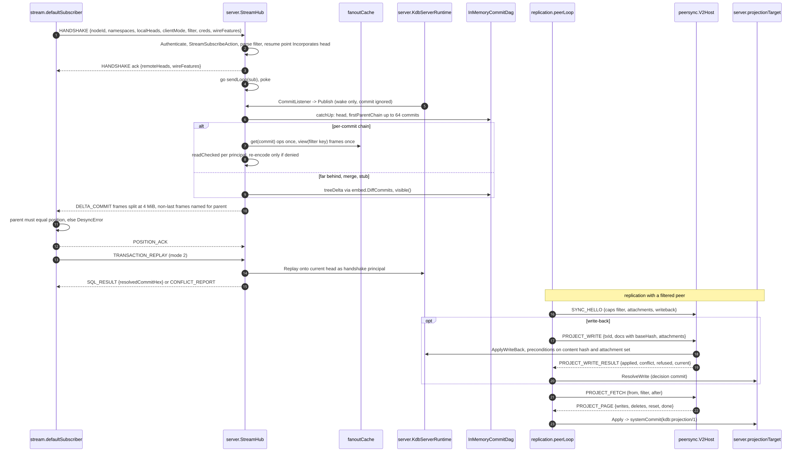

<details><summary>Mermaid source</summary>

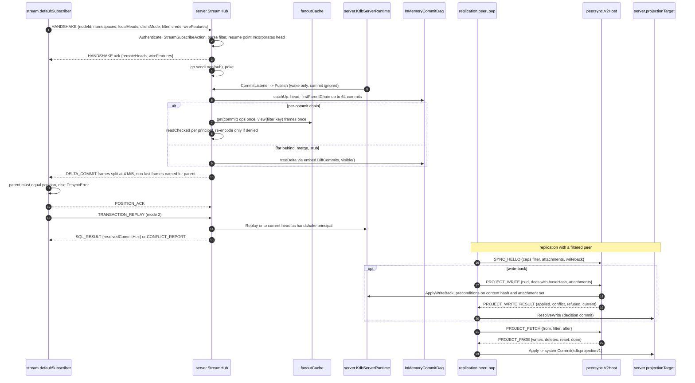

</details>

### Call chain

| # | Function (pkg.Type.Method) | File:line | What it does |
|---|---|---|---|
| 1 | `server.ListenStreamTLS` | server/stream_listen.go:44 | TCP accept loop; creates the `StreamHub` (`NewStreamHub` :381, with a `newFanoutCache` stream_fanout.go:55). `service` wires it (service/service.go:606), sets `SetAllowAnonymous` (:612) and `srv.CommitListener` to call `hub.Publish` (:618-620), later chained with the control plane's `PublishCommit` (:763-770). Serves only the primary namespace. |
| 2 | `server.StreamHub.run` / `handleFrame` | server/stream_listen.go:399 / :429 | Per connection: `HandshakeMessage` -> `handleHandshake` (ack sent, then the returned start func runs); `PositionAck` -> `updateLastAck`; `TransactionReplay` -> `handleTransactionReplay`; other frames ignored. |
| 3 | `server.StreamHub.handleHandshake` | server/stream_listen.go:443 | Requires `ClientMode` in `{STREAM_READ_ONLY, STREAM_WRITE_BACK}` and the hub's namespace; unless `allowAnonymous` authenticates credentials and authorizes `StreamSubscribeAction`; parses the optional `Filter` (`sql.ParseFilter`); resume point `LocalHeads[ns]` must be in the DAG and `dag.Incorporates(p, head)` (dag/join.go:135: ancestor, or a content-free merge whose content main holds), else rejected ("subscribe without one and reload"); no position = start at head. Negotiates wire features: with `binary-frames-2` the subscriber gets its own codec and a `viewKey = filterKey+features`. Registers `registeredSubscriber` (retiring an earlier one on the same conn), returns ack + start (`go sendLoop`, `poke`). |
| 4 | `server.StreamHub.Publish` | server/stream_listen.go:390 | Still ignores its `stream.PublishedCommit` argument (kept only for the `CommitListener` signature); pokes every subscriber. Never blocks the writer. |
| 5 | `server.StreamHub.sendLoop` / `catchUp` | server/stream_listen.go:116 / :138 | Per-subscriber goroutine. If main's first-parent line reaches the position within `maxPerCommitCatchUp = 64` (:67) commits and none is a stub (`firstParentChain` :167), each commit goes via `sendCommit`; otherwise `treeDelta` (:206, `embed.DiffCommits` + `Storage.GetDocuments` in 256-id chunks) sent by `sendDelta` (:277) named for the head. A send/encode error closes the conn and `unregister`s. |
| 6 | `server.fanoutCache.get` / `StreamHub.view` | server/stream_fanout.go:82 / :154 | Shared per-commit state: operations loaded once (LRU bounded by `fanoutCacheMaxBytes = 16 MiB` and `2*maxPerCommitCatchUp` entries, :37-41); per `viewKey` a `filterView` (:184) and its frames encoded once with correlation id 0 (`sync.Once`). |
| 7 | `server.StreamHub.sendCommit` / `readChecked` | server/stream_fanout.go:236 / :256 | Per subscriber: `DocumentReadAction` per write/attachment op; nothing denied -> shared frames; something denied -> writes become `DeleteOp`, attachment ops of unreadable docs dropped, frames encoded for this subscriber alone. |
| 8 | `server.StreamHub.visible` / `filterView` | server/stream_listen.go:249, stream_fanout.go:184 | Tree-delta path: a write outside the filter becomes a `DeleteOp`; `AttachmentPutOp`/`AttachmentDeleteOp` pass the filter (no body) and are read-checked; then `readChecked` if `checkReads`. |
| 9 | `server.StreamHub.encodeDelta` / `splitOpsByBytes` / `sendFrames` | server/stream_fanout.go:210, stream_listen.go:288, stream_fanout.go:300 | Splits ops into frames of at most `maxDeltaFrameOpBytes = 4 MiB` (:260; fast path on worst-case size `opWorstBytes`); every frame but the last is named `CommitHash = ParentHash = parent`, so the subscriber's position moves only on the last. `sendFrames` patches a fresh correlation id into a copy (pooled buffer for synchronous senders). |
| 10 | `server.StreamHub.handleTransactionReplay` | server/stream_listen.go:562 | Requires a completed handshake (or anonymous allowed), authorizes `TxCommitAction`, then `replayTransaction` (server/wire_listen.go:1367) -> `KdbServerRuntime.Replay` (server/server_runtime.go:741) -> `replayWith` (:790) -> `runTransaction` (:825): replay onto the current head, ignoring the client's `BaseVersion`. Replies `SQL_RESULT{ResolvedCommitHex}` or `CONFLICT_REPORT`. |
| 11 | `stream.defaultSubscriber.Connect` / `handleFrame` | stream/subscriber.go:77 / :240 | Client side: HANDSHAKE (offers `wire.SupportedWireFeatures` unless `SubscriberConfig.JSONOnly`, :130-134), blocks up to `handshakeTimeout` (10s) for the ack; each `DELTA_COMMIT` must have `ParentHash == position` else `EventError(DesyncError)` (:285) and the frame is dropped; then `hintApplier.Apply` (no-op `NoopHintApplier`), position advance, `POSITION_ACK`. |
| 12 | `stream.defaultSubscriber.submitTransaction` | stream/subscriber.go:400 | Mode 2: sends `TRANSACTION_REPLAY` with `BaseVersion = position`, waits up to `replayTimeout` (30s); maps replies with `replayResultFrom` (:473). |
| 13 | `stream.defaultCoordinator` | stream/coordinator.go:33 | In-memory-transport-only coordinator (`Start` wires a handler only for `*InMemoryTransport`, :66). `stream.NewCoordinator` (:45) / `NewSubscriber` (subscriber.go:62) have no non-test callers; the real listener is `server.StreamHub`. |
| 14 | `replication.peerLoop.run` / `Replicator.awaitSnapshotPeers` | replication/replicator.go:311 / :369 | Peers with `bootstrap=snapshot` (`bootstrapsBySnapshot` :356) run their first cycle first; every other peer's first sync waits on `snapshotFirst` (closed when `snapshotPending` hits 0, :334-336) so a plain pull cannot make the namespace non-empty and silently skip the snapshot bootstrap. |
| 15 | `replication.peerLoop.cycle` | replication/replicator.go:424 | Extra haves = `PendingTips` (capped to `peersync.MaxPendingTips`) + last `RemoteMain`; `SyncV2` with `CatchUp`/`CatchUpNamespaces` (config.go `catchup=`, `catchup-ns=pattern:route`; resolved per namespace by `V2ClientConfig.catchUpFor` peersync/squash.go:55). Records `Pulled`/`Pushed`/`Overshoot` (`Received - Pulled`); on a namespace error keeps `pendingFrontier` (replication/pending_tips.go:22); logs snapshot / squash / graft / boundary events; then `deepen` if configured. |
| 16 | `replication.peerLoop.projectionCycle` | replication/replicator.go:651 | For a `PeerConfig.Filter != ""` peer: target = `Config.Projections(source, filter, writeBack)` (syncnode/node.go:377: `n.set.Resolve(ProjectionNamespace(...), true)`); `peersync.SyncProjection`; records `Pulled = writes+deletes`, `Pushed = written`. |
| 17 | `peersync.SyncProjection` / `pushWrites` | peersync/projection.go:571 / :699 | `SYNC_HELLO` caps `filter` (+`attachments` if the target is an `AttachmentProjectionTarget`, +`writeback`); write-back sends pending writes in order (attachment bytes fetched first); loops `PROJECT_FETCH` from `Target.LastSource()`, adds `projectedAttachmentOps` per page, `Target.Apply`. A reset page ends with deleting everything not delivered. |
| 18 | `peersync.V2Host.projectFetch` / `projectPage` | peersync/v2_host.go:855, peersync/projection.go:75 | Read-only authorization (`StreamSubscribeAction`, per-document `DocumentReadAction`); `reset` when `FromHex` is unknown or not an ancestor: `resetSeek` (:155, trie seek from the cursor; `kdb_id` ranges in the filter become seek+stop) else `resetScan`; delta: `deltaDiff` (:395, `DiffTrees`, deletes only where `heldAtFrom`) else `deltaReplay` (:460). Pages bounded by `maxBytes` (`DefaultPageBytes`). |
| 19 | `server.projectionTarget.Apply` / `LastSource` | server/projection.go:54 / :19 | Each page is one `systemCommit` (server/meta.go:818, bypasses RBAC and the projection read-only rule) with message `kdb:projection/1 source=<hash> complete=<bool>`; writes become `WriteOp{Replace: true}` (`replacing` :80, no longer delete+write, which would drop attachments). `LastSource` walks first parents (max 100k) to the last `complete=true`. Pages skip documents with an undecided local write. `AttachmentsOf`/`AttachmentStore` (:93/:106) back attachment projection (see attachments flow). |
| 20 | `server.KdbServerRuntime.admitWrite` | server/server_runtime.go:966 | Refuses client writes when draining, read-only (`AssertWritable`), fenced, on a projection without write-back (`admitProjectionWrite` writeback.go:51: writes, deletes and attachment put/delete only) or on a non-home node (`admitHome` home.go:96). |
| 21 | `server.KdbServerRuntime.clientWrite` / `localWriteMessage` | server/server_runtime.go:757, server/writeback.go:70 | Write-back projection: commit made locally at once with message `kdb:writeback-local/1 <doc>=<contentHashBefore>[@<attachmentSetHash or ->]...`; pending until a `kdb:writeback/1 commit=<hash> outcome=...` commit names it (`loadPendingLocked` :217 rebuilds the outbox from the DAG; `pendingWrite` :144 builds the doc list, `KeepBody` for attachment-only changes). |
| 22 | `V2Host.projectWrite` -> `KdbServerRuntime.ApplyWriteBack` | peersync/v2_host.go:505, server/writeback.go:387 | Host authorizes `StreamSubscribeAction`, then `cfg.WriteBack`. Source side: tx id `WriteBackTxID(commit)` (projection.go:528) makes a resend idempotent; each body becomes `WriteOp{Replace:true}`/`DeleteOp` guarded by `ExpectContentHash`/`ExpectAbsent`; attachment set compared to `AttachmentsBase` (mismatch -> `WriteBackConflict`), else `AttachmentSetOps`; empty tx -> `applied` at head. Stale base -> `WriteBackConflict` (`notApplied` :502); permanent -> `WriteBackRefused` (:526); transient -> `PEER_ERROR`. |
| 23 | `server.projectionTarget.ResolveWrite` | server/writeback.go:290 | Not applied: `recordRejectedWrite` (:344, `ConflictWriteBack`) and the decision commit restores each document (and its attachments) to the source's current state; applied: just the decision commit. |
| 24 | `server.ReadThrough.Get` | server/read_through.go:81 | A projection with `readthrough=true` answers reads of documents it does not hold (`KdbServerRuntime.ReadDocument` :145) via `Replicator.OpenDocSession` (replicator.go:761) -> `peersync.OpenDocSession` (doc_fetch.go:189) -> `DOC_FETCH` (flow 9). |
| 25 | `embed.OpenReadOnlyFileRuntime` / `EmbeddedKdbRuntime.Refresh` / `AssertWritable` | embed/file.go:31, :347; embed/runtime.go:204, :189 | Shared attach lock only (`acquireDirLockShared` embed/dir_lock.go:65): coexists with the live writer (which also holds `.kdb.write.lock` EXCLUSIVE); no WAL, no delta writer; `Refresh` replays the delta log onto its DAG (`replayDeltaNamespaceFrom`); every write path calls `AssertWritable` (`ErrReadOnly`). Not network replication. |
| 26 | Promotion / handover | server/handover.go:51-119, server/meta.go:522, server/home.go:96-154, control/promote.go:213 | `Handover` / `ForceHandover` / `answerHomeRequest` (:76, a peer's `HOME_REQUEST` via `V2HostConfig.HomeRequest`, peersync/v2_host.go:316-333, wired at server/peersync_listen.go:149) call `MetaStore.AssignHome`, which raises the fence and records `Since`. The new home refuses writes until it holds `Since` (`admitHome`); replicated commits from a former home after `Since` are refused (`checkReplicatedCommit` home.go:131, wired as `IngestEnv.CheckCommit` only when a home is set, peersync_ingest.go:81-84). `control/promote.go` is **restore** promotion, unrelated to replicas. |
| 27 | `replication.Replicator.FetchBodies` / `Compare` / `PeerFloor` | replication/replicator.go:698 / :742 / :624 | Repair helpers: bodies of damaged documents from peers (healthiest first, hash-verified), Merkle-diff against a peer, and the retention floor (`PeerFloor` + `InboundPeerFloor`) for `history=none` truncation. |

### Data that changes

| Step | Structure / file / wire message | Mutation |
|---|---|---|
| Handshake | `StreamHub.subscribers` (`registeredSubscriber`: principal, filter, `filterKey`, `viewKey`, `codec`, `checkReads`, `position`, `lastAck`, `wake`, `stop`) in memory | Added; an earlier registration for the same connection is retired. Nothing on disk. |
| Fan-out | `StreamHub.fanout` (`fanoutCache`: commit -> ops + per-`viewKey` `fanoutView{ops, frames}`) | Filled on first per-commit send; LRU-evicted past 16 MiB / 128 entries. Not used by the tree-delta path. |
| Delta | `wire.DeltaCommitMessage{Payload{Namespace, CommitHash, ParentHash, TimestampMicros, Operations}}`, JSON or binary per negotiated features | `IndexHints` never populated; operations rewritten by filter / read check; a catch-up over 4 MiB is several frames, all but the last with `CommitHash = ParentHash`. |
| Subscriber | `defaultSubscriber.position` | Advanced after each accepted frame (a split frame leaves it unchanged); lost on process end (resume needs `ResumeFrom`). |
| Write-back stream | A commit on the hub's runtime via `Replay` (write gate, delta log, indexes, listeners) | Message is the home stamp or `localWriteMessage` as for any client write. |
| Projection pull | Projection namespace commits `kdb:projection/1 source=<srcCommit> complete=<bool>` | Documents replaced (`Replace: true`), attachments synced when both sides have the `attachments` cap; `LastSource` derived from the DAG. |
| Projection write | Local commit `kdb:writeback-local/1 <doc>=<hash>[@<set>]`; decision commit `kdb:writeback/1 commit=... outcome=...`; `ConflictQueue` entry `write-back`; on the source a commit with tx id `WriteBackTxID(commit)` | Outbox is the DAG. |
| Replicator | `<dataRoot>/replication/peers/<name>.json` (`PeerState`: `LastAttempt/LastSuccess/ConsecutiveFailures`, per namespace `LocalMain/RemoteMain/LastSync/PendingTips/Pulled/Pushed/Overshoot/OpenConflicts`) | Saved after each cycle (tmp + `fsx.Rename`); `PendingTips` kept as a bounded frontier. |
| Handover | Metadata doc `kind: home` `{node, addr, fence, since}`; runtime `home` atomic | New fence; replicated as an ordinary definition. |

### Failure, edge cases & durability points

- **What exists vs. not.** Exists: `server.StreamHub` (real TCP stream mode, resumable, filtered, per-document read checks, shared fan-out, byte-bounded frames, binary frames), `stream.Subscriber` (client library; still tests only - `NewSubscriber`/`NewCoordinator` have no non-test callers), `replication.Replicator` (pull/push/both, filtered projections with write-back incl. attachments and read-through, `bootstrap=snapshot` ordered first, squash catch-up policy, `deepen`, scoped metadata, inbound-peer retention floor), single-home ownership with fences and application-driven handover, shared-directory read-only runtimes. Not present: the stream `Coordinator`/`hint_applier` as a production path (`NoopHintApplier`; the hub sends no hints); `CompactionNotice`/`IceArchiveNotice` frames are handled by the subscriber but nothing sends them; a network "read-only replica" role distinct from `mode=pull`; any replica-to-primary promote; automatic failover. A filtered peer forces `Mode = SyncPull` and cannot combine with `deepen` (replication/config.go:211-217).
- **docs/kdb-lld-flows.md section 13 is still stale.** It shows `HUB->>S1: DELTA_COMMIT` driven by `CommitListener(namespace, commit)` carrying operations and `indexHints`; in the code `Publish` ignores its argument and each subscriber's goroutine rebuilds frames from the DAG (shared via `fanoutCache`). It omits handshake auth, filters, read checks, resume, the 64-commit rule, frame splitting and binary frames. Section 23 (read-only replicas) matches the code (readers coexist with the writer).
- **Durability / ordering of notifications.** Local writes: `CommitListener` fires after the fsync wait (server_runtime.go:938-946); cross-namespace groups after `wait()` (namespace_set.go:340-351). Peer-adopted commits: `serverLocalNode.Advanced` fires `CommitListener` (peersync_ingest.go:244-248) from `advance(node, step)` inside `node.Exclusive` (peersync/ingest.go:311, :354, :375), i.e. under the write gate **before** the durable waits (:381-388), so a stream subscriber (or `replicator.OnLocalCommit` kick) can see a peer-adopted (incl. squash/snapshot) commit not yet durable here. And since the hub reads the DAG head, a failing log wait whose head stays resident can still be streamed.
- **Tree-delta catch-up drops attachment changes.** `treeDelta` (stream_listen.go:206-245) emits only `WriteOp`/`DeleteOp` from `embed.DiffCommits` (embed/revert.go:201, document trees only); attachment put/delete are carried only on the per-commit path. A subscriber >64 commits behind, behind a merge, or behind a squash/stub sees no attachment changes for that range.
- **Mode 2 replay semantics.** `Replay` ignores the client's `BaseVersion`; conflicts come from the engine's own detection (`CONFLICT_REPORT`). Runs as the handshake principal; anonymous only on operator opt-in.
- **Subscriber failure modes.** A resume position not incorporated by main is rejected at handshake. A `ParentHash` mismatch gives `DesyncError` and the frame is dropped while the hub keeps its own position, so the client must reconnect. A dead or slow connection never blocks writers (`wake` cap 1); a failed send unregisters. A catch-up interrupted mid-split resumes from parent and resends the same final-body ops (idempotent). Before the split, a >16 MiB catch-up failed encode on every reconnect (fixed). Stubbed or evicted operations push catch-up to `treeDelta`.
- **Replicator failure modes.** Failed cycle: `ConsecutiveFailures++`, exponential backoff capped at `MaxBackoff` (10 min), state saved. Namespace errors keep a bounded `pendingFrontier` for resume. A `bootstrap=snapshot` peer that is down delays others' first sync by at most a request timeout. State files use tmp + `fsx.Rename` without fsync of the data.
- **Write-back crash safety.** A write is pending exactly while no decision commit names it; resend with the deterministic tx id gets `applied` again. A source that cannot decide returns `PEER_ERROR`; `pushWrites` stops at the first failure. Attachment-set mismatch is judged against the head read at entry; a later change is caught by the commit's preconditions.
- **Single-home specifics.** Writes on a non-home node fail with `NotHomeError` (`NOT_HOME`). The new home answers `UnavailableError` until it holds `Since`. `checkReplicatedCommit` runs only when a home is set.
- **Read-only runtime caveat.** `OpenReadOnlyFileRuntime` takes only the shared attach lock and coexists with a live writer; its view advances only on `Refresh()`. Its doc comment (embed/file.go:25-27, "a writer cannot start while any of them is open") is stale against embed/dir_lock.go:13-27, 63-65.
---

## 15. Attachments: upload, commit, read, maintenance and sync

### Description (short)

A record has any number of named attachments, each identified by `(docID, attachmentID)` and carrying a `name` unique within the document, a scheme-1 content hash, a size and a mime type. Attachments are **not** part of the document's content hash: they live in a separate per-namespace attachment table (a trie from document id to the hash of its sorted attachment set), and every commit records that table's root as `Commit.AttachmentTreeHash` (nil = empty table).

The content hash is the root of an RFC 6962 Merkle tree over 1 MiB chunks, folded with the size (`document.AttachmentIdentity`), so a reader can verify each chunk on its own.

Writing is always **upload first, commit second**:

1. The bytes stream into `attachstore.Store` (`Begin`/`Write`/`Finish`), hashed chunk by chunk in parallel.
2. Small blobs (<= 256 KiB, one chunk) go inline in a pointer segment. Larger ones become a bytes segment plus a leaves segment plus a pointer `h-<hash>.<gen>`.
3. A transaction carrying `AttachmentPutOp` / `AttachmentDeleteOp` is committed through the normal write path (flow 3). Preflight checks that the blob is stored and the name is free. A separate per-attachment conflict check runs. `InMemoryCommitDag.appendCommitLocked` derives the new table root, and for a merge also adds the three-way attachment merge ops.

An uploaded blob that no commit references is kept for `UploadGrace` (1 h). The hold ends when the referencing commit is durable (`Store.Committed`, via the `PersistingCommitDAG` hook).

Maintenance (`Maintain` -> `CompactAttachments`) does three things:

- It brings a reference index (`r-` segment) up to date incrementally.
- It re-stores replaced versions as binary deltas against their successor, in budgeted `DeltaStep` jobs, recording progress in a persisted mark (`m-` segment).
- It `Collect`s the blobs nothing keeps.

Reads open a pinned, leased `attachstore.Reader` that verifies every chunk against the stored leaves. On the wire:

- `ATTACHMENT_GET`/`DATA` pages are served from a per-connection read.
- With `Proofs` set, every whole chunk carries its inclusion path, so the Go client (`OpenAttachmentRange` / `ReadAttachmentAt`) checks it before handing out any byte.

Peer sync moves blobs separately from commits:

- `BLOB_FETCH` (0x42/0x43), proof-checked, before a pulled page is stored.
- `ATTACHMENT_UPLOAD` with `Expect` before a pushed `REF_UPDATE`.
- Snapshot and graft pages carry packed attachment tables.

Backups copy the attachment store's segments. Damaged stored bytes surface as `attachstore.ErrCorrupt` -> wire `INTEGRITY` and are logged and counted.

### Diagram

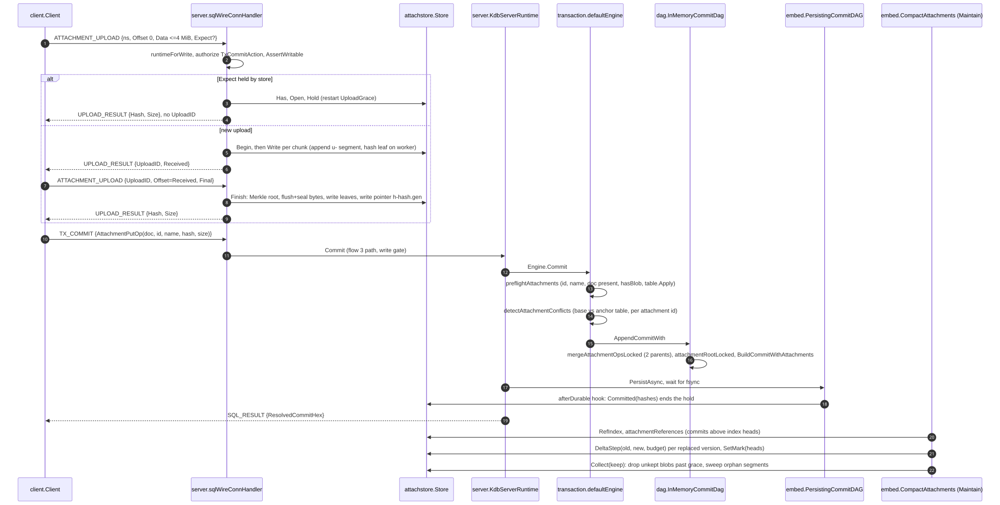

<details><summary>Mermaid source</summary>

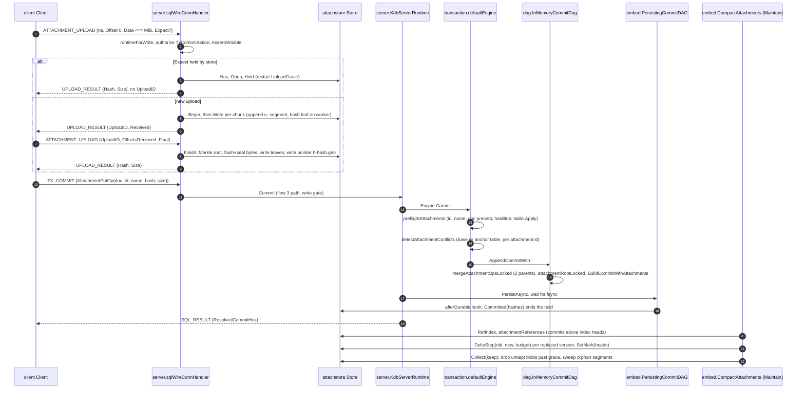

</details>

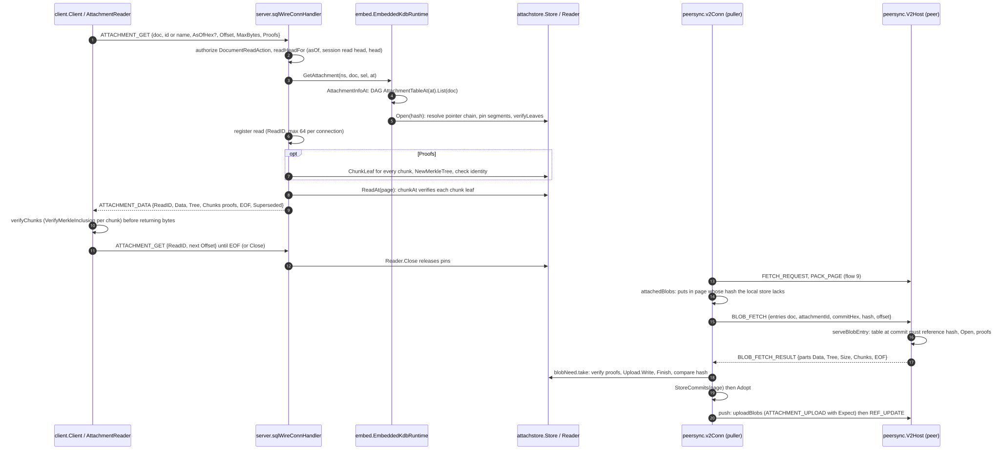

<details><summary>Mermaid source</summary>

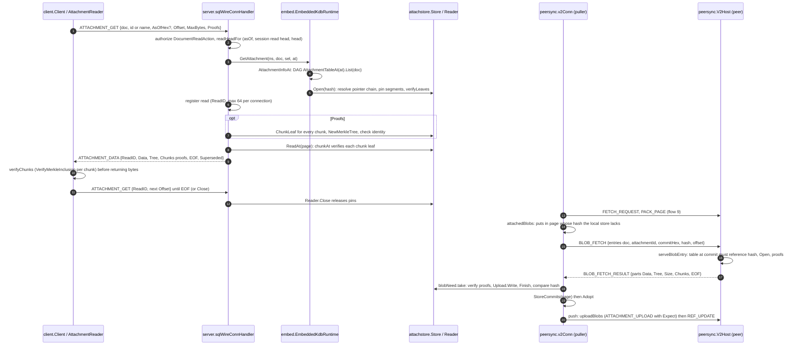

</details>

### Call chain

| # | Function (pkg.Type.Method) | File:line | What it does |
|---|---|---|---|
| 1 | `document.ChunkLeafHash` / `MerkleBuilder` / `AttachmentIdentity` | `document/attachment_hash.go:41`, `:69`, `:59` | Scheme 1: leaf = SHA-256(0x00 ‖ chunk), RFC 6962 tree over 1 MiB chunks (`AttachmentChunkBytes`), identity = SHA-256(0x02 ‖ be64(size) ‖ tree). `MerkleTree.Proof` (`:206`) / `VerifyMerkleInclusion` (`:146`) give and check audit paths. |
| 2 | `client.Client.UploadAttachment` -> `ResumeUpload` | `client/attachments.go:167` -> `:172` | Needs the `attachments` wire feature (`requireAttachments` `:132`). Reads 1 MiB chunks one ahead so the last frame is `Final`; sends `ATTACHMENT_UPLOAD {UploadID, Offset, Data}`. A failure returns `*UploadError{UploadID, Received}` so the caller resumes. The Go client never sets `Expect`. |
| 3 | `sqlWireConnHandler.handleAttachmentUpload` | `server/attachments_wire.go:129` | Dispatched at `server/wire_listen.go:538`. Runs `runtimeForWrite` and `TxCommitAction` (uploading is the first half of committing), checks chunk <= `wire.MaxAttachmentChunkBytes` (4 MiB, `wire/attachment_ops.go:42`) and `AssertWritable`. `Expect` held -> `heldBlob` (`:452`: `Has`, `Open`, `Hold`) answers with the hash and no upload. Otherwise a server-scoped upload (`rt.attachUploads`, max 1024, idle sweep 1 h `sweepLocked` `:53`) keyed by a random token and bound to `(ns, principal)`. `Offset` must equal `received`; a retried final chunk of a finished upload returns the result again. |
| 4 | `attachstore.Store.Begin` / `Upload.Write` / `flushChunk` / `hashChunk` | `storage/attachstore/store.go:530` / `:536` / `:563` / `:585` | `MaxBytes` check (`ErrTooLarge` -> `RESOURCE_EXHAUSTED`); each full chunk is appended to a random `u-` segment (registered in `s.uploads` so `Collect` leaves it alone) and hashed on a worker (bounded by `HashWorkers`). |
| 5 | `attachstore.Upload.Finish` | `storage/attachstore/store.go:601` | Last partial chunk, waits on the workers, Merkle root -> `Info{Hash, Size}`. Size 0 -> nothing stored (`emptyHash`). One chunk <= `SmallMaxBytes` (256 KiB) -> `writePointerLocked` with `inline` bytes. Otherwise `FlushSegment` + `SealSegment` the bytes, `writeLeaves` (`:770`, 32 B per chunk, flushed and sealed), then a pointer. An already-stored hash deletes the new copy and `holdLocked`s the old one. The pointer records `finished` (start of `UploadGrace`). |
| 6 | `attachstore.Store.writePointerLocked` / `encodePointer` / `readPointer` | `storage/attachstore/store.go:472` / `:364` / `:391` | Pointer segment `<ns>/attachment/h-<hash>.<gen>`. The shim has no rename, so replacement writes a higher generation first. On load the newest readable generation wins, so a torn pointer reads as the one below it. Inline bytes are checked against the hash when read. |
| 7 | `attachstore.pointerIndex.get` / `put` / `spill` / `mergeTop` | `storage/attachstore/pointer_index.go:135` / `:176` / `:206` / `:235` | Fixed-size entry per blob (gen, delta/base, segment name keys, `held` time) in a bounded overlay plus sorted `x-<seq>` runs (binary search). A run >= 1/4 of the one below is merged. Pointers themselves sit in an LRU bounded by `PointerCacheBytes` (4 MiB). The index is rebuilt from pointer segments on first use after a restart (`loadLocked` `store.go:272`) and old runs are deleted. |
| 8 | SQL write: `attachmentWriter.ref` / `insertAttachmentOps` / `updateAttachmentOps` | `sql/attachments.go:471` / `:541` / `:572` | Called from `sql/dml.go:37` (INSERT ... WITH ATTACHMENT) and `:130` (UPDATE SET/DROP/RENAME ATTACHMENT). `STREAM ?` must be a `ParamAttachmentRef`, which is checked with `HasAttachmentBlob`. `CellBytes` / `X''` / `FROM_BASE64` are stored via `PutAttachmentBlob` (deduped per statement). The engine gets the store from `sql.SetAttachmentBlobs(s.sqlEngine, s.Runtime)` (`server/server_runtime.go:408`). |
| 9 | Client commit: `client.Client.PutAttachment` -> `attach` -> `commitAttachmentChanges` | `client/attachments.go:591` -> `:599` -> `:670` | `ListAttachments` to resolve an existing ID/name, random ID if new, then a `document.Transaction{BaseVersion: st.head, Operations: [AttachmentPutOp]}` through `commitTransaction` (flow 3). `RenameAttachment` (`:636`) re-puts the same hash under a new name; `DeleteAttachment` (`:645`) sends `AttachmentDeleteOp`. |
| 10 | `transaction.preflightAttachments` | `transaction/attachments.go:108` | Called from `defaultEngine.plan` (`transaction/prepare.go:121`). Per `AttachmentPutOp`: non-zero ID, `ValidateAttachmentName` (`document/attachment_table.go:39`, <= 255 bytes), size >= 0, document present after the tx, `hasBlob` (`:78`: the runtime registered by `RegisterAttachmentBlobs` `:45`, held weakly, else `BlobPresence`/`ReadBlob`). Then applies the ops one by one to `AttachmentTableAt(anchor)`, so a duplicate name is refused. Violations -> `ResultSchemaError` on field `_attachment`. |
| 11 | `transaction.detectAttachmentConflicts` | `transaction/attachments.go:180` | `prepare.go:154`. Skipped if base == anchor. Compares `base.Get(doc, att)` vs `target.Get` per attachment op (`ConcurrentWrite`), and for a `DeleteOp` the per-document set hash (`SetHash`). A concurrently deleted document -> `WriteDelete`. A JSON-only write never conflicts with an attachment change. Precondition-guarded ops are exempt. |
| 12 | `InMemoryCommitDag.mergeAttachmentOpsLocked` | `dag/attachment_merge.go:35` | In `appendCommitLocked` (`dag/in_memory_commit_dag.go:1047`) for **two-parent** commits: three-way per attachment ID against the first merge base (`mergeAttachmentSets` `:150`: a version beats a removal; between two versions the greater (hash, name, size, mime) wins; a name clash keeps the smaller ID, the other becomes `name~<8 hex>`). Documents absent from the merged tree lose their attachments. Ops are appended to the merge's operations, so every node builds the same commit hash. |
| 13 | `InMemoryCommitDag.attachmentRootLocked` / `attachmentTableLocked` | `dag/attachments.go:223` / `:171` | Root = first parent's table + this commit's ops (or `tx.Attachments` if staged). Tables are cached by root (64 + pinned seeds). A miss is rebuilt forward from the nearest cached/empty ancestor, hydrating evicted ops, and **each step is checked against the recorded root** (`ConsistencyError` on mismatch). Built into the commit hash by `document.BuildCommitWithAttachments`. |
| 14 | `AttachmentSetPool` / `useAttachmentSetStore` / `engineSetStore` | `document/attachment_set_pool.go:49`, `embed/attachments.go:218` / `:205` | Sets shared by all tables; with a spilling engine they are bounded (`AttachmentSetBudgetBytes`, default 8 MiB) and evicted to the engine blob store **unlogged** (`WriteUnloggedBlob`), read back hash-checked. `installAttachmentReachability` (`:171`) tells the engine (history=none) to keep head-referenced sets and blobs. |
| 15 | `PersistingCommitDAG.afterDurable` -> `EmbeddedKdbRuntime.attachmentsCommitted` -> `Store.Committed` | `embed/persisting_dag.go:38` -> `embed/attachments.go:934` -> `storage/attachstore/store.go:729` | Wired at `embed/file.go:327`. Wraps `PersistAsync`'s wait (`persisting_dag.go:185`): once the fsync succeeds for a commit with a put, clears `held` in the pointer index for its hashes. |
| 16 | `EmbeddedKdbRuntime.Maintain` -> `CompactAttachments` | `embed/runtime.go:104` -> `embed/attachments.go:776` | Called by `MaintenanceScheduler.runPass` (`embed/maintenance_loop.go:520`). `AttachmentHistoryLatest`: `Collect` keeping what branch/tag heads reference. `AttachmentHistoryAll` (default): `attachmentReferences` then `deltaReplaced` then `SetMark(heads)` (only if no delta is pending) then `Collect(refs.Has)`. `DisableDeltas` -> `inflateDeltas` (`:854`) turns deltas back into whole copies within budget. |
| 17 | `EmbeddedKdbRuntime.attachmentReferences` | `embed/attachments.go:558` | Incremental when the stored `RefIndex` (`r-<gen>`, `attachstore/ref_index.go:90`/`:160`) has the same history floor and its heads are still below the current ones (`stillBelow`): reads only `CommitsAbove(heads, prev.Heads)` and only commits whose attachment root differs from their first parent's. Otherwise it rebuilds from all retained history. A commit with no parent here (shallow/truncated) contributes its whole table. It also returns the replaced-version changes above the mark. |
| 18 | `deltaReplaced` -> `attachstore.Store.DeltaStep` | `embed/attachments.go:890` -> `storage/attachstore/deltajob.go:78` | For each put whose first parent held a different kept version of the same attachment: re-store **old as a delta against new**. Bounded by `DeltaStepBytes` (4 GiB per pass); `DeltaPending` carries the job (`s.job`, phases index/encode/verify) to the next pass. Skipped if the old version is already a delta/inline, the chain is > `DeltaMaxDepth` (8), or the pair was declined. `finishJob` (`:353`) writes a higher-generation pointer `{delta, framed, base}` and deletes (or defers) the whole copy. A delta that does not reproduce its version is declined and logged. |
| 19 | `attachstore.Store.Collect` | `storage/attachstore/store.go:888` | `expireReaders` first. Pass 1 rescues bases of kept or held deltas. Pass 2 removes index entries not kept, not rescued and past grace, and clears `held` on kept ones. Then it lists `<ns>/attachment/` and deletes every segment no kept entry names, except `x-` runs, `r-` indexes, the mark and in-flight uploads. Pinned segments are deferred to the last reader's `Close`. |
| 20 | `sqlWireConnHandler.handleAttachmentGet` | `server/attachments_wire.go:279` | New read: `DocumentReadAction`, `readHeadFor` (`:231`), `GetAttachment`, registered under a token (max 64 per connection, `closeAll` on connection end `wire_listen.go:405`). Page default 1 MiB, cap 4 MiB. `Proofs`: offset rounded down to a chunk, whole chunks, `merkleTree` (`:402`, leaves from the store, identity re-checked -> `INTEGRITY`), one `BlobChunkProof` per chunk. EOF closes the read and sets `Superseded` (`:435`) if the head now has another version. Offset past size -> `SCHEMA_VIOLATION` with `Info` (size) kept. |
| 21 | `EmbeddedKdbRuntime.GetAttachment` / `AttachmentInfoAt` / `ListAttachments` | `embed/attachments.go:425` / `:442` / `:455` | Table at the commit -> `Attachment` by ID or name; `Store.Open` `ErrNotFound` -> `ErrAttachmentNotRetained` (-> `NOT_FOUND`, `errCodeFor` `attachments_wire.go:97`). `handleAttachmentList` (`:247`) returns the set plus `CommitHex`. |
| 22 | `attachstore.Store.Open` / `Reader.chunkAt` / `ReadAt` / `Close` | `storage/attachstore/reader.go:404` / `:240` / `:289` / `:312` | `resolveLocked` (`:377`) walks the delta chain; pins bytes and leaves of every link; `verifyLeaves` (`:527`) once per leaves segment (LRU of known-good). Every chunk read is compared with its stored leaf -> `ErrCorrupt` (`chunk i of <hash>`). Legacy small blobs come from the engine blob store, hashed whole. Lease `ReadLease` (1 h): an expired reader returns `ErrReadLeaseExpired`. |
| 23 | `client.Client.OpenAttachmentRange` / `ReadAttachmentAt` / `takeVerified` / `verifyChunks` | `client/attachments.go:327` / `:549` / `:372` / `:410` | Needs the `attachment-proofs` feature (`wire.SupportedWireFeatures` `wire/binary.go:63`). Checks the identity of `(Tree, Size)` against the info hash, the scheme, and page alignment, then each chunk's inclusion proof. Bytes no proof covers -> `ErrAttachmentCorrupt`. Only bytes inside `[offset, offset+length)` are exposed. `OpenAttachment` (`:289`) streams without proofs (no client-side check). |
| 24 | `server.classifyError` / `attachstore.ReportCorrupt` | `server/error_classification.go:17`, `storage/attachstore/store.go:81` | `ErrCorrupt` -> `wire.ErrorCodeIntegrity`. Every reply path that turns a read error into a frame calls `ReportCorrupt` (slog error plus process-wide `CorruptReads` counter). |
| 25 | Pull: `v2Conn.fetchRef` -> `fetchBlobs` -> `blobNeed.take` | `peersync/v2_client.go:450` (`:470`) -> `peersync/attachments.go:298` -> `:364` | Before `StoreCommits` of a `PACK_PAGE`: `attachedBlobs` (`:274`) lists puts the local store lacks. `BLOB_FETCH` in batches of 64, 8 MiB per page. Each part: identity of `(Tree, Size)` == hash, each chunk proved, written into an `Upload`, `Finish` hash compared. A `NOT_FOUND` part (host keeps latest only) marks the blob done **without** it. |
| 26 | Host: `V2Host.blobFetch` / `serveBlobEntry` | `peersync/attachments.go:45` / `:87` | Dispatched at `peersync/v2_host.go:379`. Pull grant (or projection session + per-document `canRead`). The requested commit's table must reference `(doc, att) -> hash`, which proves the bytes belong to the namespace. Offset must be on a chunk boundary. Leaves -> tree -> proofs per chunk. `Superseded` at EOF against the head. |
| 27 | Push: `v2Conn.push` -> `uploadBlobs` -> `uploadBlob`; host `V2Host.attachmentUpload` | `peersync/v2_client.go:557` (`:611`) -> `peersync/attachments.go:420` -> `:440`; `:181` | Before each `REF_UPDATE` page: per put, `ATTACHMENT_UPLOAD` with `Expect` on the first chunk (host has it -> one round trip). Host side: `dirPush` grant, per-session uploads (`hostUploads`). A peer without `SyncCapAttachments` gets `AttachmentsUnsupportedError` (`checkPeerAttachments` `:720`, `carriesAttachments` `:711`) instead of commits it cannot decode. |
| 28 | Snapshots/grafts: `snapshotPage`, `seedingSnapshotPages`, `fetchTableBlobs` / `uploadTableBlobs` | `peersync/snapshot.go:36`, `peersync/attachments.go:547`, `:587` / `:600` | The last snapshot page carries `PackAttachmentTables([commit])` (`dag/attachments.go:284`). The puller seeds it (`SeedPackedAttachmentTables` `:312`) and persists it via `IngestEnv.AttachmentTableSeeded` = `EmbeddedKdbRuntime.PersistAttachmentSeed` (`embed/attachments.go:979`, wired `server/peersync_ingest.go:55`), because no replay can derive a root's table. Then it fetches every blob the table names (`v2_client.go:259`, `:487`, `:508`). Checkpoints pack head tables too (`embed/checkpoint_open.go:310`, seeded at `:129`). |
| 29 | Backup: `backupAttachments` / `fetchAttachments` / `verifyAttachments`; restore `restoreAttachmentSegments` | `backup/attachments.go:48` / `:108` / `:143`; `recovery/restore.go:169` | `CreateWithOptions` (`backup/backup.go:256`) uploads attachment-store segments **after** the log, cut into parts stored under their SHA-256 (an unchanged part of an incremental backup is not re-uploaded). `Verify` (`:334`) and `FetchToDir` (`:416`) re-check every part. |

### Data that changes

| Step | Structure / file / wire message | Mutation |
|---|---|---|
| Upload | Wire `ATTACHMENT_UPLOAD` (0x44) `{Namespace, UploadID, Offset, Data, Final, Expect}` / `ATTACHMENT_UPLOAD_RESULT` (0x45) `{UploadID, Received, Hash, Size, Error, ErrorCode}` | Server-scoped `attachmentUploads.m[token]` (in memory; idle 1 h). |
| Upload bytes | `<ns>/attachment/u-<id>` (bytes), a second `u-` segment (leaves, 32 B per chunk) | Appended per chunk; flushed and sealed at `Finish`. An aborted or idle upload's segments are removed by the next `Collect`. |
| Pointer | `<ns>/attachment/h-<hash>.<gen>`: segment, leaves, size, delta/framed/base, `inline` bytes, `finished` | Written at `Finish`, rewritten at a higher generation by `holdLocked` (once per half grace) and by `finishJob` (delta). |
| Pointer index | `pointerIndex` overlay + `<ns>/attachment/x-<seq>` runs; pointer LRU | `put`/`remove` per change; overlay spilled to a run; runs merged. Rebuilt from pointers at open. |
| Commit | `AttachmentPutOp{DocID, AttachmentID, Name, Scheme, ContentHash, Size, Mime}`, `AttachmentDeleteOp{DocID, AttachmentID}` in `document.Transaction.Operations`; `Commit.AttachmentTreeHash` | New table root in the commit hash; merge commits gain derived attachment ops. The delta-log record carries ops and root (flow 3). |
| DAG | `attachmentCache` (tables by root, 64 + pinned seeds), `AttachmentSetPool` (sets by hash), `sawAttachments` | Tables cached as derived; sets spilled to the engine blob store unlogged. |
| Hold | `indexEntry.held` | Set at `Finish`/`Hold`; cleared by `Committed` after the commit's fsync or by `Collect`. |
| Maintenance | `<ns>/attachment/r-<gen>` (`RefIndex{Heads, Floor, Refs}`), `m-<gen>` (mark: heads, SHA-256 prefix), delta segments | Ref index rewritten when heads or refs change; mark after a pass that finished its deltas; a delta replaces a whole copy. |
| Seeds | Snapshot key `kdb:attachment-seeds:<ns>` (packed tables) | Appended (deduped by root) when a snapshot, graft or boundary extension seeds a table; re-seeded on every open (`embed/file.go:239`). |
| Read | Wire `ATTACHMENT_GET` (0x46) `{DocID, AttachmentID or Name, AsOfHex, SessionID, ReadID, Offset, MaxBytes, Proofs, Close}` / `ATTACHMENT_DATA` (0x47) `{ReadID, Info, CommitHex, Offset, Data, EOF, Superseded, Tree, Scheme, Chunks}`; `ATTACHMENT_LIST` (0x48/0x49) | Per-connection `attachReads.m`; `Store.pinned`/`deferred` counts; `readers` lease set. |
| Peer sync | `BLOB_FETCH` (0x42) `{Namespace, MaxBytes, Entries[{DocID, AttachmentID, CommitHex, Hash, Offset, MaxBytes}]}` / `BLOB_FETCH_RESULT` (0x43) `{Parts[{Index, Hash, Offset, Size, Tree, Data, Chunks, EOF, Superseded, Error}], More}`; `SnapshotPageMessage.AttachmentTables` | Pulled blobs written through `Upload` (held under grace until the adopting commit is durable). |
| Backup | Manifest `Attachments []AttachmentSegment{name, parts}`; object keys from `attachmentPartKey` | Parts uploaded once per content. |

### Failure, edge cases & durability points

- **Bytes durable before the commit.** `Finish` flushes and seals the bytes and leaves segments before the pointer exists, and the client commits only after `UPLOAD_RESULT`. Preflight refuses an `AttachmentPutOp` whose blob is not stored (`attachment blob not stored`). Pointer segments themselves are written by `writeSegment` (`store.go:490`).
- **Upload hold window.** A finished upload is kept for `UploadGrace` (1 h) without a reference. A client that uploads and commits more than an hour later can lose the blob to `Collect`, and its commit is then refused at preflight. `Expect` skips re-upload only when the store already holds the hash, and restarts the grace (`Hold`). `Committed` clears `held` in the in-memory index only. After a restart the hold is re-derived from the pointer's `finished`, so a committed blob may be held up to one more grace (harmless).
- **Uploads outlive connections, not processes.** `attachUploads` is in memory: a server restart drops every in-flight upload (partial segments are swept). Resume works only across connections to the same process. An upload is bound to its principal and namespace.
- **Size is trusted.** `AttachmentPutOp.Size` comes from the client (or SQL `ParamAttachmentRef`), and preflight checks only `>= 0` plus presence of the hash. It is not compared with the stored blob's size, so a client can commit a ref with a wrong `Size`. Reads use the table's size for bounds (`handleAttachmentGet`, `serveBlobEntry`).
- **Conflicts are per attachment.** Two writers changing different attachments of one document both commit; a JSON-only write never conflicts with an attachment change. A document delete conflicts with a concurrent change to any of its attachments. Merge commits never report attachment conflicts: they resolve them deterministically (version beats removal, greater tuple wins, `~<hex>` rename on a name clash). Only two-parent merges get merge ops.
- **Tables are verified, sets are not logged.** Every rebuilt table is checked against the root its commit recorded, so a damaged log or cache is a `ConsistencyError`, never a wrong attachment. Spilled sets are written unlogged: after a crash they are rebuilt by replay, and a seeded table whose sets were lost would fail its hash check on read.
- **History modes.** Under `AttachmentHistoryLatest` only heads' blobs survive `Collect`. Peers asking for an older version get `NOT_FOUND` per entry, and the puller **adopts the commit without the blob** (later reads fail the same way). `uploadBlob` also skips silently when the local `Open` fails for any reason, `ErrCorrupt` included, so a damaged local copy is never reported on push and the host stores a commit whose bytes it cannot get from this node.
- **Delta safety.** A delta is written, verified (`verifyDelta`) and only then swapped in by a higher-generation pointer; the whole copy is deleted or deferred while readers pin it. A delta job is dropped if old's pointer changed, and `Collect` drops a job whose versions are going. A delta whose read-back differs is declined and logged; the version stays whole. With `DeltaPending` the mark is not advanced, so the next pass re-walks from it.
- **Readers.** Pins make a read finish on the version it started on, despite commits, deltas or GC. A reader past `ReadLease` (1 h) is released by the next `Collect` and fails with `ErrReadLeaseExpired`. A wire read holds its pin until EOF, Close or connection end. An unclosed read on a long-lived connection keeps segments for up to the lease.
- **Corruption is typed and per chunk.** `chunkAt` compares every chunk with its leaf; `verifyLeaves` re-derives the root from the leaves. Mismatch -> `ErrCorrupt` -> `INTEGRITY` on `ATTACHMENT_DATA` and `BLOB_FETCH` parts, logged with namespace/doc/attachment/offset and counted (`CorruptReads`). Without `Proofs` a Go client cannot detect a host that serves wrong bytes. With proofs (`OpenAttachmentRange`) no unverified byte is returned.
- **Old peers.** A peer without `SyncCapAttachments` is refused commits that carry attachments (`AttachmentsUnsupportedError`). Rolling upgrades are safe only if nothing is attached before every node supports attachments. A squash window containing attachment commits is refused (`dag/in_memory_commit_dag.go:1126`).
- **Backups.** Attachment segments go up after the delta log, so every blob a backed-up commit names is in the backup. `backup/attachments.go:3` says small blobs "live in the namespace's delta log"; since inline pointers they are attachment-store segments and are copied with the rest, so that comment is stale (as is `store.go:11-12`, which still says small blobs go to the ordinary blob store; the engine blob store is now read only for legacy blobs).
- **Embedded API bypasses the server gate.** `EmbeddedKdbRuntime.PutAttachment` / `RenameAttachment` / `DeleteAttachment` (`embed/attachments.go:269`, `:287`, `:355`) append with `DAG.AppendCommit` and `Storage.CommitTree` directly, not through the server's write gate, admission or conflict engine. No server path calls them; wire and SQL clients go through `TX_COMMIT`.

---

## 16. Client replica (Track D): TS `@kdb/replica` and Kotlin `kdb-replica`

### Description (short)

A client replica is a peer-sync v2 **client only**: it never merges, serves nothing and runs no SQL. It is implemented natively twice, TS (`packages/kdb-replica`) and Kotlin multiplatform (`kdb-replica`), and talks to an unmodified Go host (`peersync.V2Host`, flow 9) over WebSocket `/kdb/sync` or TCP. `openReplica` / `Replica.open` lists namespaces in one of two modes.

**Full mode** (`ReplicaNamespace`): one sync round per namespace runs:

1. Resume any interrupted convergence.
2. **Push** local commits (`REF_UPDATE`, after uploading pinned blobs). The host merges if needed.
3. **Pull**. An empty namespace bootstraps from `SNAPSHOT_FETCH` pages. Otherwise it catches up by `FETCH_REQUEST`/`PACK_PAGE` replay, or by a squash (`SQUASH_HEAD` + `TREE_NODES` diff + `OBJECT_FETCH`) when the backlog is large.

Every fast-forward is checked: the built document trie must equal the target's `documentTreeHash`, and the applied attachment table must equal its `attachmentRoot`.

**Filtered mode** (`ProjectionNamespace`) uses `PROJECT_FETCH`/`PAGE` with a KDB-SQL filter and optional write-back (`PROJECT_WRITE`, an outbox drained in order before each fetch).

Live updates: after a round, a `watch`-capable host is sent `REFS_WATCH` (0x50). The host coalesces head moves (25 ms) into unsolicited `REFS_CHANGED` (0x51) frames, each of which schedules a round. Otherwise the replica polls (5 s, or 60 s while watching) with exponential backoff.

Attachments are refs-only locally. Bytes are fetched lazily on `readAttachment` by `BLOB_FETCH`, every chunk proof-verified, and cached in an LRU-bounded blob store. Bytes written locally are pinned until uploaded.

Persistence:

- **TS**: a key-value `KvStore`, either `MemoryStore` or `IndexedDbStore` (strict-durability transactions, atomic batch per operation), behind a `CachedStore` LRU.
- **Kotlin**: a `ReplicaStore` behind the same design, or `FileReplicaNamespace`. The latter holds each namespace in a Kotlin file runtime with Go's on-disk layout: delta log, plus Go-format checkpoints from `GoCheckpointWriter`, plus `replica.json`. Go tools can therefore open the replica's directory.

### Diagram

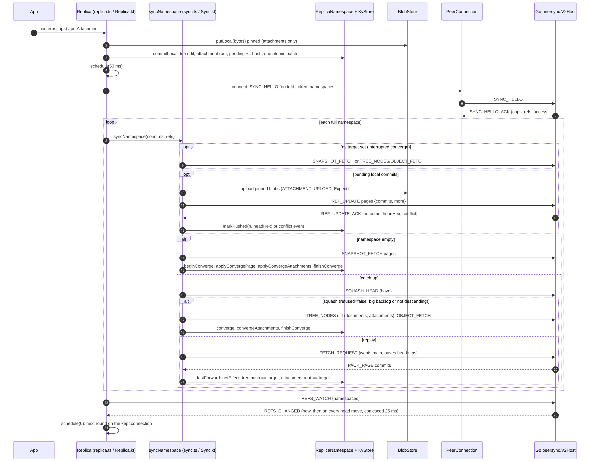

<details><summary>Mermaid source</summary>

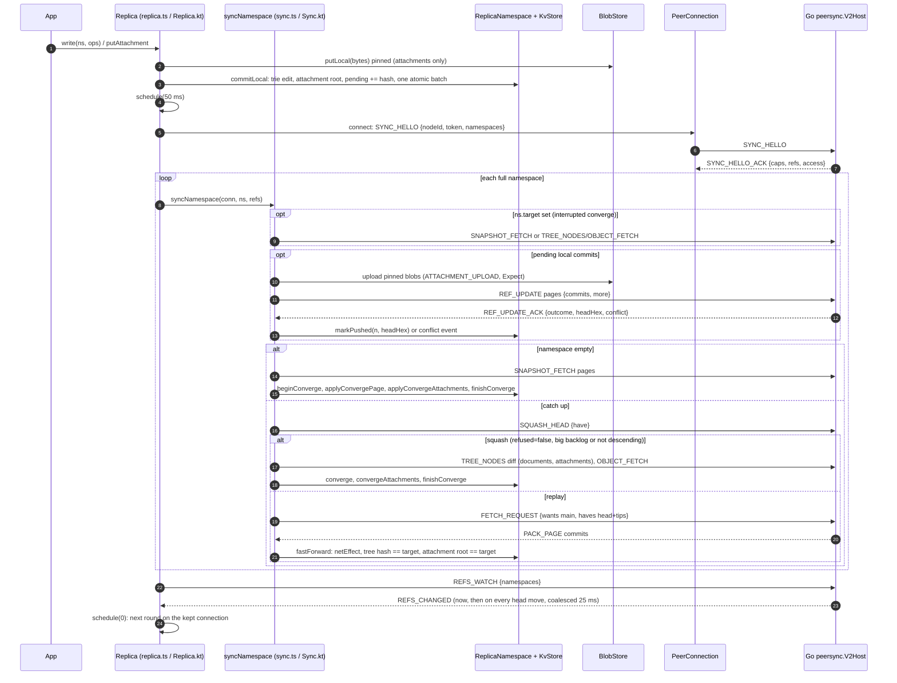

</details>

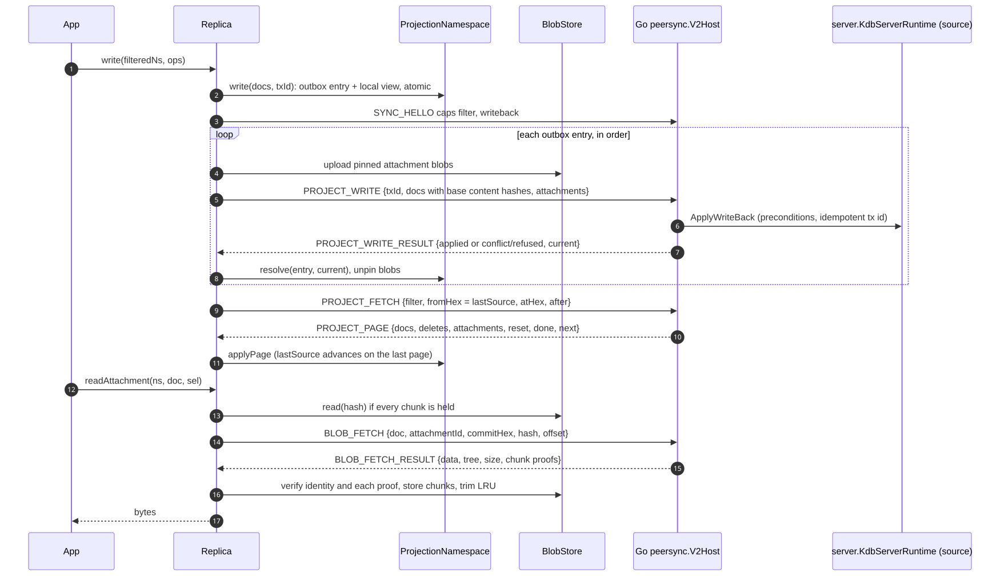

<details><summary>Mermaid source</summary>

```mermaid
sequenceDiagram
    autonumber
    participant A as App
    participant R as Replica
    participant PN as ProjectionNamespace
    participant B as BlobStore
    participant H as Go peersync.V2Host
    participant SRC as server.KdbServerRuntime (source)

    A->>R: write(filteredNs, ops)
    R->>PN: write(docs, txId): outbox entry + local view, atomic
    R->>H: SYNC_HELLO caps filter, writeback
    loop each outbox entry, in order
        R->>B: upload pinned attachment blobs
        R->>H: PROJECT_WRITE {txId, docs with base content hashes, attachments}
        H->>SRC: ApplyWriteBack (preconditions, idempotent tx id)
        H-->>R: PROJECT_WRITE_RESULT {applied or conflict/refused, current}
        R->>PN: resolve(entry, current), unpin blobs
    end
    R->>H: PROJECT_FETCH {filter, fromHex = lastSource, atHex, after}
    H-->>R: PROJECT_PAGE {docs, deletes, attachments, reset, done, next}
    R->>PN: applyPage (lastSource advances on the last page)
    A->>R: readAttachment(ns, doc, sel)
    R->>B: read(hash) if every chunk is held
    R->>H: BLOB_FETCH {doc, attachmentId, commitHex, hash, offset}
    H-->>R: BLOB_FETCH_RESULT {data, tree, size, chunk proofs}
    R->>B: verify identity and each proof, store chunks, trim LRU
    R-->>A: bytes
```

</details>

### Call chain

TS paths are relative to `packages/kdb-replica/src/`, Kotlin paths to `kdb-replica/src/` (common code under `commonMain/kotlin/dev/kdb/replica/`, file runtime under `jvmMain/...`), and Go paths to `go/kdb/`.

| # | Function (pkg.Type.Method) | File:line | What it does |
|---|---|---|---|
| 1 | `openReplica` -> `Replica.open` | `replica.ts:486` -> `:133`; Kotlin `Replica.open` `Replica.kt:192` | Wraps the store in `CachedStore` (32 MiB default), creates or loads `m/node` (replica node id), opens each namespace (full -> `ReplicaNamespace.open` `namespace.ts:164`; filtered -> `ProjectionNamespace.open` `projection.ts:142`). In a browser it calls `navigator.storage.persist()` (`persistStorage`), then `#schedule(0)`. Kotlin full namespaces come from `ReplicaOptions.fullNamespaces`, either `ReplicaNamespace.open` (`ReplicaNamespace.kt:226`) or `fileNamespaces(dataDir)` (`jvmMain/.../FileReplicaNamespace.kt:35`). |
| 2 | `Replica.write` / `put` / `delete` | `replica.ts:199`; `Replica.kt:246` | Full: `ReplicaNamespace.commitLocal` (`namespace.ts:343`): builds the commit on the head (timestamp forced above any seen), applies the trie edit and the attachment table in one `KvStore.apply` batch, and appends to `meta.pending`. Filtered: `projectionWrites` (`:494`) then `ProjectionNamespace.write` (outbox). Emits `change{source: local}`, `#schedule(50)`. |
| 3 | `Replica.putAttachment` / `deleteAttachment` | `replica.ts:259` / `:271`; `Replica.kt:323` / `:347` | `BlobStore.putLocal` (`blobs.ts:94`): content hash, all chunks plus meta `{pinned: true}` in one batch. Then `write` with an `attachmentPut` op (existing ID kept by name). Refused on a filtered namespace without write-back. |
| 4 | `Replica.syncNow` / `#schedule` / `#round` | `replica.ts:329` / `:352` / `:393`; `Replica.kt:402` / `:443` / `:488` | One round at a time (`#again` re-runs). After a round it waits `pollMs` (5 s, or 60 s while watching), or a backoff of `500 ms * 2^failures` capped at 60 s. `#round`: `#connect`, `refs_` re-asked on a reused connection, `syncNamespace` per full namespace, `syncProjection` per filtered one, events `change`/`conflict`/`sync`. Per-namespace errors are collected, not fatal. |
| 5 | `Replica.#connect` -> `PeerConnection.open` | `replica.ts:369` -> `peer.ts:192`; `Replica.kt:468` -> `PeerConnection.kt:163` | Token function evaluated per connect. `SYNC_HELLO` names full and filtered sources. The connection is reused while live; `onClose` reschedules in 1 s. Frames use the binary envelope (`binwire.ts`) where agreed, JSON otherwise; one reply per request, `PEER_ERROR` -> `RemoteError`. |
| 6 | `syncNamespace` | `sync.ts:74`; `Sync.kt:48` | Order: `resumeConverge` if `ns.target`; push if `pending` (refused when access is `pull`; `NOT_HOME` / stale fence -> `SingleHomeError`); pull if access is not `push` and the host main differs: `bootstrap` when `isEmpty`, else `catchUp`; then `setRemoteMain`. |
| 7 | `push` | `sync.ts:136`; `Sync.kt:112` (`uploadPinned` `:362`) | Uploads every **pinned** blob a pending `attachmentPut` names (`BlobStore.upload` `blobs.ts:243`: `Expect` on the first chunk, resume from `received`). Then `REF_UPDATE` pages of <= 4 MiB (`PeerConnection.refUpdate` `peer.ts:429`, `more` on all but the last). The last ack's outcome decides: `conflict` -> `ConflictEvent` and stop; otherwise unpin and `markPushed(n, headHex)`. Host side is `V2Host` REF_UPDATE (flow 9, `peersync.ApplyRef`), which merges when needed. |
| 8 | `bootstrap` -> `resumeConverge` | `sync.ts:171` -> `:177`; `Sync.kt:135` -> `:141` | `SNAPSHOT_FETCH` (`peer.ts:349`) pages at the host main. `beginConverge` (`namespace.ts:408`) records the target in meta, so an interrupted bootstrap resumes from `after`. `applyConvergePage` (`:425`) per page. The last page's packed table goes to `applyConvergeAttachments(parsePackedAttachmentTable(...), true)` (`attachments.ts:270`). `finishConverge` (`:468`) checks the tree and attachment root; on mismatch it falls back to `converge` (diff) plus `convergeAttachments`. |
| 9 | `catchUp` -> `replay` / squash | `sync.ts:222` -> `:249`; `Sync.kt:187` -> `:220` | With `squash`+`repair` caps and catch-up not `replay`: `SQUASH_HEAD` (`peer.ts:363`). Squash if forced, if the host main does not descend from the head, or if `backlog >= 1000` and `backlog >= 2 x` the changed-document count of a `diffTrees` (`:294`). Squash = `converge` (`:341`, `TREE_NODES` + `OBJECT_FETCH`) + `convergeAttachments` (`:445`, attachment trie diff, each set checked against its hash). Otherwise replay: `FETCH_REQUEST` with haves = head + held tips, fast-forwarding whenever the held pages close on one tip. |
| 10 | `ReplicaNamespace.fastForward` | `namespace.ts:266`; Kotlin store-backed `ReplicaNamespace.kt`, file `FileReplicaNamespace.kt:152` | Refuses with pending commits or an open convergence. `checkReachesHead`, `topoSort`, `netEffect` (last op per document), trie edit, `built == tip.treeHash` else `TreeMismatchError`. `AttachmentEdit.apply` (`attachments.ts:175`) per commit in order must reach `tip.attachmentRoot` else `AttachmentRootMismatchError`. One batch replaces the head commit and meta (the old head commit is deleted: no history kept). |
| 11 | Kotlin `FileReplicaNamespace.open` / `fastForward` / `commitLocal` / `finishConverge` | `jvmMain/.../FileReplicaNamespace.kt:76` / `:152` / `:203` / `:300` | `openFileRuntime` (`kdb-jdbc/src/main/kotlin/dev/kdb/jdbc/file/FileEmbeddedRuntime.kt:33`) holds the directory lock. Pending hashes the log lacks are dropped at open; a convergence restarts from page one (its pages are held in memory). `fastForward` checks everything, then `dag.putCommit` (host commits logged as-is), storage puts, `commitTree`, `setHead`. `commitLocal` writes `replica.json` (tmp + fsync + atomic rename + dir fsync) **before** logging the commit. `finishConverge` -> `installSnapshot` (`kdb-embed/.../EmbedSnapshot.kt:56`) on a fresh namespace or `installSquash` (`EmbedSquash.kt:48`). |
| 12 | Kotlin checkpoint: `NamespaceCheckpointer` -> `GoCheckpointWriter.write` | `kdb-jdbc/src/main/kotlin/dev/kdb/jdbc/file/NamespaceCheckpointer.kt:103` -> `GoCheckpointWriter.kt:69`; `FileSnapshotPersistence.kt:48` | Writes Go-format checkpoints (legacy if it fits and has no attachments, else sectioned), including packed attachment tables. A squashed or snapshot-rooted replica therefore reopens from its checkpoint, the only record of its root. `FileReplicaNamespace.close` (`:351`) closes the runtime (seal log, write checkpoint) and releases the lock. |
| 13 | `syncProjection` | `sync.ts:387`; `Sync.kt:398` | Write-back (needs `writeback` cap): for each outbox entry in order, upload pinned blobs, then `PROJECT_WRITE` (`peer.ts:419`). A `RemoteError` defers the rest of the queue (`res.deferred`). `applied` -> `resolve(entry, null)`; else `resolve(entry, current)` plus a rejected entry surfaced as a `conflict` event. Then `beginTransfer` and `PROJECT_FETCH` (`peer.ts:406`) pages from `lastSource`, `applyPage`; `reset` replaces the view. Host side: `V2Host.projectFetch` / `projectWrite` -> `ApplyWriteBack` (flow 14 rows 13, 17), plus `withAttachmentOnlyChanges` / `withProjectedAttachments` (`peersync/v2_host.go:878`, `:881`). |
| 14 | `PeerConnection.watch` -> host `V2Host.startWatch` / `changed` / `sendChanges` | `peer.ts:334`; `PeerConnection.kt:349`; `peersync/watch.go:28` / `:75` / `:88` | Only if the host offered `SyncCapWatch` (`wire/watch_ops.go:6`, offered when `WatchHead` + `Send` are configured, `server/peersync_listen.go:159`). Authorized like `refs`. Registers `KdbServerRuntime.WatchHead` (`server/head_watch.go:16`), which fires from `notifyHeadWatchers` (`:34`, called at `peersync_ingest.go:249`, `namespace_set.go:351` and the commit-listener points). Pending namespaces are coalesced for 25 ms and re-authorized one at a time; `REFS_CHANGED` goes out under the watch's correlation id. The replica's callback ignores the payload and calls `#schedule(0)`. |
| 15 | `Replica.readAttachment` -> `BlobStore.read` / `fetch` | `replica.ts:240` -> `blobs.ts:119` / `:194`; `Replica.kt:297` -> `Blobs.kt:161` / `:183` | Served from local chunks if every chunk is held. Otherwise `BLOB_FETCH` (`peer.ts:389`) from the first missing chunk: part hash and size must match, `blobIdentity(tree, size) == hash`, every chunk `verifyInclusion` before it is stored. Chunks and meta are written per page (resumable). `trim` keeps the cache under `blobCacheBytes` (256 MiB default, `DEFAULT_BLOB_CACHE_BYTES`), evicting least recently used unpinned blobs. Host: `V2Host.blobFetch` (flow 15 row 26), projection sessions limited by per-document `canRead`. |
| 16 | `IndexedDbStore.apply` / `CachedStore.apply` | `idb.ts:82`; `store.ts:158`; Kotlin `ReplicaStore.kt:84` / `:167` | Every replica operation is one batch: an IndexedDB `readwrite` transaction with `{durability: "strict"}`, awaited to completion. `CachedStore` is a write-through LRU of keys (default 32 MiB). |

### Data that changes

| Step | Structure / file / wire message | Mutation |
|---|---|---|
| Open | KV `m/node` | Replica node id (random UUID) on first open. |
| Namespace meta | KV `ReplicaNamespace.metaKey(name)`: `NamespaceMeta{head, pending[], remoteMain, target{hash, via, after, payloadHex}, lastMicros, nodeId}`; Kotlin file mode `ns/<ns>/replica.json` | Rewritten in the same batch as each local commit, fast-forward, page, push mark and converge step. |
| Documents | KV `d/<nsKey>/<id>` bodies; trie nodes keyed by nibble prefix; head commit `c/<nsKey>/<hash>` plus pending commits | Trie edited per op; only head + pending commits are kept (the old head commit is deleted on fast-forward). |
| Attachments (refs) | Attachment trie and sets under the namespace key (`AttachmentEdit.writeTo`) | Applied with the commit ops; replaced wholesale by `applyConvergeAttachments`. |
| Blobs | KV `bm/<hash>` (`BlobMeta{size, have[], pinned, used}`), `b/<hash>/<chunk %08d>` | `putLocal` pinned; `fetch` adds chunks; `unpin` after upload; `trim`/`evict` delete unpinned LRU. |
| Projection | Outbox entries, local view, `lastSource` in `ProjectionMeta` | Outbox appended on write, removed on `resolve`; view replaced or edited per `PROJECT_PAGE`. |
| Kotlin file runtime | `ns/<ns>/delta/*.seg`, Go-format checkpoint (`GoCheckpointWriter`), snapshot marker | Host commits and local commits logged; checkpoint on close or maintenance; snapshot/squash persisted before applied. |
| Wire | `SYNC_HELLO`/`ACK`, `REF_UPDATE`/`ACK`, `FETCH_REQUEST`/`PACK_PAGE`, `SNAPSHOT_FETCH`/`PAGE`, `SQUASH_HEAD`, `TREE_NODES`, `OBJECT_FETCH`, `PROJECT_FETCH`/`PAGE`/`WRITE`/`WRITE_RESULT`, `BLOB_FETCH`, `ATTACHMENT_UPLOAD`, `REFS_WATCH` (0x50) / `REFS_CHANGED` (0x51) | `REFS_CHANGED` is unsolicited, under the watch's correlation id. |
| Host | `refsWatch{pending, sending}` per session; `headWatchers.fns` per runtime; the host's own commits (merges, write-back decisions, flow 9/14) | Cancelled by `stopWatch` (a new watch or the session ending). |

### Failure, edge cases & durability points

- **Durable unit = one KV batch.** In TS each operation is one atomic `apply` (IndexedDB strict durability). A crash leaves the previous or the next state, never a half-applied fast-forward. `MemoryStore` is not durable. A browser may still evict storage when `navigator.storage.persist()` is refused; `persisted` records the answer.
- **Kotlin file mode ordering.** `commitLocal` lists the commit as pending in `replica.json` before logging it. On open, pending hashes absent from the log are dropped: an unacknowledged write is lost, never duplicated. A convergence's pages are kept only in memory, so an interrupted bootstrap restarts from page one (TS resumes from `after`).
- **Never merges.** A pull with pending commits is refused (`NotFastForwardError`): the push must come first. A push conflict (host Strict policy) stops the namespace with a `conflict` event, and the commits stay pending until the app resolves it. `push` reads only the last page's ack; earlier `more` pages' acks are not inspected.
- **Every fast-forward is verified.** Document trie root and attachment root must equal the target commit's. A host whose main does not descend from the replica head (rollback, squash) is followed only by converging, and is detected through `SQUASH_HEAD.descends`. Without the `squash`/`repair` caps such a host makes replay fail with `NotFastForwardError`.
- **Single-home namespaces** cannot be written in full mode (`SingleHomeError`); a filtered namespace with write-back queues writes until the home is reachable.
- **Write-back ordering.** The outbox drains strictly in order and stops at the first transient error, so later writes never overtake an undecided one. Host-side idempotency (`WriteBackTxID`) makes a resend after a lost reply safe (flow 14).
- **Watch is a hint.** `REFS_CHANGED` only triggers a round; the round re-reads refs. Revoked grants drop out of later notifications (re-authorized per send). The connection is kept only while live and `watch` is offered; a closed connection reschedules in 1 s, and a dead one is noticed only by the next request.
- **Lazy attachment reads.** Bytes are fetched on first read and verified per chunk, so a lying host cannot plant bytes. `BLOB_FETCH` needs a commit the **host** holds:
  - Kotlin reads at `remoteMain` while local commits are unpushed.
  - **TS `Replica.readAttachment` (`replica.ts:245`) always uses `full.head`.** With an unpushed local commit that head is unknown to the host, `serveBlobEntry` answers `NOT_FOUND`, and the read fails with `BlobUnavailableError` until the next push. This is a TS/Kotlin parity defect.
  - A host keeping only the latest version answers `NOT_FOUND` for superseded versions.
- **Blob cache.** Pinned (locally written, not yet uploaded) blobs are never evicted. A blob uploaded by a rejected write-back is unpinned anyway: the host holds it unreferenced until its `UploadGrace` lapses, and the replica keeps a cache copy.
- **Interop.** Parity rests on Go-generated golden vectors (commit, trie, attachment hash and checkpoint fixtures) and live tests against a Go node. Pack pages are decoded with Node's native zstd or the TS port (`zstd.ts`, `peer.ts:125`).
