# KDB Architecture & Design Document

**Version described:** 0.6.2 (`VERSION`). **Go module:** `github.com/limidus/kdb/go` (go 1.26, toolchain 1.26.3).
**Audience:** engineers who need to understand, operate, extend or review KDB.
**Method:** every claim below was checked against the code under `go/kdb/*` and the Kotlin modules `kdb-*`.
Where the older documents (`kdb-architecture.md`, `kdb-lld-*.md`, `kdb-spec*.md`) disagree with the code, this
document follows the code and says so in section 22 (stale-doc register).

> **A note on the checkout this was written from.** When this document was written, the working tree
> contained a staged partial revert of the last few merged PRs (#111, #113, #114 and the scan-cap fix). Where a
> mechanism exists in git `HEAD` (b039218) but not in the files on disk, it is marked **[HEAD]**. Those are:
> the content-free merge join (`dag/join.go`, `peersync/join.go`), unlogged peer commits (`dag/unlogged.go`),
> the shallow-boundary extension (`peersync/boundary.go`, `peersync/snapshot_state.go`), and the SQL
> result-bound/key-lookup fixes. Treat HEAD as the intended product.

---

## Table of contents

1. Purpose, goals, non-goals
2. System context
3. Containers and deployment view
4. Layered architecture and package map
5. Data model: content addressing, documents, trees, commits
6. Commit DAG, branches, tags, revisions
7. History modes (FULL / NONE) and retention
8. Namespaces and the multi-namespace runtime
9. Storage engine and on-disk layout
10. Indexes
11. Schema lens
12. SQL and the query path
13. Transactions (single- and cross-namespace)
14. Distribution: peer sync, replication, merge, conflict procedures
15. Authentication, authorization (RBAC)
16. Encryption
17. Resource governance and admission
18. Integrity, backup, recovery
19. Observability and the control plane
20. Wire protocol and transports
21. Concurrency model; durability guarantees
22. Stale-documentation register
23. Key design decisions and trade-offs
24. Quality attributes
25. Known limitations and risks

---

## 1. Purpose, goals, non-goals

### 1.1 Purpose

KDB is a **portable embedded database engine for versioned JSON documents** ("source control for structured
data"). Applications store whole JSON documents under UUID identities; every change is an immutable,
content-addressed commit in a per-namespace history that can branch, diverge, merge and be read at any point.
An optional schema adds a typed, indexable *lens* over fields, which enables SQL, JDBC and `database/sql`.

It exists to give three things at once that are usually three systems:

1. one engine and one file/wire format on every platform (server, CLI, browser, mobile);
2. history as a storage primitive (point-in-time reads, audit, revert, merge) rather than audit tables;
3. documents and SQL over the same data, without a translation layer.

### 1.2 Goals

| # | Goal | Where it shows up |
|---|------|-------------------|
| G1 | Documents are the truth; the schema is a lens | `schema/`, documents stored verbatim |
| G2 | Immutable, content-addressed history | `document/`, `dag/` |
| G3 | Crash safety without a repair step | delta-log replay, torn-tail rule (sec. 9, 21) |
| G4 | Equal peers that may diverge and reconverge | `peersync/`, `replication/` (sec. 14) |
| G5 | Typed, retry-aware failures; never a dead connection | `wire/error_code.go`, `server/error_classification.go` |
| G6 | Start only what can be finished | admission control, cost model (sec. 17) |
| G7 | Same bytes on disk and on the wire across implementations | golden fixtures (sec. 4.3) |
| G8 | Bounded memory regardless of history length | LRU caches, ops budget, `history=none` (sec. 7) |

### 1.3 Non-goals

- Not a general SQL database; SQL is a query interface over documents, not the storage model.
- Not a consensus cluster: there is no leader election, no quorum. (Opt-in *single-home* ownership per
  namespace exists, sec. 14.8; it is a fenced assignment, not consensus.)
- Not a multi-host distributed-transaction system: cross-namespace atomicity is within one host.
- Not an event bus (it has a stream mode, but is not Kafka).
- Not a peer discovery system: topology is configured (`--peer`), not discovered.
- Multi-process embedded *writers* on one data directory (one writer per data root, enforced by lock).

---

## 2. System context


Mermaid source

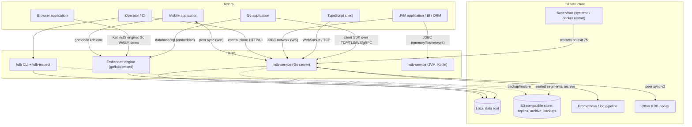

Trust boundaries: the wire listeners and the peer listener authenticate at the handshake (RBAC, sec. 15); the
admin HTTP endpoint (`--admin-addr`) is **unauthenticated by design** and must be bound privately; the control
plane (`--control-addr`) requires an `Authorization` header on every request.

---

## 3. Containers and deployment view

### 3.1 Containers

| Container | Artifact / path | Role |
|-----------|-----------------|------|
| Embedded engine | `go/kdb/embed` (`embed.Host`, `EmbeddedKdbRuntime`) | The whole database in-process; owns the data root lock, all namespaces |
| `kdb-service` | `go/cmd/kdb-service` -> `go/kdb/service` | Server: SQL wire, WebSocket, peer-sync, stream, admin HTTP, control plane. Links no gRPC |
| `kdb-service-grpc` | `go/grpc/cmd/kdb-service-grpc` (separate Go module) | Same service plus a `--grpc-addr` listener, via blank import of `go/grpc/register` |
| `kdb` CLI | `go/cmd/kdb` -> `go/cmd/kdb/cli` | git-like local CLI on a data dir: init/put/get/query/log/show/diff/revert/branch/tag/status/unlock/node/sync/conflicts/resolve/resolution/scrub/peer-diff/deepen. Operates on a local data dir, not over the network (except peer-sync commands) |
| `kdb-inspect` | `go/cmd/kdb-inspect` | Offline tooling (takes the exclusive lock): `verify`, `repair-segments`, `migrate-history`, `restore`, `backup`, `backup-verify`, `backup-list`, `backup-fetch`, `dump-wire` |
| Go client SDK | `go/kdb/client` | Network client for the SQL wire (put/get/upsert/commit/CAS/leases/query/search/history/revert; router follows `NOT_HOME`) |
| `database/sql` driver | `go/kdb/driver` | **Embedded only** (`kdb://memory:///cat/ns`, `kdb://file:///root[/cat/ns]?readOnly=true`). Imports no client or server code |
| TypeScript client | `packages/kdb-client` | Zero-dependency `@kdb/client`, wire-compatible, golden-tested with `kdb-tsfixtures`, live-tested against `kdb-tsinterop` |
| JDBC driver | `kdb-jdbc` (Kotlin) | `jdbc:kdb:` URLs; MEMORY, FILE, NETWORK modes (network over WebSocket, default port 7444) |
| Hibernate dialect | `kdb-hibernate` | A thin `KdbDialect` (limit/offset, if-exists flags); no type mapping |
| Go WASM demo | `go/wasm/demo` | `KdbBrowser.openMemory(...)`: in-memory embed only; a demo, not a client |
| Kotlin/JS engine | `kdb-embed` (js), `kdb-browser-demo` | Browser runtime with WebSocket transport |
| Mobile sync node | `go/mobile/kdbsync` | gomobile-bound `Node` (open, add peer, start, sync, put/get, request home); string-only API |
| Embeddable source bundle | `go/embedbundle` | Release tool producing a compiling zipped source closure of the embed entry points |
| Test/ops helpers | `kdb-e2e-helper`, `kdb-loadtest`, `kdb-pressure-test`, `kdb-tsfixtures`, `kdb-tsinterop` | E2E client for the Python cluster harness, load and governance verification, TS fixtures |
| Peer nodes | other `kdb-service`/embedded `syncnode` processes | Equal peers, dialed from `--peer` configuration |

### 3.2 Deployment view


Mermaid source

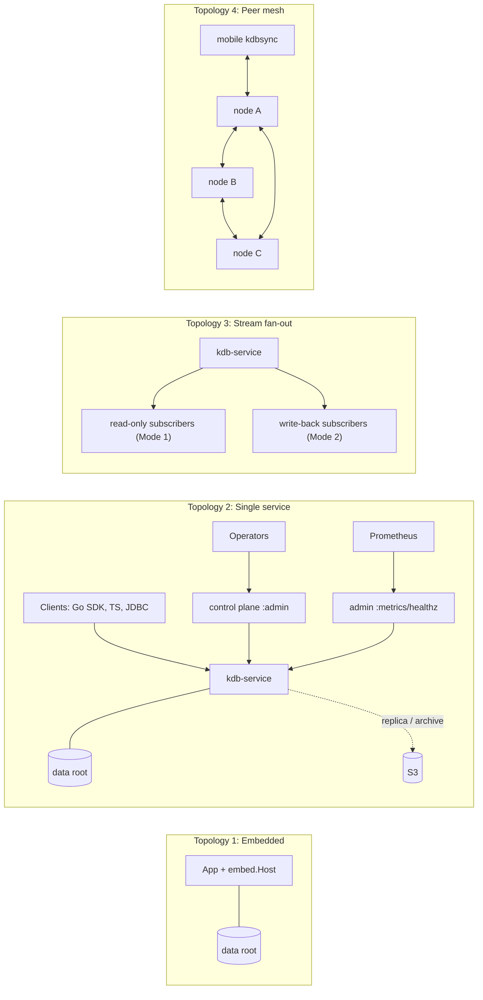

Default ports (Dockerfile): 9090 SQL wire, 9091 peer sync, 9092 stream, 9093 admin HTTP (health check
`wget /healthz`). WebSocket (`--ws-addr`), gRPC (`--grpc-addr`), control plane (`--control-addr`) and
`--peer-http` are off by default. Runtime image is alpine, non-root uid 10001, `VOLUME /var/lib/kdb`.
`deploy/compose.yaml` has a single-node profile and a 3-node `cluster` profile; `restart: on-failure` is required
for the exit-75 contract; `deploy/systemd/kdb-service.service` uses `Restart=on-failure`.

Constraint: **one writer process per data root** (lock files, sec. 9.2). Read-only attachments may run alongside a
live writer on unix.

---

## 4. Layered architecture and package map

### 4.1 Layer diagram (Go)


Mermaid source

```mermaid
flowchart TB
    subgraph L7["L7  Entry points"]
        cmdkdb["cmd/kdb"]
        cmdsvc["cmd/kdb-service"]
        cmdinsp["cmd/kdb-inspect"]
        mobile["mobile/kdbsync"]
        wasm["wasm/demo"]
    end
    subgraph L6["L6  Service assembly and clients"]
        service["service"]
        control["control (+ui)"]
        syncnode["syncnode"]
        client["client"]
        driver["driver"]
        grpc["grpc (separate module)"]
    end
    subgraph L5["L5  Server runtime and distribution"]
        server["server"]
        replication["replication"]
        peersync["peersync"]
        stream["stream"]
        script["script"]
    end
    subgraph L4["L4  Embedded runtime"]
        embed["embed"]
        hybrid["query/hybrid"]
        backup["backup"]
        recovery["recovery"]
        integrity["integrity"]
    end
    subgraph L3["L3  Engines"]
        sql["sql"]
        transaction["transaction"]
        index["index (+fulltext, vector, fusion, analyzer)"]
        auth["auth"]
        policy["policy"]
        wire["wire"]
        transport["transport (core, tcp, ws)"]
    end
    subgraph L2["L2  Storage"]
        storage["storage (+wal, memtable, sstable, delta, engine, io, s3, mem, manager)"]
        dag["dag"]
        schema["schema"]
        tier["tier (stub)"]
        compaction["compaction (skeleton)"]
    end
    subgraph L1["L1  Model and codec"]
        document["document"]
        json["json"]
        codec["codec (+schema)"]
        compression["compression"]
    end
    subgraph L0["L0  Foundations"]
        error["error"]
        version["version"]
        metrics["metrics"]
        config["config"]
    end
    L7 --> L6 --> L5 --> L4 --> L3 --> L2 --> L1 --> L0
```

Dependency rule: arrows point downward only. Known exceptions are noted in sec. 4.4. The driver deliberately
does **not** import `server` (so it can be embedded without the server's weight); it shares only the
`embed.CommitGroup` protocol.

### 4.2 Go package responsibilities (`go/kdb/*`)

**L0 foundations**

| Package | Responsibility |
|---------|----------------|
| `error` | Stable numeric engine error codes (`code.go`: 1001 decode, 3101 VersionNotFound, 3102 IceStorage, 4001 Conflict, 4101 StorageTier, 4102 DataDirectoryLocked, 4201 NamespaceNotFound, 6301/6302 authn/authz, 7001 ArchiveRestore, ...) and typed errors |
| `version` | Build identity (`Version`, `Commit`, `Dirty`, `BuildDate`) via `-ldflags`, with VCS fallback; shown in banner, `/healthz`, `kdb_build_info` |
| `metrics` | Dependency-free per-stage latency recorder (`lock_wait`, `fsync_wait`, `tree_rebuild`); `/metrics` text is hand-formatted in `server/admin.go` |
| `config` | `ServiceFile` JSON (strict, camelCase), settings descriptors (`descriptors.go`: source, scope, mutability), governance settings |

**L1 model and codec**

| Package | Responsibility |
|---------|----------------|
| `codec` (+`codec/schema`) | Canonical binary encoding (leb128 records, ascending field ids, defaults omitted); typed `Value`, schema registry; `DerivedUUID`. This is what gets hashed |
| `compression` | zstd (klauspost, pooled encoders, level 3, 64 MiB decode cap) and CRC-32 |
| `json` | Own JSON parser/writer, JSONPath get/set/delete/merge, `DiffConflict` 3-way, `CanonicalText` |
| `document` | `Document`, `KdbCommit`, `KdbOp` (write/delete/file-write/schema-migration), Merkle trie `DocumentTree`, proofs, identity resolution (`ResolveID`) |
| `file` | Attachment ingest metadata (`Ingest`: SHA-256, size, content type); blob bytes live in the storage adapter |

**L2 state and storage**

| Package | Responsibility |
|---------|----------------|
| `dag` | `CommitDAG` interface; `InMemoryCommitDag` (nodes, stubs, shallow roots, branches, tags, tx index, pins, lock-free head); checkpoint support; ops-budget retention; squash/stub |
| `schema` | Versioned content-hashed schema, validation, migrations, backward-compat diff, unique constraints |
| `storage` | Config, enums, history/reclaim modes, memory budgets, `Adapter` interface |
| `storage/io` (+`io/s3`) | `SegmentByteStore` shim (OS files, per-segment locks, fsync variants, preallocation, replica/archive sinks, S3) |
| `storage/wal` | Blob write-ahead log (`GroupCommitter`) |
| `storage/memtable` | Sorted tombstone-aware table + flush manager |
| `storage/sstable` | Immutable blob tables, `LsmBlobStore`, block cache, full-merge compaction |
| `storage/delta` | The **commit log**: KDBP frames, writer with rotation, reader/scanner |
| `storage/engine` | `ServerEngine`: sharded document store, live tree, bounded historical-tree LRU, tree objects, cold loader |
| `storage/manager`, `storage/mem` | Realized-store pool (thin); in-memory adapter |
| `tier` | Stub (`ArchiveCommit` fires a callback only). Real "ice" is `dag.StubCommit` + S3 archive sink |
| `compaction` | Skeleton (`RunCycle` returns empty). Real DAG squash is `dag.Squash`; real blob compaction is in `sstable` |

**L3 engines**

| Package | Responsibility |
|---------|----------------|
| `transaction` | Optimistic transaction engine, conflict policies, preconditions (CAS, insert-if-absent), leases (`LockManager`), unique-key registry |
| `index` | Index registry/stores: hash, btree (shared `MemoryStore`), `fulltext`, `vector` (HNSW), `fusion` (RRF/weighted), `analyzer`, `stores` factory |
| `sql` | Hand-written parser, planner, executor, `IndexProvider` seam |
| `query/hybrid` | Version-aware query front end (`AT VERSION/COMMIT/TIME`), read consistency, search |
| `auth` | `Authenticator`/`Authorizer`/`Engine`, `AllowAll`, `RegistryAuthEngine`, `RegistryAuthStore`, PBKDF2 |
| `policy` | Namespace policy types, parser, registry, compaction boundary evaluator; only `DocumentExpiryPolicy` is wired into the service |
| `wire` | Frame codec, message types (0x01-0x3F), error codes, handshake negotiator |
| `transport/core`, `tcp`, `ws` | Framed streams, TLS/mTLS, admission-at-header, TCP, custom RFC 6455 WebSocket |
| `compute` (+`webgpu`) | `Adapter{Dot}` with CPU implementation; WebGPU variants fall back to CPU; no production caller |
| `script` | Stored procedures on `goja` (pure-Go JS), pure and read modes |

**L4 embedded runtime and data safety**

| Package | Responsibility |
|---------|----------------|
| `embed` | `Host` (data root lock, namespaces, IO shim, memory arbiter, txn coordinator), `EmbeddedKdbRuntime`, checkpoint, delta replay, commit log writer, truncation, maintenance, history switch/migrate, cross-namespace `CommitGroup` |
| `integrity` | `Verify` (L1 frames, L2 parent closure; L3 is a stub), `Repair` (torn tail truncate, prefix rewrite with quarantine) |
| `backup` | Manifest-based full/incremental backups of the delta log to a directory or S3; database-level backups |
| `recovery` | `HybridRestore` (verified union of sources), staged restore promotion across restart |
| `inspect` | Wire-frame dumping for `kdb-inspect dump-wire` |

**L5 server runtime and distribution**

| Package | Responsibility |
|---------|----------------|
| `server` | `KdbServerRuntime` (per namespace), `NamespaceSet`, write gate, sessions, listeners, admission, cost model, memory guard, abort watchdog, admin HTTP, `_kdb/meta`, home, scrub, conflict webhook/procedure |
| `peersync` | Sync protocol v1 and v2, ingest/adopt, snapshot, graft, deepen, merge resolution, resolution chains, repair, projections, conflict queue |
| `replication` | Per-peer loops (debounce, anti-entropy tick, backoff), peer state, retention floor |
| `stream` | Mode 1 / Mode 2 stream coordinator and in-memory transport |

**L6 assembly and clients**

| Package | Responsibility |
|---------|----------------|
| `service` | `kdb-service` main: flags/env/config, listeners, drain, user management subcommand |
| `control` | Control plane HTTP/JSON API (`/v1/...`) and embedded single-file UI |
| `syncnode` | Makes any process a sync node: replicator, peer listener, `_kdb/meta`, resolver authority, retention floor, scrub, handover |
| `client` | Go SDK |
| `driver` | `database/sql` driver (embedded) |

**Test-only**: `integration`, `interop` (JVM-server interop, build-tagged).

### 4.3 Kotlin modules

Kotlin Multiplatform tree (Kotlin 2.0.21; targets JVM, JS(IR), linuxX64, macosArm64; no wasm target). It is the
original implementation; Go is the deployment target. Byte formats are shared and pinned by golden fixtures
(`go/testdata/golden`, `make test-cross`, `test-physical-golden`).

| Layer | Modules | Responsibility |
|-------|---------|----------------|
| L0 | `kdb-error`, `kdb-codec`, `kdb-compression` | Error codes; binary codec, hashes, UUID, timestamps; zstd |
| L1 | `kdb-document`, `kdb-json`, `kdb-schema`, `kdb-dag`, `kdb-storage` | Document/commit/tree/op model; JSON; schema+migrations; commit DAG; `StorageAdapter` interface |
| L2 | `kdb-index` (core), `kdb-transaction`, `kdb-storage-io` | Index manager; engine, locks, unique keys; platform IO shim |
| L3 | `kdb-index-hash`, `-btree`, `-fulltext`, `-vector`, `-composite`, `kdb-storage-wal`, `-sstable`, `-memtable`, `-delta`, `kdb-sql` | Index stores (`-composite` is the store-factory aggregator, **not** multi-field indexing); LSM pieces and delta writer; SQL with joins, HAVING, views, DDL/DML, GRANT/REVOKE |
| L4 | `kdb-compaction`, `kdb-namespace-policy`, `kdb-hybrid-query`, `kdb-storage-engine`, `-chunking`, `-compaction`, `-manager`, `-tier`, `kdb-integrity`, `kdb-recovery` | Squash/compaction; policy; version-aware SQL; storage engine assembly; content-defined chunking; tiering; verify/repair |
| L5 | `kdb-wire`, `kdb-stream`, `kdb-auth`, `kdb-transport-core`, `kdb-inspect` | Wire frames (v1 + SQL session); stream modes; auth interfaces; transports; inspect tooling |
| L6 | `kdb-peer-sync` (**v1 only**), `kdb-transport-tcp` (jvm, linux, macos), `kdb-transport-ws` (jvm, js), `kdb-embed` (jvm + js) | Peer sync v1; transports; embedded runtime |
| L7 JVM-only | `kdb-server`, `kdb-jdbc`, `kdb-cli`, `kdb-script` (GraalJS), `kdb-file`, `kdb-config`, `kdb-auth-static`, `kdb-auth-store` | Server runtime; JDBC; CLI; procedures; blobs; static users and RBAC-as-documents |
| L8 | `kdb-service`, `kdb-hibernate`, `kdb-benchmark` (JMH), `kdb-integration` (tests), `kdb-browser-demo` (js), `kdb-compute`/`-jvm`/`-webgpu` | Runnable JVM service; dialect; benchmarks; tests; demo; compute adapters |

Kotlin-only capabilities: JDBC/Hibernate, SQL joins/HAVING/views/GRANT, content-defined chunking, GraalJS
procedures, static auth, browser demo. Go-only capabilities: peer sync v2, replication, syncnode, cross-namespace
commit groups, preconditions (CAS/insert-if-absent), `database/sql` driver, mobile, WASM demo, gRPC, the TS
client's server, wire opcodes 0x14 and above except SEARCH.

### 4.4 Layering anomalies (Kotlin)

`kdb-storage-engine` depends on `kdb-compute` and `kdb-inspect`; `kdb-wire` depends on `kdb-index` and
`kdb-compaction`; `kdb-stream` depends on `kdb-inspect`; `kdb-embed` (the browser runtime) pulls `kdb-peer-sync`.
These are accepted debts, not designed couplings.

---

## 5. Data model


Mermaid source

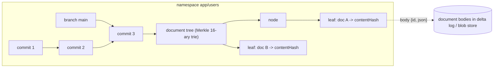

### 5.1 Content addressing

- **Hash:** SHA-256 everywhere (`document/sha256.go`, `codec.Hash` = 32 bytes).
- **Canonical encoding** (`codec/wirecodec.go`, `EncodeBytes`): a record is `leb128(bodyLen)` then fields in
  ascending field-id order, each `leb128(id) tag value`; default-valued fields are omitted; nullable fields use a
  marker byte; unions a branch byte; numbers little-endian; UUIDs 16 bytes big-endian; timestamps int64 epoch
  micros; NaN and infinities are rejected. The record schemas live in the `dev.kdb.document` registry
  (`document/wire.go`).
- **Commit hash** = SHA-256 of the canonical `CommitPayload`. Verifying a commit verifies its tree and parents.
- **Document content hash** = SHA-256 of canonical `DocumentBody{id, json}`. The JSON text is stored verbatim; key
  order and whitespace therefore affect the hash.

### 5.2 Documents and identity

`ResolveID` (`document/identity.go`): a UUID-string `id` field is used as is; any other non-empty string becomes
`DerivedUUID(s)` (a name-based UUID: SHA-256 over a fixed namespace UUID plus the UTF-8 string, version nibble 8);
no `id` yields a random v4. Derived IDs let independent nodes address the same logical entity (used heavily by
`_kdb/meta`, e.g. `DerivedUUID("kdb:meta/schema/"+ns)`).

### 5.3 Document tree

`document/document_tree_trie.go`: a persistent 16-ary Merkle trie over the 32 hex nibbles of the UUID.
Leaf hash = SHA-256(`0x00` || uuid || contentHash); internal hash = SHA-256(`0x01` || 16 child hashes, absent =
zeros). Single-entry subtrees are stored as one compressed leaf whose folded hash equals the uncompressed form, so
the tree hash is representation-independent. `With`/`Without` are O(depth) persistent updates, so a commit costs
O(changed documents x depth). The same structure provides Merkle sync nodes by nibble prefix
(`document_tree_node.go`) and inclusion/absence proofs (`document_tree_proof.go`, about 2.5 KB at one million
documents). A live tree costs about 5 KB per document regardless of document size (200k documents is roughly
930 MB), which is the primary scaling limit of the in-memory tree (sec. 25).

### 5.4 Commits and operations

`KdbCommit` (`document/kdb_commit.go`): parent hashes, namespace id, transaction id (UUID), timestamp, author node
id, operations, document tree hash, schema hash (nullable), message. Operations are a union: `WriteOp{docId,
patch}`, `DeleteOp`, `FileWriteOp{path, blobHash}`, `SchemaMigrationOp`. Operations carry no pre-image, so history
is **not invertible**: trees cannot be folded backward, only forward from a held ancestor tree.

Timestamps are causal: a commit's timestamp is raised to parent-max + 1 us (HLC-like), which makes "later origin
wins" well defined in merges. The genesis commit is deterministic (fixed tx/author UUIDs, zero timestamp, message
`genesis`, empty tree) and is never written to the log.

---

## 6. Commit DAG, branches, tags, revisions

`dag.InMemoryCommitDag` (about 1,200 lines) holds: commit nodes, stubs (archived/"ice" commits), a shallow-root
set, branches (default `main`), tags, `txIndex` (transaction id to commit, giving idempotent retry in O(1)), reader
pins, and a lock-free atomic head snapshot (`atomic.Pointer`) so point reads need no lock.

- **Append:** `AppendCommit` is a head compare-and-swap against the expected parent; a racing writer gets
  `*dag.HeadConflictError` instead of an orphan. `AppendMergeCommit*` do the same for merges.
  `AppendCommitDetached` deliberately skips the CAS (used when ingesting peer commits).
- **Reads:** `Walk`, `Diff`, `ListCommits`, `ResolveRevision` (hash / branch / tag / time / `~N`),
  `CommonAncestor` (BFS over the full ancestor closure of one side), `IsAncestor`.
- **Pins:** readers refcount a commit (`dag.Pin`) so squash/eviction cannot reclaim it mid-transaction.
- **Squash and stub:** `Squash` creates a synthetic commit (fixed tx UUID); it refuses if a branch head or pin is
  inside the window. `StubCommit` archives a commit to a `CommitStub`; reading it raises `IceStorageError` (3102).
- **Provisional commits** (`provisional.go`) support cross-namespace groups (sec. 13.2).
- **Checkpoint support** (`dag/checkpoint.go`): `CheckpointSnapshotRetaining`, `RestoreCheckpoint`,
  `RestoreCommitOperations`, `HydrateBranchHeads`.
- **Ops budget** (`dag/ops_retention.go`): commit operations are LRU-bounded (25% of the memory budget by
  default); evicted operations are re-read from the delta log by `embed/commit_ops_loader.go` (a lazy hash to
  frame index, about 48 bytes per commit). Branch heads, tags, pins and shallow roots are never evicted.
- **Not yet bounded:** the commit *node* map (metadata) is resident for the life of the process in `FULL` mode.
  `KDB_GRAPH_FILE` (an on-disk mmapped graph) is accepted but is a no-op stub (`graphFile struct{}`);
  `KDB_ANCESTRY_PRUNING` adds generation numbers for pruned ancestry walks (off by default).
- **[HEAD]** `dag/join.go` (`IsContentFreeMerge`, `Frontier`) and `dag/unlogged.go` (`PutUnloggedCommit`;
  unlogged commits are omitted from checkpoints and their ops stay pinned in the ops budget, because a checkpoint
  describes the graph without ops and relies on the log).

---

## 7. History modes and retention

Per-namespace setting stored in `ns/<id>/meta.json` (`historyMode`, `historyStrategy`; defaults for new
namespaces: mode `full`, strategy `objects`; an unmarked existing namespace is `replay` + `full`). Resolved by
`embed/namespace_meta.go:resolveNamespaceHistory`; a mismatch with a requested value raises
`HistoryModeMismatchError` / `HistoryStrategyMismatchError`.

| | FULL | NONE |
|---|------|------|
| What is kept | everything; the delta log is the only home of old document versions | current data + a bounded retention window (`KDB_RETAIN_DURATION`, default 24h; `KDB_RETAIN_COMMITS`) |
| Reclamation | none | delta segments wholly below the checkpoint *and* outside the window are deleted (`embed/truncate.go`) |
| Historical reads | any commit | only inside the window; otherwise `HistoryNotRetainedError` |
| Branch/tag | allowed | refused (`HistoryFeatureUnavailableError`) |
| Strategy | `objects` (default) or `replay` | `replay` only (`objects`+`none` is `HistoryModeStrategyConflictError`) |
| Checkpoint | a cache, never an authority | authoritative: if lost with a truncated log, open fails `TruncatedLogError` |

**Strategies.** `replay`: historical trees are rebuilt by folding the log forward from the nearest cached ancestor
(`embed/tree_rebuild.go`, `maxTreeFoldDepth`). `objects` (`storage/engine/tree_objects.go`): per-commit tree
objects stored in the blob store under the tree hash (version byte 1; kind 0 full, 1 diff; chain limit bounds
read amplification); document versions in the log are referenced by 17-byte pointers (tag 2, seq, offset).

**Reclaim modes** (`storage/reclaim_mode.go`): `manual` (checkpoint only), `immediate` (10 s tick), `balanced`
(default; 5 min / 30 min), `lazy` (30 min / 6 h). Truncation order: plan; write a checkpoint claiming the new
floor; `PrepareForTruncation` (copy live document bodies into the blob store and flush); delete segments. An
archive sink (`KDB_S3_ARCHIVE_*`) keeps deleted segments; without one, reclamation is final. A `nothing`-retention
sentinel (`KDB_RETAIN_DURATION=0`) exists.

**Switching.** `history_mode_switch.go` is a reversible metadata switch (to none, it forces replay and starts at
`manual` reclaim, so nothing is deleted until you opt in). `kdb-inspect migrate-history --to replay|objects`
converts offline. `restore_archive.go` restores segments from an archive sink.

**Peers and retention.** `peersync` retention floors (outbound `Replicator.PeerFloor`, inbound
`server/inbound_peers.go`) widen the NONE window so peers that are merely behind do not lose commits; a peer silent
longer than `--peer-retention-grace` (7d default) stops pinning history and re-bootstraps by snapshot.

**Bounded caches** (all derived from `GlobalMemoryBudgetBytes`; embed default 64 MiB): document versions 50%
(sharded x64, LRU with pins; `KDB_DOCUMENT_CACHE_BYTES`), commit ops 25% (`KDB_COMMIT_OPS_BYTES`), historical trees
25% (`boundedTreeStore` LRU with pins; `KDB_HISTORY_TREE_CACHE_BYTES`), memtable flush threshold 25%, SSTable block
cache 25%. The current tree is outside the tree cache.

---

## 8. Namespaces and the multi-namespace runtime

A **namespace** (`catalog/collection`, may contain `/`) is an independently versioned store: its own DAG, branches,
delta log, schema, indexes, history mode and RBAC scope.

- `embed.Host` owns one data root: the lock files, the platform IO shim, the memory arbiter, a `MultiplexAdapter`
  (all namespaces as one `storage.Adapter`) and the `TxnCoordinator`. `Host.Namespace(...)` is idempotent.
  `OpenFileRuntime*` are single-namespace wrappers. Namespaces exist on disk only if `ns/<id>/meta.json` exists.
- `server.KdbServerRuntime` wraps one `EmbeddedKdbRuntime` for one namespace and adds the write gate, admission,
  auth, sessions, conflict queue, home, resolution chain, procedures and listeners hooks.
- `server.NamespaceSet` (`namespace_set.go`) holds one runtime per namespace, reserved *system* namespaces
  (`_kdb/meta`: replicated, never reachable via SQL or the document wire), `known` (on disk, not open) and a lazy
  `opener` (create allowed on write, not on read). `Resolve(ns, create)`, `CommitAcross`, `Snapshot(ns...)`.
  Idle close (`namespace_idle.go`, `IdlePolicy{MaxOpen, IdleAfter, MinIdle, Pinned}`) is started by `syncnode`.
  There must be exactly one runtime per namespace (two would be two uncoordinated writers).
- Secondary runtimes call `ShareGovernanceWith(primary)`: one shared memory guard and admission pool, inherited
  auth engine and write timeout.
- **Which listeners are multi-namespace.** SQL wire and WebSocket route per `SESSION_BEGIN`/`DOCUMENT_GET`
  namespace; the peer-sync listener serves every namespace in the set (subject to auth); the **stream listener
  serves only the primary namespace**; the control plane lists the primary plus all namespaces found on disk at
  startup.
- The `--namespace` flag (default `demo/users`) names the primary. `--data-dir` and `--memory` are mutually
  exclusive; with neither, memory mode is used.
- Node identity: a stable `NODE` file (`embed/node_identity.go`, `KDB_NODE_ID` override) authors every commit.
- Reserved namespaces: `_kdb/meta` (replicated definitions), `_system/users`, `_system/roles` (RBAC registry as
  versioned documents).

---

## 9. Storage engine and on-disk layout

### 9.1 Two durable stores

1. The **delta log** (`storage/delta`): an append-only sequence of segments holding one frame per commit. It is
   sufficient to rebuild a namespace; backup, verify, restore and replication all operate on this one artefact.
2. The **blob store** (WAL + memtable + SSTables): content-addressed blobs for document bodies, tree objects and
   file attachments, keyed by SHA-256.


Mermaid source

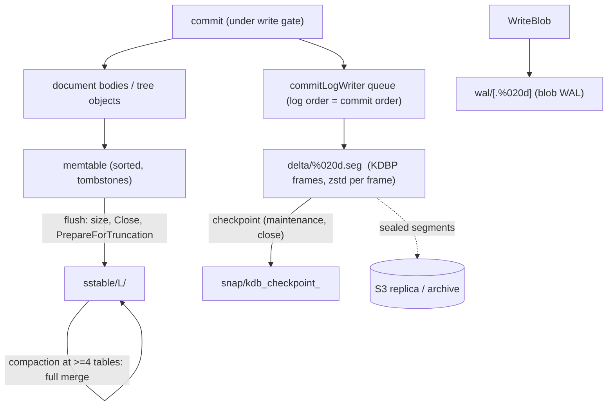

### 9.2 On-disk layout (real names)


Mermaid source

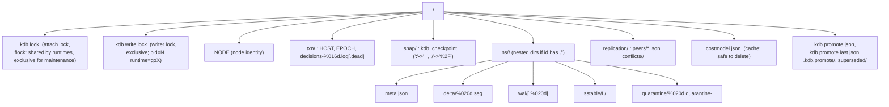

- `ns/<id>/meta.json`: `{namespaceId, historyStrategy, historyMode, shallowRoots, graftRoots, bodiesExternal}`,
  written via `.tmp` + rename. `meta/` is reserved/empty. `delta/` is created eagerly; `wal/`, `sstable/` lazily.
  `quarantine/` appears only after a repair.
- `txn/` holds cross-namespace state (sec. 13.2). `.kdb.write.lock` and `.kdb.lock` together implement the two-lock
  scheme: readers attach shared; the writer is exclusive on the second lock, so a read replica does not require the
  writer to be down.
- There is **no single storage manifest**; the nearest equivalents are `meta.json`, the checkpoint and backup
  manifests.

### 9.3 Delta segments and the KDBP frame

- Name: `delta/<20-digit zero-padded sequence>.seg`. Zero padding makes lexical order equal commit order for every
  object store listing. A non-conforming (legacy) name makes the writer refuse to open (`LegacySegmentFormatError`);
  `repair-segments` does **not** yet migrate such names.
- Each open starts a **new** segment at `maxSeq+1`; old segments are never reopened for append. Rotation at batch
  boundaries once the segment reaches `DeltaMaxSegmentBytes` (64 MiB default; a floor, a segment may overshoot by
  one batch). A single append is limited to 16 MiB (`MaxAppendBytes`), so one commit frame is at most 16 MiB.
- KDBP v2 frame (big-endian, 20-byte header, no file header or footer): `"KDBP"` magic (4) | version=2 (1) |
  codec 0 none / 1 zstd (1) | reserved (2) | compressedLength (4) | uncompressedLength (4) | CRC32-IEEE of body
  (4) | body = optionally-zstd(canonical `CommitPayload`). The codec is recorded **per frame**, so changing
  compression never invalidates data and verification can tell codec mismatch from corruption.

### 9.4 Blob WAL, memtable, SSTable

- **WAL record** (`storage/wal/codec.go`): magic `0x4B444358` | bodyLen | sequence(8) | epochMicros(8) | kind(1:
  PutBlob, DeleteBlob, FlushCheckpoint, Marker) | CRC32(payload) | payload | trailing CRC32 over the record.
  Segments `<walUUID>` then `<walUUID>.%020d`, 64 MiB cap, a batch is never split. `GroupCommitter` lets waiters
  share one fsync. *Finding:* `ServerEngine.RecoverBlobsFromWal` and `wal.Truncate` have no production caller, so
  the blob WAL is written and synced but never replayed or truncated in production; document bodies and tree
  objects bypass it and go to the memtable.
- **Memtable** (`storage/memtable`): `SortedTable` (tombstone-aware) + `Manager` (active + pending flush); flushes at
  25% of the budget, on `Close`, `Flush` and `PrepareForTruncation`.
- **SSTable v2**: one block per key (16-byte header: version, codec, lengths, CRC32), footer with magic `"KDBS"`,
  index lines `keyHex:offset:size[:1]` (`:1` = tombstone), a file SHA-256, and a trailing index length. Flush writes
  level 0. `LsmBlobStore.Compact` triggers at 4 tables and **always merges all of them** into one table one level
  deeper (full rewrite, no leveling); tombstones and unreachable keys (history=none `keep` filter) are dropped.
  Block cache: byte-capped FIFO keyed by (hash, offset).

### 9.5 Checkpoints

`snap/kdb_checkpoint_<ns>` written by `WriteSnapshot` (tmp, fsync, rename, directory fsync). Encoded with the
project codec as record `dev.kdb.checkpoint.Checkpoint`, `formatVersion=2`: namespace id; `throughSequence`;
commits (hash, parents, tx id, ts, author, tree hash, schema hash, message, op count - **operations omitted**);
branches; tags; flattened live tree; per-segment fingerprints (sequence, size, last commit); head commit payloads
(branch heads, shallow roots); floor sequence.

Written: after an open that required a full replay; on clean close; in each maintenance pass (default 5 min /
30 min sweep, max defer 6, only if there is work, skipped while the write queue is non-empty); on snapshot install.
Deferred while a cross-namespace group is undecided. Disabled by `KDB_CHECKPOINTS=off`.

### 9.6 Open, replay and torn tail

1. Read the checkpoint; treat it as absent on any failure (read, version, namespace mismatch, undecodable).
2. `checkpointMatchesLog`: every covered segment at or above the floor must exist with the same size and last
   commit; segments below the floor are expected gone; `throughSequence` must not exceed the highest segment.
3. Restore graph, live tree and head operations; replay only later segments. Any failure falls back to full
   replay (always correct for `full`; a hard `TruncatedLogError` for truncated `none`;
   `SnapshotCheckpointMissingError` for a snapshot-bootstrapped namespace).
4. Replay (`embed/delta_replay.go`) applies commits **topologically**, not in file order (file order is the fast
   path). A commit whose parents are absent is deferred; unresolved parents mean "log is missing data" unless the
   commit is a recorded shallow root. Cross-namespace parts whose group has no decision, and their descendants,
   are dropped (`groupGate`).
5. **Torn tail:** a `CorruptFrameError` in the *newest* segment is logged and replay continues; truncated/garbled
   headers and zero regions end the scan silently. Corruption in an older segment is *not* tolerated by design, but
   see sec. 25: the reader's segment listing stops at the first CRC failure and reports only the readable prefix, so
   the failure surfaces indirectly through missing parents (and is invisible if the lost commits are leaves). Use
   `kdb-inspect verify`, which scans raw bytes itself.

### 9.7 Compression

zstd level 3, per frame (delta) and per block (SSTable); `none` selectable (`--compression`). The delta-log size is
strongly zstd-dependent (an uncompressed measurement is roughly 40x the compressed one), so capacity numbers must
state the codec.

### 9.8 Storage tiers and S3

`storage/io/primary_replicas.go` supports a **replica sink** (mirrors sealed segments) and an **archive sink**
(keeps segments deleted by reclamation; never mirrors deletes). `storage/io/s3` configures both from
`KDB_S3_*` and `KDB_S3_ARCHIVE_*` environment variables (bucket, region, endpoint, prefix, credentials).

---

## 10. Indexes

Index definitions are created by SQL (`CREATE [UNIQUE] INDEX ... USING HASH|BTREE|FULLTEXT|VECTOR WITH (...)`),
persisted in a registry (`index.LoadRegistry`; a stale registry yields a report requiring `RebuildFromScan`) and
replicated as `index` documents in `_kdb/meta`. Index stores are **versioned event logs with visibility by commit
ancestry**, so queries at a past commit see the matching index state.

| Type | Package | Notes |
|------|---------|-------|
| HASH | `index` (`MemoryStore`) | equality |
| BTREE | `index` (`MemoryStore`) | equality, range, BETWEEN, IN |
| Composite | `index` (`CompositeKey{Parts}`) | multi-field HASH/BTREE keys; there is no separate "composite" type in Go. In Kotlin `kdb-index-composite` is only a factory |
| FULLTEXT | `index/fulltext` | `index/analyzer`: Unicode letter/digit tokenization, lowercase, 64-code-point cap, fixed English stopwords, Porter stemmer; positions after stopword removal. BM25F-lite scoring (k1 = 1.2, b = 0.75), per-field weights (`weights="title=3,description=1"`), OR semantics plus quoted phrases, deterministic tie-break on doc id |
| VECTOR | `index/vector` | exact brute force below `DefaultExactThreshold = 1000` live vectors, HNSW above (M=16, efConstruction=200, efSearch=64); cosine (default), l2 (`1/(1+dist)`), inner_product; HNSW levels derived from `sha256(docId)` so the same corpus builds the same graph regardless of insertion order; dimension guard rejects a commit before apply |
| Fusion | `index/fusion` | RRF (`sum weight/(k+rank)`, k=60) or weighted-sum with min-max normalization; per-arm weight, depth, min score; ties by doc id so Go and Kotlin agree |

Unique keys are **not** an index feature: they are enforced by `transaction.UniqueKeyRegistry` inside the commit
path (sec. 13.1). Compound uniqueness uses `schema.KdbSchema.UniqueConstraints` and table-level `UNIQUE(a,b)`.

Index maintenance rides the commit: `prepareIndexes` before `engine.Commit`, `commitToIndexes` after, both under
the write gate.

---

## 11. Schema lens

`schema.KdbSchema{Fields, Version, UniqueConstraints}` is optional, versioned and content-hashed (the schema hash is
in each commit). Documents are stored as supplied; the schema only types and validates declared fields.

- Types: String, Int32, Int64, Float64, Bool, Timestamp, UUID, Object, Array, Enum (SQL: TEXT, INTEGER, BIGINT,
  REAL, BOOLEAN, TIMESTAMP, JSON). `_doc` and `kdb_id` columns are always available.
- `Validate`, `IsBackwardCompatible`, `DiffSchemas`/`Diff.IsBreaking`, `ApplyMigration` with steps AddField,
  DropField, RenameField, ChangeType, AddIndex, DropIndex, SetRequired, SetUnique, WidenEnum, NarrowEnum
  (`MigrationBuilder`). Enabling `unique` is rejected if existing data violates it.
- Schema migrations are commit operations (`SchemaMigrationOp`), so a schema is versioned with the data and
  merges treat the schema hash as agreed only when both sides agree.
- Schemas replicate through `_kdb/meta` (`schema` documents: hex of `schema.ToBytes`).

---

## 12. SQL and the query path

### 12.1 Go SQL (`go/kdb/sql`)

Hand-written recursive-descent parser (`parser.go`; panics recovered into `*ParseError`; trailing `;` allowed).

- Statements: `SELECT`, `INSERT`, `UPDATE`, `DELETE`, `CREATE TABLE` (incl. table-level `UNIQUE` tuples),
  `CREATE [UNIQUE] INDEX`, `DROP INDEX`, `BEGIN`/`COMMIT`/`ROLLBACK` (recognized by the parser, executed by the
  session layer).
- SELECT: `DISTINCT`, `WHERE`, `GROUP BY`, `ORDER BY`, `LIMIT/OFFSET`, table-less `SELECT 1`, `IN`, `BETWEEN`,
  `LIKE/ILIKE`, `IS NULL`, `TRUE/FALSE`, bound parameters (including a vector parameter); aggregates `count`,
  `sum`, `avg`, `min`, `max`; `array_contains`, `array_contains_any`, `array_length`; search functions
  `MATCH(index_or_field, query)`, `SIMILARITY(field, vector)`, `FUSE(arm1, arm2[, 'rrf'|'weighted'])`.
- **Not supported in Go:** `JOIN`, `HAVING`, subqueries, `UNION` (the words appear only in the alias stop list).
  Kotlin `kdb-sql` has joins, HAVING and views.
- **Planner/executor:** `DefaultPlanner` validates columns and yields `PlanFullScan` or `PlanSingleRow`; real
  access-path choice is in the executor (`chooseAccessPath`): (1) search ranking when `ORDER BY` leads with a
  score; (2) the first top-level `AND` conjunct served by `IndexProvider` (MATCH, equality via hash/btree, range /
  BETWEEN / IN via btree); (3) full scan. The residual `WHERE` is always re-checked. Pipeline: resolve ids,
  materialize + residual filter, sort, project, distinct, offset/limit; limit is pushed down only without
  `ORDER BY`, `DISTINCT` or grouping.
- `IndexProvider`: `FullTextSearch`, `VectorSearch`, `ExactLookup`, `RangeLookup`.
- **Bounds:** the server caps SELECT results at `MaxRows` 10,000 (hardcoded in `wire_listen.go`) and rows examined
  by `QueryContext.RowBudget` (`--scan-row-budget`, default 1,000,000), which raises
  `ScanRowBudgetExceededError` -> `RESOURCE_EXHAUSTED`. **On disk** (not HEAD) ids are truncated to `MaxRows`
  *before* the residual filter, so filtered results and `COUNT` can be silently wrong beyond 10k documents.
  **[HEAD]** fixes this (see `docs/kdb-scan-cap-plan.md`) and adds `kdb_id = ?` key lookup.

### 12.2 Time travel and the hybrid front end

There is no `AS OF` grammar. `query/hybrid` strips a trailing `AT VERSION '<tag>'`, `AT COMMIT '<hex>'` or
`AT TIME '<ISO8601>'` and resolves it through `dag.ResolveRevision`. `hybrid.Request` also carries read consistency
(`Snapshot`, `ReadCommitted`, `ReadYourWrites`), read pin, session checkout (branch), transaction base, and
`MaxRows`. Historical document reads use `ServerEngine.GetDocument(ns, id, atCommit)` -> `treeAt(atCommit)`
(`storage/engine/server_engine.go`). Per-document history: `embed/document_history.go`; revert writes a **new**
commit (`embed/revert.go`). Under `history=none`, reads outside the window raise `HistoryNotRetainedError`.

### 12.3 Cost and admission of queries

`server/costmodel.go` estimates scan cost structurally (cardinality x observed doc size x plan shape) and learns
per-shape cells (sec. 17).

---

## 13. Transactions

### 13.1 Single namespace (`go/kdb/transaction`)

- `Engine`: `Commit`, `Replay`, `Merge`, `Validate`. `EngineOptions{UniqueKeys, Preconditions}`;
  **`transaction.NewEngine` without options silently disables unique enforcement and preconditions** - the server
  always passes both; embedded callers must too.
- **Optimistic concurrency:** `tx.BaseVersion` is a commit hash. `detectConflicts` compares each touched document's
  content hash at the base tree against the head tree (`ConcurrentWrite`, `DeleteWrite`, `WriteDelete`). Equal
  hashes are not a conflict (so two clients writing different documents, or identical content, do not conflict).
- **Idempotency:** transactions are keyed by transaction id; `findExistingCommit` via the DAG `txIndex` makes retries
  after a network timeout safe.
- **Policies:** `AppendOnly`, `LastWrite`, `Strict`, `Custom`. The server's transaction engine is `Strict`; its
  upsert engine is `LastWrite` (never conflicts, no `BaseVersion`).
- **Preconditions** (`preconditions.go`; Go only): `PutIfAbsent`, `ReplaceIf` (`ExpectContentHash`, compared
  *literally*, i.e. true compare-and-set), `ReplaceIfPresent`. They ride on the transaction envelope, **not** inside
  the op, because an op is hashed history and a precondition is a request-time assertion. A failure yields a
  `CONFLICT_REPORT` with op type `PRECONDITION_FAILED`.
- **Leases** (`LockManager`; wire `LOCK_*`): per (namespace, document) expiring locks with monotonic **fence
  tokens** (`DefaultLeaseTTL` 30 s, max 5 min; released on rollback and disconnect). A holder that stalls past its
  deadline is refused at commit rather than overwriting the next holder.
- **Unique keys:** `UniqueKeyRegistry` (plus compound constraints) is *derived state* rebuilt on open by one scan.
- **Read isolation:** `SNAPSHOT` sessions pin a commit (`dag.Pin`, re-pinned at each transaction boundary);
  `READ_COMMITTED` and `READ_YOUR_WRITES` read the live head. Scans are not snapshots.
- **Causal tokens:** `server/session_token.go` provides Bayou-style tokens (the newest commit hash a client has
  seen). `AwaitCommit` makes a replica wait up to `DefaultSessionWait` (2 s) else `ReplicaBehindError` (BUSY,
  retry-after 250 ms). Client side: `client.Session.Token()/Resume()`.
- Kotlin `kdb-transaction` has the engine, locks and unique registry but **no preconditions**.

### 13.2 Cross-namespace atomic commits (Go; `embed/group_commit.go`)

One implementation, `embed.CommitGroup(coord, parts)`, used by `NamespaceSet.CommitAcross` (wire `TX_COMMIT_MULTI`
0x23/0x24 and SQL `BEGIN`/`COMMIT` spanning namespaces, `server/sql_cross_namespace.go`) and by the `database/sql`
driver (`driver/commit.go`).

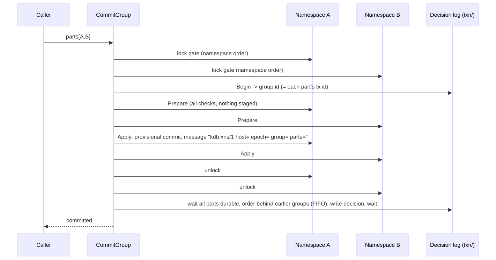

Mermaid source

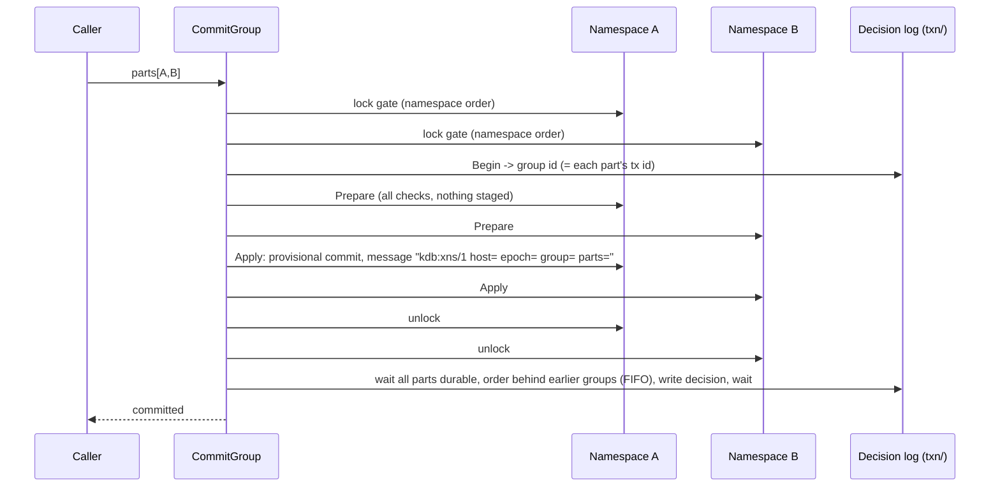

- **Decision log:** `txn/decisions-%016d.log`, one per *epoch*; header magic `KDBXNSD1`, then 20-byte records
  (16-byte group id + CRC32C). A group commits exactly when its record is durable. A sealed epoch's file is deleted
  (absence means everything in it committed); a dead epoch is renamed `.dead`.
- **Recovery:** replay drops a part whose group has no decision and everything descending from it; parts naming
  another host in the marker are ignored.
- **Failure after a part is published:** the group fails and *all* participants are fenced (`GroupFailedError`)
  until reopened.
- **Isolation:** writers are serializable across participants (all gates held from validation to publication);
  plain reads are read-committed; `NamespaceSet.Snapshot(ns...)` gives a consistent multi-namespace head (retried
  if a group was half-published).
- **Non-goals:** multi-host transactions; idempotent whole-group retry. Kotlin only honours decisions on replay
  (`kdb-jdbc/.../CrossNamespaceDecisions.kt`); the Kotlin runtime cannot run groups.

---

## 14. Distribution: peer sync, replication, merge, conflict procedures

Distribution is **Go-only** beyond v1 (Kotlin `kdb-peer-sync` implements protocol v1 only).


Mermaid source

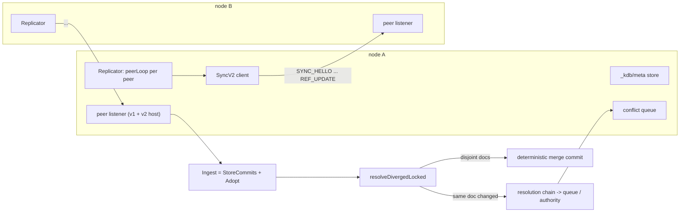

### 14.1 Protocol v1 (`peersync/client.go`, `host.go`)

One connection serves one namespace's `main`. `HANDSHAKE` (requires `ClientFullPeer`, rejects the same node id,
authenticates), `COMMIT_FETCH` (0x03; `since`, `haves`, `MaxCommits`), `COMMIT_PUSH` (0x04, paged) and
`COMMIT_PUSH_ACK` (0x18). Default page 500 commits. v1 carries no resolution-chain hash, so a namespace with a
chain never auto-merges over v1 (the client pushes only fast-forwards).

### 14.2 Protocol v2 (`wire/sync_v2_ops.go`, `peersync/v2_host.go`, `v2_client.go`)

`SyncProtocolVersion = 2`. One connection serves many namespaces, all branches and tags. Capabilities are
negotiated by intersection: branches, tags, stubs, snapshot, filter, writeback, graft, metaview, home, repair,
docfetch.

1. `SYNC_HELLO` (0x26): node id, protocol, caps, namespace patterns, credentials. `SYNC_HELLO_ACK` (0x27) returns
   per-namespace `NamespaceRefs`: branches, tags, `HistoryFloorHex`, `Shallow`, `ResolutionHash`, `Access`
   (pull/push/both).
2. Optional `META_VIEW` (0x3C/0x3D) for scoped-meta peers runs before any namespace, so resolution chains are in
   place first.
3. Per namespace: **pull then push** (so a post-merge push fast-forwards the peer). A direction the grant lacks is
   skipped.
   - Pull: if the local namespace is empty and the peer is shallow or the config says so, `InstallSnapshot`; else
     build `haves` (spread ancestors, ref heads, pending tips) and `fetchRef` (`FETCH_REQUEST` 0x2A /
     `PACK_PAGE` 0x2B, parents first, paged by bytes, archived parents as stubs), `main` first; a `main` error
     aborts, other refs are recorded and skipped.
   - Push: `REF_UPDATE`/`REF_UPDATE_ACK` (0x2C/0x2D) pages of commits plus a ref proposal on the last page; when
     chains differ (`ResolutionMismatch`) only fast-forwards are pushed.
4. Other frames: `SNAPSHOT_FETCH/PAGE` 0x2E/0x2F; `PROJECT_FETCH/PAGE/WRITE/RESULT` 0x30-0x33;
   `TREE_NODES` 0x34/0x35 and `OBJECT_FETCH` 0x36/0x37 (Merkle anti-entropy repair); `DOC_FETCH` 0x38/0x39;
   `GRAFT_PUSH` 0x3A/0x3B; `META_VIEW` 0x3C/0x3D; `HOME_REQUEST` 0x3E/0x3F; `PEER_ERROR` 0x25.
5. If the peer answers HELLO with `UNSUPPORTED`, each literal namespace falls back to v1 (`main` only).

### 14.3 Ingest, snapshot, graft, deepen

- `Ingest = StoreCommits + Adopt`. `StoreCommits` runs outside the node's serialization, adds commits to the DAG
  and checks clock skew (`DefaultMaxClockSkew` 5 min). `Adopt` runs inside `LocalNode.Exclusive` with the
  per-namespace `divergenceLock` and classifies via `ResolveHeadUpdate`: already-ancestor (no-op), fast-forward
  (net effect applied in one step and verified against the declared tree hash, `applyAndVerify`), or diverged.
  Only commits that main has *adopted* are logged, in adoption order, because replay applies every logged commit to
  main. The `CheckCommit` hook refuses writes from a superseded home (the fence).
- **Snapshot** (`snapshot.go`): requires an empty namespace; pages documents by id order, verifies the built tree
  against the commit's declared tree hash, admits the commit as a **shallow root**, makes it durable with a
  checkpoint (undone if that fails).
- **Graft** (`graft.go`): with `ResolutionChain.AllowUnrelated`, pulls an unrelated peer's shallow-root state; the
  marker is recorded before the root is logged; the root is not on main.
- **Deepen** (`deepen.go`): re-runnable fetch of history below shallow roots, ordered durability steps; the
  replicator calls it when `PeerConfig.Deepen` is set.
- **[HEAD] Shallow boundary** (`boundary.go`, `snapshot_state.go`): a snapshot node holding root S without S's
  parents cannot store a peer commit whose parent is behind S. Fix: fetch P's *state* via `SNAPSHOT_FETCH`, verify
  its tree hash, admit P as a shallow root through the graft path; a host can serve a snapshot at a commit whose
  tree it never built by folding first-parent ops (`maxSnapshotFold` 10,000).
- **Repair/projection:** `repair.go`, `doc_fetch.go` (content-hash verified); `projection.go` implements filtered
  projection replicas with write-back and read-through.

### 14.4 Merge semantics (`conflict_detection.go`, `merge_resolution.go`)

`resolveDivergedLocked` does **not** replay from a single ancestor. For each document either side wrote since they
parted, it finds the value at each head and the **origin commit** of that value, then asks whether the *other*
head changed it after that origin:

- only local changed -> take local; only remote changed -> take remote (**disjoint auto-merge**);
- both changed, or neither changed yet values differ (criss-cross) -> a real **conflict**.

The merge commit is deterministic (`mergeNonConflicting`): author `MergeAuthorNodeID`, parents in canonical hash
order, timestamp = later of the two heads, tx id `DerivedUUID("kdb:merge/1:"+p0+":"+p1)`, ops = every document on
which the parents differ (so it replays from either parent). Schema hash is kept only when both sides agree.
`CommonAncestor` can return several candidates for a criss-cross; the base is taken in canonical parent order.
Unrelated histories merge only with `allowUnrelated` (base = empty tree), otherwise `VersionNotFoundError`.

**[HEAD] Content-free merge join** (`dag/join.go`, `peersync/join.go`): pairwise deterministic merging was not
*confluent* (`merge(merge(a,b),c) != merge(merge(a,c),b)`; a 5-node mesh never settled). When two heads share tree
and schema, the result depends only on the joint frontier of content-carrying tips: one of the heads, or a canonical
content-free merge (message `kdb:merge/1`) with derived tx id, author and timestamp.

### 14.5 Resolution order and chains

`resolveConflicting`: operator `Choose` -> resolution `Chain` rules -> `Policy`. Policy: `LastWrite` (later origin
wins, hash tie-break), `Custom` (a `ConflictResolver`, canonical side order, falling back to a report on error),
`Strict`/`AppendOnly` (report). Unresolved output is `OutcomeConflict` with a `ConflictReport`; main stays unmoved
and the conflict is queued.

A **resolution chain** (`resolution_chain.go`) is an ordered rule list: `source-priority`, `validity` (schema),
`field-merge` (top-level fields, 3-way vs base), `last-write`, `queue` (terminal), `procedure` (stored procedure,
pinned by `SourceHash`), `authority` (terminal; `hold` or `provisional`; optional `Node`, `Timeout`, `Procedure`).
Rules must be pure and symmetric (merge hashes cover the result; non-determinism forks the mesh). The chain hash is
advertised in `NamespaceRefs.ResolutionHash` (`"unavailable:"+hash` if a pinned procedure is missing); on mismatch
both sides stop merging, queue, and push only fast-forwards. A procedure that throws or times out **holds** the
merge, never falls through.

### 14.6 Conflict queue and resolution

`ConflictQueue` (`conflicts.go`) is durable per namespace (`replication/conflicts/<ns>/`), entries have ids and kinds
(including `damaged` from scrub). `ResolveConflict` applies per-document choices including a **fork** (the losing
body is written under a new `ForkID`, once). Provisional merges are marked in the commit message. Resolver
authority needs the `resolve` grant; delivery is by `ConflictWebhook` (JSON POST, HMAC-SHA256 `X-KDB-Signature`,
at-least-once, deduped by `X-KDB-Delivery`) or `ConflictProcedure` (a stored procedure in read mode on the notifying
node, max 5 attempts, cannot write; the settlement is an ordinary commit by a named principal).

### 14.7 Stored procedures (`go/kdb/script`)

Runtime: `goja` (pure-Go ES5.1+); Kotlin uses GraalJS (`kdb-script`). Each call gets a fresh runtime and defines
`main(args)` returning JSON; programs are cached by source hash. **Pure mode** (used in merges) removes
`Math.random`, transcendental Math, `Date`, `Intl` and locale methods; **read mode** adds a `kdb` host object
(`get`, `query`, `log`), never writes. Limits: wall clock 5 s, output 1 MiB, log 64 KiB, 1000 host calls. Calling
convention (`conflict.go`): input `ConflictInput{base, local, remote, origins}`; output one of defer, take, doc,
fork, delete. Because Kotlin and Go merges differ in determinism, in-merge procedure parity is out of scope.

### 14.8 `_kdb/meta`, single-home, replication, scrub

- **`_kdb/meta`** (`server/meta.go`): a replicated system namespace of one document per definition with derived ids
  (kinds `schema`, `index`, `home`, `resolution`, `procedure`). Two nodes defining the same thing write the same
  document; disagreement is an ordinary same-document conflict. Version 2 allows pattern namespaces (`app/u/*`,
  `app/**`; most specific wins). `MetaStore` reconciles definitions onto live runtimes; `View(canSee)`/`AdoptView`
  scope what a peer may see.
- **Single-home** (`server/home.go`): a replicated `Home{Node, Addr, Fence, Since}`; non-home nodes refuse writes
  (`NotHomeError`, wire `NOT_HOME`, the Go client's router follows it), ingest refuses commits stamped with an older
  fence; moves are handovers (`Handover`, `ForceHandover`, `RequestHome`).
- **Replicator** (`go/kdb/replication`): `PeerConfig{Name, Addr, Namespaces (patterns, ! excludes), Mode, Interval
  (30 s), credentials, CreateLocal, PreferSnapshot, Filter/WriteBack/ReadThrough, ScopedMeta, Deepen}`. Each peer has
  a `peerLoop`: a 50 ms debounce after local commits, an anti-entropy tick, exponential backoff to 10 min. State is
  persisted under `replication/peers`. Flag form: `--peer name=...,addr=...,namespaces=a|b,mode=...`.
- **Scrub** (`syncnode scrubLoop`, `kdb scrub`): rereads every document in the head tree, checks the content hash,
  repairs from peers by hash as a `kdb:repair/1` commit; unrepairable ones go to the queue as `damaged`.

---

## 15. Authentication and authorization

- Interfaces (`go/kdb/auth`): `Authenticator.Authenticate(Credentials{User, Password, Token}) -> Principal{ID, Roles,
  Claims}`, `Authorizer.Authorize(Principal, Action)`, `Engine` = both. Default `auth.AllowAll` (principal
  `anonymous`).
- The only real engine is `RegistryAuthEngine` over `RegistryAuthStore`: users and roles are **versioned documents**
  in `_system/users` and `_system/roles`, so changes take effect on the next call and are auditable. Enabled with
  `--rbac` + `--data-dir`; without a data dir the registry is in memory only.
- Passwords: PBKDF2-HMAC-SHA256, 120k iterations, 32-byte key, 16-byte salt, constant-time compare; cross-verified
  with Kotlin.
- The credential `Token` is literally `user:password` (split at the first `:`). **There is no bearer/JWT/OIDC
  mechanism in Go**; session-document tokens (Component 41) remain design only. Users and roles are managed only
  by the Go API or `kdb-service user create|role|assign|list` (needs the service stopped; it opens the registry
  exclusively). There is no SQL `CREATE USER`/`GRANT` in the Go parser.
- **Grants** are `kind:pattern` strings on roles. Kinds: `read`, `write`, `sync`, `sync_pull`, `sync_push`
  (`sync` grants both), `resolve`, `admin`. Patterns: exact, or `/*` suffix (prefix wildcard that includes the
  prefix). Paths resolve most-specific first (`db/coll/docId`, `db/coll`, `db`); grants are allow-only.
- Action to kind: `read` <- SessionBegin, read-only SqlExec, StreamSubscribe, DocumentRead; `write` <- other SqlExec,
  TxCommit, DocumentWrite/Delete; `sync*` <- PeerSync/Pull/Push; `resolve` <- ConflictResolve; `admin` <-
  AdminAction{Scope}.
- **Enforcement points:** handshake (default or first namespace), `SESSION_BEGIN`, commit (per document op,
  `authorizeOperations`), peer listener (per direction; `authorizePushedDocuments` optional per-document), stream
  subscription and per-document read (a document that becomes unreadable is sent as a delete), control plane.
- TLS: `--tls-cert/--tls-key` upgrade tcp->tcps, ws->wss on SQL, peer, stream, WS listeners; `--tls-ca` +
  `clientAuth` gives mTLS (`RequireAndVerifyClientCert`; CA without require = verify-if-given). `tcps` without TLS
  settings is a hard error (no silent downgrade). Admin and control listeners are plain HTTP.
- Kotlin additionally has `kdb-auth-static` and SQL `GRANT/REVOKE`.

---

## 16. Encryption

**Not implemented** in either tree (verified: no AEAD code outside token signing). The old docs and the user guide
agree ("specified, not implemented"). Design intent (`docs/kdb-spec-layer14-encryption-at-rest.md`, plus the fixed
scope decision in `docs/kdb-finish-up-plan.md`):

- It is a **toggle** whose unit is the whole store or a single collection (namespace), never per-document or
  per-field; off must be byte-identical to today; the encrypted form must be distinguishable in the frame header.
- AES-256-GCM everywhere (WebCrypto-compatible); HKDF-SHA256; KEK from a passphrase (or FIDO2 hmac-secret) wraps a
  per-namespace DEK; per-segment subkeys `HKDF(DEK, "kdb/seg/v1|"+segmentName)`; keyring at
  `{dataRoot}/keyring.kdbkeys`.
- Seams: the codecs (`delta/page_codec.go`, `sstable/codec.go`, `wal/codec.go`) and a decorating
  `SegmentByteStore` (`storage/io/segment_store.go`) for snapshots; S3 replicas inherit because they ship on-disk
  bytes. `meta.json` and `NODE` stay plaintext (accepted metadata leak).
- Spec staleness to reconcile before building: it assumes a 16-byte KDBP header (code is v2, 20 bytes with a codec
  byte) and an older WAL layout.

Until then: platform volume encryption.

---

## 17. Resource governance and admission

Goal: **never be OOM-killed; refuse with a typed, actionable error instead.**

- **MemoryGuard** (`memory_guard.go`): 200 ms sampler; usage from cgroup `memory.current` on Linux, else
  `runtime/metrics`. Zones: Normal, Elevated (70%), High (85%), Critical (93%); hysteresis exits below 0.9x entry
  with a 600 ms dwell. Policy: Normal/Elevated admit all; High admits point reads and replication; Critical admits
  point reads only. Retry-after 50/100/500 ms.
- **Admission** (`admission.go`): byte-denominated grants on a weighted semaphore. Capacity = budget - rescue
  reserve; a **non-granted floor** (DAG, stacks, indexes) is a permanent reservation adjusted every sample, so the
  throttle tightens as retained history grows. Rescue reserve 48 MiB by default (clamped to 1/4 of budget),
  released on entering Critical. Classes: `PointRead`, `Scan`, `Write`, `Replication`. An operation larger than the
  whole capacity yields `RESOURCE_EXHAUSTED` (waiting cannot help), not BUSY.
- **Cost model** (`costmodel.go`): calibrated write base + k x payload bytes; structural scan estimate; learned
  per-shape cells keyed by (namespace, fingerprint, tree size) with accuracy p95 and a safety multiplier (under-
  estimating is the dangerous direction). Persisted to `<data-dir>/costmodel.json` (loaded if under 7 days old,
  saved on drain).
- **Early shed at the frame header** (`frame_admission.go`): classify from the 12-byte header (DOCUMENT_GET ->
  point read; SQL_EXEC, SEARCH -> scan; TX_COMMIT, UPSERT, TRANSACTION_REPLAY, TX_COMMIT_MULTI -> write;
  COMMIT_PUSH, DELTA_COMMIT -> replication), shed before the body is read; the body is discarded without buffering
  and the connection stays usable. Only the SQL and WS listeners set `MaxConnections` (256 default) and the
  admitter; the peer and stream listeners do not.
- **Memory budget:** `--memory-budget-mb` (0 auto = cgroup limit else 75% of RAM; -1 off), `GOMEMLIMIT` set to 90%
  of it.
- **Failure ladder:** healthy -> shrink scan budgets -> refuse writes and scans (point reads continue) -> refuse all
  but point reads, release the rescue reserve -> orderly abort (**exit 75**, `AbortWatchdog`, `--abort-after`)
  for a supervisor restart. A point read is never shed: a server that cannot answer one looks dead, and reads are how
  operators diagnose pressure.
- **Write path bounds:** write gate queue 64, `WriteTimeout` 5 s, per-connection `MaxInFlightFrames` 64, incoming
  queue 4 frames, max frame 16 MiB.
- **Drain:** SIGINT/SIGTERM -> `/readyz` 503 -> sync stopped -> maintenance stopped -> `BeginDraining` (new writes
  `UnavailableError`) -> sql/peer/stream listeners closed -> wait for writes (`--drain-timeout` 30 s) -> cost model
  saved -> `Release` -> `host.Close()`.
- **Runtime configurability** (`config/descriptors.go`): each setting has source, scope (process/namespace/
  listener) and mutability (`live`, `live-new-connections`, `namespace-reopen`, `restart`, `immutable`); the control
  plane can `PATCH /v1/settings` for live ones (memory budget/reserve, scan row budget, some maintenance and log
  settings, per-namespace retention) and optionally persist to the config file.

---

## 18. Integrity, backup, recovery

- **Verify** (`integrity.Verify`, `kdb-inspect verify --level L1|L2 --json`): L1 per-frame CRC/framing; L2 parent
  closure (genesis exempt); L3 semantic is a stub. Findings: `torn_tail`, `mid_log_corruption`, `missing_parent`,
  `sequence_gap`. It scans raw bytes itself because the normal reader silently drops mid-log corruption.
- **Repair** (`kdb-inspect repair-segments [--dry-run]`): only L1 findings; truncating a torn tail or rewriting a
  segment prefix always copies the original bytes to `ns/<ns>/quarantine/` first; mid-log repair is refused if later
  commits would lose parents. Legacy-name migration is not implemented.
- **Backup** (`go/kdb/backup`): objects in a directory or S3 plus one **manifest written last**
  (`backups/<ns>/<id>/manifest.json`, formatVersion 1: namespace, backupId, baseBackupId, createdAt, head hashes,
  commit count, segments with sha256/size/key/verifiedPrefix). Sealed segments upload in full to the shared key
  `ns/<ns>/delta/%020d.seg`; the active (highest) segment uploads as its CRC-verified prefix
  `active-%020d.prefix`. Incremental backups reference base entries with the same sequence and hash. **Database
  backups** (`database-backups/<id>/manifest.json`) group namespaces under one exclusive data-dir lock and copy
  `txn/*`. `backup-verify` re-downloads and re-hashes; `backup-fetch` materializes a data-dir-shaped tree.
  Backups contain the delta log and txn state only - not WAL, SSTables, checkpoint, `meta.json` or `NODE`.
- **Restore** (`go/kdb/recovery`): `HybridRestore` computes a verified union of commits from any number of sources,
  orders them topologically and writes a fresh sequenced delta log; `MissingHashes` lists unresolved parents. There
  is exactly one algorithm for plain and hybrid restore. It does not recreate `meta.json`, SSTables or checkpoint.
- **Promotion** (`recovery/promote.go`): staged restores are copied to `.kdb.promote/`, recorded in
  `.kdb.promote.json`, and applied at the next startup by moving the live namespace to `superseded/`; the commit
  count is verified before the swap. The control plane drives staging/promote (promote ends with exit 75).
- **Runtime scrub**: sec. 14.8.

---

## 19. Observability and the control plane

- **Admin HTTP** (`--admin-addr`, unauthenticated): `/healthz` (version, commit, dirty, build date, node id),
  `/readyz`, `/metrics`, `/debug/vars`, `/debug/pprof/*`. Prometheus text is hand-formatted: `kdb_build_info`,
  `kdb_stage_ops_total` / `kdb_stage_latency_seconds{stage,stat}`, `kdb_go_*`, `kdb_draining`, `kdb_memory_zone`,
  `kdb_admission_*`, `kdb_cost_*`, `kdb_conflicts_open{namespace,kind}`, plus replicator metrics. Admission metrics
  reflect the primary runtime (secondaries share it).
- **Logs:** structured, `--log-level`, `--log-format`.
- **Control plane** (`go/kdb/control`, `--control-addr`; routes under `/v1`): reads (namespaces, status, retention,
  conflicts, home, resolution, procedures, schema, indexes, log, commits, diff, refs, compare, docs, history,
  integrity, checkpoints, maintenance plan, backups, SQL via the read path, SSE `events`); admin-scoped (health,
  settings, drift, ops runtime/locks/metrics, drain, placement, peers, restore staging, promotion, restore points).
  Mutations (document put/delete, branches/tags, retention changes, conflict resolution, home/resolution/procedure
  edits, scrub, deepen, backups, revert, restore) require `--control-write`; promotion additionally
  `--control-promote`. Every request needs `Authorization` (Basic or `Bearer user:pass`) even under `AllowAll`;
  unknown namespaces 404 before authz. The UI is a single embedded dependency-free HTML file served at `/` with
  a strict CSP.
- **Maintenance loops** (`embed.StartMaintenance`): per namespace checkpoint, reclaim, blob compaction at
  `--maintenance-interval` 5 m / `--maintenance-sweep` 30 m / `--maintenance-max-defer` 6, skipped while the write
  queue is non-empty.

---

## 20. Wire protocol and transports

### 20.1 Frame

12-byte little-endian header: `u32 frameLength` (including header) | `u16 messageType` | `u16 protocolVersion` |
`u32 correlationId`; payload = 1-byte encoding tag (0 = "binary" label, 1 = JSON) + envelope. In v1 **both tags
carry a JSON UTF-8 envelope** (no non-JSON payload encoding exists). Constants: `KdbWireProtocolVersion = 1`,
`DefaultMaxFrameBytes` 16 MiB, `PeekHeader` for header-only decisions. Client modes: STREAM_READ_ONLY 0,
STREAM_WRITE_BACK 1, FULL_PEER 2, SQL_CLIENT 3. An unknown message type is a decode error, so new types cannot be
sent to old servers.

### 20.2 Message catalogue

| Range | Messages |
|-------|----------|
| 0x01-0x0D | HANDSHAKE, DELTA_COMMIT, COMMIT_FETCH, COMMIT_PUSH, DAG_DIFF, TRANSACTION_REPLAY, CONFLICT_REPORT, COMPACTION_NOTICE, ICE_ARCHIVE_NOTICE, SNAPSHOT_REQUEST/RESPONSE, POSITION_ACK, SCHEMA_PUSH |
| 0x0E-0x13 | SESSION_BEGIN, SQL_EXEC, SQL_RESULT, TX_COMMIT, TX_ROLLBACK, SESSION_BEGIN_ACK |
| 0x14-0x1C | DOCUMENT_GET/RESULT, UPSERT/RESULT, COMMIT_PUSH_ACK, LOCK_ACQUIRE/RENEW/RELEASE/RESULT (Go-only) |
| 0x1D-0x24 | SEARCH/RESULT (both trees), HISTORY_LIST/RESULT, REVERT/RESULT, TX_COMMIT_MULTI/RESULT |
| 0x25-0x3F | PEER_ERROR and the sync v2 family (sec. 14.2) |

### 20.3 Errors

Wire error codes (additive fields `ErrorCode`, `RetryAfterMs` beside the legacy `Error` string): `BUSY`,
`UNAVAILABLE`, `DEADLINE_EXCEEDED`, `RESOURCE_EXHAUSTED`, `CONFLICT`, `SCHEMA_VIOLATION`, `UNIQUE_VIOLATION`,
`UNAUTHORIZED`, `UNSUPPORTED`, `NAMESPACE_MISMATCH`, `INTEGRITY`, `NOT_HOME`, `INTERNAL`. `classifyError`
(`server/error_classification.go`) maps typed server errors: Busy/ReplicaBehind/MemoryPressure -> BUSY;
Unavailable -> UNAVAILABLE; ResourceExhausted/ScanRowBudgetExceeded -> RESOURCE_EXHAUSTED; Conflict/StaleFence ->
CONFLICT; Authorization -> UNAUTHORIZED; NotHome -> NOT_HOME; Schema -> UNIQUE_VIOLATION or SCHEMA_VIOLATION.
Clients decide retry / retry-later / never / resubmit-smaller from the code, never from prose. The Go SDK exposes
sentinels (`ErrConflict`, `ErrBusy` with `RetryAfter`, `ErrUnavailable`, `ErrNotHome`, `ErrPreconditionFailed`, ...);
`UNIQUE_VIOLATION`, `SCHEMA_VIOLATION` and `UNAUTHORIZED` currently have no distinct SDK sentinel.

### 20.4 Session semantics

The SQL handshake requires `SQL_CLIENT`, authenticates once per connection and reuses the principal for each
`SESSION_BEGIN`. **It always acks JSON v1 and does not call `Negotiate`**, so error codes 6001/6002 (unsupported
version/encoding) are never raised in production. DML in `SQL_EXEC` is buffered in the session's pending builder;
SELECT and DDL run immediately; `TX_COMMIT`/`TX_ROLLBACK` end the transaction and re-anchor the base and pin.
Session ids are process-unique because lock ownership is keyed by them.

### 20.5 Transports

| Transport | Details |
|-----------|---------|
| TCP (`transport/tcp`) | `tcp://`, `kdb+tcp://`, `tcps://`, `kdb+tcps://`; `?bind=true` marks listen URIs; `TCP_NODELAY`; TLS/mTLS |
| WebSocket (`transport/ws`) | Custom RFC 6455 (no gorilla); binary frames only (no text or continuation frames); server requires client masking; 10 s handshake timeout; **does not validate the upgrade path** (clients use `/kdb`); `ws.Upgrade(w, r, opts)` lets an app mount it (used by `--peer-http` at `/kdb/sync`, where the `Authorization` header becomes credentials) |
| gRPC (`go/grpc`) | Separate module: bidirectional stream `KdbWire.Connect(stream Frame)`, one stream = one connection, each `Frame.payload` one complete KDB frame; client `Transport` plugs into `client.ConnectOptions.Transport` |
| In-memory | `stream` coordinator transport for tests and WASM |

`transport/core` provides `FrameStreamReader` (reassembly + header admission), `TransportConnectOptions`,
`TransportTlsSettings`. Connection model: goroutine per connection; up to 64 frames dispatched concurrently,
replies serialized, frames naming one session FIFO-ordered by a ticket taken on the reader goroutine.

### 20.6 Streaming (`go/kdb/stream`, `server/stream_listen.go`)

Mode 1 (read-only): subscriber handshakes with resume position and an optional SQL `Filter`, receives
`DELTA_COMMIT`, acks with `POSITION_ACK`. Mode 2 adds `TRANSACTION_REPLAY` submission (applied / conflict /
rejected). `StreamHub` runs one `sendLoop` per subscriber: catch-up from the subscriber's position (per-commit up
to 64 commits, else one net tree-diff frame), so slow subscribers are caught up, not dropped. Filter and
per-document RBAC apply per op (stop-matching documents are sent as deletes). Anonymous subscription needs
`--stream-allow-anonymous`. Primary namespace only.

---

## 21. Concurrency model and durability guarantees

### 21.1 Concurrency


Mermaid source

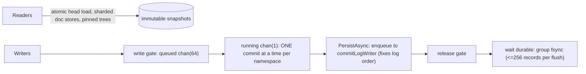

- **One commit at a time per namespace** through `writeGate` (bounded queue 64; full -> `BusyError{50ms}`; deadline
  -> `DeadlineExceededError`). Reads never take it.
- **Durability is decoupled from serialization:** the log position is fixed under the gate (`PersistAsync`), the
  gate is released, then the caller waits for the shared fsync (`commitLogWriter` drain goroutine, `maxLogBatch` 256).
  Measured: file-backed commits 4022 us/op serial vs 528 us/op at 16-way parallel; the gate primitive costs
  0.65 us. A separate batching layer was measured and deliberately not built.
- **Correctness floor below the gate:** DAG head CAS (`HeadConflictError`), optimistic per-document conflict
  detection, unique registry, preconditions, optional leases.
- **Reads:** immutable content-addressed trees; `head -> commit -> tree hash -> sharded GetDocument`. `SNAPSHOT`
  sessions pin. Document storage is sharded x64; the live head is a lock-free atomic.
- **Cross-namespace:** gates acquired in namespace order, two-phase prepare/apply, decision log (sec. 13.2).
- **Embedded driver:** an in-process per-namespace lock replaces the gate; connections to the same data share one
  `database` object per root since the directory lock admits one opener.
- **Locks across processes:** `.kdb.lock` (attach, shared) + `.kdb.write.lock` (writer, exclusive); one writer per
  data root. Shared/read-only modes are unix only (the non-flock fallback refuses rather than degrade).
- **Other goroutines:** per-connection readers, per-subscriber stream senders, replicator peer loops, maintenance
  schedulers, idle-close sweeper, conflict webhook retrier, expiry sweeper, scrub loop, control SSE hub (lossy
  16-slot buffers, never blocks commits), `MemoryGuard` sampler, abort watchdog.

### 21.2 Durability guarantees

| Setting | Flag / env | Meaning |
|---------|-----------|---------|
| `durability=sync` (default) | `--durability`, `KDB_DURABILITY` | Ack after the commit batch is appended and flushed. An acknowledged commit survives process death, and (with `syncMode=full`) power loss |
| `durability=async` | + `--async-sync-interval-ms` (default 5) | Ack at enqueue; flush on a timer. Bounded loss window on crash. Cross-namespace parts are still flushed immediately |
| `durability=memory` | | No delta writer is created. Nothing survives restart |
| `syncMode=full` (default) | `--sync-mode`, `KDB_SYNC_MODE` | `os.File.Sync()`: **F_FULLFSYNC on macOS** (~4 ms, power-loss safe); `fsync` on Linux |
| `syncMode=fast` (alias `barrier`) | | macOS: `F_BARRIERFSYNC` (falls back to `Sync`); Linux: `fdatasync`. Survives process and OS crash, **not power loss** |

Platform realities:

- **Linux:** `fast` is close to a no-op relative to `full` *unless* segments are preallocated: without
  preallocation, a growing file forces a metadata commit so `fdatasync` degrades to `fsync`. With preallocation,
  `fast` is about 1.6x cheaper.
- **macOS:** any extra flushing log halves neighbours (device-wide contention); benchmark with a no-protocol control.
- **Segment preallocation** is opt-in via `KDB_PREALLOCATE_SEGMENTS` (env/embedded option; not in the service JSON).
  Size is derived from `DeltaMaxSegmentBytes`; `fallocate`+zero-fill on Linux, `F_PREALLOCATE` on macOS; writes are
  positional. Open gaps: sealed segments are not truncated back to their logical end; `integrity.Verify` may flag a
  preallocated zero tail as `torn_tail`/`mid_log_corruption`; `ListSegments` reports logical size while the file is
  full size.
- **Directory fsync:** checkpoints, `meta.json`, `NODE` use tmp + rename (checkpoints also fsync the directory;
  `meta.json` and `NODE` do not). No directory fsync is performed when a new `.seg` is created.
- **Crash recovery needs no repair step:** replay is topological with a torn-tail rule (sec. 9.6); the checkpoint is
  only a cache. A mid-segment flipped byte in a non-final segment was historically able to roll a namespace back
  silently; that was fixed (#81) and `verify` is the reliable detector.
- **Process-kill durability** is exercised by the `kill -9` integration test (known to flake in CI `integration`).

---

## 22. Stale-documentation register

Verified against code; the old documents should be corrected or marked historical.

| Document | Stale claim | Reality |
|----------|-------------|---------|
| `kdb-architecture.md` s10, s11; `kdb-lld-query.md` s3.1/s7 | Go SQL is SELECT/INSERT/CREATE TABLE, full scan only; index not consulted by the Go planner | UPDATE/DELETE, CREATE/DROP INDEX, GROUP BY, aggregates, IN/BETWEEN/LIKE, DISTINCT, BEGIN/COMMIT, MATCH/SIMILARITY/FUSE exist; `Executor.chooseAccessPath` uses `IndexProvider`. Still true: no JOIN/HAVING/subquery/UNION in Go |
| `kdb-architecture.md` s10/s11; `kdb-lld-query.md` s7 | Historical reads return current documents | `GetDocument` resolves `treeAt(atCommit)`; `AT VERSION/COMMIT/TIME`, `document_history.go`, `tree_rebuild.go` exist |
| `kdb-architecture.md` s11 | Composite uniqueness not implemented | `UniqueConstraints`, table-level `UNIQUE(a,b)` |
| `kdb-architecture.md` s7.5/s10 | Encryption "specified only" | Correct (not implemented); the *spec* itself is stale on frame headers |
| `kdb-architecture.md` s8, s4 | Single service = one namespace per runtime | `NamespaceSet`: many namespaces per process (stream listener excepted) |
| `kdb-architecture.md` s10; `kdb-lld-flows.md`; `kdb-lld-protocol.md` | Peer sync = v1 classification | v2 (0x25-0x3F), snapshot/graft/deepen, replicator, resolution chains, `_kdb/meta`, projections, single-home are undocumented there |
| `kdb-architecture.md` P4/P5 | No leader, conflicts never silently resolved | Holds by default; opt-in single-home, last-write, chains, authority |
| `kdb-architecture.md` P10 / README | Two implementations, Kotlin leads format changes | Go leads; sync v2, xns groups, preconditions, opcodes >= 0x14 are Go-only |
| `kdb-architecture.md` mobile/browser | "embed binds via gomobile"; Go WASM | Mobile surface is `go/mobile/kdbsync`; Go WASM is a memory-only demo |
| `kdb-lld-protocol.md` s2.3, s10 | Handshake negotiates version/encoding; 6001/6002 raised | `Negotiate` is only called from tests; server always acks JSON v1 |
| `kdb-lld-protocol.md` s2, s5.4, s6, s7.2 | Catalogue stops at 0x1C; grant kinds read/write/sync/admin; omits some error codes and early-admission classes | Catalogue to 0x3F; plus `sync_pull`, `sync_push`, `resolve`; extra error codes; SEARCH and TX_COMMIT_MULTI classified |
| `kdb-lld-protocol.md` s7.4 | One process serves one namespace | Multi-namespace via `NamespaceSet` |
| `kdb-lld-storage.md` s2/s3.4 | Layout lacks `snap/`, `NODE`, `txn/`, `replication/`, promote files; snapshot key `kdb:snap:{id}` | Checkpoints are `snap/kdb_checkpoint_<ns>` |
| `kdb-lld-storage.md` s3.2 | WAL magic `KDBW`, no timestamp field | Magic `0x4B444358`, 8-byte epochMicros |
| `kdb-lld-storage.md` s6.4 | Tombstones dropped at flush | Tombstones are written (`:1` index flag); comments in `sstable/types.go` also stale |
| `kdb-lld-storage.md` s9 | Segment grows until restart | Rotates at 64 MiB |
| `kdb-lld-storage.md` s6.1/s6.3 | Nothing evicts history; historical trees unsupported | Ops, document versions and historical trees are LRU-bounded; only commit node metadata is resident |
| `kdb-lld-concurrency.md` | DAG behind a reader/writer lock; no xns ordering | Atomic head; cross-namespace gate ordering and many more goroutines |
| `kdb-distributed-plan.md` | "Nothing implemented yet" | Phases 0-7, 9, 16 landed |
| `deploy/compose.yaml` comment | Nodes do not dial each other | `--peer`/`KDB_PEERS` replicators dial unattended |
| `service.go` `--control-write` help | "Nothing mutating is implemented yet" | Many mutating endpoints exist |
| Code comments in `storage/engine/tree_*.go`, `memory_budget.go` | "fixed-depth 32, no path compression" | Single-entry subtrees are compressed (hash-identical) |

---

## 23. Key design decisions and trade-offs

| # | Decision | Alternative rejected | Rationale and trade-off |
|---|----------|----------------------|--------------------------|
| D1 | Commit **delta log is the source of truth**; blob store is derived/cache-like | one unified log | One append-only artefact rebuilds a namespace, so backup/verify/restore/replicate are simple. Cost: two stores to reason about; backups omit SSTables (history=none bodies need care) |
| D2 | Zero-padded sequence segment names | UUID names | File order is commit order for every listing |
| D3 | Replay applies commits **topologically** | trust file order | An ordering bug degrades to a slower open, not an unopenable namespace |
| D4 | Tolerate torn tail only in the **newest** segment | blanket tolerance or strict | Torn tail is the expected crash shape; elsewhere corruption is real. Trade-off: listing truncation (sec. 9.6) |
| D5 | **One commit at a time per namespace** via bounded, deadline-aware gate | mutex or head CAS only | Adds "queue full" and "deadline passed" outcomes a mutex cannot express |
| D6 | Fix log position under gate, **fsync after release** | fsync in critical section | Concurrent commits share a physical sync; no batching layer needed (measured) |
| D7 | Byte-denominated admission with a dynamic non-granted floor | boolean memory guard | The DAG grows monotonically; reserve-before-start turns that into a smooth throttle |
| D8 | Shed at the frame header | shed after decode | Refusals must be cheapest exactly when load is highest |
| D9 | Typed error codes with retry semantics | strings | Clients decide retry policy without parsing prose |
| D10 | Content-addressed Merkle trie per commit | mutable index | O(changed) commits, structural sharing, verifiable history, anti-entropy sync; cost ~5 KB RAM per document live |
| D11 | Idempotent transactions by tx id | content dedupe | A timeout must not duplicate a commit |
| D12 | Conflict detection by content hash base vs head | head equality | Disjoint or identical writes do not conflict |
| D13 | Per-frame/per-block codec byte | global setting | Compression can change without invalidating data |
| D14 | One writer per data root, two lock files | multi-process coordination | Explicit and immediate; read replicas need not stop the writer |
| D15 | **Go is the deployment target**, Kotlin the multiplatform reference | one implementation | Removes the JVM from small deployments; browser/JVM reach stays. Cost: two implementations drifting, mitigated by golden tests; Go now leads |
| D16 | Unique keys enforced by a registry **in the commit path**, as derived state rebuilt on open | persisted registry, index-backed | A second persistence path is a second recovery bug; cost is one scan per open |
| D17 | Preconditions on the envelope, `ExpectContentHash` literal | in-op; no-op-tolerant | Op is hashed history; CAS asserts state, not intent |
| D18 | Leases carry monotonic fence tokens | TTL only | Prevents two writers each believing they hold the lock |
| D19 | History modes FULL/NONE per namespace; checkpoint authoritative only in NONE | single mode | Bounds disk and memory for hot data; trade-off: no branches/time-travel outside the window |
| D20 | No inverse operations (ops lack pre-image) | invertible ops | Smaller log; cost: historical trees fold only forward from a cached ancestor |
| D21 | Deterministic, origin-based **3-way-by-document merge**; pure/symmetric rules | replay-based or last-writer merge | Peers converge without coordination; **[HEAD]** content-free join makes meshes confluent. Cost: chain rules constrained to pure functions |
| D22 | Cross-namespace atomicity via **per-host decision log**, not 2PC across hosts | distributed 2PC | A commit is the durability of one 20-byte record; recovery is local. Non-goal: multi-host |
| D23 | Auth registry stored as **versioned documents** | external IdP/config file | Dogfoods the engine, auditable, replicable. Cost: no OIDC/JWT yet |
| D24 | `_kdb/meta` replicates definitions as ordinary documents with derived ids | custom DDL replication | Reuses merge/conflict machinery; two nodes defining the same thing converge |
| D25 | JSON envelope for both wire encodings | binary payload | Simplicity and cross-language parity first; cost: size/CPU overhead |
| D26 | Custom WebSocket and no gRPC in the core module | gorilla/grpc deps | Keeps the core module graph small for gomobile/embedbundle; gRPC is a separate module |
| D27 | Control plane over HTTP with same RBAC engine | separate admin auth | One authorization model; writes gated by explicit flags |
| D28 | Exit 75 + supervisor on sustained pressure | degrade forever | A clean restart beats lingering in degraded mode |

---

## 24. Quality attributes

| Attribute | Approach and evidence |
|-----------|-----------------------|
| **Durability** | Sync log batches with shared fsync; CRC per frame/block; topological replay; torn-tail tolerance; backup manifests written last; quarantine-before-repair |
| **Consistency** | Per-namespace serialized commits; optimistic concurrency per document; unique/CAS/lease primitives; snapshot pins; atomic cross-namespace commits on one host; eventual, explicit convergence across peers |
| **Availability** | Failure ladder keeps point reads alive; early shed; drain; exit-75 restart; peers continue independently |
| **Performance** | Commit O(changed docs x depth) + one shared fsync; point read = atomic head + shard lookup; lock-free head; file-backed commits ~7.6x faster at 16-way parallelism than serial; benchmarks in `docs/benchmarks/` (always check machine load and run in isolation - contention fakes regressions) |
| **Scalability** | Reads scale with cores; writes serialize per namespace but overlap disk; many namespaces per process with idle close; limited by ~5 KB/document live tree and resident commit-node metadata |
| **Memory** | Global budget split across bounded LRUs; admission with floor; `GOMEMLIMIT`; `history=none` |
| **Security** | TLS/mTLS everywhere configurable, no silent downgrade; PBKDF2 users; resource-scoped RBAC at wire, commit, peer, stream, control; no encryption at rest yet; admin endpoint unauthenticated |
| **Portability** | Pure-Go core (CGO off); Kotlin for JVM/JS/native; WASM/mobile/gomobile entry points; S3 tier; byte-identical formats guarded by goldens |
| **Operability** | Layered config (defaults < file < `KDB_*` env < flags; unknown file keys fail), runtime-mutable descriptors, Prometheus, pprof, control UI, `kdb-inspect`, build identity everywhere |
| **Testability** | Unit tests per package, golden cross-language fixtures, Python multi-node e2e (`kdb-integration/e2e`), loadtest, pressure test, interop with a real JVM server and a TS client, race-detector runs |
| **Evolvability** | Additive wire fields; versioned frame/checkpoint formats; refuse (never guess) on unknown legacy formats; capability negotiation in sync v2 |

---

## 25. Known limitations and risks

**Scale and memory**
- Live tree ~5 KB/document (200k documents ~ 930 MB); commit-node metadata resident (the on-disk mmapped graph is a
  stub). `FULL` namespaces grow monotonically in memory.
- Blob compaction is full-merge-only; SSTable block cache is FIFO.

**Storage and recovery**
- Blob WAL is never replayed or truncated in production (`RecoverBlobsFromWal`, `wal.Truncate` unused).
- Mid-log corruption in an older segment is surfaced only indirectly by the normal reader (use `kdb-inspect verify`).
- Preallocated segments are not truncated on seal; `Verify` may false-positive on their zero tail; no directory
  fsync on new segment creation; legacy-segment-name migration is unimplemented.
- Backups cover the delta log and txn state only; restore of `history=none` namespaces (bodies in SSTables) is not
  proven.
- No encryption at rest.

**Query**
- Go SQL lacks JOIN, HAVING, subqueries, UNION; results hard-capped at 10,000 rows (not configurable); on disk,
  the pre-filter truncation bug exists (fixed at HEAD).
- No `AS OF` grammar (suffix clauses via the hybrid front end); `compute`/WebGPU is a CPU stub with no caller.

**Distribution**
- Kotlin implements sync v1 only; the Kotlin runtime cannot run cross-namespace groups; Kotlin merges are
  non-deterministic, so in-merge procedure parity is out.
- Stream listener serves the primary namespace only; peer and stream listeners lack the connection cap and header
  admitter.
- Peer discovery, multi-host transactions and consensus are non-goals.
- The mesh-merge convergence, shallow-boundary and unlogged-commit mechanisms are **HEAD-only** in this checkout.

**Security and API**
- No bearer/OIDC auth; "token" is `user:password`; admin endpoint unauthenticated; handshake ignores the client's
  protocol version/encoding.
- `transaction.NewEngine` without `EngineOptions` silently disables unique keys and preconditions.
- SDK lacks distinct sentinels for `UNIQUE_VIOLATION`, `SCHEMA_VIOLATION`, `UNAUTHORIZED`.
- `policy` registry/parser is not wired into the service (only document expiry).

**Process**
- Two implementations can drift; CI on `main` is intermittently red (a `kill -9` durability test and two Kotlin
  tests are known flakes); many docs under `docs/` are stale (sec. 22).

---

*Sources of truth for further detail:* `docs/kdb-spec*.md` (normative per-layer specs), `docs/kdb-lld*.md` (low
level; see sec. 22 before trusting), `docs/kdb-open-issues-plan.md` (current work), `docs/kdb-user-guide.md`
(operations; most current of the older docs), and the code paths cited above.
